# CADEFAR — Análisis de clases por caso de uso

> **Actualizado:** 12/10/2026.
>
> **Contenido:** Fases 1–6 — Autenticación, Usuarios, Recuperación, Proveedores/Laboratorios, Catálogo de Medicamentos, Compras, Inventario, Vencimientos y Retiros. Los 33 CU implementados están analizados: CU01–CU27, CU33–CU37 y CU40.
>
> **Entrega actual:** Fase 6 — Vencimientos y Retiros, CU33–CU36, pendiente de revisión. Continuidad solicitada por el usuario. Cobertura integral en la sección 13.
>
> **Referencia estructural:** [Diagrama de clases actualizado](diagrama-clases.md). Objetivos y actores: [Casos de uso](casos-uso.md). Condiciones: [Reglas de negocio](reglas-negocio.md) y [Requerimientos](requerimientos.md).

## 0. Criterios del análisis

Cada CU identifica actor, clases participantes, responsabilidad, métodos ejecutados y relaciones. Su diagrama muestra **todos los atributos y métodos propios de cada clase incluida**, aunque durante esa operación se ejecute únicamente una parte de sus métodos.

### 0.1. Convenciones

- Se utilizan los nombres reales del backend: `Usuario`, `authController`, `usuarioService`, etc.
- `<<actor>>` es un rol externo al software; Administrador, Regente y Vendedor no son subclases del modelo Usuario.
- `<<modelo>>`, `<<servicio>>`, `<<controller>>`, `<<repository>>` y `<<validator>>` identifican responsabilidades existentes. `<<error>>` identifica AppError.
- `<<funcion>>` representa una función de middleware como punto de conexión, **no una clase existente**; estas cajas no tienen compartimentos de atributos o métodos inventados.
- La flecha del actor representa la solicitud desde la interfaz indicada en cada CU. Los enlaces entre middleware y Controller representan el encadenamiento de la ruta Express; no significan que el middleware invoque directamente el método del Controller.
- `..>` representa dependencia; `--` asociación persistente. Las etiquetas señalan la participación en el CU, no todo el conjunto de imports de un archivo.
- Los compartimentos se repiten completos para que cada diagrama pueda consultarse por separado. Una operación listada no implica que se ejecute en ese CU: las tablas de participación precisan los métodos utilizados.
- `+` identifica operaciones públicas y `$`, estáticas. Los métodos async continúan siendo async en el código; se omite esa palabra en el dibujo. Los servicios, Controllers, Repositories y Validators de las fases documentadas no declaran atributos propios de clase.
- Se muestran exclusivamente métodos definidos **dentro de la clase**, incluidos los auxiliares que sí están declarados allí. Funciones externas, constantes importadas y esquemas Zod definidos fuera no se incorporan como miembros.
- Los modelos muestran atributos completos y `associate(models)`, cuando lo declaran. Sus métodos heredados de Sequelize (`findOne`, `update`, etc.) se identifican en las explicaciones de acceso a datos; no se atribuyen como métodos propios del modelo.
- `-` marca datos internos de persistencia en UML; no afirma privacidad de campos JavaScript. Los tipos `VARCHAR_60`, `CHAR_64`, `DATETIME_3`, `INT_UNSIGNED` y `TINYINT_UNSIGNED` abrevian `VARCHAR(60)`, `CHAR(64)`, `DATETIME(3)`, `INT UNSIGNED` y `TINYINT UNSIGNED`. Tipos, claves, nulos y valores predeterminados completos están en `diagrama-clases.md`.
- Las firmas gráficas usan nombres para objetos (`data`, `options`, `datosUsuario`); sus firmas reales y valores predeterminados están en 0.3, 3.1, 5.1, 7.1 y 9.1. No se inventan tipos de retorno para las clases JavaScript.
- React utiliza componentes funcionales y servicios HTTP como funciones. Se documentan sus archivos y conexiones en las tablas de interfaz; no se convierten en clases con métodos ficticios.
- AppError declara `statusCode`, `details` y su constructor. `message`, `name` y `stack` pertenecen a Error; su herencia se explica aquí sin duplicarlos como atributos propios.
- Las asociaciones mostradas son las relevantes para ese CU. Mostrar `associate(models)` completo como operación no obliga a agregar al dibujo todos los modelos de otros módulos que esa configuración relaciona.

### 0.2. Fases y cobertura

| Fase | Módulo | Casos | Estado del análisis |
|---|---|---|---|
| 1 | Autenticación, Usuarios y Recuperación | CU01–CU09 | Elaborados; continuidad solicitada |
| 2 | Proveedores / Laboratorios | CU10–CU13 | Elaborados; continuidad solicitada |
| 3 | Medicamentos, Principios Activos y Composición | CU14–CU20 | Elaborados; continuidad solicitada |
| 4 | Compras | CU25–CU27 | Elaborados; continuidad solicitada |
| 5 | Inventario, Ajustes, Movimientos y Stock bajo | CU21–CU24, CU37, CU40 | Elaborados; continuidad solicitada |
| 6 | Vencimientos y Retiros | CU33–CU36 | Elaborados en esta entrega; revisión pendiente |
| Futuro | Ventas, Recetas y Reportes | CU28–CU32, CU38, CU39, CU41 | Operaciones funcionales pendientes; análisis posterior |

La Fase 1 cubre **9 CU y 10 diagramas**: CU08 se divide en cambio propio y restablecimiento administrativo. CU09 integra solicitud y consumo del código en su diagrama, manteniendo sus dos endpoints.

La Fase 2 agrega **4 CU y 4 diagramas**; CU11 reúne listado y detalle en un mismo diagrama. La Fase 3 agrega **7 CU y 7 diagramas**; CU18 integra las operaciones del catálogo de principios y CU19 las de composición. La Fase 4 agrega **3 CU y 3 diagramas**; CU26 reúne listado y detalle. La Fase 5 agrega **6 CU y 6 diagramas**, incluidos CU24 y CU40 por separado aunque compartan implementación. La Fase 6 agrega **4 CU y 4 diagramas**. El avance acumulado es **33 CU analizados y 34 diagramas**.

El alcance funcional actual es **33 de 41 CU implementados**, todos analizados aquí. La tabla integral de la sección 13 relaciona los 41 CU con su estado funcional y su fase de análisis. Los ocho CU pendientes de implementación son:

| CU | Nombre del catálogo | Estado funcional |
|---|---|---|
| CU28 | Registrar venta | Pendiente |
| CU29 | Consultar ventas | Pendiente |
| CU30 | Anular venta | Pendiente |
| CU31 | Registrar receta | Pendiente |
| CU32 | Revisar receta | Pendiente |
| CU38 | Consultar reporte de ventas | Pendiente |
| CU39 | Consultar reporte de compras | Pendiente |
| CU41 | Consultar pérdidas | Pendiente |

Los modelos Venta, DetalleVenta y Receta ya existen. La consulta de compras por período de CU26 y la pérdida devuelta al registrar un retiro no completan por sí solas CU39 ni CU41.

### 0.3. Fuentes y firmas propias de las clases de Fase 1

Todas las rutas siguientes se expresan desde la raíz del repositorio.

| Clase | Archivo |
|---|---|
| `Usuario` | `backend/src/data/models/usuario.js` |
| `Rol` | `backend/src/data/models/rol.js` |
| `RecuperacionPassword` | `backend/src/data/models/recuperacion-password.js` |
| `LimiteRecuperacionIp` | `backend/src/data/models/limite-recuperacion-ip.js` |
| `authController` | `backend/src/presentation/controllers/auth.controller.js` |
| `usuarioController` | `backend/src/presentation/controllers/usuario.controller.js` |
| `authService` | `backend/src/business/services/auth.service.js` |
| `usuarioService` | `backend/src/business/services/usuario.service.js` |
| `recuperacionPasswordService` | `backend/src/business/services/recuperacion-password.service.js` |
| `authValidator` | `backend/src/business/validators/auth.validator.js` |
| `usuarioValidator` | `backend/src/business/validators/usuario.validator.js` |
| `recuperacionPasswordValidator` | `backend/src/business/validators/recuperacion-password.validator.js` |
| `usuarioRepository` | `backend/src/data/repositories/usuario.repository.js` |
| `recuperacionPasswordRepository` | `backend/src/data/repositories/recuperacion-password.repository.js` |
| `AppError` | `backend/src/shared/errors/app-error.js` |

**Modelos:** Usuario tiene 9 atributos, Rol 4, RecuperacionPassword 9 y LimiteRecuperacionIp 4. Los tres primeros declaran `static associate(models)`; LimiteRecuperacionIp no declara métodos. Son **26 atributos persistentes**; no se incorporan password en claro, JWT, estados React o resultados calculados.

**Controllers:** los cinco métodos de authController y siete de usuarioController reciben `(req, res, next)`. Son públicos, estáticos y async; sus nombres completos están en cada diagrama.

**Services — firmas exactas:**

| Clase | Métodos propios |
|---|---|
| `authService` | `login({ nombreUsuario, password })`; `getSessionUsuario(idUsuario, versionCredenciales)` |
| `usuarioService` | `createUsuario({ idRol, nombreUsuario, password, correo })`; `getUsuarios()`; `getUsuarioById(idUsuario, transaction = undefined)`; `updateUsuario(idUsuario, { idRol, nombreUsuario, correo })`; `updateEstado(idUsuario, { estado })`; `updatePassword(idUsuario, { password })`; `updateOwnPassword(idUsuario, { passwordActual, passwordNueva }, versionCredenciales)` |
| `recuperacionPasswordService` | `verificarLimiteIp(ambito, ip)`; `esperarRespuesta(inicio)`; `invalidarEnvioRechazado({ idUsuario, idRecuperacion, nonce })`; `solicitarRecuperacion(data, ip, mailOptions = {})`; `restablecerPassword(data, ip)` |

Todos esos métodos son públicos, estáticos y async. `verificarLimiteIp`, `esperarRespuesta` e `invalidarEnvioRechazado` se incluyen porque están dentro de recuperacionPasswordService. `validateRolActivo`, `throwIfDuplicateUsuario`, `toPublicUsuario`, `getBlockedMessage`, `isUsable`, etc., están fuera de sus clases y no figuran como métodos.

**Validators:** sus métodos son públicos, estáticos y síncronos. Todos reciben `(data)`: authValidator tiene `validateLogin`; usuarioValidator tiene `validateIdUsuario`, `validateCreateUsuario`, `validateUpdateUsuario`, `validateUpdateEstado`, `validateUpdatePassword`, `validateUpdateOwnPassword`; recuperacionPasswordValidator tiene `validateSolicitud`, `validateRestablecimiento`.

**Repositories — firmas exactas:**

| Clase | Métodos propios |
|---|---|
| `usuarioRepository` | `findByNombreUsuario({ nombreUsuario, transaction = undefined, lock = false })`; `findAllUsuarios()`; `findById({ idUsuario, transaction = undefined })`; `findByIdForUpdate({ idUsuario, transaction })`; `findByCorreo({ correo, transaction = undefined })`; `findByIdForRecovery({ idUsuario, transaction })`; `findByIdForSession({ idUsuario })`; `findByIdWithPassword({ idUsuario, transaction = undefined, lock = false })`; `findRolById({ idRol, transaction = undefined })`; `createUsuario({ idRol, nombreUsuario, passwordHash, correo = null })`; `updateUsuario({ idUsuario, idRol, nombreUsuario, correo, transaction = undefined })`; `updateEstado({ idUsuario, estado })`; `updatePassword({ idUsuario, passwordHash, versionCredenciales, transaction })`; `updateLoginSecurity({ idUsuario, intentosFallidosLogin, bloqueadoHasta, transaction })` |
| `recuperacionPasswordRepository` | `findByIdForUpdate({ idRecuperacion, idUsuario, transaction })`; `getCurrentDate({ transaction } = {})`; `incrementIpQuota({ ambito, claveIpHmac, ahora, ventanaHasta, transaction })`; `findHistoryByUsuario({ idUsuario, desde, transaction })`; `findLatestByUsuario({ idUsuario, transaction })`; `create({ values, transaction })`; `updateById({ idRecuperacion, values, transaction })`; `invalidatePendingByUsuario({ idUsuario, invalidadaEn, transaction })` |

Ambos Repositories usan métodos públicos, estáticos y async. AppError declara `constructor(message, statusCode, details = undefined)`, que invoca el constructor de Error y asigna únicamente `statusCode` y `details`.

### 0.4. Autenticación, autorización y errores compartidos

En CU02–CU08, `authMiddleware(req, res, next)` verifica la cookie/JWT y llama a `authService.getSessionUsuario()`, que consulta Usuario mediante `usuarioRepository.findByIdForSession()`. Se comprueban cuenta activa y versión de credenciales actual.

CU03–CU07 y CU08 administrativo requieren además `requireRole(ROLES.ADMINISTRADOR)`. CU02 y CU08 propio permiten los tres roles. Los middlewares son funciones en `backend/src/presentation/middlewares/auth.middleware.js` y `role.middleware.js`; las cadenas se configuran en `backend/src/presentation/routes/auth.router.js` y `usuario.router.js`.

CU10–CU13 utilizan la misma autenticación previa. `backend/src/presentation/routes/proveedor-laboratorio.router.js` aplica authMiddleware a todo el router y requireRole por endpoint: Administrador/Regente para CU11; Administrador para CU10, CU12 y CU13.

CU14–CU20 también verifican sesión antes de autorizar la operación. `backend/src/presentation/routes/medicamento.router.js` y `principio-activo.router.js` aplican authMiddleware; `composicion-medicamento.router.js` hereda esa comprobación al montarse bajo Medicamento con mergeParams. Los permisos por variante se detallan en 5.2.

CU25–CU27 utilizan authMiddleware en `backend/src/presentation/routes/compra.router.js`: Administrador para registro/anulación, Administrador o Regente para consulta. El responsable de escritura y el filtro personal por clave se obtienen de req.usuario, nunca de un ID enviado en el body/query.

CU21–CU24, CU37 y CU40 utilizan authMiddleware en `backend/src/presentation/routes/inventario.router.js`: los tres roles consultan inventario, existencias y stock bajo; Administrador/Regente consultan movimientos e historial; únicamente Regente registra ajustes. Administrador no hereda ese permiso técnico. El responsable del ajuste procede de req.usuario.

CU33–CU36 utilizan ese mismo router y autenticación: Administrador/Regente consultan próximos a vencer y vencidos; solo Regente registra retiros por vencimiento o daño. Cada método de retiro determina el motivo oficial en el backend y toma el responsable de req.usuario, sin admitir esos campos del cliente.

Los diagramas protegidos incluyen authService, usuarioRepository, Usuario y AppError por esa comprobación previa, aunque la operación principal sea solo cerrar sesión. CU01 y CU09 son públicos y no pasan por esos middlewares.

`errorHandler(error, req, res, next)`, de `backend/src/presentation/middlewares/error.middleware.js`, recibe los errores mediante `next(error)` y publica el contrato HTTP. AppError expresa errores conocidos; los inesperados producen un 500 genérico. Los errores del parser 400/413 se gestionan antes del Controller. Esa infraestructura compartida no se repite como clase ficticia.

## 1. Fase 1 — Autenticación, Usuarios y Recuperación

### CU01. Iniciar sesión

**Actor:** Administrador, Regente o Vendedor. **Objetivo:** autenticar una cuenta activa mediante nombre y contraseña. **API:** `POST /api/auth/login`. **Referencias:** RF01, RF03, RNF01–RNF03; RN05, RN07 y RN115.

**Interfaz:** `/login` → `frontend/src/features/auth/pages/LoginPage.jsx` → `components/LoginForm.jsx`. AuthProvider, en `frontend/src/features/auth/context/AuthContext.jsx`, llama a la función `login(credentials)` de `frontend/src/features/auth/services/auth.service.js`. La API usa la instancia Axios con cookies.

| Participante | Participación y métodos ejecutados |
|---|---|
| `authController` | `login(req,res,next)` valida, llama al Service, coloca cookie HttpOnly y devuelve usuario público. |
| `authValidator` | `validateLogin(data)` comprueba el body estricto y longitudes compatibles con contraseñas históricas. |
| `authService` | `login(datos)` consulta/bloquea Usuario, verifica contraseña, contador/bloqueo, confirma el resultado y firma JWT. |
| `usuarioRepository` | `findByNombreUsuario(options)`; `updateLoginSecurity(options)` cuando corresponde. |
| `Usuario` | Nombre, hash, estado, rol por FK, contador, bloqueo y versión de credenciales. `findOne`/`update` son heredados de Sequelize. |
| `AppError` | Constructor para validación y credenciales/estado/bloqueo rechazados. |

**Relaciones y resultado:** Controller → Validator/Service; Service → Repository; Repository → Usuario. No se consulta el modelo Rol en este flujo: `id_rol` se toma de Usuario. Bcrypt y `generarToken` son apoyos externos. No existe `iniciarSesion()` como método de usuarioService.

El login usa transacción para contador/bloqueo. Un fallo de contraseña se confirma antes de producir el error HTTP; al tercero bloquea diez minutos. Respuestas principales: 200, 400, 401, 403 y 423. El éxito devuelve usuario público y cookie; React mantiene únicamente la información pública. La restauración posterior por `GET /api/auth/me` es apoyo de sesión y no otro CU: ejecuta `authController.me()` y `authService.getSessionUsuario()`.

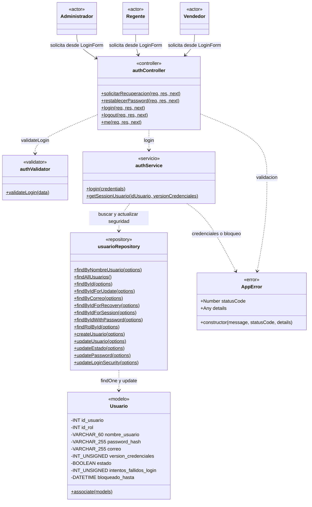

### CU02. Cerrar sesión

**Actor:** Administrador, Regente o Vendedor autenticado. **API:** `POST /api/auth/logout`. **Referencias:** RF02, RF03; CU02 y reglas de sesión del contexto maestro.

**Interfaz:** acciones de cuenta en `frontend/src/layouts/components/AppHeader.jsx` y `AppSidebar.jsx` → `frontend/src/layouts/MainLayout.jsx` → AuthProvider → `logout()` de `frontend/src/features/auth/services/auth.service.js`.

| Participante | Participación y métodos ejecutados |
|---|---|
| `authMiddleware` (función) | Verifica token y sesión antes del Controller. |
| `authService` | `getSessionUsuario(idUsuario,versionCredenciales)` para la autenticación previa. |
| `usuarioRepository` | `findByIdForSession(options)` consulta la cuenta. |
| `Usuario` | Estado y versión actuales; no se modifica durante logout. |
| `authController` | `logout(req,res,next)` elimina la cookie con `res.clearCookie`. |
| `AppError` | Errores de la comprobación previa; errorHandler recibe fallos HTTP. |

**Relaciones y resultado:** Actor → middleware → Controller en la ruta; middleware → authService → usuarioRepository → Usuario para autenticar. El cuerpo de `authController.logout()` no llama a un Service de logout. Devuelve 200; ausencia/sesión inválida produce 401. AuthProvider limpia su estado local incluso si la solicitud falla. No se crea historial de logout ni se modifica `version_credenciales`; una copia externa del JWT puede seguir vigente mientras su cuenta/versión sean válidas y no haya expirado.

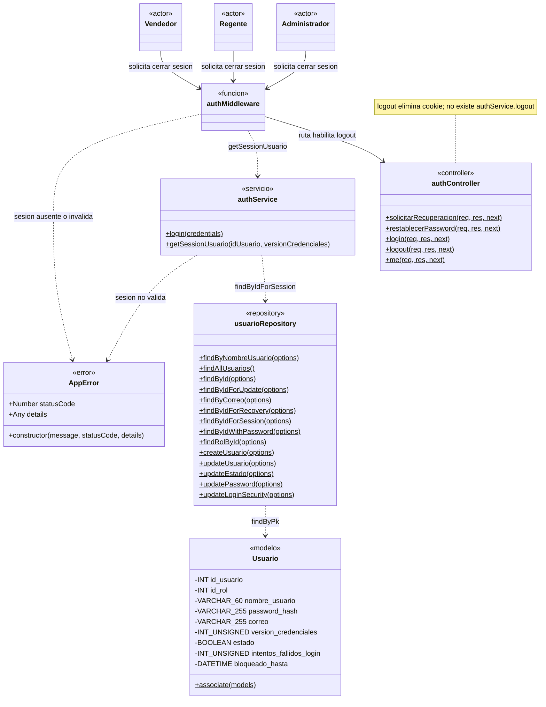

### CU03. Crear usuario

**Actor:** Administrador. **API:** `POST /api/usuarios`. **Referencias:** RF04, RF05, RF09; RN01–RN07, RN107.

**Interfaz:** `/usuarios/nuevo` → `frontend/src/features/usuarios/pages/UsuarioFormPage.jsx` y `components/UsuarioForm.jsx` → `createUsuario(data)` de `frontend/src/features/usuarios/services/usuario.service.js`.

| Participante | Participación y métodos ejecutados |
|---|---|
| Autenticación y autorización | Cadena común de 0.4: authMiddleware, authService, usuarioRepository, Usuario y requireRole Administrador. |
| `usuarioController` | `createUsuario(req,res,next)` publica 201 con datos permitidos. |
| `usuarioValidator` | `validateCreateUsuario(data)`; el esquema externo newPasswordSchema aplica complejidad y 72 bytes. |
| `usuarioService` | `createUsuario(datosUsuario)` y `getUsuarioById(idUsuario)` para devolver lo creado. |
| `usuarioRepository` | `findByNombreUsuario`, `findByCorreo` si hay correo, `findRolById`, `createUsuario`, `findById`; consulta Usuario y Rol. |
| `Usuario`, `Rol` | Nueva cuenta con rol existente/activo, nombre/correo únicos y password_hash. |
| `AppError` | Validación, referencias y conflictos. |

**Relaciones y resultado:** Controller → Validator/Service → Repository → Usuario/Rol. Los chequeos de nombre, correo y rol se realizan mediante funciones externas del Service que llaman al Repository; no son métodos de la clase. Bcrypt transforma la contraseña antes de persistir. La inserción usa los defaults de estado, versión y seguridad. El código actual no abre una transacción conjunta para validaciones/alta/lectura final; los UNIQUE son la barrera de unicidad en base de datos. Respuestas: 201, 400, 401/403, 404 por rol inexistente, 409 por conflicto/rol inactivo y 500 inesperado. No se devuelven hash, contador ni bloqueo.

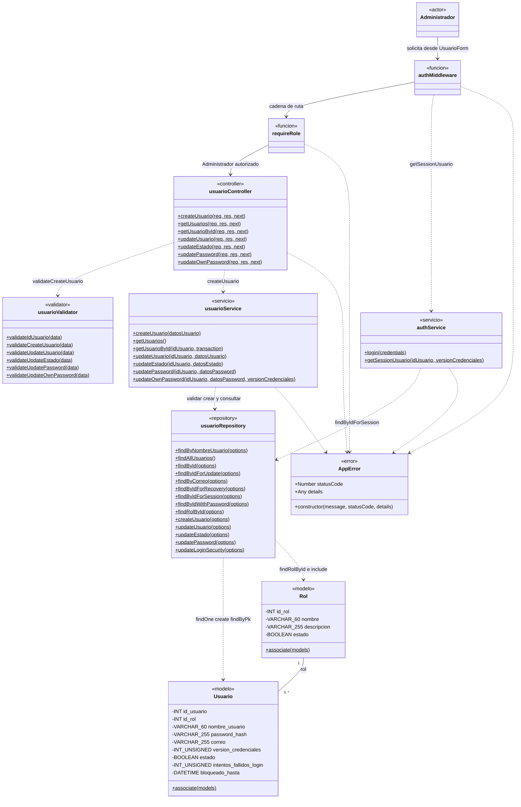

### CU04. Consultar usuarios

**Actor:** Administrador. **API:** `GET /api/usuarios`. **Referencias:** RF04, RF06; RN01, RN05, RN06 y RN07.

**Interfaz:** `/usuarios` → `frontend/src/features/usuarios/pages/UsuariosPage.jsx` y `components/UsuarioTable.jsx` → `getUsuarios()` de `frontend/src/features/usuarios/services/usuario.service.js`. Búsqueda por nombre/rol y filtro por estado se aplican localmente al listado recibido.

| Participante | Participación y métodos ejecutados |
|---|---|
| Autenticación y autorización | Cadena de 0.4; solo Administrador. |
| `usuarioController` | `getUsuarios(req,res,next)` devuelve `{ data }`. |
| `usuarioService` | `getUsuarios()` convierte a DTO público. |
| `usuarioRepository` | `findAllUsuarios()` con atributos públicos e include de Rol. |
| `Usuario`, `Rol` | Cuentas, correo, estado y datos del rol; conserva activos/inactivos. |
| `AppError` | Sesión/permisos previos; fallos inesperados llegan al errorHandler. |

**Relaciones y resultado:** Controller → Service → Repository → Usuario con Rol. Este endpoint no ejecuta usuarioValidator; no se incluye esa clase por el solo hecho de estar importada en el archivo del Controller. Respuesta 200 con lista, incluida lista vacía; 401/403 por acceso y 500 inesperado. Consulta sin escritura ni transacción de negocio. Todos los atributos de Usuario aparecen en el diagrama como estructura, pero la selección SQL y el DTO excluyen password_hash y campos privados de seguridad.

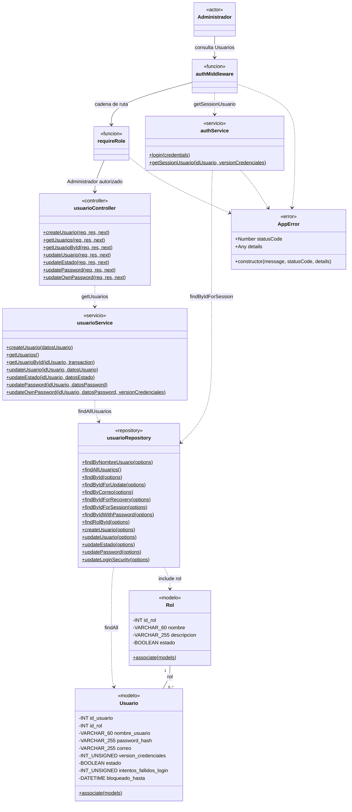

### CU05. Consultar usuario por ID

**Actor:** Administrador. **API:** `GET /api/usuarios/:idUsuario`. **Referencias:** RF04, RF06; CU05, RN01 y RN07.

**Interfaz:** la carga inicial de `/usuarios/:idUsuario/editar` en `frontend/src/features/usuarios/pages/UsuarioFormPage.jsx` ejecuta `getUsuario(idUsuario)` de `frontend/src/features/usuarios/services/usuario.service.js`. CU05 es la consulta de la cuenta, aunque la interfaz la reutilice para preparar CU06; no hay una página independiente de detalle de usuario.

| Participante | Participación y métodos ejecutados |
|---|---|
| Autenticación y autorización | Cadena de 0.4; solo Administrador. |
| `usuarioController` | `getUsuarioById(req,res,next)`; la función externa getIdUsuario valida params. |
| `usuarioValidator` | `validateIdUsuario(data)` para el ID de ruta. |
| `usuarioService` | `getUsuarioById(idUsuario,transaction)` consulta y construye DTO público. |
| `usuarioRepository` | `findById(options)` incluye Rol y atributos públicos de Usuario. |
| `Usuario`, `Rol` | Cuenta consultada y su rol. |
| `AppError` | ID inválido, cuenta inexistente o acceso rechazado. |

**Relaciones y resultado:** Controller → Validator/Service → Repository → Usuario/Rol. Devuelve 200 con datos públicos; 400 por ID inválido, 401/403 por acceso, 404 por cuenta inexistente y 500 inesperado. Es lectura; no cambia estado, credenciales ni recuperaciones. Las funciones externas getIdUsuario/getValidatedData no se representan como métodos de usuarioController.

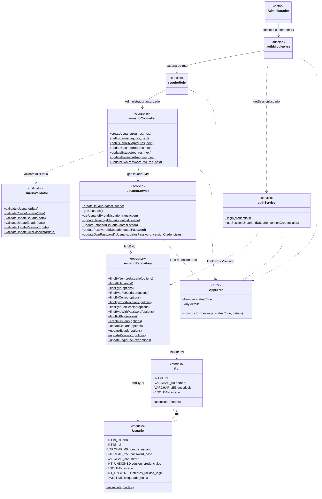

### CU06. Modificar usuario

**Actor:** Administrador. **API:** `PATCH /api/usuarios/:idUsuario`; la preparación usa CU05. **Referencias:** RF04, RF07, RI15; RN01, RN04, RN107.

**Interfaz:** `/usuarios/:idUsuario/editar` → `frontend/src/features/usuarios/pages/UsuarioFormPage.jsx` y `components/UsuarioForm.jsx` → `updateUsuario(idUsuario,data)` de `frontend/src/features/usuarios/services/usuario.service.js`.

| Participante | Participación y métodos ejecutados |
|---|---|
| Autenticación y autorización | Cadena de 0.4; solo Administrador. |
| `usuarioController` | `updateUsuario(req,res,next)` valida ID/body y responde con cuenta actualizada. |
| `usuarioValidator` | `validateIdUsuario`, `validateUpdateUsuario`; PATCH estricto no vacío, con nombre, rol y/o correo. |
| `usuarioService` | `updateUsuario(idUsuario,datosUsuario)` y `getUsuarioById` para la respuesta dentro de la transacción. |
| `usuarioRepository` | `findByIdForUpdate`, `updateUsuario`, `findById`; según campos, `findByNombreUsuario`, `findRolById`, `findByCorreo`. |
| `Usuario`, `Rol` | Cuenta bloqueada y datos públicos con rol; valida rol activo si se envía. |
| `recuperacionPasswordRepository`, `RecuperacionPassword` | `invalidatePendingByUsuario` si el correo se cambia efectivamente o se retira. |
| `AppError` | Validación, duplicados, rol/usuario inexistente, rol inactivo y acceso. |

**Relaciones y resultado:** usuarioService coordina ambos Repositories. Cambio de correo e invalidación de recuperaciones se confirman juntos con lectura final dentro de la transacción. Omitir correo lo conserva; NULL lo retira; el mismo correo normalizado conserva las recuperaciones. No se reinician cuotas IP ni de cuenta, ni se cambia password, estado o versión de credenciales mediante este PATCH. LimiteRecuperacionIp no se consulta en esta operación y no participa en el diagrama.

Respuestas principales: 200, 400, 401/403, 404, 409 y 500. Nombre/correo siguen sujetos a UNIQUE. La interfaz conserva el formulario ante error y vuelve al listado tras éxito. La posible invalidación es un camino del propio CU06, por eso la clase RecuperacionPassword se incluye incluso cuando un PATCH solo de nombre no la toca.

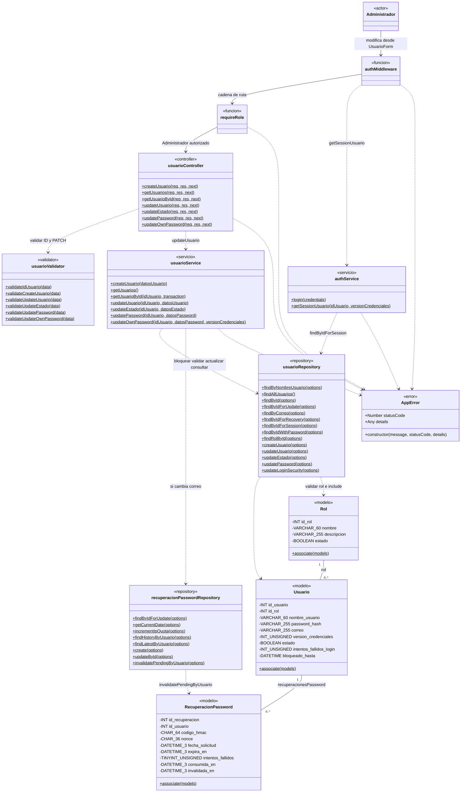

### CU07. Activar o desactivar usuario

**Actor:** Administrador. **API:** `PATCH /api/usuarios/:idUsuario/estado`. **Referencias:** RF04, RF08; RN05, RN06 y RN102.

**Interfaz:** `/usuarios` → `frontend/src/features/usuarios/pages/UsuariosPage.jsx` y `components/UsuarioTable.jsx`, con confirmación en `frontend/src/components/ConfirmDialog.jsx` → `updateEstadoUsuario(idUsuario,estado)` de `frontend/src/features/usuarios/services/usuario.service.js`.

| Participante | Participación y métodos ejecutados |
|---|---|
| Autenticación y autorización | Cadena de 0.4; solo Administrador. |
| `usuarioController` | `updateEstado(req,res,next)` recibe exclusivamente `{ estado }` en el body. |
| `usuarioValidator` | `validateIdUsuario` y `validateUpdateEstado`. |
| `usuarioService` | `updateEstado(idUsuario,datosEstado)` y `getUsuarioById` antes/después. |
| `usuarioRepository` | `findById`, `updateEstado`; además la comprobación de sesión común. |
| `Usuario`, `Rol` | Cambia solo estado de Usuario; las lecturas públicas incluyen Rol. |
| `AppError` | ID/body inválido, cuenta inexistente, sesión/permisos. |

**Relaciones y resultado:** Controller → Validator/Service → Repository → Usuario; Rol participa en las lecturas públicas, no se modifica. Desactivar conserva la cuenta y su historial y hace que futuras comprobaciones de sesión rechacen esa cuenta. No incrementa versión, no reinicia intentos/bloqueo y no elimina recuperaciones. El Service actual hace consultas antes/después y un UPDATE sin transacción explícita conjunta; el análisis no le atribuye un protocolo de bloqueo que no implementa.

Devuelve 200 con cuenta actualizada; 400, 401/403, 404 o 500 según fallo. No hay regla implementada especial de impedir que el Administrador cambie su propio estado ni de proteger al último Administrador activo: no se agrega esa condición al diagrama. La confirmación visual precede al envío y el estado de carga bloquea duplicados accidentales en la interfaz.


### CU08. Cambiar contraseña

**Variantes del mismo CU:** cambio propio para Administrador/Regente/Vendedor; restablecimiento administrativo para Administrador. **Referencias:** RF09 y RNF17; RN07 y RN115. La nueva contraseña cumple complejidad, 8–100 caracteres y máximo 72 bytes UTF-8. ConfirmPassword es comprobación de interfaz y no se envía ni se persiste.

#### CU08 — A. Cambio propio

**Actor:** Administrador, Regente o Vendedor autenticado. **API:** `PATCH /api/usuarios/me/password`. Esta ruta está definida antes de la restricción administrativa del router y utiliza authMiddleware sin requireRole Administrador.

**Interfaz:** `frontend/src/layouts/MainLayout.jsx` abre `frontend/src/features/usuarios/components/ChangeOwnPasswordDialog.jsx` → `updateOwnPassword(data)` de `frontend/src/features/usuarios/services/usuario.service.js`.

| Participante | Participación y métodos ejecutados |
|---|---|
| Autenticación | authMiddleware → authService.getSessionUsuario → usuarioRepository.findByIdForSession → Usuario. |
| `usuarioController` | `updateOwnPassword(req,res,next)` valida body, pasa versión autenticada y renueva cookie tras éxito. |
| `usuarioValidator` | `validateUpdateOwnPassword(data)`; conserva compatibilidad de contraseña actual y exige política nueva. |
| `usuarioService` | `updateOwnPassword(idUsuario,datosPassword,versionCredenciales)` verifica actual y revalida credenciales bajo bloqueo. |
| `usuarioRepository` | `findByIdWithPassword` antes y dentro de transacción con lock; `updatePassword`. |
| `recuperacionPasswordRepository` | `invalidatePendingByUsuario` en la misma transacción. |
| `Usuario`, `RecuperacionPassword` | Cambia hash/versión, reinicia intentos/bloqueo e invalida emisiones pendientes. |
| `AppError` | Sesión o contraseña actual inválida, datos incorrectos, cuenta inexistente y errores. |

**Relaciones y resultado:** usuarioService coordina los dos Repositories. Bcrypt compare/hash sucede antes de la transacción final; bajo bloqueo se vuelve a comprobar estado, versión y hash observado. Incrementa versión, actualiza credenciales, invalida recuperaciones y firma el nuevo token antes del commit. El Controller renueva su cookie tras la operación. Rol no se consulta: la firma usa `id_rol` de Usuario. LimiteRecuperacionIp tampoco se toca.

Respuestas: 200, 400, 401 por sesión o contraseña actual inválida, 404 si la cuenta requerida no existe y 500 inesperado. La cookie nueva mantiene esta sesión; otras sesiones con la versión anterior dejan de ser válidas. No se transforma `requireCurrentCredentials` o `siguienteVersionCredenciales`, que son funciones externas, en métodos del Service.

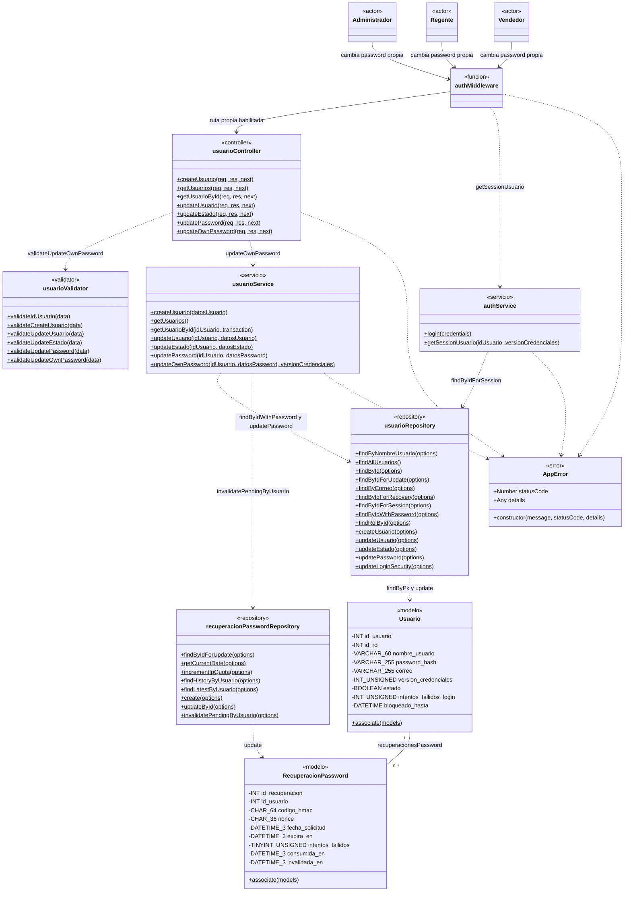

#### CU08 — B. Restablecimiento administrativo

**Actor:** Administrador. **API:** `PATCH /api/usuarios/:idUsuario/password`. **Interfaz:** `/usuarios` → `frontend/src/features/usuarios/components/ResetPasswordDialog.jsx` → `resetPasswordUsuario(idUsuario,password)` de `frontend/src/features/usuarios/services/usuario.service.js`.

| Participante | Participación y métodos ejecutados |
|---|---|
| Autenticación y autorización | Cadena de 0.4; Administrador. |
| `usuarioController` | `updatePassword(req,res,next)` valida ID/body y devuelve mensaje de éxito. |
| `usuarioValidator` | `validateIdUsuario`, `validateUpdatePassword`. |
| `usuarioService` | `updatePassword(idUsuario,datosPassword)`; `getUsuarioById` para comprobar existencia. |
| `usuarioRepository` | `findById` con Rol; `findByIdForUpdate`, `updatePassword` para la cuenta objetivo. |
| `recuperacionPasswordRepository`, `RecuperacionPassword` | `invalidatePendingByUsuario` en la transacción del cambio. |
| `Usuario`, `Rol` | Usuario objetivo; Rol se incluye en su consulta pública previa, no se modifica. |
| `AppError` | Datos inválidos, cuenta inexistente y acceso rechazado. |

**Relaciones y resultado:** verifica existencia, calcula bcrypt y bloquea la cuenta dentro de la transacción para actualizar hash/versión, limpiar bloqueo e invalidar recuperaciones. No exige ni muestra contraseña anterior; no cambia rol ni estado administrativo. Devuelve 200 sin emitir cookie de renovación para el usuario objetivo. Los JWT anteriores de esa cuenta quedan obsoletos, incluso si un Administrador restablece la suya por esta variante. Las cuotas permanecen intactas.

Errores principales: 400, 401/403, 404 y 500. La búsqueda/listado para elegir la cuenta usa CU04; este dibujo se centra en el restablecimiento y las clases que ejecuta. LimiteRecuperacionIp no participa solo porque el Repository de recuperación tenga un método de cuota entre sus métodos completos.

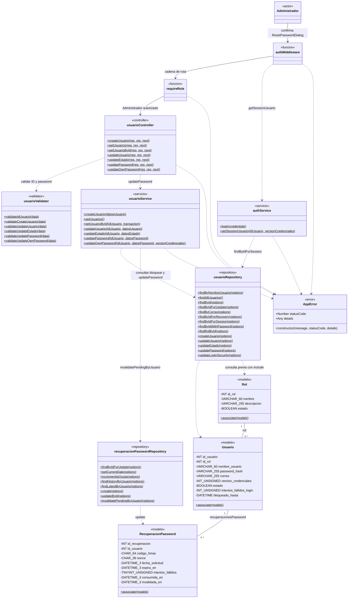

### CU09. Restablecer contraseña mediante correo electrónico

**Actor:** Administrador, Regente o Vendedor que olvidó su contraseña; acceso público. **API:** `POST /api/auth/recuperacion/solicitar` y `POST /api/auth/recuperacion/restablecer`. **Referencias:** RF40–RF42, RI15, RNF15–RNF17; RN107–RN115.

**Interfaz:** `/recuperar-contrasena` → `frontend/src/features/auth/pages/RecuperacionPasswordPage.jsx` → `solicitarRecuperacion({ correo })` y `restablecerPassword({ correo, codigo, passwordNueva })` de `frontend/src/features/auth/services/auth.service.js`. Confirmación de contraseña y borradores son estado local, no atributos persistentes. La página no llama a login tras el éxito.

| Participante | Participación y métodos ejecutados |
|---|---|
| `authController` | `solicitarRecuperacion` y `restablecerPassword`; valida, comprueba configuración y pasa IP del socket al Service. |
| `recuperacionPasswordValidator` | `validateSolicitud` y `validateRestablecimiento`; también invocados dentro del Service. |
| `recuperacionPasswordService` | Los cinco métodos de la clase participan: solicitud, restablecimiento, cuota IP, espera pública e invalidación condicional por rechazo de correo. |
| `usuarioRepository` | `findByCorreo`, `findByIdForRecovery` y `updatePassword`. |
| `recuperacionPasswordRepository` | Los ocho métodos participan entre cuota, emisión, rechazo explícito, verificación y consumo. |
| `Usuario` | Correo, estado, hash y versión; cuenta bloqueada antes de emisiones/consumos definitivos. |
| `RecuperacionPassword` | Historial de emisión, HMAC, nonce, vigencia, fallos, consumo e invalidación. |
| `LimiteRecuperacionIp` | Cuotas persistentes por ámbito/IP protegida; PK compuesta, sin FK a Usuario. |
| `AppError` | Datos/código inválidos, cuotas, indisponibilidad y errores. |

**Relaciones:** Controller → Validator/Service; Service → Validator y ambos Repositories; usuarioRepository → Usuario; recuperacionPasswordRepository → RecuperacionPassword/LimiteRecuperacionIp. Usuario tiene `0..*` recuperaciones y cada recuperación pertenece a un Usuario. No se consulta Rol, no se llama authService y no hay requisito de sesión. El rol del actor identifica quién puede usar el objetivo, no una autorización JWT de la ruta pública.

**Solicitud:** consume cuota IP; busca cuenta y la bloquea; verifica estado/correo/cuota de cuenta; invalida emisión anterior y registra HMAC/nonce/expiración en transacción. El transporte se intenta una vez después del commit. Rechazo explícito activa `invalidarEnvioRechazado`; resultado incierto conserva vigencia. `esperarRespuesta` aplica la espera mínima pública. Respuesta genérica también para desconocidos/inactivos/cuota de cuenta suprimida; 400, 429, 503 y 500 corresponden a entrada, cuota IP, configuración e inesperado.

**Restablecimiento:** consume cuota IP, verifica recuperación bajo bloqueo y confirma los intentos fallidos antes del error público. Tras preverificación calcula bcrypt fuera de la transacción final; revalida cuenta, código, vigencia y versión, cambia hash/versión, consume emisión e invalida pendientes conjuntamente. Limpia bloqueo/contador de login. Devuelve 200 sin cookie ni login automático. Código incorrecto, vencido, consumido o invalidado usa error público genérico 400; máximo cinco fallos. Las cuotas persistidas no se revierten por un fallo de envío o un código rechazado.

**Apoyos externos:** `recuperacion-config.js`, `recuperacion-crypto.js`, `recuperacion-mail.js`, `credenciales.js`, `password.schema.js`, bcrypt y temporización. `crearTransporteRecuperacion` devuelve un objeto con función `enviar(payload)`, no una clase Service declarada. El código soporta mock/Brevo; el envío a buzón real sigue pendiente de validación y la ejecución depende de la configuración habilitada.

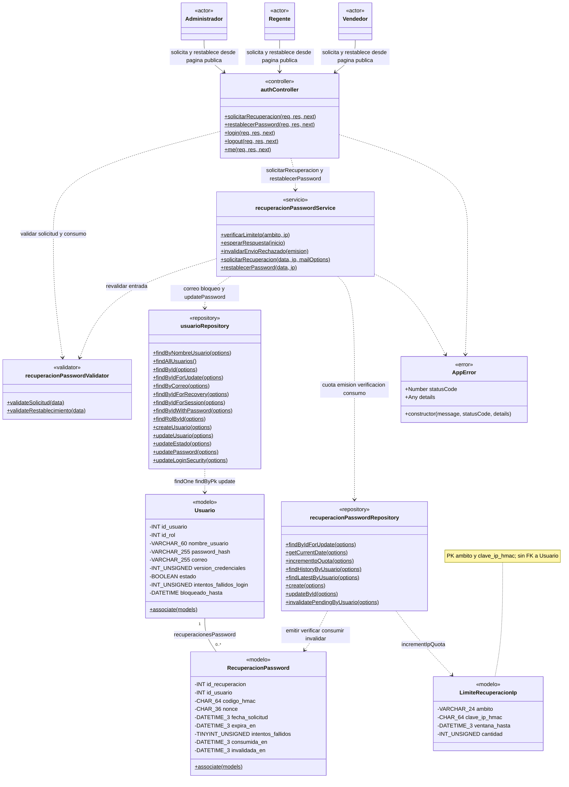

## 2. Cierre y revisión de Fase 1

| Caso | Diagramas | Estado |
|---|---|---|
| CU01 — Iniciar sesión | 1 | Elaborado |
| CU02 — Cerrar sesión | 1 | Elaborado |
| CU03 — Crear usuario | 1 | Elaborado |
| CU04 — Consultar usuarios | 1 | Elaborado |
| CU05 — Consultar usuario por ID | 1 | Elaborado |
| CU06 — Modificar usuario | 1 | Elaborado |
| CU07 — Activar/desactivar usuario | 1 | Elaborado |
| CU08 — Cambiar contraseña | 2, variantes propia/administrativa | Elaborado |
| CU09 — Recuperación por correo | 1, integra solicitud y restablecimiento | Elaborado |

**Verificación de esta entrega:** se contrastaron 15 clases reales, 26 atributos persistentes y 61 operaciones propias, comprobando cada aparición completa de clase en los diagramas. Las firmas de Services/Repositories, los archivos referidos, los tipos y las cardinalidades se comprobaron contra el código y los metadatos de Sequelize. Los 10 diagramas se analizaron y renderizaron localmente a SVG con Mermaid 11.12.0, sin errores. Se revisó el formato del Markdown. Estas comprobaciones no abrieron conexiones MySQL.

**Puntos de revisión:** actores y variantes; presencia de autenticación previa en rutas protegidas; clase completa frente a métodos ejecutados; relaciones Usuario/Rol y Usuario/RecuperacionPassword; cuota IP solo en CU09; auxiliares externos separados de miembros; datos persistidos frente a DTO/estado local; transacciones según código real.

Este análisis documenta la implementación encontrada, con sus dependencias y límites. La validación del envío real de correo y la configuración de CU09 siguen siendo aspectos operativos independientes. La Fase 2 se incorpora a continuación por solicitud de continuidad del usuario.

## 3. Fase 2 — Proveedores y Laboratorios

### 3.1. Clases, fuentes y miembros propios

La feature `proveedores` administra una única entidad `ProveedorLaboratorio`, conforme a RN09. Cada CU incluye también las clases de comprobación de sesión descritas en 0.3 y 0.4: authService, usuarioRepository, Usuario y AppError.

| Clase | Archivo |
|---|---|
| `ProveedorLaboratorio` | `backend/src/data/models/proveedor-laboratorio.js` |
| `proveedorLaboratorioController` | `backend/src/presentation/controllers/proveedor-laboratorio.controller.js` |
| `proveedorLaboratorioService` | `backend/src/business/services/proveedor-laboratorio.service.js` |
| `proveedorLaboratorioRepository` | `backend/src/data/repositories/proveedor-laboratorio.repository.js` |
| `proveedorLaboratorioValidator` | `backend/src/business/validators/proveedor-laboratorio.validator.js` |

**Atributos persistentes completos de ProveedorLaboratorio:**

| Atributo | Tipo | Nulo | Restricciones / comportamiento |
|---|---|---|---|
| `id_proveedor_laboratorio` | INT | No | PK, AUTO_INCREMENT |
| `nombre` | VARCHAR(150) | No | Nombre de la entidad; no tiene UNIQUE |
| `telefono` | VARCHAR(30) | Sí | Dato de contacto opcional |
| `direccion` | VARCHAR(255) | Sí | Dato de contacto opcional |
| `estado` | BOOLEAN | No | Predeterminado `true` |

El modelo declara `static associate(models)` y utiliza `timestamps: false`. Son cinco atributos; no incorpora fecha de alta, usuario creador, licencia, resolución SEDES ni discriminador proveedor/laboratorio.

**Firmas exactas de las clases:**

| Clase | Métodos propios |
|---|---|
| `proveedorLaboratorioController` | `createProveedorLaboratorio(req, res, next)`; `getProveedoresLaboratorios(req, res, next)`; `getProveedorLaboratorioById(req, res, next)`; `updateProveedorLaboratorio(req, res, next)`; `updateEstado(req, res, next)` |
| `proveedorLaboratorioService` | `createProveedorLaboratorio(data)`; `getProveedoresLaboratorios()`; `getProveedorLaboratorioById(idProveedorLaboratorio)`; `updateProveedorLaboratorio(idProveedorLaboratorio, data)`; `updateEstado(idProveedorLaboratorio, { estado })` |
| `proveedorLaboratorioRepository` | `findAll()`; `findById({ idProveedorLaboratorio })`; `create({ nombre, telefono, direccion, estado })`; `update({ idProveedorLaboratorio, data })`; `updateEstado({ idProveedorLaboratorio, estado })` |
| `proveedorLaboratorioValidator` | `validateId(data)`; `validateCreate(data)`; `validateUpdate(data)`; `validateUpdateEstado(data)` |

Todos son públicos y estáticos; Controller, Service y Repository usan métodos async, Validator usa métodos síncronos. Estas cuatro clases no declaran atributos propios. Las cinco clases nuevas aportan **20 operaciones propias**, contando `associate(models)`.

**Funciones y objetos externos relevantes:**

- `toPublicProveedorLaboratorio` es una función fuera del Service: convierte los nombres persistentes al DTO `{ idProveedorLaboratorio, nombre, telefono, direccion, estado }`.
- `getValidatedData` y `getIdProveedorLaboratorio` están fuera del Controller. Obtienen la salida validada o generan AppError; este último llama a `proveedorLaboratorioValidator.validateId`.
- `textoOpcional`, los esquemas Zod y `datosSchema` están fuera del Validator. Nombre y contactos se recortan; teléfono/dirección vacíos se convierten a NULL. Teléfono admite texto hasta 30 caracteres; no exige un patrón numérico.
- `frontend/src/features/proveedores/services/proveedor-laboratorio.service.js` exporta cinco funciones HTTP, no una clase: `getProveedoresLaboratorios()`, `getProveedorLaboratorio(idProveedorLaboratorio)`, `createProveedorLaboratorio(data)`, `updateProveedorLaboratorio(idProveedorLaboratorio, data)` y `updateEstadoProveedorLaboratorio(idProveedorLaboratorio, estado)`. Usan `frontend/src/api/api.js` y extraen `response.data.data`.
- Las rutas de interfaz están en `frontend/src/app/router.jsx`, bajo ProtectedRoute y RoleRoute. El backend monta el router en `/api/proveedores-laboratorios` desde `backend/src/app.js`.

### 3.2. Relaciones y cardinalidades

Los diagramas de CU10–CU13 muestran las dependencias que ejecuta cada operación: ruta protegida → Controller → Validator/Service → Repository → ProveedorLaboratorio, más la consulta de Usuario para autenticar. Usuario y ProveedorLaboratorio no tienen una FK entre sí: el actor autenticado no se almacena como creador/modificador de esta entidad.

Las asociaciones persistentes de contexto declaradas por `ProveedorLaboratorio.associate(models)` son:

| Origen | Destino | Cardinalidad | FK en destino | Alias desde ProveedorLaboratorio |
|---|---|---|---|---|
| ProveedorLaboratorio | Medicamento | `1` proveedor por medicamento; `0..*` medicamentos por proveedor | `Medicamento.id_proveedor_laboratorio`, no nullable | `medicamentos` |
| ProveedorLaboratorio | Compra | `1` proveedor por compra; `0..*` compras por proveedor | `Compra.id_proveedor_laboratorio`, no nullable | `compras` |

Ambas asociaciones usan RESTRICT en eliminación/actualización. CU10–CU13 consultan o modifican solamente el registro del proveedor; el Repository no carga esas colecciones con include. Sus asociaciones completas pueden consultarse en `diagrama-clases.md`; Medicamento y Compra se desarrollarán como clases participantes en sus fases correspondientes.

RN11 asigna al personal la verificación de licencia y resolución del SEDES. Es una condición operativa externa, sin validación automática ni clase de verificación en estos flujos. RN10 conserva los registros inactivos y su historial: la comprobación de proveedor activo para nuevas compras/asignaciones pertenece a las operaciones consumidoras.

### CU10. Registrar proveedor o laboratorio

**Actor:** Administrador. **Objetivo:** registrar la entidad suministradora y sus datos de contacto. **API:** `POST /api/proveedores-laboratorios`. **Referencias:** RF03, RF04, RF10; RN09–RN11 y CU10.

**Interfaz:** `/proveedores/nuevo` → `frontend/src/features/proveedores/pages/ProveedorLaboratorioFormPage.jsx` en modo create y `frontend/src/features/proveedores/components/ProveedorLaboratorioForm.jsx` → función HTTP `createProveedorLaboratorio(data)`.

| Participante | Participación y métodos ejecutados |
|---|---|
| `authMiddleware`, `requireRole` (funciones) | Comprueban sesión y rol Administrador antes del Controller. |
| `authService`, `usuarioRepository`, `Usuario` | `getSessionUsuario` → `findByIdForSession` → lectura de la cuenta autenticada. |
| `proveedorLaboratorioController` | `createProveedorLaboratorio(req,res,next)` valida y responde 201 con mensaje y data. |
| `proveedorLaboratorioValidator` | `validateCreate(data)` admite nombre obligatorio, contactos opcionales y estado booleano opcional; rechaza campos extra. |
| `proveedorLaboratorioService` | `createProveedorLaboratorio(data)` coordina inserción y DTO. |
| `proveedorLaboratorioRepository` | `create(datos)` envía nombre y los campos opcionales presentes al modelo. |
| `ProveedorLaboratorio` | Se crea el registro; `create` es heredado de Sequelize, no un método propio del modelo. |
| `AppError` | Constructor para entrada inválida, sesión/permisos; fallos técnicos pasan a errorHandler. |

**Relaciones y ejecución:** Actor → authMiddleware → requireRole → Controller; Controller → Validator y Service; Service → Repository; Repository → ProveedorLaboratorio. La comprobación de sesión consulta Usuario de forma independiente. No hay asociación persistente entre los dos modelos participantes; las cardinalidades de contexto están en 3.2.

El formulario envía nombre recortado, teléfono/dirección o NULL y el estado inicial seleccionado (activo por defecto). La API permite omitir estado; el Repository lo omite del INSERT en ese caso y se aplica el default activo. Nombre permite 1–150 caracteres después de trim; contactos 30/255. El ID lo genera la base y no se admite en el body. El Service convierte directamente la instancia creada a DTO, sin una segunda consulta por ID ni transacción explícita de negocio. No existe restricción de nombre único ni chequeo previo de duplicados en este CU.

**Resultado:** 201 con `{ message, data }`; errores principales 400, 401, 403 o 500. Tras éxito la página vuelve a `/proveedores` con un mensaje y el listado se carga mediante CU11; ante error conserva los campos. La verificación externa de RN11 no genera campos ni llamadas a SEDES.

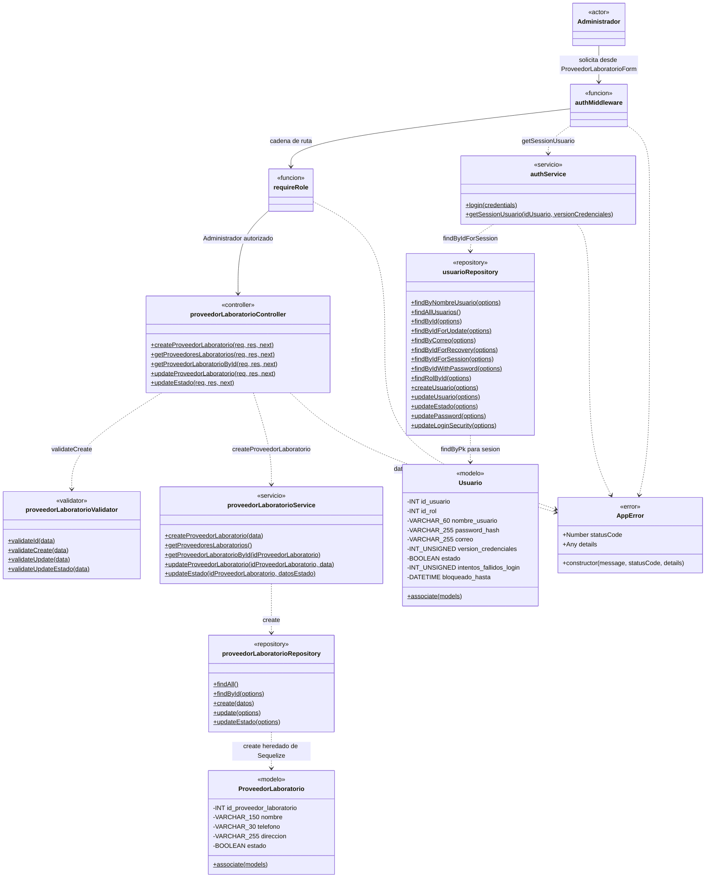

### CU11. Consultar proveedores o laboratorios

**Actor:** Administrador o Regente. **Objetivo:** consultar registros y datos de una entidad seleccionada. **API:** `GET /api/proveedores-laboratorios` y `GET /api/proveedores-laboratorios/:idProveedorLaboratorio`. **Referencias:** RF03, RF04, RF10; RN09, RN10 y CU11.

**Interfaz:** `/proveedores` → `frontend/src/features/proveedores/pages/ProveedoresPage.jsx` y `frontend/src/features/proveedores/components/ProveedorLaboratorioTable.jsx` → función HTTP `getProveedoresLaboratorios()`. El enlace de detalle abre `/proveedores/:idProveedorLaboratorio` → `frontend/src/features/proveedores/pages/ProveedorLaboratorioDetailPage.jsx` → `getProveedorLaboratorio(idProveedorLaboratorio)`. La carga inicial del formulario de edición reutiliza esta consulta por ID.

| Participante | Participación y métodos ejecutados |
|---|---|
| Autenticación y autorización | authMiddleware, authService.getSessionUsuario, usuarioRepository.findByIdForSession y Usuario; requireRole permite Administrador/Regente. |
| `proveedorLaboratorioController` | `getProveedoresLaboratorios` para listado; `getProveedorLaboratorioById` para detalle. |
| `proveedorLaboratorioValidator` | `validateId(data)` solo al consultar por ID; el listado no ejecuta Validator. |
| `proveedorLaboratorioService` | `getProveedoresLaboratorios()` transforma cada registro; `getProveedorLaboratorioById(id)` verifica existencia y transforma la instancia. |
| `proveedorLaboratorioRepository` | `findAll()` ordena por ID ascendente; `findById(options)` obtiene el seleccionado. |
| `ProveedorLaboratorio` | Lecturas `findAll`/`findByPk`, heredadas de Sequelize, con los cinco atributos. |
| `AppError` | ID inválido, registro inexistente y acceso rechazado; fallos inesperados llegan a errorHandler. |

**Relaciones y ejecución:** Controller → Service → Repository → ProveedorLaboratorio; en el camino por ID, Controller → Validator. El diagrama reúne ambos caminos del mismo CU y señala esa validación condicional. Sesión/rol se verifican antes de cada endpoint. No se consulta el modelo Rol; authService utiliza el rol actual de Usuario. Las consultas no hacen include de medicamentos ni compras, y el detalle actual muestra nombre/contactos/estado.

El listado incluye activos e inactivos y puede devolver un arreglo vacío. Búsqueda por nombre, teléfono o dirección y filtro por estado se aplican inmediatamente en React con useMemo al arreglo recibido; no se envían como filtros de query ni existe paginación implementada aquí. No hay escrituras ni transacción de negocio. La interfaz maneja carga, vacío y error; el listado ofrece reintento y descarta respuestas de cargas obsoletas mediante una referencia local.

**Resultado:** 200 con `{ data: [...] }` o `{ data: proveedor }`; 400 por ID inválido, 401/403 por acceso, 404 por entidad inexistente y 500 inesperado. El Regente tiene acceso de consulta; los controles de crear/editar/cambiar estado se muestran al Administrador, con autorización definitiva en las rutas backend.

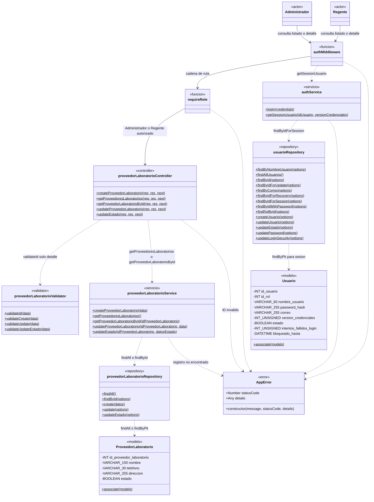

### CU12. Modificar proveedor o laboratorio

**Actor:** Administrador. **Objetivo:** actualizar los datos permitidos de la entidad. **API:** `PATCH /api/proveedores-laboratorios/:idProveedorLaboratorio`; la carga inicial utiliza CU11. **Referencias:** RF03, RF04, RF10; RN09, RN10 y CU12.

**Interfaz:** `/proveedores/:idProveedorLaboratorio/editar` → `frontend/src/features/proveedores/pages/ProveedorLaboratorioFormPage.jsx` en modo edit y `frontend/src/features/proveedores/components/ProveedorLaboratorioForm.jsx` → función HTTP `updateProveedorLaboratorio(idProveedorLaboratorio,data)`.

| Participante | Participación y métodos ejecutados |
|---|---|
| Autenticación y autorización | Cadena común de 0.4: comprobación de Usuario y requireRole Administrador. |
| `proveedorLaboratorioController` | `updateProveedorLaboratorio(req,res,next)` obtiene ID/body validados y publica resultado. |
| `proveedorLaboratorioValidator` | `validateId(data)` y `validateUpdate(data)`; PATCH estricto y no vacío de nombre/teléfono/dirección. |
| `proveedorLaboratorioService` | `updateProveedorLaboratorio(id,data)` ejecuta `getProveedorLaboratorioById(id)` antes y después de la escritura. |
| `proveedorLaboratorioRepository` | `findById(options)` para existencia/lectura final; `update({ idProveedorLaboratorio, data })` para escribir. |
| `ProveedorLaboratorio` | Lecturas `findByPk` y escritura `update`, heredadas de Sequelize. |
| `AppError` | Datos/ID inválidos, registro inexistente y acceso rechazado. |

**Relaciones y ejecución:** Controller → Validator/Service → Repository → ProveedorLaboratorio. El Service verifica existencia, actualiza por PK y consulta nuevamente para construir el DTO. Son sentencias independientes; no abre una transacción conjunta ni usa bloqueo explícito de fila para la secuencia. La comprobación de sesión consulta Usuario aparte, sin FK con el proveedor.

La API permite modificar uno o varios de los tres campos. Un campo omitido se conserva; teléfono/dirección NULL o vacíos se limpian. Nombre enviado debe seguir siendo no vacío y respetar 150 caracteres; contactos 30/255. El formulario actual envía los tres campos de datos, aunque alguno no haya cambiado, y excluye estado. El esquema rechaza ID, estado y campos extra. El registro inactivo también puede editarse; conserva ese estado. Editar sus datos no cambia FK de medicamentos/compras ni llama a sus Services; sus relaciones permanecen con el mismo ID, conforme a 3.2.

**Resultado:** 200 con `{ message, data }`; 400, 401/403, 404 o 500 ante fallos. Tras éxito vuelve al listado con mensaje; ante error conserva el borrador. Los cambios permitidos no exigen ni comprueban unicidad del nombre.

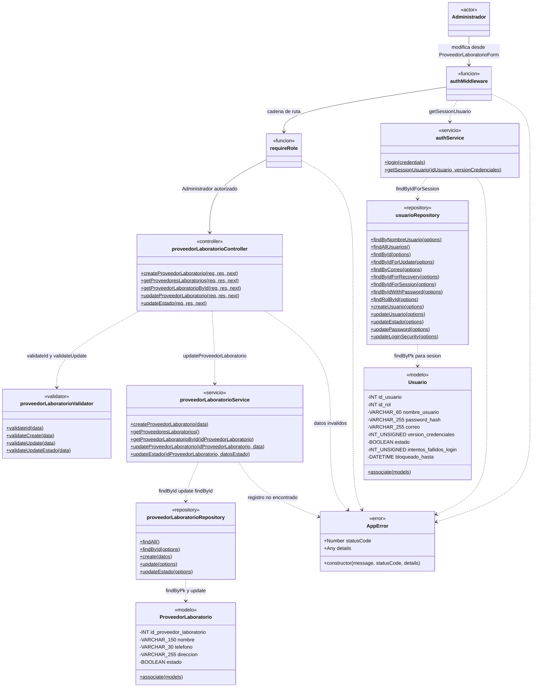

### CU13. Activar o desactivar proveedor o laboratorio

**Actor:** Administrador. **Objetivo:** modificar la disponibilidad administrativa de la entidad conservando su registro e historial. **API:** `PATCH /api/proveedores-laboratorios/:idProveedorLaboratorio/estado`. **Referencias:** RF03, RF04, RF10; RN09, RN10, RN102 y CU13.

**Interfaz:** `/proveedores` → `frontend/src/features/proveedores/pages/ProveedoresPage.jsx` y `frontend/src/features/proveedores/components/ProveedorLaboratorioTable.jsx` → confirmación con `frontend/src/components/ConfirmDialog.jsx` → función HTTP `updateEstadoProveedorLaboratorio(idProveedorLaboratorio,estado)`.

| Participante | Participación y métodos ejecutados |
|---|---|
| Autenticación y autorización | Cadena común de 0.4; requireRole permite solamente Administrador. |
| `proveedorLaboratorioController` | `updateEstado(req,res,next)` devuelve mensaje de activación/desactivación y DTO. |
| `proveedorLaboratorioValidator` | `validateId(data)` y `validateUpdateEstado(data)` para ID positivo y body estricto `{ estado: boolean }`. |
| `proveedorLaboratorioService` | `updateEstado(id,{ estado })` y `getProveedorLaboratorioById(id)` antes/después de actualizar. |
| `proveedorLaboratorioRepository` | `findById(options)` y `updateEstado({ idProveedorLaboratorio, estado })`. |
| `ProveedorLaboratorio` | Se modifica únicamente estado; `findByPk`/`update` son heredados. |
| `AppError` | Validación, entidad inexistente, sesión/permisos. |

**Relaciones y ejecución:** Controller → Validator/Service → Repository → ProveedorLaboratorio; authMiddleware → authService → usuarioRepository → Usuario para comprobar al actor. No se modifica Usuario ni se registra responsable en el proveedor. Verificación de existencia, UPDATE y lectura final no se agrupan en una transacción explícita del Service.

La interfaz solicita el estado inverso al actual después de confirmar; la API recibe un valor booleano objetivo, no una instrucción toggle. Actualiza la fila local con el DTO devuelto, sin GET adicional inmediato, y bloquea el envío duplicado mientras está en curso. Al desactivar, el registro sigue apareciendo en CU11; se conservan las asociaciones de 3.2, medicamentos y compras históricas. Nuevas compras/asignaciones comprueban el estado en sus operaciones correspondientes; CU13 no actualiza en cascada medicamentos, stock o compras. Activar restablece la disponibilidad del proveedor para esas comprobaciones sin cambiar el estado propio de sus medicamentos.

**Resultado:** 200 con `{ message, data }`; 400, 401/403, 404 o 500 ante fallos. El Service no exige que el nuevo estado sea distinto del existente. Ante error, el listado muestra el mensaje y cierra la confirmación; no incorpora el cambio local como si hubiese tenido éxito.

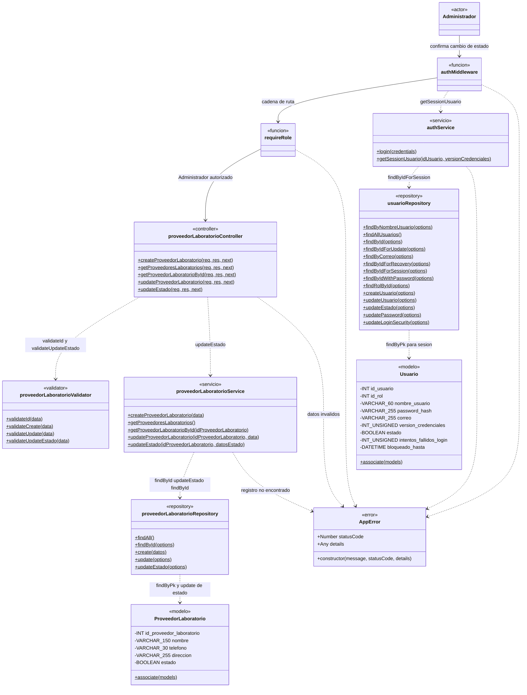

## 4. Cierre y revisión de Fase 2

| Caso | Diagramas | Estado |
|---|---|---|
| CU10 — Registrar proveedor o laboratorio | 1 | Elaborado |
| CU11 — Consultar proveedores o laboratorios | 1, integra listado y detalle | Elaborado |
| CU12 — Modificar proveedor o laboratorio | 1 | Elaborado |
| CU13 — Activar/desactivar proveedor o laboratorio | 1 | Elaborado |

**Verificación de esta entrega:** se contrastaron los cuatro diagramas nuevos contra nueve clases participantes: cinco del módulo y cuatro de autenticación/errores. Contienen 14 atributos persistentes y 38 operaciones propias, contando los miembros completos de las clases compartidas; el módulo aporta cinco atributos y 20 operaciones nuevas. Se comprobaron firmas, archivos, tipos, actores, dependencias de sesión y las dos asociaciones de contexto mediante código y metadatos de Sequelize. Se verificó también el documento acumulado: 20 clases reales, 31 atributos persistentes y 81 operaciones propias. Los 14 diagramas de ambas fases se analizaron y renderizaron localmente a SVG con Mermaid 11.12.0, sin errores ni conexiones MySQL. Se revisó el formato del Markdown.

**Puntos de revisión:** actores de consulta frente a administración; miembros propios completos y métodos utilizados; DTO/atributos persistentes; estado opcional al crear y separado en edición; listado/detalle activos e inactivos; relaciones de contexto y ausencia de cascadas; RN11 como verificación humana; secuencias de lectura/escritura según el código real.

**Avance al cierre de Fase 2:** 13 de los 33 CU implementados analizados, con 14 diagramas. La Fase 3 se incorpora a continuación por solicitud de continuidad del usuario.

## 5. Fase 3 — Medicamentos, Principios Activos y Composición

### 5.1. Fuentes y miembros propios

| Clase | Archivo |
|---|---|
| `Medicamento` | `backend/src/data/models/medicamento.js` |
| `PrincipioActivo` | `backend/src/data/models/principio-activo.js` |
| `ComposicionMedicamento` | `backend/src/data/models/composicion-medicamento.js` |
| `ExistenciaMedicamento` | `backend/src/data/models/existencia-medicamento.js` |
| `MovimientoInventario` | `backend/src/data/models/movimiento-inventario.js` |
| `medicamentoController` | `backend/src/presentation/controllers/medicamento.controller.js` |
| `principioActivoController` | `backend/src/presentation/controllers/principio-activo.controller.js` |
| `composicionMedicamentoController` | `backend/src/presentation/controllers/composicion-medicamento.controller.js` |
| `medicamentoService` | `backend/src/business/services/medicamento.service.js` |
| `principioActivoService` | `backend/src/business/services/principio-activo.service.js` |
| `composicionMedicamentoService` | `backend/src/business/services/composicion-medicamento.service.js` |
| `medicamentoRepository` | `backend/src/data/repositories/medicamento.repository.js` |
| `principioActivoRepository` | `backend/src/data/repositories/principio-activo.repository.js` |
| `composicionMedicamentoRepository` | `backend/src/data/repositories/composicion-medicamento.repository.js` |
| `medicamentoValidator` | `backend/src/business/validators/medicamento.validator.js` |
| `principioActivoValidator` | `backend/src/business/validators/principio-activo.validator.js` |
| `composicionMedicamentoValidator` | `backend/src/business/validators/composicion-medicamento.validator.js` |

Se reutilizan ProveedorLaboratorio y las cuatro clases de autenticación/errores de las fases anteriores. Cada diagrama incluye sus miembros completos cuando participan. Las nuevas clases Controller/Service/Repository/Validator no declaran atributos propios. Todos sus métodos son públicos y estáticos; salvo Validators, son async.

**Controllers:** medicamentoController declara cinco métodos: `getMedicamentos`, `getMedicamentoById`, `createMedicamento`, `updateMedicamento`, `updateEstado`. principioActivoController declara cinco: `getPrincipiosActivos`, `getPrincipioActivoById`, `createPrincipioActivo`, `updatePrincipioActivo`, `updateEstado`. composicionMedicamentoController declara cuatro: `getComposicionMedicamento`, `createComposicion`, `updateComposicion`, `removeComposicion`. Todos reciben `(req, res, next)`.

**Services — firmas exactas:**

| Clase | Métodos propios |
|---|---|
| `medicamentoService` | `getMedicamentos(filtros)`; `getMedicamentoById(idMedicamento, transaction = undefined)`; `getMedicamentoForUpdate(idMedicamento, transaction)`; `validateSinHistorial(idMedicamento, transaction)`; `createMedicamento(data)`; `updateMedicamento(idMedicamento, data)`; `updateEstado(idMedicamento, { estado })` |
| `principioActivoService` | `getPrincipiosActivos()`; `getPrincipioActivoById(idPrincipioActivo, transaction = undefined)`; `createPrincipioActivo(data)`; `updatePrincipioActivo(idPrincipioActivo, data)`; `updateEstado(idPrincipioActivo, { estado })` |
| `composicionMedicamentoService` | `getComposicionMedicamento(idMedicamento)`; `createComposicion(idMedicamento, data)`; `updateComposicion(idMedicamento, idComposicion, data)`; `removeComposicion(idMedicamento, idComposicion)` |

**Repositories — firmas exactas:**

| Clase | Métodos propios |
|---|---|
| `medicamentoRepository` | `findAll({ codigoMedicamento, nombreComercial, idPrincipioActivo } = {})`; `findById({ idMedicamento, transaction, lock = false })`; `findByCodigo({ codigoMedicamento, transaction })`; `findMayorCorrelativo({ prefijo, transaction })`; `findProveedorById({ idProveedorLaboratorio, transaction, exclusivo = false })`; `findDuplicadosIdentidad({ medicamento, composicion, transaction, idMedicamento })`; `hasMovimientos({ idMedicamento, transaction })`; `create({ data, transaction })`; `update({ idMedicamento, data, transaction })`; `updateEstado({ idMedicamento, estado, transaction })` |
| `principioActivoRepository` | `findAll()`; `findById({ idPrincipioActivo, transaction, lock = false })`; `findByNombre({ nombre, transaction })`; `create({ data, transaction })`; `update({ idPrincipioActivo, data, transaction })`; `updateEstado({ idPrincipioActivo, estado, transaction })` |
| `composicionMedicamentoRepository` | `findAllForMedicamento({ idMedicamento, transaction })`; `findById({ idMedicamento, idComposicion, transaction })`; `findByPrincipio({ idMedicamento, idPrincipioActivo, transaction })`; `findPrincipioById({ idPrincipioActivo, transaction })`; `create({ data, transaction })`; `update({ idMedicamento, idComposicion, data, transaction })`; `remove({ idMedicamento, idComposicion, transaction })` |

**Validators:** todos reciben `(data)`. medicamentoValidator declara `validateId`, `validateCreate`, `validateUpdate`, `validateUpdateEstado`, `validateFiltros`; principioActivoValidator declara `validateId`, `validateCreate`, `validateUpdate`, `validateUpdateEstado`; composicionMedicamentoValidator declara `validateMedicamentoId`, `validateId`, `validateCreate`, `validateUpdate`.

**Modelos:** Medicamento tiene 12 atributos, PrincipioActivo 4, ComposicionMedicamento 7, ExistenciaMedicamento 7 y MovimientoInventario 12. Son 42 atributos persistentes nuevos en el análisis; todos esos modelos declaran únicamente `associate(models)` como método propio. Los tipos `DECIMAL_12_4`, `DECIMAL_14_6`, `DATE` y `ENUM_DIA_MES`/`ENUM_ENTRADA_SALIDA` representan DECIMAL(12,4), DECIMAL(14,6), DATEONLY SQL DATE y los ENUM reales. Restricciones y nulabilidad completas: `diagrama-clases.md`.

**Funciones externas:** `generarCodigo`, `obtenerPrefijoMedicamento`, `toModelData`, `toPublicMedicamento`, `toPublicComposicion`, `validateCodigoNoEnviado` y `esColisionCodigo` apoyan Medicamento. `prepararModificacion`, `validarResultado` y `getComposicion` apoyan Composición. `validateNombreDisponible`, `handleDuplicateDatabaseError` y `toPublicPrincipioActivo` apoyan Principios. Los Controllers tienen getValidatedData y funciones para obtener IDs fuera de sus clases; los esquemas Zod y helpers de texto/cantidad también son externos. No se incorporan como métodos de las clases.

`backend/src/business/services/identidad-medicamento.js` exporta **funciones**, no una clase: `composicionCanonica`, `transaccionCatalogo`, `bloquearProveedoresIdentidad`, `validarIdentidadDisponible` y `convertirErrorContencionCatalogo`. Las dependencias hacia medicamentoRepository de CU14/CU16/CU19 incluyen llamadas desde esas funciones. Compartir `toPublicComposicion` no constituye una llamada entre Services; en CU19 sí se ejecutan métodos propios de medicamentoService.

### 5.2. Autorización, asociaciones y reglas compartidas

| Operación | Roles autorizados |
|---|---|
| CU14, CU16, CU17 | Regente |
| CU15 y CU20 | Administrador, Regente y Vendedor |
| CU18: listar/consultar por ID | Administrador y Regente |
| CU18: crear/editar/cambiar estado | Regente |
| CU19: agregar/editar/retirar relaciones | Regente |
| GET de composición, apoyo de consulta de CU19 | Administrador, Regente y Vendedor |

El actor principal de CU19 en el catálogo es Regente; el diagrama identifica además a Administrador/Vendedor únicamente en la lectura de apoyo disponible en la misma pantalla. El backend mantiene requireRole por operación.

| Asociación persistente | Cardinalidad | FK / alias |
|---|---|---|
| ProveedorLaboratorio — Medicamento | `1` proveedor por medicamento; `0..*` medicamentos por proveedor | `Medicamento.id_proveedor_laboratorio`; `proveedorLaboratorio` |
| Medicamento — ComposicionMedicamento | `1` medicamento por componente; `0..*` componentes por medicamento | `ComposicionMedicamento.id_medicamento`; `composiciones` |
| PrincipioActivo — ComposicionMedicamento | `1` principio por componente; `0..*` componentes por principio | `ComposicionMedicamento.id_principio_activo`; `principioActivo` |
| Medicamento — ExistenciaMedicamento | `1` medicamento por existencia; `0..*` existencias por medicamento | `ExistenciaMedicamento.id_medicamento`; `existencias` |
| ExistenciaMedicamento — MovimientoInventario | `1` existencia por movimiento; `0..*` movimientos por existencia | `MovimientoInventario.id_existencia`; `movimientosInventario` |
| Usuario — MovimientoInventario | `1` responsable por movimiento; `0..*` movimientos por usuario | `MovimientoInventario.id_usuario`; `usuario` |

Todas esas FK son no nullable y usan RESTRICT. La cardinalidad estructural `0..*` de composición conserva históricos incompletos y la retirada permitida de la última relación; **CU14 exige al menos un componente**. ComposicionMedicamento es la clase asociativa con cantidades y unidades; su UNIQUE compuesto impide repetir el par medicamento/principio. No hay un UNIQUE de identidad comercial completa: esa condición la validan los flujos del backend.

CU14/CU16/CU19 usan `transaccionCatalogo` con READ COMMITTED y bloqueo exclusivo del proveedor. CU16/CU19 bloquean primero el medicamento propio y después proveedores en orden de ID. Las consultas de duplicados no bloquean los candidatos. CU17 y las escrituras de CU18 usan transacciones Sequelize sin fijar ese aislamiento de catálogo. Los diagramas incluyen existencias/movimientos solo en CU16/CU19, donde `hasMovimientos` bloquea existencias y busca un movimiento; no hay consulta de historial en el DTO de lectura ni atributo persistente `tieneHistorial`.

Los catálogos de proveedores y principios que preparan los formularios reutilizan CU11/CU18. Sus clases y flujos están documentados en esos CU; no se atribuyen a medicamentoService. La búsqueda por composición utiliza CU20 y el mismo endpoint de CU15.

### CU14. Registrar medicamento

**Actor:** Regente. **Objetivo:** crear producto y composición inicial de manera atómica. **API:** `POST /api/medicamentos`. **Referencias:** RF03/RF04, RF11/RF13; RN10, RN13, RN15/RN16 y CU14.

**Interfaz:** `/medicamentos/nuevo` → `frontend/src/features/medicamentos/pages/MedicamentoFormPage.jsx` → `frontend/src/features/medicamentos/components/MedicamentoForm.jsx`, con `ComposicionForm.jsx`/`ComposicionTable.jsx` como borrador local → `createMedicamento(data)` de `frontend/src/features/medicamentos/services/medicamento.service.js`. Proveedores y principios se cargan con CU11/CU18; no se realizan altas independientes de componentes antes del envío integral.

| Participante | Métodos ejecutados y responsabilidad |
|---|---|
| Autenticación/roles | authMiddleware → authService.getSessionUsuario → usuarioRepository.findByIdForSession → Usuario; requireRole Regente. |
| `medicamentoController`, `medicamentoValidator` | `createMedicamento`; `validateCreate` valida body estricto, composición no vacía y principios sin repetir. Reutiliza el objeto externo componenteComposicionSchema, no métodos de composicionMedicamentoValidator. |
| `medicamentoService` | `createMedicamento`, `getMedicamentoById` para lectura final. Aplica reglas y coordina la transacción integral. |
| `medicamentoRepository` | `findProveedorById`, `findDuplicadosIdentidad`, `findMayorCorrelativo`, `findByCodigo`, `create`, `findById`; varias llamadas proceden de las funciones externas. |
| `composicionMedicamentoRepository` | `findPrincipioById` y `create` para cada componente. |
| `Medicamento`, `ComposicionMedicamento` | Nuevos registros y lectura final; métodos de persistencia heredados. |
| `ProveedorLaboratorio`, `PrincipioActivo` | Proveedor existente/activo bloqueado; principios existentes consultados bajo bloqueo compartido. La lectura final incluye sus datos públicos. |
| `AppError` | Entrada, referencias, identidad duplicada, agotamiento y contención. |

**Ejecución:** tras validar, obtenerPrefijoMedicamento exige tres letras ASCII normalizadas del nombre. En transacción se bloquea proveedor, se verifica su estado y cada principio, se compara la identidad completa y se genera el código mediante `generarCodigo` externo. Se inserta Medicamento y todos sus componentes y se consulta el resultado antes del commit. medicamentoService utiliza el Repository de Composición directamente; no llama a composicionMedicamentoService ni a principioActivoService.

El correlativo toma el mayor sufijo válido conservado del prefijo, también de inactivos, más uno; no usa COUNT ni ID. Una colisión específica de uq_medicamento_codigo repite toda la transacción hasta cinco intentos; otros conflictos no activan ese reintento. No se reutilizan huecos ni se regeneran códigos históricos. El mínimo funcional de composición es uno, aunque la asociación estructural sea `0..*`.

**Contrato y resultado:** nombre y datos comerciales obligatorios, proveedor e ingredientes por ID, cantidades JSON positivas a cuatro decimales, unidades hasta 30 caracteres. stockMinimo/estado opcionales, defaults 0/activo; el formulario no envía estado ni código/IDs locales. Se devuelve 201 después del commit con composición completa y cantidades como cadenas. Errores 400, 401/403, 404, 409 o 500; rollback evita altas parciales. Conflicto de identidad informa referencias públicas de productos coincidentes. React conserva el borrador y abre la ficha al éxito. No se crean existencias ni movimientos al dar de alta el catálogo.

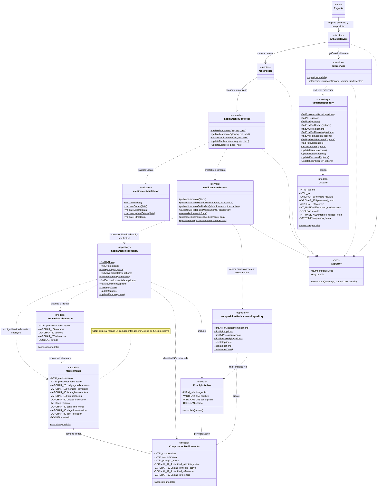

### CU15. Consultar o buscar medicamento

**Actor:** Administrador, Regente o Vendedor. **API:** `GET /api/medicamentos` y `GET /api/medicamentos/:idMedicamento`. **Referencias:** RF03/RF04, RF11; RN13–RN16 y CU15.

**Interfaz:** `/medicamentos` → `frontend/src/features/medicamentos/pages/MedicamentosPage.jsx`, `MedicamentoFilters.jsx` y `MedicamentoTable.jsx`; `/medicamentos/:idMedicamento` → `frontend/src/features/medicamentos/pages/MedicamentoDetailPage.jsx`. Funciones HTTP `getMedicamentos(filtros)` y `getMedicamento(id)`; la selección de principios para el filtro se explica en CU20.

| Participante | Métodos ejecutados y responsabilidad |
|---|---|
| Autenticación/roles | Cadena de sesión común; requireRole permite los tres roles. |
| `medicamentoController` | `getMedicamentos` o `getMedicamentoById`; publica DTOs. |
| `medicamentoValidator` | `validateFiltros` para query o `validateId` para params. |
| `medicamentoService` | `getMedicamentos(filtros)` o `getMedicamentoById(id)`. |
| `medicamentoRepository` | `findAll(filtros)` o `findById(options)`; carga proveedor, composición y principio. El camino de filtro por principios pertenece además a CU20. |
| `Medicamento`, `ProveedorLaboratorio`, `ComposicionMedicamento`, `PrincipioActivo` | Lectura del producto y sus asociaciones completas para el DTO. |
| `AppError` | Query/ID inválidos, producto inexistente y acceso rechazado. |

**Ejecución y resultado:** código/nombre utilizan LIKE de contiene con escape de `%`, `_` y barra para tratarlos como texto; filtros combinados se aplican juntos. No hay filtro de estado/paginación en este contrato: conserva activos e inactivos, incluidos históricos sin composición. Orden por ID de medicamento y componente. La composición recibida siempre incluye todos los componentes; decimales como cadenas. La ficha no calcula stock ni historial; sus enlaces invocan las consultas correspondientes.

La búsqueda textual automática actual espera **350 ms**, conserva filtros en URL mediante replace e invalida respuestas anteriores al cambiar el borrador. No se atribuye al módulo el debounce de otros listados. Respuesta 200 con lista (posiblemente vacía) o DTO por ID; 400, 401/403, 404 por ID inexistente o 500. Son consultas sin escrituras ni transacción de negocio explícita. Las cardinalidades aparecen en el diagrama; asociar el proveedor en lectura no ejecuta proveedorLaboratorioService.

```mermaid
classDiagram
    class Administrador { <<actor>> }
    class Regente { <<actor>> }
    class Vendedor { <<actor>> }
    class authMiddleware { <<funcion>> }
    class requireRole { <<funcion>> }
    class medicamentoController {
        <<controller>>
        +getMedicamentos(req, res, next)$
        +getMedicamentoById(req, res, next)$
        +createMedicamento(req, res, next)$
        +updateMedicamento(req, res, next)$
        +updateEstado(req, res, next)$
    }
    class medicamentoValidator {
        <<validator>>
        +validateId(data)$
        +validateCreate(data)$
        +validateUpdate(data)$
        +validateUpdateEstado(data)$
        +validateFiltros(data)$
    }
    class medicamentoService {
        <<servicio>>
        +getMedicamentos(filtros)$
        +getMedicamentoById(idMedicamento, transaction)$
        +getMedicamentoForUpdate(idMedicamento, transaction)$
        +validateSinHistorial(idMedicamento, transaction)$
        +createMedicamento(data)$
        +updateMedicamento(idMedicamento, data)$
        +updateEstado(idMedicamento, datosEstado)$
    }
    class medicamentoRepository {
        <<repository>>
        +findAll(filtros)$
        +findById(options)$
        +findByCodigo(options)$
        +findMayorCorrelativo(options)$
        +findProveedorById(options)$
        +findDuplicadosIdentidad(options)$
        +hasMovimientos(options)$
        +create(options)$
        +update(options)$
        +updateEstado(options)$
    }
    class Medicamento {
        <<modelo>>
        -INT id_medicamento
        -INT id_proveedor_laboratorio
        -VARCHAR_20 codigo_medicamento
        -VARCHAR_150 nombre_comercial
        -VARCHAR_80 forma_farmaceutica
        -VARCHAR_150 presentacion
        -VARCHAR_50 unidad_inventario
        -INT stock_minimo
        -VARCHAR_40 condicion_venta
        -VARCHAR_80 via_administracion
        -VARCHAR_80 tipo_liberacion
        -BOOLEAN estado
        +associate(models)$
    }
    class ProveedorLaboratorio {
        <<modelo>>
        -INT id_proveedor_laboratorio
        -VARCHAR_150 nombre
        -VARCHAR_30 telefono
        -VARCHAR_255 direccion
        -BOOLEAN estado
        +associate(models)$
    }
    class PrincipioActivo {
        <<modelo>>
        -INT id_principio_activo
        -VARCHAR_150 nombre
        -VARCHAR_255 descripcion
        -BOOLEAN estado
        +associate(models)$
    }
    class ComposicionMedicamento {
        <<modelo>>
        -INT id_composicion
        -INT id_medicamento
        -INT id_principio_activo
        -DECIMAL_12_4 cantidad_principio_activo
        -VARCHAR_30 unidad_principio_activo
        -DECIMAL_12_4 cantidad_referencia
        -VARCHAR_30 unidad_referencia
        +associate(models)$
    }
    class authService {
        <<servicio>>
        +login(credentials)$
        +getSessionUsuario(idUsuario, versionCredenciales)$
    }
    class usuarioRepository {
        <<repository>>
        +findByNombreUsuario(options)$
        +findAllUsuarios()$
        +findById(options)$
        +findByIdForUpdate(options)$
        +findByCorreo(options)$
        +findByIdForRecovery(options)$
        +findByIdForSession(options)$
        +findByIdWithPassword(options)$
        +findRolById(options)$
        +createUsuario(options)$
        +updateUsuario(options)$
        +updateEstado(options)$
        +updatePassword(options)$
        +updateLoginSecurity(options)$
    }
    class Usuario {
        <<modelo>>
        -INT id_usuario
        -INT id_rol
        -VARCHAR_60 nombre_usuario
        -VARCHAR_255 password_hash
        -VARCHAR_255 correo
        -INT_UNSIGNED version_credenciales
        -BOOLEAN estado
        -INT_UNSIGNED intentos_fallidos_login
        -DATETIME bloqueado_hasta
        +associate(models)$
    }
    class AppError {
        <<error>>
        +Number statusCode
        +Any details
        +constructor(message, statusCode, details)
    }
    Administrador --> authMiddleware : consulta catalogo o ficha
    Regente --> authMiddleware : consulta catalogo o ficha
    Vendedor --> authMiddleware : consulta catalogo o ficha
    authMiddleware --> requireRole : cadena de ruta
    requireRole --> medicamentoController : tres roles autorizados
    authMiddleware ..> authService : getSessionUsuario
    authMiddleware ..> AppError
    requireRole ..> AppError
    authService ..> usuarioRepository : findByIdForSession
    authService ..> AppError
    usuarioRepository ..> Usuario : sesion
    medicamentoController ..> medicamentoValidator : validateFiltros o validateId
    medicamentoController ..> medicamentoService : getMedicamentos o getMedicamentoById
    medicamentoController ..> AppError
    medicamentoService ..> medicamentoRepository : findAll o findById
    medicamentoService ..> AppError : medicamento no encontrado
    medicamentoRepository ..> Medicamento : findAll o findByPk
    medicamentoRepository ..> ProveedorLaboratorio : include
    medicamentoRepository ..> ComposicionMedicamento : include y filtro opcional
    medicamentoRepository ..> PrincipioActivo : include
    ProveedorLaboratorio "1" -- "0..*" Medicamento : proveedorLaboratorio
    Medicamento "1" -- "0..*" ComposicionMedicamento : composiciones
    PrincipioActivo "1" -- "0..*" ComposicionMedicamento : principioActivo
```

### CU16. Modificar medicamento

**Actor:** Regente. **API:** `PATCH /api/medicamentos/:idMedicamento`; preparación mediante CU15/CU11. **Referencias:** RF03/RF04, RF11; RN10, RN13 y CU16.

**Interfaz:** `/medicamentos/:idMedicamento/editar` → MedicamentoFormPage/MedicamentoForm → `updateMedicamento(id,data)`. La página carga ficha y proveedores; el formulario envía únicamente campos comerciales modificados, conserva proveedor inactivo si su ID no se cambia y no envía código, estado o composición.

| Participante | Métodos ejecutados y responsabilidad |
|---|---|
| Autenticación/roles | Cadena de sesión común; requireRole Regente. |
| `medicamentoController`, `medicamentoValidator` | `updateMedicamento`; `validateId`, `validateUpdate` para PATCH estricto/no vacío. |
| `medicamentoService` | `updateMedicamento`, `getMedicamentoForUpdate`, `getMedicamentoById`; `validateSinHistorial` si cambian campos protegidos. |
| `medicamentoRepository` | `findById`, `findProveedorById`, `update`; condicionalmente `hasMovimientos` y `findDuplicadosIdentidad`. |
| `composicionMedicamentoRepository` | `findAllForMedicamento` si cambian atributos de identidad, para comparar composición actual completa. |
| `Medicamento`, `ProveedorLaboratorio` | Producto propio bloqueado; proveedores origen/destino bloqueados; actualización y lectura final. |
| `ComposicionMedicamento`, `PrincipioActivo` | Composición para unicidad y asociaciones de lectura final. |
| `ExistenciaMedicamento`, `MovimientoInventario` | Comprobación condicional de historial: bloquear existencias y buscar un movimiento asociado. |
| `AppError` | Validación, referencias, historial, identidad duplicada y contención. |

**Ejecución:** en READ COMMITTED bloquea el medicamento y proveedores en orden. Cambiar efectivamente proveedor, forma, presentación, unidad de inventario, vía o liberación exige ausencia de movimientos en todas sus existencias. Nombre, stock mínimo y condición de venta siguen editables con historial. Si se envía proveedor, exige que esté activo, incluso si se envió el mismo ID; por ello React omite el proveedor conservado. El bloqueo de existencias en `hasMovimientos` evita carreras con su primer movimiento.

Cambios efectivos de nombre o campos de identidad consultan la composición y comparan el producto resultante, excluyendo su ID. Solo cambiar stock mínimo/condición no ejecuta esa comparación. Actualización y lectura final se confirman juntas; conflictos revierten todo. `tieneHistorial` es una variable local de validateSinHistorial; no se almacena ni se devuelve. No se cambia código ni se llama al Service de Inventario/Composición para validar historial: medicamentoRepository consulta directamente los modelos mostrados.

**Resultado:** 200 con mensaje y DTO; 400, 401/403, 404, 409 o 500. El formulario conserva datos al rechazo, muestra referencias de duplicados cuando las recibe y abre ficha al éxito. Las asociaciones históricas no se reescriben; en el diagrama Usuario también se relaciona con movimientos porque estos almacenan su responsable, aunque el Usuario consultado para autenticar no tenga que ser autor de esos movimientos.

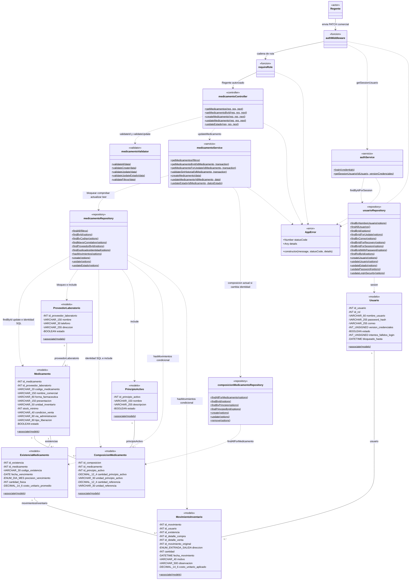

### CU17. Activar o desactivar medicamento

**Actor:** Regente. **API:** `PATCH /api/medicamentos/:idMedicamento/estado`. **Referencias:** RF03/RF04, RF11; RN13/RN14 y CU17.

**Interfaz:** MedicamentosPage/MedicamentoTable en `/medicamentos`, con `frontend/src/components/ConfirmDialog.jsx` → `updateEstadoMedicamento(id,estado)`. Recibe estado objetivo booleano; la interfaz solicita el inverso al mostrado.

| Participante | Métodos ejecutados y responsabilidad |
|---|---|
| Autenticación/roles | Cadena de sesión común; requireRole Regente. |
| `medicamentoController`, `medicamentoValidator` | `updateEstado`; `validateId`, `validateUpdateEstado` para body estricto `{ estado }`. |
| `medicamentoService` | `updateEstado`, `getMedicamentoForUpdate`, `getMedicamentoById`. |
| `medicamentoRepository` | `findById` con bloqueo y lectura final; `updateEstado`, que llama a su propio `update`. |
| `Medicamento` | Producto bloqueado; se actualiza únicamente estado. |
| `ProveedorLaboratorio`, `ComposicionMedicamento`, `PrincipioActivo` | Asociaciones del DTO final, sin modificaciones. |
| `AppError` | Validación, producto inexistente, sesión/permisos y fallos. |

**Ejecución y resultado:** una transacción Sequelize bloquea producto, cambia estado y consulta el DTO antes del commit. No comprueba historial, proveedor activo ni duplicado comercial para administrar estado; no ejecuta `generarCodigo` ni cambia composición. Mantiene código, existencias y movimientos; no pone saldo físico a cero. Los consumidores de stock calculan disponibilidad vendible según estado en sus propios CU. No hay modelos de inventario participantes en esta ejecución solo porque existan asociaciones históricas.

Devuelve 200 con mensaje y DTO, aun si el estado enviado ya era el actual; 400, 401/403, 404 o 500 ante fallo. El listado actualiza su fila con la respuesta y cierra la confirmación; puede seguir consultando inactivos. La asociación de proveedor/composición en el diagrama representa lectura final, no validación de disponibilidad ni actualización en cascada.

```mermaid
classDiagram
    class Regente { <<actor>> }
    class authMiddleware { <<funcion>> }
    class requireRole { <<funcion>> }
    class medicamentoController {
        <<controller>>
        +getMedicamentos(req, res, next)$
        +getMedicamentoById(req, res, next)$
        +createMedicamento(req, res, next)$
        +updateMedicamento(req, res, next)$
        +updateEstado(req, res, next)$
    }
    class medicamentoValidator {
        <<validator>>
        +validateId(data)$
        +validateCreate(data)$
        +validateUpdate(data)$
        +validateUpdateEstado(data)$
        +validateFiltros(data)$
    }
    class medicamentoService {
        <<servicio>>
        +getMedicamentos(filtros)$
        +getMedicamentoById(idMedicamento, transaction)$
        +getMedicamentoForUpdate(idMedicamento, transaction)$
        +validateSinHistorial(idMedicamento, transaction)$
        +createMedicamento(data)$
        +updateMedicamento(idMedicamento, data)$
        +updateEstado(idMedicamento, datosEstado)$
    }
    class medicamentoRepository {
        <<repository>>
        +findAll(filtros)$
        +findById(options)$
        +findByCodigo(options)$
        +findMayorCorrelativo(options)$
        +findProveedorById(options)$
        +findDuplicadosIdentidad(options)$
        +hasMovimientos(options)$
        +create(options)$
        +update(options)$
        +updateEstado(options)$
    }
    class Medicamento {
        <<modelo>>
        -INT id_medicamento
        -INT id_proveedor_laboratorio
        -VARCHAR_20 codigo_medicamento
        -VARCHAR_150 nombre_comercial
        -VARCHAR_80 forma_farmaceutica
        -VARCHAR_150 presentacion
        -VARCHAR_50 unidad_inventario
        -INT stock_minimo
        -VARCHAR_40 condicion_venta
        -VARCHAR_80 via_administracion
        -VARCHAR_80 tipo_liberacion
        -BOOLEAN estado
        +associate(models)$
    }
    class ProveedorLaboratorio {
        <<modelo>>
        -INT id_proveedor_laboratorio
        -VARCHAR_150 nombre
        -VARCHAR_30 telefono
        -VARCHAR_255 direccion
        -BOOLEAN estado
        +associate(models)$
    }
    class PrincipioActivo {
        <<modelo>>
        -INT id_principio_activo
        -VARCHAR_150 nombre
        -VARCHAR_255 descripcion
        -BOOLEAN estado
        +associate(models)$
    }
    class ComposicionMedicamento {
        <<modelo>>
        -INT id_composicion
        -INT id_medicamento
        -INT id_principio_activo
        -DECIMAL_12_4 cantidad_principio_activo
        -VARCHAR_30 unidad_principio_activo
        -DECIMAL_12_4 cantidad_referencia
        -VARCHAR_30 unidad_referencia
        +associate(models)$
    }
    class authService {
        <<servicio>>
        +login(credentials)$
        +getSessionUsuario(idUsuario, versionCredenciales)$
    }
    class usuarioRepository {
        <<repository>>
        +findByNombreUsuario(options)$
        +findAllUsuarios()$
        +findById(options)$
        +findByIdForUpdate(options)$
        +findByCorreo(options)$
        +findByIdForRecovery(options)$
        +findByIdForSession(options)$
        +findByIdWithPassword(options)$
        +findRolById(options)$
        +createUsuario(options)$
        +updateUsuario(options)$
        +updateEstado(options)$
        +updatePassword(options)$
        +updateLoginSecurity(options)$
    }
    class Usuario {
        <<modelo>>
        -INT id_usuario
        -INT id_rol
        -VARCHAR_60 nombre_usuario
        -VARCHAR_255 password_hash
        -VARCHAR_255 correo
        -INT_UNSIGNED version_credenciales
        -BOOLEAN estado
        -INT_UNSIGNED intentos_fallidos_login
        -DATETIME bloqueado_hasta
        +associate(models)$
    }
    class AppError {
        <<error>>
        +Number statusCode
        +Any details
        +constructor(message, statusCode, details)
    }
    Regente --> authMiddleware : confirma estado objetivo
    authMiddleware --> requireRole : cadena de ruta
    requireRole --> medicamentoController : Regente autorizado
    authMiddleware ..> authService : getSessionUsuario
    authMiddleware ..> AppError
    requireRole ..> AppError
    authService ..> usuarioRepository : findByIdForSession
    authService ..> AppError
    usuarioRepository ..> Usuario : sesion
    medicamentoController ..> medicamentoValidator : validateId y validateUpdateEstado
    medicamentoController ..> medicamentoService : updateEstado
    medicamentoController ..> AppError
    medicamentoService ..> medicamentoRepository : findById y updateEstado
    medicamentoService ..> AppError
    medicamentoRepository ..> Medicamento : bloqueo update y lectura
    medicamentoRepository ..> ProveedorLaboratorio : include final
    medicamentoRepository ..> ComposicionMedicamento : include final
    medicamentoRepository ..> PrincipioActivo : include final
    ProveedorLaboratorio "1" -- "0..*" Medicamento : proveedorLaboratorio
    Medicamento "1" -- "0..*" ComposicionMedicamento : composiciones
    PrincipioActivo "1" -- "0..*" ComposicionMedicamento : principioActivo
```

### CU18. Gestionar principios activos

**Actores:** Administrador/Regente para consultar; Regente para crear, modificar y cambiar estado. **Referencias:** RF03/RF04, RF12; RN16 y CU18. Este CU agrupa el mantenimiento de un catálogo, con autorización según operación.

| Operación | Endpoint | Controller / Service ejecutado | Validator | Repository ejecutado |
|---|---|---|---|---|
| Listar | GET `/api/principios-activos` | `getPrincipiosActivos` | No ejecuta | `findAll` |
| Consultar por ID | GET `/api/principios-activos/:idPrincipioActivo` | `getPrincipioActivoById` | `validateId` | `findById` |
| Crear | POST `/api/principios-activos` | `createPrincipioActivo` | `validateCreate` | `findByNombre`, `create` |
| Modificar | PATCH `/api/principios-activos/:idPrincipioActivo` | `updatePrincipioActivo`; Service llama también a `getPrincipioActivoById` | `validateId`, `validateUpdate` | `findById` bloqueante, `findByNombre` si se envía nombre, `update`, `findById` final |
| Cambiar estado | PATCH `/api/principios-activos/:idPrincipioActivo/estado` | `updateEstado`; Service llama también a `getPrincipioActivoById` | `validateId`, `validateUpdateEstado` | `findById` bloqueante, `updateEstado` → `update`, `findById` final |

**Interfaz:** `frontend/src/features/principios-activos/pages/PrincipiosActivosPage.jsx` y `components/PrincipioActivoTable.jsx` en `/principios-activos`; `frontend/src/features/principios-activos/pages/PrincipioActivoFormPage.jsx` y `components/PrincipioActivoForm.jsx` en `/principios-activos/nuevo` o `/principios-activos/:idPrincipioActivo/editar`. Funciones HTTP en `frontend/src/features/principios-activos/services/principio-activo.service.js`; ConfirmDialog para estado.

**Participación de clases:** principioActivoController valida/publica HTTP; principioActivoValidator comprueba estructura; principioActivoService coordina reglas/transacciones y DTO; principioActivoRepository accede a PrincipioActivo; el modelo mantiene ID, nombre único, descripción nullable y estado. La cadena authMiddleware/requireRole, authService, usuarioRepository, Usuario y AppError es la compartida. No se consulta ComposicionMedicamento al administrar principios: su asociación `1` principio–`0..*` componentes se mantiene como contexto de 5.2, no como un acceso de este CU.

**Ejecución:** listado ordenado por ID, búsqueda local inmediata por nombre/descripción; API sin filtros de búsqueda ni paginación. Nombre obligatorio recortado hasta 150; descripción opcional/NULL o vacía→NULL hasta 255; estado opcional en POST (activo por defecto), separado en PATCH de estado. Nombre tiene UNIQUE uq_principio_activo_nombre; función externa validateNombreDisponible y captura externa de conflicto traducen duplicados a 409. Crear/editar/estado usan transacciones; editar/estado bloquean fila. Lecturas no abren transacción de negocio.

Se conserva el principio al desactivar y no se borran ni modifican componentes. El contrato de composición actual exige existencia del principio, **no estado activo**; un principio inactivo no impide por sí mismo relacionarlo. Editar su nombre/descripcion es mantenimiento del catálogo de referencia, sin modificar cantidades/unidades/IDs de relaciones ni ejecutar la comprobación de identidad de medicamento.

**Resultado:** 200 en lecturas/edición/estado; 201 en alta; 400, 401/403, 404, 409 por nombre duplicado o 500 según camino. Listado vacío válido. El Regente dispone de acciones de mantenimiento; Administrador solo consulta; Vendedor no accede al catálogo de principios. Formulario conserva borrador en error y vuelve al listado al guardar. La pantalla de Medicamentos reutiliza esta consulta para opciones solo cuando el rol la permite.

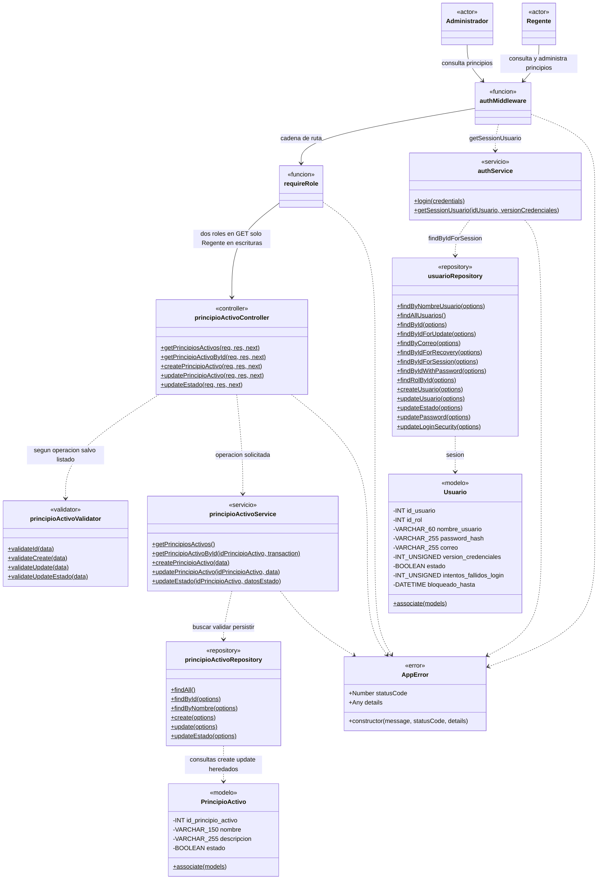

### CU19. Gestionar composición de medicamento

**Actor principal:** Regente para administrar. **Lectura de apoyo:** Administrador, Regente o Vendedor. **Referencias:** RF03/RF04, RF13; RN13, RN15/RN16 y CU19. Las altas iniciales de componentes del producto nuevo pertenecen al POST integral de CU14.

| Operación | Endpoint bajo `/api/medicamentos/:idMedicamento/composicion` | Métodos del Controller / Service | Validator |
|---|---|---|---|
| Consultar composición | GET `/` | `getComposicionMedicamento` | `validateMedicamentoId` |
| Agregar componente | POST `/` | `createComposicion` | `validateMedicamentoId`, `validateCreate` |
| Editar cantidades/unidades | PATCH `/:idComposicion` | `updateComposicion` | `validateId`, `validateUpdate` |
| Retirar relación | DELETE `/:idComposicion` | `removeComposicion` | `validateId` |

**Interfaz:** `/medicamentos/:idMedicamento/composicion` → `frontend/src/features/medicamentos/pages/MedicamentoComposicionPage.jsx`, `ComposicionTable.jsx`, `ComposicionForm.jsx`, Modal y ConfirmDialog. Funciones HTTP `getComposicionMedicamento`, `createComposicion`, `updateComposicion`, `deleteComposicion`. Carga la ficha mediante CU15 y, solo para Regente, opciones mediante CU18. La lectura GET de composición se incluye aquí como apoyo de la pantalla, no como nuevo CU.

| Participante | Métodos ejecutados y responsabilidad |
|---|---|
| Autenticación/roles | Sesión heredada de medicamentoRouter; requireRole por variante. |
| `composicionMedicamentoController`, `composicionMedicamentoValidator` | Métodos de la matriz; parámetros conservados con mergeParams, cuerpos estrictos. |
| `composicionMedicamentoService` | Los cuatro métodos propios según operación; coordina modificación de la relación y comprobación del resultado. |
| `medicamentoService` | `getMedicamentoById` para GET; `getMedicamentoForUpdate`, `validateSinHistorial` para las escrituras, llamadas desde prepararModificacion externo. |
| `medicamentoRepository` | `findById` y asociaciones en GET; `findById` bloqueante, `findProveedorById`, `hasMovimientos`, `findDuplicadosIdentidad` en escrituras. |
| `composicionMedicamentoRepository` | `findAllForMedicamento`, `findById`; en alta `findPrincipioById`, `findByPrincipio`, `create`; en edición `update`; en retiro `remove`. |
| `Medicamento`, `ProveedorLaboratorio` | Producto bloqueado antes de proveedor en escrituras; proveedor participa en sincronización y en lectura. |
| `ComposicionMedicamento`, `PrincipioActivo` | Relación consultada/creada/actualizada/eliminada; principio existente para alta e include de nombre para DTO. |
| `ExistenciaMedicamento`, `MovimientoInventario` | Comprobación obligatoria de ausencia de historial para toda escritura de composición. |
| `AppError` | IDs/cantidades/campos, referencias, pertenencia, historial, ingredientes repetidos, identidad y contención. |

**Consulta:** composicionMedicamentoService.getComposicionMedicamento llama a medicamentoService.getMedicamentoById y devuelve su arreglo composicion; **no ejecuta** composicionMedicamentoRepository en este camino. Esa consulta también carga proveedor y todos los componentes/principios mediante medicamentoRepository. No añade `tieneHistorial` al DTO.

**Escrituras:** dentro de READ COMMITTED bloquea medicamento, proveedor y existencias para exigir ausencia de movimientos. Alta verifica principio existente (sin exigir activo), impide el mismo principio mediante findByPrincipio y UNIQUE y crea una relación. Editar/retirar buscan por **ambos IDs**, medicamento y componente: una relación de otro producto devuelve 404. PATCH solo cantidades/unidades; sus FK no se modifican. Retiro usa `destroy` heredado de Sequelize para esa relación, no para medicamento/principio.

Después de cada cambio consulta composición resultante y valida identidad completa, excluyendo el propio producto; un duplicado revierte el cambio. Se permite completar históricos vacíos y retirar la última relación antes del historial si no produce duplicado. El proveedor se bloquea para sincronizar identidad, pero CU19 no vuelve a exigir estado activo del proveedor ni del medicamento. Un nombre de principio cambiado en CU18 no equivale a cambiar su FK en CU19.

**Resultado:** GET/PATCH/DELETE 200; POST 201. DELETE devuelve mensaje sin data; las otras respuestas contienen DTO/arreglo y cantidades como cadenas. Errores 400, 401/403, 404, 409 y 500. Modal conserva formulario en error; confirmación precede retiro; tras éxito React actualiza sus componentes locales. Los controles de administración corresponden al Regente y el backend comprueba nuevamente historial y permisos. No se reescriben movimientos históricos.

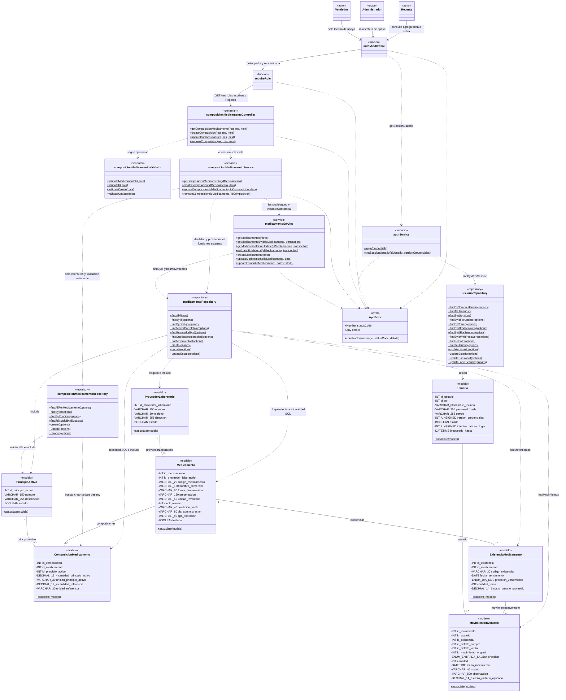

### CU20. Consultar medicamentos por composición

**Actor:** Administrador, Regente o Vendedor. **API:** `GET /api/medicamentos?idPrincipioActivo=...` con parámetro repetido para varios IDs; puede combinar código/nombre. **Referencias:** RF03/RF04, RF14; RN16/RN17 y CU20.

**Interfaz:** MedicamentosPage y `frontend/src/features/medicamentos/components/MedicamentoFilters.jsx` usan selección múltiple de principios y función HTTP `getMedicamentos(filtros)`. Seleccionar/quitar principios dispara consulta inmediata; código/nombre conservan debounce de 350 ms. Los criterios permanecen en URL y las respuestas anteriores se invalidan al cambiar filtros.

| Participante | Métodos ejecutados y responsabilidad |
|---|---|
| Autenticación/roles | Cadena común, requireRole permite los tres roles. |
| `medicamentoController`, `medicamentoValidator` | `getMedicamentos`; `validateFiltros` admite uno o varios IDs positivos y elimina repetidos. |
| `medicamentoService` | `getMedicamentos(filtros)` transforma DTOs. |
| `medicamentoRepository` | `findAll(filtros)` realiza selección por todos los principios y carga productos con asociaciones completas. |
| `ComposicionMedicamento` | Primera consulta agrupa medicamentos con COUNT DISTINCT de principios solicitados; determina IDs coincidentes. |
| `Medicamento`, `ProveedorLaboratorio`, `PrincipioActivo` | Segunda consulta carga catálogo y todas sus composiciones, proveedor y nombres de principios. |
| `AppError` | Query inválida, sesión/permisos; errores inesperados pasan a errorHandler. |

**Ejecución:** no hay un Service nuevo ni un método `buscarPorComposicion` inventado. medicamentoRepository.findAll filtra composiciones con IN de IDs, agrupa por medicamento y exige COUNT DISTINCT igual al número de IDs solicitados. Es **AND**, admite ingredientes adicionales. Si no hay coincidencias devuelve [] sin la segunda consulta; si las hay aplica sus IDs a Medicamento.findAll junto con filtros textuales y carga toda la composición, no únicamente los ingredientes de selección.

No compara cantidades/unidades para este filtro ni concluye sustitución terapéutica. La igualdad comercial completa de CU14/CU16/CU19 es otra operación y no se ejecuta aquí. Un ID de principio válido pero sin coincidencias no produce 404. Ambas consultas son lecturas sin transacción explícita conjunta; el análisis no les atribuye un snapshot transaccional único.

**Carga de opciones por rol:** Administrador/Regente consultan principios mediante CU18. Vendedor no llama a `/api/principios-activos`: una carga independiente de `getMedicamentos()` extrae/deduplica los principios ya expuestos por el catálogo autorizado. Las opciones no se reducen a los resultados filtrados. Este apoyo reutiliza los flujos CU18/CU15 sin añadir métodos al Service; Vendedor conserva autorización de búsqueda por IDs en el endpoint de Medicamentos.

**Resultado:** 200 con listado y composición completa; 400, 401/403 o 500 ante fallos. Mantiene activos/inactivos; no escribe entidades ni almacena criterios/alertas como fuente persistente. El diagrama repite las clases completas del endpoint común, con dependencias específicas del camino por principios.

```mermaid
classDiagram
    class Administrador { <<actor>> }
    class Regente { <<actor>> }
    class Vendedor { <<actor>> }
    class authMiddleware { <<funcion>> }
    class requireRole { <<funcion>> }
    class medicamentoController {
        <<controller>>
        +getMedicamentos(req, res, next)$
        +getMedicamentoById(req, res, next)$
        +createMedicamento(req, res, next)$
        +updateMedicamento(req, res, next)$
        +updateEstado(req, res, next)$
    }
    class medicamentoValidator {
        <<validator>>
        +validateId(data)$
        +validateCreate(data)$
        +validateUpdate(data)$
        +validateUpdateEstado(data)$
        +validateFiltros(data)$
    }
    class medicamentoService {
        <<servicio>>
        +getMedicamentos(filtros)$
        +getMedicamentoById(idMedicamento, transaction)$
        +getMedicamentoForUpdate(idMedicamento, transaction)$
        +validateSinHistorial(idMedicamento, transaction)$
        +createMedicamento(data)$
        +updateMedicamento(idMedicamento, data)$
        +updateEstado(idMedicamento, datosEstado)$
    }
    class medicamentoRepository {
        <<repository>>
        +findAll(filtros)$
        +findById(options)$
        +findByCodigo(options)$
        +findMayorCorrelativo(options)$
        +findProveedorById(options)$
        +findDuplicadosIdentidad(options)$
        +hasMovimientos(options)$
        +create(options)$
        +update(options)$
        +updateEstado(options)$
    }
    class Medicamento {
        <<modelo>>
        -INT id_medicamento
        -INT id_proveedor_laboratorio
        -VARCHAR_20 codigo_medicamento
        -VARCHAR_150 nombre_comercial
        -VARCHAR_80 forma_farmaceutica
        -VARCHAR_150 presentacion
        -VARCHAR_50 unidad_inventario
        -INT stock_minimo
        -VARCHAR_40 condicion_venta
        -VARCHAR_80 via_administracion
        -VARCHAR_80 tipo_liberacion
        -BOOLEAN estado
        +associate(models)$
    }
    class ProveedorLaboratorio {
        <<modelo>>
        -INT id_proveedor_laboratorio
        -VARCHAR_150 nombre
        -VARCHAR_30 telefono
        -VARCHAR_255 direccion
        -BOOLEAN estado
        +associate(models)$
    }
    class PrincipioActivo {
        <<modelo>>
        -INT id_principio_activo
        -VARCHAR_150 nombre
        -VARCHAR_255 descripcion
        -BOOLEAN estado
        +associate(models)$
    }
    class ComposicionMedicamento {
        <<modelo>>
        -INT id_composicion
        -INT id_medicamento
        -INT id_principio_activo
        -DECIMAL_12_4 cantidad_principio_activo
        -VARCHAR_30 unidad_principio_activo
        -DECIMAL_12_4 cantidad_referencia
        -VARCHAR_30 unidad_referencia
        +associate(models)$
    }
    class authService {
        <<servicio>>
        +login(credentials)$
        +getSessionUsuario(idUsuario, versionCredenciales)$
    }
    class usuarioRepository {
        <<repository>>
        +findByNombreUsuario(options)$
        +findAllUsuarios()$
        +findById(options)$
        +findByIdForUpdate(options)$
        +findByCorreo(options)$
        +findByIdForRecovery(options)$
        +findByIdForSession(options)$
        +findByIdWithPassword(options)$
        +findRolById(options)$
        +createUsuario(options)$
        +updateUsuario(options)$
        +updateEstado(options)$
        +updatePassword(options)$
        +updateLoginSecurity(options)$
    }
    class Usuario {
        <<modelo>>
        -INT id_usuario
        -INT id_rol
        -VARCHAR_60 nombre_usuario
        -VARCHAR_255 password_hash
        -VARCHAR_255 correo
        -INT_UNSIGNED version_credenciales
        -BOOLEAN estado
        -INT_UNSIGNED intentos_fallidos_login
        -DATETIME bloqueado_hasta
        +associate(models)$
    }
    class AppError {
        <<error>>
        +Number statusCode
        +Any details
        +constructor(message, statusCode, details)
    }
    Administrador --> authMiddleware : busca por principios AND
    Regente --> authMiddleware : busca por principios AND
    Vendedor --> authMiddleware : busca por principios AND
    authMiddleware --> requireRole : cadena de ruta
    requireRole --> medicamentoController : tres roles autorizados
    authMiddleware ..> authService : getSessionUsuario
    authMiddleware ..> AppError
    requireRole ..> AppError
    authService ..> usuarioRepository : findByIdForSession
    authService ..> AppError
    usuarioRepository ..> Usuario : sesion
    medicamentoController ..> medicamentoValidator : validateFiltros
    medicamentoController ..> medicamentoService : getMedicamentos
    medicamentoController ..> AppError
    medicamentoService ..> medicamentoRepository : findAll con IDs de principios
    medicamentoRepository ..> ComposicionMedicamento : agrupar coincidencias e include completo
    medicamentoRepository ..> Medicamento : buscar IDs coincidentes y texto
    medicamentoRepository ..> ProveedorLaboratorio : include
    medicamentoRepository ..> PrincipioActivo : include de todos los componentes
    ProveedorLaboratorio "1" -- "0..*" Medicamento : proveedorLaboratorio
    Medicamento "1" -- "0..*" ComposicionMedicamento : composiciones
    PrincipioActivo "1" -- "0..*" ComposicionMedicamento : principioActivo
```

## 6. Cierre y revisión de Fase 3

| Caso | Diagramas | Estado |
|---|---|---|
| CU14 — Registrar medicamento | 1, alta integral | Elaborado |
| CU15 — Consultar o buscar medicamento | 1, listado y ficha | Elaborado |
| CU16 — Modificar medicamento | 1, incluye caminos condicionales de identidad/historial | Elaborado |
| CU17 — Activar/desactivar medicamento | 1 | Elaborado |
| CU18 — Gestionar principios activos | 1, consulta y mantenimiento por rol | Elaborado |
| CU19 — Gestionar composición | 1, lectura de apoyo y escrituras independientes | Elaborado |
| CU20 — Consultar medicamentos por composición | 1, filtro AND | Elaborado |

**Verificación de esta entrega:** se contrastaron siete diagramas nuevos contra 22 clases participantes, con 56 atributos persistentes y 90 operaciones propias al incluir clases compartidas. Esta fase incorpora 17 clases nuevas al análisis, con 42 atributos y 71 operaciones propias. Se comprobaron miembros completos, firmas, tipos, fuentes, actores, dependencias entre Services/Repositories y cardinalidades contra código y metadatos Sequelize. La comprobación acumulada cubre 37 clases reales, 73 atributos persistentes y 152 operaciones propias, en 205 apariciones completas de clases. Los 21 diagramas de las tres fases se analizaron y renderizaron localmente a SVG con Mermaid 11.12.0, sin errores ni conexiones MySQL. Se revisó el formato del Markdown.

**Puntos de revisión:** clases completas frente a métodos ejecutados; generarCodigo/identidad como funciones externas; alta integral por Repository de Composición frente a CU19 con llamadas entre Services; cardinalidad estructural frente al mínimo del alta; modelos reales que comprueban historial; permisos por operación y opciones del Vendedor; composición completa en filtro AND; distinción entre datos persistentes, DTO y borrador local.

**Avance al cierre de Fase 3:** 20 de los 33 CU implementados analizados, con 21 diagramas. La Fase 4 se incorpora a continuación por solicitud de continuidad del usuario.

## 7. Fase 4 — Compras

### 7.1. Fuentes y miembros propios

| Clase | Archivo |
|---|---|
| `Compra` | `backend/src/data/models/compra.js` |
| `DetalleCompra` | `backend/src/data/models/detalle-compra.js` |
| `Venta` | `backend/src/data/models/venta.js` |
| `DetalleVenta` | `backend/src/data/models/detalle-venta.js` |
| `compraController` | `backend/src/presentation/controllers/compra.controller.js` |
| `compraValidator` | `backend/src/business/validators/compra.validator.js` |
| `compraService` | `backend/src/business/services/compra.service.js` |
| `compraRepository` | `backend/src/data/repositories/compra.repository.js` |
| `existenciaMedicamentoRepository` | `backend/src/data/repositories/existencia-medicamento.repository.js` |
| `movimientoInventarioRepository` | `backend/src/data/repositories/movimiento-inventario.repository.js` |

Se reutilizan authService, usuarioRepository, Usuario, AppError, medicamentoRepository, Medicamento, ProveedorLaboratorio, ExistenciaMedicamento y MovimientoInventario. CU27 no llama a medicamentoRepository: su lectura final de producto se realiza mediante compraRepository. Venta/DetalleVenta participan **condicionalmente en consultas de integridad del historial de CU27**; su presencia no completa CU28–CU32 ni agrega un Service de Ventas.

**Miembros de las clases de aplicación:** no declaran atributos propios. Sus métodos son públicos/estáticos; Controller, Services y Repositories son async; Validator es síncrono.

| Clase | Métodos propios y firmas exactas |
|---|---|
| `compraController` | `anularCompra(req, res, next)`; `createCompra(req, res, next)`; `getCompras(req, res, next)`; `getCompraById(req, res, next)` |
| `compraValidator` | `validateCreate(data)`; `validateAnular(data)`; `validateId(data)`; `validateFiltros(data)`; `validateSinFiltros(data)` |
| `compraService` | `anularCompra(idCompra, motivo, idUsuarioAutenticado)`; `createCompra(data, idUsuarioAutenticado)`; `getCompras(filtros = {}, idUsuarioAutenticado)`; `getCompraById(idCompra, transaction)` |
| `compraRepository` | `findParaAnular({ idCompra, transaction })`; `findDetallesParaAnular({ idCompra, transaction })`; `anular({ idCompra, motivo, idUsuario, fechaHora, transaction })`; `findByClave({ claveOperacion, transaction })`; `create({ data, transaction })`; `createDetalle({ data, transaction })`; `findAll({ desde, hasta, idProveedorLaboratorio, estadoOperacion, claveOperacion, idUsuario } = {})`; `findById(idCompra, { transaction } = {})` |
| `existenciaMedicamentoRepository` | `findByIdParaMovimiento({ idExistencia, transaction })`; `findByIdParaAnular({ idExistencia, transaction })`; `findParaCompra({ idMedicamento, transaction })`; `create({ data, transaction })`; `updateSaldoYCosto({ idExistencia, cantidadFisica, costoUnitarioPromedio, transaction })`; `findInventario({ idMedicamento, codigoMedicamento, nombreComercial } = {}, { soloConExistencias = false } = {})`; `findMedicamentoConExistencias(idMedicamento)` |
| `movimientoInventarioRepository` | `findUltimoIdParaExistencia({ idExistencia, transaction })`; `findParaAnular({ idsExistencias, idsDetalles, transaction })`; `findReversiones({ idsOriginales, transaction })`; `findReferenciasParaAnular({ idsDetallesCompra, idsDetallesVenta, transaction })`; `create({ data, transaction })`; `findAll({ idMedicamento, idExistencia, desde, hasta, direccion, motivo } = {})` |

Los métodos de otros CU de los Repositories se repiten completos en los diagramas, pero las tablas de participación precisan cuáles se ejecutan en Compras. compraService no llama a inventarioService ni a medicamentoService; coordina Repositories directamente. No existe una clase DetalleCompraService/Repository en este flujo: compraRepository crea/consulta sus detalles.

**Modelos:** Compra tiene 11 atributos, DetalleCompra 8, Venta 10 y DetalleVenta 7: 36 atributos persistentes nuevos en el análisis. Cada uno declara únicamente `associate(models)` como método propio. `DECIMAL_14_2` representa DECIMAL(14,2); `ENUM_CONFIRMADA_ANULADA` y `ENUM_CONFIRMADA_ANULADA_PENDIENTE` representan los estados reales de Compra y Venta. Tipos, defaults, claves y nulabilidad completos: `diagrama-clases.md`. No se agregan totales calculados al modelo fuera de sus campos reales.

Los snapshots `DetalleCompra.saldo_anterior` y `costo_promedio_anterior` son nullable para conservar históricos; las nuevas compras proporcionan ambos, iguales para todos los detalles de una existencia. La migración B1 existente comprueba par completo no negativo o ambos NULL; el DTO público de consulta **no expone** ese par. Los diagramas sí lo muestran porque pertenece al modelo.

**Funciones externas a las clases:**

- En compra.service.js: `validarImporte`, `claveExistencia`, `manejarErrorRegistro`, `toPlain`, `decimal`, `inconsistenciaAnulacion`, `cantidadHistorica`, `costoHistorico`, `esMotivoCompra`, `esMotivoAnulacionCompra`, `validarReferenciaCompensacion`, `calcularCompensacion`, `toPublicUsuario`, `toPublicCompra`, `toPublicDetalle`. B1/A pertenece a calcularCompensacion, no a métodos ficticios de compraService.
- `getValidatedData` es externo al Controller; los esquemas Zod, costos, fechas y clave son externos al Validator. `relacionesCabecera` y los arrays de atributos son externos a compraRepository; `contiene`, medicamentoAttributes y existenciasInclude son externos a existenciaMedicamentoRepository y no se ejecutan en Compras.
- `backend/src/shared/utils/decimal.js`, `vencimiento.js` y `fecha-operacion.js` aportan cálculos a escala fija, validación de vencimientos y hora comercial. No se incorporan como operaciones de Compra/Existencia.
- `frontend/src/features/compras/services/compra.service.js` exporta funciones HTTP: `getCompras(filtros = {})`, `getCompra(idCompra)`, `createCompra(data)` y `anularCompra(idCompra, data)`. Devuelven `response.data` (envoltorio con data/message), a diferencia de funciones de otras features que extraen directamente el DTO. Usan `frontend/src/api/api.js` con cookies.

### 7.2. Asociaciones, cardinalidades y temporalidad

| Asociación | Multiplicidad hacia padre / desde padre | FK / alias |
|---|---|---|
| Usuario registrador — Compra | `1` registrador por compra / `0..*` compras | `Compra.id_usuario`; `usuarioRegistrador` |
| Usuario anulador — Compra | `0..1` anulador por compra / `0..*` compras anuladas | `Compra.id_usuario_anulador`; `usuarioAnulador` |
| ProveedorLaboratorio — Compra | `1` proveedor por compra / `0..*` compras | `Compra.id_proveedor_laboratorio`; `proveedorLaboratorio` |
| Compra — DetalleCompra | `1` compra por detalle / `0..*` detalles estructurales | `DetalleCompra.id_compra`; `detallesCompra` |
| ExistenciaMedicamento — DetalleCompra | `1` existencia por detalle / `0..*` detalles | `DetalleCompra.id_existencia`; `existencia` |
| DetalleCompra — MovimientoInventario | `0..1` detalle por movimiento / `0..*` movimientos por detalle | `MovimientoInventario.id_detalle_compra`; `detalleCompra` |
| Movimiento original — Movimiento de reversión | `0..1` original por movimiento / `0..1` reversión por original | `MovimientoInventario.id_movimiento_original` UNIQUE nullable; `movimientoOriginal` |
| Venta — DetalleVenta, contexto de CU27 | `1` venta por detalle / `0..*` detalles | `DetalleVenta.id_venta`; `venta` |
| ExistenciaMedicamento — DetalleVenta | `1` existencia por detalle / `0..*` detalles | `DetalleVenta.id_existencia`; `existencia` |
| DetalleVenta — MovimientoInventario | `0..1` detalle por movimiento / `0..*` movimientos por detalle | `MovimientoInventario.id_detalle_venta`; `detalleVenta` |

Se mantienen las asociaciones Medicamento–Existencia, Usuario–Movimiento y Medicamento–Proveedor descritas en 5.2. Venta tiene también registrador obligatorio/anulador opcional y relaciones con Receta, pero CU27 consulta únicamente referencias de sus detalles/estado; no carga Receta ni usuarios de Venta. Los diagramas distinguen las FK opcionales; no agregan multiplicidad a simples dependencias de aplicación.

CU25 exige al menos un detalle aunque la estructura admita `0..*`; crea un movimiento original por detalle. CU27 agrega una reversión por original y conserva ambos. Un movimiento puede referir un detalle de compra **o** de venta, nunca ambos; ajustes/retiros pueden no referir ninguno. Un Administrador puede anular una compra de otro registrador; la asociación del anulador conserva esa responsabilidad aparte.

La fecha de adquisición es DATE, separada de la fecha/hora de registro y de movimientos. Las nuevas escrituras utilizan un instante posterior a los bloqueos, con hora civil America/La_Paz, STR_TO_DATE al persistir y DATE_FORMAT al consultar. Las consultas devuelven históricos como texto almacenado sin reinterpretarlos ni añadir Z. DIA/MES se validan con día comercial actual; la fecha de adquisición retroactiva no produce entradas retroactivas.

### CU25. Registrar compra

**Actor:** Administrador. **API:** `POST /api/compras`. **Referencias:** RF03/RF04, RF20; RN10, RN14, RN29, RN33–RN45 y CU25.

**Interfaz:** `/compras/nueva` → `frontend/src/features/compras/pages/CompraFormPage.jsx` → `frontend/src/features/compras/components/CompraForm.jsx` y `CompraLinea.jsx`, revisión en Modal → función HTTP `createCompra(data)`. Las opciones reutilizan CU15/CU11; la consulta por clave para recuperar un resultado utiliza CU26. Componentes React y helpers de `frontend/src/features/compras/utils/compraForm.js` son funciones, no clases persistentes.

| Participante | Métodos ejecutados y responsabilidad |
|---|---|
| Autenticación/roles | authMiddleware → authService.getSessionUsuario → usuarioRepository.findByIdForSession → Usuario; requireRole Administrador. |
| `compraController`, `compraValidator` | `createCompra`; `validateSinFiltros`, `validateCreate` para query vacío y body estricto. |
| `compraService` | `createCompra(data,idUsuarioAutenticado)` y `getCompraById(id,transaction)` para lectura final. Calcula importes/grupos y coordina transacción. |
| `compraRepository` | `findByClave`, `create`, `createDetalle`, `findById`. |
| `medicamentoRepository` | `findById` bajo bloqueo por medicamento; `findProveedorById` con bloqueo compartido. |
| `existenciaMedicamentoRepository` | `findParaCompra`, `create` si es nueva o `updateSaldoYCosto` si existe. |
| `movimientoInventarioRepository` | `create` por detalle, motivo COMPRA y dirección ENTRADA. |
| `Compra`, `DetalleCompra` | Cabecera, líneas, subtotales, total y snapshots; lectura final de operación. |
| `Medicamento`, `ProveedorLaboratorio` | Activos/referencias para recepción; proveedor único derivado del catálogo y conservado en cabecera. |
| `ExistenciaMedicamento`, `MovimientoInventario`, `Usuario` | Stock/promedio y trazabilidad de entradas con responsable autenticado. |
| `AppError` | Entrada, referencias, clave, estados, vencimientos, límites y contención. |

**Contrato:** solo claveOperacion (1–64 ASCII alfanuméricos/guion/guion bajo, minúsculas), fechaCompra y al menos un detalle. Cada línea recibe idMedicamento, cantidad positiva INT, costoUnitario como cadena decimal positiva hasta 99999999.999999, precisionVencimiento y fechaVencimiento. DIA recibe YYYY-MM-DD; MES YYYY-MM y se normaliza al último día. Query vacío; no se envían proveedor, usuario, existencia, código, total, subtotal, snapshots, estado o fechas del movimiento.

**Ejecución:** calcula subtotales individuales a dos decimales y total como su suma; agrupa cantidades/valor por medicamento–fecha almacenada–precisión, conservando líneas repetidas. Hace una comprobación auxiliar de clave antes de transacción; UNIQUE es la barrera final global, también para claves de compras anuladas. Bloquea medicamentos por ID ascendente, exige activos y proveedor único/activo bajo bloqueo compartido y bloquea todas sus existencias, incluidas agotadas. No llama a medicamentoService ni inventarioService.

Después de bloqueos toma el instante comercial: rechaza adquisición futura y recepción vencida, verifica límites y calcula promedio ponderado **una vez por grupo** a seis decimales. Reutiliza existencia de igual combinación aunque agotada; nuevas existencias reciben código desde máximo sufijo conservado +1, no COUNT ni huecos. Conserva snapshot común previo por grupo (0/0.000000 si es nueva). Crea cabecera, crea/actualiza existencias y registra un detalle y movimiento individual por línea. Consulta el DTO completo dentro de transacción; responde después del commit. No crea composición ni consulta modelos de principios activos.

**Resultado:** 201 con mensaje y compra/detalles; cantidades enteras, costos/importes como cadenas. 400 por estructura/importe/adquisición futura; 401/403, 404, 409 por clave/recepción/contención y 500 inesperado. Rollback conserva atomicidad y libera clave fallida. Una clave repetida produce 409, no reproduce la respuesta ni acredita equivalencia del contenido. Frontend conserva clave/borrador, bloquea doble envío, permite búsqueda personal por clave y no reintenta automáticamente; abre detalle tras éxito.

```mermaid
classDiagram
    class Administrador { <<actor>> }
    class authMiddleware { <<funcion>> }
    class requireRole { <<funcion>> }
    class compraController {
        <<controller>>
        +anularCompra(req, res, next)$
        +createCompra(req, res, next)$
        +getCompras(req, res, next)$
        +getCompraById(req, res, next)$
    }
    class compraValidator {
        <<validator>>
        +validateCreate(data)$
        +validateAnular(data)$
        +validateId(data)$
        +validateFiltros(data)$
        +validateSinFiltros(data)$
    }
    class compraService {
        <<servicio>>
        +anularCompra(idCompra, motivo, idUsuarioAutenticado)$
        +createCompra(data, idUsuarioAutenticado)$
        +getCompras(filtros, idUsuarioAutenticado)$
        +getCompraById(idCompra, transaction)$
    }
    class compraRepository {
        <<repository>>
        +findParaAnular(options)$
        +findDetallesParaAnular(options)$
        +anular(options)$
        +findByClave(options)$
        +create(options)$
        +createDetalle(options)$
        +findAll(filtros)$
        +findById(idCompra, options)$
    }
    class medicamentoRepository {
        <<repository>>
        +findAll(filtros)$
        +findById(options)$
        +findByCodigo(options)$
        +findMayorCorrelativo(options)$
        +findProveedorById(options)$
        +findDuplicadosIdentidad(options)$
        +hasMovimientos(options)$
        +create(options)$
        +update(options)$
        +updateEstado(options)$
    }
    class existenciaMedicamentoRepository {
        <<repository>>
        +findByIdParaMovimiento(options)$
        +findByIdParaAnular(options)$
        +findParaCompra(options)$
        +create(options)$
        +updateSaldoYCosto(options)$
        +findInventario(filtros, options)$
        +findMedicamentoConExistencias(idMedicamento)$
    }
    class movimientoInventarioRepository {
        <<repository>>
        +findUltimoIdParaExistencia(options)$
        +findParaAnular(options)$
        +findReversiones(options)$
        +findReferenciasParaAnular(options)$
        +create(options)$
        +findAll(filtros)$
    }
    class Compra {
        <<modelo>>
        -INT id_compra
        -INT id_usuario
        -INT id_proveedor_laboratorio
        -DATE fecha_compra
        -DATETIME fecha_registro
        -ENUM_CONFIRMADA_ANULADA estado_operacion
        -VARCHAR_64 clave_operacion
        -DECIMAL_14_2 total
        -DATETIME fecha_anulacion
        -VARCHAR_255 motivo_anulacion
        -INT id_usuario_anulador
        +associate(models)$
    }
    class DetalleCompra {
        <<modelo>>
        -INT id_detalle_compra
        -INT id_compra
        -INT id_existencia
        -INT cantidad
        -DECIMAL_14_6 costo_unitario
        -DECIMAL_14_2 subtotal
        -INT saldo_anterior
        -DECIMAL_14_6 costo_promedio_anterior
        +associate(models)$
    }
    class Medicamento {
        <<modelo>>
        -INT id_medicamento
        -INT id_proveedor_laboratorio
        -VARCHAR_20 codigo_medicamento
        -VARCHAR_150 nombre_comercial
        -VARCHAR_80 forma_farmaceutica
        -VARCHAR_150 presentacion
        -VARCHAR_50 unidad_inventario
        -INT stock_minimo
        -VARCHAR_40 condicion_venta
        -VARCHAR_80 via_administracion
        -VARCHAR_80 tipo_liberacion
        -BOOLEAN estado
        +associate(models)$
    }
    class ProveedorLaboratorio {
        <<modelo>>
        -INT id_proveedor_laboratorio
        -VARCHAR_150 nombre
        -VARCHAR_30 telefono
        -VARCHAR_255 direccion
        -BOOLEAN estado
        +associate(models)$
    }
    class ExistenciaMedicamento {
        <<modelo>>
        -INT id_existencia
        -INT id_medicamento
        -VARCHAR_30 codigo_existencia
        -DATE fecha_vencimiento
        -ENUM_DIA_MES precision_vencimiento
        -INT cantidad_fisica
        -DECIMAL_14_6 costo_unitario_promedio
        +associate(models)$
    }
    class MovimientoInventario {
        <<modelo>>
        -INT id_movimiento
        -INT id_usuario
        -INT id_existencia
        -INT id_detalle_compra
        -INT id_detalle_venta
        -INT id_movimiento_original
        -ENUM_ENTRADA_SALIDA direccion
        -INT cantidad
        -DATETIME fecha_movimiento
        -VARCHAR_40 motivo
        -VARCHAR_500 observacion
        -DECIMAL_14_6 costo_unitario_aplicado
        +associate(models)$
    }
    class authService {
        <<servicio>>
        +login(credentials)$
        +getSessionUsuario(idUsuario, versionCredenciales)$
    }
    class usuarioRepository {
        <<repository>>
        +findByNombreUsuario(options)$
        +findAllUsuarios()$
        +findById(options)$
        +findByIdForUpdate(options)$
        +findByCorreo(options)$
        +findByIdForRecovery(options)$
        +findByIdForSession(options)$
        +findByIdWithPassword(options)$
        +findRolById(options)$
        +createUsuario(options)$
        +updateUsuario(options)$
        +updateEstado(options)$
        +updatePassword(options)$
        +updateLoginSecurity(options)$
    }
    class Usuario {
        <<modelo>>
        -INT id_usuario
        -INT id_rol
        -VARCHAR_60 nombre_usuario
        -VARCHAR_255 password_hash
        -VARCHAR_255 correo
        -INT_UNSIGNED version_credenciales
        -BOOLEAN estado
        -INT_UNSIGNED intentos_fallidos_login
        -DATETIME bloqueado_hasta
        +associate(models)$
    }
    class AppError {
        <<error>>
        +Number statusCode
        +Any details
        +constructor(message, statusCode, details)
    }
    Administrador --> authMiddleware : confirma compra completa
    authMiddleware --> requireRole : cadena de ruta
    requireRole --> compraController : Administrador autorizado
    authMiddleware ..> authService : getSessionUsuario
    authMiddleware ..> AppError
    requireRole ..> AppError
    authService ..> usuarioRepository : findByIdForSession
    authService ..> AppError
    usuarioRepository ..> Usuario : sesion
    compraController ..> compraValidator : validateSinFiltros y validateCreate
    compraController ..> compraService : createCompra
    compraController ..> AppError
    compraService ..> compraRepository : clave cabecera detalles lectura final
    compraService ..> medicamentoRepository : bloquear medicamentos y proveedor
    compraService ..> existenciaMedicamentoRepository : bloquear crear o actualizar
    compraService ..> movimientoInventarioRepository : create de ENTRADA COMPRA
    compraService ..> AppError
    medicamentoRepository ..> Medicamento : findById bloqueante
    medicamentoRepository ..> ProveedorLaboratorio : findProveedorById compartido
    existenciaMedicamentoRepository ..> ExistenciaMedicamento : findParaCompra create update
    movimientoInventarioRepository ..> MovimientoInventario : create
    compraRepository ..> Compra : findByClave create findById
    compraRepository ..> DetalleCompra : createDetalle e include
    compraRepository ..> ExistenciaMedicamento : include final
    compraRepository ..> Medicamento : include final
    compraRepository ..> ProveedorLaboratorio : include cabecera
    compraRepository ..> Usuario : registrador y anulador
    Usuario "1" -- "0..*" Compra : usuarioRegistrador
    Usuario "0..1" -- "0..*" Compra : usuarioAnulador
    ProveedorLaboratorio "1" -- "0..*" Compra : proveedorLaboratorio
    ProveedorLaboratorio "1" -- "0..*" Medicamento : proveedorLaboratorio
    Compra "1" -- "0..*" DetalleCompra : detallesCompra
    Medicamento "1" -- "0..*" ExistenciaMedicamento : existencias
    ExistenciaMedicamento "1" -- "0..*" DetalleCompra : existencia
    ExistenciaMedicamento "1" -- "0..*" MovimientoInventario : movimientosInventario
    Usuario "1" -- "0..*" MovimientoInventario : usuario
    DetalleCompra "0..1" -- "0..*" MovimientoInventario : detalleCompra
    note for Compra "CU25 exige detalles; un original por linea y snapshot comun por existencia"
```

### CU26. Consultar compras

**Actor:** Administrador o Regente. **API:** `GET /api/compras` y `GET /api/compras/:idCompra`. **Referencias:** RF03/RF04, RF21; RN33–RN40, RN75 y CU26.

**Interfaz:** `/compras` → `frontend/src/features/compras/pages/ComprasPage.jsx` → `CompraFilters.jsx` / `CompraTable.jsx` → función HTTP `getCompras(filtros)`. `/compras/:idCompra` → `frontend/src/features/compras/pages/CompraDetailPage.jsx` → `CompraDetallesTable.jsx` → `getCompra(idCompra)`. Los componentes pertenecen a `frontend/src/features/compras/components/`. Los filtros usan `frontend/src/hooks/useConsultaAutomatica.js`: búsqueda automática con espera de 300 ms para texto, aplicación inmediata de controles que lo indican, URL aplicada y retorno desde detalle. La carga de proveedores reutiliza CU11, incluye inactivos y se recupera independientemente.

| Participante | Métodos ejecutados y responsabilidad |
|---|---|
| Autenticación/roles | authMiddleware → authService.getSessionUsuario → usuarioRepository.findByIdForSession → Usuario; requireRole Administrador/Regente. |
| `compraController` | `getCompras` o `getCompraById`; entrega 200 con `{ data }`. |
| `compraValidator` | `validateFiltros` en listado; `validateId` y `validateSinFiltros` en detalle. |
| `compraService` | `getCompras(filtros,idUsuarioAutenticado)` o `getCompraById(idCompra)`. Transforma a DTO público; añade filtro de responsable cuando se busca por clave. |
| `compraRepository` | `findAll` consulta cabeceras y sus relaciones; `findById` agrega líneas y producto a través de existencia. |
| `Compra`, `ProveedorLaboratorio`, `Usuario` | Datos originales de cabecera, proveedor registrado, registrador y anulador opcional. |
| `DetalleCompra`, `ExistenciaMedicamento`, `Medicamento` | Participan en detalle, no en listado: líneas originales con identificación de existencia/producto. |
| `AppError` | Validación, sesión, permisos o ID inexistente. |

**Ejecución:** listado acepta únicamente desde/hasta como fechas civiles, idProveedorLaboratorio positivo dentro de INT, estadoOperacion CONFIRMADA/ANULADA y claveOperacion normalizada como CU25. Rango inclusivo sobre fecha_compra: mismo extremo consulta un día; no filtra por hora de registro. Si hay clave agrega idUsuario desde sesión aun combinando filtros; no acepta un ID de usuario del cliente. Sin clave, Administrador/Regente pueden consultar compras de otros registradores. Ordena por fecha de adquisición descendente y después ID descendente. No filtra por actividad actual de proveedor/medicamento.

El detalle valida ID y query vacío, carga proveedor desde cabecera y todos los detalles por ID ascendente, sin agrupar líneas repetidas. Los importes originales no se recalculan; costos/moneda son cadenas de seis/dos decimales. Los nombres, presentación y estados del catálogo son los actuales, no snapshots de esos textos. No devuelve stock actual, promedio ni snapshots B1 del detalle; esos campos del modelo figuran completos en el dibujo, pero no son campos de este DTO. Las fechas se devuelven sin reinterpretación de históricos. La compra anulada conserva líneas, importes, clave, motivo, fecha y anulador.

**Resultado:** 200 `{ data: [] }` para listado vacío, incluida clave ajena; 200 `{ data: compraConDetalles }` para ficha; 400 para filtros/ID, 401/403 para sesión/rol, 404 para ID inexistente y 500 genérico. El detalle por ID no aplica el filtro personal de clave. Esta consulta no usa existenciaMedicamentoRepository, medicamentoRepository, movimientoInventarioRepository ni inventarioService: compraRepository realiza los includes directamente. Los enlaces a Inventario/Movimientos abren CU posteriores. Consultar período no implementa el reporte CU39.

```mermaid
classDiagram
    class Administrador { <<actor>> }
    class Regente { <<actor>> }
    class authMiddleware { <<funcion>> }
    class requireRole { <<funcion>> }
    class compraController {
        <<controller>>
        +anularCompra(req, res, next)$
        +createCompra(req, res, next)$
        +getCompras(req, res, next)$
        +getCompraById(req, res, next)$
    }
    class compraValidator {
        <<validator>>
        +validateCreate(data)$
        +validateAnular(data)$
        +validateId(data)$
        +validateFiltros(data)$
        +validateSinFiltros(data)$
    }
    class compraService {
        <<servicio>>
        +anularCompra(idCompra, motivo, idUsuarioAutenticado)$
        +createCompra(data, idUsuarioAutenticado)$
        +getCompras(filtros, idUsuarioAutenticado)$
        +getCompraById(idCompra, transaction)$
    }
    class compraRepository {
        <<repository>>
        +findParaAnular(options)$
        +findDetallesParaAnular(options)$
        +anular(options)$
        +findByClave(options)$
        +create(options)$
        +createDetalle(options)$
        +findAll(filtros)$
        +findById(idCompra, options)$
    }
    class Compra {
        <<modelo>>
        -INT id_compra
        -INT id_usuario
        -INT id_proveedor_laboratorio
        -DATE fecha_compra
        -DATETIME fecha_registro
        -ENUM_CONFIRMADA_ANULADA estado_operacion
        -VARCHAR_64 clave_operacion
        -DECIMAL_14_2 total
        -DATETIME fecha_anulacion
        -VARCHAR_255 motivo_anulacion
        -INT id_usuario_anulador
        +associate(models)$
    }
    class DetalleCompra {
        <<modelo>>
        -INT id_detalle_compra
        -INT id_compra
        -INT id_existencia
        -INT cantidad
        -DECIMAL_14_6 costo_unitario
        -DECIMAL_14_2 subtotal
        -INT saldo_anterior
        -DECIMAL_14_6 costo_promedio_anterior
        +associate(models)$
    }
    class Medicamento {
        <<modelo>>
        -INT id_medicamento
        -INT id_proveedor_laboratorio
        -VARCHAR_20 codigo_medicamento
        -VARCHAR_150 nombre_comercial
        -VARCHAR_80 forma_farmaceutica
        -VARCHAR_150 presentacion
        -VARCHAR_50 unidad_inventario
        -INT stock_minimo
        -VARCHAR_40 condicion_venta
        -VARCHAR_80 via_administracion
        -VARCHAR_80 tipo_liberacion
        -BOOLEAN estado
        +associate(models)$
    }
    class ProveedorLaboratorio {
        <<modelo>>
        -INT id_proveedor_laboratorio
        -VARCHAR_150 nombre
        -VARCHAR_30 telefono
        -VARCHAR_255 direccion
        -BOOLEAN estado
        +associate(models)$
    }
    class ExistenciaMedicamento {
        <<modelo>>
        -INT id_existencia
        -INT id_medicamento
        -VARCHAR_30 codigo_existencia
        -DATE fecha_vencimiento
        -ENUM_DIA_MES precision_vencimiento
        -INT cantidad_fisica
        -DECIMAL_14_6 costo_unitario_promedio
        +associate(models)$
    }
    class authService {
        <<servicio>>
        +login(credentials)$
        +getSessionUsuario(idUsuario, versionCredenciales)$
    }
    class usuarioRepository {
        <<repository>>
        +findByNombreUsuario(options)$
        +findAllUsuarios()$
        +findById(options)$
        +findByIdForUpdate(options)$
        +findByCorreo(options)$
        +findByIdForRecovery(options)$
        +findByIdForSession(options)$
        +findByIdWithPassword(options)$
        +findRolById(options)$
        +createUsuario(options)$
        +updateUsuario(options)$
        +updateEstado(options)$
        +updatePassword(options)$
        +updateLoginSecurity(options)$
    }
    class Usuario {
        <<modelo>>
        -INT id_usuario
        -INT id_rol
        -VARCHAR_60 nombre_usuario
        -VARCHAR_255 password_hash
        -VARCHAR_255 correo
        -INT_UNSIGNED version_credenciales
        -BOOLEAN estado
        -INT_UNSIGNED intentos_fallidos_login
        -DATETIME bloqueado_hasta
        +associate(models)$
    }
    class AppError {
        <<error>>
        +Number statusCode
        +Any details
        +constructor(message, statusCode, details)
    }
    Administrador --> authMiddleware : consulta listado o ficha
    Regente --> authMiddleware : consulta listado o ficha
    authMiddleware --> requireRole : cadena de ruta
    requireRole --> compraController : Administrador o Regente autorizado
    authMiddleware ..> authService : getSessionUsuario
    authMiddleware ..> AppError
    requireRole ..> AppError
    authService ..> usuarioRepository : findByIdForSession
    authService ..> AppError
    usuarioRepository ..> Usuario : sesion
    compraController ..> compraValidator : filtros o ID y query vacio
    compraController ..> compraService : getCompras o getCompraById
    compraController ..> AppError
    compraService ..> compraRepository : findAll o findById
    compraService ..> AppError
    compraRepository ..> Compra : findAll o findByPk heredados
    compraRepository ..> ProveedorLaboratorio : proveedor registrado
    compraRepository ..> Usuario : registrador y anulador
    compraRepository ..> DetalleCompra : include solo en ficha
    compraRepository ..> ExistenciaMedicamento : include solo en ficha
    compraRepository ..> Medicamento : include solo en ficha
    Usuario "1" -- "0..*" Compra : usuarioRegistrador
    Usuario "0..1" -- "0..*" Compra : usuarioAnulador
    ProveedorLaboratorio "1" -- "0..*" Compra : proveedorLaboratorio
    Compra "1" -- "0..*" DetalleCompra : detallesCompra
    Medicamento "1" -- "0..*" ExistenciaMedicamento : existencias
    ExistenciaMedicamento "1" -- "0..*" DetalleCompra : existencia
    note for Compra "La clave agrega responsable de sesion; listado general y ficha conservan permisos de consulta"
```

### CU27. Anular compra

**Actor:** Administrador. **API:** `POST /api/compras/:idCompra/anular`. **Referencias:** RF03/RF04, RF22; RN30, RN70–RN76, RN80 y CU27.

**Interfaz:** `/compras/:idCompra` → `frontend/src/features/compras/pages/CompraDetailPage.jsx` → `frontend/src/features/compras/components/CompraAnularForm.jsx` → revisión en Modal → función HTTP `anularCompra(idCompra,{ motivo })`. CU26 carga la ficha inicialmente y permite reconsultar ante conflicto/resultado incierto. Regente solo consulta; Administrador puede anular compras de otro registrador. React no elige B1/A ni calcula compensaciones.

| Participante | Métodos ejecutados y responsabilidad |
|---|---|
| Autenticación/roles | authMiddleware → authService.getSessionUsuario → usuarioRepository.findByIdForSession → Usuario; requireRole Administrador. |
| `compraController`, `compraValidator` | `anularCompra`; `validateId`, `validateSinFiltros`, `validateAnular`. |
| `compraService` | `anularCompra(idCompra,motivo,idUsuarioAutenticado)` coordina transacción y auxiliares de integridad/compensación; `getCompraById(id,transaction)` obtiene respuesta final. |
| `compraRepository` | `findParaAnular`, `findDetallesParaAnular`, `anular`, `findById`. |
| `existenciaMedicamentoRepository` | `findByIdParaAnular`, `updateSaldoYCosto` una vez por existencia. |
| `movimientoInventarioRepository` | `findParaAnular`, `findReferenciasParaAnular`, `findReversiones`, `create` individual por original. |
| `Compra`, `DetalleCompra` | Cabecera/estado, líneas originales y snapshot común; se conserva información de adquisición. También se leen referencias a otras compras anuladas si el historial contiene compensaciones. |
| `ExistenciaMedicamento`, `MovimientoInventario` | Saldo/promedio actual, historial conciliado, originales y reversiones; escrituras compensatorias. |
| `Venta`, `DetalleVenta` | Lectura condicional por movimientoInventarioRepository para comprobar referencias de reversiones de venta ya presentes en el historial; no se escriben ni se ejecuta CU30. |
| `Medicamento`, `ProveedorLaboratorio`, `Usuario` | Producto/proveedor y registrador/anulador en DTO final por compraRepository; Usuario también participa en sesión y responsabilidad de reversiones. |
| `AppError` | Estructura/permiso, compra ausente, doble anulación, integridad, stock, valoración y contención. |

**Contrato:** ID positivo dentro de INT, query vacío y body estricto con motivo obligatorio de 1–255 caracteres después de trim. No recibe usuario, fecha, estado, líneas seleccionadas, modalidad o precondiciones de Ajustes/Retiros. La actividad actual del catálogo/proveedor y el vencimiento no impiden compensar una compra histórica.

**Ejecución y bloqueos:** valida responsable autenticado; bloquea cabecera, exige CONFIRMADA con datos de anulación aún NULL, bloquea detalles y existencias por ID ascendente. Lee historial bajo bloqueo por existencia **o** referencias a los detalles de la compra para detectar enlaces incorrectos, no ignorarlos. Consulta detalles/cabeceras referidos por compensaciones existentes; esta lectura de referencias no agrega bloqueos a otras cabeceras. Comprueba saldo físico conciliado con entradas/salidas, cantidades/costos representables, dirección y referencias íntegras. Cada detalle de la compra debe tener exactamente un original ENTRADA de COMPRA (o literal histórico reconocido), misma existencia/cantidad/costo, sin original ni detalle de venta. Exige snapshots idénticos/completos por grupo o todos NULL y detecta intercalaciones ajenas entre originales. Comprueba también reversiones de los originales mediante findReversiones antes de escribir.

**Valoración por existencia:** `calcularCompensacion` es función externa a compraService y valida todos los grupos antes de modificar datos. Usa costos de seis decimales y BigInt, no subtotales de dos decimales:

- **B1, sin posteriores ajenos:** exige snapshot disponible y estado actual igual al saldo/promedio agrupado esperado de la compra. Restaura exactamente el par previo una sola vez, incluso promedio histórico de una agotada. Sin snapshot, el legado se rechaza; no se infiere el pasado.
- **A, con posteriores ajenos:** resta la cantidad original al saldo actual y el valor original a saldoActual × promedioActual. Saldo positivo obtiene promedio residual redondeado a seis decimales. Rechaza saldo/residual negativos, promedio fuera de rango y residual distinto de cero a saldo cero; saldo cero/residual cero conserva promedio actual. Puede aceptar legado con ambos snapshots NULL cuando el historial íntegro permite A. No elude snapshots parciales/contradictorios, originales incorrectos, intercalaciones o reversiones incompatibles.

Los posteriores se identifican por ID mayor al menor original en la misma existencia excluyendo todos los originales de la compra. La secuencia es fiable dentro del protocolo de bloqueo de existencias antes de INSERT; no se presenta AUTO_INCREMENT como orden global de commits o garantía sobre escrituras externas.

**Persistencia y resultado:** actualiza una vez saldo/promedio por existencia, crea una SALIDA ANULACION_COMPRA por original con misma cantidad/costo/existencia y referencias al detalle y original; observacion conserva motivo. Marca cabecera ANULADA con fecha, motivo y anulador autenticado. Un instante comercial posterior a bloqueos produce hora común de cabecera/reversiones. Conserva originales, detalles, snapshots, total, fecha de adquisición, clave y códigos. Lee DTO dentro de transacción; 200 con mensaje y ficha únicamente después del commit. Un fallo revierte toda la compra; bloqueo de cabecera y UNIQUE del movimiento original impiden dos anulaciones efectivas.

400 por entrada inválida, 401/403, 404 por compra ausente, 409 por estado/stock/valoración/integridad/contención y 500 genérico. Timeout/deadlock se traducen tras rollback sin reintento automático. En frontend 400 conserva motivo; 404/409/red/500 exige Actualizar antes de otro envío; 401/403 bloquea escritura. Éxito sustituye DTO sin GET adicional y retira formulario. Si la respuesta se pierde, CU26 recupera estado; repetir una anulación confirmada devuelve 409. Un GET confirmado no demuestra que una solicitud aún pendiente haya terminado. Los enlaces de historial muestran reversiones mediante CU24/CU40; no se inventa un método anular en inventarioService.

```mermaid
classDiagram
    class Administrador { <<actor>> }
    class authMiddleware { <<funcion>> }
    class requireRole { <<funcion>> }
    class compraController {
        <<controller>>
        +anularCompra(req, res, next)$
        +createCompra(req, res, next)$
        +getCompras(req, res, next)$
        +getCompraById(req, res, next)$
    }
    class compraValidator {
        <<validator>>
        +validateCreate(data)$
        +validateAnular(data)$
        +validateId(data)$
        +validateFiltros(data)$
        +validateSinFiltros(data)$
    }
    class compraService {
        <<servicio>>
        +anularCompra(idCompra, motivo, idUsuarioAutenticado)$
        +createCompra(data, idUsuarioAutenticado)$
        +getCompras(filtros, idUsuarioAutenticado)$
        +getCompraById(idCompra, transaction)$
    }
    class compraRepository {
        <<repository>>
        +findParaAnular(options)$
        +findDetallesParaAnular(options)$
        +anular(options)$
        +findByClave(options)$
        +create(options)$
        +createDetalle(options)$
        +findAll(filtros)$
        +findById(idCompra, options)$
    }
    class existenciaMedicamentoRepository {
        <<repository>>
        +findByIdParaMovimiento(options)$
        +findByIdParaAnular(options)$
        +findParaCompra(options)$
        +create(options)$
        +updateSaldoYCosto(options)$
        +findInventario(filtros, options)$
        +findMedicamentoConExistencias(idMedicamento)$
    }
    class movimientoInventarioRepository {
        <<repository>>
        +findUltimoIdParaExistencia(options)$
        +findParaAnular(options)$
        +findReversiones(options)$
        +findReferenciasParaAnular(options)$
        +create(options)$
        +findAll(filtros)$
    }
    class Compra {
        <<modelo>>
        -INT id_compra
        -INT id_usuario
        -INT id_proveedor_laboratorio
        -DATE fecha_compra
        -DATETIME fecha_registro
        -ENUM_CONFIRMADA_ANULADA estado_operacion
        -VARCHAR_64 clave_operacion
        -DECIMAL_14_2 total
        -DATETIME fecha_anulacion
        -VARCHAR_255 motivo_anulacion
        -INT id_usuario_anulador
        +associate(models)$
    }
    class DetalleCompra {
        <<modelo>>
        -INT id_detalle_compra
        -INT id_compra
        -INT id_existencia
        -INT cantidad
        -DECIMAL_14_6 costo_unitario
        -DECIMAL_14_2 subtotal
        -INT saldo_anterior
        -DECIMAL_14_6 costo_promedio_anterior
        +associate(models)$
    }
    class Medicamento {
        <<modelo>>
        -INT id_medicamento
        -INT id_proveedor_laboratorio
        -VARCHAR_20 codigo_medicamento
        -VARCHAR_150 nombre_comercial
        -VARCHAR_80 forma_farmaceutica
        -VARCHAR_150 presentacion
        -VARCHAR_50 unidad_inventario
        -INT stock_minimo
        -VARCHAR_40 condicion_venta
        -VARCHAR_80 via_administracion
        -VARCHAR_80 tipo_liberacion
        -BOOLEAN estado
        +associate(models)$
    }
    class ProveedorLaboratorio {
        <<modelo>>
        -INT id_proveedor_laboratorio
        -VARCHAR_150 nombre
        -VARCHAR_30 telefono
        -VARCHAR_255 direccion
        -BOOLEAN estado
        +associate(models)$
    }
    class ExistenciaMedicamento {
        <<modelo>>
        -INT id_existencia
        -INT id_medicamento
        -VARCHAR_30 codigo_existencia
        -DATE fecha_vencimiento
        -ENUM_DIA_MES precision_vencimiento
        -INT cantidad_fisica
        -DECIMAL_14_6 costo_unitario_promedio
        +associate(models)$
    }
    class MovimientoInventario {
        <<modelo>>
        -INT id_movimiento
        -INT id_usuario
        -INT id_existencia
        -INT id_detalle_compra
        -INT id_detalle_venta
        -INT id_movimiento_original
        -ENUM_ENTRADA_SALIDA direccion
        -INT cantidad
        -DATETIME fecha_movimiento
        -VARCHAR_40 motivo
        -VARCHAR_500 observacion
        -DECIMAL_14_6 costo_unitario_aplicado
        +associate(models)$
    }
    class Venta {
        <<modelo>>
        -INT id_venta
        -INT id_usuario
        -DATETIME fecha_venta
        -DATETIME fecha_registro
        -ENUM_CONFIRMADA_ANULADA_PENDIENTE estado_operacion
        -VARCHAR_64 clave_operacion
        -DECIMAL_14_2 total
        -DATETIME fecha_anulacion
        -VARCHAR_255 motivo_anulacion
        -INT id_usuario_anulador
        +associate(models)$
    }
    class DetalleVenta {
        <<modelo>>
        -INT id_detalle_venta
        -INT id_venta
        -INT id_receta
        -INT id_existencia
        -INT cantidad
        -DECIMAL_14_2 precio_unitario
        -DECIMAL_14_2 subtotal
        +associate(models)$
    }
    class authService {
        <<servicio>>
        +login(credentials)$
        +getSessionUsuario(idUsuario, versionCredenciales)$
    }
    class usuarioRepository {
        <<repository>>
        +findByNombreUsuario(options)$
        +findAllUsuarios()$
        +findById(options)$
        +findByIdForUpdate(options)$
        +findByCorreo(options)$
        +findByIdForRecovery(options)$
        +findByIdForSession(options)$
        +findByIdWithPassword(options)$
        +findRolById(options)$
        +createUsuario(options)$
        +updateUsuario(options)$
        +updateEstado(options)$
        +updatePassword(options)$
        +updateLoginSecurity(options)$
    }
    class Usuario {
        <<modelo>>
        -INT id_usuario
        -INT id_rol
        -VARCHAR_60 nombre_usuario
        -VARCHAR_255 password_hash
        -VARCHAR_255 correo
        -INT_UNSIGNED version_credenciales
        -BOOLEAN estado
        -INT_UNSIGNED intentos_fallidos_login
        -DATETIME bloqueado_hasta
        +associate(models)$
    }
    class AppError {
        <<error>>
        +Number statusCode
        +Any details
        +constructor(message, statusCode, details)
    }
    Administrador --> authMiddleware : confirma anulacion completa
    authMiddleware --> requireRole : cadena de ruta
    requireRole --> compraController : Administrador autorizado
    authMiddleware ..> authService : getSessionUsuario
    authMiddleware ..> AppError
    requireRole ..> AppError
    authService ..> usuarioRepository : findByIdForSession
    authService ..> AppError
    usuarioRepository ..> Usuario : sesion
    compraController ..> compraValidator : ID query vacio y motivo
    compraController ..> compraService : anularCompra
    compraController ..> AppError
    compraService ..> compraRepository : bloquear cabecera detalles anular lectura final
    compraService ..> existenciaMedicamentoRepository : bloquear y updateSaldoYCosto
    compraService ..> movimientoInventarioRepository : historial referencias reversiones create
    compraService ..> AppError
    existenciaMedicamentoRepository ..> ExistenciaMedicamento : bloqueo UPDATE y saldo promedio
    movimientoInventarioRepository ..> MovimientoInventario : historial originales reversiones y SALIDA
    movimientoInventarioRepository ..> DetalleCompra : referencias condicionales de compensaciones
    movimientoInventarioRepository ..> Compra : estado de referencias condicionales
    movimientoInventarioRepository ..> DetalleVenta : referencias condicionales de compensaciones
    movimientoInventarioRepository ..> Venta : estado de referencias condicionales
    compraRepository ..> Compra : bloqueo anular y findById
    compraRepository ..> DetalleCompra : bloqueo e include final
    compraRepository ..> ExistenciaMedicamento : include final
    compraRepository ..> Medicamento : include final
    compraRepository ..> ProveedorLaboratorio : include final
    compraRepository ..> Usuario : registrador y anulador
    Usuario "1" -- "0..*" Compra : usuarioRegistrador
    Usuario "0..1" -- "0..*" Compra : usuarioAnulador
    ProveedorLaboratorio "1" -- "0..*" Compra : proveedorLaboratorio
    Compra "1" -- "0..*" DetalleCompra : detallesCompra
    Medicamento "1" -- "0..*" ExistenciaMedicamento : existencias
    ExistenciaMedicamento "1" -- "0..*" DetalleCompra : existencia
    ExistenciaMedicamento "1" -- "0..*" MovimientoInventario : movimientosInventario
    Usuario "1" -- "0..*" MovimientoInventario : usuario
    DetalleCompra "0..1" -- "0..*" MovimientoInventario : detalleCompra
    MovimientoInventario "0..1" -- "0..1" MovimientoInventario : movimientoOriginal
    Venta "1" -- "0..*" DetalleVenta : venta
    ExistenciaMedicamento "1" -- "0..*" DetalleVenta : existencia
    DetalleVenta "0..1" -- "0..*" MovimientoInventario : detalleVenta
    note for compraService "B1 y A se calculan por auxiliares externos; una transaccion conserva originales y agrega reversiones"
    note for Venta "Lectura condicional de integridad; Ventas y Recetas permanecen pendientes"
```

## 8. Cierre y revisión de Fase 4

| Caso | Diagramas | Estado |
|---|---|---|
| CU25 — Registrar compra | 1, recepción integral y lectura final | Elaborado |
| CU26 — Consultar compras | 1, listado y ficha por ID | Elaborado |
| CU27 — Anular compra | 1, integridad histórica y compensación B1/A | Elaborado |

**Verificación de esta entrega:** se contrastaron los tres diagramas nuevos contra 19 clases participantes, con 81 atributos persistentes y 70 operaciones propias al incluir clases compartidas. Esta fase incorpora 10 clases nuevas, con 36 atributos persistentes y 38 operaciones propias. Se comprobaron miembros completos, firmas, tipos, fuentes, actores, dependencias y cardinalidades contra código y metadatos Sequelize, incluida nulabilidad de anulador/detalles y unicidad de reversión. La comprobación acumulada cubre 47 clases reales, 109 atributos persistentes y 190 operaciones propias, en 253 apariciones completas de clases. Los 24 diagramas de las cuatro fases se analizaron y renderizaron localmente a SVG con Mermaid 11.12.0 sin errores. La verificación utilizó únicamente código y metadatos, sin conexiones MySQL. Se revisó el formato del Markdown.

**Puntos de revisión:** proveedor derivado frente a proveedor histórico de cabecera; clave global UNIQUE frente a búsqueda personal; modelos completos frente a campos del DTO; cálculo agrupado y snapshots comunes; B1/A como auxiliares externos; Venta/DetalleVenta como lectura condicional de integridad sin completar CU30; FK opcionales y reversión única; rollback de operación completa y conservación de originales.

**Avance al cierre de Fase 4:** 23 de los 33 CU implementados analizados, con 24 diagramas. La Fase 5 se incorpora a continuación por solicitud de continuidad del usuario.

## 9. Fase 5 — Inventario, Ajustes, Movimientos y Stock bajo

### 9.1. Fuentes y miembros propios

| Clase | Archivo |
|---|---|
| `inventarioController` | `backend/src/presentation/controllers/inventario.controller.js` |
| `inventarioValidator` | `backend/src/business/validators/inventario.validator.js` |
| `inventarioService` | `backend/src/business/services/inventario.service.js` |

Se reutilizan existenciaMedicamentoRepository y movimientoInventarioRepository, con firmas completas en 7.1; authService, usuarioRepository y AppError, en 0.3; y los modelos Usuario, Medicamento, ExistenciaMedicamento, MovimientoInventario, DetalleCompra y DetalleVenta. Los diagramas repiten todos sus miembros propios. No existe un modelo Inventario, Alerta, Reporte o Ajuste.

| Clase | Métodos propios y firmas exactas |
|---|---|
| `inventarioController` | `registrarRetiroVencimiento(req, res, next)`; `registrarRetiroDano(req, res, next)`; `registrarAjuste(req, res, next)`; `getInventario(req, res, next)`; `getExistencias(req, res, next)`; `getMovimientos(req, res, next)`; `getProximosAVencer(req, res, next)`; `getVencidos(req, res, next)`; `getStockBajo(req, res, next)` |
| `inventarioValidator` | `validateId(data)`; `validateSinFiltros(data)`; `validateFiltrosInventario(data)`; `validateFiltrosMovimientos(data)`; `validateAjuste(data)`; `validateRetiroVencimiento(data)`; `validateRetiroDano(data)` |
| `inventarioService` | `registrarRetiroVencimiento(data, idUsuarioAutenticado)`; `registrarRetiroDano(data, idUsuarioAutenticado)`; `registrarAjuste(data, idUsuarioAutenticado)`; `getInventario(filtros, fechaComercial = obtenerFechaComercial())`; `getExistencias(idMedicamento, fechaComercial = obtenerFechaComercial())`; `getProximosAVencer(filtros, fechaComercial = obtenerFechaComercial())`; `getVencidos(filtros, fechaComercial = obtenerFechaComercial())`; `getStockBajo(filtros, fechaComercial = obtenerFechaComercial())`; `getMovimientos(filtros)` |

Estas clases no declaran atributos propios; todos sus métodos son públicos y estáticos, Controller/Service async y Validator síncrono. El argumento fechaComercial permite comprobar disponibilidad con una fecha determinada en código; el cliente HTTP no puede enviarlo ni elegir zona horaria. Los métodos de vencimientos/retiros se muestran por completitud de clase; su ejecución se analiza en Fase 6.

**Auxiliares externos, excluidos de miembros de clase:**

- inventario.service.js: `toPlain`, `decimal6`, `disponibilidadMeta`, `costoPromedioExistencia`, `compararVencimientos`, `toPublicExistencias`, `toPublicInventario`, `consultarDisponibilidad`, `existenciasDeInventario`, `toPublicMovimiento` y `registrarRetiro`. consultarDisponibilidad llama a existenciaMedicamentoRepository; registrarRetiro es el flujo compartido externo de CU35/CU36, no un método propio de inventarioService ni una ejecución de CU23.
- inventario.controller.js: `getValidatedData`. inventario.validator.js: `texto`, los esquemas Zod y el objeto precondiciones. Los helpers/arrays de Repositories se identifican en 7.1.
- `backend/src/shared/utils/vencimiento.js` aporta calcularVencimiento, obtenerFechaComercial y zona America/La_Paz; `decimal.js` aporta aritmética de escala fija; `fecha-operacion.js` obtiene el instante posterior a bloqueos de escritura. Estos nombres no se incorporan como métodos de los modelos.
- `frontend/src/features/inventario/services/inventario.service.js` exporta funciones HTTP, no una clase: `getInventario(filtros = {})`, `getStockBajo(filtros = {})`, `getProximosAVencer(filtros = {})`, `getVencidos(filtros = {})`, `getMovimientos(filtros = {})`, `getExistenciasMedicamento(idMedicamento)`, `registrarAjuste(data)`, `registrarRetiroVencimiento(data)` y `registrarRetiroDano(data)`. `consultar`, filtrosStock y filtrosHistorial son auxiliares externos. Usan `frontend/src/api/api.js` y cookies; mantienen los envoltorios data/meta o message/data.

### 9.2. Relaciones, campos calculados y lectura de apoyo

Las asociaciones persistentes de Medicamento–Existencia, Usuario–Movimiento, DetalleCompra/DetalleVenta–Movimiento y Movimiento original–Reversión conservan las multiplicidades verificadas en 5.2/7.2. Cada existencia pertenece a un medicamento; cada movimiento a una existencia y un usuario. Las referencias a detalle y original son opcionales; id_movimiento_original es UNIQUE nullable. Los ajustes independientes guardan esas tres referencias en NULL.

**Persistencia frente a proyección:** stockFisico representa cantidad_fisica; stockVendible se calcula según actividad y vencimiento, y los totales de medicamento son sumas de existencias. fechaEfectivaVencimiento, vencida, ultimoMovimiento, meta y los datos de respuesta de ajuste no son atributos nuevos de modelo. El máximo ID de movimiento se proyecta exclusivamente en CU22; otras consultas de disponibilidad no lo incluyen. Se conservan costos decimales como cadenas y fechas civiles/horas históricas sin reinterpretación.

**Dependencia de CU22 en SQL:** existenciaMedicamentoRepository.findMedicamentoConExistencias realiza un MAX correlacionado sobre movimiento_inventario en la misma sentencia que consulta existencias. El diagrama incorpora MovimientoInventario por esa lectura real, aunque no se instancie mediante un include ni se llame a movimientoInventarioRepository. El marcador de consulta no reemplaza la lectura actual bloqueante de CU23.

**Cargas auxiliares en React:** getExistenciasMedicamento ejecuta en paralelo CU22 y la ficha del catálogo CU15, `GET /api/medicamentos/:idMedicamento`. CU15 aporta identidad del producto aun sin existencias; CU22 aporta saldo, vencimiento, costo y marcador coherente. Se reutiliza el diagrama de CU15, sin atribuir medicamentoService/Repository a inventarioService. Ajustes vuelven a consultar ese flujo para preparar precondiciones frescas. La lectura HTTP de apoyo se explica aparte del POST de CU23.

**CU24/CU40:** la consulta de movimientos incluye DetalleCompra y DetalleVenta para identificar la operación de origen, pero no carga sus cabeceras Compra/Venta ni Receta. La presencia de detalles de venta no implementa Ventas. movimientoInventarioRepository.findReferenciasParaAnular sí carga cabeceras en CU27; ese método no se ejecuta en CU24/CU40.

### CU21. Consultar inventario

**Actor:** Administrador, Regente o Vendedor. **API:** `GET /api/inventario`. **Referencias:** RF03/RF04, RF15, RF17/RF18; RN18, RN24, RN27–RN29 y CU21.

**Interfaz:** `/inventario` → `frontend/src/features/inventario/pages/InventarioPage.jsx`, vista inventario → `frontend/src/features/inventario/components/InventarioFilters.jsx` / `InventarioTable.jsx` → función HTTP getInventario. `frontend/src/hooks/useConsultaAutomatica.js` aplica búsqueda automática con espera de 300 ms para texto y controles inmediatos según configuración, filtros en URL y descarte de respuestas anteriores. ConsultaMeta/ConsultaResultado presentan fecha comercial, carga, vacío y errores.

| Participante | Métodos ejecutados y responsabilidad |
|---|---|
| Autenticación/roles | authMiddleware → authService.getSessionUsuario → usuarioRepository.findByIdForSession → Usuario; requireRole permite los tres roles. |
| `inventarioController`, `inventarioValidator` | `getInventario`; `validateFiltrosInventario` para query estricto. |
| `inventarioService` | `getInventario(filtros,fechaComercial)` → auxiliar externo consultarDisponibilidad con soloConExistencias true; construye DTO físico/vendible. |
| `existenciaMedicamentoRepository` | `findInventario(filtros,{ soloConExistencias: true })`; consulta Medicamento con include obligatorio de existencias. |
| `Medicamento`, `ExistenciaMedicamento` | Identificación, estado, mínimo, vencimientos, saldos y promedios. |
| `AppError` | Validación/sesión/rol; los errores inesperados pasan al middleware global. |

**Ejecución:** acepta idMedicamento positivo dentro de INT, codigoMedicamento de 1–20 caracteres y nombreComercial de 1–150 después de trim, todos opcionales y combinables. ID es exacto; código/nombre son coincidencias parciales con LIKE, escapando %, _ y barra inversa del texto buscado. Solo incluye medicamentos con al menos una existencia registrada mediante required true; incluye agotados, vencidos e inactivos, y no exige compra o movimiento. Un producto exclusivamente de catálogo no aparece.

Obtiene una fecha comercial común America/La_Paz, calcula vencimiento efectivo DIA/MES y stock vendible por existencia (cero si producto inactivo o existencia vencida). Mantiene saldo físico de vencidas hasta retiro. Ordena productos por ID y existencias por vencimiento efectivo/ID; suma físico/vendible por producto. No ejecuta getExistencias ni getMovimientos ni lee MovimientoInventario; cada existencia de este DTO conserva costo promedio pero carece de ultimoMovimiento.

**Resultado:** 200 `{ data: medicamentosConExistencias, meta: { fechaComercial, zonaHoraria } }`; filtro sin resultados, incluso ID existente sin existencias o inexistente, devuelve data vacía, no 404. 400 por query inválido, 401/403 por sesión/rol y 500 inesperado. No modifica stock ni crea entidades de inventario. React usa las cantidades calculadas por API y enlaza a CU22.

```mermaid
classDiagram
    class Administrador { <<actor>> }
    class Regente { <<actor>> }
    class Vendedor { <<actor>> }
    class authMiddleware { <<funcion>> }
    class requireRole { <<funcion>> }
    class inventarioController {
        <<controller>>
        +registrarRetiroVencimiento(req, res, next)$
        +registrarRetiroDano(req, res, next)$
        +registrarAjuste(req, res, next)$
        +getInventario(req, res, next)$
        +getExistencias(req, res, next)$
        +getMovimientos(req, res, next)$
        +getProximosAVencer(req, res, next)$
        +getVencidos(req, res, next)$
        +getStockBajo(req, res, next)$
    }
    class inventarioValidator {
        <<validator>>
        +validateId(data)$
        +validateSinFiltros(data)$
        +validateFiltrosInventario(data)$
        +validateFiltrosMovimientos(data)$
        +validateAjuste(data)$
        +validateRetiroVencimiento(data)$
        +validateRetiroDano(data)$
    }
    class inventarioService {
        <<servicio>>
        +registrarRetiroVencimiento(data, idUsuarioAutenticado)$
        +registrarRetiroDano(data, idUsuarioAutenticado)$
        +registrarAjuste(data, idUsuarioAutenticado)$
        +getInventario(filtros, fechaComercial)$
        +getExistencias(idMedicamento, fechaComercial)$
        +getProximosAVencer(filtros, fechaComercial)$
        +getVencidos(filtros, fechaComercial)$
        +getStockBajo(filtros, fechaComercial)$
        +getMovimientos(filtros)$
    }
    class existenciaMedicamentoRepository {
        <<repository>>
        +findByIdParaMovimiento(options)$
        +findByIdParaAnular(options)$
        +findParaCompra(options)$
        +create(options)$
        +updateSaldoYCosto(options)$
        +findInventario(filtros, options)$
        +findMedicamentoConExistencias(idMedicamento)$
    }
    class Medicamento {
        <<modelo>>
        -INT id_medicamento
        -INT id_proveedor_laboratorio
        -VARCHAR_20 codigo_medicamento
        -VARCHAR_150 nombre_comercial
        -VARCHAR_80 forma_farmaceutica
        -VARCHAR_150 presentacion
        -VARCHAR_50 unidad_inventario
        -INT stock_minimo
        -VARCHAR_40 condicion_venta
        -VARCHAR_80 via_administracion
        -VARCHAR_80 tipo_liberacion
        -BOOLEAN estado
        +associate(models)$
    }
    class ExistenciaMedicamento {
        <<modelo>>
        -INT id_existencia
        -INT id_medicamento
        -VARCHAR_30 codigo_existencia
        -DATE fecha_vencimiento
        -ENUM_DIA_MES precision_vencimiento
        -INT cantidad_fisica
        -DECIMAL_14_6 costo_unitario_promedio
        +associate(models)$
    }
    class authService {
        <<servicio>>
        +login(credentials)$
        +getSessionUsuario(idUsuario, versionCredenciales)$
    }
    class usuarioRepository {
        <<repository>>
        +findByNombreUsuario(options)$
        +findAllUsuarios()$
        +findById(options)$
        +findByIdForUpdate(options)$
        +findByCorreo(options)$
        +findByIdForRecovery(options)$
        +findByIdForSession(options)$
        +findByIdWithPassword(options)$
        +findRolById(options)$
        +createUsuario(options)$
        +updateUsuario(options)$
        +updateEstado(options)$
        +updatePassword(options)$
        +updateLoginSecurity(options)$
    }
    class Usuario {
        <<modelo>>
        -INT id_usuario
        -INT id_rol
        -VARCHAR_60 nombre_usuario
        -VARCHAR_255 password_hash
        -VARCHAR_255 correo
        -INT_UNSIGNED version_credenciales
        -BOOLEAN estado
        -INT_UNSIGNED intentos_fallidos_login
        -DATETIME bloqueado_hasta
        +associate(models)$
    }
    class AppError {
        <<error>>
        +Number statusCode
        +Any details
        +constructor(message, statusCode, details)
    }
    Administrador --> authMiddleware : consulta inventario
    Regente --> authMiddleware : consulta inventario
    Vendedor --> authMiddleware : consulta inventario
    authMiddleware --> requireRole : cadena de ruta
    requireRole --> inventarioController : tres roles autorizados
    authMiddleware ..> authService : getSessionUsuario
    authMiddleware ..> AppError
    requireRole ..> AppError
    authService ..> usuarioRepository : findByIdForSession
    authService ..> AppError
    usuarioRepository ..> Usuario : sesion
    inventarioController ..> inventarioValidator : validateFiltrosInventario
    inventarioController ..> inventarioService : getInventario
    inventarioController ..> AppError
    inventarioService ..> existenciaMedicamentoRepository : findInventario por auxiliar externo
    existenciaMedicamentoRepository ..> Medicamento : findAll heredado
    existenciaMedicamentoRepository ..> ExistenciaMedicamento : include obligatorio
    Medicamento "1" -- "0..*" ExistenciaMedicamento : existencias
    note for Medicamento "CU21 requiere al menos una existencia registrada; conserva agotados vencidos e inactivos"
```

### CU22. Consultar existencias de un medicamento

**Actor:** Administrador, Regente o Vendedor. **API:** `GET /api/inventario/medicamentos/:idMedicamento/existencias`. **Referencias:** RF03/RF04, RF15, RF17/RF18; RN18, RN24, RN27–RN29, RN103 y CU22.

**Interfaz:** `/inventario/medicamentos/:idMedicamento/existencias` → `frontend/src/features/inventario/pages/ExistenciasPage.jsx` → `frontend/src/features/inventario/components/ExistenciasTable.jsx` → función HTTP getExistenciasMedicamento. La identificación se obtiene del catálogo CU15 en paralelo, como se explica en 9.2. Los enlaces a historial son para Administrador/Regente; las acciones de ajustar/retirar, solo Regente.

| Participante | Métodos ejecutados y responsabilidad |
|---|---|
| Autenticación/roles | authMiddleware → authService.getSessionUsuario → usuarioRepository.findByIdForSession → Usuario; requireRole para los tres roles. |
| `inventarioController`, `inventarioValidator` | `getExistencias`; `validateId` y `validateSinFiltros`. |
| `inventarioService` | `getExistencias(idMedicamento,fechaComercial)`; transforma existencias con ultimoMovimiento mediante auxiliar toPublicExistencias. |
| `existenciaMedicamentoRepository` | `findMedicamentoConExistencias(idMedicamento)`; findByPk de Medicamento, include opcional de existencias y subconsulta MAX de movimientos. |
| `Medicamento`, `ExistenciaMedicamento` | Identificación de pertenencia, actividad, saldos, costos y vencimiento. |
| `MovimientoInventario` | Lectura de máximo id_movimiento por existencia en SQL correlacionado; no se carga historial completo. |
| `AppError` | ID/query, sesión/rol o medicamento inexistente. |

**Ejecución:** ID es cadena numérica positiva dentro de INT y query vacío. Un findByPk consulta producto y existencias con LEFT JOIN; no exige movimientos, compras, saldo positivo ni actividad. El MAX por existencia se calcula en la misma sentencia de consulta que devuelve saldo y no mezcla lecturas independientes. Sin movimientos es null, no cero. El Service devuelve existencias ordenadas por vencimiento efectivo e ID con stockFisico/stockVendible, costo de seis decimales, fecha almacenada, precisión, vencida y fecha efectiva. Agrega meta comercial común.

**Resultado:** 200 `{ data: existencias, meta }`; producto existente sin existencias devuelve data vacía y la interfaz conserva identidad/ficha del catálogo. ID inexistente devuelve 404; query/ID inválidos 400, sesión/rol 401/403 y fallo inesperado 500. ultimoMovimiento es dato calculado de consulta, no atributo persistente ni idempotencia. No llama a movimientoInventarioRepository.findUltimoIdParaExistencia: ese método bloqueante se reserva para escritura. Regente vuelve a consultar CU22 al preparar CU23/CU35/CU36; el marcador de esta pantalla no se reutiliza sin nueva lectura.

```mermaid
classDiagram
    class Administrador { <<actor>> }
    class Regente { <<actor>> }
    class Vendedor { <<actor>> }
    class authMiddleware { <<funcion>> }
    class requireRole { <<funcion>> }
    class inventarioController {
        <<controller>>
        +registrarRetiroVencimiento(req, res, next)$
        +registrarRetiroDano(req, res, next)$
        +registrarAjuste(req, res, next)$
        +getInventario(req, res, next)$
        +getExistencias(req, res, next)$
        +getMovimientos(req, res, next)$
        +getProximosAVencer(req, res, next)$
        +getVencidos(req, res, next)$
        +getStockBajo(req, res, next)$
    }
    class inventarioValidator {
        <<validator>>
        +validateId(data)$
        +validateSinFiltros(data)$
        +validateFiltrosInventario(data)$
        +validateFiltrosMovimientos(data)$
        +validateAjuste(data)$
        +validateRetiroVencimiento(data)$
        +validateRetiroDano(data)$
    }
    class inventarioService {
        <<servicio>>
        +registrarRetiroVencimiento(data, idUsuarioAutenticado)$
        +registrarRetiroDano(data, idUsuarioAutenticado)$
        +registrarAjuste(data, idUsuarioAutenticado)$
        +getInventario(filtros, fechaComercial)$
        +getExistencias(idMedicamento, fechaComercial)$
        +getProximosAVencer(filtros, fechaComercial)$
        +getVencidos(filtros, fechaComercial)$
        +getStockBajo(filtros, fechaComercial)$
        +getMovimientos(filtros)$
    }
    class existenciaMedicamentoRepository {
        <<repository>>
        +findByIdParaMovimiento(options)$
        +findByIdParaAnular(options)$
        +findParaCompra(options)$
        +create(options)$
        +updateSaldoYCosto(options)$
        +findInventario(filtros, options)$
        +findMedicamentoConExistencias(idMedicamento)$
    }
    class Medicamento {
        <<modelo>>
        -INT id_medicamento
        -INT id_proveedor_laboratorio
        -VARCHAR_20 codigo_medicamento
        -VARCHAR_150 nombre_comercial
        -VARCHAR_80 forma_farmaceutica
        -VARCHAR_150 presentacion
        -VARCHAR_50 unidad_inventario
        -INT stock_minimo
        -VARCHAR_40 condicion_venta
        -VARCHAR_80 via_administracion
        -VARCHAR_80 tipo_liberacion
        -BOOLEAN estado
        +associate(models)$
    }
    class ExistenciaMedicamento {
        <<modelo>>
        -INT id_existencia
        -INT id_medicamento
        -VARCHAR_30 codigo_existencia
        -DATE fecha_vencimiento
        -ENUM_DIA_MES precision_vencimiento
        -INT cantidad_fisica
        -DECIMAL_14_6 costo_unitario_promedio
        +associate(models)$
    }
    class MovimientoInventario {
        <<modelo>>
        -INT id_movimiento
        -INT id_usuario
        -INT id_existencia
        -INT id_detalle_compra
        -INT id_detalle_venta
        -INT id_movimiento_original
        -ENUM_ENTRADA_SALIDA direccion
        -INT cantidad
        -DATETIME fecha_movimiento
        -VARCHAR_40 motivo
        -VARCHAR_500 observacion
        -DECIMAL_14_6 costo_unitario_aplicado
        +associate(models)$
    }
    class authService {
        <<servicio>>
        +login(credentials)$
        +getSessionUsuario(idUsuario, versionCredenciales)$
    }
    class usuarioRepository {
        <<repository>>
        +findByNombreUsuario(options)$
        +findAllUsuarios()$
        +findById(options)$
        +findByIdForUpdate(options)$
        +findByCorreo(options)$
        +findByIdForRecovery(options)$
        +findByIdForSession(options)$
        +findByIdWithPassword(options)$
        +findRolById(options)$
        +createUsuario(options)$
        +updateUsuario(options)$
        +updateEstado(options)$
        +updatePassword(options)$
        +updateLoginSecurity(options)$
    }
    class Usuario {
        <<modelo>>
        -INT id_usuario
        -INT id_rol
        -VARCHAR_60 nombre_usuario
        -VARCHAR_255 password_hash
        -VARCHAR_255 correo
        -INT_UNSIGNED version_credenciales
        -BOOLEAN estado
        -INT_UNSIGNED intentos_fallidos_login
        -DATETIME bloqueado_hasta
        +associate(models)$
    }
    class AppError {
        <<error>>
        +Number statusCode
        +Any details
        +constructor(message, statusCode, details)
    }
    Administrador --> authMiddleware : consulta existencias
    Regente --> authMiddleware : consulta existencias
    Vendedor --> authMiddleware : consulta existencias
    authMiddleware --> requireRole : cadena de ruta
    requireRole --> inventarioController : tres roles autorizados
    authMiddleware ..> authService : getSessionUsuario
    authMiddleware ..> AppError
    requireRole ..> AppError
    authService ..> usuarioRepository : findByIdForSession
    authService ..> AppError
    usuarioRepository ..> Usuario : sesion
    inventarioController ..> inventarioValidator : validateId y validateSinFiltros
    inventarioController ..> inventarioService : getExistencias
    inventarioController ..> AppError
    inventarioService ..> existenciaMedicamentoRepository : findMedicamentoConExistencias
    inventarioService ..> AppError : medicamento inexistente
    existenciaMedicamentoRepository ..> Medicamento : findByPk heredado
    existenciaMedicamentoRepository ..> ExistenciaMedicamento : include opcional
    existenciaMedicamentoRepository ..> MovimientoInventario : MAX correlacionado en SQL
    Medicamento "1" -- "0..*" ExistenciaMedicamento : existencias
    ExistenciaMedicamento "1" -- "0..*" MovimientoInventario : movimientosInventario
    note for ExistenciaMedicamento "Saldo y ultimoMovimiento en una sentencia; el marcador no es columna ni bloqueo de escritura"
```

### CU23. Registrar ajuste de inventario

**Actor:** Regente. **API:** `POST /api/inventario/ajustes`. **Referencias:** RF03/RF04, RF19, RF39; RN26, RN30, RN40, RN64–RN70, RN81–RN84, RN103/RN104 y CU23.

**Interfaz:** `/inventario/medicamentos/:idMedicamento/existencias/:idExistencia/ajuste` → `frontend/src/features/inventario/pages/AjusteFormPage.jsx` → `frontend/src/features/inventario/components/AjusteForm.jsx`, revisión en Modal y AjusteResultado → registrarAjuste. `frontend/src/features/inventario/utils/consultaExistencia.js` vuelve a cargar CU22/CU15 y valida pertenencia, saldo y marcador antes de habilitar preparación. No sustituye un marcador ausente por null.

| Participante | Métodos ejecutados y responsabilidad |
|---|---|
| Autenticación/roles | authMiddleware → authService.getSessionUsuario → usuarioRepository.findByIdForSession → Usuario; requireRole solo Regente. |
| `inventarioController`, `inventarioValidator` | `registrarAjuste`; `validateSinFiltros` y `validateAjuste` para query vacío/body estricto. |
| `inventarioService` | `registrarAjuste(data,idUsuarioAutenticado)`; transacción, precondiciones, diferencia y valoración. |
| `existenciaMedicamentoRepository` | `findByIdParaMovimiento` bajo FOR UPDATE; `updateSaldoYCosto` únicamente si hay diferencia. |
| `movimientoInventarioRepository` | `findUltimoIdParaExistencia` lectura actual bloqueante; `create` únicamente si hay diferencia. |
| `ExistenciaMedicamento`, `MovimientoInventario` | Saldo/costo actual y marcador; escritura de ajuste independiente con cantidad positiva y motivo AJUSTE. |
| `Usuario`, `AppError` | Sesión/responsable y errores de contrato, precondiciones, integridad o contención. |

**Contrato:** idExistencia positivo, saldoContado y stockObservado enteros entre 0 y 2147483647, ultimoMovimientoObservado positivo dentro de INT o null, observacion obligatoria de 1–500 caracteres después de trim. costoUnitario es cadena positiva hasta 99999999.999999, máximo seis decimales, obligatoria solo si saldoContado > stockObservado y prohibida en salida/sin diferencia. No admite dirección, cantidad de movimiento, diferencia, promedio, motivo, usuario, fecha ni query. El Validator comprueba coherencia de la entrada; el Service no reclasifica una solicitud desactualizada.

**Ejecución:** valida responsable autenticado y abre transacción. Bloquea existencia por PK; luego consulta último movimiento por ID descendente, LIMIT 1, FOR UPDATE. Compara ambos valores con el par observado **antes** de calcular diferencia, incluso si saldoContado coincide. Un saldo restaurado con historial distinto produce 409. Toma hora comercial posterior a bloqueos, verifica saldo/promedio representables y calcula diferencia. No lee Medicamento, ni Compra, ni detalles de operaciones: actividad/vencimiento no son condiciones del ajuste y el diagrama del POST no incorpora esos modelos por la carga HTTP previa.

- **Entrada:** cantidad es diferencia positiva; aplica costo recibido y promedio ponderado a seis decimales con BigInt y redondeo de empate hacia arriba. Saldo anterior cero no aporta valor desde promedio histórico.
- **Salida:** cantidad es valor absoluto de diferencia; aplica promedio vigente, admitido cero, y conserva ese promedio incluso al agotar.
- **Sin diferencia:** confirma comprobaciones y responde sin actualizar saldo/promedio ni crear movimiento u otra auditoría; no guarda observación. Puede haber dos conciliaciones sin efectos exitosas sobre el mismo par.

Con diferencia actualiza saldo/promedio y crea ENTRADA/SALIDA AJUSTE, usuario autenticado, observación y hora civil, con id_detalle_compra/id_detalle_venta/id_movimiento_original NULL. Mantiene bloqueo hasta commit/rollback. Existencias vencidas, agotadas o de productos inactivos son válidas para conteo; no crea existencias, reactiva producto ni modifica vencimiento.

**Resultado:** 201 con `{ message, data }` si hay movimiento; 200 si ajusteRealizado false/movimiento null. data incluye saldoAnterior, saldoContado, diferencia, stockFisico, promedio y ultimoMovimiento resultante. No calcula stockVendible posterior: se obtiene de CU22. 400 por contrato, 401/403 por sesión/rol, 404 por existencia ausente, 409 por par cambiado/integridad/contención, 500 inesperado. Un fallo revierte saldo y movimiento. No hay clave de idempotencia ni recuperación automática de respuesta perdida; 404/409/red/500 exige reconsulta explícita en React conservando borrador y nueva revisión, sin POST automático. Ajuste efectivo cuenta como posterior para CU27; sin diferencia no agrega posteriores. Daño/vencimiento identificado pertenece a CU36/CU35.

```mermaid
classDiagram
    class Regente { <<actor>> }
    class authMiddleware { <<funcion>> }
    class requireRole { <<funcion>> }
    class inventarioController {
        <<controller>>
        +registrarRetiroVencimiento(req, res, next)$
        +registrarRetiroDano(req, res, next)$
        +registrarAjuste(req, res, next)$
        +getInventario(req, res, next)$
        +getExistencias(req, res, next)$
        +getMovimientos(req, res, next)$
        +getProximosAVencer(req, res, next)$
        +getVencidos(req, res, next)$
        +getStockBajo(req, res, next)$
    }
    class inventarioValidator {
        <<validator>>
        +validateId(data)$
        +validateSinFiltros(data)$
        +validateFiltrosInventario(data)$
        +validateFiltrosMovimientos(data)$
        +validateAjuste(data)$
        +validateRetiroVencimiento(data)$
        +validateRetiroDano(data)$
    }
    class inventarioService {
        <<servicio>>
        +registrarRetiroVencimiento(data, idUsuarioAutenticado)$
        +registrarRetiroDano(data, idUsuarioAutenticado)$
        +registrarAjuste(data, idUsuarioAutenticado)$
        +getInventario(filtros, fechaComercial)$
        +getExistencias(idMedicamento, fechaComercial)$
        +getProximosAVencer(filtros, fechaComercial)$
        +getVencidos(filtros, fechaComercial)$
        +getStockBajo(filtros, fechaComercial)$
        +getMovimientos(filtros)$
    }
    class existenciaMedicamentoRepository {
        <<repository>>
        +findByIdParaMovimiento(options)$
        +findByIdParaAnular(options)$
        +findParaCompra(options)$
        +create(options)$
        +updateSaldoYCosto(options)$
        +findInventario(filtros, options)$
        +findMedicamentoConExistencias(idMedicamento)$
    }
    class movimientoInventarioRepository {
        <<repository>>
        +findUltimoIdParaExistencia(options)$
        +findParaAnular(options)$
        +findReversiones(options)$
        +findReferenciasParaAnular(options)$
        +create(options)$
        +findAll(filtros)$
    }
    class ExistenciaMedicamento {
        <<modelo>>
        -INT id_existencia
        -INT id_medicamento
        -VARCHAR_30 codigo_existencia
        -DATE fecha_vencimiento
        -ENUM_DIA_MES precision_vencimiento
        -INT cantidad_fisica
        -DECIMAL_14_6 costo_unitario_promedio
        +associate(models)$
    }
    class MovimientoInventario {
        <<modelo>>
        -INT id_movimiento
        -INT id_usuario
        -INT id_existencia
        -INT id_detalle_compra
        -INT id_detalle_venta
        -INT id_movimiento_original
        -ENUM_ENTRADA_SALIDA direccion
        -INT cantidad
        -DATETIME fecha_movimiento
        -VARCHAR_40 motivo
        -VARCHAR_500 observacion
        -DECIMAL_14_6 costo_unitario_aplicado
        +associate(models)$
    }
    class authService {
        <<servicio>>
        +login(credentials)$
        +getSessionUsuario(idUsuario, versionCredenciales)$
    }
    class usuarioRepository {
        <<repository>>
        +findByNombreUsuario(options)$
        +findAllUsuarios()$
        +findById(options)$
        +findByIdForUpdate(options)$
        +findByCorreo(options)$
        +findByIdForRecovery(options)$
        +findByIdForSession(options)$
        +findByIdWithPassword(options)$
        +findRolById(options)$
        +createUsuario(options)$
        +updateUsuario(options)$
        +updateEstado(options)$
        +updatePassword(options)$
        +updateLoginSecurity(options)$
    }
    class Usuario {
        <<modelo>>
        -INT id_usuario
        -INT id_rol
        -VARCHAR_60 nombre_usuario
        -VARCHAR_255 password_hash
        -VARCHAR_255 correo
        -INT_UNSIGNED version_credenciales
        -BOOLEAN estado
        -INT_UNSIGNED intentos_fallidos_login
        -DATETIME bloqueado_hasta
        +associate(models)$
    }
    class AppError {
        <<error>>
        +Number statusCode
        +Any details
        +constructor(message, statusCode, details)
    }
    Regente --> authMiddleware : confirma conteo observado
    authMiddleware --> requireRole : cadena de ruta
    requireRole --> inventarioController : solo Regente
    authMiddleware ..> authService : getSessionUsuario
    authMiddleware ..> AppError
    requireRole ..> AppError
    authService ..> usuarioRepository : findByIdForSession
    authService ..> AppError
    usuarioRepository ..> Usuario : sesion
    inventarioController ..> inventarioValidator : validateSinFiltros y validateAjuste
    inventarioController ..> inventarioService : registrarAjuste
    inventarioController ..> AppError
    inventarioService ..> existenciaMedicamentoRepository : bloquear y actualizar si diferencia
    inventarioService ..> movimientoInventarioRepository : marcador bloqueante y create si diferencia
    inventarioService ..> AppError
    existenciaMedicamentoRepository ..> ExistenciaMedicamento : findByPk bloqueante y update
    movimientoInventarioRepository ..> MovimientoInventario : findOne bloqueante y create
    ExistenciaMedicamento "1" -- "0..*" MovimientoInventario : movimientosInventario
    Usuario "1" -- "0..*" MovimientoInventario : usuario
    note for inventarioService "Sin diferencia verifica precondiciones pero no escribe; con diferencia confirma saldo y movimiento juntos"
```

### CU24. Consultar movimientos de inventario

**Actor:** Administrador o Regente. **API:** `GET /api/inventario/movimientos`. **Referencias:** RF03/RF04, RF29, RF39; RN64–RN74, RN102 y CU24.

**Interfaz:** `/inventario/movimientos` → `frontend/src/features/inventario/pages/MovimientosPage.jsx` → `frontend/src/features/inventario/components/InventarioFilters.jsx` / `MovimientosTable.jsx` → función HTTP getMovimientos. Búsqueda automática de 300 ms para IDs/motivo, inmediata para fechas/dirección y Limpiar; conserva filtros en URL. Los enlaces desde CU22 y Compras pueden preparar el filtro de producto/existencia.

| Participante | Métodos ejecutados y responsabilidad |
|---|---|
| Autenticación/roles | authMiddleware → authService.getSessionUsuario → usuarioRepository.findByIdForSession → Usuario; requireRole Administrador/Regente. |
| `inventarioController`, `inventarioValidator` | `getMovimientos`; `validateFiltrosMovimientos`. |
| `inventarioService` | `getMovimientos(filtros)` transforma registros mediante toPublicMovimiento externo. |
| `movimientoInventarioRepository` | `findAll(filtros)` consulta historial, producto/existencia, responsable, detalles opcionales y reversión. |
| `MovimientoInventario`, `ExistenciaMedicamento`, `Medicamento`, `Usuario` | Hechos de entrada/salida, identificación actual de existencia/producto y responsable. |
| `DetalleCompra`, `DetalleVenta` | Includes opcionales para IDs de operación y detalle; no se carga Compra/Venta. |
| `AppError` | Entrada, sesión/rol; errores inesperados pasan al middleware global. |

**Ejecución:** query estricto con idMedicamento/idExistencia positivos dentro de INT, desde/hasta civiles con orden válido, direccion ENTRADA/SALIDA y motivo de 1–40 caracteres después de trim. Todos opcionales/combinables; motivo se compara por igualdad según la colación de MySQL, no es búsqueda parcial ni enum que descarte textos históricos. El filtro de producto se aplica al include obligatorio de existencia. Fecha compara contra DATETIME guardado desde 00:00:00 hasta 23:59:59.999999 del día final, sin convertir a UTC. Orden por fecha_movimiento descendente y luego ID descendente; DATE_FORMAT publica hora civil almacenada.

Cada DTO conserva dirección, cantidad positiva, motivo/observación, costo aplicado de seis decimales, responsable público, existencia/producto actual, idMovimientoOriginal y reversión opcional. Compra/venta en el DTO son objetos de IDs derivados de sus detalles, no las cabeceras. El include movimientoReversion es hasOne sobre la FK UNIQUE y permite conocer el ID de compensación; el original se identifica desde id_movimiento_original sin cargar de nuevo todo su registro. Se conservan originales y reversiones, ajustes y retiros independientes con referencias NULL. No recalcula costos históricos ni compensa movimientos.

**Resultado:** 200 `{ data: movimientos }`, sin meta de disponibilidad; filtros sin coincidencias o IDs sin movimientos devuelven lista vacía, no 404. 400 por query, 401/403 por sesión/rol y 500 inesperado. No llama a existenciaMedicamentoRepository, compraRepository, inventarioService.getInventario ni a Services de ventas/recetas. CU40 reutiliza exactamente este flujo para la trazabilidad integral.

```mermaid
classDiagram
    class Administrador { <<actor>> }
    class Regente { <<actor>> }
    class authMiddleware { <<funcion>> }
    class requireRole { <<funcion>> }
    class inventarioController {
        <<controller>>
        +registrarRetiroVencimiento(req, res, next)$
        +registrarRetiroDano(req, res, next)$
        +registrarAjuste(req, res, next)$
        +getInventario(req, res, next)$
        +getExistencias(req, res, next)$
        +getMovimientos(req, res, next)$
        +getProximosAVencer(req, res, next)$
        +getVencidos(req, res, next)$
        +getStockBajo(req, res, next)$
    }
    class inventarioValidator {
        <<validator>>
        +validateId(data)$
        +validateSinFiltros(data)$
        +validateFiltrosInventario(data)$
        +validateFiltrosMovimientos(data)$
        +validateAjuste(data)$
        +validateRetiroVencimiento(data)$
        +validateRetiroDano(data)$
    }
    class inventarioService {
        <<servicio>>
        +registrarRetiroVencimiento(data, idUsuarioAutenticado)$
        +registrarRetiroDano(data, idUsuarioAutenticado)$
        +registrarAjuste(data, idUsuarioAutenticado)$
        +getInventario(filtros, fechaComercial)$
        +getExistencias(idMedicamento, fechaComercial)$
        +getProximosAVencer(filtros, fechaComercial)$
        +getVencidos(filtros, fechaComercial)$
        +getStockBajo(filtros, fechaComercial)$
        +getMovimientos(filtros)$
    }
    class movimientoInventarioRepository {
        <<repository>>
        +findUltimoIdParaExistencia(options)$
        +findParaAnular(options)$
        +findReversiones(options)$
        +findReferenciasParaAnular(options)$
        +create(options)$
        +findAll(filtros)$
    }
    class MovimientoInventario {
        <<modelo>>
        -INT id_movimiento
        -INT id_usuario
        -INT id_existencia
        -INT id_detalle_compra
        -INT id_detalle_venta
        -INT id_movimiento_original
        -ENUM_ENTRADA_SALIDA direccion
        -INT cantidad
        -DATETIME fecha_movimiento
        -VARCHAR_40 motivo
        -VARCHAR_500 observacion
        -DECIMAL_14_6 costo_unitario_aplicado
        +associate(models)$
    }
    class ExistenciaMedicamento {
        <<modelo>>
        -INT id_existencia
        -INT id_medicamento
        -VARCHAR_30 codigo_existencia
        -DATE fecha_vencimiento
        -ENUM_DIA_MES precision_vencimiento
        -INT cantidad_fisica
        -DECIMAL_14_6 costo_unitario_promedio
        +associate(models)$
    }
    class Medicamento {
        <<modelo>>
        -INT id_medicamento
        -INT id_proveedor_laboratorio
        -VARCHAR_20 codigo_medicamento
        -VARCHAR_150 nombre_comercial
        -VARCHAR_80 forma_farmaceutica
        -VARCHAR_150 presentacion
        -VARCHAR_50 unidad_inventario
        -INT stock_minimo
        -VARCHAR_40 condicion_venta
        -VARCHAR_80 via_administracion
        -VARCHAR_80 tipo_liberacion
        -BOOLEAN estado
        +associate(models)$
    }
    class DetalleCompra {
        <<modelo>>
        -INT id_detalle_compra
        -INT id_compra
        -INT id_existencia
        -INT cantidad
        -DECIMAL_14_6 costo_unitario
        -DECIMAL_14_2 subtotal
        -INT saldo_anterior
        -DECIMAL_14_6 costo_promedio_anterior
        +associate(models)$
    }
    class DetalleVenta {
        <<modelo>>
        -INT id_detalle_venta
        -INT id_venta
        -INT id_receta
        -INT id_existencia
        -INT cantidad
        -DECIMAL_14_2 precio_unitario
        -DECIMAL_14_2 subtotal
        +associate(models)$
    }
    class authService {
        <<servicio>>
        +login(credentials)$
        +getSessionUsuario(idUsuario, versionCredenciales)$
    }
    class usuarioRepository {
        <<repository>>
        +findByNombreUsuario(options)$
        +findAllUsuarios()$
        +findById(options)$
        +findByIdForUpdate(options)$
        +findByCorreo(options)$
        +findByIdForRecovery(options)$
        +findByIdForSession(options)$
        +findByIdWithPassword(options)$
        +findRolById(options)$
        +createUsuario(options)$
        +updateUsuario(options)$
        +updateEstado(options)$
        +updatePassword(options)$
        +updateLoginSecurity(options)$
    }
    class Usuario {
        <<modelo>>
        -INT id_usuario
        -INT id_rol
        -VARCHAR_60 nombre_usuario
        -VARCHAR_255 password_hash
        -VARCHAR_255 correo
        -INT_UNSIGNED version_credenciales
        -BOOLEAN estado
        -INT_UNSIGNED intentos_fallidos_login
        -DATETIME bloqueado_hasta
        +associate(models)$
    }
    class AppError {
        <<error>>
        +Number statusCode
        +Any details
        +constructor(message, statusCode, details)
    }
    Administrador --> authMiddleware : consulta movimientos
    Regente --> authMiddleware : consulta movimientos
    authMiddleware --> requireRole : cadena de ruta
    requireRole --> inventarioController : Administrador o Regente
    authMiddleware ..> authService : getSessionUsuario
    authMiddleware ..> AppError
    requireRole ..> AppError
    authService ..> usuarioRepository : findByIdForSession
    authService ..> AppError
    usuarioRepository ..> Usuario : sesion
    inventarioController ..> inventarioValidator : validateFiltrosMovimientos
    inventarioController ..> inventarioService : getMovimientos
    inventarioController ..> AppError
    inventarioService ..> movimientoInventarioRepository : findAll
    movimientoInventarioRepository ..> MovimientoInventario : findAll e include movimientoReversion
    movimientoInventarioRepository ..> ExistenciaMedicamento : include obligatorio y filtro producto
    movimientoInventarioRepository ..> Medicamento : include de existencia
    movimientoInventarioRepository ..> Usuario : include responsable publico
    movimientoInventarioRepository ..> DetalleCompra : include IDs de operacion
    movimientoInventarioRepository ..> DetalleVenta : include IDs de operacion
    Medicamento "1" -- "0..*" ExistenciaMedicamento : existencias
    ExistenciaMedicamento "1" -- "0..*" MovimientoInventario : movimientosInventario
    Usuario "1" -- "0..*" MovimientoInventario : usuario
    DetalleCompra "0..1" -- "0..*" MovimientoInventario : detalleCompra
    DetalleVenta "0..1" -- "0..*" MovimientoInventario : detalleVenta
    MovimientoInventario "0..1" -- "0..1" MovimientoInventario : movimientoReversion
    note for MovimientoInventario "Originales y compensaciones se conservan; referencias a detalles son opcionales"
```

### CU37. Consultar medicamentos con stock bajo

**Actor:** Administrador, Regente o Vendedor. **API:** `GET /api/inventario/stock-bajo`. **Referencias:** RF03/RF04, RF34; RN28/RN29, RN31/RN32, RN93/RN96 y CU37.

**Interfaz:** `/inventario/stock-bajo` → `frontend/src/features/inventario/pages/InventarioPage.jsx`, vista stockBajo → InventarioFilters / InventarioTable de `frontend/src/features/inventario/components/` → función HTTP getStockBajo. Reutiliza búsqueda automática de 300 ms, URL, estados de carga/error/vacío y metadatos de disponibilidad. React recibe el criterio calculado por backend.

| Participante | Métodos ejecutados y responsabilidad |
|---|---|
| Autenticación/roles | authMiddleware → authService.getSessionUsuario → usuarioRepository.findByIdForSession → Usuario; requireRole para los tres roles. |
| `inventarioController`, `inventarioValidator` | `getStockBajo`; `validateFiltrosInventario`. |
| `inventarioService` | `getStockBajo(filtros,fechaComercial)` → consultarDisponibilidad externo → filtra activo y stockVendible <= stockMinimo. |
| `existenciaMedicamentoRepository` | `findInventario(filtros)` con soloConExistencias false por defecto: disponibilidad amplia con LEFT JOIN. |
| `Medicamento`, `ExistenciaMedicamento` | Estado/mínimo del producto y saldos/vencimientos para stock físico/vendible. |
| `AppError` | Query/sesión/rol; fallos inesperados pasan al middleware global. |

**Ejecución:** admite filtros de CU21 y obtiene una fecha comercial común. Consulta catálogo con existencias opcionales, construye disponibilidad y conserva solo productos activos cuyo total vendible es menor **o igual** al mínimo. Incluye activos sin existencias con físico/vendible cero, también si el mínimo es cero; activos con solo unidades vencidas pueden tener físico positivo y vendible cero. Excluye inactivos de esta alerta aunque sigan visibles en Inventario/Existencias. No exige compras/movimientos ni stock físico positivo.

**Resultado:** 200 `{ data: medicamentosConStockBajo, meta }`, lista vacía válida; 400, 401/403 y 500 según contrato compartido. Incluye el mismo DTO por medicamento de disponibilidad, con sus existencias y promedios cuando existan; no genera una entidad Alerta ni persiste resultados. No llama a getInventario, que activaría el criterio exclusivo de CU21: ambos usan consultarDisponibilidad externo con opciones distintas. No confunde alerta con disponibilidad garantizada para una nueva venta; la validación definitiva de venta pertenece a su operación backend.

```mermaid
classDiagram
    class Administrador { <<actor>> }
    class Regente { <<actor>> }
    class Vendedor { <<actor>> }
    class authMiddleware { <<funcion>> }
    class requireRole { <<funcion>> }
    class inventarioController {
        <<controller>>
        +registrarRetiroVencimiento(req, res, next)$
        +registrarRetiroDano(req, res, next)$
        +registrarAjuste(req, res, next)$
        +getInventario(req, res, next)$
        +getExistencias(req, res, next)$
        +getMovimientos(req, res, next)$
        +getProximosAVencer(req, res, next)$
        +getVencidos(req, res, next)$
        +getStockBajo(req, res, next)$
    }
    class inventarioValidator {
        <<validator>>
        +validateId(data)$
        +validateSinFiltros(data)$
        +validateFiltrosInventario(data)$
        +validateFiltrosMovimientos(data)$
        +validateAjuste(data)$
        +validateRetiroVencimiento(data)$
        +validateRetiroDano(data)$
    }
    class inventarioService {
        <<servicio>>
        +registrarRetiroVencimiento(data, idUsuarioAutenticado)$
        +registrarRetiroDano(data, idUsuarioAutenticado)$
        +registrarAjuste(data, idUsuarioAutenticado)$
        +getInventario(filtros, fechaComercial)$
        +getExistencias(idMedicamento, fechaComercial)$
        +getProximosAVencer(filtros, fechaComercial)$
        +getVencidos(filtros, fechaComercial)$
        +getStockBajo(filtros, fechaComercial)$
        +getMovimientos(filtros)$
    }
    class existenciaMedicamentoRepository {
        <<repository>>
        +findByIdParaMovimiento(options)$
        +findByIdParaAnular(options)$
        +findParaCompra(options)$
        +create(options)$
        +updateSaldoYCosto(options)$
        +findInventario(filtros, options)$
        +findMedicamentoConExistencias(idMedicamento)$
    }
    class Medicamento {
        <<modelo>>
        -INT id_medicamento
        -INT id_proveedor_laboratorio
        -VARCHAR_20 codigo_medicamento
        -VARCHAR_150 nombre_comercial
        -VARCHAR_80 forma_farmaceutica
        -VARCHAR_150 presentacion
        -VARCHAR_50 unidad_inventario
        -INT stock_minimo
        -VARCHAR_40 condicion_venta
        -VARCHAR_80 via_administracion
        -VARCHAR_80 tipo_liberacion
        -BOOLEAN estado
        +associate(models)$
    }
    class ExistenciaMedicamento {
        <<modelo>>
        -INT id_existencia
        -INT id_medicamento
        -VARCHAR_30 codigo_existencia
        -DATE fecha_vencimiento
        -ENUM_DIA_MES precision_vencimiento
        -INT cantidad_fisica
        -DECIMAL_14_6 costo_unitario_promedio
        +associate(models)$
    }
    class authService {
        <<servicio>>
        +login(credentials)$
        +getSessionUsuario(idUsuario, versionCredenciales)$
    }
    class usuarioRepository {
        <<repository>>
        +findByNombreUsuario(options)$
        +findAllUsuarios()$
        +findById(options)$
        +findByIdForUpdate(options)$
        +findByCorreo(options)$
        +findByIdForRecovery(options)$
        +findByIdForSession(options)$
        +findByIdWithPassword(options)$
        +findRolById(options)$
        +createUsuario(options)$
        +updateUsuario(options)$
        +updateEstado(options)$
        +updatePassword(options)$
        +updateLoginSecurity(options)$
    }
    class Usuario {
        <<modelo>>
        -INT id_usuario
        -INT id_rol
        -VARCHAR_60 nombre_usuario
        -VARCHAR_255 password_hash
        -VARCHAR_255 correo
        -INT_UNSIGNED version_credenciales
        -BOOLEAN estado
        -INT_UNSIGNED intentos_fallidos_login
        -DATETIME bloqueado_hasta
        +associate(models)$
    }
    class AppError {
        <<error>>
        +Number statusCode
        +Any details
        +constructor(message, statusCode, details)
    }
    Administrador --> authMiddleware : consulta stock bajo
    Regente --> authMiddleware : consulta stock bajo
    Vendedor --> authMiddleware : consulta stock bajo
    authMiddleware --> requireRole : cadena de ruta
    requireRole --> inventarioController : tres roles autorizados
    authMiddleware ..> authService : getSessionUsuario
    authMiddleware ..> AppError
    requireRole ..> AppError
    authService ..> usuarioRepository : findByIdForSession
    authService ..> AppError
    usuarioRepository ..> Usuario : sesion
    inventarioController ..> inventarioValidator : validateFiltrosInventario
    inventarioController ..> inventarioService : getStockBajo
    inventarioController ..> AppError
    inventarioService ..> existenciaMedicamentoRepository : findInventario amplio por auxiliar externo
    existenciaMedicamentoRepository ..> Medicamento : findAll heredado
    existenciaMedicamentoRepository ..> ExistenciaMedicamento : include opcional
    Medicamento "1" -- "0..*" ExistenciaMedicamento : existencias
    note for Medicamento "Activo y stockVendible menor o igual al minimo; incluye productos sin existencias"
```

### CU40. Consultar historial de inventario

**Actor:** Administrador o Regente. **API:** `GET /api/inventario/movimientos`, compartida con CU24. **Referencias:** RF03/RF04, RF37/RF39; RN70–RN74, RN97/RN100, RN102/RN104 y CU40.

**Interfaz:** `frontend/src/features/inventario/pages/MovimientosPage.jsx` en `/inventario/movimientos` → InventarioFilters / MovimientosTable → getMovimientos de `frontend/src/features/inventario/services/inventario.service.js`. Los accesos desde existencias, compras y resultados de ajustes/retiros conservan la consulta por producto/existencia cuando corresponde. No existe página ni Service de Reportes adicional para CU40.

| Participante | Métodos ejecutados y responsabilidad |
|---|---|
| Autenticación/roles | authMiddleware → authService.getSessionUsuario → usuarioRepository.findByIdForSession → Usuario; requireRole Administrador/Regente. |
| `inventarioController`, `inventarioValidator` | `getMovimientos`; `validateFiltrosMovimientos`. |
| `inventarioService`, `movimientoInventarioRepository` | `getMovimientos(filtros)` → `findAll(filtros)` → DTO mediante toPublicMovimiento externo; mismos métodos que CU24. |
| `MovimientoInventario` | Entradas, salidas, ajustes, retiros y compensaciones; original conservado y reversión enlazada. |
| `ExistenciaMedicamento`, `Medicamento`, `Usuario` | Identificación de existencia/producto y responsable público de cada hecho. |
| `DetalleCompra`, `DetalleVenta` | Operación de origen por IDs cuando corresponde; no carga cabeceras ni Receta. |
| `AppError` | Filtros/sesión/rol y contrato compartido de errores. |

**Ejecución y trazabilidad:** usa los filtros, rango inclusivo, orden descendente y respuesta exactos de CU24. Permite seguir cada movimiento de una existencia, distinguir motivos registrados y relacionar original–compensación, sin borrar o sustituir el original. Ajustes/retiros independientes pueden no tener detalles; nuevas compras y sus anulaciones identifican detalle y, en reversión, original. Los textos históricos se conservan sin normalizarlos. Usuario/producto se identifican por datos actuales, mientras cantidades, costo aplicado, motivo, observación y hora son los registrados en el movimiento.

La respuesta es una **consulta de hechos históricos**, no un saldo acumulado reconstruido ni un cálculo de pérdidas/reportes de venta. No agrega columnas/entidades Reporte o Inventario, no deduce valoración histórica desde el promedio actual y no afirma que un filtro parcial represente todo el historial. Las FK hacia Compra/Venta en los detalles no implican consultas a sus cabeceras en este flujo. Ventas/Recetas y reportes CU38/CU39/CU41 siguen pendientes.

**Resultado:** 200 `{ data }`, vacío válido; 400/401/403/500 conforme a CU24, sin escrituras. El diagrama se repite completo para lectura independiente; no representa una segunda ejecución de la misma consulta ni una implementación distinta de historial.

```mermaid
classDiagram
    class Administrador { <<actor>> }
    class Regente { <<actor>> }
    class authMiddleware { <<funcion>> }
    class requireRole { <<funcion>> }
    class inventarioController {
        <<controller>>
        +registrarRetiroVencimiento(req, res, next)$
        +registrarRetiroDano(req, res, next)$
        +registrarAjuste(req, res, next)$
        +getInventario(req, res, next)$
        +getExistencias(req, res, next)$
        +getMovimientos(req, res, next)$
        +getProximosAVencer(req, res, next)$
        +getVencidos(req, res, next)$
        +getStockBajo(req, res, next)$
    }
    class inventarioValidator {
        <<validator>>
        +validateId(data)$
        +validateSinFiltros(data)$
        +validateFiltrosInventario(data)$
        +validateFiltrosMovimientos(data)$
        +validateAjuste(data)$
        +validateRetiroVencimiento(data)$
        +validateRetiroDano(data)$
    }
    class inventarioService {
        <<servicio>>
        +registrarRetiroVencimiento(data, idUsuarioAutenticado)$
        +registrarRetiroDano(data, idUsuarioAutenticado)$
        +registrarAjuste(data, idUsuarioAutenticado)$
        +getInventario(filtros, fechaComercial)$
        +getExistencias(idMedicamento, fechaComercial)$
        +getProximosAVencer(filtros, fechaComercial)$
        +getVencidos(filtros, fechaComercial)$
        +getStockBajo(filtros, fechaComercial)$
        +getMovimientos(filtros)$
    }
    class movimientoInventarioRepository {
        <<repository>>
        +findUltimoIdParaExistencia(options)$
        +findParaAnular(options)$
        +findReversiones(options)$
        +findReferenciasParaAnular(options)$
        +create(options)$
        +findAll(filtros)$
    }
    class MovimientoInventario {
        <<modelo>>
        -INT id_movimiento
        -INT id_usuario
        -INT id_existencia
        -INT id_detalle_compra
        -INT id_detalle_venta
        -INT id_movimiento_original
        -ENUM_ENTRADA_SALIDA direccion
        -INT cantidad
        -DATETIME fecha_movimiento
        -VARCHAR_40 motivo
        -VARCHAR_500 observacion
        -DECIMAL_14_6 costo_unitario_aplicado
        +associate(models)$
    }
    class ExistenciaMedicamento {
        <<modelo>>
        -INT id_existencia
        -INT id_medicamento
        -VARCHAR_30 codigo_existencia
        -DATE fecha_vencimiento
        -ENUM_DIA_MES precision_vencimiento
        -INT cantidad_fisica
        -DECIMAL_14_6 costo_unitario_promedio
        +associate(models)$
    }
    class Medicamento {
        <<modelo>>
        -INT id_medicamento
        -INT id_proveedor_laboratorio
        -VARCHAR_20 codigo_medicamento
        -VARCHAR_150 nombre_comercial
        -VARCHAR_80 forma_farmaceutica
        -VARCHAR_150 presentacion
        -VARCHAR_50 unidad_inventario
        -INT stock_minimo
        -VARCHAR_40 condicion_venta
        -VARCHAR_80 via_administracion
        -VARCHAR_80 tipo_liberacion
        -BOOLEAN estado
        +associate(models)$
    }
    class DetalleCompra {
        <<modelo>>
        -INT id_detalle_compra
        -INT id_compra
        -INT id_existencia
        -INT cantidad
        -DECIMAL_14_6 costo_unitario
        -DECIMAL_14_2 subtotal
        -INT saldo_anterior
        -DECIMAL_14_6 costo_promedio_anterior
        +associate(models)$
    }
    class DetalleVenta {
        <<modelo>>
        -INT id_detalle_venta
        -INT id_venta
        -INT id_receta
        -INT id_existencia
        -INT cantidad
        -DECIMAL_14_2 precio_unitario
        -DECIMAL_14_2 subtotal
        +associate(models)$
    }
    class authService {
        <<servicio>>
        +login(credentials)$
        +getSessionUsuario(idUsuario, versionCredenciales)$
    }
    class usuarioRepository {
        <<repository>>
        +findByNombreUsuario(options)$
        +findAllUsuarios()$
        +findById(options)$
        +findByIdForUpdate(options)$
        +findByCorreo(options)$
        +findByIdForRecovery(options)$
        +findByIdForSession(options)$
        +findByIdWithPassword(options)$
        +findRolById(options)$
        +createUsuario(options)$
        +updateUsuario(options)$
        +updateEstado(options)$
        +updatePassword(options)$
        +updateLoginSecurity(options)$
    }
    class Usuario {
        <<modelo>>
        -INT id_usuario
        -INT id_rol
        -VARCHAR_60 nombre_usuario
        -VARCHAR_255 password_hash
        -VARCHAR_255 correo
        -INT_UNSIGNED version_credenciales
        -BOOLEAN estado
        -INT_UNSIGNED intentos_fallidos_login
        -DATETIME bloqueado_hasta
        +associate(models)$
    }
    class AppError {
        <<error>>
        +Number statusCode
        +Any details
        +constructor(message, statusCode, details)
    }
    Administrador --> authMiddleware : consulta trazabilidad historica
    Regente --> authMiddleware : consulta trazabilidad historica
    authMiddleware --> requireRole : cadena de ruta
    requireRole --> inventarioController : Administrador o Regente
    authMiddleware ..> authService : getSessionUsuario
    authMiddleware ..> AppError
    requireRole ..> AppError
    authService ..> usuarioRepository : findByIdForSession
    authService ..> AppError
    usuarioRepository ..> Usuario : sesion
    inventarioController ..> inventarioValidator : validateFiltrosMovimientos
    inventarioController ..> inventarioService : getMovimientos compartido con CU24
    inventarioController ..> AppError
    inventarioService ..> movimientoInventarioRepository : findAll
    movimientoInventarioRepository ..> MovimientoInventario : hechos e include movimientoReversion
    movimientoInventarioRepository ..> ExistenciaMedicamento : include obligatorio
    movimientoInventarioRepository ..> Medicamento : include de existencia
    movimientoInventarioRepository ..> Usuario : include responsable publico
    movimientoInventarioRepository ..> DetalleCompra : IDs de origen de compra
    movimientoInventarioRepository ..> DetalleVenta : IDs de origen de venta
    Medicamento "1" -- "0..*" ExistenciaMedicamento : existencias
    ExistenciaMedicamento "1" -- "0..*" MovimientoInventario : movimientosInventario
    Usuario "1" -- "0..*" MovimientoInventario : usuario
    DetalleCompra "0..1" -- "0..*" MovimientoInventario : detalleCompra
    DetalleVenta "0..1" -- "0..*" MovimientoInventario : detalleVenta
    MovimientoInventario "0..1" -- "0..1" MovimientoInventario : movimientoReversion
    note for MovimientoInventario "CU40 comparte CU24; conserva hechos originales y referencias sin crear entidad Reporte"
```

## 10. Cierre y revisión de Fase 5

| Caso | Diagramas | Estado |
|---|---|---|
| CU21 — Consultar inventario | 1, productos con existencias registradas | Elaborado |
| CU22 — Consultar existencias | 1, saldo y marcador en consulta coherente | Elaborado |
| CU23 — Registrar ajuste | 1, entrada/salida y conciliación sin diferencia | Elaborado |
| CU24 — Consultar movimientos | 1, filtros y referencias de operación | Elaborado |
| CU37 — Consultar stock bajo | 1, disponibilidad amplia y umbral inclusivo | Elaborado |
| CU40 — Consultar historial | 1, flujo compartido con CU24 | Elaborado |

**Verificación de esta entrega:** se contrastaron los seis diagramas nuevos contra 14 clases participantes, con 55 atributos persistentes y 61 operaciones propias al incluir clases compartidas. Esta fase incorpora tres clases nuevas, sin atributos propios y con 25 operaciones. Se comprobaron miembros completos, firmas, tipos, fuentes, actores, dependencias y cardinalidades contra código y metadatos Sequelize, incluida la lectura SQL correlacionada de CU22, la ausencia de lectura de Medicamento en el POST de CU23 y las referencias opcionales/hasOne de CU24/CU40. La comprobación acumulada cubre 50 clases reales, 109 atributos persistentes y 215 operaciones propias, en 321 apariciones completas de clases. Los 30 diagramas de las cinco fases se analizaron y renderizaron localmente a SVG con Mermaid 11.12.0 sin errores. La verificación utilizó código y metadatos, sin conexiones MySQL. Se revisó el formato del Markdown.

**Puntos de revisión:** stock físico frente a vendible; CU21 con existencias obligatorias frente a stock bajo con productos sin existencias; CU22 con MAX correlacionado frente a marcador bloqueante de CU23; catálogo como carga independiente de identidad; Administrador sin permiso de ajuste; conteo sin diferencia sin auditoría persistida; originales y reversiones conservados; detalles de venta sin cabeceras ni implementación de Ventas; CU24/CU40 como misma consulta.

**Avance al cierre de Fase 5:** 29 de los 33 CU implementados analizados, con 30 diagramas. La Fase 6 se incorpora a continuación por solicitud de continuidad del usuario.

## 11. Fase 6 — Vencimientos y Retiros

### 11.1. Fuentes y clases completas reutilizadas

Esta fase reutiliza las clases y firmas de 9.1 y los Repositories de 7.1, sin incorporar clases nuevas. Las fuentes principales son `backend/src/business/services/inventario.service.js`, `backend/src/presentation/controllers/inventario.controller.js`, `backend/src/business/validators/inventario.validator.js`, `backend/src/data/repositories/existencia-medicamento.repository.js` y `backend/src/data/repositories/movimiento-inventario.repository.js`. Las rutas están en `backend/src/presentation/routes/inventario.router.js` y `frontend/src/app/router.jsx`.

Los diagramas muestran completos inventarioController, inventarioValidator, inventarioService, Repositories participantes, authService, usuarioRepository, Usuario y AppError. Las consultas agregan Medicamento/ExistenciaMedicamento; los POST de retiro agregan ExistenciaMedicamento/MovimientoInventario, sin leer Medicamento. Todos sus atributos y operaciones propios se repiten aunque solo se ejecute una parte.

**Auxiliares externos:** consultarDisponibilidad, toPublicInventario, toPublicExistencias, existenciasDeInventario y compararVencimientos construyen las consultas; registrarRetiro comparte la transacción de CU35/CU36, con costoPromedioExistencia/toPlain y utilidades monetarias/temporales. Son funciones fuera de inventarioService. Los esquemas retiroVencimientoSchema/retiroDanoSchema y getValidatedData tampoco son miembros de Validator/Controller. No existe clase Vencimiento, Retiro, BajaInventario o Perdida en estos flujos.

### 11.2. Fechas, valoración y preparación de retiro

- **Fecha almacenada:** ExistenciaMedicamento.fecha_vencimiento se conserva. La precisión MES histórica no canónica no se corrige al consultar o retirar.
- **Etiqueta normalizada:** `obtenerFechaEtiquetaNormalizada` de `backend/src/shared/utils/vencimiento.js` devuelve la fecha DIA o el último día del mes MES. CU33 usa este cálculo para el intervalo inclusivo de tres meses calendario; no se sustituye por 90 días.
- **Fecha efectiva de no venta:** DIA vence al inicio de la fecha indicada; MES desde el primer día del mes siguiente. calcularVencimiento compara contra fecha comercial America/La_Paz. CU33 exige todavía no vencida; CU34 exige vencida; CU35 vuelve a comprobarla después de los bloqueos.
- **Disponibilidad:** inactivos conservan físico y existencias, con vendible cero. CU33/CU34 pueden incluir sus existencias si cumplen el criterio físico/temporal. La mera aparición en una consulta de vencimientos no registra un retiro.
- **Preparación HTTP:** `frontend/src/features/inventario/utils/consultaExistencia.js` consulta nuevamente CU22 junto con CU15 para identificación. El par stockObservado/ultimoMovimientoObservado procede del saldo/marcador de la misma respuesta CU22, nunca de una alerta. La validación de pertenencia al producto es preparación de interfaz; el POST recibe exclusivamente idExistencia y datos permitidos. No atribuye consultas de catálogo al flujo de escritura.
- **Valoración:** ambos retiros aplican costo promedio vigente, permitido cero, y lo conservan incluso al agotar la existencia. La pérdida se deriva de cantidad × costo aplicado a seis decimales, se redondea a dos con BigInt y empate hacia arriba, y se devuelve como cadena. No es columna ni entidad; puede superar el límite DECIMAL(14,2), que no se persiste para este resultado. El movimiento guarda el costo aplicado de seis decimales.

Las asociaciones de existencia–movimiento y usuario–movimiento conservan padre obligatorio y `0..*` hijos. Un retiro independiente deja id_detalle_compra, id_detalle_venta e id_movimiento_original en NULL; no es reversión de un original. Las clases completas conservan esos campos porque forman parte del modelo, sin crear dependencias de escritura a Compra/Venta/Receta.

### CU33. Consultar productos próximos a vencer

**Actor:** Administrador o Regente. **API:** `GET /api/inventario/proximos-a-vencer`. **Referencias:** RF03/RF04, RF32; RN28/RN29, RN85, RN93/RN94 y CU33.

**Interfaz:** `/vencimientos` → `frontend/src/features/inventario/pages/InventarioPage.jsx`, vista proximos → InventarioFilters / ExistenciasTable de `frontend/src/features/inventario/components/` → función HTTP getProximosAVencer de `frontend/src/features/inventario/services/inventario.service.js`. Usa búsqueda automática de 300 ms, filtros en URL, ConsultaMeta y estados de carga/error/vacío. React presenta las fechas y disponibilidad calculadas por backend.

| Participante | Métodos ejecutados y responsabilidad |
|---|---|
| Autenticación/roles | authMiddleware → authService.getSessionUsuario → usuarioRepository.findByIdForSession → Usuario; requireRole Administrador/Regente. |
| `inventarioController`, `inventarioValidator` | `getProximosAVencer`; `validateFiltrosInventario`. |
| `inventarioService` | `getProximosAVencer(filtros,fechaComercial)` usa consultarDisponibilidad/existenciasDeInventario externos; calcula fechaHasta y filtra etiqueta normalizada. |
| `existenciaMedicamentoRepository` | `findInventario(filtros)` con include opcional, sin activar soloConExistencias true de CU21. |
| `Medicamento`, `ExistenciaMedicamento` | Identificación/estado y fecha/precisión, saldo físico, vendible y costo promedio por existencia. |
| `AppError` | Filtros/sesión/rol; errores inesperados pasan al middleware global. |

**Ejecución:** filtros estrictos idMedicamento/codigoMedicamento/nombreComercial de CU21, no un período o fecha comercial del cliente. Consulta disponibilidad amplia del catálogo, aplana existencias y conserva solo stockFisico > 0 y no vencida. Calcula fechaHasta = sumarMesesCalendario(fechaComercial,3), conservando el día de origen o último día del mes destino si falta ese día. Agrega fechaEtiquetaNormalizada y exige fechaComercial <= etiqueta <= fechaHasta. Ordena por etiqueta normalizada e ID de existencia.

Para MES el intervalo usa fin de mes de etiqueta, distinto del primer día del mes siguiente de no venta. DIA en su fecha ya está vencida y se excluye aunque coincida con el extremo inferior. Los productos inactivos no se excluyen por actividad: sus existencias físicas no vencidas pueden requerir control. No exige compra/movimiento; productos sin existencias no aportan filas tras aplanar. No lee MovimientoInventario ni getInventario/getExistencias; reutiliza consultarDisponibilidad con opciones de alerta.

**Resultado:** 200 `{ data: existenciasConMedicamento, meta: { fechaComercial, zonaHoraria, fechaHasta } }`; cada existencia conserva fecha almacenada, fecha efectiva, precisión, vencida, físico/vendible y costo promedio, agregando etiqueta normalizada calculada. Sin resultados es lista vacía, no 404. 400 por query, 401/403 por sesión/rol, 500 inesperado. No modifica fechas/saldos ni persiste alertas; ultimoMovimiento no forma parte de este DTO.

```mermaid
classDiagram
    class Administrador { <<actor>> }
    class Regente { <<actor>> }
    class authMiddleware { <<funcion>> }
    class requireRole { <<funcion>> }
    class inventarioController {
        <<controller>>
        +registrarRetiroVencimiento(req, res, next)$
        +registrarRetiroDano(req, res, next)$
        +registrarAjuste(req, res, next)$
        +getInventario(req, res, next)$
        +getExistencias(req, res, next)$
        +getMovimientos(req, res, next)$
        +getProximosAVencer(req, res, next)$
        +getVencidos(req, res, next)$
        +getStockBajo(req, res, next)$
    }
    class inventarioValidator {
        <<validator>>
        +validateId(data)$
        +validateSinFiltros(data)$
        +validateFiltrosInventario(data)$
        +validateFiltrosMovimientos(data)$
        +validateAjuste(data)$
        +validateRetiroVencimiento(data)$
        +validateRetiroDano(data)$
    }
    class inventarioService {
        <<servicio>>
        +registrarRetiroVencimiento(data, idUsuarioAutenticado)$
        +registrarRetiroDano(data, idUsuarioAutenticado)$
        +registrarAjuste(data, idUsuarioAutenticado)$
        +getInventario(filtros, fechaComercial)$
        +getExistencias(idMedicamento, fechaComercial)$
        +getProximosAVencer(filtros, fechaComercial)$
        +getVencidos(filtros, fechaComercial)$
        +getStockBajo(filtros, fechaComercial)$
        +getMovimientos(filtros)$
    }
    class existenciaMedicamentoRepository {
        <<repository>>
        +findByIdParaMovimiento(options)$
        +findByIdParaAnular(options)$
        +findParaCompra(options)$
        +create(options)$
        +updateSaldoYCosto(options)$
        +findInventario(filtros, options)$
        +findMedicamentoConExistencias(idMedicamento)$
    }
    class Medicamento {
        <<modelo>>
        -INT id_medicamento
        -INT id_proveedor_laboratorio
        -VARCHAR_20 codigo_medicamento
        -VARCHAR_150 nombre_comercial
        -VARCHAR_80 forma_farmaceutica
        -VARCHAR_150 presentacion
        -VARCHAR_50 unidad_inventario
        -INT stock_minimo
        -VARCHAR_40 condicion_venta
        -VARCHAR_80 via_administracion
        -VARCHAR_80 tipo_liberacion
        -BOOLEAN estado
        +associate(models)$
    }
    class ExistenciaMedicamento {
        <<modelo>>
        -INT id_existencia
        -INT id_medicamento
        -VARCHAR_30 codigo_existencia
        -DATE fecha_vencimiento
        -ENUM_DIA_MES precision_vencimiento
        -INT cantidad_fisica
        -DECIMAL_14_6 costo_unitario_promedio
        +associate(models)$
    }
    class authService {
        <<servicio>>
        +login(credentials)$
        +getSessionUsuario(idUsuario, versionCredenciales)$
    }
    class usuarioRepository {
        <<repository>>
        +findByNombreUsuario(options)$
        +findAllUsuarios()$
        +findById(options)$
        +findByIdForUpdate(options)$
        +findByCorreo(options)$
        +findByIdForRecovery(options)$
        +findByIdForSession(options)$
        +findByIdWithPassword(options)$
        +findRolById(options)$
        +createUsuario(options)$
        +updateUsuario(options)$
        +updateEstado(options)$
        +updatePassword(options)$
        +updateLoginSecurity(options)$
    }
    class Usuario {
        <<modelo>>
        -INT id_usuario
        -INT id_rol
        -VARCHAR_60 nombre_usuario
        -VARCHAR_255 password_hash
        -VARCHAR_255 correo
        -INT_UNSIGNED version_credenciales
        -BOOLEAN estado
        -INT_UNSIGNED intentos_fallidos_login
        -DATETIME bloqueado_hasta
        +associate(models)$
    }
    class AppError {
        <<error>>
        +Number statusCode
        +Any details
        +constructor(message, statusCode, details)
    }
    Administrador --> authMiddleware : consulta proximos a vencer
    Regente --> authMiddleware : consulta proximos a vencer
    authMiddleware --> requireRole : cadena de ruta
    requireRole --> inventarioController : Administrador o Regente
    authMiddleware ..> authService : getSessionUsuario
    authMiddleware ..> AppError
    requireRole ..> AppError
    authService ..> usuarioRepository : findByIdForSession
    authService ..> AppError
    usuarioRepository ..> Usuario : sesion
    inventarioController ..> inventarioValidator : validateFiltrosInventario
    inventarioController ..> inventarioService : getProximosAVencer
    inventarioController ..> AppError
    inventarioService ..> existenciaMedicamentoRepository : findInventario por auxiliar externo
    existenciaMedicamentoRepository ..> Medicamento : findAll heredado
    existenciaMedicamentoRepository ..> ExistenciaMedicamento : include opcional
    Medicamento "1" -- "0..*" ExistenciaMedicamento : existencias
    note for ExistenciaMedicamento "Fisico positivo y no vencida; etiqueta normalizada dentro de tres meses calendario"
```

### CU34. Consultar productos vencidos

**Actor:** Administrador o Regente. **API:** `GET /api/inventario/vencidos`. **Referencias:** RF03/RF04, RF33; RN27–RN29, RN86/RN87, RN93/RN95 y CU34.

**Interfaz:** `/vencimientos/vencidos` → `frontend/src/features/inventario/pages/InventarioPage.jsx`, vista vencidos → InventarioFilters / ExistenciasTable → getVencidos de `frontend/src/features/inventario/services/inventario.service.js`. Regente puede abrir retiro por vencimiento desde la tabla; esa acción inicia CU35 con una nueva consulta CU22, no utiliza el saldo de esta alerta como precondición definitiva.

| Participante | Métodos ejecutados y responsabilidad |
|---|---|
| Autenticación/roles | authMiddleware → authService.getSessionUsuario → usuarioRepository.findByIdForSession → Usuario; requireRole Administrador/Regente. |
| `inventarioController`, `inventarioValidator` | `getVencidos`; `validateFiltrosInventario`. |
| `inventarioService` | `getVencidos(filtros,fechaComercial)` → consultarDisponibilidad/existenciasDeInventario externos → filtra saldo físico positivo y vencida. |
| `existenciaMedicamentoRepository` | `findInventario(filtros)` con include opcional amplio. |
| `Medicamento`, `ExistenciaMedicamento` | Identificación/estado y fechas, saldos físicos, promedios para unidades pendientes de retiro. |
| `AppError` | Entrada/sesión/rol y contrato de errores compartido. |

**Ejecución:** acepta los mismos filtros de disponibilidad de CU21/CU33. Calcula vencimiento efectivo con fecha comercial común America/La_Paz, aplana existencias y conserva stockFisico > 0 y vencida true. MES vence desde primer día del mes siguiente, aunque la fecha histórica guardada no sea fin de mes; no se reescribe ese DATE. Ordena por fecha efectiva e ID. Incluye existencias de medicamentos inactivos; su físico permanece visible y vendible es cero, igual que cualquier vencida.

**Resultado:** 200 `{ data: existenciasConMedicamento, meta: { fechaComercial, zonaHoraria } }`; vacío válido, 400/401/403/500 según contrato compartido. No agrega fechaHasta ni fechaEtiquetaNormalizada de CU33, ni ultimoMovimiento de CU22. Una agotada no aparece aunque esté vencida. No pone saldos en cero, no registra retiros ni consulta movimientos; la salida física requiere CU35. No crea alertas persistentes ni valida permiso de escritura mediante la mera consulta.

```mermaid
classDiagram
    class Administrador { <<actor>> }
    class Regente { <<actor>> }
    class authMiddleware { <<funcion>> }
    class requireRole { <<funcion>> }
    class inventarioController {
        <<controller>>
        +registrarRetiroVencimiento(req, res, next)$
        +registrarRetiroDano(req, res, next)$
        +registrarAjuste(req, res, next)$
        +getInventario(req, res, next)$
        +getExistencias(req, res, next)$
        +getMovimientos(req, res, next)$
        +getProximosAVencer(req, res, next)$
        +getVencidos(req, res, next)$
        +getStockBajo(req, res, next)$
    }
    class inventarioValidator {
        <<validator>>
        +validateId(data)$
        +validateSinFiltros(data)$
        +validateFiltrosInventario(data)$
        +validateFiltrosMovimientos(data)$
        +validateAjuste(data)$
        +validateRetiroVencimiento(data)$
        +validateRetiroDano(data)$
    }
    class inventarioService {
        <<servicio>>
        +registrarRetiroVencimiento(data, idUsuarioAutenticado)$
        +registrarRetiroDano(data, idUsuarioAutenticado)$
        +registrarAjuste(data, idUsuarioAutenticado)$
        +getInventario(filtros, fechaComercial)$
        +getExistencias(idMedicamento, fechaComercial)$
        +getProximosAVencer(filtros, fechaComercial)$
        +getVencidos(filtros, fechaComercial)$
        +getStockBajo(filtros, fechaComercial)$
        +getMovimientos(filtros)$
    }
    class existenciaMedicamentoRepository {
        <<repository>>
        +findByIdParaMovimiento(options)$
        +findByIdParaAnular(options)$
        +findParaCompra(options)$
        +create(options)$
        +updateSaldoYCosto(options)$
        +findInventario(filtros, options)$
        +findMedicamentoConExistencias(idMedicamento)$
    }
    class Medicamento {
        <<modelo>>
        -INT id_medicamento
        -INT id_proveedor_laboratorio
        -VARCHAR_20 codigo_medicamento
        -VARCHAR_150 nombre_comercial
        -VARCHAR_80 forma_farmaceutica
        -VARCHAR_150 presentacion
        -VARCHAR_50 unidad_inventario
        -INT stock_minimo
        -VARCHAR_40 condicion_venta
        -VARCHAR_80 via_administracion
        -VARCHAR_80 tipo_liberacion
        -BOOLEAN estado
        +associate(models)$
    }
    class ExistenciaMedicamento {
        <<modelo>>
        -INT id_existencia
        -INT id_medicamento
        -VARCHAR_30 codigo_existencia
        -DATE fecha_vencimiento
        -ENUM_DIA_MES precision_vencimiento
        -INT cantidad_fisica
        -DECIMAL_14_6 costo_unitario_promedio
        +associate(models)$
    }
    class authService {
        <<servicio>>
        +login(credentials)$
        +getSessionUsuario(idUsuario, versionCredenciales)$
    }
    class usuarioRepository {
        <<repository>>
        +findByNombreUsuario(options)$
        +findAllUsuarios()$
        +findById(options)$
        +findByIdForUpdate(options)$
        +findByCorreo(options)$
        +findByIdForRecovery(options)$
        +findByIdForSession(options)$
        +findByIdWithPassword(options)$
        +findRolById(options)$
        +createUsuario(options)$
        +updateUsuario(options)$
        +updateEstado(options)$
        +updatePassword(options)$
        +updateLoginSecurity(options)$
    }
    class Usuario {
        <<modelo>>
        -INT id_usuario
        -INT id_rol
        -VARCHAR_60 nombre_usuario
        -VARCHAR_255 password_hash
        -VARCHAR_255 correo
        -INT_UNSIGNED version_credenciales
        -BOOLEAN estado
        -INT_UNSIGNED intentos_fallidos_login
        -DATETIME bloqueado_hasta
        +associate(models)$
    }
    class AppError {
        <<error>>
        +Number statusCode
        +Any details
        +constructor(message, statusCode, details)
    }
    Administrador --> authMiddleware : consulta vencidos pendientes de retiro
    Regente --> authMiddleware : consulta vencidos pendientes de retiro
    authMiddleware --> requireRole : cadena de ruta
    requireRole --> inventarioController : Administrador o Regente
    authMiddleware ..> authService : getSessionUsuario
    authMiddleware ..> AppError
    requireRole ..> AppError
    authService ..> usuarioRepository : findByIdForSession
    authService ..> AppError
    usuarioRepository ..> Usuario : sesion
    inventarioController ..> inventarioValidator : validateFiltrosInventario
    inventarioController ..> inventarioService : getVencidos
    inventarioController ..> AppError
    inventarioService ..> existenciaMedicamentoRepository : findInventario por auxiliar externo
    existenciaMedicamentoRepository ..> Medicamento : findAll heredado
    existenciaMedicamentoRepository ..> ExistenciaMedicamento : include opcional
    Medicamento "1" -- "0..*" ExistenciaMedicamento : existencias
    note for ExistenciaMedicamento "Vencida y fisico positivo; vencimiento no pone saldo en cero ni registra retiro"
```

### CU35. Registrar retiro por vencimiento

**Actor:** Regente. **API:** `POST /api/inventario/retiros/vencimiento`. **Referencias:** RF03/RF04, RF30/RF39; RN29/RN30, RN40, RN64–RN70, RN87/RN88, RN90–RN92, RN103/RN104 y CU35.

**Interfaz:** `/inventario/medicamentos/:idMedicamento/existencias/:idExistencia/retiro-vencimiento` → `frontend/src/features/inventario/pages/RetiroFormPage.jsx`, tipo vencimiento → `frontend/src/features/inventario/components/RetiroForm.jsx`, revisión en Modal y RetiroResultado → función HTTP registrarRetiroVencimiento. Accede desde CU22 o CU34; vuelve a consultar CU22/CU15 mediante consultarExistencia. La interfaz exige saldo positivo y vencida según backend antes de preparar; el POST lo comprueba nuevamente bajo bloqueo.

| Participante | Métodos ejecutados y responsabilidad |
|---|---|
| Autenticación/roles | authMiddleware → authService.getSessionUsuario → usuarioRepository.findByIdForSession → Usuario; requireRole solo Regente. |
| `inventarioController`, `inventarioValidator` | `registrarRetiroVencimiento`; `validateSinFiltros`, `validateRetiroVencimiento`. |
| `inventarioService` | `registrarRetiroVencimiento(data,idUsuarioAutenticado)` delega a registrarRetiro externo fijando MOTIVOS_MOVIMIENTO.VENCIMIENTO. |
| `existenciaMedicamentoRepository` | `findByIdParaMovimiento`, `updateSaldoYCosto`; bloqueo y saldo posterior con promedio conservado. |
| `movimientoInventarioRepository` | `findUltimoIdParaExistencia`, `create`; marcador actual bloqueante y movimiento SALIDA. |
| `ExistenciaMedicamento`, `MovimientoInventario` | Estado actual, fecha/precisión de vencimiento, saldo/costo y trazabilidad del retiro. |
| `Usuario`, `AppError` | Sesión/responsable y errores de contrato, estado, integridad, stock o contención. |

**Contrato:** body estricto con idExistencia/cantidad enteros positivos hasta 2147483647, stockObservado entero no negativo hasta ese máximo, ultimoMovimientoObservado positivo o null. observacion opcional; si se proporciona debe tener 1–500 caracteres después de trim, sin admitir cadena vacía o null. Frontend omite texto vacío; backend guarda NULL cuando se omite. Query vacío. No recibe costo, pérdida, motivo, dirección, usuario, fecha o ID de medicamento de la ruta visual.

**Ejecución:** registrarRetiro valida responsable, inicia transacción y bloquea existencia por PK; inexistente es 404. Obtiene último movimiento mediante findOne ordenado por ID DESC/LIMIT 1/FOR UPDATE, null si nunca hubo movimientos. Compara saldo y marcador con el par observado; cualquier diferencia es 409, incluso con saldo restituido. Obtiene fecha/hora comercial posterior a ambos bloqueos. Verifica saldo representable y vencimiento efectivo DIA/MES: rechaza fechas/precisión inconsistentes o existencia todavía no vencida, sin basarse en la alerta previa o una fecha del cliente.

Verifica cantidad <= saldo y promedio válido dentro de DECIMAL(14,6), permitido cero. Calcula saldoFinal = saldoActual − cantidad y pérdida derivada a dos decimales. Actualiza saldo una vez y conserva promedio; crea SALIDA con motivo VENCIMIENTO, costo aplicado vigente, responsable, hora civil y observación, dejando referencias a detalles/original en NULL. Mantiene bloqueo hasta commit/rollback; no lee ni bloquea Medicamento, Compra/Venta o Receta, ni crea una existencia o cambia vencimiento.

**Resultado:** 201 después del commit con mensaje `Retiro por vencimiento registrado exitosamente` y data: idExistencia, saldoAnterior, cantidadRetirada, stockFisico, costoUnitarioPromedio, perdida, ultimoMovimiento y movimiento creado. El promedio/costo aplicado son cadenas de seis decimales; perdida es cadena de dos, sin límite artificial DECIMAL(14,2). La respuesta no publica una columna de pérdida ni stockVendible actualizado; este último se obtiene de CU22. Se conservan existencia/código, fecha, originales y costos históricos, también al agotar o retirar un producto inactivo.

400 por contrato, 401/403 por sesión/rol, 404 por existencia ausente, 409 por par obsoleto/vencimiento/stock/costo/saldo/contención y 500 inesperado. Timeout/deadlock se traducen tras rollback; no hay POST automático o clave de idempotencia. React conserva borrador y exige reconsulta explícita tras 404/409/red/500; 401/403 bloquea envío. Una respuesta perdida no se reconstruye inequívocamente a partir de una nueva consulta. El retiro efectivo es posterior para RN76 y puede impedir B1 o conducir a A/rechazo de CU27; no modifica snapshots para facilitar anulación. La pérdida devuelta no completa CU41.

```mermaid
classDiagram
    class Regente { <<actor>> }
    class authMiddleware { <<funcion>> }
    class requireRole { <<funcion>> }
    class inventarioController {
        <<controller>>
        +registrarRetiroVencimiento(req, res, next)$
        +registrarRetiroDano(req, res, next)$
        +registrarAjuste(req, res, next)$
        +getInventario(req, res, next)$
        +getExistencias(req, res, next)$
        +getMovimientos(req, res, next)$
        +getProximosAVencer(req, res, next)$
        +getVencidos(req, res, next)$
        +getStockBajo(req, res, next)$
    }
    class inventarioValidator {
        <<validator>>
        +validateId(data)$
        +validateSinFiltros(data)$
        +validateFiltrosInventario(data)$
        +validateFiltrosMovimientos(data)$
        +validateAjuste(data)$
        +validateRetiroVencimiento(data)$
        +validateRetiroDano(data)$
    }
    class inventarioService {
        <<servicio>>
        +registrarRetiroVencimiento(data, idUsuarioAutenticado)$
        +registrarRetiroDano(data, idUsuarioAutenticado)$
        +registrarAjuste(data, idUsuarioAutenticado)$
        +getInventario(filtros, fechaComercial)$
        +getExistencias(idMedicamento, fechaComercial)$
        +getProximosAVencer(filtros, fechaComercial)$
        +getVencidos(filtros, fechaComercial)$
        +getStockBajo(filtros, fechaComercial)$
        +getMovimientos(filtros)$
    }
    class existenciaMedicamentoRepository {
        <<repository>>
        +findByIdParaMovimiento(options)$
        +findByIdParaAnular(options)$
        +findParaCompra(options)$
        +create(options)$
        +updateSaldoYCosto(options)$
        +findInventario(filtros, options)$
        +findMedicamentoConExistencias(idMedicamento)$
    }
    class movimientoInventarioRepository {
        <<repository>>
        +findUltimoIdParaExistencia(options)$
        +findParaAnular(options)$
        +findReversiones(options)$
        +findReferenciasParaAnular(options)$
        +create(options)$
        +findAll(filtros)$
    }
    class ExistenciaMedicamento {
        <<modelo>>
        -INT id_existencia
        -INT id_medicamento
        -VARCHAR_30 codigo_existencia
        -DATE fecha_vencimiento
        -ENUM_DIA_MES precision_vencimiento
        -INT cantidad_fisica
        -DECIMAL_14_6 costo_unitario_promedio
        +associate(models)$
    }
    class MovimientoInventario {
        <<modelo>>
        -INT id_movimiento
        -INT id_usuario
        -INT id_existencia
        -INT id_detalle_compra
        -INT id_detalle_venta
        -INT id_movimiento_original
        -ENUM_ENTRADA_SALIDA direccion
        -INT cantidad
        -DATETIME fecha_movimiento
        -VARCHAR_40 motivo
        -VARCHAR_500 observacion
        -DECIMAL_14_6 costo_unitario_aplicado
        +associate(models)$
    }
    class authService {
        <<servicio>>
        +login(credentials)$
        +getSessionUsuario(idUsuario, versionCredenciales)$
    }
    class usuarioRepository {
        <<repository>>
        +findByNombreUsuario(options)$
        +findAllUsuarios()$
        +findById(options)$
        +findByIdForUpdate(options)$
        +findByCorreo(options)$
        +findByIdForRecovery(options)$
        +findByIdForSession(options)$
        +findByIdWithPassword(options)$
        +findRolById(options)$
        +createUsuario(options)$
        +updateUsuario(options)$
        +updateEstado(options)$
        +updatePassword(options)$
        +updateLoginSecurity(options)$
    }
    class Usuario {
        <<modelo>>
        -INT id_usuario
        -INT id_rol
        -VARCHAR_60 nombre_usuario
        -VARCHAR_255 password_hash
        -VARCHAR_255 correo
        -INT_UNSIGNED version_credenciales
        -BOOLEAN estado
        -INT_UNSIGNED intentos_fallidos_login
        -DATETIME bloqueado_hasta
        +associate(models)$
    }
    class AppError {
        <<error>>
        +Number statusCode
        +Any details
        +constructor(message, statusCode, details)
    }
    Regente --> authMiddleware : confirma retiro por vencimiento
    authMiddleware --> requireRole : cadena de ruta
    requireRole --> inventarioController : solo Regente
    authMiddleware ..> authService : getSessionUsuario
    authMiddleware ..> AppError
    requireRole ..> AppError
    authService ..> usuarioRepository : findByIdForSession
    authService ..> AppError
    usuarioRepository ..> Usuario : sesion
    inventarioController ..> inventarioValidator : validateSinFiltros y validateRetiroVencimiento
    inventarioController ..> inventarioService : registrarRetiroVencimiento
    inventarioController ..> AppError
    inventarioService ..> existenciaMedicamentoRepository : bloquear y actualizar por registrarRetiro externo
    inventarioService ..> movimientoInventarioRepository : marcador y create por registrarRetiro externo
    inventarioService ..> AppError : errores del auxiliar de retiro
    existenciaMedicamentoRepository ..> ExistenciaMedicamento : findByPk bloqueante y update
    movimientoInventarioRepository ..> MovimientoInventario : findOne bloqueante y create SALIDA
    ExistenciaMedicamento "1" -- "0..*" MovimientoInventario : movimientosInventario
    Usuario "1" -- "0..*" MovimientoInventario : usuario
    note for inventarioService "Fija VENCIMIENTO; auxiliar externo comprueba corte DIA MES despues de bloqueos y deriva perdida"
```

### CU36. Registrar retiro por daño

**Actor:** Regente. **API:** `POST /api/inventario/retiros/dano`. **Referencias:** RF03/RF04, RF31/RF39; RN30, RN40, RN64–RN70, RN89–RN92, RN103/RN104 y CU36.

**Interfaz:** `/inventario/medicamentos/:idMedicamento/existencias/:idExistencia/retiro-dano` → `frontend/src/features/inventario/pages/RetiroFormPage.jsx`, tipo dano → RetiroForm / RetiroResultado → función HTTP registrarRetiroDano. Consulta CU22/CU15 con consultarExistencia antes de preparar el retiro; la observación del daño es obligatoria. Usa el mismo formulario funcional y Modal de revisión, sin convertirlos en clases del dominio.

| Participante | Métodos ejecutados y responsabilidad |
|---|---|
| Autenticación/roles | authMiddleware → authService.getSessionUsuario → usuarioRepository.findByIdForSession → Usuario; requireRole solo Regente. |
| `inventarioController`, `inventarioValidator` | `registrarRetiroDano`; `validateSinFiltros`, `validateRetiroDano`. |
| `inventarioService` | `registrarRetiroDano(data,idUsuarioAutenticado)` delega a registrarRetiro externo fijando MOTIVOS_MOVIMIENTO.DANO, cuyo literal persistido es DAÑO. |
| `existenciaMedicamentoRepository` | `findByIdParaMovimiento`, `updateSaldoYCosto`; saldo posterior con promedio conservado. |
| `movimientoInventarioRepository` | `findUltimoIdParaExistencia`, `create`; marcador actual y SALIDA independiente por daño. |
| `ExistenciaMedicamento`, `MovimientoInventario` | Saldo/costo y movimiento persistente con motivo/observación del daño. |
| `Usuario`, `AppError` | Sesión/responsable y errores de entrada, precondiciones, saldo/costo, stock o contención. |

**Contrato:** mismos IDs/cantidad/par observado de CU35, con observacion **obligatoria** de 1–500 caracteres después de trim. Body estricto y query vacío; no recibe costo alternativo, pérdida, motivo, dirección, responsable o fecha. El motivo procede del método backend, no del formulario ni de un body parametrizado. Daño no se registra como ajuste negativo ni como vencimiento.

**Ejecución:** el auxiliar registrarRetiro aplica el mismo protocolo de transacción, existencia bloqueada y último movimiento actual de CU35. Verifica ambos valores observados antes de efectos, obtiene instante comercial, exige saldo representable y cantidad suficiente, valida promedio vigente, resta cantidad y deriva pérdida. **No ejecuta calcularVencimiento en esta rama ni exige actividad del medicamento**: admite existencias vencidas y productos inactivos, sin cambiar fecha o reactivar producto. No lee Medicamento/Compra/Venta/Receta durante el POST.

Actualiza físico y conserva promedio; crea SALIDA DAÑO con observación obligatoria, costo aplicado, responsable autenticado y fecha/hora civil. Referencias de compra/venta/original NULL; no crea una baja o pérdida como entidad separada. Promedio cero es válido y produce pérdida 0.00; al agotar mantiene el promedio. Mantiene bloqueo hasta commit/rollback, con atomicidad de saldo y movimiento. El costo aplicado queda histórico, sin recalcularse por promedios futuros.

**Resultado:** 201 `{ message: 'Retiro por daño registrado exitosamente', data }` con el mismo DTO de CU35: saldo anterior, cantidad retirada, físico posterior, promedio conservado, pérdida, marcador y movimiento. Perdida de dos decimales es derivada y no se limita como DECIMAL(14,2); no se serializan BigInt ni se convierten importes a Number en React. Observacion guarda el texto normalizado, no NULL. Actualizar stock vendible exige CU22; el retiro no vuelve vendibles unidades vencidas/inactivas.

Errores 400/401/403/404/409/500 conforme al flujo de CU35, sin conflicto por no estar vencida. Ante par cambiado, insuficiencia o fallo se conserva toda la existencia sin efectos parciales. 404/409/red/500 conserva borrador y exige reconsulta/nueva revisión en frontend; no hay reintento automático ni idempotencia completa. Resultado ofrece historial CU24/CU40 y preparar otro retiro con nueva consulta. El movimiento DAÑO es posterior para RN76 y su pérdida permanece separada de VENCIMIENTO/AJUSTE; no completa CU41.

```mermaid
classDiagram
    class Regente { <<actor>> }
    class authMiddleware { <<funcion>> }
    class requireRole { <<funcion>> }
    class inventarioController {
        <<controller>>
        +registrarRetiroVencimiento(req, res, next)$
        +registrarRetiroDano(req, res, next)$
        +registrarAjuste(req, res, next)$
        +getInventario(req, res, next)$
        +getExistencias(req, res, next)$
        +getMovimientos(req, res, next)$
        +getProximosAVencer(req, res, next)$
        +getVencidos(req, res, next)$
        +getStockBajo(req, res, next)$
    }
    class inventarioValidator {
        <<validator>>
        +validateId(data)$
        +validateSinFiltros(data)$
        +validateFiltrosInventario(data)$
        +validateFiltrosMovimientos(data)$
        +validateAjuste(data)$
        +validateRetiroVencimiento(data)$
        +validateRetiroDano(data)$
    }
    class inventarioService {
        <<servicio>>
        +registrarRetiroVencimiento(data, idUsuarioAutenticado)$
        +registrarRetiroDano(data, idUsuarioAutenticado)$
        +registrarAjuste(data, idUsuarioAutenticado)$
        +getInventario(filtros, fechaComercial)$
        +getExistencias(idMedicamento, fechaComercial)$
        +getProximosAVencer(filtros, fechaComercial)$
        +getVencidos(filtros, fechaComercial)$
        +getStockBajo(filtros, fechaComercial)$
        +getMovimientos(filtros)$
    }
    class existenciaMedicamentoRepository {
        <<repository>>
        +findByIdParaMovimiento(options)$
        +findByIdParaAnular(options)$
        +findParaCompra(options)$
        +create(options)$
        +updateSaldoYCosto(options)$
        +findInventario(filtros, options)$
        +findMedicamentoConExistencias(idMedicamento)$
    }
    class movimientoInventarioRepository {
        <<repository>>
        +findUltimoIdParaExistencia(options)$
        +findParaAnular(options)$
        +findReversiones(options)$
        +findReferenciasParaAnular(options)$
        +create(options)$
        +findAll(filtros)$
    }
    class ExistenciaMedicamento {
        <<modelo>>
        -INT id_existencia
        -INT id_medicamento
        -VARCHAR_30 codigo_existencia
        -DATE fecha_vencimiento
        -ENUM_DIA_MES precision_vencimiento
        -INT cantidad_fisica
        -DECIMAL_14_6 costo_unitario_promedio
        +associate(models)$
    }
    class MovimientoInventario {
        <<modelo>>
        -INT id_movimiento
        -INT id_usuario
        -INT id_existencia
        -INT id_detalle_compra
        -INT id_detalle_venta
        -INT id_movimiento_original
        -ENUM_ENTRADA_SALIDA direccion
        -INT cantidad
        -DATETIME fecha_movimiento
        -VARCHAR_40 motivo
        -VARCHAR_500 observacion
        -DECIMAL_14_6 costo_unitario_aplicado
        +associate(models)$
    }
    class authService {
        <<servicio>>
        +login(credentials)$
        +getSessionUsuario(idUsuario, versionCredenciales)$
    }
    class usuarioRepository {
        <<repository>>
        +findByNombreUsuario(options)$
        +findAllUsuarios()$
        +findById(options)$
        +findByIdForUpdate(options)$
        +findByCorreo(options)$
        +findByIdForRecovery(options)$
        +findByIdForSession(options)$
        +findByIdWithPassword(options)$
        +findRolById(options)$
        +createUsuario(options)$
        +updateUsuario(options)$
        +updateEstado(options)$
        +updatePassword(options)$
        +updateLoginSecurity(options)$
    }
    class Usuario {
        <<modelo>>
        -INT id_usuario
        -INT id_rol
        -VARCHAR_60 nombre_usuario
        -VARCHAR_255 password_hash
        -VARCHAR_255 correo
        -INT_UNSIGNED version_credenciales
        -BOOLEAN estado
        -INT_UNSIGNED intentos_fallidos_login
        -DATETIME bloqueado_hasta
        +associate(models)$
    }
    class AppError {
        <<error>>
        +Number statusCode
        +Any details
        +constructor(message, statusCode, details)
    }
    Regente --> authMiddleware : confirma retiro por dano identificado
    authMiddleware --> requireRole : cadena de ruta
    requireRole --> inventarioController : solo Regente
    authMiddleware ..> authService : getSessionUsuario
    authMiddleware ..> AppError
    requireRole ..> AppError
    authService ..> usuarioRepository : findByIdForSession
    authService ..> AppError
    usuarioRepository ..> Usuario : sesion
    inventarioController ..> inventarioValidator : validateSinFiltros y validateRetiroDano
    inventarioController ..> inventarioService : registrarRetiroDano
    inventarioController ..> AppError
    inventarioService ..> existenciaMedicamentoRepository : bloquear y actualizar por registrarRetiro externo
    inventarioService ..> movimientoInventarioRepository : marcador y create por registrarRetiro externo
    inventarioService ..> AppError : errores del auxiliar de retiro
    existenciaMedicamentoRepository ..> ExistenciaMedicamento : findByPk bloqueante y update
    movimientoInventarioRepository ..> MovimientoInventario : findOne bloqueante y create SALIDA
    ExistenciaMedicamento "1" -- "0..*" MovimientoInventario : movimientosInventario
    Usuario "1" -- "0..*" MovimientoInventario : usuario
    note for inventarioService "Fija DAÑO; auxiliar externo exige observacion validada y saldo suficiente sin comprobar vencimiento"
```

## 12. Cierre y revisión de Fase 6

| Caso | Diagramas | Estado |
|---|---|---|
| CU33 — Consultar próximos a vencer | 1, etiqueta normalizada y tres meses calendario | Elaborado |
| CU34 — Consultar vencidos | 1, vencimiento efectivo y físico pendiente | Elaborado |
| CU35 — Retiro por vencimiento | 1, precondiciones y corte temporal bajo bloqueo | Elaborado |
| CU36 — Retiro por daño | 1, observación obligatoria y sin condición de vencimiento | Elaborado |

**Verificación de esta entrega:** se contrastaron los cuatro diagramas nuevos contra 12 clases participantes, con 40 atributos persistentes y 59 operaciones propias al incluir clases compartidas. No se incorporan clases ni atributos nuevos. Se comprobaron miembros completos, firmas, tipos, fuentes, actores, dependencias y cardinalidades contra código y metadatos Sequelize, distinguiendo consultas amplias de disponibilidad y POST con lectura bloqueante por auxiliares externos. La comprobación acumulada cubre 50 clases reales, 109 atributos persistentes y 215 operaciones propias, en 363 apariciones completas de clases. Los 34 diagramas de las seis fases se analizaron y renderizaron localmente a SVG con Mermaid 11.12.0 sin errores. La tabla integral se contrastó con los nombres y números de los 41 CU del catálogo: 33 implementados/analizados y ocho pendientes. La verificación utilizó código y metadatos, sin conexiones MySQL. Se revisó el formato del Markdown.

**Puntos de revisión:** etiqueta normalizada frente a fecha efectiva de no venta; MES histórico conservado; tres meses calendario; inactivos presentes en control físico; consulta de alerta frente a nueva preparación CU22; Regente como único actor de escritura; registrarRetiro externo; pérdida derivada y promedio conservado; observación opcional/obligatoria; control de concurrencia sin idempotencia completa; reportes funcionalmente pendientes.

**Avance acumulado:** los 33 CU implementados están analizados, con 34 diagramas en seis fases. CU08 tiene dos diagramas; CU24/CU40 comparten implementación con diagramas separados. Los ocho CU pendientes de implementación se mantienen identificados en la cobertura integral siguiente. La Fase 6 queda pendiente de revisión del usuario.

## 13. Cobertura integral y cierre del alcance implementado

Nombres contrastados con el catálogo `docs/ai/casos-uso.md`. «Elaborado» significa que el análisis de clases está incluido; no representa una nueva aceptación funcional, un despliegue ni aprobación manual de todos los diagramas. Las fases se mantuvieron por módulo, por eso Compras precede a Inventario en el documento aunque los números de CU sean anteriores.

| CU | Nombre del catálogo | Estado funcional | Análisis |
|---|---|---|---|
| CU01 | Iniciar sesión | Implementado | Elaborado — Fase 1 |
| CU02 | Cerrar sesión | Implementado | Elaborado — Fase 1 |
| CU03 | Crear usuario | Implementado | Elaborado — Fase 1 |
| CU04 | Consultar usuarios | Implementado | Elaborado — Fase 1 |
| CU05 | Consultar usuario por ID | Implementado | Elaborado — Fase 1 |
| CU06 | Modificar usuario | Implementado | Elaborado — Fase 1 |
| CU07 | Activar o desactivar usuario | Implementado | Elaborado — Fase 1 |
| CU08 | Cambiar contraseña | Implementado | Elaborado — Fase 1, dos variantes |
| CU09 | Restablecer contraseña mediante correo electrónico | Implementado | Elaborado — Fase 1 |
| CU10 | Registrar proveedor o laboratorio | Implementado | Elaborado — Fase 2 |
| CU11 | Consultar proveedores o laboratorios | Implementado | Elaborado — Fase 2 |
| CU12 | Modificar proveedor o laboratorio | Implementado | Elaborado — Fase 2 |
| CU13 | Activar o desactivar proveedor o laboratorio | Implementado | Elaborado — Fase 2 |
| CU14 | Registrar medicamento | Implementado | Elaborado — Fase 3 |
| CU15 | Consultar o buscar medicamento | Implementado | Elaborado — Fase 3 |
| CU16 | Modificar medicamento | Implementado | Elaborado — Fase 3 |
| CU17 | Activar o desactivar medicamento | Implementado | Elaborado — Fase 3 |
| CU18 | Gestionar principios activos | Implementado | Elaborado — Fase 3 |
| CU19 | Gestionar composición de medicamento | Implementado | Elaborado — Fase 3 |
| CU20 | Consultar medicamentos por composición | Implementado | Elaborado — Fase 3 |
| CU21 | Consultar inventario | Implementado | Elaborado — Fase 5 |
| CU22 | Consultar existencias de un medicamento | Implementado | Elaborado — Fase 5 |
| CU23 | Registrar ajuste de inventario | Implementado | Elaborado — Fase 5 |
| CU24 | Consultar movimientos de inventario | Implementado | Elaborado — Fase 5 |
| CU25 | Registrar compra | Implementado | Elaborado — Fase 4 |
| CU26 | Consultar compras | Implementado | Elaborado — Fase 4 |
| CU27 | Anular compra | Implementado | Elaborado — Fase 4 |
| CU28 | Registrar venta | Pendiente | Posterior a implementación |
| CU29 | Consultar ventas | Pendiente | Posterior a implementación |
| CU30 | Anular venta | Pendiente | Posterior a implementación |
| CU31 | Registrar receta | Pendiente | Posterior a implementación |
| CU32 | Revisar receta | Pendiente | Posterior a implementación |
| CU33 | Consultar productos próximos a vencer | Implementado | Elaborado — Fase 6 |
| CU34 | Consultar productos vencidos | Implementado | Elaborado — Fase 6 |
| CU35 | Registrar retiro por vencimiento | Implementado | Elaborado — Fase 6 |
| CU36 | Registrar retiro por daño | Implementado | Elaborado — Fase 6 |
| CU37 | Consultar medicamentos con stock bajo | Implementado | Elaborado — Fase 5 |
| CU38 | Consultar reporte de ventas | Pendiente | Posterior a implementación |
| CU39 | Consultar reporte de compras | Pendiente | Posterior a implementación |
| CU40 | Consultar historial de inventario | Implementado | Elaborado — Fase 5 |
| CU41 | Consultar pérdidas | Pendiente | Posterior a implementación |

**Cierre del alcance:** 33 CU implementados y analizados, ocho CU funcionalmente pendientes y 34 diagramas de clases completos. El diagrama estructural `diagrama-clases.md` sigue siendo referencia de los 15 modelos; Receta no participa en los CU ejecutados documentados aquí, y Venta/DetalleVenta aparecen únicamente cuando las consultas implementadas necesitan sus referencias. La existencia de esos modelos no completa sus operaciones. CU26 no completa CU39 y el resultado de retiro no completa CU41. La activación/validación de envío de CU09 a un buzón real conserva el pendiente operativo ya documentado.
