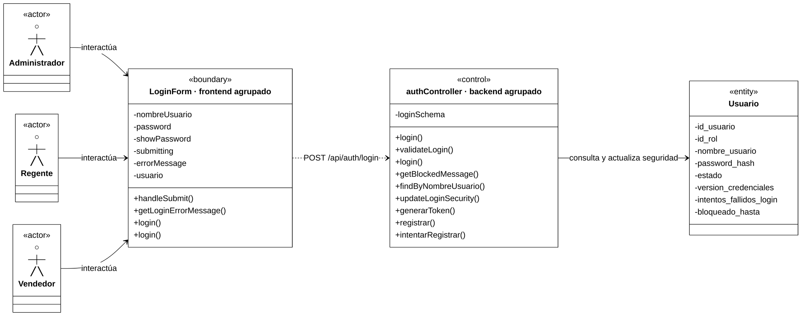
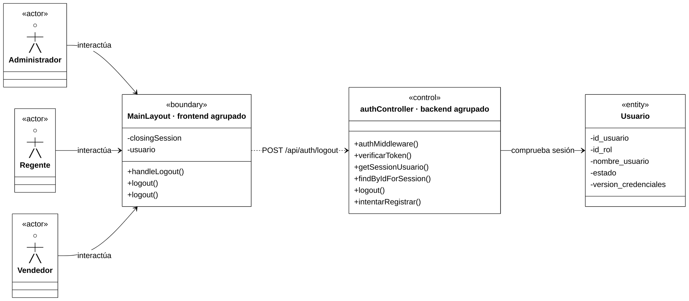
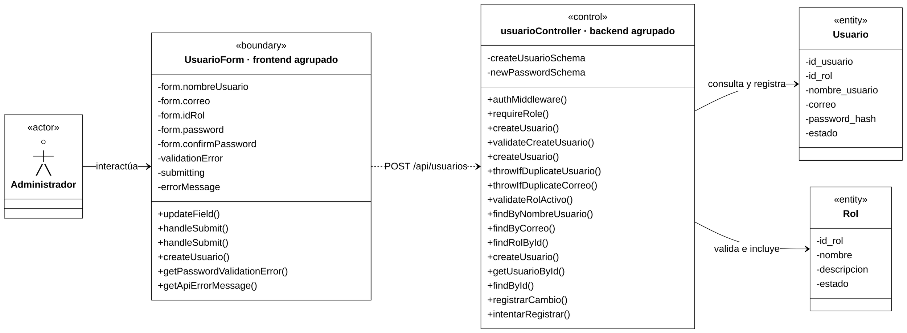
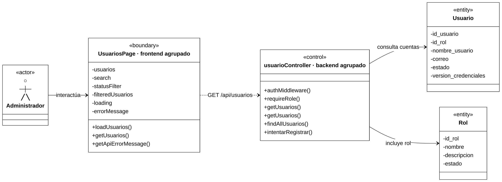
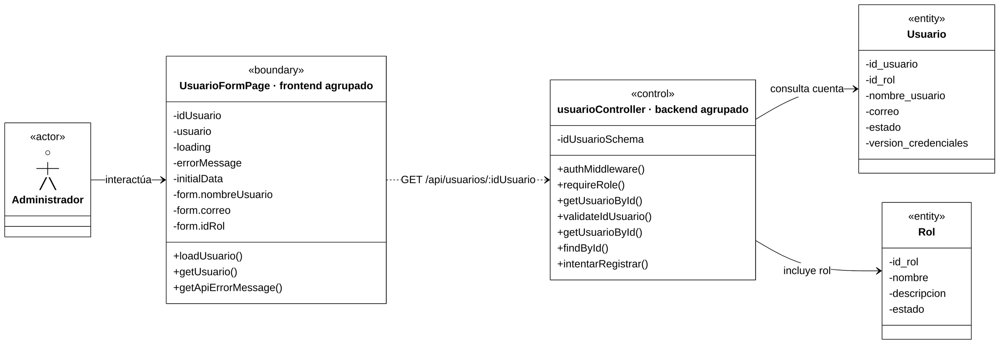
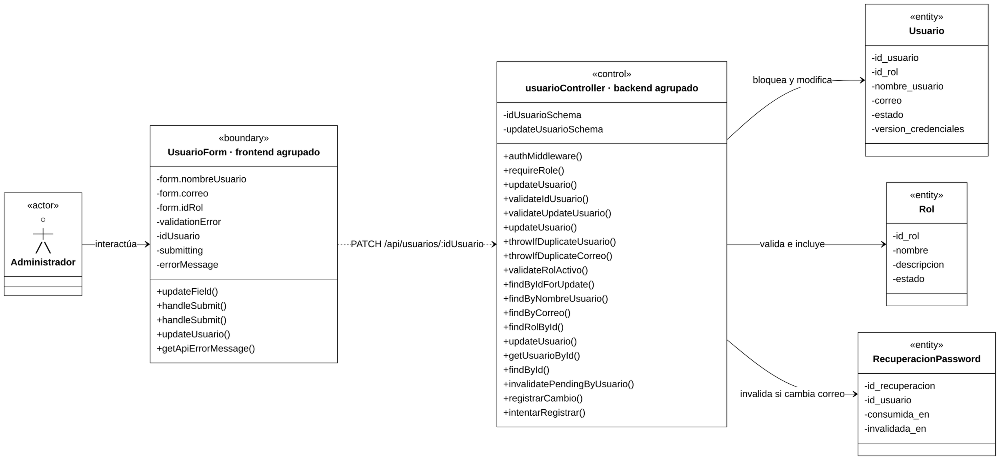
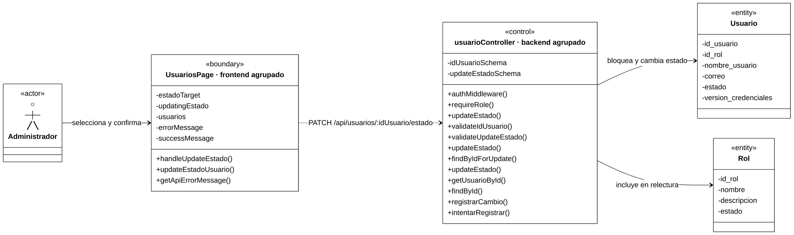
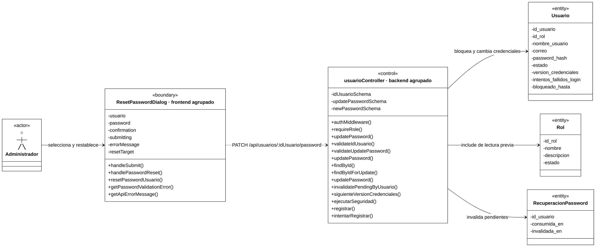
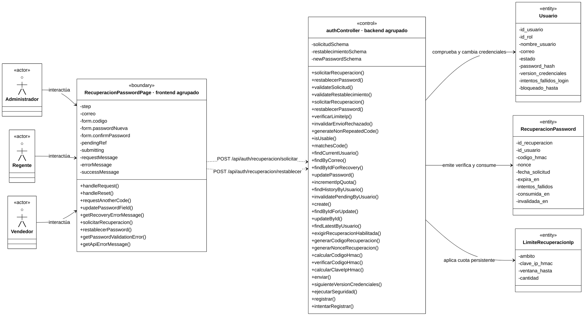

# CADEFAR — ANÁLISIS DE CLASES ACADÉMICO SIMPLIFICADO

Sistema de Información Web para la Administración de Inventario, Ventas y Control de Vencimiento de la Farmacia CADEFAR.

**Materia:** Sistemas de Información I. **Enfoque:** Boundary–Control–Entity (BCE).

**Fuente principal:** [Análisis académico completo](analisis-clases-academico.md), conservado sin modificaciones. Este documento es una versión independiente contrastada con el código actual, no una propuesta de reorganización del software.

**Entrega actual — Fase 1:** CU01–CU09, nueve casos de uso y diez diagramas; CU08 conserva las variantes A y B. La cobertura final prevista del documento fuente es de 33 CU y 34 diagramas. Las fases siguientes se incorporarán en el mismo orden del original, tras su autorización.

## 0. Notación, alcance y lectura

- Cada dibujo tiene actores a la izquierda, **un Boundary**, **un Control** y las entidades pertinentes a la derecha, con distribución `LR` y estilo blanco/negro.
- Boundary y Control son **agrupaciones académicas de funciones**, aunque lleven el nombre del componente o Controller principal. No son clases nuevas ni contienen físicamente todas las operaciones representadas. Una función local React o de módulo sigue siendo una función, no se transforma en método de clase.
- Los métodos muestran su **nombre real y `()`**, sin parámetros ni retornos. Boundary no utiliza etiquetas. En Control solo se distinguen homónimos con `[controller]`/`[service]` y las operaciones principales de Bitácora con `[auditoria]`, siempre después del método. Las etiquetas indican procedencia, no tipos de retorno.
- Los atributos muestran nombres sin tipos. `form.nombreUsuario` identifica la propiedad real de un estado agrupado; no es un atributo persistente nuevo. Los esquemas Zod aparecen como atributos/colaboradores del Control, nunca como métodos ficticios; sus llamadas a safeParse/parse pertenecen a Zod.
- Se conservan funciones homónimas y se localizan mediante la correspondencia inferior. Se seleccionan **métodos funcionalmente relevantes**, no todas las llamadas indirectas: interacción, HTTP, validación, negocio y acceso a datos.
- No se inventan nombres para callbacks anónimos ni setters React. Las bibliotecas no se representan como métodos propios; las reglas internas de contraseña quedan resumidas por getPasswordValidationError y el Validator del backend.
- La relación Boundary–Control **resume** la cadena interfaz → servicio HTTP frontend → Axios común → router/middleware → Controller. No afirma una llamada directa React–Controller. Los endpoints se escriben también fuera del dibujo para conservar literalmente `:idUsuario`.
- La autenticación de rutas y la infraestructura de auditoría se resumen: no se repiten contexto/IP/fechas/JSON/diagnóstico/excepciones. Se mantienen las operaciones principales de auditoría y, cuando explica el objetivo, la autorización. Por el alcance del original no se agrega una Entity de BitacoraAuditoria ni un CU42.
- `requireRole()` es una factory de autorización; `enviar()` pertenece al objeto de transporte de recuperación. No se atribuyen físicamente al Controller principal.
- El GET de restauración `/api/auth/me` es apoyo de arranque, no otra acción del CU01/CU02. La lectura preparatoria de edición corresponde a CU05; la selección de usuarios a CU04. Se conservan las lecturas esenciales de cada operación y se resume la comprobación transversal de sesión mediante authMiddleware.

**Trazabilidad:** las rutas son relativas a la raíz del repositorio. La correspondencia compacta identifica las funciones principales y sus archivos; el análisis completo y el código conservan los detalles técnicos.

**Lectura visual:** los actores usan figura esquemática UML de cabeza, brazos, tronco y piernas, con estereotipo `«actor»`; la clase auxiliar del renderer tiene contorno invisible. Boundary/Control/Entity conservan recuadros UML y compartimentos. Fuente de 18 px; los diagramas extensos se leen a tamaño natural con desplazamiento/zoom, sin reducir la tipografía para hacerlos caber en una página.

**Etiquetas y Mermaid:** el renderer convierte un sufijo ordinario de método en `: retorno`. Para conservar `login() [controller]` sin esa apariencia, los métodos se declaran con `()` y las etiquetas se añaden mediante `themeCSS`. Los comentarios `%% método() [etiqueta]` identifican la fila correspondiente. No se cambian nombres, compartimentos ni firmas; al editar el orden de métodos hay que ajustar sus selectores `nth-child`. La correspondencia textual conserva la procedencia incluso en visores que omitan el CSS personalizado.

La directiva adicional `state.useMaxWidth: false` mantiene el tamaño natural en Mermaid 11.12.0: su renderer de clases usa esa opción para el ancho del SVG. Se conserva también `class.useMaxWidth: false` para otros renderers de clases.

**Correspondencia común** (solo cuando el método aparece en el CU):

| Funciones o atributos | Archivo real |
|---|---|
| `authMiddleware()` / `requireRole()` | `backend/src/presentation/middlewares/auth.middleware.js` / `backend/src/presentation/middlewares/role.middleware.js` |
| `generarToken()`, `verificarToken()` | `backend/src/shared/utils/jwt.js` |
| `siguienteVersionCredenciales()` | `backend/src/shared/utils/credenciales.js` |
| `registrar()`, `registrarCambio()`, `ejecutarSeguridad()`, `intentarRegistrar()` | `backend/src/business/services/bitacora-auditoria.service.js` |
| `getPasswordValidationError()` | `frontend/src/features/usuarios/utils/passwordPolicy.js` |
| `getApiErrorMessage()` | `frontend/src/utils/apiError.js` |
| `newPasswordSchema` | `backend/src/business/validators/password.schema.js` |

**Entidades:** los atributos se contrastan con `backend/src/data/models/usuario.js`, `rol.js`, `recuperacion-password.js` y `limite-recuperacion-ip.js`, según las cajas de cada CU. Los métodos de Repository se agrupan en Control y no se atribuyen a los modelos. Bitácora resume el registro exitoso/cambio y los rechazos o fallos pertinentes, sin exponer su persistencia interna.

## 1. Fase 1 — Autenticación, Usuarios y Recuperación

### CU01 — Iniciar sesión

**Actores:** Administrador, Regente o Vendedor, sin sesión previa requerida. **Endpoint:** `POST /api/auth/login`.

**Colaboración:** formulario → login del Provider → login HTTP → validación → login de negocio. Se consulta la cuenta, se comprueba estado/contraseña/bloqueo y se actualiza su seguridad. El Controller entrega la cookie después del éxito confirmado.

**Correspondencia principal** (las funciones homónimas son distintas):

| Funciones | Archivo real |
|---|---|
| `handleSubmit()`, `getLoginErrorMessage()` | `frontend/src/features/auth/components/LoginForm.jsx` |
| Primer `login()` de Boundary: Provider | `frontend/src/features/auth/context/AuthContext.jsx` |
| Segundo `login()` de Boundary: HTTP | `frontend/src/features/auth/services/auth.service.js` |
| `login() [controller]` | `backend/src/presentation/controllers/auth.controller.js` |
| `validateLogin()`; atributo `loginSchema` | `backend/src/business/validators/auth.validator.js` |
| `login() [service]`, `getBlockedMessage()` | `backend/src/business/services/auth.service.js` |
| `findByNombreUsuario()`, `updateLoginSecurity()` | `backend/src/data/repositories/usuario.repository.js` |

**Aclaraciones:** `generarToken()` y las operaciones de auditoría se localizan en la correspondencia común. El CU es público y no ejecuta authMiddleware; no consulta Rol. El tercer fallo puede bloquear la cuenta; un fallo obligatorio de auditoría revierte el éxito y evita entregar la cookie.

### CU02 — Cerrar sesión

**Actores:** Administrador, Regente o Vendedor autenticado. **Endpoint:** `POST /api/auth/logout`.

**Colaboración:** handleLogout del layout → logout del Provider → logout HTTP. El backend verifica la sesión, elimina la cookie y registra el cierre; el Provider limpia el usuario público.

**Correspondencia principal:**

| Funciones | Archivo real |
|---|---|
| `handleLogout()` | `frontend/src/layouts/MainLayout.jsx` |
| Primer `logout()` de Boundary: Provider | `frontend/src/features/auth/context/AuthContext.jsx` |
| Segundo `logout()` de Boundary: HTTP | `frontend/src/features/auth/services/auth.service.js` |
| `logout() [controller]` | `backend/src/presentation/controllers/auth.controller.js` |
| `getSessionUsuario()` | `backend/src/business/services/auth.service.js` |
| `findByIdForSession()` | `backend/src/data/repositories/usuario.repository.js` |

**Aclaraciones:** AppHeader/AppSidebar reciben handleLogout como prop; no se inventa otro handler. La lectura previa comprueba cuenta activa y versión. No se modifica Usuario ni se revoca un JWT copiado mediante blacklist; el fallo exclusivo de auditoría del cierre no sustituye su respuesta de éxito.

### CU03 — Crear usuario

**Actor:** Administrador autenticado. **Endpoint:** `POST /api/usuarios`.

**Colaboración:** el handleSubmit del formulario valida y llama al handleSubmit de la página; esta envía el alta por HTTP. Control valida entrada, unicidad y rol activo, genera el hash, crea la cuenta y la relee con Rol. Alta y auditoría de éxito comparten transacción.

**Correspondencia principal:**

| Funciones | Archivo real |
|---|---|
| `updateField()`, primer `handleSubmit()` de Boundary | `frontend/src/features/usuarios/components/UsuarioForm.jsx` |
| Segundo `handleSubmit()` de Boundary | `frontend/src/features/usuarios/pages/UsuarioFormPage.jsx` |
| `createUsuario()` de Boundary: HTTP | `frontend/src/features/usuarios/services/usuario.service.js` |
| `createUsuario() [controller]` | `backend/src/presentation/controllers/usuario.controller.js` |
| `validateCreateUsuario()`; `createUsuarioSchema` | `backend/src/business/validators/usuario.validator.js` |
| `createUsuario() [service]`, `getUsuarioById()` y auxiliares de unicidad/rol | `backend/src/business/services/usuario.service.js` |
| Tercer `createUsuario()` de Control, sin etiqueta, y sus consultas | `backend/src/data/repositories/usuario.repository.js` |

**Aclaraciones:** se conservan las tres createUsuario de Control (Controller, Service y Repository). La confirmación no se envía y el actor no asigna ID/estado. newPasswordSchema es un esquema compartido, no un método; los roles de la interfaz proceden de ROLE_OPTIONS.

### CU04 — Consultar usuarios

**Actor:** Administrador autenticado. **Endpoint:** `GET /api/usuarios`.

**Colaboración:** Boundary carga por HTTP y presenta UsuarioTable con filtros locales. Control consulta cuentas con Rol y devuelve datos públicos, también cuando el listado está vacío; luego registra la lectura sensible.

**Correspondencia principal:**

| Funciones | Archivo real |
|---|---|
| `loadUsuarios()`; estado derivado `filteredUsuarios` | `frontend/src/features/usuarios/pages/UsuariosPage.jsx` |
| `getUsuarios()` de Boundary: HTTP | `frontend/src/features/usuarios/services/usuario.service.js` |
| `getUsuarios() [controller]` | `backend/src/presentation/controllers/usuario.controller.js` |
| `getUsuarios() [service]` | `backend/src/business/services/usuario.service.js` |
| `findAllUsuarios()` | `backend/src/data/repositories/usuario.repository.js` |

**Aclaraciones:** no hay Validator HTTP específico ni método aplicarFiltros; los callbacks de filtrado son anónimos. La consulta no modifica cuentas, pero sí genera auditoría. No carga hash ni devuelve version_credenciales; esa versión solo interviene en la comprobación de la sesión del responsable.

### CU05 — Consultar usuario por ID

**Actor:** Administrador autenticado. **Endpoint:** `GET /api/usuarios/:idUsuario`. Se ejecuta al abrir la edición; no hay pantalla independiente de detalle de usuario.

**Colaboración:** loadUsuario, local al efecto de la página, llama al servicio HTTP y alimenta initialData de UsuarioForm. Control valida el ID, consulta con Rol y responde con datos públicos; si no existe la cuenta, produce 404.

**Correspondencia principal:**

| Funciones | Archivo real |
|---|---|
| `loadUsuario()` | `frontend/src/features/usuarios/pages/UsuarioFormPage.jsx` |
| `getUsuario()` de Boundary: HTTP | `frontend/src/features/usuarios/services/usuario.service.js` |
| `getUsuarioById() [controller]` | `backend/src/presentation/controllers/usuario.controller.js` |
| `validateIdUsuario()`; `idUsuarioSchema` | `backend/src/business/validators/usuario.validator.js` |
| `getUsuarioById() [service]` | `backend/src/business/services/usuario.service.js` |
| `findById()` | `backend/src/data/repositories/usuario.repository.js` |

**Aclaraciones:** esta carga preparatoria no ejecuta los handlers de envío de CU06. El GET registra una lectura sensible una sola vez, sin modificar la cuenta; version_credenciales pertenece aquí a la comprobación de la sesión del responsable.

### CU06 — Modificar usuario

**Actor:** Administrador autenticado. **Endpoint:** `PATCH /api/usuarios/:idUsuario`. La carga preparatoria se documenta en CU05.

**Colaboración:** formulario → handler de página → HTTP. Control valida los campos recibidos, bloquea la cuenta, comprueba unicidad/rol, modifica y relee con Rol. Si cambia efectivamente el correo, invalida recuperaciones pendientes; cambio, invalidación y auditoría de éxito comparten transacción.

**Correspondencia principal:**

| Funciones | Archivo real |
|---|---|
| `updateField()`, primer `handleSubmit()` de Boundary | `frontend/src/features/usuarios/components/UsuarioForm.jsx` |
| Segundo `handleSubmit()` de Boundary | `frontend/src/features/usuarios/pages/UsuarioFormPage.jsx` |
| `updateUsuario()` de Boundary: HTTP | `frontend/src/features/usuarios/services/usuario.service.js` |
| `updateUsuario() [controller]` | `backend/src/presentation/controllers/usuario.controller.js` |
| `validateIdUsuario()`, `validateUpdateUsuario()` y sus esquemas | `backend/src/business/validators/usuario.validator.js` |
| `updateUsuario() [service]`, `getUsuarioById()` y auxiliares de unicidad/rol | `backend/src/business/services/usuario.service.js` |
| Tercer `updateUsuario()` de Control y consultas de cuenta/rol | `backend/src/data/repositories/usuario.repository.js` |
| `invalidatePendingByUsuario()` | `backend/src/data/repositories/recuperacion-password.repository.js` |

**Aclaraciones:** correo omitido o sin cambio conserva recuperaciones pendientes. No cambia contraseña, estado ni versión de credenciales; esta última solo participa en el acceso del responsable. Se describe la transacción sin inventar un método ejecutarTransaccion.

### CU07 — Activar o desactivar usuario

**Actor:** Administrador autenticado. **Endpoint:** `PATCH /api/usuarios/:idUsuario/estado`.

**Colaboración:** UsuarioTable selecciona estadoTarget con callback inline; ConfirmDialog recibe handleUpdateEstado como onConfirm. Tras confirmar, Boundary envía el nuevo estado. Control bloquea la cuenta, modifica estado, relee con Rol y registra el cambio en la misma transacción.

**Correspondencia principal:**

| Funciones | Archivo real |
|---|---|
| `handleUpdateEstado()` | `frontend/src/features/usuarios/pages/UsuariosPage.jsx` |
| `updateEstadoUsuario()` de Boundary: HTTP | `frontend/src/features/usuarios/services/usuario.service.js` |
| `updateEstado() [controller]` | `backend/src/presentation/controllers/usuario.controller.js` |
| `validateIdUsuario()`, `validateUpdateEstado()` y sus esquemas | `backend/src/business/validators/usuario.validator.js` |
| `updateEstado() [service]`, `getUsuarioById()` | `backend/src/business/services/usuario.service.js` |
| Tercer `updateEstado()` de Control, `findByIdForUpdate()`, `findById()` | `backend/src/data/repositories/usuario.repository.js` |

**Diferencia verificada:** la lectura inicial actual es findByIdForUpdate, sin Rol; findById carga Rol en la relectura. El estado administrativo no es el bloqueo temporal del login. El flujo no implementa una prohibición de desactivar la propia cuenta o al último Administrador.

### CU08 — Cambiar contraseña

Se conservan dos diagramas, en el orden original, por sus permisos/validación/cookies distintos.

#### Variante A — Cambio propio

**Actores:** Administrador, Regente o Vendedor autenticado. **Endpoint:** `PATCH /api/usuarios/me/password`.

```mermaid
%%{init: {"theme":"base","htmlLabels":true,"markdownAutoWrap":false,"class":{"useMaxWidth":false},"themeCSS":".node.actor .label-container path{stroke:none!important;fill:none!important;} .node.actor .divider{display:none;} .nodeLabel{color:#000000!important;} .node .label div{display:table-cell!important;white-space:nowrap!important;max-width:none!important;} .control .methods-group .label:nth-child(2) p::after{content:\" [controller]\";} .control .methods-group .label:nth-child(4) p::after{content:\" [service]\";} .control .methods-group .label:nth-child(11) p::after{content:\" [auditoria]\";} .control .methods-group .label:nth-child(12) p::after{content:\" [auditoria]\";} .control .methods-group .label:nth-child(13) p::after{content:\" [auditoria]\";}","themeVariables":{"background":"#ffffff","primaryColor":"#ffffff","primaryTextColor":"#000000","primaryBorderColor":"#000000","secondaryColor":"#ffffff","tertiaryColor":"#ffffff","lineColor":"#000000","textColor":"#000000","fontFamily":"Arial","fontSize":"18px"}}}%%
%%{init: {"state":{"useMaxWidth":false}}}%%
classDiagram
    direction LR
    class Administrador["○<br/>─┼─<br/>╱ ╲<br/>Administrador"]
    class Regente["○<br/>─┼─<br/>╱ ╲<br/>Regente"]
    class Vendedor["○<br/>─┼─<br/>╱ ╲<br/>Vendedor"]
    class Administrador { <<actor>> }
    class Regente { <<actor>> }
    class Vendedor { <<actor>> }
    class Boundary["ChangeOwnPasswordDialog · frontend agrupado"] {
        <<boundary>>
        -form.passwordActual
        -form.passwordNueva
        -form.confirmPassword
        -submitting
        -errorMessage
        -successMessage
        -passwordDialogOpen
        +updateField()
        +handleSubmit()
        +updateOwnPassword()
        +getPasswordValidationError()
        +getApiErrorMessage()
    }
    class Control["usuarioController · backend agrupado"] {
        <<control>>
        -updateOwnPasswordSchema
        -newPasswordSchema
        +authMiddleware()
        %% updateOwnPassword() [controller]
        +updateOwnPassword()
        +validateUpdateOwnPassword()
        %% updateOwnPassword() [service]
        +updateOwnPassword()
        +requireCurrentCredentials()
        +findByIdWithPassword()
        +updatePassword()
        +invalidatePendingByUsuario()
        +siguienteVersionCredenciales()
        +generarToken()
        %% ejecutarSeguridad() [auditoria]
        +ejecutarSeguridad()
        %% registrar() [auditoria]
        +registrar()
        %% intentarRegistrar() [auditoria]
        +intentarRegistrar()
    }
    class Usuario {
        <<entity>>
        -id_usuario
        -id_rol
        -nombre_usuario
        -password_hash
        -estado
        -version_credenciales
        -intentos_fallidos_login
        -bloqueado_hasta
    }
    class RecuperacionPassword {
        <<entity>>
        -id_usuario
        -consumida_en
        -invalidada_en
    }
    Administrador --> Boundary : interactúa
    Regente --> Boundary : interactúa
    Vendedor --> Boundary : interactúa
    Boundary ..> Control : PATCH /api/usuarios/me/password
    Control --> Usuario : revalida y cambia credenciales
    Control --> RecuperacionPassword : invalida pendientes
    cssClass "Control" control
    classDef actor fill:#ffffff,stroke-width:0px,color:#000000
    cssClass "Administrador,Regente,Vendedor" actor
```

**Colaboración:** MainLayout abre el diálogo con callback inline. Boundary valida y envía contraseña actual/nueva por HTTP. Control compara la actual y revalida estado/hash/versión bajo bloqueo; cambia credenciales, invalida recuperaciones y audita. La firma se prepara antes del commit y el Controller renueva la cookie después del éxito.

**Correspondencia principal:**

| Funciones | Archivo real |
|---|---|
| `updateField()`, `handleSubmit()` | `frontend/src/features/usuarios/components/ChangeOwnPasswordDialog.jsx` |
| `updateOwnPassword()` de Boundary: HTTP | `frontend/src/features/usuarios/services/usuario.service.js` |
| `updateOwnPassword() [controller]` | `backend/src/presentation/controllers/usuario.controller.js` |
| `validateUpdateOwnPassword()`; `updateOwnPasswordSchema` | `backend/src/business/validators/usuario.validator.js` |
| `updateOwnPassword() [service]`, `requireCurrentCredentials()` | `backend/src/business/services/usuario.service.js` |
| `findByIdWithPassword()`, `updatePassword()` | `backend/src/data/repositories/usuario.repository.js` |
| `invalidatePendingByUsuario()` | `backend/src/data/repositories/recuperacion-password.repository.js` |

**Aclaraciones:** no intervienen requireRole, Rol ni login del Provider. newPasswordSchema se aplica a la contraseña nueva; confirmPassword no se envía. El cambio renueva esta cookie y vuelve obsoletas las versiones anteriores. Un fallo de firma o auditoría obligatoria revierte el cambio.

#### Variante B — Restablecimiento administrativo

**Actor:** Administrador autenticado. **Endpoint:** `PATCH /api/usuarios/:idUsuario/password`. La selección previa del listado pertenece a CU04.

**Colaboración:** el diálogo valida y envía la nueva contraseña; handlePasswordReset es el callback de éxito de la página, no otra petición. Control valida ID/body, consulta previamente con Rol y bloquea después; cambia hash/versión, limpia seguridad e invalida recuperaciones con auditoría transaccional.

**Correspondencia principal:**

| Funciones | Archivo real |
|---|---|
| `handleSubmit()` | `frontend/src/features/usuarios/components/ResetPasswordDialog.jsx` |
| `handlePasswordReset()` | `frontend/src/features/usuarios/pages/UsuariosPage.jsx` |
| `resetPasswordUsuario()` de Boundary: HTTP | `frontend/src/features/usuarios/services/usuario.service.js` |
| `updatePassword() [controller]` | `backend/src/presentation/controllers/usuario.controller.js` |
| `validateIdUsuario()`, `validateUpdatePassword()` y sus esquemas | `backend/src/business/validators/usuario.validator.js` |
| `updatePassword() [service]` | `backend/src/business/services/usuario.service.js` |
| Tercer `updatePassword()` de Control, `findById()`, `findByIdForUpdate()` | `backend/src/data/repositories/usuario.repository.js` |
| `invalidatePendingByUsuario()` | `backend/src/data/repositories/recuperacion-password.repository.js` |

**Diferencia verificada:** usuarioService.getUsuarioById no participa actualmente; se excluye. Rol permanece porque findById del Repository lo incluye. No compara contraseña anterior ni renueva cookie; el campo enviado es password y confirmation solo se valida en la interfaz.

### CU09 — Restablecer contraseña mediante correo electrónico

**Actores:** Administrador, Regente o Vendedor que olvidó su contraseña; acceso público. **Endpoints:** `POST /api/auth/recuperacion/solicitar` y `POST /api/auth/recuperacion/restablecer`. Se conserva un diagrama para ambos recorridos, como en el original.

**Colaboración:** Boundary reúne solicitud y restablecimiento, con sus dos funciones HTTP. Control valida, aplica cuotas, emite un código protegido y lo envía; después verifica su vigencia/uso/intentos y cambia credenciales al consumirlo. Los auxiliares conservados expresan esas reglas, no los detalles internos del transporte.

**Correspondencia principal:**

| Funciones | Archivo real |
|---|---|
| `handleRequest()`, `handleReset()`, `requestAnotherCode()`, `updatePasswordField()`, `getRecoveryErrorMessage()` | `frontend/src/features/auth/pages/RecuperacionPasswordPage.jsx` |
| `solicitarRecuperacion()`, `restablecerPassword()` de Boundary: HTTP | `frontend/src/features/auth/services/auth.service.js` |
| Ambas acciones `[controller]` | `backend/src/presentation/controllers/auth.controller.js` |
| `validateSolicitud()`, `validateRestablecimiento()` y sus esquemas | `backend/src/business/validators/recuperacion-password.validator.js` |
| Ambas acciones `[service]`, `verificarLimiteIp()`, `invalidarEnvioRechazado()` y auxiliares de código/vigencia/cuenta | `backend/src/business/services/recuperacion-password.service.js` |
| `findByCorreo()`, `findByIdForRecovery()`, `updatePassword()` | `backend/src/data/repositories/usuario.repository.js` |
| `incrementIpQuota()`, `findHistoryByUsuario()`, `invalidatePendingByUsuario()`, `create()`, `findByIdForUpdate()`, `updateById()`, `findLatestByUsuario()` | `backend/src/data/repositories/recuperacion-password.repository.js` |
| `exigirRecuperacionHabilitada()` | `backend/src/shared/utils/recuperacion-config.js` |
| Generación de código/nonce y cálculo/verificación de HMAC del dibujo | `backend/src/shared/utils/recuperacion-crypto.js` |
| `enviar()` del objeto de transporte | `backend/src/shared/utils/recuperacion-mail.js` |

**Caminos importantes:**

- Solicitud: consume cuota IP, busca cuenta y comprueba activa/correo/cuota de cuenta bajo bloqueo; emite código no repetido y protegido, invalida pendientes y confirma antes del único envío. Desconocido/inactivo/supresión reciben respuesta genérica. esperarRespuesta se ejecuta en finally del bloque admitido, no ante cualquier rechazo previo.
- Envío: aceptación técnica no garantiza entrega; rechazo explícito invalida esa emisión mediante invalidarEnvioRechazado, con bloqueo/revalidación de nonce. Timeout/red/resultado ambiguo conservan código hasta vencer; no hay reenvío automático.
- Restablecimiento: consume cuota IP, comprueba código/estado/vigencia/fallos en una transacción corta; confirma fallos antes del error público. Calcula bcrypt fuera del bloqueo y vuelve a revalidar cuenta/código/versión; cambia credenciales, consume/invalida y audita éxito en transacción. No reactiva cuenta ni cambia rol.

**Aclaraciones:** no hay endpoint separado para verificar código, authMiddleware, requireRole ni login automático. requestAnotherCode vuelve al formulario sin enviar automáticamente. findByIdForUpdate pertenece aquí al Repository de recuperación, no al de usuarios. LimiteRecuperacionIp aplica cuotas HMAC por ámbito/IP y no tiene FK de Usuario. El envío requiere recuperación habilitada y transporte configurado; se representa enviar, sin desplegar sus ramas internas.

## 2. Cierre de Fase 1 y diferencias verificadas

| Caso de uso | Diagramas | Variante / alcance |
|---|---|---|
| CU01 — Iniciar sesión | 1 | Formulario/Provider/HTTP; seguridad de login. |
| CU02 — Cerrar sesión | 1 | Layout/Provider/HTTP y comprobación de sesión. |
| CU03 — Crear usuario | 1 | Validación/unicidad/rol/alta transaccional. |
| CU04 — Consultar usuarios | 1 | Listado y filtros locales, lectura sensible auditada. |
| CU05 — Consultar usuario por ID | 1 | Carga preparatoria/ID/DTO. |
| CU06 — Modificar usuario | 1 | Edición e invalidación condicional por correo. |
| CU07 — Activar o desactivar usuario | 1 | Bloqueo actual/estado y relectura. |
| CU08 — Cambiar contraseña | 2 | A: propia con cookie renovada; B: administrativa sin renovación. |
| CU09 — Restablecer contraseña mediante correo electrónico | 1 | Solicitud/envío y verificación/consumo públicos. |
| **Total de la entrega** | **10** | **9/33 CU y 10/34 diagramas previstos.** |

**Diferencias frente al documento completo, sin corregirlo:**

1. Se agrupan funciones de múltiples archivos en una única Boundary y un único Control por diagrama, seleccionadas por relevancia funcional. Se conservan handlers, Provider cuando participa, HTTP, validación, negocio, Repository y auxiliares esenciales; se resumen hooks/guards e infraestructura secundaria.
2. Se suprimen parámetros, retornos y tipos de atributos exclusivamente en esta representación. Se eliminan todos los prefijos de procedencia; solo se usan etiquetas posteriores [controller], [service] y [auditoria], sin apariencia de retorno. Los homónimos permanecen separados y se localizan en las correspondencias compactas.
3. Se muestran únicamente atributos pertinentes: por ejemplo CU02 no necesita hash, CU06 no consulta código/HMAC y CU08 propio no consulta correo/Rol. Los campos restantes siguen existiendo en los modelos, sin cambios al software.
4. CU07 ahora emplea findByIdForUpdate inicialmente, sin Rol; findById incluye Rol después. CU08-B no ejecuta getUsuarioById del Service, aunque sí consulta previamente con findById del Repository y conserva Rol como participante.
5. Las capturas actuales de autenticación/usuarios/seguridad se resumen mediante las operaciones principales de auditoría pertinentes a cada CU. Las lecturas CU04/CU05 no modifican cuentas, pero sí generan eventos transversales. Se conserva el alcance de entidades del original, sin agregar una Entity ni un CU de Bitácora.
6. Las firmas actuales incorporan contexto de auditoría/transacción/seguimiento que el original no siempre incluía; no se exhiben parámetros en los nuevos diagramas ni se copian firmas desactualizadas. El rollback se explica como comportamiento de transacciones Sequelize, sin inventar un método del proyecto.

**Fuentes de contraste:** AGENTS.md de raíz, backend y frontend; secciones de autenticación/usuarios/recuperación de `contexto-maestro.md`, `casos-uso.md`, `requerimientos.md`, `reglas-negocio.md`; rutas/controllers/services/repositories/validators/modelos y frontend enumerados en cada tabla. Los prefijos HTTP se comprueban en `backend/src/app.js`, `backend/src/presentation/routes/auth.router.js` y `backend/src/presentation/routes/usuario.router.js`; Axios común en `frontend/src/api/api.js`, con envío de cookies; permisos visuales en `frontend/src/app/router.jsx`.

**Validación documental de esta entrega:** nueve títulos CU y diez diagramas con las dos variantes de CU08, en el orden fuente; un Boundary/un Control por diagrama, actores/entidades y servicios HTTP presentes; métodos reales sin parámetros/retornos, atributos sin tipos y etiquetas limitadas a las tres autorizadas. Se reutiliza el contraste previo de nombres/participación y se revisan puntualmente las dudas. Se comprueban Mermaid, vistas previas de CU01/CU03, formato y conservación del original mediante SHA-256; git diff --check incluye el archivo nuevo. No se ejecutan pruebas funcionales ni se accede a MySQL para esta corrección documental.

**Próxima fase acordada:** CU10–CU13 — Proveedores y Laboratorios, cuatro diagramas. Esta entrega no anticipa contenido de fases aún no autorizadas.
