# CADEFAR — ANÁLISIS DE CLASES ACADÉMICO SIMPLIFICADO

Sistema de Información Web para la Administración de Inventario, Ventas y Control de Vencimiento de la Farmacia CADEFAR.

**Materia:** Sistemas de Información I. **Enfoque:** Boundary–Control–Entity (BCE).

**Fuente principal:** [Análisis académico completo](analisis-clases-academico.md), conservado sin modificaciones. Este documento es una versión independiente contrastada con el código actual, no una propuesta de reorganización del software.

**Estado actual — limpieza integral:** los 35 diagramas existentes cubren 34 casos de uso: CU01–CU27, CU33–CU37, CU40 y CU42; CU08 conserva las variantes A y B. Se depuran métodos y atributos secundarios, reutilizando las correspondencias y verificaciones aprobadas de Fases 1–6. Se conserva la cobertura de 33 CU/34 diagramas del documento fuente y CU42 — Bitácora, agregado por autorización explícita del usuario.

## 0. Notación, alcance y lectura

- Cada dibujo tiene actores a la izquierda, **un Boundary**, **un Control** y las entidades pertinentes a la derecha, con distribución `LR` y estilo blanco/negro.
- Boundary y Control son **agrupaciones académicas de funciones**, aunque lleven el nombre del componente o Controller principal. No son clases nuevas ni contienen físicamente todas las operaciones representadas. Una función local React o de módulo sigue siendo una función, no se transforma en método de clase.
- Los métodos muestran su **nombre real y `()`**, sin parámetros ni retornos. Boundary no utiliza etiquetas. En Control solo se distinguen homónimos con `[controller]`/`[service]` y las operaciones principales de Bitácora con `[auditoria]`, siempre después del método. Las etiquetas indican procedencia, no tipos de retorno.
- Los atributos muestran nombres sin tipos. `form.nombreUsuario` identifica una propiedad real del formulario, no una columna persistente nueva. Boundary conserva datos relevantes del formulario, selección o consulta; Entity conserva los atributos pertinentes al CU. Control no muestra esquemas Zod ni otros atributos técnicos; se conservan los métodos reales de validación.
- Se conservan funciones homónimas y se localizan mediante la correspondencia inferior. Se seleccionan **métodos funcionalmente relevantes**, no todas las llamadas indirectas: interacción, HTTP, validación, negocio y acceso a datos.
- No se inventan nombres para callbacks anónimos ni setters React. Las bibliotecas no se representan como métodos propios; las reglas internas de contraseña quedan resumidas por getPasswordValidationError y el Validator del backend.
- La relación Boundary–Control **resume** la cadena interfaz → servicio HTTP frontend → Axios común → router/middleware → Controller. No afirma una llamada directa React–Controller. Los endpoints se escriben también fuera del dibujo para conservar literalmente `:idUsuario`.
- La autenticación de rutas y la infraestructura de auditoría se resumen: no se repiten contexto/IP/fechas/JSON/diagnóstico/excepciones. Se mantienen las operaciones principales de auditoría y, cuando explica el objetivo, la autorización. Por ampliación explícita del alcance en Fase 6 se incorpora CU42 y su Entity BitacoraAuditoria; los diagramas anteriores conservan su alcance aprobado.
- `requireRole()` es una factory de autorización; `enviar()` pertenece al objeto de transporte de recuperación. No se atribuyen físicamente al Controller principal.
- El GET de restauración `/api/auth/me` es apoyo de arranque, no otra acción del CU01/CU02. La lectura preparatoria de edición corresponde a CU05; la selección de usuarios a CU04. Autenticación y autorización siguen aplicándose en routers/middlewares y se explican en las condiciones compartidas, sin repetir sus métodos en todos los recuadros Control.

**Trazabilidad:** las rutas son relativas a la raíz del repositorio. La correspondencia compacta identifica las funciones principales y sus archivos; el análisis completo y el código conservan los detalles técnicos.

**Lectura visual:** los actores usan figura esquemática UML de cabeza, brazos, tronco y piernas, con estereotipo `«actor»`; la clase auxiliar del renderer tiene contorno invisible. Boundary/Control/Entity conservan recuadros UML y compartimentos. Fuente de 18 px; los diagramas extensos se leen a tamaño natural con desplazamiento/zoom, sin reducir la tipografía para hacerlos caber en una página.

**Etiquetas y Mermaid:** el renderer convierte un sufijo ordinario de método en `: retorno`. Para conservar `login() [controller]` sin esa apariencia, los métodos se declaran con `()` y las etiquetas se añaden mediante `themeCSS`. Los comentarios `%% método() [etiqueta]` identifican la fila correspondiente. No se cambian nombres, compartimentos ni firmas; al editar el orden de métodos hay que ajustar sus selectores `nth-child`. La correspondencia textual conserva la procedencia incluso en visores que omitan el CSS personalizado.

La directiva adicional `state.useMaxWidth: false` mantiene el tamaño natural en Mermaid 11.12.0: su renderer de clases usa esa opción para el ancho del SVG. Se conserva también `class.useMaxWidth: false` para otros renderers de clases.

**Correspondencia común** (solo cuando el método aparece en el CU):

| Funciones o atributos | Archivo real |
|---|---|
| `generarToken()` | `backend/src/shared/utils/jwt.js` |
| `registrar()`, `registrarCambio()`, `ejecutarSeguridad()`, `ejecutarCambio()`, `intentarRegistrar()` | `backend/src/business/services/bitacora-auditoria.service.js` |
| `getPasswordValidationError()` | `frontend/src/features/usuarios/utils/passwordPolicy.js` |

**Entidades:** los atributos se contrastan con los modelos de `backend/src/data/models/` identificados en cada fase, según las cajas de cada CU. Los métodos de Repository se agrupan en Control y no se atribuyen a los modelos. Bitácora resume el registro exitoso/cambio y los rechazos o fallos pertinentes, sin exponer su persistencia interna.

**Alcance de la depuración:** se conservan handlers principales, HTTP, validaciones, negocio, acceso a datos y operaciones principales de auditoría. Se resumen cableado de campos/hooks, errores genéricos, formato, serialización, utilidades criptográficas internas y relecturas auxiliares de respuesta; sus reglas permanecen explicadas en cada CU. toPublicInventario/toPublicExistencias se mantienen por calcular sumas y vendibilidad, no por su formato. Las comprobaciones y cantidades registradas al cerrar cada fase son antecedentes anteriores a esta limpieza; la verificación vigente figura al final.

## 1. Fase 1 — Autenticación, Usuarios y Recuperación

### CU01 — Iniciar sesión

**Actores:** Administrador, Regente o Vendedor, sin sesión previa requerida. **Endpoint:** `POST /api/auth/login`.

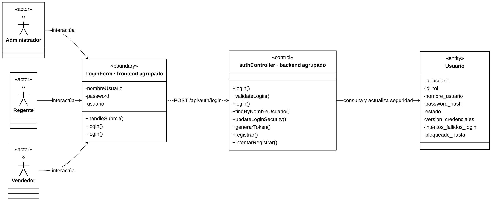

**Colaboración:** formulario → login del Provider → login HTTP → validación → login de negocio. Se consulta la cuenta, se comprueba estado/contraseña/bloqueo y se actualiza su seguridad. El Controller entrega la cookie después del éxito confirmado.

**Correspondencia principal** (las funciones homónimas son distintas):

| Funciones | Archivo real |
|---|---|
| `handleSubmit()` | `frontend/src/features/auth/components/LoginForm.jsx` |
| Primer `login()` de Boundary: Provider | `frontend/src/features/auth/context/AuthContext.jsx` |
| Segundo `login()` de Boundary: HTTP | `frontend/src/features/auth/services/auth.service.js` |
| `login() [controller]` | `backend/src/presentation/controllers/auth.controller.js` |
| `validateLogin()` | `backend/src/business/validators/auth.validator.js` |
| `login() [service]` | `backend/src/business/services/auth.service.js` |
| `findByNombreUsuario()`, `updateLoginSecurity()` | `backend/src/data/repositories/usuario.repository.js` |

**Aclaraciones:** `generarToken()` y las operaciones de auditoría se localizan en la correspondencia común. El CU es público y no ejecuta authMiddleware; no consulta Rol. El tercer fallo puede bloquear la cuenta; un fallo obligatorio de auditoría revierte el éxito y evita entregar la cookie.

### CU02 — Cerrar sesión

**Actores:** Administrador, Regente o Vendedor autenticado. **Endpoint:** `POST /api/auth/logout`.

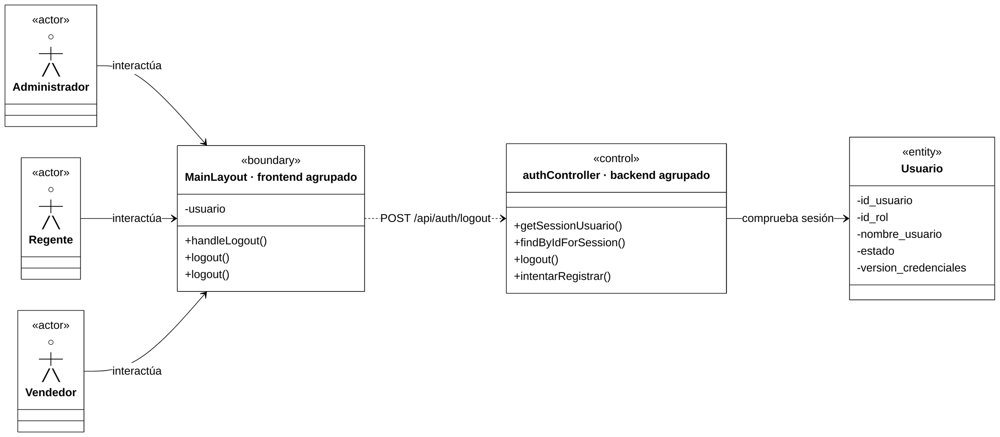

**Colaboración:** handleLogout del layout → logout del Provider → logout HTTP. El backend verifica la sesión, elimina la cookie y registra el cierre; el Provider limpia el usuario público.

**Correspondencia principal:**

| Funciones | Archivo real |
|---|---|
| `handleLogout()` | `frontend/src/layouts/MainLayout.jsx` |
| Primer `logout()` de Boundary: Provider | `frontend/src/features/auth/context/AuthContext.jsx` |
| Segundo `logout()` de Boundary: HTTP | `frontend/src/features/auth/services/auth.service.js` |
| `logout() [controller]` | `backend/src/presentation/controllers/auth.controller.js` |
| `getSessionUsuario()` | `backend/src/business/services/auth.service.js` |
| `findByIdForSession()` | `backend/src/data/repositories/usuario.repository.js` |

**Aclaraciones:** AppHeader/AppSidebar reciben handleLogout como prop; no se inventa otro handler. La lectura previa comprueba cuenta activa y versión. No se modifica Usuario ni se revoca un JWT copiado mediante blacklist; el fallo exclusivo de auditoría del cierre no sustituye su respuesta de éxito.

### CU03 — Crear usuario

**Actor:** Administrador autenticado. **Endpoint:** `POST /api/usuarios`.

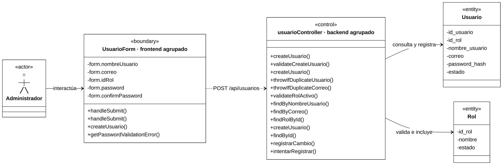

**Colaboración:** el handleSubmit del formulario valida y llama al handleSubmit de la página; esta envía el alta por HTTP. Control valida entrada, unicidad y rol activo, genera el hash, crea la cuenta y la relee con Rol. Alta y auditoría de éxito comparten transacción.

**Correspondencia principal:**

| Funciones | Archivo real |
|---|---|
| primer `handleSubmit()` de Boundary | `frontend/src/features/usuarios/components/UsuarioForm.jsx` |
| Segundo `handleSubmit()` de Boundary | `frontend/src/features/usuarios/pages/UsuarioFormPage.jsx` |
| `createUsuario()` de Boundary: HTTP | `frontend/src/features/usuarios/services/usuario.service.js` |
| `createUsuario() [controller]` | `backend/src/presentation/controllers/usuario.controller.js` |
| `validateCreateUsuario()` | `backend/src/business/validators/usuario.validator.js` |
| `createUsuario() [service]` y auxiliares de unicidad/rol | `backend/src/business/services/usuario.service.js` |
| Tercer `createUsuario()` de Control, sin etiqueta, y sus consultas | `backend/src/data/repositories/usuario.repository.js` |

**Aclaraciones:** se conservan las tres createUsuario de Control (Controller, Service y Repository). La confirmación no se envía y el actor no asigna ID/estado. newPasswordSchema es un esquema compartido, no un método; los roles de la interfaz proceden de ROLE_OPTIONS.

### CU04 — Consultar usuarios

**Actor:** Administrador autenticado. **Endpoint:** `GET /api/usuarios`.

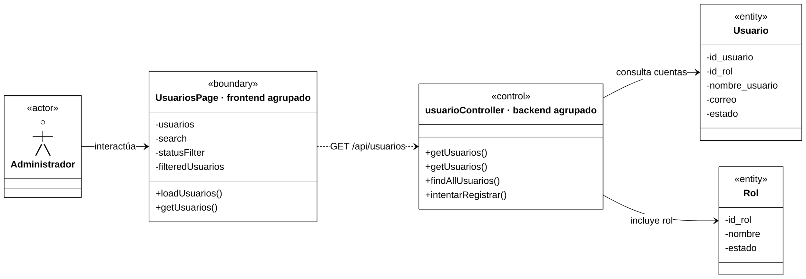

**Colaboración:** Boundary carga por HTTP y presenta UsuarioTable con filtros locales. Control consulta cuentas con Rol y devuelve datos públicos, también cuando el listado está vacío; luego registra la lectura sensible.

**Correspondencia principal:**

| Funciones | Archivo real |
|---|---|
| `loadUsuarios()`; estado derivado `filteredUsuarios` | `frontend/src/features/usuarios/pages/UsuariosPage.jsx` |
| `getUsuarios()` de Boundary: HTTP | `frontend/src/features/usuarios/services/usuario.service.js` |
| `getUsuarios() [controller]` | `backend/src/presentation/controllers/usuario.controller.js` |
| `getUsuarios() [service]` | `backend/src/business/services/usuario.service.js` |
| `findAllUsuarios()` | `backend/src/data/repositories/usuario.repository.js` |

**Aclaraciones:** no hay Validator HTTP específico ni método aplicarFiltros; los callbacks de filtrado son anónimos. La consulta no modifica cuentas, pero sí genera auditoría. No carga hash ni devuelve version_credenciales; esa versión solo interviene en la comprobación de la sesión del responsable.

### CU05 — Consultar usuario por ID

**Actor:** Administrador autenticado. **Endpoint:** `GET /api/usuarios/:idUsuario`. Se ejecuta al abrir la edición; no hay pantalla independiente de detalle de usuario.

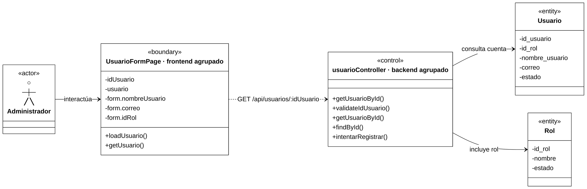

**Colaboración:** loadUsuario, local al efecto de la página, llama al servicio HTTP y alimenta initialData de UsuarioForm. Control valida el ID, consulta con Rol y responde con datos públicos; si no existe la cuenta, produce 404.

**Correspondencia principal:**

| Funciones | Archivo real |
|---|---|
| `loadUsuario()` | `frontend/src/features/usuarios/pages/UsuarioFormPage.jsx` |
| `getUsuario()` de Boundary: HTTP | `frontend/src/features/usuarios/services/usuario.service.js` |
| `getUsuarioById() [controller]` | `backend/src/presentation/controllers/usuario.controller.js` |
| `validateIdUsuario()` | `backend/src/business/validators/usuario.validator.js` |
| `getUsuarioById() [service]` | `backend/src/business/services/usuario.service.js` |
| `findById()` | `backend/src/data/repositories/usuario.repository.js` |

**Aclaraciones:** esta carga preparatoria no ejecuta los handlers de envío de CU06. El GET registra una lectura sensible una sola vez, sin modificar la cuenta; version_credenciales pertenece aquí a la comprobación de la sesión del responsable.

### CU06 — Modificar usuario

**Actor:** Administrador autenticado. **Endpoint:** `PATCH /api/usuarios/:idUsuario`. La carga preparatoria se documenta en CU05.

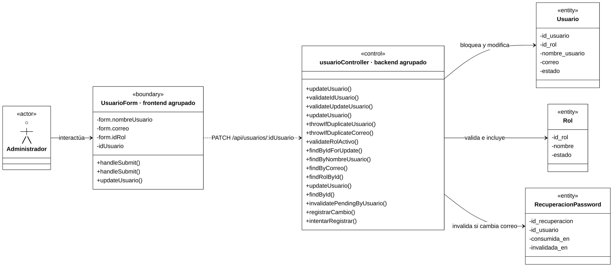

**Colaboración:** formulario → handler de página → HTTP. Control valida los campos recibidos, bloquea la cuenta, comprueba unicidad/rol, modifica y relee con Rol. Si cambia efectivamente el correo, invalida recuperaciones pendientes; cambio, invalidación y auditoría de éxito comparten transacción.

**Correspondencia principal:**

| Funciones | Archivo real |
|---|---|
| primer `handleSubmit()` de Boundary | `frontend/src/features/usuarios/components/UsuarioForm.jsx` |
| Segundo `handleSubmit()` de Boundary | `frontend/src/features/usuarios/pages/UsuarioFormPage.jsx` |
| `updateUsuario()` de Boundary: HTTP | `frontend/src/features/usuarios/services/usuario.service.js` |
| `updateUsuario() [controller]` | `backend/src/presentation/controllers/usuario.controller.js` |
| `validateIdUsuario()`, `validateUpdateUsuario()` | `backend/src/business/validators/usuario.validator.js` |
| `updateUsuario() [service]` y auxiliares de unicidad/rol | `backend/src/business/services/usuario.service.js` |
| Tercer `updateUsuario()` de Control y consultas de cuenta/rol | `backend/src/data/repositories/usuario.repository.js` |
| `invalidatePendingByUsuario()` | `backend/src/data/repositories/recuperacion-password.repository.js` |

**Aclaraciones:** correo omitido o sin cambio conserva recuperaciones pendientes. No cambia contraseña, estado ni versión de credenciales; esta última solo participa en el acceso del responsable. Se describe la transacción sin inventar un método ejecutarTransaccion.

### CU07 — Activar o desactivar usuario

**Actor:** Administrador autenticado. **Endpoint:** `PATCH /api/usuarios/:idUsuario/estado`.

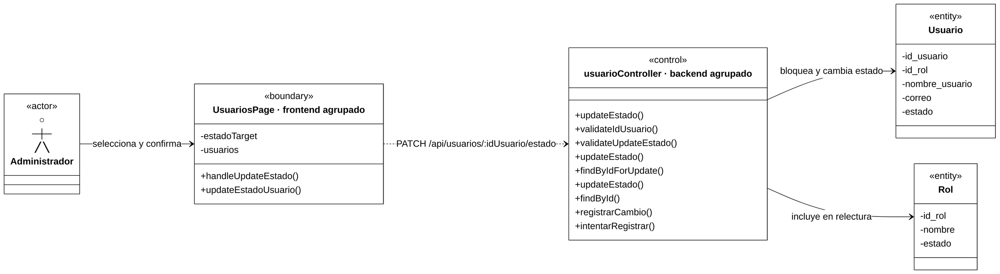

**Colaboración:** UsuarioTable selecciona estadoTarget con callback inline; ConfirmDialog recibe handleUpdateEstado como onConfirm. Tras confirmar, Boundary envía el nuevo estado. Control bloquea la cuenta, modifica estado, relee con Rol y registra el cambio en la misma transacción.

**Correspondencia principal:**

| Funciones | Archivo real |
|---|---|
| `handleUpdateEstado()` | `frontend/src/features/usuarios/pages/UsuariosPage.jsx` |
| `updateEstadoUsuario()` de Boundary: HTTP | `frontend/src/features/usuarios/services/usuario.service.js` |
| `updateEstado() [controller]` | `backend/src/presentation/controllers/usuario.controller.js` |
| `validateIdUsuario()`, `validateUpdateEstado()` | `backend/src/business/validators/usuario.validator.js` |
| `updateEstado() [service]` | `backend/src/business/services/usuario.service.js` |
| Tercer `updateEstado()` de Control, `findByIdForUpdate()`, `findById()` | `backend/src/data/repositories/usuario.repository.js` |

**Diferencia verificada:** la lectura inicial actual es findByIdForUpdate, sin Rol; findById carga Rol en la relectura. El estado administrativo no es el bloqueo temporal del login. El flujo no implementa una prohibición de desactivar la propia cuenta o al último Administrador.

### CU08 — Cambiar contraseña

Se conservan dos diagramas, en el orden original, por sus permisos/validación/cookies distintos.

#### Variante A — Cambio propio

**Actores:** Administrador, Regente o Vendedor autenticado. **Endpoint:** `PATCH /api/usuarios/me/password`.

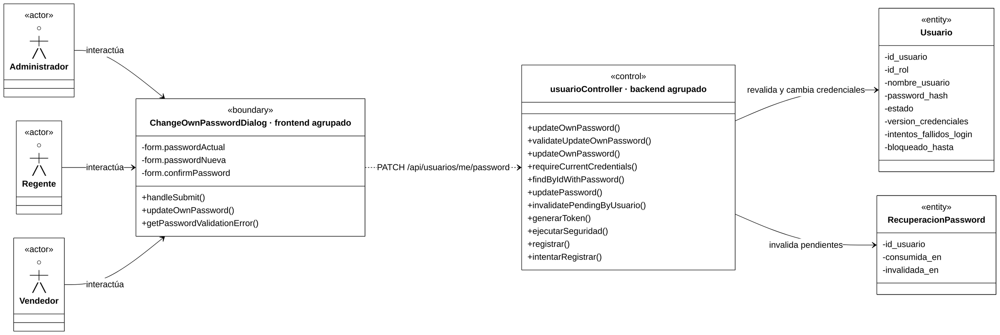

**Colaboración:** MainLayout abre el diálogo con callback inline. Boundary valida y envía contraseña actual/nueva por HTTP. Control compara la actual y revalida estado/hash/versión bajo bloqueo; cambia credenciales, invalida recuperaciones y audita. La firma se prepara antes del commit y el Controller renueva la cookie después del éxito.

**Correspondencia principal:**

| Funciones | Archivo real |
|---|---|
| `handleSubmit()` | `frontend/src/features/usuarios/components/ChangeOwnPasswordDialog.jsx` |
| `updateOwnPassword()` de Boundary: HTTP | `frontend/src/features/usuarios/services/usuario.service.js` |
| `updateOwnPassword() [controller]` | `backend/src/presentation/controllers/usuario.controller.js` |
| `validateUpdateOwnPassword()` | `backend/src/business/validators/usuario.validator.js` |
| `updateOwnPassword() [service]`, `requireCurrentCredentials()` | `backend/src/business/services/usuario.service.js` |
| `findByIdWithPassword()`, `updatePassword()` | `backend/src/data/repositories/usuario.repository.js` |
| `invalidatePendingByUsuario()` | `backend/src/data/repositories/recuperacion-password.repository.js` |

**Aclaraciones:** no intervienen requireRole, Rol ni login del Provider. newPasswordSchema se aplica a la contraseña nueva; confirmPassword no se envía. El cambio renueva esta cookie y vuelve obsoletas las versiones anteriores. Un fallo de firma o auditoría obligatoria revierte el cambio.

#### Variante B — Restablecimiento administrativo

**Actor:** Administrador autenticado. **Endpoint:** `PATCH /api/usuarios/:idUsuario/password`. La selección previa del listado pertenece a CU04.

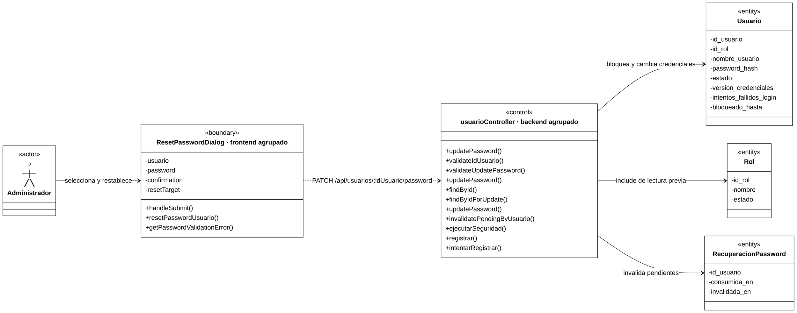

**Colaboración:** el diálogo valida y envía la nueva contraseña; handlePasswordReset es el callback de éxito de la página, no otra petición. Control valida ID/body, consulta previamente con Rol y bloquea después; cambia hash/versión, limpia seguridad e invalida recuperaciones con auditoría transaccional.

**Correspondencia principal:**

| Funciones | Archivo real |
|---|---|
| `handleSubmit()` | `frontend/src/features/usuarios/components/ResetPasswordDialog.jsx` |

| `resetPasswordUsuario()` de Boundary: HTTP | `frontend/src/features/usuarios/services/usuario.service.js` |
| `updatePassword() [controller]` | `backend/src/presentation/controllers/usuario.controller.js` |
| `validateIdUsuario()`, `validateUpdatePassword()` | `backend/src/business/validators/usuario.validator.js` |
| `updatePassword() [service]` | `backend/src/business/services/usuario.service.js` |
| Tercer `updatePassword()` de Control, `findById()`, `findByIdForUpdate()` | `backend/src/data/repositories/usuario.repository.js` |
| `invalidatePendingByUsuario()` | `backend/src/data/repositories/recuperacion-password.repository.js` |

**Diferencia verificada:** usuarioService.getUsuarioById no participa actualmente; se excluye. Rol permanece porque findById del Repository lo incluye. No compara contraseña anterior ni renueva cookie; el campo enviado es password y confirmation solo se valida en la interfaz.

### CU09 — Restablecer contraseña mediante correo electrónico

**Actores:** Administrador, Regente o Vendedor que olvidó su contraseña; acceso público. **Endpoints:** `POST /api/auth/recuperacion/solicitar` y `POST /api/auth/recuperacion/restablecer`. Se conserva un diagrama para ambos recorridos, como en el original.

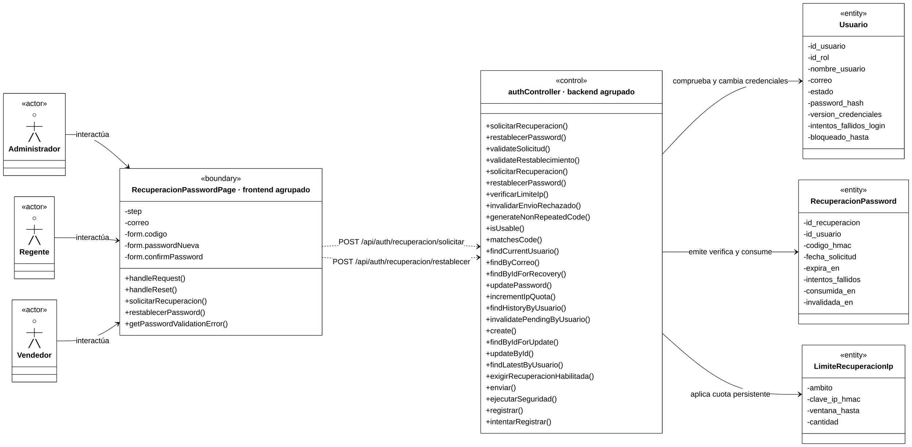

**Colaboración:** Boundary reúne solicitud y restablecimiento, con sus dos funciones HTTP. Control valida, aplica cuotas, emite un código protegido y lo envía; después verifica su vigencia/uso/intentos y cambia credenciales al consumirlo. Los auxiliares conservados expresan esas reglas, no los detalles internos del transporte.

**Correspondencia principal:**

| Funciones | Archivo real |
|---|---|
| `handleRequest()`, `handleReset()` | `frontend/src/features/auth/pages/RecuperacionPasswordPage.jsx` |
| `solicitarRecuperacion()`, `restablecerPassword()` de Boundary: HTTP | `frontend/src/features/auth/services/auth.service.js` |
| Ambas acciones `[controller]` | `backend/src/presentation/controllers/auth.controller.js` |
| `validateSolicitud()`, `validateRestablecimiento()` | `backend/src/business/validators/recuperacion-password.validator.js` |
| Ambas acciones `[service]`, `verificarLimiteIp()`, `invalidarEnvioRechazado()` y auxiliares de código/vigencia/cuenta | `backend/src/business/services/recuperacion-password.service.js` |
| `findByCorreo()`, `findByIdForRecovery()`, `updatePassword()` | `backend/src/data/repositories/usuario.repository.js` |
| `incrementIpQuota()`, `findHistoryByUsuario()`, `invalidatePendingByUsuario()`, `create()`, `findByIdForUpdate()`, `updateById()`, `findLatestByUsuario()` | `backend/src/data/repositories/recuperacion-password.repository.js` |
| `exigirRecuperacionHabilitada()` | `backend/src/shared/utils/recuperacion-config.js` |
| `enviar()` del objeto de transporte | `backend/src/shared/utils/recuperacion-mail.js` |

**Caminos importantes:**

- Solicitud: consume cuota IP, busca cuenta y comprueba activa/correo/cuota de cuenta bajo bloqueo; emite código no repetido y protegido, invalida pendientes y confirma antes del único envío. Desconocido/inactivo/supresión reciben respuesta genérica. esperarRespuesta se ejecuta en finally del bloque admitido, no ante cualquier rechazo previo.
- Envío: aceptación técnica no garantiza entrega; rechazo explícito invalida esa emisión mediante invalidarEnvioRechazado, con bloqueo/revalidación de nonce. Timeout/red/resultado ambiguo conservan código hasta vencer; no hay reenvío automático.
- Restablecimiento: consume cuota IP, comprueba código/estado/vigencia/fallos en una transacción corta; confirma fallos antes del error público. Calcula bcrypt fuera del bloqueo y vuelve a revalidar cuenta/código/versión; cambia credenciales, consume/invalida y audita éxito en transacción. No reactiva cuenta ni cambia rol.

**Aclaraciones:** no hay endpoint separado para verificar código, authMiddleware, requireRole ni login automático. requestAnotherCode vuelve al formulario sin enviar automáticamente. findByIdForUpdate pertenece aquí al Repository de recuperación, no al de usuarios. LimiteRecuperacionIp aplica cuotas HMAC por ámbito/IP y no tiene FK de Usuario. El envío requiere recuperación habilitada y transporte configurado; se representa enviar, sin desplegar sus ramas internas.

## 2. Cierre de Fase 1 y diferencias verificadas

| Caso de uso | Diagramas | Variante / alcance |
|---|---|---|
| CU01 — Iniciar sesión | 1 | Formulario/Provider/HTTP; seguridad de login. |
| CU02 — Cerrar sesión | 1 | Layout/Provider/HTTP y comprobación de sesión. |
| CU03 — Crear usuario | 1 | Validación/unicidad/rol/alta transaccional. |
| CU04 — Consultar usuarios | 1 | Listado y filtros locales, lectura sensible auditada. |
| CU05 — Consultar usuario por ID | 1 | Carga preparatoria/ID/DTO. |
| CU06 — Modificar usuario | 1 | Edición e invalidación condicional por correo. |
| CU07 — Activar o desactivar usuario | 1 | Bloqueo actual/estado y relectura. |
| CU08 — Cambiar contraseña | 2 | A: propia con cookie renovada; B: administrativa sin renovación. |
| CU09 — Restablecer contraseña mediante correo electrónico | 1 | Solicitud/envío y verificación/consumo públicos. |
| **Total de la entrega** | **10** | **9/33 CU y 10/34 diagramas previstos.** |

**Diferencias frente al documento completo, sin corregirlo:**

1. Se agrupan funciones de múltiples archivos en una única Boundary y un único Control por diagrama, seleccionadas por relevancia funcional. Se conservan handlers, Provider cuando participa, HTTP, validación, negocio, Repository y auxiliares esenciales; se resumen hooks/guards e infraestructura secundaria.
2. Se suprimen parámetros, retornos y tipos de atributos exclusivamente en esta representación. Se eliminan todos los prefijos de procedencia; solo se usan etiquetas posteriores [controller], [service] y [auditoria], sin apariencia de retorno. Los homónimos permanecen separados y se localizan en las correspondencias compactas.
3. Se muestran únicamente atributos pertinentes: por ejemplo CU02 no necesita hash, CU06 no consulta código/HMAC y CU08 propio no consulta correo/Rol. Los campos restantes siguen existiendo en los modelos, sin cambios al software.
4. CU07 ahora emplea findByIdForUpdate inicialmente, sin Rol; findById incluye Rol después. CU08-B no ejecuta getUsuarioById del Service, aunque sí consulta previamente con findById del Repository y conserva Rol como participante.
5. Las capturas actuales de autenticación/usuarios/seguridad se resumen mediante las operaciones principales de auditoría pertinentes a cada CU. Las lecturas CU04/CU05 no modifican cuentas, pero sí generan eventos transversales. Se conserva el alcance de entidades del original, sin agregar una Entity ni un CU de Bitácora.
6. Las firmas actuales incorporan contexto de auditoría/transacción/seguimiento que el original no siempre incluía; no se exhiben parámetros en los nuevos diagramas ni se copian firmas desactualizadas. El rollback se explica como comportamiento de transacciones Sequelize, sin inventar un método del proyecto.

**Fuentes de contraste:** AGENTS.md de raíz, backend y frontend; secciones de autenticación/usuarios/recuperación de `contexto-maestro.md`, `casos-uso.md`, `requerimientos.md`, `reglas-negocio.md`; rutas/controllers/services/repositories/validators/modelos y frontend enumerados en cada tabla. Los prefijos HTTP se comprueban en `backend/src/app.js`, `backend/src/presentation/routes/auth.router.js` y `backend/src/presentation/routes/usuario.router.js`; Axios común en `frontend/src/api/api.js`, con envío de cookies; permisos visuales en `frontend/src/app/router.jsx`.

**Validación documental de esta entrega:** nueve títulos CU y diez diagramas con las dos variantes de CU08, en el orden fuente; un Boundary/un Control por diagrama, actores/entidades y servicios HTTP presentes; métodos reales sin parámetros/retornos, atributos sin tipos y etiquetas limitadas a las tres autorizadas. Se reutiliza el contraste previo de nombres/participación y se revisan puntualmente las dudas. Se comprueban Mermaid, vistas previas de CU01/CU03, formato y conservación del original mediante SHA-256; git diff --check incluye el archivo nuevo. No se ejecutan pruebas funcionales ni se accede a MySQL para esta corrección documental.

**Estado de Fase 1:** revisada y aprobada por el usuario. La Fase 2 autorizada se incorpora a continuación.

## 3. Fase 2 — Proveedores y Laboratorios

**Alcance compartido:** se mantiene una sola entidad ProveedorLaboratorio, con atributos pertinentes a cada operación. CU10, CU12 y CU13 requieren Administrador; CU11 permite Administrador o Regente. Todas las rutas comprueban sesión/cuenta/versión mediante authMiddleware y rol mediante requireRole, resumidos fuera de los recuadros. Esa comprobación transversal no añade una Entity de Usuario a estos diagramas.

Nombre es obligatorio; teléfono/dirección son opcionales y sus valores vacíos se convierten a null. El nombre no tiene una regla de unicidad en estos CU. La verificación de licencia y resolución SEDES corresponde al personal, no a una función automática del sistema. Referencias: RF10/RF48, RN09–RN12 y CU10–CU13.

Medicamento y Compra conservan sus relaciones con ProveedorLaboratorio, pero estas operaciones no cargan sus colecciones ni las modifican. No se agregan cajas de esas entidades ni se representan eliminaciones o cascadas.

### CU10 — Registrar proveedor o laboratorio

**Actor:** Administrador autenticado. **Endpoint:** `POST /api/proveedores-laboratorios`. **Vista:** `/proveedores/nuevo`.

```mermaid
%%{init: {"theme":"base","htmlLabels":true,"markdownAutoWrap":false,"class":{"useMaxWidth":false},"themeCSS":".node.actor .label-container path{stroke:none!important;fill:none!important;} .node.actor .divider{display:none;} .nodeLabel{color:#000000!important;} .node .label div{display:table-cell!important;white-space:nowrap!important;max-width:none!important;} .control .methods-group .label:nth-child(1) p::after{content:\" [controller]\";}.control .methods-group .label:nth-child(3) p::after{content:\" [service]\";}.control .methods-group .label:nth-child(5) p::after{content:\" [auditoria]\";}.control .methods-group .label:nth-child(6) p::after{content:\" [auditoria]\";}","themeVariables":{"background":"#ffffff","primaryColor":"#ffffff","primaryTextColor":"#000000","primaryBorderColor":"#000000","secondaryColor":"#ffffff","tertiaryColor":"#ffffff","lineColor":"#000000","textColor":"#000000","fontFamily":"Arial","fontSize":"18px"}}}%%
%%{init: {"state":{"useMaxWidth":false}}}%%
classDiagram
    direction LR
    class Administrador["○<br/>─┼─<br/>╱ ╲<br/>Administrador"]
    class Administrador { <<actor>> }
    class Boundary["ProveedorLaboratorioForm · frontend agrupado"] {
        <<boundary>>
        -form.nombre
        -form.telefono
        -form.direccion
        -form.estado
        +handleSubmit()
        +handleSubmit()
        +createProveedorLaboratorio()
    }
    class Control["proveedorLaboratorioController · backend agrupado"] {
        <<control>>
        %% createProveedorLaboratorio() [controller]
        +createProveedorLaboratorio()
        +validateCreate()
        %% createProveedorLaboratorio() [service]
        +createProveedorLaboratorio()
        +create()
        %% registrarCambio() [auditoria]
        +registrarCambio()
        %% intentarRegistrar() [auditoria]
        +intentarRegistrar()
    }
    class ProveedorLaboratorio {
        <<entity>>
        -id_proveedor_laboratorio
        -nombre
        -telefono
        -direccion
        -estado
    }
    Administrador --> Boundary : interactúa
    Boundary ..> Control : POST /api/proveedores-laboratorios
    Control --> ProveedorLaboratorio : registra
    cssClass "Control" control
    classDef actor fill:#ffffff,stroke-width:0px,color:#000000
    cssClass "Administrador" actor
```

**Colaboración:** updateField recoge los datos; el handleSubmit del formulario valida y llama al handleSubmit de la página. Esta solicita el alta por HTTP. Control valida la entrada, inserta el registro y registra el éxito en la misma transacción; responde 201 con los datos públicos de la instancia creada.

**Correspondencia principal:**

| Funciones | Archivo real |
|---|---|
| primer `handleSubmit()` de Boundary | `frontend/src/features/proveedores/components/ProveedorLaboratorioForm.jsx` |
| Segundo `handleSubmit()` de Boundary | `frontend/src/features/proveedores/pages/ProveedorLaboratorioFormPage.jsx` |
| `createProveedorLaboratorio()` de Boundary: HTTP | `frontend/src/features/proveedores/services/proveedor-laboratorio.service.js` |
| `createProveedorLaboratorio() [controller]` | `backend/src/presentation/controllers/proveedor-laboratorio.controller.js` |
| `validateCreate()` | `backend/src/business/validators/proveedor-laboratorio.validator.js` |
| `createProveedorLaboratorio() [service]` | `backend/src/business/services/proveedor-laboratorio.service.js` |
| `create()` | `backend/src/data/repositories/proveedor-laboratorio.repository.js` |

**Aclaraciones:** la interfaz permite indicar estado inicial, activo por defecto; la API admite omitirlo. El ID lo genera la base de datos y no se envía. No hay consulta por ID después del alta ni comprobación de nombre duplicado. loadProveedor no se ejecuta en modo create; el retorno al listado pertenece a CU11. Auditoría resume el éxito obligatorio y los rechazos/fallos pertinentes; si falla su registro obligatorio, se revierte el alta.

### CU11 — Consultar proveedores o laboratorios

**Actores:** Administrador o Regente autenticado. **Endpoints:** `GET /api/proveedores-laboratorios` y `GET /api/proveedores-laboratorios/:idProveedorLaboratorio`. **Vistas:** `/proveedores` y `/proveedores/:idProveedorLaboratorio`; la consulta por ID también prepara la edición del Administrador.

```mermaid
%%{init: {"theme":"base","htmlLabels":true,"markdownAutoWrap":false,"class":{"useMaxWidth":false},"themeCSS":".node.actor .label-container path{stroke:none!important;fill:none!important;} .node.actor .divider{display:none;} .nodeLabel{color:#000000!important;} .node .label div{display:table-cell!important;white-space:nowrap!important;max-width:none!important;} .control .methods-group .label:nth-child(1) p::after{content:\" [controller]\";}.control .methods-group .label:nth-child(2) p::after{content:\" [controller]\";}.control .methods-group .label:nth-child(4) p::after{content:\" [service]\";}.control .methods-group .label:nth-child(5) p::after{content:\" [service]\";}","themeVariables":{"background":"#ffffff","primaryColor":"#ffffff","primaryTextColor":"#000000","primaryBorderColor":"#000000","secondaryColor":"#ffffff","tertiaryColor":"#ffffff","lineColor":"#000000","textColor":"#000000","fontFamily":"Arial","fontSize":"18px"}}}%%
%%{init: {"state":{"useMaxWidth":false}}}%%
classDiagram
    direction LR
    class Administrador["○<br/>─┼─<br/>╱ ╲<br/>Administrador"]
    class Regente["○<br/>─┼─<br/>╱ ╲<br/>Regente"]
    class Administrador { <<actor>> }
    class Regente { <<actor>> }
    class Boundary["ProveedoresPage · frontend agrupado"] {
        <<boundary>>
        -proveedores
        -search
        -statusFilter
        -filteredProveedores
        -idProveedorLaboratorio
        -proveedor
        +loadProveedores()
        +getProveedoresLaboratorios()
        +loadProveedor()
        +loadProveedor()
        +getProveedorLaboratorio()
    }
    class Control["proveedorLaboratorioController · backend agrupado"] {
        <<control>>
        %% getProveedoresLaboratorios() [controller]
        +getProveedoresLaboratorios()
        %% getProveedorLaboratorioById() [controller]
        +getProveedorLaboratorioById()
        +validateId()
        %% getProveedoresLaboratorios() [service]
        +getProveedoresLaboratorios()
        %% getProveedorLaboratorioById() [service]
        +getProveedorLaboratorioById()
        +findAll()
        +findById()
    }
    class ProveedorLaboratorio {
        <<entity>>
        -id_proveedor_laboratorio
        -nombre
        -telefono
        -direccion
        -estado
    }
    Administrador --> Boundary : consulta
    Regente --> Boundary : consulta
    Boundary ..> Control : GET /api/proveedores-laboratorios
    Boundary ..> Control : GET /api/proveedores-laboratorios/#58;idProveedorLaboratorio
    Control --> ProveedorLaboratorio : consulta listado o registro
    cssClass "Control" control
    classDef actor fill:#ffffff,stroke-width:0px,color:#000000
    cssClass "Administrador,Regente" actor
```

**Colaboración:** loadProveedores obtiene el listado por HTTP y lo presenta mediante ProveedorLaboratorioTable. La consulta por ID utiliza loadProveedor en la página de detalle o en la carga preparatoria de edición. Control consulta todos los registros o valida el ID y comprueba existencia, según el endpoint.

**Correspondencia principal:**

| Funciones | Archivo real |
|---|---|
| `loadProveedores()`; valor derivado `filteredProveedores` | `frontend/src/features/proveedores/pages/ProveedoresPage.jsx` |
| Primer `loadProveedor()` de Boundary: detalle | `frontend/src/features/proveedores/pages/ProveedorLaboratorioDetailPage.jsx` |
| Segundo `loadProveedor()` de Boundary: carga de edición | `frontend/src/features/proveedores/pages/ProveedorLaboratorioFormPage.jsx` |
| `getProveedoresLaboratorios()`, `getProveedorLaboratorio()` de Boundary: HTTP | `frontend/src/features/proveedores/services/proveedor-laboratorio.service.js` |
| Ambas consultas `[controller]` | `backend/src/presentation/controllers/proveedor-laboratorio.controller.js` |
| `validateId()` | `backend/src/business/validators/proveedor-laboratorio.validator.js` |
| Ambas consultas `[service]` | `backend/src/business/services/proveedor-laboratorio.service.js` |
| `findAll()`, `findById()` | `backend/src/data/repositories/proveedor-laboratorio.repository.js` |

**Aclaraciones:** se conserva un diagrama para listado/detalle y el apoyo de edición del original. Los dos loadProveedor son funciones distintas, locales a sus efectos; el Regente consulta el detalle, pero no accede a editar. La tabla enlaza por React Router y los filtros de texto/estado son locales, sin un método aplicarFiltros ni otra petición. Se consultan activos e inactivos; listado vacío es válido, ID inválido produce 400 y registro inexistente 404. El flujo no carga compras/medicamentos ni registra una lectura exitosa de catálogo en Bitácora; los rechazos de acceso y errores se cubren transversalmente.

### CU12 — Modificar proveedor o laboratorio

**Actor:** Administrador autenticado. **Endpoint:** `PATCH /api/proveedores-laboratorios/:idProveedorLaboratorio`. **Vista:** `/proveedores/:idProveedorLaboratorio/editar`. La carga preparatoria corresponde a CU11.

```mermaid
%%{init: {"theme":"base","htmlLabels":true,"markdownAutoWrap":false,"class":{"useMaxWidth":false},"themeCSS":".node.actor .label-container path{stroke:none!important;fill:none!important;} .node.actor .divider{display:none;} .nodeLabel{color:#000000!important;} .node .label div{display:table-cell!important;white-space:nowrap!important;max-width:none!important;} .control .methods-group .label:nth-child(1) p::after{content:\" [controller]\";}.control .methods-group .label:nth-child(4) p::after{content:\" [service]\";}.control .methods-group .label:nth-child(8) p::after{content:\" [auditoria]\";}.control .methods-group .label:nth-child(9) p::after{content:\" [auditoria]\";}","themeVariables":{"background":"#ffffff","primaryColor":"#ffffff","primaryTextColor":"#000000","primaryBorderColor":"#000000","secondaryColor":"#ffffff","tertiaryColor":"#ffffff","lineColor":"#000000","textColor":"#000000","fontFamily":"Arial","fontSize":"18px"}}}%%
%%{init: {"state":{"useMaxWidth":false}}}%%
classDiagram
    direction LR
    class Administrador["○<br/>─┼─<br/>╱ ╲<br/>Administrador"]
    class Administrador { <<actor>> }
    class Boundary["ProveedorLaboratorioForm · frontend agrupado"] {
        <<boundary>>
        -form.nombre
        -form.telefono
        -form.direccion
        -idProveedorLaboratorio
        +handleSubmit()
        +handleSubmit()
        +updateProveedorLaboratorio()
    }
    class Control["proveedorLaboratorioController · backend agrupado"] {
        <<control>>
        %% updateProveedorLaboratorio() [controller]
        +updateProveedorLaboratorio()
        +validateId()
        +validateUpdate()
        %% updateProveedorLaboratorio() [service]
        +updateProveedorLaboratorio()
        +getProveedorLaboratorioById()
        +findById()
        +update()
        %% registrarCambio() [auditoria]
        +registrarCambio()
        %% intentarRegistrar() [auditoria]
        +intentarRegistrar()
    }
    class ProveedorLaboratorio {
        <<entity>>
        -id_proveedor_laboratorio
        -nombre
        -telefono
        -direccion
        -estado
    }
    Administrador --> Boundary : edita
    Boundary ..> Control : PATCH /api/proveedores-laboratorios/#58;idProveedorLaboratorio
    Control --> ProveedorLaboratorio : bloquea y modifica datos
    cssClass "Control" control
    classDef actor fill:#ffffff,stroke-width:0px,color:#000000
    cssClass "Administrador" actor
```

**Colaboración:** handleSubmit del formulario valida y entrega nombre/contactos al handleSubmit de la página; esta envía el PATCH. Control valida ID/body, consulta y bloquea el registro, actualiza, relee los datos públicos y audita el cambio en la misma transacción.

**Correspondencia principal:**

| Funciones | Archivo real |
|---|---|
| primer `handleSubmit()` de Boundary | `frontend/src/features/proveedores/components/ProveedorLaboratorioForm.jsx` |
| Segundo `handleSubmit()` de Boundary | `frontend/src/features/proveedores/pages/ProveedorLaboratorioFormPage.jsx` |
| `updateProveedorLaboratorio()` de Boundary: HTTP | `frontend/src/features/proveedores/services/proveedor-laboratorio.service.js` |
| `updateProveedorLaboratorio() [controller]` | `backend/src/presentation/controllers/proveedor-laboratorio.controller.js` |
| `validateId()`, `validateUpdate()` | `backend/src/business/validators/proveedor-laboratorio.validator.js` |
| `updateProveedorLaboratorio() [service]`, `getProveedorLaboratorioById()` | `backend/src/business/services/proveedor-laboratorio.service.js` |
| `findById()`, `update()` | `backend/src/data/repositories/proveedor-laboratorio.repository.js` |

**Aclaraciones:** getProveedorLaboratorioById y findById participan antes/después de escribir; se representan una vez por función, sin convertir esas lecturas internas en otro GET HTTP. La API admite uno o varios campos de datos: omitir conserva y un contacto vacío/null limpia; la interfaz envía los tres. Se puede editar un registro inactivo; ID/estado se conservan y no se exige nombre único. Ante error se conserva el borrador.

**Diferencia verificada:** el original describe sentencias sin transacción conjunta. El Service actual sí abre una transacción, solicita bloqueo inicial mediante findById con lock y registra auditoría obligatoria antes del commit. Su fallo revierte la modificación; no se inventan métodos de bloqueo o transacción.

### CU13 — Activar o desactivar proveedor o laboratorio

**Actor:** Administrador autenticado. **Endpoint:** `PATCH /api/proveedores-laboratorios/:idProveedorLaboratorio/estado`. **Vista:** `/proveedores`; la carga del listado pertenece a CU11.

```mermaid
%%{init: {"theme":"base","htmlLabels":true,"markdownAutoWrap":false,"class":{"useMaxWidth":false},"themeCSS":".node.actor .label-container path{stroke:none!important;fill:none!important;} .node.actor .divider{display:none;} .nodeLabel{color:#000000!important;} .node .label div{display:table-cell!important;white-space:nowrap!important;max-width:none!important;} .control .methods-group .label:nth-child(1) p::after{content:\" [controller]\";}.control .methods-group .label:nth-child(4) p::after{content:\" [service]\";}.control .methods-group .label:nth-child(8) p::after{content:\" [auditoria]\";}.control .methods-group .label:nth-child(9) p::after{content:\" [auditoria]\";}","themeVariables":{"background":"#ffffff","primaryColor":"#ffffff","primaryTextColor":"#000000","primaryBorderColor":"#000000","secondaryColor":"#ffffff","tertiaryColor":"#ffffff","lineColor":"#000000","textColor":"#000000","fontFamily":"Arial","fontSize":"18px"}}}%%
%%{init: {"state":{"useMaxWidth":false}}}%%
classDiagram
    direction LR
    class Administrador["○<br/>─┼─<br/>╱ ╲<br/>Administrador"]
    class Administrador { <<actor>> }
    class Boundary["ProveedoresPage · frontend agrupado"] {
        <<boundary>>
        -estadoTarget
        -proveedores
        +handleUpdateEstado()
        +updateEstadoProveedorLaboratorio()
    }
    class Control["proveedorLaboratorioController · backend agrupado"] {
        <<control>>
        %% updateEstado() [controller]
        +updateEstado()
        +validateId()
        +validateUpdateEstado()
        %% updateEstado() [service]
        +updateEstado()
        +getProveedorLaboratorioById()
        +findById()
        +updateEstado()
        %% registrarCambio() [auditoria]
        +registrarCambio()
        %% intentarRegistrar() [auditoria]
        +intentarRegistrar()
    }
    class ProveedorLaboratorio {
        <<entity>>
        -id_proveedor_laboratorio
        -nombre
        -estado
    }
    Administrador --> Boundary : selecciona y confirma
    Boundary ..> Control : PATCH /api/proveedores-laboratorios/#58;idProveedorLaboratorio/estado
    Control --> ProveedorLaboratorio : bloquea y cambia estado
    cssClass "Control" control
    classDef actor fill:#ffffff,stroke-width:0px,color:#000000
    cssClass "Administrador" actor
```

**Colaboración:** ProveedorLaboratorioTable selecciona estadoTarget mediante onToggleEstado y ConfirmDialog invoca handleUpdateEstado como onConfirm. Boundary envía el estado inverso al visible; Control valida, bloquea, actualiza estado, relee el registro y audita dentro de la transacción. La página sustituye la fila con la respuesta, sin otro GET inmediato.

**Correspondencia principal:**

| Funciones | Archivo real |
|---|---|
| `handleUpdateEstado()` | `frontend/src/features/proveedores/pages/ProveedoresPage.jsx` |
| `updateEstadoProveedorLaboratorio()` de Boundary: HTTP | `frontend/src/features/proveedores/services/proveedor-laboratorio.service.js` |
| `updateEstado() [controller]` | `backend/src/presentation/controllers/proveedor-laboratorio.controller.js` |
| `validateId()`, `validateUpdateEstado()` | `backend/src/business/validators/proveedor-laboratorio.validator.js` |
| `updateEstado() [service]`, `getProveedorLaboratorioById()` | `backend/src/business/services/proveedor-laboratorio.service.js` |
| Tercer `updateEstado()` de Control, `findById()` | `backend/src/data/repositories/proveedor-laboratorio.repository.js` |

**Aclaraciones:** onToggleEstado recibe el setter de la página y onConfirm su handler; no se inventan métodos seleccionarProveedor/confirmar/cerrar. La API recibe un estado booleano objetivo y no exige que sea diferente. Se conserva registro/historial y no se modifican en cascada medicamentos, compras o inventario. La inactivación restringe nuevos usos según RN10, sin impedir vender medicamentos ya existentes en inventario; activar no activa los medicamentos relacionados.

**Diferencia verificada:** también aquí el código actual usa transacción y bloqueo inicial mediante getProveedorLaboratorioById/findById; el original indicaba una secuencia sin transacción conjunta. El éxito auditado se confirma con el cambio de estado y los rechazos/fallos se registran según el recorrido transversal. Si falla la auditoría obligatoria, se revierte el cambio.

## 4. Cierre de Fase 2 y diferencias verificadas

| Caso de uso | Diagramas | Alcance |
|---|---|---|
| CU10 — Registrar proveedor o laboratorio | 1 | Formulario/página/HTTP, validación y alta auditada. |
| CU11 — Consultar proveedores o laboratorios | 1 | Listado/detalle y carga preparatoria; Administrador/Regente. |
| CU12 — Modificar proveedor o laboratorio | 1 | Datos permitidos, bloqueo/relectura y auditoría transaccional. |
| CU13 — Activar o desactivar proveedor o laboratorio | 1 | Selección/confirmación, estado objetivo y conservación histórica. |
| **Total de Fase 2** | **4** | **CU10–CU13.** |
| **Acumulado de Fases 1–2** | **14** | **13/33 CU y 14/34 diagramas previstos.** |

**Diferencias frente al documento completo, sin modificarlo:**

1. Un Boundary/un Control reúnen las funciones reales de cada recorrido; las funciones HTTP y Validators participan visualmente y sus archivos quedan identificados. Se conservan los homónimos de formulario/página, detalle/carga de edición y Controller/Service/Repository sin abreviaturas ni etiquetas adicionales.
2. CU10, CU12 y CU13 incluyen las operaciones principales de auditoría actualmente ejecutadas; se resumen contexto, snapshots, serialización, excepciones y persistencia interna. CU11 conserva la consulta ordinaria sin inventar un registro de lectura exitosa.
3. CU12/CU13 usan ahora una transacción con bloqueo inicial y auditoría obligatoria: la descripción de ausencia de transacción del original ya no corresponde al código actual. CU10 también confirma alta y auditoría conjuntamente, sin una relectura por ID.
4. ProveedorLaboratorio permanece unificado, con sus cinco atributos sin tipos. Las lecturas preparatorias no se confunden con la escritura; estado inicial pertenece a CU10, datos a CU12 y activación/desactivación a CU13.

**Fuentes de contraste:** bloque CU10–CU13 de `analisis-clases-academico.md`; secciones pertinentes de `contexto-maestro.md`, `requerimientos.md`, `reglas-negocio.md` y `casos-uso.md`; archivos de las correspondencias y modelo `backend/src/data/models/proveedor-laboratorio.js`. Endpoints/permisos contrastados con `backend/src/presentation/routes/proveedor-laboratorio.router.js`, `backend/src/app.js` y `frontend/src/app/router.jsx`; selección/enlaces con `frontend/src/features/proveedores/components/ProveedorLaboratorioTable.jsx`, confirmación con `frontend/src/components/ConfirmDialog.jsx`; operaciones de auditoría con el Service de la correspondencia común.

**Validación documental completada:** cuatro CU/cuatro diagramas nuevos y cobertura acumulada de trece CU/catorce diagramas; formato BCE y etiquetas iguales a Fase 1, métodos reales con paréntesis vacíos, atributos sin tipos y esquemas Zod tratados como atributos. Se verificaron las 58 apariciones de métodos de Fase 2 y la sintaxis de sus cuatro diagramas mediante mermaid.parse en Mermaid 11.12.0. Los diez bloques Mermaid de Fase 1 permanecen intactos; el SHA-256 del original se conserva y git diff --check está aprobado. Sin capturas adicionales, mediciones visuales, pruebas funcionales ni acceso a MySQL para esta entrega documental.

**Continuación autorizada:** el usuario aprobó continuar con CU14–CU20 — Medicamentos, Principios Activos y Composición, siete diagramas incorporados en Fase 3.

## 5. Fase 3 — Medicamentos, Principios Activos y Composición

### Condiciones compartidas

| Camino | Actores autorizados |
|---|---|
| CU14, CU16 y CU17 | Regente. |
| CU15 y CU20 | Administrador, Regente o Vendedor. |
| CU18: consultas | Administrador o Regente; la edición visual corresponde al Regente. |
| CU18: registro, edición y estado | Regente. |
| CU19: consulta de apoyo / escrituras | Los tres roles pueden leer; solo Regente agrega, edita o retira componentes. |

Todas las solicitudes requieren sesión válida. Se reutilizan authMiddleware/requireRole y el formato visual aprobado. Las cargas de proveedores/principios son apoyo de CU11/CU18; se mencionan sin repetir sus recorridos completos. Las funciones HTTP importadas sí figuran en Boundary cuando explican el camino representado.

**Identidad e historial:** código automático e inmutable; identidad comercial = nombre, proveedor, forma, presentación, unidad de inventario, vía, liberación y composición completa con cantidades/unidades de ingrediente y referencia. La comparación incluye inactivos, excluye el propio medicamento al modificar y no convierte unidades. Historial significa al menos un MovimientoInventario asociado a alguna ExistenciaMedicamento, aun revertido o con saldo cero; una existencia por sí sola no basta. No existe columna tieneHistorial.

**Persistencia:** el alta exige composición no vacía, pero la asociación estructural Medicamento–ComposicionMedicamento sigue siendo `1` — `0..*` por los históricos y la retirada permitida de la última relación sin historial. El par medicamento/principio es único. Un principio inactivo puede relacionarse si existe. Las cantidades se envían como números JSON positivos con hasta cuatro decimales y se devuelven como cadenas decimales; unidades de hasta 30 caracteres.

**Fuentes comunes nuevas:** los modelos `medicamento.js`, `proveedor-laboratorio.js`, `principio-activo.js`, `composicion-medicamento.js`, `existencia-medicamento.js` y `movimiento-inventario.js`, en `backend/src/data/models/`, proporcionan los atributos y asociaciones. bloquearProveedoresIdentidad y validarIdentidadDisponible, de `backend/src/business/services/identidad-medicamento.js`, se conservan como funciones de módulo esenciales. La coordinación técnica de transaccionCatalogo, comparación/canonización interna, serialización, snapshots y traducción de excepciones se resumen.

**Auditoría de escrituras:** ejecutarCambio coordina el recorrido auditado; registrarCambio confirma el éxito en la transacción de negocio e intentarRegistrar participa en rechazos/fallos pertinentes. Se representan estas operaciones principales sin reconstruir la infraestructura. Un fallo de auditoría obligatoria revierte la escritura. Las consultas ordinarias no inventan un registro de lectura exitosa.

### CU14 — Registrar medicamento

**Actor:** Regente autenticado. **Endpoint:** `POST /api/medicamentos`. **Vista:** `/medicamentos/nuevo`. La carga de opciones reutiliza CU11/CU18.

```mermaid
%%{init: {"theme":"base","htmlLabels":true,"markdownAutoWrap":false,"class":{"useMaxWidth":false},"themeCSS":".node.actor .label-container path{stroke:none!important;fill:none!important;} .node.actor .divider{display:none;} .nodeLabel{color:#000000!important;} .node .label div{display:table-cell!important;white-space:nowrap!important;max-width:none!important;} .control .methods-group .label:nth-child(1) p::after{content:\" [controller]\";}.control .methods-group .label:nth-child(3) p::after{content:\" [service]\";}.control .methods-group .label:nth-child(16) p::after{content:\" [auditoria]\";}.control .methods-group .label:nth-child(17) p::after{content:\" [auditoria]\";}.control .methods-group .label:nth-child(18) p::after{content:\" [auditoria]\";}","themeVariables":{"background":"#ffffff","primaryColor":"#ffffff","primaryTextColor":"#000000","primaryBorderColor":"#000000","secondaryColor":"#ffffff","tertiaryColor":"#ffffff","lineColor":"#000000","textColor":"#000000","fontFamily":"Arial","fontSize":"18px"}}}%%
%%{init: {"state":{"useMaxWidth":false}}}%%
classDiagram
    direction LR
    class Regente["○<br/>─┼─<br/>╱ ╲<br/>Regente"]
    class Regente { <<actor>> }
    class Boundary["MedicamentoForm · frontend agrupado"] {
        <<boundary>>
        -form.nombreComercial
        -form.idProveedorLaboratorio
        -form.formaFarmaceutica
        -form.presentacion
        -form.unidadInventario
        -form.stockMinimo
        -form.condicionVenta
        -form.viaAdministracion
        -form.tipoLiberacion
        -composicion
        -duplicados
        +submit()
        +submit()
        +guardarComponente()
        +submit()
        +createMedicamento()
    }
    class Control["medicamentoController · backend agrupado"] {
        <<control>>
        %% createMedicamento() [controller]
        +createMedicamento()
        +validateCreate()
        %% createMedicamento() [service]
        +createMedicamento()
        +validateCodigoNoEnviado()
        +bloquearProveedoresIdentidad()
        +validarIdentidadDisponible()
        +generarCodigo()
        +findProveedorById()
        +findPrincipioById()
        +findDuplicadosIdentidad()
        +findMayorCorrelativo()
        +findByCodigo()
        +create()
        +create()
        +findById()
        %% ejecutarCambio() [auditoria]
        +ejecutarCambio()
        %% registrarCambio() [auditoria]
        +registrarCambio()
        %% intentarRegistrar() [auditoria]
        +intentarRegistrar()
    }
    class Medicamento {
        <<entity>>
        -id_medicamento
        -id_proveedor_laboratorio
        -codigo_medicamento
        -nombre_comercial
        -forma_farmaceutica
        -presentacion
        -unidad_inventario
        -stock_minimo
        -condicion_venta
        -via_administracion
        -tipo_liberacion
        -estado
    }
    class ProveedorLaboratorio {
        <<entity>>
        -id_proveedor_laboratorio
        -nombre
        -estado
    }
    class PrincipioActivo {
        <<entity>>
        -id_principio_activo
        -nombre
    }
    class ComposicionMedicamento {
        <<entity>>
        -id_composicion
        -id_medicamento
        -id_principio_activo
        -cantidad_principio_activo
        -unidad_principio_activo
        -cantidad_referencia
        -unidad_referencia
    }
    Regente --> Boundary : prepara y envía borrador
    Boundary ..> Control : POST /api/medicamentos
    Control --> Medicamento : verifica identidad y registra
    Control --> ProveedorLaboratorio : bloquea y verifica actividad
    Control --> PrincipioActivo : verifica existencia
    Control --> ComposicionMedicamento : registra componentes
    ProveedorLaboratorio "1" -- "0..*" Medicamento : proveedorLaboratorio
    Medicamento "1" -- "0..*" ComposicionMedicamento : composiciones
    PrincipioActivo "1" -- "0..*" ComposicionMedicamento : principioActivo
    cssClass "Control" control
    classDef actor fill:#ffffff,stroke-width:0px,color:#000000
    cssClass "Regente" actor
```

**Colaboración:** ComposicionForm valida un componente y llama a guardarComponente mediante onSubmit; MedicamentoForm conserva el borrador local y permite corregir/retirar filas mediante callbacks. Su submit entrega medicamento y componentes al submit de la página, que envía un único POST. Control valida estructura, bloquea proveedor, verifica referencias e identidad completa, genera código, inserta producto/componentes, relee con relaciones y registra el éxito dentro de la misma transacción.

**Correspondencia principal:**

| Funciones o atributos | Archivo real |
|---|---|
| Primer `submit()`, `guardarComponente()` | `frontend/src/features/medicamentos/components/MedicamentoForm.jsx` |
| Segundo `submit()` | `frontend/src/features/medicamentos/components/ComposicionForm.jsx` |
| Tercer `submit()` | `frontend/src/features/medicamentos/pages/MedicamentoFormPage.jsx` |
| `createMedicamento()` de Boundary: HTTP | `frontend/src/features/medicamentos/services/medicamento.service.js` |
| `createMedicamento() [controller]` | `backend/src/presentation/controllers/medicamento.controller.js` |
| `validateCreate()` | `backend/src/business/validators/medicamento.validator.js` |

| `createMedicamento() [service]`, `validateCodigoNoEnviado()`, `generarCodigo()` | `backend/src/business/services/medicamento.service.js` |
| `bloquearProveedoresIdentidad()`, `validarIdentidadDisponible()` | `backend/src/business/services/identidad-medicamento.js` |

| `findProveedorById()`, `findDuplicadosIdentidad()`, `findMayorCorrelativo()`, `findByCodigo()`, primer `create()` de Control, `findById()` | `backend/src/data/repositories/medicamento.repository.js` |
| `findPrincipioById()`, segundo `create()` de Control | `backend/src/data/repositories/composicion-medicamento.repository.js` |

**Aclaraciones:** nextId identifica filas del borrador, no PK persistentes; se excluye del payload junto a principioActivo. La tabla no declara handlers propios. El formulario no envía código/estado/IDs técnicos; stock mínimo inicia en cero y estado es activo por defecto. Se exige proveedor activo, principios existentes y composición no vacía sin IDs repetidos. No se crean existencias ni movimientos.

El código usa tres letras ASCII normalizadas del nombre y un correlativo conservado de `001` a `999`, sin rellenar huecos ni reutilizar códigos. Una colisión específica puede repetir toda la transacción hasta cinco intentos; referencias inválidas, identidad duplicada o agotamiento rechazan sin cambios parciales. Resultado 201 tras commit; se abre la ficha y, ante error, permanece el borrador con referencias públicas de duplicados cuando estén disponibles.

### CU15 — Consultar o buscar medicamento

**Actores:** Administrador, Regente o Vendedor autenticado. **Endpoints:** `GET /api/medicamentos` y `GET /api/medicamentos/:idMedicamento`. **Vistas:** `/medicamentos` y `/medicamentos/:idMedicamento`; la consulta por ID prepara también la edición del Regente.

```mermaid
%%{init: {"theme":"base","htmlLabels":true,"markdownAutoWrap":false,"class":{"useMaxWidth":false},"themeCSS":".node.actor .label-container path{stroke:none!important;fill:none!important;} .node.actor .divider{display:none;} .nodeLabel{color:#000000!important;} .node .label div{display:table-cell!important;white-space:nowrap!important;max-width:none!important;} .control .methods-group .label:nth-child(1) p::after{content:\" [controller]\";}.control .methods-group .label:nth-child(2) p::after{content:\" [controller]\";}.control .methods-group .label:nth-child(5) p::after{content:\" [service]\";}.control .methods-group .label:nth-child(6) p::after{content:\" [service]\";}","themeVariables":{"background":"#ffffff","primaryColor":"#ffffff","primaryTextColor":"#000000","primaryBorderColor":"#000000","secondaryColor":"#ffffff","tertiaryColor":"#ffffff","lineColor":"#000000","textColor":"#000000","fontFamily":"Arial","fontSize":"18px"}}}%%
%%{init: {"state":{"useMaxWidth":false}}}%%
classDiagram
    direction LR
    class Administrador["○<br/>─┼─<br/>╱ ╲<br/>Administrador"]
    class Regente["○<br/>─┼─<br/>╱ ╲<br/>Regente"]
    class Vendedor["○<br/>─┼─<br/>╱ ╲<br/>Vendedor"]
    class Administrador { <<actor>> }
    class Regente { <<actor>> }
    class Vendedor { <<actor>> }
    class Boundary["MedicamentosPage · frontend agrupado"] {
        <<boundary>>
        -filters.codigoMedicamento
        -filters.nombreComercial
        -medicamentos
        -query
        -idMedicamento
        -med
        +changeFilters()
        +search()
        +getMedicamentos()
        +getMedicamento()
    }
    class Control["medicamentoController · backend agrupado"] {
        <<control>>
        %% getMedicamentos() [controller]
        +getMedicamentos()
        %% getMedicamentoById() [controller]
        +getMedicamentoById()
        +validateFiltros()
        +validateId()
        %% getMedicamentos() [service]
        +getMedicamentos()
        %% getMedicamentoById() [service]
        +getMedicamentoById()
        +findAll()
        +findById()
    }
    class Medicamento {
        <<entity>>
        -id_medicamento
        -id_proveedor_laboratorio
        -codigo_medicamento
        -nombre_comercial
        -forma_farmaceutica
        -presentacion
        -unidad_inventario
        -stock_minimo
        -condicion_venta
        -via_administracion
        -tipo_liberacion
        -estado
    }
    class ProveedorLaboratorio {
        <<entity>>
        -id_proveedor_laboratorio
        -nombre
    }
    class ComposicionMedicamento {
        <<entity>>
        -id_composicion
        -id_medicamento
        -id_principio_activo
        -cantidad_principio_activo
        -unidad_principio_activo
        -cantidad_referencia
        -unidad_referencia
    }
    class PrincipioActivo {
        <<entity>>
        -id_principio_activo
        -nombre
    }
    Administrador --> Boundary : consulta
    Regente --> Boundary : consulta
    Vendedor --> Boundary : consulta
    Boundary ..> Control : GET /api/medicamentos
    Boundary ..> Control : GET /api/medicamentos/#58;idMedicamento
    Control --> Medicamento : consulta listado o ficha
    Control --> ProveedorLaboratorio : incluye identificación
    Control --> ComposicionMedicamento : incluye composición completa
    Control --> PrincipioActivo : incluye identificación
    ProveedorLaboratorio "1" -- "0..*" Medicamento : proveedorLaboratorio
    Medicamento "1" -- "0..*" ComposicionMedicamento : composiciones
    PrincipioActivo "1" -- "0..*" ComposicionMedicamento : principioActivo
    cssClass "Control" control
    classDef actor fill:#ffffff,stroke-width:0px,color:#000000
    cssClass "Administrador,Regente,Vendedor" actor
```

**Colaboración:** los callbacks de filtros llaman a changeFilters/search; un efecto solicita el listado por HTTP. La tabla navega mediante Link a la ficha, cuyo efecto consulta por ID. Control valida filtros o ID y lee mediante findAll/findById con proveedor y composición/principios. No se invocan sus Services de mantenimiento por usar include.

**Correspondencia principal:**

| Funciones o atributos | Archivo real |
|---|---|
| `changeFilters()`, `search()` | `frontend/src/features/medicamentos/pages/MedicamentosPage.jsx` |
| `getMedicamentos()`, `getMedicamento()` de Boundary: HTTP | `frontend/src/features/medicamentos/services/medicamento.service.js` |
| Consultas `[controller]` | `backend/src/presentation/controllers/medicamento.controller.js` |
| `validateFiltros()`, `validateId()` | `backend/src/business/validators/medicamento.validator.js` |
| Consultas `[service]` | `backend/src/business/services/medicamento.service.js` |
| `findAll()`, `findById()` | `backend/src/data/repositories/medicamento.repository.js` |
| Estado `med` y efecto de ficha / carga preparatoria de edición | `frontend/src/features/medicamentos/pages/MedicamentoDetailPage.jsx` / `frontend/src/features/medicamentos/pages/MedicamentoFormPage.jsx` |

**Aclaraciones:** no existe loadMedicamento ni handler de consulta en la tabla. readFilters es externo al componente; la protección de respuestas anteriores queda resumida, sin repetir temporizadores/diagnóstico. Código/nombre utilizan búsqueda por texto contenido, combinable, con 350 ms de espera y criterios conservados en URL. CU20 detalla los ingredientes. Se incluyen activos/inactivos e históricos vacíos, sin filtro de estado ni paginación. Un listado vacío es válido; ID inválido produce 400 e inexistente 404. Resultado 200 sin escrituras. La ficha no calcula stock ni historial; proveedor/principio se proyectan a ID/nombre aunque las cajas identifiquen sus atributos persistentes.

### CU16 — Modificar medicamento

**Actor:** Regente autenticado. **Endpoint:** `PATCH /api/medicamentos/:idMedicamento`. **Vista:** `/medicamentos/:idMedicamento/editar`. La carga preparatoria reutiliza CU15/CU11.

```mermaid
%%{init: {"theme":"base","htmlLabels":true,"markdownAutoWrap":false,"class":{"useMaxWidth":false},"themeCSS":".node.actor .label-container path{stroke:none!important;fill:none!important;} .node.actor .divider{display:none;} .nodeLabel{color:#000000!important;} .node .label div{display:table-cell!important;white-space:nowrap!important;max-width:none!important;} .control .methods-group .label:nth-child(1) p::after{content:\" [controller]\";}.control .methods-group .label:nth-child(4) p::after{content:\" [service]\";}.control .methods-group .label:nth-child(16) p::after{content:\" [auditoria]\";}.control .methods-group .label:nth-child(17) p::after{content:\" [auditoria]\";}.control .methods-group .label:nth-child(18) p::after{content:\" [auditoria]\";}","themeVariables":{"background":"#ffffff","primaryColor":"#ffffff","primaryTextColor":"#000000","primaryBorderColor":"#000000","secondaryColor":"#ffffff","tertiaryColor":"#ffffff","lineColor":"#000000","textColor":"#000000","fontFamily":"Arial","fontSize":"18px"}}}%%
%%{init: {"state":{"useMaxWidth":false}}}%%
classDiagram
    direction LR
    class Regente["○<br/>─┼─<br/>╱ ╲<br/>Regente"]
    class Regente { <<actor>> }
    class Boundary["MedicamentoForm · frontend agrupado"] {
        <<boundary>>
        -form.nombreComercial
        -form.idProveedorLaboratorio
        -form.formaFarmaceutica
        -form.presentacion
        -form.unidadInventario
        -form.stockMinimo
        -form.condicionVenta
        -form.viaAdministracion
        -form.tipoLiberacion
        -idMedicamento
        -duplicados
        +submit()
        +submit()
        +updateMedicamento()
    }
    class Control["medicamentoController · backend agrupado"] {
        <<control>>
        %% updateMedicamento() [controller]
        +updateMedicamento()
        +validateId()
        +validateUpdate()
        %% updateMedicamento() [service]
        +updateMedicamento()
        +validateCodigoNoEnviado()
        +getMedicamentoForUpdate()
        +bloquearProveedoresIdentidad()
        +validateSinHistorial()
        +validarIdentidadDisponible()
        +findById()
        +findProveedorById()
        +hasMovimientos()
        +findAllForMedicamento()
        +findDuplicadosIdentidad()
        +update()
        %% ejecutarCambio() [auditoria]
        +ejecutarCambio()
        %% registrarCambio() [auditoria]
        +registrarCambio()
        %% intentarRegistrar() [auditoria]
        +intentarRegistrar()
    }
    class Medicamento {
        <<entity>>
        -id_medicamento
        -id_proveedor_laboratorio
        -codigo_medicamento
        -nombre_comercial
        -forma_farmaceutica
        -presentacion
        -unidad_inventario
        -stock_minimo
        -condicion_venta
        -via_administracion
        -tipo_liberacion
        -estado
    }
    class ProveedorLaboratorio {
        <<entity>>
        -id_proveedor_laboratorio
        -nombre
        -estado
    }
    class ComposicionMedicamento {
        <<entity>>
        -id_composicion
        -id_medicamento
        -id_principio_activo
        -cantidad_principio_activo
        -unidad_principio_activo
        -cantidad_referencia
        -unidad_referencia
    }
    class PrincipioActivo {
        <<entity>>
        -id_principio_activo
        -nombre
    }
    class ExistenciaMedicamento {
        <<entity>>
        -id_existencia
        -id_medicamento
    }
    class MovimientoInventario {
        <<entity>>
        -id_movimiento
        -id_existencia
    }
    Regente --> Boundary : modifica datos
    Boundary ..> Control : PATCH /api/medicamentos/#58;idMedicamento
    Control --> Medicamento : bloquea modifica y relee
    Control --> ProveedorLaboratorio : bloquea y verifica referencia
    Control --> ComposicionMedicamento : compara identidad si corresponde
    Control --> PrincipioActivo : incluye identificación final
    Control --> ExistenciaMedicamento : historial condicional
    Control --> MovimientoInventario : historial condicional
    ProveedorLaboratorio "1" -- "0..*" Medicamento : proveedorLaboratorio
    Medicamento "1" -- "0..*" ComposicionMedicamento : composiciones
    PrincipioActivo "1" -- "0..*" ComposicionMedicamento : principioActivo
    Medicamento "1" -- "0..*" ExistenciaMedicamento : existencias
    ExistenciaMedicamento "1" -- "0..*" MovimientoInventario : movimientosInventario
    cssClass "Control" control
    classDef actor fill:#ffffff,stroke-width:0px,color:#000000
    cssClass "Regente" actor
```

**Colaboración:** submit del formulario valida y envía únicamente cambios al submit de la página, que solicita el PATCH. Control valida ID/body, bloquea producto/proveedores, comprueba historial e identidad cuando corresponde, actualiza, relee con relaciones y audita en la transacción de catálogo. No genera otro GET HTTP para la relectura interna.

**Correspondencia principal:**

| Funciones | Archivo real |
|---|---|
| primer `submit()` de Boundary | `frontend/src/features/medicamentos/components/MedicamentoForm.jsx` |
| Segundo `submit()` de Boundary | `frontend/src/features/medicamentos/pages/MedicamentoFormPage.jsx` |
| `updateMedicamento()` de Boundary: HTTP | `frontend/src/features/medicamentos/services/medicamento.service.js` |
| `updateMedicamento() [controller]` | `backend/src/presentation/controllers/medicamento.controller.js` |
| `validateId()`, `validateUpdate()` | `backend/src/business/validators/medicamento.validator.js` |
| `updateMedicamento() [service]`, `validateCodigoNoEnviado()`, `getMedicamentoForUpdate()`, `validateSinHistorial()` | `backend/src/business/services/medicamento.service.js` |
| `bloquearProveedoresIdentidad()`, `validarIdentidadDisponible()` | `backend/src/business/services/identidad-medicamento.js` |
| `findById()`, `findProveedorById()`, `hasMovimientos()`, `findDuplicadosIdentidad()`, `update()` de Control | `backend/src/data/repositories/medicamento.repository.js` |
| `findAllForMedicamento()` | `backend/src/data/repositories/composicion-medicamento.repository.js` |

**Condiciones verificadas:**

| Cambio | Recorrido real |
|---|---|
| Proveedor, forma, presentación, unidad de inventario, vía o liberación | Un cambio efectivo ejecuta validateSinHistorial/hasMovimientos; con historial se rechaza. |
| Nombre comercial | Editable con historial; un cambio efectivo comprueba identidad completa, excluyendo el propio producto. |
| Stock mínimo o condición de venta | Editables con historial; por sí solos no activan la comprobación de identidad. |
| Código, estado o composición | No se aceptan en este PATCH; código inmutable, estado CU17 y composición CU19. |

**Aclaraciones:** si se envía proveedor debe existir y estar activo, incluso si es el mismo; el formulario omite una asignación conservada para mantener un proveedor inactivo. findById con bloqueo lee solo producto; la relectura sin bloqueo incluye relaciones. hasMovimientos consulta existencias y solo busca un movimiento si encuentra alguna. No se cargan responsables/detalles por dibujar sus FK ni se escriben saldos/costos/movimientos. Resultado 200 al éxito y apertura de ficha; conflicto revierte la escritura y conserva el borrador.

### CU17 — Activar o desactivar medicamento

**Actor:** Regente autenticado. **Endpoint:** `PATCH /api/medicamentos/:idMedicamento/estado`. **Vista:** `/medicamentos`; el listado reutiliza CU15.

```mermaid
%%{init: {"theme":"base","htmlLabels":true,"markdownAutoWrap":false,"class":{"useMaxWidth":false},"themeCSS":".node.actor .label-container path{stroke:none!important;fill:none!important;} .node.actor .divider{display:none;} .nodeLabel{color:#000000!important;} .node .label div{display:table-cell!important;white-space:nowrap!important;max-width:none!important;} .control .methods-group .label:nth-child(1) p::after{content:\" [controller]\";}.control .methods-group .label:nth-child(4) p::after{content:\" [service]\";}.control .methods-group .label:nth-child(8) p::after{content:\" [auditoria]\";}.control .methods-group .label:nth-child(9) p::after{content:\" [auditoria]\";}.control .methods-group .label:nth-child(10) p::after{content:\" [auditoria]\";}","themeVariables":{"background":"#ffffff","primaryColor":"#ffffff","primaryTextColor":"#000000","primaryBorderColor":"#000000","secondaryColor":"#ffffff","tertiaryColor":"#ffffff","lineColor":"#000000","textColor":"#000000","fontFamily":"Arial","fontSize":"18px"}}}%%
%%{init: {"state":{"useMaxWidth":false}}}%%
classDiagram
    direction LR
    class Regente["○<br/>─┼─<br/>╱ ╲<br/>Regente"]
    class Regente { <<actor>> }
    class Boundary["MedicamentosPage · frontend agrupado"] {
        <<boundary>>
        -target
        -medicamentos
        +toggleEstado()
        +updateEstadoMedicamento()
    }
    class Control["medicamentoController · backend agrupado"] {
        <<control>>
        %% updateEstado() [controller]
        +updateEstado()
        +validateId()
        +validateUpdateEstado()
        %% updateEstado() [service]
        +updateEstado()
        +getMedicamentoForUpdate()
        +findById()
        +updateEstado()
        %% ejecutarCambio() [auditoria]
        +ejecutarCambio()
        %% registrarCambio() [auditoria]
        +registrarCambio()
        %% intentarRegistrar() [auditoria]
        +intentarRegistrar()
    }
    class Medicamento {
        <<entity>>
        -id_medicamento
        -id_proveedor_laboratorio
        -codigo_medicamento
        -nombre_comercial
        -estado
    }
    class ProveedorLaboratorio {
        <<entity>>
        -id_proveedor_laboratorio
        -nombre
    }
    class ComposicionMedicamento {
        <<entity>>
        -id_composicion
        -id_medicamento
        -id_principio_activo
    }
    class PrincipioActivo {
        <<entity>>
        -id_principio_activo
        -nombre
    }
    Regente --> Boundary : selecciona y confirma
    Boundary ..> Control : PATCH /api/medicamentos/#58;idMedicamento/estado
    Control --> Medicamento : bloquea y cambia estado
    Control --> ProveedorLaboratorio : incluye identificación final
    Control --> ComposicionMedicamento : incluye composición final
    Control --> PrincipioActivo : incluye identificación final
    ProveedorLaboratorio "1" -- "0..*" Medicamento : proveedorLaboratorio
    Medicamento "1" -- "0..*" ComposicionMedicamento : composiciones
    PrincipioActivo "1" -- "0..*" ComposicionMedicamento : principioActivo
    cssClass "Control" control
    classDef actor fill:#ffffff,stroke-width:0px,color:#000000
    cssClass "Regente" actor
```

**Colaboración:** MedicamentoTable selecciona target mediante onToggleEstado=setTarget; ConfirmDialog invoca toggleEstado. Boundary envía el booleano inverso al visible. Control valida, bloquea el medicamento, cambia solo estado, relee y audita en una transacción. La respuesta sustituye la fila, sin otro GET inmediato.

**Correspondencia principal:**

| Funciones | Archivo real |
|---|---|
| `toggleEstado()` | `frontend/src/features/medicamentos/pages/MedicamentosPage.jsx` |
| `updateEstadoMedicamento()` de Boundary: HTTP | `frontend/src/features/medicamentos/services/medicamento.service.js` |
| `updateEstado() [controller]` | `backend/src/presentation/controllers/medicamento.controller.js` |
| `validateId()`, `validateUpdateEstado()` | `backend/src/business/validators/medicamento.validator.js` |
| `updateEstado() [service]`, `getMedicamentoForUpdate()` | `backend/src/business/services/medicamento.service.js` |
| `findById()`, tercer `updateEstado()` de Control | `backend/src/data/repositories/medicamento.repository.js` |

**Aclaraciones:** updateEstado del Repository delega en update; no es el homónimo del Service/Controller. Proveedor, composición y principios aparecen por la relectura, sin cambiarse. La API recibe un estado objetivo y no exige que difiera del actual. No ejecuta comparación de identidad, comprobación de historial ni actividad de proveedor/principios para este cambio. Desactivar conserva código, componentes, existencias, saldos e historial; impide nuevos usos que exigen producto activo. Activar no crea stock ni activa entidades relacionadas. Resultado 200; fallo obligatorio revierte el cambio.

### CU18 — Gestionar principios activos

**Actores:** Administrador o Regente para consultas; solo Regente para escrituras. **Endpoints:** `GET /api/principios-activos`, `GET /api/principios-activos/:idPrincipioActivo`, `POST /api/principios-activos`, `PATCH /api/principios-activos/:idPrincipioActivo` y `PATCH /api/principios-activos/:idPrincipioActivo/estado`. **Vistas:** `/principios-activos`, `/principios-activos/nuevo` y `/principios-activos/:idPrincipioActivo/editar`.

```mermaid
%%{init: {"theme":"base","htmlLabels":true,"markdownAutoWrap":false,"class":{"useMaxWidth":false},"themeCSS":".node.actor .label-container path{stroke:none!important;fill:none!important;} .node.actor .divider{display:none;} .nodeLabel{color:#000000!important;} .node .label div{display:table-cell!important;white-space:nowrap!important;max-width:none!important;} .control .methods-group .label:nth-child(1) p::after{content:\" [controller]\";}.control .methods-group .label:nth-child(2) p::after{content:\" [controller]\";}.control .methods-group .label:nth-child(3) p::after{content:\" [controller]\";}.control .methods-group .label:nth-child(4) p::after{content:\" [controller]\";}.control .methods-group .label:nth-child(5) p::after{content:\" [controller]\";}.control .methods-group .label:nth-child(10) p::after{content:\" [service]\";}.control .methods-group .label:nth-child(11) p::after{content:\" [service]\";}.control .methods-group .label:nth-child(12) p::after{content:\" [service]\";}.control .methods-group .label:nth-child(13) p::after{content:\" [service]\";}.control .methods-group .label:nth-child(14) p::after{content:\" [service]\";}.control .methods-group .label:nth-child(22) p::after{content:\" [auditoria]\";}.control .methods-group .label:nth-child(23) p::after{content:\" [auditoria]\";}.control .methods-group .label:nth-child(24) p::after{content:\" [auditoria]\";}","themeVariables":{"background":"#ffffff","primaryColor":"#ffffff","primaryTextColor":"#000000","primaryBorderColor":"#000000","secondaryColor":"#ffffff","tertiaryColor":"#ffffff","lineColor":"#000000","textColor":"#000000","fontFamily":"Arial","fontSize":"18px"}}}%%
%%{init: {"state":{"useMaxWidth":false}}}%%
classDiagram
    direction LR
    class Administrador["○<br/>─┼─<br/>╱ ╲<br/>Administrador"]
    class Regente["○<br/>─┼─<br/>╱ ╲<br/>Regente"]
    class Administrador { <<actor>> }
    class Regente { <<actor>> }
    class Boundary["PrincipiosActivosPage · frontend agrupado"] {
        <<boundary>>
        -principios
        -search
        -nombre
        -descripcion
        -idPrincipioActivo
        -target
        +toggle()
        +submit()
        +submit()
        +getPrincipiosActivos()
        +getPrincipioActivo()
        +createPrincipioActivo()
        +updatePrincipioActivo()
        +updateEstadoPrincipioActivo()
    }
    class Control["principioActivoController · backend agrupado"] {
        <<control>>
        %% getPrincipiosActivos() [controller]
        +getPrincipiosActivos()
        %% getPrincipioActivoById() [controller]
        +getPrincipioActivoById()
        %% createPrincipioActivo() [controller]
        +createPrincipioActivo()
        %% updatePrincipioActivo() [controller]
        +updatePrincipioActivo()
        %% updateEstado() [controller]
        +updateEstado()
        +validateId()
        +validateCreate()
        +validateUpdate()
        +validateUpdateEstado()
        %% getPrincipiosActivos() [service]
        +getPrincipiosActivos()
        %% getPrincipioActivoById() [service]
        +getPrincipioActivoById()
        %% createPrincipioActivo() [service]
        +createPrincipioActivo()
        %% updatePrincipioActivo() [service]
        +updatePrincipioActivo()
        %% updateEstado() [service]
        +updateEstado()
        +validateNombreDisponible()
        +findAll()
        +findById()
        +findByNombre()
        +create()
        +update()
        +updateEstado()
        %% ejecutarCambio() [auditoria]
        +ejecutarCambio()
        %% registrarCambio() [auditoria]
        +registrarCambio()
        %% intentarRegistrar() [auditoria]
        +intentarRegistrar()
    }
    class PrincipioActivo {
        <<entity>>
        -id_principio_activo
        -nombre
        -descripcion
        -estado
    }
    Administrador --> Boundary : consulta
    Regente --> Boundary : consulta o gestiona
    Boundary ..> Control : GET /api/principios-activos
    Boundary ..> Control : GET /api/principios-activos/#58;idPrincipioActivo
    Boundary ..> Control : POST /api/principios-activos
    Boundary ..> Control : PATCH /api/principios-activos/#58;idPrincipioActivo
    Boundary ..> Control : PATCH /api/principios-activos/#58;idPrincipioActivo/estado
    Control --> PrincipioActivo : consulta registra o modifica
    cssClass "Control" control
    classDef actor fill:#ffffff,stroke-width:0px,color:#000000
    cssClass "Administrador,Regente" actor
```

**Colaboración:** el listado consulta mediante un efecto anónimo y filtra localmente; la tabla selecciona target y ConfirmDialog llama a toggle. PrincipioActivoForm entrega datos al submit de su página por onSubmit. Cada petición ejecuta su camino: consulta, alta, edición o estado. Las escrituras validan y auditan dentro de su transacción; edición/estado bloquean el principio y releen el resultado.

**Correspondencia principal:**

| Funciones o atributos | Archivo real |
|---|---|
| `toggle()`; valor derivado `visible` | `frontend/src/features/principios-activos/pages/PrincipiosActivosPage.jsx` |
| Primer `submit()` de Boundary | `frontend/src/features/principios-activos/components/PrincipioActivoForm.jsx` |
| Segundo `submit()` de Boundary | `frontend/src/features/principios-activos/pages/PrincipioActivoFormPage.jsx` |
| Las cinco funciones HTTP de Boundary | `frontend/src/features/principios-activos/services/principio-activo.service.js` |
| Las cinco operaciones `[controller]` | `backend/src/presentation/controllers/principio-activo.controller.js` |
| `validateId()`, `validateCreate()`, `validateUpdate()`, `validateUpdateEstado()` | `backend/src/business/validators/principio-activo.validator.js` |
| Las cinco operaciones `[service]`, `validateNombreDisponible()` | `backend/src/business/services/principio-activo.service.js` |
| `findAll()`, `findById()`, `findByNombre()`, `create()`, `update()`, tercer `updateEstado()` de Control | `backend/src/data/repositories/principio-activo.repository.js` |

**Aclaraciones:** nombre obligatorio y único, descripción opcional/null; vacío retira la descripción. Un duplicado produce 409. El alta no hace relectura por ID y el formulario no envía estado, activo por defecto; la API permite indicarlo. En edición, el nombre se comprueba si se envía; estado utiliza su PATCH específico. El listado no tiene Validator ni filtro HTTP de búsqueda; visible se calcula por nombre/descripción en useMemo. No se inventa loadPrincipios.

El GET por ID permite Administrador/Regente en API, pero su uso visual es preparar edición del Regente; no existe detalle independiente. Vendedor no accede a este catálogo. Desactivar conserva principio y relaciones: no se carga/modifica ComposicionMedicamento ni se compara identidad comercial. Resultado 201 en alta y 200 en las demás operaciones; al guardar se vuelve al listado y ante error se conserva el formulario.

### CU19 — Gestionar composición de medicamento

**Actor principal:** Regente autenticado para agregar, editar o retirar; Administrador/Regente/Vendedor para consulta de apoyo. **Vista:** `/medicamentos/:idMedicamento/composicion`.

**Endpoints:** `GET /api/medicamentos/:idMedicamento`, `GET /api/medicamentos/:idMedicamento/composicion`, `POST /api/medicamentos/:idMedicamento/composicion`, `PATCH /api/medicamentos/:idMedicamento/composicion/:idComposicion` y `DELETE /api/medicamentos/:idMedicamento/composicion/:idComposicion`. Las opciones del Regente reutilizan CU18.

```mermaid
%%{init: {"theme":"base","htmlLabels":true,"markdownAutoWrap":false,"class":{"useMaxWidth":false},"themeCSS":".node.actor .label-container path{stroke:none!important;fill:none!important;} .node.actor .divider{display:none;} .nodeLabel{color:#000000!important;} .node .label div{display:table-cell!important;white-space:nowrap!important;max-width:none!important;} .control .methods-group .label:nth-child(1) p::after{content:\" [controller]\";}.control .methods-group .label:nth-child(2) p::after{content:\" [controller]\";}.control .methods-group .label:nth-child(3) p::after{content:\" [controller]\";}.control .methods-group .label:nth-child(4) p::after{content:\" [controller]\";}.control .methods-group .label:nth-child(5) p::after{content:\" [controller]\";}.control .methods-group .label:nth-child(11) p::after{content:\" [service]\";}.control .methods-group .label:nth-child(12) p::after{content:\" [service]\";}.control .methods-group .label:nth-child(13) p::after{content:\" [service]\";}.control .methods-group .label:nth-child(14) p::after{content:\" [service]\";}.control .methods-group .label:nth-child(15) p::after{content:\" [service]\";}.control .methods-group .label:nth-child(34) p::after{content:\" [auditoria]\";}.control .methods-group .label:nth-child(35) p::after{content:\" [auditoria]\";}.control .methods-group .label:nth-child(36) p::after{content:\" [auditoria]\";}","themeVariables":{"background":"#ffffff","primaryColor":"#ffffff","primaryTextColor":"#000000","primaryBorderColor":"#000000","secondaryColor":"#ffffff","tertiaryColor":"#ffffff","lineColor":"#000000","textColor":"#000000","fontFamily":"Arial","fontSize":"18px"}}}%%
%%{init: {"state":{"useMaxWidth":false}}}%%
classDiagram
    direction LR
    class Administrador["○<br/>─┼─<br/>╱ ╲<br/>Administrador"]
    class Regente["○<br/>─┼─<br/>╱ ╲<br/>Regente"]
    class Vendedor["○<br/>─┼─<br/>╱ ╲<br/>Vendedor"]
    class Administrador { <<actor>> }
    class Regente { <<actor>> }
    class Vendedor { <<actor>> }
    class Boundary["MedicamentoComposicionPage · frontend agrupado"] {
        <<boundary>>
        -idMedicamento
        -med
        -composicion
        -principios
        -removeTarget
        -form.cantidadPrincipioActivo
        -form.unidadPrincipioActivo
        -form.cantidadReferencia
        -form.unidadReferencia
        -form.idPrincipioActivo
        +openForm()
        +submit()
        +save()
        +remove()
        +getMedicamento()
        +getComposicionMedicamento()
        +createComposicion()
        +updateComposicion()
        +deleteComposicion()
    }
    class Control["composicionMedicamentoController · backend agrupado"] {
        <<control>>
        %% getComposicionMedicamento() [controller]
        +getComposicionMedicamento()
        %% getMedicamentoById() [controller]
        +getMedicamentoById()
        %% createComposicion() [controller]
        +createComposicion()
        %% updateComposicion() [controller]
        +updateComposicion()
        %% removeComposicion() [controller]
        +removeComposicion()
        +validateMedicamentoId()
        +validateId()
        +validateId()
        +validateCreate()
        +validateUpdate()
        %% getComposicionMedicamento() [service]
        +getComposicionMedicamento()
        %% getMedicamentoById() [service]
        +getMedicamentoById()
        %% createComposicion() [service]
        +createComposicion()
        %% updateComposicion() [service]
        +updateComposicion()
        %% removeComposicion() [service]
        +removeComposicion()
        +prepararModificacion()
        +getMedicamentoForUpdate()
        +bloquearProveedoresIdentidad()
        +validateSinHistorial()
        +getComposicion()
        +validarResultado()
        +validarIdentidadDisponible()
        +findById()
        +findById()
        +hasMovimientos()
        +findProveedorById()
        +findPrincipioById()
        +findByPrincipio()
        +findAllForMedicamento()
        +findDuplicadosIdentidad()
        +create()
        +update()
        +remove()
        %% ejecutarCambio() [auditoria]
        +ejecutarCambio()
        %% registrarCambio() [auditoria]
        +registrarCambio()
        %% intentarRegistrar() [auditoria]
        +intentarRegistrar()
    }
    class Medicamento {
        <<entity>>
        -id_medicamento
        -id_proveedor_laboratorio
        -codigo_medicamento
        -nombre_comercial
        -forma_farmaceutica
        -presentacion
        -unidad_inventario
        -via_administracion
        -tipo_liberacion
    }
    class ProveedorLaboratorio {
        <<entity>>
        -id_proveedor_laboratorio
        -nombre
    }
    class ComposicionMedicamento {
        <<entity>>
        -id_composicion
        -id_medicamento
        -id_principio_activo
        -cantidad_principio_activo
        -unidad_principio_activo
        -cantidad_referencia
        -unidad_referencia
    }
    class PrincipioActivo {
        <<entity>>
        -id_principio_activo
        -nombre
    }
    class ExistenciaMedicamento {
        <<entity>>
        -id_existencia
        -id_medicamento
    }
    class MovimientoInventario {
        <<entity>>
        -id_movimiento
        -id_existencia
    }
    Administrador --> Boundary : consulta
    Regente --> Boundary : consulta o gestiona
    Vendedor --> Boundary : consulta
    Boundary ..> Control : GET /api/medicamentos/#58;idMedicamento
    Boundary ..> Control : GET y POST /api/medicamentos/#58;idMedicamento/composicion
    Boundary ..> Control : PATCH y DELETE /api/medicamentos/#58;idMedicamento/composicion/#58;idComposicion
    Control --> Medicamento : consulta y bloquea para escritura
    Control --> ProveedorLaboratorio : sincroniza identidad
    Control --> ComposicionMedicamento : consulta agrega modifica o retira
    Control --> PrincipioActivo : verifica existencia o incluye
    Control --> ExistenciaMedicamento : comprueba historial al escribir
    Control --> MovimientoInventario : comprueba historial al escribir
    ProveedorLaboratorio "1" -- "0..*" Medicamento : proveedorLaboratorio
    Medicamento "1" -- "0..*" ComposicionMedicamento : composiciones
    PrincipioActivo "1" -- "0..*" ComposicionMedicamento : principioActivo
    Medicamento "1" -- "0..*" ExistenciaMedicamento : existencias
    ExistenciaMedicamento "1" -- "0..*" MovimientoInventario : movimientosInventario
    cssClass "Control" control
    classDef actor fill:#ffffff,stroke-width:0px,color:#000000
    cssClass "Administrador,Regente,Vendedor" actor
```

**Colaboración:** la página carga ficha/composición mediante dos GET en un efecto; solo el Regente carga opciones de CU18. openForm abre el modal; ComposicionForm llama a save mediante onSubmit para agregar/editar. La tabla selecciona removeTarget por callback inline y ConfirmDialog llama a remove. Cada escritura prepara bloqueos, comprueba ausencia de historial, opera sobre la relación, valida identidad completa resultante y registra el éxito antes del commit.

**Correspondencia principal:**

| Funciones o atributos | Archivo real |
|---|---|
| `openForm()`, `save()`, `remove()` de Boundary | `frontend/src/features/medicamentos/pages/MedicamentoComposicionPage.jsx` |
| `submit()` | `frontend/src/features/medicamentos/components/ComposicionForm.jsx` |
| Las cinco funciones HTTP de Boundary, incluido `deleteComposicion()` | `frontend/src/features/medicamentos/services/medicamento.service.js` |
| Operaciones de composición `[controller]` | `backend/src/presentation/controllers/composicion-medicamento.controller.js` |
| `getMedicamentoById() [controller]` | `backend/src/presentation/controllers/medicamento.controller.js` |
| `validateMedicamentoId()`, primer `validateId()`, `validateCreate()`, `validateUpdate()` | `backend/src/business/validators/composicion-medicamento.validator.js` |
| Segundo `validateId()` | `backend/src/business/validators/medicamento.validator.js` |
| Operaciones de composición `[service]`, `prepararModificacion()`, `getComposicion()`, `validarResultado()` | `backend/src/business/services/composicion-medicamento.service.js` |
| `getMedicamentoById() [service]`, `getMedicamentoForUpdate()`, `validateSinHistorial()` | `backend/src/business/services/medicamento.service.js` |
| `bloquearProveedoresIdentidad()`, `validarIdentidadDisponible()` | `backend/src/business/services/identidad-medicamento.js` |
| Primer `findById()`, `hasMovimientos()`, `findProveedorById()`, `findDuplicadosIdentidad()` | `backend/src/data/repositories/medicamento.repository.js` |
| Segundo `findById()`, `findPrincipioById()`, `findByPrincipio()`, `findAllForMedicamento()`, `create()`, `update()`, `remove()` de Control | `backend/src/data/repositories/composicion-medicamento.repository.js` |

**Caminos verificados:**

| Camino | Condición y efecto |
|---|---|
| Consulta | getComposicionMedicamento del Service delega a getMedicamentoById y medicamentoRepository.findById; no utiliza composicionMedicamentoRepository ni comprueba historial. |
| Agregar | Principio existente y no repetido; crea relación, validaResultado con toda la composición y relee la relación. |
| Editar | getComposicion comprueba pertenencia con ambos IDs; modifica solo cantidades/unidades y valida/relee el resultado. |
| Retirar | Comprueba pertenencia, elimina físicamente la relación y valida la identidad resultante, incluso si quedó vacía. |

**Aclaraciones:** todas las escrituras exigen ausencia de movimientos; un componente ajeno produce 404 e historial/repetición/duplicado producen conflicto según su condición. prepararModificacion bloquea producto y proveedor y llama a validateSinHistorial; validarResultado obtiene la composición completa y comprueba identidad excluyendo el propio producto. Se preservan funciones reales, sin inventar loadComposicion, handlers de tabla o un removeComposicion HTTP frontend.

El PATCH no cambia FK; un ingrediente incorrecto se corrige retirando y agregando su relación. Puede retirarse la última antes de historial si no se produce duplicado; no permite alta nueva vacía. Este CU no exige actividad del producto/proveedor/principio, sí su existencia. No escribe producto, stock ni movimientos. Resultado 201 al agregar, 200 al consultar/editar/retirar; DELETE devuelve mensaje sin data. La página actualiza componentes localmente y conserva el formulario ante fallo.

### CU20 — Consultar medicamentos por composición

**Actores:** Administrador, Regente o Vendedor autenticado. **Endpoint:** `GET /api/medicamentos`, con uno o varios `idPrincipioActivo` y filtros textuales opcionales. **Vista:** `/medicamentos`. Las opciones reutilizan CU18 para Administrador/Regente y CU15 para Vendedor.

```mermaid
%%{init: {"theme":"base","htmlLabels":true,"markdownAutoWrap":false,"class":{"useMaxWidth":false},"themeCSS":".node.actor .label-container path{stroke:none!important;fill:none!important;} .node.actor .divider{display:none;} .nodeLabel{color:#000000!important;} .node .label div{display:table-cell!important;white-space:nowrap!important;max-width:none!important;} .control .methods-group .label:nth-child(1) p::after{content:\" [controller]\";}.control .methods-group .label:nth-child(3) p::after{content:\" [service]\";}","themeVariables":{"background":"#ffffff","primaryColor":"#ffffff","primaryTextColor":"#000000","primaryBorderColor":"#000000","secondaryColor":"#ffffff","tertiaryColor":"#ffffff","lineColor":"#000000","textColor":"#000000","fontFamily":"Arial","fontSize":"18px"}}}%%
%%{init: {"state":{"useMaxWidth":false}}}%%
classDiagram
    direction LR
    class Administrador["○<br/>─┼─<br/>╱ ╲<br/>Administrador"]
    class Regente["○<br/>─┼─<br/>╱ ╲<br/>Regente"]
    class Vendedor["○<br/>─┼─<br/>╱ ╲<br/>Vendedor"]
    class Administrador { <<actor>> }
    class Regente { <<actor>> }
    class Vendedor { <<actor>> }
    class Boundary["MedicamentosPage · frontend agrupado"] {
        <<boundary>>
        -filters.idPrincipioActivo
        -filters.codigoMedicamento
        -filters.nombreComercial
        -principios
        -ingredientSearch
        -medicamentos
        -query
        +togglePrincipio()
        +changeFilters()
        +search()
        +load()
        +getMedicamentos()
        +getPrincipiosActivos()
    }
    class Control["medicamentoController · backend agrupado"] {
        <<control>>
        %% getMedicamentos() [controller]
        +getMedicamentos()
        +validateFiltros()
        %% getMedicamentos() [service]
        +getMedicamentos()
        +findAll()
    }
    class Medicamento {
        <<entity>>
        -id_medicamento
        -id_proveedor_laboratorio
        -codigo_medicamento
        -nombre_comercial
        -forma_farmaceutica
        -presentacion
        -unidad_inventario
        -via_administracion
        -tipo_liberacion
        -estado
    }
    class ProveedorLaboratorio {
        <<entity>>
        -id_proveedor_laboratorio
        -nombre
    }
    class ComposicionMedicamento {
        <<entity>>
        -id_composicion
        -id_medicamento
        -id_principio_activo
        -cantidad_principio_activo
        -unidad_principio_activo
        -cantidad_referencia
        -unidad_referencia
    }
    class PrincipioActivo {
        <<entity>>
        -id_principio_activo
        -nombre
    }
    Administrador --> Boundary : selecciona ingredientes
    Regente --> Boundary : selecciona ingredientes
    Vendedor --> Boundary : selecciona ingredientes
    Boundary ..> Control : GET /api/medicamentos con filtros
    Control --> ComposicionMedicamento : selecciona todos los ingredientes pedidos
    Control --> Medicamento : consulta coincidencias
    Control --> ProveedorLaboratorio : incluye identificación
    Control --> PrincipioActivo : incluye composición completa
    ProveedorLaboratorio "1" -- "0..*" Medicamento : proveedorLaboratorio
    Medicamento "1" -- "0..*" ComposicionMedicamento : composiciones
    PrincipioActivo "1" -- "0..*" ComposicionMedicamento : principioActivo
    cssClass "Control" control
    classDef actor fill:#ffffff,stroke-width:0px,color:#000000
    cssClass "Administrador,Regente,Vendedor" actor
```

**Colaboración:** MedicamentoFilters llama a togglePrincipio, que añade/retira IDs y consulta inmediatamente mediante changeFilters/search. readFilters recupera criterios de URL y el efecto solicita getMedicamentos; load obtiene opciones en otro efecto. Control valida/deduplica IDs y findAll selecciona productos que contienen todos los principios solicitados; si hay coincidencias, carga proveedor y composición completa.

**Correspondencia principal:**

| Funciones o atributos | Archivo real |
|---|---|
| `togglePrincipio()`, `changeFilters()`, `search()`, `load()` | `frontend/src/features/medicamentos/pages/MedicamentosPage.jsx` |
| `getMedicamentos()` de Boundary: HTTP para resultados/opciones del Vendedor | `frontend/src/features/medicamentos/services/medicamento.service.js` |
| `getPrincipiosActivos()` de Boundary: HTTP de apoyo, solo Administrador/Regente | `frontend/src/features/principios-activos/services/principio-activo.service.js` |
| Estado `ingredientSearch`; callback recibido `onTogglePrincipio` | `frontend/src/features/medicamentos/components/MedicamentoFilters.jsx` |
| `getMedicamentos() [controller]` | `backend/src/presentation/controllers/medicamento.controller.js` |
| `validateFiltros()` | `backend/src/business/validators/medicamento.validator.js` |
| `getMedicamentos() [service]` | `backend/src/business/services/medicamento.service.js` |
| `findAll()` | `backend/src/data/repositories/medicamento.repository.js` |

**Aclaraciones:** el Control representa el GET de medicamentos; el GET de opciones de principios reutiliza íntegramente CU18. Vendedor obtiene opciones deduplicadas del catálogo autorizado sin filtros, nunca del endpoint restringido de principios. Las opciones son independientes de los resultados; ingredientSearch solo filtra su presentación local. load es real y local al efecto de opciones, no un nuevo método de búsqueda.

La selección aplica **AND**: A+B exige ambos, pero A+B+C también coincide y conserva todos sus ingredientes en la respuesta. Cantidades/unidades no son criterios. Un ID válido sin coincidencias devuelve 200 con lista vacía, no 404. No existe buscarPorComposicion; no compara identidad comercial, convierte unidades ni indica sustitución terapéutica. Se mantienen activos/inactivos y no se calcula stock vendible. Los textos conservan espera de 350 ms, los criterios quedan en URL y se descartan respuestas obsoletas.

## 6. Cierre de Fase 3 y diferencias verificadas

| Caso de uso | Diagramas | Alcance |
|---|---|---|
| CU14 — Registrar medicamento | 1 | Borrador local, POST integral, código automático e identidad completa. |
| CU15 — Consultar o buscar medicamento | 1 | Listado/ficha y carga de edición; filtros textuales y relaciones. |
| CU16 — Modificar medicamento | 1 | PATCH parcial; historial/identidad condicionales, bloqueo y relectura. |
| CU17 — Activar o desactivar medicamento | 1 | Confirmación y estado objetivo; conservación de stock/historial. |
| CU18 — Gestionar principios activos | 1 | Cinco caminos, permisos diferenciados y nombre único. |
| CU19 — Gestionar composición de medicamento | 1 | Consulta y tres escrituras; pertenencia, historial e identidad resultante. |
| CU20 — Consultar medicamentos por composición | 1 | Selección AND y opciones autorizadas según rol. |
| **Total de Fase 3** | **7** | **CU14–CU20.** |
| **Acumulado de Fases 1–3** | **21** | **20/33 CU y 21/34 diagramas previstos.** |

**Diferencias frente al documento completo, sin modificarlo:**

1. Cada CU utiliza un Boundary y un Control agrupados; las exportaciones HTTP, Validators y auxiliares funcionales esenciales aparecen con nombres reales. Las correspondencias conservan homónimos de formularios/páginas, Controller/Service y Repositories sin abreviaturas de procedencia.
2. Los esquemas quedan encapsulados en los Validators; Control conserva sus métodos reales con `()`. Auditoría de escrituras se resume mediante ejecutarCambio/registrarCambio/intentarRegistrar, actualmente ejecutados; se omiten auxiliares secundarios de contexto, snapshots, serialización y excepciones.
3. CU14 mantiene borrador y persistencia diferenciados; CU16/CU19 conservan bloqueo, historial e identidad completa. No se confunde la búsqueda AND de CU20 con igualdad comercial ni el mínimo de alta con multiplicidad estructural.
4. Se conservan las seis entidades reales y las 22 asociaciones persistentes de esta fase, con atributos sin tipos y sin agregar entidades por las FK de MovimientoInventario. Existencias/movimientos solo participan en el historial de CU16/CU19, sin escrituras de inventario.

**Fuentes de contraste:** CU14–CU20 del análisis completo; secciones pertinentes de contexto-maestro, requerimientos (RF11–RF14), reglas-negocio (RN10/RN13–RN17) y casos-uso; archivos de las correspondencias/modelos compartidos. Endpoints/permisos contrastados con los routers `medicamento.router.js`, `principio-activo.router.js`, `composicion-medicamento.router.js`, en `backend/src/presentation/routes/`, y `frontend/src/app/router.jsx`. Tablas/filtros usan callbacks/enlaces; ConfirmDialog/Modal reutilizan la colaboración previamente verificada.

**Validación documental completada:** siete CU/siete diagramas nuevos; acumulado de veinte CU/veintiún diagramas. Las 190 apariciones de métodos se contrastaron con los archivos relacionados, junto con atributos, actores, recorridos y correspondencias de homónimos. Formato BCE, paréntesis vacíos, esquemas como atributos y selectores de etiquetas comprobados. Sintaxis válida en 7/7 diagramas mediante mermaid.parse en Mermaid 11.12.0; se renderizaron y revisaron únicamente CU17/CU20 como vistas representativas, con etiquetas después de `()` y sin apariencia de retorno. Los catorce bloques Mermaid anteriores permanecen intactos por comparación de hashes de bloques; el SHA-256 del original se conserva y git diff --check está aprobado.

**Continuación autorizada:** el usuario aprobó continuar con CU25–CU27 — Compras, tres diagramas incorporados en Fase 4.

## 7. Fase 4 — Compras

### Condiciones compartidas

| Caso de uso | Actores autorizados |
|---|---|
| CU25 — Registrar compra | Administrador. |
| CU26 — Consultar compras | Administrador o Regente. |
| CU27 — Anular compra | Administrador; puede anular una compra de otro registrador. |

Todas las rutas requieren sesión válida. Usuario participa como responsable del registro/anulación y de los movimientos; el actor no es una subclase de Usuario. Los includes de responsables consultan únicamente ID/nombre, sin contraseña/correo/datos de seguridad. Los atributos de las cajas identifican el modelo persistente, no todos los datos de la respuesta pública.

**Flujo y agrupación:** compraService coordina directamente compraRepository y los Repositories de medicamentos, existencias y movimientos. No llama a medicamentoService ni inventarioService, ni existe un Repository/Service independiente de DetalleCompra en estos recorridos. Boundary reúne componentes, hooks y funciones de módulo reales sin atribuirlos físicamente a la página principal.

**Contrato HTTP:** las cuatro exportaciones de `frontend/src/features/compras/services/compra.service.js` devuelven `response.data`, el envoltorio con data/message, no solo el DTO. Axios/cookies reutilizan la configuración común. Los endpoints se montan en `/api/compras`; authMiddleware precede a requireRole.

**Importes e historial:** costos/promedios tienen seis decimales y subtotales/total dos; se reciben/devuelven cadenas. El backend calcula con escala fija y BigInt, sin trasladar valoración a React. DetalleCompra conserva saldo_anterior/costo_promedio_anterior comunes a todas las líneas de la misma existencia; los históricos pueden conservar ambos NULL. Los snapshots no se exponen en las consultas públicas.

**Clave y tiempo:** clave_operacion es única globalmente, no una PK ni una comparación del contenido del POST; no se reutiliza tras anular. Un conflicto no devuelve automáticamente una compra. La consulta personal de CU26 ayuda a recuperar respuestas inciertas sin reenvío automático. La fecha de adquisición se distingue de la hora civil de registro/movimientos en America/La_Paz; se toma un instante común tras los bloqueos, sin movimientos retroactivos. Los auxiliares de fecha/serialización y de auditoría interna quedan resumidos.

**Entidades y asociaciones:** se reutilizan las verificaciones aprobadas de Medicamento, ProveedorLaboratorio, ExistenciaMedicamento, MovimientoInventario y Usuario. Los nuevos modelos son `backend/src/data/models/compra.js`, `detalle-compra.js`, `venta.js` y `detalle-venta.js`. Venta/DetalleVenta solo participan condicionalmente en integridad de CU27; no se carga Receta por mostrar id_receta. Las multiplicidades siguen siendo estructurales: el alta exige al menos un detalle y crea una entrada por línea; la anulación crea una reversión por original, sin convertir las asociaciones del esquema en `1..*` o `1`.

### CU25 — Registrar compra

**Actor:** Administrador autenticado. **Endpoint:** `POST /api/compras`, sin query. **Vista:** `/compras/nueva`. Las opciones reutilizan CU15/CU11 y la recuperación por clave pertenece a CU26.

```mermaid
%%{init: {"theme":"base","htmlLabels":true,"markdownAutoWrap":false,"class":{"useMaxWidth":false},"themeCSS":".node.actor .label-container path{stroke:none!important;fill:none!important;} .node.actor .divider{display:none;} .nodeLabel{color:#000000!important;} .node .label div{display:table-cell!important;white-space:nowrap!important;max-width:none!important;} .control .methods-group .label:nth-child(1) p::after{content:\" [controller]\";}.control .methods-group .label:nth-child(4) p::after{content:\" [service]\";}.control .methods-group .label:nth-child(18) p::after{content:\" [auditoria]\";}.control .methods-group .label:nth-child(19) p::after{content:\" [auditoria]\";}.control .methods-group .label:nth-child(20) p::after{content:\" [auditoria]\";}","themeVariables":{"background":"#ffffff","primaryColor":"#ffffff","primaryTextColor":"#000000","primaryBorderColor":"#000000","secondaryColor":"#ffffff","tertiaryColor":"#ffffff","lineColor":"#000000","textColor":"#000000","fontFamily":"Arial","fontSize":"18px"}}}%%
%%{init: {"state":{"useMaxWidth":false}}}%%
classDiagram
    direction LR
    class Administrador["○<br/>─┼─<br/>╱ ╲<br/>Administrador"]
    class Administrador { <<actor>> }
    class Boundary["CompraForm · frontend agrupado"] {
        <<boundary>>
        -form.claveOperacion
        -form.fechaCompra
        -form.detalles
        -medicamentos
        -proveedores
        -proveedorId
        -review
        +generarClaveCompra()
        +prepararCompra()
        +revisar()
        +confirmar()
        +guardar()
        +createCompra()
    }
    class Control["compraController · backend agrupado"] {
        <<control>>
        %% createCompra() [controller]
        +createCompra()
        +validateSinFiltros()
        +validateCreate()
        %% createCompra() [service]
        +createCompra()
        +validarImporte()
        +calcularVencimiento()
        +dividirYRedondear()
        +findByClave()
        +findById()
        +findProveedorById()
        +findParaCompra()
        +create()
        +create()
        +updateSaldoYCosto()
        +createDetalle()
        +create()
        +findById()
        %% ejecutarCambio() [auditoria]
        +ejecutarCambio()
        %% registrarCambio() [auditoria]
        +registrarCambio()
        %% intentarRegistrar() [auditoria]
        +intentarRegistrar()
    }
    class Compra {
        <<entity>>
        -id_compra
        -id_usuario
        -id_proveedor_laboratorio
        -fecha_compra
        -fecha_registro
        -estado_operacion
        -clave_operacion
        -total
    }
    class DetalleCompra {
        <<entity>>
        -id_detalle_compra
        -id_compra
        -id_existencia
        -cantidad
        -costo_unitario
        -subtotal
        -saldo_anterior
        -costo_promedio_anterior
    }
    class ExistenciaMedicamento {
        <<entity>>
        -id_existencia
        -id_medicamento
        -codigo_existencia
        -fecha_vencimiento
        -precision_vencimiento
        -cantidad_fisica
        -costo_unitario_promedio
    }
    class MovimientoInventario {
        <<entity>>
        -id_movimiento
        -id_usuario
        -id_existencia
        -id_detalle_compra
        -id_detalle_venta
        -id_movimiento_original
        -direccion
        -cantidad
        -fecha_movimiento
        -motivo
        -observacion
        -costo_unitario_aplicado
    }
    class Medicamento {
        <<entity>>
        -id_medicamento
        -id_proveedor_laboratorio
        -codigo_medicamento
        -nombre_comercial
        -estado
    }
    class ProveedorLaboratorio {
        <<entity>>
        -id_proveedor_laboratorio
        -nombre
        -estado
    }
    class Usuario {
        <<entity>>
        -id_usuario
    }
    Administrador --> Boundary : prepara revisa y confirma
    Boundary ..> Control : POST /api/compras
    Control --> Compra : registra y relee
    Control --> DetalleCompra : registra líneas y snapshots
    Control --> Medicamento : bloquea y verifica actividad
    Control --> ProveedorLaboratorio : verifica proveedor único activo
    Control --> ExistenciaMedicamento : crea o incrementa saldo y promedio
    Control --> MovimientoInventario : registra entrada por línea
    Control --> Usuario : incluye responsables públicos
    Usuario "1" -- "0..*" Compra : usuarioRegistrador
    Usuario "0..1" -- "0..*" Compra : usuarioAnulador
    ProveedorLaboratorio "1" -- "0..*" Compra : proveedorLaboratorio
    ProveedorLaboratorio "1" -- "0..*" Medicamento : proveedorLaboratorio
    Compra "1" -- "0..*" DetalleCompra : detallesCompra
    Medicamento "1" -- "0..*" ExistenciaMedicamento : existencias
    ExistenciaMedicamento "1" -- "0..*" DetalleCompra : existencia
    ExistenciaMedicamento "1" -- "0..*" MovimientoInventario : movimientosInventario
    Usuario "1" -- "0..*" MovimientoInventario : usuario
    DetalleCompra "0..1" -- "0..*" MovimientoInventario : detalleCompra
    cssClass "Control" control
    classDef actor fill:#ffffff,stroke-width:0px,color:#000000
    cssClass "Administrador" actor
```

**Colaboración:** CompraLinea llama a changeLinea mediante callbacks; agregar/quitar filas es inline y nuevaLinea solo crea el borrador. revisar utiliza prepararCompra y muestra review en Modal; confirmar llama a guardar de la página mediante onSubmit. Esta envía el POST y abre la ficha al éxito. Control valida query/body, toma el responsable de sesión y coordina toda la recepción, incluidos agrupación, importes, referencias, existencias, detalles, movimientos y auditoría.

**Correspondencia principal:**

| Funciones o atributos | Archivo real |
|---|---|
| `revisar()`, `confirmar()` | `frontend/src/features/compras/components/CompraForm.jsx` |
| `generarClaveCompra()`, `prepararCompra()` | `frontend/src/features/compras/utils/compraForm.js` |
| `guardar()` | `frontend/src/features/compras/pages/CompraFormPage.jsx` |
| `createCompra()` de Boundary: HTTP | `frontend/src/features/compras/services/compra.service.js` |
| `createCompra() [controller]` | `backend/src/presentation/controllers/compra.controller.js` |
| `validateSinFiltros()`, `validateCreate()` | `backend/src/business/validators/compra.validator.js` |
| `createCompra() [service]`, `validarImporte()` | `backend/src/business/services/compra.service.js` |
| `calcularVencimiento()` | `backend/src/shared/utils/vencimiento.js` |
| `dividirYRedondear()` | `backend/src/shared/utils/decimal.js` |
| `findByClave()`, primer `create()` de Control, `createDetalle()`, segundo `findById()` | `backend/src/data/repositories/compra.repository.js` |
| Primer `findById()` de Control, `findProveedorById()` | `backend/src/data/repositories/medicamento.repository.js` |
| `findParaCompra()`, segundo `create()` de Control, `updateSaldoYCosto()` | `backend/src/data/repositories/existencia-medicamento.repository.js` |
| Tercer `create()` de Control | `backend/src/data/repositories/movimiento-inventario.repository.js` |

**Condiciones verificadas:**

| Aspecto | Recorrido real |
|---|---|
| Entrada | Solo claveOperacion, fechaCompra y detalles; por línea medicamento, cantidad, costoUnitario y vencimiento DIA/MES. Al menos una línea. |
| Referencias | Medicamentos existentes/activos de un mismo proveedor existente/activo; el backend deriva proveedor y responsable. No divide compras de varios proveedores. |
| Bloqueos | Medicamentos en orden estable, proveedor compartido y existencias; la lectura previa de clave es auxiliar fuera de la transacción. UNIQUE garantiza la clave ante concurrencia. |
| Existencia nueva | Crea la combinación medicamento–fecha almacenada–precisión con código del mayor correlativo conservado más uno; snapshot inicial `0 / 0.000000`. |
| Existencia reutilizada | Conserva la combinación incluso con saldo cero y actualiza saldo/promedio; snapshot tomado antes de la compra completa. |
| Agrupación | Una actualización de saldo/promedio por existencia; cada línea conserva detalle y entrada propios, aun repetida. |
| Valoración | Subtotal redondeado a dos decimales y total como suma de subtotales; promedio ponderado redondeado una vez a seis por grupo, con costos de seis decimales. |

**Aclaraciones:** generarClaveCompra genera una clave de operación, no un ID de base de datos. prepararCompra construye exclusivamente campos permitidos y costo como cadena; no calcula inventario/importes. Las opciones se cargan mediante consultarOpciones/useConsulta con GET de Medicamentos/Proveedores, reutilizando CU15/CU11. No se inventan handlers propios de CompraLinea/Modal; el cierre usa close del formulario sin incorporarlo como operación funcional principal.

createCompra del Service delega su ejecución en el método privado `#createCompra()` dentro del recorrido auditado; se representa la entrada pública y sus colaboradores funcionales, sin repetir el árbol interno. MES se recibe como `YYYY-MM` y el Validator normaliza al último día; DIA utiliza `YYYY-MM-DD`. La fecha de adquisición no puede ser futura y ninguna recepción puede estar vencida al día comercial del registro. Los códigos de existencia no reutilizan huecos y respetan la longitud de 30 caracteres. Se verifican rangos de cantidades, importes y saldos agrupados.

React no envía IDs/códigos de existencia, proveedor, responsable, subtotales, total, snapshots, estado u horas. Cabecera, detalles, existencias, snapshots, movimientos y éxito auditado se confirman conjuntamente; falla cualquiera y se revierte todo. getCompraById/findById releen dentro de la transacción, sin otro GET. Resultado 201 tras commit; error conserva clave/borrador en la pantalla y no reenvía automáticamente. El anulador permanece ausente en el alta.

### CU26 — Consultar compras

**Actores:** Administrador o Regente autenticado. **Endpoints:** `GET /api/compras` y `GET /api/compras/:idCompra`; la ficha exige query vacío. **Vistas:** `/compras` y `/compras/:idCompra`. El Administrador puede recuperar una respuesta incierta desde el borrador de CU25 consultando su clave.

```mermaid
%%{init: {"theme":"base","htmlLabels":true,"markdownAutoWrap":false,"class":{"useMaxWidth":false},"themeCSS":".node.actor .label-container path{stroke:none!important;fill:none!important;} .node.actor .divider{display:none;} .nodeLabel{color:#000000!important;} .node .label div{display:table-cell!important;white-space:nowrap!important;max-width:none!important;} .control .methods-group .label:nth-child(1) p::after{content:\" [controller]\";}.control .methods-group .label:nth-child(2) p::after{content:\" [controller]\";}.control .methods-group .label:nth-child(6) p::after{content:\" [service]\";}.control .methods-group .label:nth-child(7) p::after{content:\" [service]\";}","themeVariables":{"background":"#ffffff","primaryColor":"#ffffff","primaryTextColor":"#000000","primaryBorderColor":"#000000","secondaryColor":"#ffffff","tertiaryColor":"#ffffff","lineColor":"#000000","textColor":"#000000","fontFamily":"Arial","fontSize":"18px"}}}%%
%%{init: {"state":{"useMaxWidth":false}}}%%
classDiagram
    direction LR
    class Administrador["○<br/>─┼─<br/>╱ ╲<br/>Administrador"]
    class Regente["○<br/>─┼─<br/>╱ ╲<br/>Regente"]
    class Administrador { <<actor>> }
    class Regente { <<actor>> }
    class Boundary["ComprasPage · frontend agrupado"] {
        <<boundary>>
        -filtros.desde
        -filtros.hasta
        -filtros.idProveedorLaboratorio
        -filtros.estadoOperacion
        -filtros.claveOperacion
        -query
        -consulta
        -idCompra
        -compra
        -lookup
        +validarFiltrosCompra()
        +consultarCompra()
        +actualizar()
        +consultarClave()
        +getCompras()
        +getCompra()
    }
    class Control["compraController · backend agrupado"] {
        <<control>>
        %% getCompras() [controller]
        +getCompras()
        %% getCompraById() [controller]
        +getCompraById()
        +validateFiltros()
        +validateId()
        +validateSinFiltros()
        %% getCompras() [service]
        +getCompras()
        %% getCompraById() [service]
        +getCompraById()
        +findAll()
        +findById()
    }
    class Compra {
        <<entity>>
        -id_compra
        -id_usuario
        -id_proveedor_laboratorio
        -fecha_compra
        -fecha_registro
        -estado_operacion
        -clave_operacion
        -total
        -fecha_anulacion
        -motivo_anulacion
        -id_usuario_anulador
    }
    class ProveedorLaboratorio {
        <<entity>>
        -id_proveedor_laboratorio
        -nombre
    }
    class Usuario {
        <<entity>>
        -id_usuario
        -nombre_usuario
    }
    class DetalleCompra {
        <<entity>>
        -id_detalle_compra
        -id_compra
        -id_existencia
        -cantidad
        -costo_unitario
        -subtotal
    }
    class ExistenciaMedicamento {
        <<entity>>
        -id_existencia
        -id_medicamento
        -codigo_existencia
        -fecha_vencimiento
        -precision_vencimiento
    }
    class Medicamento {
        <<entity>>
        -id_medicamento
        -codigo_medicamento
        -nombre_comercial
        -forma_farmaceutica
        -presentacion
        -unidad_inventario
        -estado
    }
    Administrador --> Boundary : consulta listado ficha o clave propia
    Regente --> Boundary : consulta listado o ficha
    Boundary ..> Control : GET /api/compras con filtros
    Boundary ..> Control : GET /api/compras/#58;idCompra
    Control --> Compra : consulta cabecera
    Control --> ProveedorLaboratorio : incluye proveedor registrado
    Control --> Usuario : incluye responsables públicos
    Control --> DetalleCompra : incluye líneas solo en ficha
    Control --> ExistenciaMedicamento : incluye identificación solo en ficha
    Control --> Medicamento : incluye datos actuales solo en ficha
    Usuario "1" -- "0..*" Compra : usuarioRegistrador
    Usuario "0..1" -- "0..*" Compra : usuarioAnulador
    ProveedorLaboratorio "1" -- "0..*" Compra : proveedorLaboratorio
    Compra "1" -- "0..*" DetalleCompra : detallesCompra
    Medicamento "1" -- "0..*" ExistenciaMedicamento : existencias
    ExistenciaMedicamento "1" -- "0..*" DetalleCompra : existencia
    cssClass "Control" control
    classDef actor fill:#ffffff,stroke-width:0px,color:#000000
    cssClass "Administrador,Regente" actor
```

**Colaboración:** CompraFilters genera value/onChange mediante campo y llama a callbacks recibidos del hook automático. ComprasPage utiliza ese hook y renderiza la tabla; sus enlaces conservan comprasQuery al abrir la ficha. CompraDetailPage solo obtiene el ID y renderiza el componente local CompraDetalle, que consulta mediante useConsulta/consultarCompra y ofrece actualizar. Desde CU25, consultarClave solicita el mismo listado con clave, sin reenviar el POST. Control valida y lee cabeceras o ficha con sus relaciones.

**Correspondencia principal:**

| Funciones o atributos | Archivo real |
|---|---|

| `validarFiltrosCompra()` | `frontend/src/features/compras/utils/filtrosCompra.js` |

| `consultarCompra()` de módulo, `actualizar()` de CompraDetalle | `frontend/src/features/compras/pages/CompraDetailPage.jsx` |
| `consultarClave()`; estado `lookup` | `frontend/src/features/compras/pages/CompraFormPage.jsx` |
| `getCompras()`, `getCompra()` de Boundary: HTTP | `frontend/src/features/compras/services/compra.service.js` |
| Consultas `[controller]` | `backend/src/presentation/controllers/compra.controller.js` |
| `validateFiltros()`, `validateId()`, `validateSinFiltros()` | `backend/src/business/validators/compra.validator.js` |
| Consultas `[service]` | `backend/src/business/services/compra.service.js` |
| `findAll()`, `findById()` | `backend/src/data/repositories/compra.repository.js` |
| `filtros`, `query`, `consulta`, `errorFiltros`: resultados del hook | `frontend/src/features/compras/pages/ComprasPage.jsx` |

**Caminos verificados:**

| Camino | Condición y resultado |
|---|---|
| Listado general | Combina desde/hasta inclusivos sobre fechaCompra, proveedor y estado; permite operaciones de otros registradores. Orden por adquisición e ID descendentes. |
| Listado por clave | El mismo endpoint agrega idUsuario desde sesión, incluso con otros filtros. Una clave ajena o sin coincidencias devuelve lista vacía. |
| Ficha por ID | ID válido y query vacío; todas las líneas por ID ascendente. No aplica filtro personal de clave; inexistencia produce 404. |

**Aclaraciones:** los hooks son funciones propias compartidas incluidas en la agrupación, no métodos físicos de ComprasPage. Sus callbacks anónimos retry/invalidate/onChange/onClear y la protección de respuestas tardías se resumen; no se inventan cargarCompras/aplicarFiltros como handlers de la página. La clave tiene espera de 300 ms, fechas/proveedor/estado se aplican inmediatamente y los filtros se conservan en URL. Las opciones de proveedores, incluidos inactivos, reutilizan consultarProveedores/useConsulta y CU11; su carga/error es independiente.

El listado no carga detalles/existencias/medicamentos; la ficha sí. Se conserva el proveedor de la cabecera, sin deducirlo nuevamente desde el catálogo. Líneas repetidas, importes, clave y datos de anulación se presentan como fueron registrados; no se recalculan ni agrupan detalles. Nombres/presentación/estados del catálogo son actuales, no snapshots históricos. El DTO no devuelve snapshots B1, saldo físico ni promedio actual y no consulta MovimientoInventario. Los enlaces a inventario/historial reutilizan sus CU; un período no convierte esta consulta en el reporte CU39.

Resultado 200 sin escrituras; listado vacío válido, errores de entrada 400 e inexistencia 404. El filtro por clave no recibe un usuario elegido por React. Encontrar una compra no acredita que coincida con el borrador; una consulta vacía tampoco demuestra que un POST en curso haya terminado. No hay consulta exitosa auditada inventada ni recuperación automática de una operación mediante POST.

### CU27 — Anular compra

**Actor:** Administrador autenticado. **Endpoint:** `POST /api/compras/:idCompra/anular`, sin query y con body exclusivo `{ motivo }`. **Vista:** `/compras/:idCompra`; preparación/actualización de la ficha reutiliza CU26.

```mermaid
%%{init: {"theme":"base","htmlLabels":true,"markdownAutoWrap":false,"class":{"useMaxWidth":false},"themeCSS":".node.actor .label-container path{stroke:none!important;fill:none!important;} .node.actor .divider{display:none;} .nodeLabel{color:#000000!important;} .node .label div{display:table-cell!important;white-space:nowrap!important;max-width:none!important;} .control .methods-group .label:nth-child(1) p::after{content:\" [controller]\";}.control .methods-group .label:nth-child(5) p::after{content:\" [service]\";}.control .methods-group .label:nth-child(19) p::after{content:\" [auditoria]\";}.control .methods-group .label:nth-child(20) p::after{content:\" [auditoria]\";}.control .methods-group .label:nth-child(21) p::after{content:\" [auditoria]\";}","themeVariables":{"background":"#ffffff","primaryColor":"#ffffff","primaryTextColor":"#000000","primaryBorderColor":"#000000","secondaryColor":"#ffffff","tertiaryColor":"#ffffff","lineColor":"#000000","textColor":"#000000","fontFamily":"Arial","fontSize":"18px"}}}%%
%%{init: {"state":{"useMaxWidth":false}}}%%
classDiagram
    direction LR
    class Administrador["○<br/>─┼─<br/>╱ ╲<br/>Administrador"]
    class Administrador { <<actor>> }
    class Boundary["CompraAnularForm · frontend agrupado"] {
        <<boundary>>
        -idCompra
        -compra
        -motivo
        -review
        -resultado
        -requiereConsulta
        +revisar()
        +confirmar()
        +guardar()
        +anularCompra()
    }
    class Control["compraController · backend agrupado"] {
        <<control>>
        %% anularCompra() [controller]
        +anularCompra()
        +validateId()
        +validateSinFiltros()
        +validateAnular()
        %% anularCompra() [service]
        +anularCompra()
        +calcularCompensacion()
        +validarReferenciaCompensacion()
        +dividirYRedondear()
        +findParaAnular()
        +findDetallesParaAnular()
        +findByIdParaAnular()
        +findParaAnular()
        +findReferenciasParaAnular()
        +findReversiones()
        +updateSaldoYCosto()
        +create()
        +anular()
        +findById()
        %% ejecutarCambio() [auditoria]
        +ejecutarCambio()
        %% registrarCambio() [auditoria]
        +registrarCambio()
        %% intentarRegistrar() [auditoria]
        +intentarRegistrar()
    }
    class Compra {
        <<entity>>
        -id_compra
        -id_usuario
        -id_proveedor_laboratorio
        -fecha_compra
        -fecha_registro
        -estado_operacion
        -clave_operacion
        -total
        -fecha_anulacion
        -motivo_anulacion
        -id_usuario_anulador
    }
    class DetalleCompra {
        <<entity>>
        -id_detalle_compra
        -id_compra
        -id_existencia
        -cantidad
        -costo_unitario
        -subtotal
        -saldo_anterior
        -costo_promedio_anterior
    }
    class ExistenciaMedicamento {
        <<entity>>
        -id_existencia
        -id_medicamento
        -codigo_existencia
        -fecha_vencimiento
        -precision_vencimiento
        -cantidad_fisica
        -costo_unitario_promedio
    }
    class MovimientoInventario {
        <<entity>>
        -id_movimiento
        -id_usuario
        -id_existencia
        -id_detalle_compra
        -id_detalle_venta
        -id_movimiento_original
        -direccion
        -cantidad
        -fecha_movimiento
        -motivo
        -observacion
        -costo_unitario_aplicado
    }
    class Usuario {
        <<entity>>
        -id_usuario
    }
    class Medicamento {
        <<entity>>
        -id_medicamento
        -id_proveedor_laboratorio
        -codigo_medicamento
        -nombre_comercial
        -estado
    }
    class ProveedorLaboratorio {
        <<entity>>
        -id_proveedor_laboratorio
        -nombre
    }
    class Venta {
        <<entity>>
        -id_venta
        -id_usuario
        -estado_operacion
    }
    class DetalleVenta {
        <<entity>>
        -id_detalle_venta
        -id_venta
        -id_existencia
        -cantidad
    }
    Administrador --> Boundary : indica motivo revisa y confirma
    Boundary ..> Control : POST /api/compras/#58;idCompra/anular
    Control --> Compra : bloquea anula y relee
    Control --> DetalleCompra : bloquea y valida originales y snapshots
    Control --> ExistenciaMedicamento : bloquea y compensa saldo y promedio
    Control --> MovimientoInventario : valida historial y crea reversiones
    Control --> Usuario : incluye responsables públicos
    Control --> Medicamento : incluye datos finales
    Control --> ProveedorLaboratorio : incluye proveedor registrado
    Control --> DetalleVenta : verifica referencias si corresponde
    Control --> Venta : verifica estado si corresponde
    Usuario "1" -- "0..*" Compra : usuarioRegistrador
    Usuario "0..1" -- "0..*" Compra : usuarioAnulador
    ProveedorLaboratorio "1" -- "0..*" Compra : proveedorLaboratorio
    Compra "1" -- "0..*" DetalleCompra : detallesCompra
    Medicamento "1" -- "0..*" ExistenciaMedicamento : existencias
    ExistenciaMedicamento "1" -- "0..*" DetalleCompra : existencia
    ExistenciaMedicamento "1" -- "0..*" MovimientoInventario : movimientosInventario
    Usuario "1" -- "0..*" MovimientoInventario : usuario
    DetalleCompra "0..1" -- "0..*" MovimientoInventario : detalleCompra
    MovimientoInventario "0..1" -- "0..1" MovimientoInventario : movimientoOriginal
    DetalleVenta "0..*" -- "1" Venta : venta
    ExistenciaMedicamento "1" -- "0..*" DetalleVenta : existencia
    DetalleVenta "0..1" -- "0..*" MovimientoInventario : detalleVenta
    cssClass "Control" control
    classDef actor fill:#ffffff,stroke-width:0px,color:#000000
    cssClass "Administrador" actor
```

**Colaboración:** CompraDetalle pasa setMotivo como onChange y guardar como onSubmit. revisar del formulario valida el motivo y prepara review; confirmar solicita la anulación mediante guardar y la función HTTP importada. Control valida ID/query/body y coordina bloqueos, integridad y compensación completa. Todos los grupos se validan antes de producir efectos; luego actualiza existencias, crea reversiones individuales, marca la compra ANULADA, relee y audita en la misma transacción.

**Correspondencia principal:**

| Funciones o atributos | Archivo real |
|---|---|
| `revisar()`, `confirmar()`; `review`, `validation` | `frontend/src/features/compras/components/CompraAnularForm.jsx` |
| `guardar()` de CompraDetalle; `motivo`, `resultado`, `requiereConsulta` | `frontend/src/features/compras/pages/CompraDetailPage.jsx` |
| `anularCompra()` de Boundary: HTTP | `frontend/src/features/compras/services/compra.service.js` |
| `anularCompra() [controller]` | `backend/src/presentation/controllers/compra.controller.js` |
| `validateId()`, `validateSinFiltros()`, `validateAnular()` | `backend/src/business/validators/compra.validator.js` |
| `anularCompra() [service]`, `calcularCompensacion()`, `validarReferenciaCompensacion()` | `backend/src/business/services/compra.service.js` |
| `dividirYRedondear()` | `backend/src/shared/utils/decimal.js` |
| Primer `findParaAnular()`, `findDetallesParaAnular()`, `anular()`, `findById()` | `backend/src/data/repositories/compra.repository.js` |
| `findByIdParaAnular()`, `updateSaldoYCosto()` | `backend/src/data/repositories/existencia-medicamento.repository.js` |
| Segundo `findParaAnular()`, `findReferenciasParaAnular()`, `findReversiones()`, `create()` de Control | `backend/src/data/repositories/movimiento-inventario.repository.js` |

**Integridad y valoración verificadas:**

| Camino o comprobación | Condiciones y efecto |
|---|---|
| Estado y bloqueos | Compra existente CONFIRMADA, sin datos previos de anulación; bloquea cabecera/detalles y existencias por ID. Motivo obligatorio de hasta 255 caracteres. |
| Originales e historial | Saldo conciliado y un original ENTRADA COMPRA por detalle, con igual existencia/cantidad/costo; verifica pertenencia, referencias y reversión única. Rechaza originales incompletos, snapshots parciales/contradictorios e intercalaciones ajenas. |
| B1: sin posteriores ajenos | Snapshots completos e iguales y saldo/promedio actuales coincidentes con el resultado agrupado esperado; restaura exactamente el estado previo una vez por existencia. Sin snapshots disponibles, rechaza el legado. |
| A: con posteriores ajenos | Resta cantidad y valor originales del estado actual; calcula promedio residual a seis decimales. Rechaza saldo/residual negativos, promedio no representable y residual distinto de cero a saldo cero. Con saldo/residual cero conserva promedio actual. |
| Escritura | Una actualización de saldo/promedio por existencia; SALIDA ANULACION_COMPRA por original, con misma cantidad/costo/existencia y referencias al original/detalle. Marca cabecera con fecha/motivo/anulador. |

**Aclaraciones:** anularCompra del Service delega en `#anularCompra()`; calcularCompensacion y validarReferenciaCompensacion son funciones de módulo, no métodos de la entidad. B1/A se decide por existencia en backend; React no envía modalidad ni calcula residuos. Una compra puede combinar ambos caminos y, si falla un grupo, se revierte la operación completa. Los costos originales de seis decimales determinan la valoración, no subtotales monetarios redondeados. A no se utiliza para eludir inconsistencias y puede rechazar aun con stock suficiente.

Los posteriores se buscan en la misma existencia desde el menor ID original, excluyendo todos los originales de la compra. Una intercalación ajena entre ellos impide anular; los IDs expresan secuencia dentro del protocolo de bloqueo, no orden global de commits. A admite ambos snapshots NULL únicamente con posteriores e historial íntegro, sin inferir un estado previo inexistente.

findReferenciasParaAnular se invoca aunque no haya IDs, pero lee Compra/DetalleCompra o Venta/DetalleVenta solo para listas no vacías. Sus comprobaciones de compensaciones históricas no escriben Ventas ni implementan CU30; Receta no participa. Medicamento/proveedor se incluyen al releer, sin medicamentoRepository ni validación de actividad o vencimiento. Se conserva compra, detalles, snapshots, originales, total, fecha de adquisición, clave y códigos. El motivo de nuevas reversiones es ANULACION_COMPRA; el literal histórico Reversión continúa reconocido.

Resultado 200 tras commit; la respuesta sustituye la ficha y retira el formulario sin GET inmediato. CompraDetailPage solo renderiza CompraDetalle: guardar no pertenece al componente exportado ni al Modal. El cierre reutiliza close del formulario; no se inventan handlers de confirmación. Ante 400 se conserva motivo; 404/409/red/500 exigen actualizar por CU26 antes de otro envío y 401/403 bloquean escritura. No se reintenta automáticamente; repetir una anulación confirmada devuelve 409. El bloqueo de cabecera y UNIQUE del original impiden dos anulaciones efectivas; el fallo de auditoría obligatoria revierte los efectos.

## 8. Cierre de Fase 4 y diferencias verificadas

| Caso de uso | Diagramas | Alcance |
|---|---|---|
| CU25 — Registrar compra | 1 | Recepción integral, proveedor derivado, existencias nuevas/reutilizadas, valoración agrupada y snapshots. |
| CU26 — Consultar compras | 1 | Listado/ficha y recuperación por clave propia; importes originales y filtros. |
| CU27 — Anular compra | 1 | Integridad, B1/A por existencia, reversión única y conservación histórica. |
| **Total de Fase 4** | **3** | **CU25–CU27.** |
| **Acumulado de Fases 1–4** | **24** | **23/33 CU y 24/34 diagramas previstos.** |

**Diferencias frente al documento completo, sin modificarlo:**

1. Un Boundary/un Control reúnen las funciones de los recorridos; las exportaciones HTTP, Validators, hooks propios y auxiliares esenciales conservan nombres reales. Se identifica cada homónimo de Repository sin etiquetas adicionales y se distingue CompraDetalle de CompraDetailPage.
2. Se muestran las entradas públicas de createCompra/anularCompra; el Service actual delega en implementaciones privadas dentro del recorrido auditado. ejecutarCambio/registrarCambio/intentarRegistrar resumen auditoría real, sin reconstruir helpers de contexto, fechas, snapshots, serialización o excepciones.
3. CU25 conserva recepción agrupada con detalles/movimientos individuales; CU26 diferencia clave personal del listado general/ficha; CU27 representa B1/A y referencias históricas de venta condicionales sin agregar un CU de Ventas.
4. Se conservan las nueve entidades reales, sus atributos pertinentes sin tipos y las 29 asociaciones de la fase, incluida reversión reflexiva y los extremos de DetalleVenta–Venta. Los esquemas Zod no se muestran en Control y ninguna función de negocio se atribuye a una Entity.

**Fuentes de contraste:** bloque CU25–CU27 del análisis completo; contexto-maestro, requerimientos RF20–RF22, reglas RN10/RN14/RN29/RN33–RN45/RN71–RN76/RN79/RN80 y casos-uso relacionados; archivos de las correspondencias y modelos compartidos/nuevos. Endpoints/permisos contrastados con `backend/src/presentation/routes/compra.router.js` y `frontend/src/app/router.jsx`; callbacks/enlaces con CompraLinea, CompraFilters, CompraTable y CompraDetallesTable en `frontend/src/features/compras/components/`. Se reutiliza la configuración visual y la comprobación previa de los colaboradores comunes.

**Validación documental completada:** tres CU/tres diagramas nuevos; acumulado de veintitrés CU/veinticuatro diagramas. Las 87 apariciones de métodos se contrastaron con sus archivos y recorridos; se comprobaron las 197 apariciones de atributos persistentes y las 29 asociaciones, junto con actores, contratos HTTP y correspondencias de homónimos. Formato BCE, paréntesis vacíos, esquemas como atributos y selectores de etiquetas comprobados. Sintaxis válida en 3/3 diagramas mediante mermaid.parse en Mermaid 11.12.0; se renderizó y revisó CU26 como vista representativa. Los veintiún bloques Mermaid anteriores permanecen intactos por comparación de hashes de bloques; el SHA-256 del original se conserva y git diff --check está aprobado.

**Continuación autorizada:** el usuario aprobó continuar con CU21–CU24, CU37 y CU40 — Inventario y movimientos, seis diagramas incorporados en Fase 5.

## 9. Fase 5 — Inventario, Ajustes, Movimientos y Stock bajo

### Condiciones compartidas

| Casos de uso | Actores autorizados |
|---|---|
| CU21, CU22 y CU37 | Administrador, Regente o Vendedor. |
| CU23 | Solo Regente. |
| CU24 y CU40 | Administrador o Regente. |

Todas las rutas requieren sesión válida; Administrador no hereda el permiso de ajustar del Regente. Usuario aparece como responsabilidad por FK en CU23 y como identificación pública del responsable en CU24/CU40. En las demás lecturas, la comprobación transversal de sesión se resume sin repetir esa Entity.

**Stock y fechas:** cantidad_fisica/costo_unitario_promedio son persistentes; stockFisico es su proyección/suma y stockVendible lo calcula el backend según actividad y vencimiento. Un producto inactivo o una existencia vencida tiene vendible cero sin perder saldo físico. DIA vence al inicio de su fecha comercial; MES desde el primer día del mes siguiente. fechaEfectivaVencimiento/vencida son resultados, no columnas. Se conserva la fecha histórica almacenada y una fecha comercial común America/La_Paz por consulta.

**Respuestas y precondiciones:** las funciones HTTP de Inventario conservan el envoltorio response.data. Disponibilidad devuelve `{ data, meta }`; movimientos, `{ data }`; ajustes, `{ message, data }`. CU22 lee saldo y mayor ID de movimiento en una sentencia: ultimoMovimiento es una proyección o null, no columna. stockObservado/ultimoMovimientoObservado son precondiciones temporales de escritura, no idempotencia ni un historial de conteos.

**Colaboración común:** useConsultaAutomatica/useConsulta, ya verificados en Fase 4, gestionan filtros, URL, carga, errores y respuestas obsoletas. Sus callbacks anónimos onChange/onClear/retry/invalidate se resumen. InventarioFilters declara campo; las páginas de lectura no declaran cargarInventario ni consultarHistorial. Boundary agrupa estos hooks y funciones reales sin convertirlos en métodos físicos de la página. Las bibliotecas y auxiliares secundarios de fechas, formato, contexto y serialización no se despliegan.

**Entidades y asociaciones:** se reutilizan los seis modelos previamente contrastados: Medicamento, ExistenciaMedicamento, MovimientoInventario, Usuario, DetalleCompra y DetalleVenta, en `backend/src/data/models/`. No se crean entidades Inventario, Ajuste, Conteo, Alerta o Reporte. Las FK en detalles no agregan lecturas de cabeceras Compra/Venta ni de Receta a CU24/CU40. Usuario conserva solo los atributos pertinentes a la responsabilidad o consulta del CU; no se leen/publican datos de seguridad.

### CU21 — Consultar inventario

**Actores:** Administrador, Regente o Vendedor autenticado. **Endpoint:** `GET /api/inventario`. **Vista:** `/inventario`.

```mermaid
%%{init: {"theme":"base","htmlLabels":true,"markdownAutoWrap":false,"class":{"useMaxWidth":false},"themeCSS":".node.actor .label-container path{stroke:none!important;fill:none!important;} .node.actor .divider{display:none;} .nodeLabel{color:#000000!important;} .node .label div{display:table-cell!important;white-space:nowrap!important;max-width:none!important;} .control .methods-group .label:nth-child(1) p::after{content:\" [controller]\";}.control .methods-group .label:nth-child(3) p::after{content:\" [service]\";}","themeVariables":{"background":"#ffffff","primaryColor":"#ffffff","primaryTextColor":"#000000","primaryBorderColor":"#000000","secondaryColor":"#ffffff","tertiaryColor":"#ffffff","lineColor":"#000000","textColor":"#000000","fontFamily":"Arial","fontSize":"18px"}}}%%
%%{init: {"state":{"useMaxWidth":false}}}%%
classDiagram
    direction LR
    class Administrador["○<br/>─┼─<br/>╱ ╲<br/>Administrador"]
    class Regente["○<br/>─┼─<br/>╱ ╲<br/>Regente"]
    class Vendedor["○<br/>─┼─<br/>╱ ╲<br/>Vendedor"]
    class Administrador { <<actor>> }
    class Regente { <<actor>> }
    class Vendedor { <<actor>> }
    class Boundary["InventarioPage · frontend agrupado"] {
        <<boundary>>
        -filtros.idMedicamento
        -filtros.codigoMedicamento
        -filtros.nombreComercial
        -consulta.data
        -consulta.meta
        +validarFiltrosInventario()
        +getInventario()
    }
    class Control["inventarioController · backend agrupado"] {
        <<control>>
        %% getInventario() [controller]
        +getInventario()
        +validateFiltrosInventario()
        %% getInventario() [service]
        +getInventario()
        +toPublicInventario()
        +toPublicExistencias()
        +calcularVencimiento()
        +findInventario()
    }
    class Medicamento {
        <<entity>>
        -id_medicamento
        -codigo_medicamento
        -nombre_comercial
        -forma_farmaceutica
        -presentacion
        -unidad_inventario
        -stock_minimo
        -estado
    }
    class ExistenciaMedicamento {
        <<entity>>
        -id_existencia
        -id_medicamento
        -codigo_existencia
        -fecha_vencimiento
        -precision_vencimiento
        -cantidad_fisica
        -costo_unitario_promedio
    }
    Administrador --> Boundary : consulta disponibilidad
    Regente --> Boundary : consulta disponibilidad
    Vendedor --> Boundary : consulta disponibilidad
    Boundary ..> Control : GET /api/inventario
    Control --> Medicamento : consulta productos con existencias
    Control --> ExistenciaMedicamento : calcula físico vendible y vencimiento
    Medicamento "1" -- "0..*" ExistenciaMedicamento : existencias
    cssClass "Control" control
    classDef actor fill:#ffffff,stroke-width:0px,color:#000000
    cssClass "Administrador,Regente,Vendedor" actor
```

**Colaboración:** InventarioFilters llama a callbacks de los hooks; InventarioPage selecciona getInventario desde el objeto vistas y presenta InventarioTable. Control valida filtros y consultarDisponibilidad coordina findInventario con soloConExistencias=true. toPublicExistencias calcula vencimiento/vendible y toPublicInventario suma físico/vendible por producto; se conservan por su función de disponibilidad, no para reconstruir la serialización completa.

**Correspondencia principal:**

| Funciones o atributos | Archivo real |
|---|---|

| `validarFiltrosInventario()` | `frontend/src/features/inventario/utils/filtrosInventario.js` |

| `getInventario()` de Boundary: HTTP | `frontend/src/features/inventario/services/inventario.service.js` |
| `vista`, `config`, `filtros`, `consulta`, `errorFiltros` | `frontend/src/features/inventario/pages/InventarioPage.jsx` |
| `getInventario() [controller]` | `backend/src/presentation/controllers/inventario.controller.js` |
| `validateFiltrosInventario()` | `backend/src/business/validators/inventario.validator.js` |
| `getInventario() [service]`, `toPublicInventario()`, `toPublicExistencias()` | `backend/src/business/services/inventario.service.js` |
| `calcularVencimiento()` | `backend/src/shared/utils/vencimiento.js` |
| `findInventario()` | `backend/src/data/repositories/existencia-medicamento.repository.js` |

**Aclaraciones:** el include obligatorio exige alguna existencia registrada, no saldo positivo, actividad, compras ni movimientos. Se conservan agotados, vencidos, inactivos e iniciales/históricos sin compra vinculada; un producto de catálogo sin existencias queda fuera del listado. La multiplicidad estructural sigue siendo `0..*`. React presenta el resultado sin repetir ese filtro ni sumar stock.

ID utiliza coincidencia exacta; código/nombre, texto contenido con metacaracteres escapados. Los filtros se mantienen en URL y esperan 300 ms. Productos se ordenan por ID y existencias por vencimiento efectivo/ID. Resultado 200 `{ data, meta }`; sin coincidencias, ID inexistente o producto sin existencias devuelve lista vacía, no 404. Query inválida produce 400. No consulta MovimientoInventario ni aporta ultimoMovimiento: preparar una escritura requiere CU22. La consulta no modifica saldos ni inventa una lectura exitosa auditada.

### CU22 — Consultar existencias de un medicamento

**Actores:** Administrador, Regente o Vendedor autenticado. **Endpoint:** `GET /api/inventario/medicamentos/:idMedicamento/existencias`, sin query. **Vista:** `/inventario/medicamentos/:idMedicamento/existencias`. La identificación del catálogo reutiliza CU15 en paralelo.

```mermaid
%%{init: {"theme":"base","htmlLabels":true,"markdownAutoWrap":false,"class":{"useMaxWidth":false},"themeCSS":".node.actor .label-container path{stroke:none!important;fill:none!important;} .node.actor .divider{display:none;} .nodeLabel{color:#000000!important;} .node .label div{display:table-cell!important;white-space:nowrap!important;max-width:none!important;} .control .methods-group .label:nth-child(1) p::after{content:\" [controller]\";}.control .methods-group .label:nth-child(4) p::after{content:\" [service]\";}","themeVariables":{"background":"#ffffff","primaryColor":"#ffffff","primaryTextColor":"#000000","primaryBorderColor":"#000000","secondaryColor":"#ffffff","tertiaryColor":"#ffffff","lineColor":"#000000","textColor":"#000000","fontFamily":"Arial","fontSize":"18px"}}}%%
%%{init: {"state":{"useMaxWidth":false}}}%%
classDiagram
    direction LR
    class Administrador["○<br/>─┼─<br/>╱ ╲<br/>Administrador"]
    class Regente["○<br/>─┼─<br/>╱ ╲<br/>Regente"]
    class Vendedor["○<br/>─┼─<br/>╱ ╲<br/>Vendedor"]
    class Administrador { <<actor>> }
    class Regente { <<actor>> }
    class Vendedor { <<actor>> }
    class Boundary["ExistenciasPage · frontend agrupado"] {
        <<boundary>>
        -idMedicamento
        -med
        -existencias
        -consulta.data
        -consulta.meta
        -canSeeMovimientos
        +consultarExistencias()
        +getExistenciasMedicamento()
        +getMedicamento()
    }
    class Control["inventarioController · backend agrupado"] {
        <<control>>
        %% getExistencias() [controller]
        +getExistencias()
        +validateId()
        +validateSinFiltros()
        %% getExistencias() [service]
        +getExistencias()
        +toPublicExistencias()
        +calcularVencimiento()
        +findMedicamentoConExistencias()
    }
    class Medicamento {
        <<entity>>
        -id_medicamento
        -codigo_medicamento
        -nombre_comercial
        -forma_farmaceutica
        -presentacion
        -unidad_inventario
        -stock_minimo
        -estado
    }
    class ExistenciaMedicamento {
        <<entity>>
        -id_existencia
        -id_medicamento
        -codigo_existencia
        -fecha_vencimiento
        -precision_vencimiento
        -cantidad_fisica
        -costo_unitario_promedio
    }
    class MovimientoInventario {
        <<entity>>
        -id_movimiento
        -id_usuario
        -id_existencia
        -id_detalle_compra
        -id_detalle_venta
        -id_movimiento_original
        -direccion
        -cantidad
        -fecha_movimiento
        -motivo
        -observacion
        -costo_unitario_aplicado
    }
    Administrador --> Boundary : consulta existencias
    Regente --> Boundary : consulta existencias
    Vendedor --> Boundary : consulta existencias
    Boundary ..> Control : GET /api/inventario/medicamentos/#58;idMedicamento/existencias
    Control --> Medicamento : comprueba producto
    Control --> ExistenciaMedicamento : consulta saldo y disponibilidad
    Control --> MovimientoInventario : obtiene solo máximo ID en SQL
    Medicamento "1" -- "0..*" ExistenciaMedicamento : existencias
    ExistenciaMedicamento "1" -- "0..*" MovimientoInventario : movimientosInventario
    cssClass "Control" control
    classDef actor fill:#ffffff,stroke-width:0px,color:#000000
    cssClass "Administrador,Regente,Vendedor" actor
```

**Colaboración:** useConsulta llama a consultarExistencias; getExistenciasMedicamento ejecuta en paralelo el GET de CU22 y getMedicamento de CU15, y combina identificación/existencias/meta. El Control representa CU22; el recorrido del GET de catálogo se reutiliza de Fase 3. findMedicamentoConExistencias obtiene saldo y MAX correlacionado de id_movimiento en una sentencia. toPublicExistencias añade vendibilidad/vencimiento y conserva el marcador consultado.

**Correspondencia principal:**

| Funciones o atributos | Archivo real |
|---|---|
| `consultarExistencias()` de módulo; estado/valores de la página | `frontend/src/features/inventario/pages/ExistenciasPage.jsx` |

| `getExistenciasMedicamento()` de Boundary: HTTP combinado | `frontend/src/features/inventario/services/inventario.service.js` |
| `getMedicamento()` de Boundary: HTTP de apoyo CU15 | `frontend/src/features/medicamentos/services/medicamento.service.js` |
| `getExistencias() [controller]` | `backend/src/presentation/controllers/inventario.controller.js` |
| `validateId()`, `validateSinFiltros()` | `backend/src/business/validators/inventario.validator.js` |
| `getExistencias() [service]`, `toPublicExistencias()` | `backend/src/business/services/inventario.service.js` |
| `calcularVencimiento()` | `backend/src/shared/utils/vencimiento.js` |
| `findMedicamentoConExistencias()` | `backend/src/data/repositories/existencia-medicamento.repository.js` |

**Aclaraciones:** el GET backend devuelve 200 `{ data: existencias, meta }`; el HTTP combinado devuelve `{ data: { medicamento, existencias }, meta }`. Un producto existente sin existencias conserva identificación/enlaces y lista vacía; inexistente produce 404. ID/query inválido produce 400. No se exige saldo, actividad, compra o movimiento para incluir una existencia; se presentan físico/vendible, código, fechas, precisión y promedio, ordenados por vencimiento efectivo/ID.

MovimientoInventario participa solo por MAX SQL, sin movimientoInventarioRepository, include de historial ni consulta del responsable. ultimoMovimiento es null si no hay movimientos, nunca cero; no se interpreta un campo ausente como ausencia histórica. La lectura no usa findUltimoIdParaExistencia, reservado a escritura bloqueante. Historial se enlaza para Administrador/Regente; ajustar/retirar solo Regente. Antes de una escritura se vuelve a consultar CU22, sin reutilizar el marcador antiguo de la tabla.

### CU23 — Registrar ajuste de inventario

**Actor:** Regente autenticado. **Endpoint:** `POST /api/inventario/ajustes`, sin query. **Vista:** `/inventario/medicamentos/:idMedicamento/existencias/:idExistencia/ajuste`. Preparación/reconsulta reutiliza CU22/CU15.

```mermaid
%%{init: {"theme":"base","htmlLabels":true,"markdownAutoWrap":false,"class":{"useMaxWidth":false},"themeCSS":".node.actor .label-container path{stroke:none!important;fill:none!important;} .node.actor .divider{display:none;} .nodeLabel{color:#000000!important;} .node .label div{display:table-cell!important;white-space:nowrap!important;max-width:none!important;} .control .methods-group .label:nth-child(1) p::after{content:\" [controller]\";}.control .methods-group .label:nth-child(4) p::after{content:\" [service]\";}.control .methods-group .label:nth-child(11) p::after{content:\" [auditoria]\";}.control .methods-group .label:nth-child(12) p::after{content:\" [auditoria]\";}.control .methods-group .label:nth-child(13) p::after{content:\" [auditoria]\";}","themeVariables":{"background":"#ffffff","primaryColor":"#ffffff","primaryTextColor":"#000000","primaryBorderColor":"#000000","secondaryColor":"#ffffff","tertiaryColor":"#ffffff","lineColor":"#000000","textColor":"#000000","fontFamily":"Arial","fontSize":"18px"}}}%%
%%{init: {"state":{"useMaxWidth":false}}}%%
classDiagram
    direction LR
    class Regente["○<br/>─┼─<br/>╱ ╲<br/>Regente"]
    class Regente { <<actor>> }
    class Boundary["AjusteForm · frontend agrupado"] {
        <<boundary>>
        -idMedicamento
        -idExistencia
        -existencia.stockFisico
        -existencia.ultimoMovimiento
        -form.saldoContado
        -form.costoUnitario
        -form.observacion
        -review
        -resultado
        -requiereConsulta
        +saldoValido()
        +revisar()
        +confirmar()
        +guardar()
        +actualizar()
        +consultarExistencia()
        +getExistenciasMedicamento()
        +registrarAjuste()
    }
    class Control["inventarioController · backend agrupado"] {
        <<control>>
        %% registrarAjuste() [controller]
        +registrarAjuste()
        +validateSinFiltros()
        +validateAjuste()
        %% registrarAjuste() [service]
        +registrarAjuste()
        +costoPromedioExistencia()
        +dividirYRedondear()
        +findByIdParaMovimiento()
        +findUltimoIdParaExistencia()
        +updateSaldoYCosto()
        +create()
        %% ejecutarCambio() [auditoria]
        +ejecutarCambio()
        %% registrarCambio() [auditoria]
        +registrarCambio()
        %% intentarRegistrar() [auditoria]
        +intentarRegistrar()
    }
    class ExistenciaMedicamento {
        <<entity>>
        -id_existencia
        -id_medicamento
        -codigo_existencia
        -cantidad_fisica
        -costo_unitario_promedio
    }
    class MovimientoInventario {
        <<entity>>
        -id_movimiento
        -id_usuario
        -id_existencia
        -direccion
        -cantidad
        -fecha_movimiento
        -motivo
        -observacion
        -costo_unitario_aplicado
    }
    class Usuario {
        <<entity>>
        -id_usuario
    }
    Regente --> Boundary : consulta cuenta revisa y confirma
    Boundary ..> Control : POST /api/inventario/ajustes
    Control --> ExistenciaMedicamento : bloquea y concilia si hay diferencia
    Control --> MovimientoInventario : comprueba marcador y registra si corresponde
    Control ..> Usuario : responsable por FK desde sesión
    ExistenciaMedicamento "1" -- "0..*" MovimientoInventario : movimientosInventario
    Usuario "1" -- "0..*" MovimientoInventario : usuario
    cssClass "Control" control
    classDef actor fill:#ffffff,stroke-width:0px,color:#000000
    cssClass "Regente" actor
```

**Colaboración:** AjusteFormPage solo obtiene IDs y renderiza el componente local AjusteConteo con key. Este usa consultarExistencia/useConsulta para preparar un par fresco de saldo/marcador. AjusteForm recibe onChange=setForm y onSubmit=guardar; revisar valida conteo/observación/costo y prepara review; confirmar envía mediante guardar/registrarAjuste. Control valida y compara precondiciones bajo bloqueo antes de calcular diferencia, incluso si el conteo coincide. La respuesta se presenta mediante AjusteResultado, sin otro GET automático.

**Correspondencia principal:**

| Funciones o atributos | Archivo real |
|---|---|
| `saldoValido()` de módulo, `revisar()`, `confirmar()` | `frontend/src/features/inventario/components/AjusteForm.jsx` |
| `guardar()`, `actualizar()` de AjusteConteo; estado del borrador/resultado | `frontend/src/features/inventario/pages/AjusteFormPage.jsx` |
| `consultarExistencia()` | `frontend/src/features/inventario/utils/consultaExistencia.js` |
| `getExistenciasMedicamento()` de apoyo CU22, `registrarAjuste()` HTTP | `frontend/src/features/inventario/services/inventario.service.js` |

| `registrarAjuste() [controller]` | `backend/src/presentation/controllers/inventario.controller.js` |
| `validateSinFiltros()`, `validateAjuste()` | `backend/src/business/validators/inventario.validator.js` |
| `registrarAjuste() [service]`, `costoPromedioExistencia()` | `backend/src/business/services/inventario.service.js` |
| `dividirYRedondear()` | `backend/src/shared/utils/decimal.js` |
| `findByIdParaMovimiento()`, `updateSaldoYCosto()` | `backend/src/data/repositories/existencia-medicamento.repository.js` |
| `findUltimoIdParaExistencia()`, `create()` de Control | `backend/src/data/repositories/movimiento-inventario.repository.js` |

**Caminos verificados:**

| Camino | Condición, valoración y efecto |
|---|---|
| Precondiciones | Existencia encontrada y bloqueada; stockObservado y ultimoMovimientoObservado deben coincidir con lecturas actuales, incluso sin diferencia. Un saldo que volvió al valor observado no evita conflicto si cambió el marcador. |
| Entrada | Diferencia positiva; costo de entrada obligatorio/positivo. Promedio ponderado exacto y un redondeo a seis decimales; saldo anterior cero no aporta valor histórico. |
| Salida | Diferencia negativa; cantidad positiva por su valor absoluto. Aplica y conserva promedio vigente, admitido cero, incluso al agotar; no recibe costo alternativo. |
| Sin diferencia | Revalida par, integridad y observación; no modifica saldo/promedio ni crea movimiento. Audita solo resultado sin cambios y existencia, sin snapshots, conteo u observación. |

**Aclaraciones:** el body admite únicamente idExistencia, saldoContado, stockObservado, ultimoMovimientoObservado y observacion, más costoUnitario solo en entrada. Saldos/conteo son enteros de cero a 2147483647; marcador es ID positivo en rango o null informado explícitamente por CU22; observación obligatoria de 1–500 caracteres tras trim. Costo es cadena positiva, hasta seis decimales y máximo 99999999.999999. React no envía diferencia, dirección, cantidad del movimiento, promedio, motivo, hora ni responsable.

registrarAjuste del Service delega en `#registrarAjuste()` dentro del recorrido auditado. Con diferencia, saldo contado, valoración y movimiento AJUSTE se confirman juntos; detalle de compra, detalle de venta y original quedan NULL. El POST no consulta Medicamento/Usuario ni ejecuta retiros; Usuario representa la FK del responsable de sesión, sin nombre público en el resultado. Se admiten agotadas/vencidas o productos inactivos, sin crear existencias, reactivar ni cambiar vencimientos. Un daño/vencimiento identificado corresponde a su retiro específico.

**Diferencia verificada frente al original:** la frase de CU23 sobre ausencia de auditoría sin diferencia se precisa según el código actual y RN129: registrarCambio sí registra INVENTARIO_CONCILIAR, limitado a resultado sin cambios y existencia. No persiste el conteo/observación ni constituye historial detallado de conteos. El fallo de auditoría obligatoria revierte la operación; rechazos/fallos pertinentes se resumen mediante intentarRegistrar.

Resultado 201 con movimiento o 200 con ajusteRealizado=false y movimiento=null, en `{ message, data }`. No devuelve vendible posterior; se consulta por CU22. Entrada inválida produce 400, existencia ausente 404 y par cambiado/integridad/contención 409. La UI conserva borrador; 404/409/red/500 requieren reconsulta explícita y revisión, y 401/403 bloquean escritura. actualizar pertenece a AjusteConteo, no a la página exportada; cierre usa close del formulario y preparar otro conteo es callback inline. No hay POST automático ni clave de idempotencia. Un ajuste efectivo cuenta como posterior para CU27; sin diferencia no agrega movimientos posteriores.

### CU24 — Consultar movimientos de inventario

**Actores:** Administrador o Regente autenticado. **Endpoint:** `GET /api/inventario/movimientos`. **Vista:** `/inventario/movimientos`. Comparte implementación con CU40, conservando objetivos académicos separados.

```mermaid
%%{init: {"theme":"base","htmlLabels":true,"markdownAutoWrap":false,"class":{"useMaxWidth":false},"themeCSS":".node.actor .label-container path{stroke:none!important;fill:none!important;} .node.actor .divider{display:none;} .nodeLabel{color:#000000!important;} .node .label div{display:table-cell!important;white-space:nowrap!important;max-width:none!important;} .control .methods-group .label:nth-child(1) p::after{content:\" [controller]\";}.control .methods-group .label:nth-child(3) p::after{content:\" [service]\";}","themeVariables":{"background":"#ffffff","primaryColor":"#ffffff","primaryTextColor":"#000000","primaryBorderColor":"#000000","secondaryColor":"#ffffff","tertiaryColor":"#ffffff","lineColor":"#000000","textColor":"#000000","fontFamily":"Arial","fontSize":"18px"}}}%%
%%{init: {"state":{"useMaxWidth":false}}}%%
classDiagram
    direction LR
    class Administrador["○<br/>─┼─<br/>╱ ╲<br/>Administrador"]
    class Regente["○<br/>─┼─<br/>╱ ╲<br/>Regente"]
    class Administrador { <<actor>> }
    class Regente { <<actor>> }
    class Boundary["MovimientosPage · frontend agrupado"] {
        <<boundary>>
        -filtros.idMedicamento
        -filtros.idExistencia
        -filtros.desde
        -filtros.hasta
        -filtros.direccion
        -filtros.motivo
        -consulta.data
        +validarFiltrosInventario()
        +getMovimientos()
    }
    class Control["inventarioController · backend agrupado"] {
        <<control>>
        %% getMovimientos() [controller]
        +getMovimientos()
        +validateFiltrosMovimientos()
        %% getMovimientos() [service]
        +getMovimientos()
        +findAll()
    }
    class MovimientoInventario {
        <<entity>>
        -id_movimiento
        -id_usuario
        -id_existencia
        -id_detalle_compra
        -id_detalle_venta
        -id_movimiento_original
        -direccion
        -cantidad
        -fecha_movimiento
        -motivo
        -observacion
        -costo_unitario_aplicado
    }
    class ExistenciaMedicamento {
        <<entity>>
        -id_existencia
        -id_medicamento
        -codigo_existencia
    }
    class Medicamento {
        <<entity>>
        -id_medicamento
        -codigo_medicamento
        -nombre_comercial
        -estado
    }
    class Usuario {
        <<entity>>
        -id_usuario
        -nombre_usuario
    }
    class DetalleCompra {
        <<entity>>
        -id_detalle_compra
        -id_compra
    }
    class DetalleVenta {
        <<entity>>
        -id_detalle_venta
        -id_venta
    }
    Administrador --> Boundary : consulta entradas salidas y reversiones
    Regente --> Boundary : consulta entradas salidas y reversiones
    Boundary ..> Control : GET /api/inventario/movimientos
    Control --> MovimientoInventario : consulta hechos y reversión
    Control --> ExistenciaMedicamento : incluye identificación y filtra producto
    Control --> Medicamento : incluye identidad actual
    Control --> Usuario : incluye responsable público
    Control --> DetalleCompra : incluye IDs de origen opcional
    Control --> DetalleVenta : incluye IDs de origen opcional
    Medicamento "1" -- "0..*" ExistenciaMedicamento : existencias
    ExistenciaMedicamento "1" -- "0..*" MovimientoInventario : movimientosInventario
    Usuario "1" -- "0..*" MovimientoInventario : usuario
    DetalleCompra "0..1" -- "0..*" MovimientoInventario : detalleCompra
    DetalleVenta "0..1" -- "0..*" MovimientoInventario : detalleVenta
    MovimientoInventario "0..1" -- "0..1" MovimientoInventario : movimientoReversion
    cssClass "Control" control
    classDef actor fill:#ffffff,stroke-width:0px,color:#000000
    cssClass "Administrador,Regente" actor
```

**Colaboración:** InventarioFilters llama a callbacks de los hooks; MovimientosPage solicita getMovimientos y presenta MovimientosTable. Control valida filtros y findAll obtiene hechos con existencia/producto, responsable, detalles opcionales y reversión. La tabla utiliza details/summary y enlaces nativos, sin otro handler/GET al desplegar referencias.

**Correspondencia principal:**

| Funciones o atributos | Archivo real |
|---|---|

| `validarFiltrosInventario()` | `frontend/src/features/inventario/utils/filtrosInventario.js` |

| `getMovimientos()` de Boundary: HTTP | `frontend/src/features/inventario/services/inventario.service.js` |
| `filtros`, `consulta`, `errorFiltros`: resultados del hook | `frontend/src/features/inventario/pages/MovimientosPage.jsx` |
| `getMovimientos() [controller]` | `backend/src/presentation/controllers/inventario.controller.js` |
| `validateFiltrosMovimientos()` | `backend/src/business/validators/inventario.validator.js` |
| `getMovimientos() [service]` | `backend/src/business/services/inventario.service.js` |
| `findAll()` | `backend/src/data/repositories/movimiento-inventario.repository.js` |

**Aclaraciones:** filtros opcionales/combinables por producto, existencia, desde/hasta, dirección y motivo. IDs/motivo esperan 300 ms; fechas/dirección/Limpiar se aplican inmediatamente, con URL conservada. Motivo usa igualdad según colación, no búsqueda parcial ni enum que excluya textos históricos. Fechas incluyen el día completo, de 00:00:00 a 23:59:59.999999 del extremo final, sobre DATETIME almacenado sin conversión UTC. Orden por fecha e ID descendentes; costos conservan seis decimales.

Cada hecho conserva cantidad positiva, dirección, costo aplicado, motivo/observación, hora, existencia y responsable. Los detalles de compra/venta son opcionales y excluyentes; ajustes/retiros pueden tener ambos NULL. La referencia al original y el include de su reversión única mantienen ambos hechos. No se cargan cabeceras Compra/Venta, Receta ni snapshots/costos de detalles; Usuario se proyecta a ID/nombre y producto/código son actuales. No se recalculan saldos/costos ni se compensa o elimina al consultar.

Resultado 200 `{ data }`, sin meta de disponibilidad; sin coincidencias o IDs sin movimientos devuelve lista vacía, no 404. Query inválida produce 400. No llama a getInventario, existenciaMedicamentoRepository, compraRepository, Services de ventas/recetas ni findReversiones/findReferenciasParaAnular de CU27. Las lecturas/rechazos comunes se resumen sin inventar auditoría de consulta exitosa.

### CU37 — Consultar medicamentos con stock bajo

**Actores:** Administrador, Regente o Vendedor autenticado. **Endpoint:** `GET /api/inventario/stock-bajo`. **Vista:** `/inventario/stock-bajo`; reutiliza InventarioPage con vista=stockBajo.

```mermaid
%%{init: {"theme":"base","htmlLabels":true,"markdownAutoWrap":false,"class":{"useMaxWidth":false},"themeCSS":".node.actor .label-container path{stroke:none!important;fill:none!important;} .node.actor .divider{display:none;} .nodeLabel{color:#000000!important;} .node .label div{display:table-cell!important;white-space:nowrap!important;max-width:none!important;} .control .methods-group .label:nth-child(1) p::after{content:\" [controller]\";}.control .methods-group .label:nth-child(3) p::after{content:\" [service]\";}","themeVariables":{"background":"#ffffff","primaryColor":"#ffffff","primaryTextColor":"#000000","primaryBorderColor":"#000000","secondaryColor":"#ffffff","tertiaryColor":"#ffffff","lineColor":"#000000","textColor":"#000000","fontFamily":"Arial","fontSize":"18px"}}}%%
%%{init: {"state":{"useMaxWidth":false}}}%%
classDiagram
    direction LR
    class Administrador["○<br/>─┼─<br/>╱ ╲<br/>Administrador"]
    class Regente["○<br/>─┼─<br/>╱ ╲<br/>Regente"]
    class Vendedor["○<br/>─┼─<br/>╱ ╲<br/>Vendedor"]
    class Administrador { <<actor>> }
    class Regente { <<actor>> }
    class Vendedor { <<actor>> }
    class Boundary["InventarioPage · frontend agrupado"] {
        <<boundary>>
        -filtros.idMedicamento
        -filtros.codigoMedicamento
        -filtros.nombreComercial
        -consulta.data
        -consulta.meta
        +validarFiltrosInventario()
        +getStockBajo()
    }
    class Control["inventarioController · backend agrupado"] {
        <<control>>
        %% getStockBajo() [controller]
        +getStockBajo()
        +validateFiltrosInventario()
        %% getStockBajo() [service]
        +getStockBajo()
        +toPublicInventario()
        +toPublicExistencias()
        +calcularVencimiento()
        +findInventario()
    }
    class Medicamento {
        <<entity>>
        -id_medicamento
        -codigo_medicamento
        -nombre_comercial
        -forma_farmaceutica
        -presentacion
        -unidad_inventario
        -stock_minimo
        -estado
    }
    class ExistenciaMedicamento {
        <<entity>>
        -id_existencia
        -id_medicamento
        -codigo_existencia
        -fecha_vencimiento
        -precision_vencimiento
        -cantidad_fisica
        -costo_unitario_promedio
    }
    Administrador --> Boundary : consulta necesidad de reposición
    Regente --> Boundary : consulta necesidad de reposición
    Vendedor --> Boundary : consulta necesidad de reposición
    Boundary ..> Control : GET /api/inventario/stock-bajo
    Control --> Medicamento : selecciona activos con vendible menor o igual al mínimo
    Control --> ExistenciaMedicamento : incluye si existen y calcula disponibilidad
    Medicamento "1" -- "0..*" ExistenciaMedicamento : existencias
    cssClass "Control" control
    classDef actor fill:#ffffff,stroke-width:0px,color:#000000
    cssClass "Administrador,Regente,Vendedor" actor
```

**Colaboración:** la vista selecciona getStockBajo y reutiliza filtros/hooks/tabla de CU21. Control valida y consulta disponibilidad amplia mediante findInventario con include opcional; getStockBajo filtra medicamentos activos cuyo stockVendible es menor o igual al mínimo. InventarioTable recibe stockBajo=true solo para su etiqueta visual, sin repetir el cálculo/selección.

**Correspondencia principal:**

| Funciones o atributos | Archivo real |
|---|---|

| `validarFiltrosInventario()` | `frontend/src/features/inventario/utils/filtrosInventario.js` |

| `getStockBajo()` de Boundary: HTTP | `frontend/src/features/inventario/services/inventario.service.js` |
| Selección de vista/config y estado de consulta | `frontend/src/features/inventario/pages/InventarioPage.jsx` |
| `getStockBajo() [controller]` | `backend/src/presentation/controllers/inventario.controller.js` |
| `validateFiltrosInventario()` | `backend/src/business/validators/inventario.validator.js` |
| `getStockBajo() [service]`, `toPublicInventario()`, `toPublicExistencias()` | `backend/src/business/services/inventario.service.js` |
| `calcularVencimiento()` | `backend/src/shared/utils/vencimiento.js` |
| `findInventario()` | `backend/src/data/repositories/existencia-medicamento.repository.js` |

**Aclaraciones:** igualar el mínimo también es stock bajo. Un activo sin existencias tiene físico/vendible cero y se incluye incluso con mínimo cero; un activo con unidades solo vencidas puede conservar físico positivo y vendible cero. Los inactivos se excluyen aunque continúen visibles en CU21/CU22. No exige compra, movimientos ni saldo positivo.

No llama a getInventario del Service: ese recorrido exige existencias y excluiría indebidamente productos sin ellas. La consulta conserva el DTO con existencias/costos cuando existen y meta comercial. El criterio usa vendible, no físico; una alerta calculada no crea Entity/tabla Alerta ni garantiza una venta futura. Filtros/errores son los de CU21. Resultado 200 `{ data, meta }`, lista vacía válida, sin persistencia ni cambios de stock.

### CU40 — Consultar historial de inventario

**Actores:** Administrador o Regente autenticado. **Endpoint y vista:** `GET /api/inventario/movimientos` y `/inventario/movimientos`, compartidos con CU24. Se conserva un diagrama propio para el objetivo oficial de trazabilidad.

```mermaid
%%{init: {"theme":"base","htmlLabels":true,"markdownAutoWrap":false,"class":{"useMaxWidth":false},"themeCSS":".node.actor .label-container path{stroke:none!important;fill:none!important;} .node.actor .divider{display:none;} .nodeLabel{color:#000000!important;} .node .label div{display:table-cell!important;white-space:nowrap!important;max-width:none!important;} .control .methods-group .label:nth-child(1) p::after{content:\" [controller]\";}.control .methods-group .label:nth-child(3) p::after{content:\" [service]\";}","themeVariables":{"background":"#ffffff","primaryColor":"#ffffff","primaryTextColor":"#000000","primaryBorderColor":"#000000","secondaryColor":"#ffffff","tertiaryColor":"#ffffff","lineColor":"#000000","textColor":"#000000","fontFamily":"Arial","fontSize":"18px"}}}%%
%%{init: {"state":{"useMaxWidth":false}}}%%
classDiagram
    direction LR
    class Administrador["○<br/>─┼─<br/>╱ ╲<br/>Administrador"]
    class Regente["○<br/>─┼─<br/>╱ ╲<br/>Regente"]
    class Administrador { <<actor>> }
    class Regente { <<actor>> }
    class Boundary["MovimientosPage · frontend agrupado"] {
        <<boundary>>
        -filtros.idMedicamento
        -filtros.idExistencia
        -filtros.desde
        -filtros.hasta
        -filtros.direccion
        -filtros.motivo
        -consulta.data
        +validarFiltrosInventario()
        +getMovimientos()
    }
    class Control["inventarioController · backend agrupado"] {
        <<control>>
        %% getMovimientos() [controller]
        +getMovimientos()
        +validateFiltrosMovimientos()
        %% getMovimientos() [service]
        +getMovimientos()
        +findAll()
    }
    class MovimientoInventario {
        <<entity>>
        -id_movimiento
        -id_usuario
        -id_existencia
        -id_detalle_compra
        -id_detalle_venta
        -id_movimiento_original
        -direccion
        -cantidad
        -fecha_movimiento
        -motivo
        -observacion
        -costo_unitario_aplicado
    }
    class ExistenciaMedicamento {
        <<entity>>
        -id_existencia
        -id_medicamento
        -codigo_existencia
    }
    class Medicamento {
        <<entity>>
        -id_medicamento
        -codigo_medicamento
        -nombre_comercial
        -estado
    }
    class Usuario {
        <<entity>>
        -id_usuario
        -nombre_usuario
    }
    class DetalleCompra {
        <<entity>>
        -id_detalle_compra
        -id_compra
    }
    class DetalleVenta {
        <<entity>>
        -id_detalle_venta
        -id_venta
    }
    Administrador --> Boundary : consulta entradas salidas y reversiones
    Regente --> Boundary : consulta entradas salidas y reversiones
    Boundary ..> Control : GET /api/inventario/movimientos
    Control --> MovimientoInventario : consulta hechos y reversión
    Control --> ExistenciaMedicamento : incluye identificación y filtra producto
    Control --> Medicamento : incluye identidad actual
    Control --> Usuario : incluye responsable público
    Control --> DetalleCompra : incluye IDs de origen opcional
    Control --> DetalleVenta : incluye IDs de origen opcional
    Medicamento "1" -- "0..*" ExistenciaMedicamento : existencias
    ExistenciaMedicamento "1" -- "0..*" MovimientoInventario : movimientosInventario
    Usuario "1" -- "0..*" MovimientoInventario : usuario
    DetalleCompra "0..1" -- "0..*" MovimientoInventario : detalleCompra
    DetalleVenta "0..1" -- "0..*" MovimientoInventario : detalleVenta
    MovimientoInventario "0..1" -- "0..1" MovimientoInventario : movimientoReversion
    cssClass "Control" control
    classDef actor fill:#ffffff,stroke-width:0px,color:#000000
    cssClass "Administrador,Regente" actor
```

**Colaboración:** reutiliza exactamente el recorrido implementado de CU24: filtros/hooks → HTTP getMovimientos → Controller/Validator → Service → movimientoInventarioRepository.findAll. Se mantienen los mismos participantes, atributos, métodos, relaciones y permisos; no hay otra petición por llamarse historial ni un método ficticio getHistorial.

**Correspondencia principal:**

| Funciones o atributos | Archivo real |
|---|---|

| `validarFiltrosInventario()` | `frontend/src/features/inventario/utils/filtrosInventario.js` |

| `getMovimientos()` de Boundary: HTTP | `frontend/src/features/inventario/services/inventario.service.js` |
| Resultados de hooks y vista de hechos | `frontend/src/features/inventario/pages/MovimientosPage.jsx` |
| `getMovimientos() [controller]` | `backend/src/presentation/controllers/inventario.controller.js` |
| `validateFiltrosMovimientos()` | `backend/src/business/validators/inventario.validator.js` |
| `getMovimientos() [service]` | `backend/src/business/services/inventario.service.js` |
| `findAll()` | `backend/src/data/repositories/movimiento-inventario.repository.js` |

**Aclaraciones:** el objetivo es trazabilidad de entradas, salidas, ajustes, retiros y reversiones. Los originales compensados permanecen visibles junto a sus vínculos; cantidades/costos/motivos/horas son históricos, identidad pública de responsable/producto es actual. No normaliza motivos históricos ni reconstruye saldo acumulado/valoración desde el promedio actual. Una consulta filtrada no demuestra que muestre todo el historial.

Los accesos desde existencias, compras y resultados de ajustes/retiros preparan filtros de producto/existencia. No existe otra página/Service de Reportes ni se ejecutan reportes de pérdidas/ventas. Cabeceras Compra/Venta y Receta no se cargan. Filtros, intervalo inclusivo, orden, errores y respuesta 200 `{ data }` con lista vacía válida son los de CU24; sin escrituras ni cálculos críticos en React.

## 10. Cierre de Fase 5 y diferencias verificadas

| Caso de uso | Diagramas | Alcance |
|---|---|---|
| CU21 — Consultar inventario | 1 | Alguna existencia obligatoria en listado; físico/vendible diferenciados. |
| CU22 — Consultar existencias de un medicamento | 1 | Saldo/marcador en una sentencia, identidad de apoyo y vacío frente a 404. |
| CU23 — Registrar ajuste de inventario | 1 | Precondiciones bajo bloqueo; entrada/salida/sin diferencia y auditoría acotada. |
| CU24 — Consultar movimientos de inventario | 1 | Hechos, responsable público, origen opcional y reversión única. |
| CU37 — Consultar medicamentos con stock bajo | 1 | Activo y vendible menor o igual al mínimo, incluso sin existencias. |
| CU40 — Consultar historial de inventario | 1 | Trazabilidad con diagrama separado y recorrido compartido con CU24. |
| **Total de Fase 5** | **6** | **CU21–CU24, CU37 y CU40.** |
| **Acumulado de Fases 1–5** | **30** | **29/33 CU y 30/34 diagramas previstos.** |

**Diferencias frente al documento completo, sin modificarlo:**

1. Un Boundary/un Control agrupan handlers, HTTP, Validators, Service, Repository y auxiliares funcionales esenciales; los hooks se resumen en el texto. toPublicInventario/toPublicExistencias se conservan por sus sumas y vendibilidad, sin expandir el formato/serialización internos. Los métodos usan `()` y los esquemas no se muestran como atributos de Control.
2. CU21 exige existencias; CU37 conserva disponibilidad amplia y productos activos sin existencias. CU22 utiliza MAX SQL sin Repository de movimientos; CU23 usa lectura actual bloqueante del marcador. No se confunden proyecciones/precondiciones con columnas ni lectura de disponibilidad con historial.
3. CU23 se alinea con RN129 y el código actual: la conciliación sin diferencia sí audita resultado sin cambios y existencia, sin snapshots, conteo, observación ni movimiento. Los ajustes efectivos confirman saldo/promedio/movimiento y auditoría juntos; no se agrega historial de conteos.
4. CU24/CU40 conservan diagramas idénticos por implementación compartida, con objetivos oficiales separados. Se mantienen seis entidades reales, sus atributos sin tipos y las 18 asociaciones, incluidas referencias opcionales y reversión reflexiva; no se agregan cabeceras o entidades por mostrar FK.

**Fuentes de contraste:** CU21–CU24/CU37/CU40 del análisis completo; contexto-maestro, requerimientos RF15/RF17–RF19/RF29/RF34/RF37/RF39, reglas RN18/RN26–RN32/RN64–RN74/RN81–RN84/RN93/RN96/RN100/RN102–RN104/RN129 y casos-uso relacionados. Archivos de correspondencias; atributos/asociaciones reutilizados de los modelos aprobados. Endpoints/permisos con `backend/src/presentation/routes/inventario.router.js` y `frontend/src/app/router.jsx`; presentación/enlaces con InventarioTable, ExistenciasTable, MovimientosTable y AjusteResultado en `frontend/src/features/inventario/components/`. Hooks/configuración visual reutilizados de las fases anteriores.

**Validación documental completada:** seis CU/seis diagramas nuevos; acumulado de veintinueve CU/treinta diagramas. Se contrastaron las 96 apariciones de métodos con sus recorridos y correspondencias, junto con actores, contratos HTTP, entidades y 18 asociaciones. Formato BCE, paréntesis vacíos, esquemas como atributos y selectores de etiquetas comprobados. Sintaxis válida en 6/6 diagramas mediante mermaid.parse en Mermaid 11.12.0; CU23/CU37 se renderizaron y revisaron como vistas representativas, con etiquetas después de `()` y sin apariencia de retorno. Los veinticuatro bloques Mermaid anteriores permanecen intactos por comparación de hashes de bloques; el SHA-256 del original se conserva y git diff --check está aprobado.

**Continuación autorizada:** el usuario aprobó continuar con CU33–CU36 — Vencimientos y Retiros y agregar el caso de uso del módulo Bitácora a esta entrega. La Fase 6 incorpora cinco diagramas: los cuatro del original y CU42.

## 11. Fase 6 — Vencimientos, Retiros y Bitácora

### Condiciones compartidas y ampliación de alcance

| Casos de uso | Actores autorizados |
|---|---|
| CU33 y CU34 | Administrador o Regente. |
| CU35 y CU36 | Solo Regente. |
| CU42 | Solo Administrador. |

Todos requieren sesión válida, cuenta activa y versión de credenciales vigente. Consultar vencimientos no concede permiso de retirar; generar eventos mediante operaciones no concede acceso a la Bitácora general. El backend comprueba los roles también para cada detalle CU42.

**Fechas y stock:** se reutilizan las decisiones de Fase 5 sobre físico/vendible, DIA/MES y America/La_Paz. CU33 compara la etiqueta normalizada con un horizonte de tres meses calendario, no 90 días; CU34 utiliza vencimiento efectivo. Ambas consultas conservan unidades de productos inactivos cuando cumplen su criterio físico/temporal. Las fechas calculadas son proyecciones y no corrigen el DATE histórico.

**Retiro y valoración:** CU35/CU36 preparan y reconsultan el par saldo/marcador mediante CU22/CU15. El POST vuelve a comprobarlo dentro de la transacción, después de bloquear existencia e historial actual. Aplica el promedio vigente, admitido cero, y lo conserva incluso al agotar. Pérdida es cantidad retirada × costo aplicado, con aritmética exacta y redondeo a dos decimales, al más cercano con empate hacia arriba. Es una cadena derivada, sin Entity/columna Pérdida ni límite artificial DECIMAL(14,2); el movimiento conserva costo de seis decimales.

**Propietarios y funciones reutilizadas:** RetiroFormPage obtiene IDs/tipo y renderiza el componente local RetiroExistencia. guardar/actualizar pertenecen a este último; revisar/confirmar/close, a RetiroForm. Los hooks, HTTP de apoyo, autenticación, Repositories y cuatro modelos de Inventario se reutilizan de Fase 5; las correspondencias distinguen funciones agrupadas de métodos físicos. El registro principal de auditoría se representa sin desplegar sus auxiliares internos.

**CU42 añadido:** se toma del catálogo oficial de casos de uso, RF50–RF53/RI16, RN117–RN133 y la sección 38 del contexto maestro; no existe en el análisis completo conservado. Su Entity real es BitacoraAuditoria, en `backend/src/data/models/bitacora-auditoria.js`, con 26 atributos persistentes, sin FK ni cascadas. IDs/nombres/roles de responsable y cuenta objetivo son información histórica capturada, no asociaciones a Usuario/Rol. Registro/referencias/evento relacionado son referencias lógicas, no relaciones persistentes inventadas con entidades de negocio. Se agrega un diagrama para listado, filtros, páginas y detalle como un único objetivo del Administrador.

### CU33 — Consultar productos próximos a vencer

**Actores:** Administrador o Regente autenticado. **Endpoint:** `GET /api/inventario/proximos-a-vencer`. **Vista:** `/vencimientos`, con InventarioPage en vista=proximos.

```mermaid
%%{init: {"theme":"base","htmlLabels":true,"markdownAutoWrap":false,"class":{"useMaxWidth":false},"themeCSS":".node.actor .label-container path{stroke:none!important;fill:none!important;} .node.actor .divider{display:none;} .nodeLabel{color:#000000!important;} .node .label div{display:table-cell!important;white-space:nowrap!important;max-width:none!important;} .control .methods-group .label:nth-child(1) p::after{content:\" [controller]\";}.control .methods-group .label:nth-child(3) p::after{content:\" [service]\";}","themeVariables":{"background":"#ffffff","primaryColor":"#ffffff","primaryTextColor":"#000000","primaryBorderColor":"#000000","secondaryColor":"#ffffff","tertiaryColor":"#ffffff","lineColor":"#000000","textColor":"#000000","fontFamily":"Arial","fontSize":"18px"}}}%%
%%{init: {"state":{"useMaxWidth":false}}}%%
classDiagram
    direction LR
    class Administrador["○<br/>─┼─<br/>╱ ╲<br/>Administrador"]
    class Regente["○<br/>─┼─<br/>╱ ╲<br/>Regente"]
    class Administrador { <<actor>> }
    class Regente { <<actor>> }
    class Boundary["InventarioPage · frontend agrupado"] {
        <<boundary>>
        -filtros.idMedicamento
        -filtros.codigoMedicamento
        -filtros.nombreComercial
        -consulta.data
        -consulta.meta
        +validarFiltrosInventario()
        +getProximosAVencer()
    }
    class Control["inventarioController · backend agrupado"] {
        <<control>>
        %% getProximosAVencer() [controller]
        +getProximosAVencer()
        +validateFiltrosInventario()
        %% getProximosAVencer() [service]
        +getProximosAVencer()
        +toPublicInventario()
        +toPublicExistencias()
        +calcularVencimiento()
        +sumarMesesCalendario()
        +obtenerFechaEtiquetaNormalizada()
        +findInventario()
    }
    class Medicamento {
        <<entity>>
        -id_medicamento
        -codigo_medicamento
        -nombre_comercial
        -forma_farmaceutica
        -presentacion
        -unidad_inventario
        -estado
    }
    class ExistenciaMedicamento {
        <<entity>>
        -id_existencia
        -id_medicamento
        -codigo_existencia
        -fecha_vencimiento
        -precision_vencimiento
        -cantidad_fisica
        -costo_unitario_promedio
    }
    Administrador --> Boundary : consulta control preventivo
    Regente --> Boundary : consulta control preventivo
    Boundary ..> Control : GET /api/inventario/proximos-a-vencer
    Control --> Medicamento : consulta identidad y estado
    Control --> ExistenciaMedicamento : selecciona físico positivo y etiqueta en horizonte
    Medicamento "1" -- "0..*" ExistenciaMedicamento : existencias
    cssClass "Control" control
    classDef actor fill:#ffffff,stroke-width:0px,color:#000000
    cssClass "Administrador,Regente" actor
```

**Colaboración:** InventarioPage selecciona getProximosAVencer desde vistas y presenta ExistenciasTable con identidad del producto. Filtros/hooks/HTTP reutilizan CU21. Control valida filtros y consultarDisponibilidad consulta productos con include opcional; los auxiliares de disponibilidad calculan físico/vendible. existenciasDeInventario aplana las existencias con producto; el Service selecciona físico positivo, no vencida y fechaComercial <= fechaEtiquetaNormalizada <= fechaHasta.

**Correspondencia principal:**

| Funciones o atributos | Archivo real |
|---|---|
| `vista`, `config`, estado de consulta/filtros | `frontend/src/features/inventario/pages/InventarioPage.jsx` |
| `validarFiltrosInventario()` | `frontend/src/features/inventario/utils/filtrosInventario.js` |

| `getProximosAVencer()` de Boundary: HTTP | `frontend/src/features/inventario/services/inventario.service.js` |
| `getProximosAVencer() [controller]` | `backend/src/presentation/controllers/inventario.controller.js` |
| `validateFiltrosInventario()` | `backend/src/business/validators/inventario.validator.js` |
| `getProximosAVencer() [service]`, `toPublicInventario()`, `toPublicExistencias()` | `backend/src/business/services/inventario.service.js` |
| `calcularVencimiento()`, `sumarMesesCalendario()`, `obtenerFechaEtiquetaNormalizada()` | `backend/src/shared/utils/vencimiento.js` |
| `findInventario()` | `backend/src/data/repositories/existencia-medicamento.repository.js` |

**Aclaraciones:** MES usa el último día del mes de etiqueta para el intervalo, distinto del primer día del mes siguiente de no venta. DIA ya está vencida al inicio de su fecha y se excluye aunque coincida con el extremo inferior. Tres meses calendario conservan el día o se ajustan al último día disponible del mes destino. El orden usa etiqueta normalizada/ID, no una selección FEFO de venta.

Puede incluir productos inactivos; sin existencias no hay filas. No exige compra/movimientos ni corrige fechas históricas MES. Filtros de producto y espera de 300 ms son los de CU21; el usuario no fija fecha comercial ni horizonte. Resultado 200 `{ data: existenciasConMedicamento, meta }`, con fechaHasta adicional; vacío válido, query inválida 400 y sesión/permisos 401/403. Las filas presentan fechas/precisión, físico/vendible y promedio. No aportan ultimoMovimiento ni ejecutan getInventario/getExistencias o retiros. Historial se enlaza para ambos roles; esta vista no ofrece retirar. Referencias: CU33, RF32, RN28/RN29/RN85/RN93/RN94.

### CU34 — Consultar productos vencidos

**Actores:** Administrador o Regente autenticado. **Endpoint:** `GET /api/inventario/vencidos`. **Vista:** `/vencimientos/vencidos`, con InventarioPage en vista=vencidos.

```mermaid
%%{init: {"theme":"base","htmlLabels":true,"markdownAutoWrap":false,"class":{"useMaxWidth":false},"themeCSS":".node.actor .label-container path{stroke:none!important;fill:none!important;} .node.actor .divider{display:none;} .nodeLabel{color:#000000!important;} .node .label div{display:table-cell!important;white-space:nowrap!important;max-width:none!important;} .control .methods-group .label:nth-child(1) p::after{content:\" [controller]\";}.control .methods-group .label:nth-child(3) p::after{content:\" [service]\";}","themeVariables":{"background":"#ffffff","primaryColor":"#ffffff","primaryTextColor":"#000000","primaryBorderColor":"#000000","secondaryColor":"#ffffff","tertiaryColor":"#ffffff","lineColor":"#000000","textColor":"#000000","fontFamily":"Arial","fontSize":"18px"}}}%%
%%{init: {"state":{"useMaxWidth":false}}}%%
classDiagram
    direction LR
    class Administrador["○<br/>─┼─<br/>╱ ╲<br/>Administrador"]
    class Regente["○<br/>─┼─<br/>╱ ╲<br/>Regente"]
    class Administrador { <<actor>> }
    class Regente { <<actor>> }
    class Boundary["InventarioPage · frontend agrupado"] {
        <<boundary>>
        -filtros.idMedicamento
        -filtros.codigoMedicamento
        -filtros.nombreComercial
        -consulta.data
        -consulta.meta
        +validarFiltrosInventario()
        +getVencidos()
    }
    class Control["inventarioController · backend agrupado"] {
        <<control>>
        %% getVencidos() [controller]
        +getVencidos()
        +validateFiltrosInventario()
        %% getVencidos() [service]
        +getVencidos()
        +toPublicInventario()
        +toPublicExistencias()
        +calcularVencimiento()
        +findInventario()
    }
    class Medicamento {
        <<entity>>
        -id_medicamento
        -codigo_medicamento
        -nombre_comercial
        -forma_farmaceutica
        -presentacion
        -unidad_inventario
        -estado
    }
    class ExistenciaMedicamento {
        <<entity>>
        -id_existencia
        -id_medicamento
        -codigo_existencia
        -fecha_vencimiento
        -precision_vencimiento
        -cantidad_fisica
        -costo_unitario_promedio
    }
    Administrador --> Boundary : consulta unidades pendientes de retiro
    Regente --> Boundary : consulta unidades pendientes de retiro
    Boundary ..> Control : GET /api/inventario/vencidos
    Control --> Medicamento : consulta identidad y estado
    Control --> ExistenciaMedicamento : selecciona vencidas con físico positivo
    Medicamento "1" -- "0..*" ExistenciaMedicamento : existencias
    cssClass "Control" control
    classDef actor fill:#ffffff,stroke-width:0px,color:#000000
    cssClass "Administrador,Regente" actor
```

**Colaboración:** reutiliza página, filtros, hooks y tabla de CU33 con getVencidos. Control valida y obtiene disponibilidad amplia; existenciasDeInventario aplana y el Service conserva vencida y stockFisico > 0. El vencimiento utiliza DIA/MES y el día comercial común; el orden usa fecha efectiva/ID.

**Correspondencia principal:**

| Funciones o atributos | Archivo real |
|---|---|
| Vista/config y estado de consulta/filtros | `frontend/src/features/inventario/pages/InventarioPage.jsx` |
| `validarFiltrosInventario()` | `frontend/src/features/inventario/utils/filtrosInventario.js` |

| `getVencidos()` de Boundary: HTTP | `frontend/src/features/inventario/services/inventario.service.js` |
| `getVencidos() [controller]` | `backend/src/presentation/controllers/inventario.controller.js` |
| `validateFiltrosInventario()` | `backend/src/business/validators/inventario.validator.js` |
| `getVencidos() [service]`, `toPublicInventario()`, `toPublicExistencias()` | `backend/src/business/services/inventario.service.js` |
| `calcularVencimiento()` | `backend/src/shared/utils/vencimiento.js` |
| `findInventario()` | `backend/src/data/repositories/existencia-medicamento.repository.js` |

**Aclaraciones:** todas las filas tienen vendible cero; físico permanece hasta una salida registrada. Se incluyen existencias de productos inactivos; una agotada queda fuera aunque esté vencida. MES vence desde el primer día del mes siguiente incluso si la fecha histórica no es canónica. La consulta conserva el DATE y no pone el saldo en cero ni genera retiro automático.

Resultado 200 `{ data: existenciasConMedicamento, meta }`, vacío válido; contratos/filtros/errores de CU33. No agrega fechaHasta/fechaEtiquetaNormalizada ni ultimoMovimiento. Historial se ofrece a ambos roles; enlaces de retiro por vencimiento/daño, solo Regente. Esos enlaces abren CU35/CU36 y provocan nueva preparación CU22/CU15: el saldo de la alerta no es la precondición definitiva. Referencias: CU34, RF33, RN27–RN29/RN86/RN87/RN93/RN95.

### CU35 — Registrar retiro por vencimiento

**Actor:** Regente autenticado. **Endpoint:** `POST /api/inventario/retiros/vencimiento`, sin query. **Vista:** `/inventario/medicamentos/:idMedicamento/existencias/:idExistencia/retiro-vencimiento`.

```mermaid
%%{init: {"theme":"base","htmlLabels":true,"markdownAutoWrap":false,"class":{"useMaxWidth":false},"themeCSS":".node.actor .label-container path{stroke:none!important;fill:none!important;} .node.actor .divider{display:none;} .nodeLabel{color:#000000!important;} .node .label div{display:table-cell!important;white-space:nowrap!important;max-width:none!important;} .control .methods-group .label:nth-child(1) p::after{content:\" [controller]\";}.control .methods-group .label:nth-child(4) p::after{content:\" [service]\";}.control .methods-group .label:nth-child(14) p::after{content:\" [auditoria]\";}.control .methods-group .label:nth-child(15) p::after{content:\" [auditoria]\";}.control .methods-group .label:nth-child(16) p::after{content:\" [auditoria]\";}","themeVariables":{"background":"#ffffff","primaryColor":"#ffffff","primaryTextColor":"#000000","primaryBorderColor":"#000000","secondaryColor":"#ffffff","tertiaryColor":"#ffffff","lineColor":"#000000","textColor":"#000000","fontFamily":"Arial","fontSize":"18px"}}}%%
%%{init: {"state":{"useMaxWidth":false}}}%%
classDiagram
    direction LR
    class Regente["○<br/>─┼─<br/>╱ ╲<br/>Regente"]
    class Regente { <<actor>> }
    class Boundary["RetiroForm · frontend agrupado"] {
        <<boundary>>
        -tipo
        -idMedicamento
        -idExistencia
        -existencia.stockFisico
        -existencia.ultimoMovimiento
        -existencia.vencida
        -form.cantidad
        -form.observacion
        -review
        -resultado
        -requiereConsulta
        +revisar()
        +confirmar()
        +guardar()
        +actualizar()
        +consultarExistencia()
        +getExistenciasMedicamento()
        +registrarRetiroVencimiento()
    }
    class Control["inventarioController · backend agrupado"] {
        <<control>>
        %% registrarRetiroVencimiento() [controller]
        +registrarRetiroVencimiento()
        +validateSinFiltros()
        +validateRetiroVencimiento()
        %% registrarRetiroVencimiento() [service]
        +registrarRetiroVencimiento()
        +registrarRetiro()
        +ejecutarRetiro()
        +calcularVencimiento()
        +costoPromedioExistencia()
        +dividirYRedondear()
        +findByIdParaMovimiento()
        +findUltimoIdParaExistencia()
        +updateSaldoYCosto()
        +create()
        %% ejecutarCambio() [auditoria]
        +ejecutarCambio()
        %% registrarCambio() [auditoria]
        +registrarCambio()
        %% intentarRegistrar() [auditoria]
        +intentarRegistrar()
    }
    class ExistenciaMedicamento {
        <<entity>>
        -id_existencia
        -id_medicamento
        -codigo_existencia
        -fecha_vencimiento
        -precision_vencimiento
        -cantidad_fisica
        -costo_unitario_promedio
    }
    class MovimientoInventario {
        <<entity>>
        -id_movimiento
        -id_usuario
        -id_existencia
        -direccion
        -cantidad
        -fecha_movimiento
        -motivo
        -observacion
        -costo_unitario_aplicado
    }
    class Usuario {
        <<entity>>
        -id_usuario
    }
    Regente --> Boundary : revisa y confirma unidades vencidas
    Boundary ..> Control : POST /api/inventario/retiros/vencimiento
    Control --> ExistenciaMedicamento : bloquea verifica vencimiento y reduce saldo
    Control --> MovimientoInventario : comprueba marcador y registra salida
    Control ..> Usuario : responsable por FK desde sesión
    ExistenciaMedicamento "1" -- "0..*" MovimientoInventario : movimientosInventario
    Usuario "1" -- "0..*" MovimientoInventario : usuario
    cssClass "Control" control
    classDef actor fill:#ffffff,stroke-width:0px,color:#000000
    cssClass "Regente" actor
```

**Colaboración:** RetiroExistencia consulta el par fresco con consultarExistencia/useConsulta; RetiroForm recibe onSubmit=guardar. revisar valida cantidad/observación y prepara review; confirmar llama a guardar, que selecciona el HTTP registrarRetiroVencimiento. Controller valida query/body. Service fija motivo VENCIMIENTO y delega a registrarRetiro/ejecutarRetiro, funciones externas reales del mismo archivo. Estas coordinan bloqueo de existencia, lectura actual del marcador, precondiciones, vencimiento efectivo y saldo/costo antes de escribir. RetiroResultado presenta la respuesta confirmada.

**Correspondencia principal:**

| Funciones o atributos | Archivo real |
|---|---|
| `revisar()`, `confirmar()`; `review` y props del formulario | `frontend/src/features/inventario/components/RetiroForm.jsx` |
| `guardar()`, `actualizar()` de RetiroExistencia; borrador/resultado | `frontend/src/features/inventario/pages/RetiroFormPage.jsx` |
| `consultarExistencia()` | `frontend/src/features/inventario/utils/consultaExistencia.js` |
| `getExistenciasMedicamento()` de apoyo CU22/CU15, `registrarRetiroVencimiento()` HTTP | `frontend/src/features/inventario/services/inventario.service.js` |
| `registrarRetiroVencimiento() [controller]` | `backend/src/presentation/controllers/inventario.controller.js` |
| `validateSinFiltros()`, `validateRetiroVencimiento()` | `backend/src/business/validators/inventario.validator.js` |
| `registrarRetiroVencimiento() [service]`, `registrarRetiro()`, `ejecutarRetiro()`, `costoPromedioExistencia()` | `backend/src/business/services/inventario.service.js` |
| `calcularVencimiento()` | `backend/src/shared/utils/vencimiento.js` |
| `dividirYRedondear()` | `backend/src/shared/utils/decimal.js` |
| `findByIdParaMovimiento()`, `updateSaldoYCosto()` | `backend/src/data/repositories/existencia-medicamento.repository.js` |
| `findUltimoIdParaExistencia()`, `create()` de Control | `backend/src/data/repositories/movimiento-inventario.repository.js` |

**Aclaraciones:** body estricto con idExistencia/cantidad positivos hasta 2147483647, stockObservado entero no negativo y ultimoMovimientoObservado positivo en rango o null de CU22. Observación opcional: si se envía, 1–500 caracteres tras trim; React omite texto vacío y backend guarda NULL. No envía medicamento de la ruta, costo alternativo, pérdida, motivo, dirección, hora ni responsable. Un marcador ausente no se fabrica como null.

Sin existencia, 404 antes de leer el marcador. Par cambiado produce 409 aunque el saldo se haya restituido. El instante comercial se obtiene después de ambos bloqueos; la rama VENCIMIENTO comprueba DIA/MES otra vez, sin confiar en una alerta o fecha del cliente. Se exige cantidad positiva, saldo suficiente y promedio representable; cero de costo se admite y produce pérdida 0.00. SALIDA VENCIMIENTO conserva cantidad/costo/responsable/hora y deja detalles de compra/venta/original NULL. Usuario representa la FK; el POST no consulta su nombre/hash ni Medicamento. Se admiten productos inactivos sin reactivarlos ni cambiar vencimiento.

Saldo reducido, promedio conservado, movimiento y auditoría de éxito se confirman juntos; fallo obligatorio del auditor revierte el conjunto y devuelve 503 sanitizado. Rechazos/fallos pertinentes se resumen mediante intentarRegistrar, fuera del negocio revertido. Resultado 201 `{ message, data }` tras commit, con saldo anterior, cantidad retirada, físico/promedio confirmado, pérdida, marcador y movimiento; vendible posterior se consulta por CU22. No existe retiro válido de cantidad cero ni camino sin efectos equivalente a CU23.

Entrada inválida 400, sesión/rol 401/403, existencia ausente 404, precondiciones/vencimiento/stock/integridad/contención 409, error inesperado 500. UI evita duplicados, conserva borrador y exige reconsulta/revisión tras 404/409/red/5xx; 401/403 bloquean envío. close del formulario atiende el Modal; preparar otro retiro es callback inline que reinicia y llama actualizar, sin POST automático ni GET posterior automático al éxito. No hay idempotencia ni reconstrucción inequívoca de respuesta perdida. El movimiento cuenta como posterior para CU27; no altera snapshots/costos históricos ni completa el reporte CU41. Referencias: CU35, RF30/RF39/RF49, RN29/RN40/RN88/RN90–RN92/RN103/RN130/RN132.

### CU36 — Registrar retiro por daño

**Actor:** Regente autenticado. **Endpoint:** `POST /api/inventario/retiros/dano`, sin query. **Vista:** `/inventario/medicamentos/:idMedicamento/existencias/:idExistencia/retiro-dano`.

```mermaid
%%{init: {"theme":"base","htmlLabels":true,"markdownAutoWrap":false,"class":{"useMaxWidth":false},"themeCSS":".node.actor .label-container path{stroke:none!important;fill:none!important;} .node.actor .divider{display:none;} .nodeLabel{color:#000000!important;} .node .label div{display:table-cell!important;white-space:nowrap!important;max-width:none!important;} .control .methods-group .label:nth-child(1) p::after{content:\" [controller]\";}.control .methods-group .label:nth-child(4) p::after{content:\" [service]\";}.control .methods-group .label:nth-child(13) p::after{content:\" [auditoria]\";}.control .methods-group .label:nth-child(14) p::after{content:\" [auditoria]\";}.control .methods-group .label:nth-child(15) p::after{content:\" [auditoria]\";}","themeVariables":{"background":"#ffffff","primaryColor":"#ffffff","primaryTextColor":"#000000","primaryBorderColor":"#000000","secondaryColor":"#ffffff","tertiaryColor":"#ffffff","lineColor":"#000000","textColor":"#000000","fontFamily":"Arial","fontSize":"18px"}}}%%
%%{init: {"state":{"useMaxWidth":false}}}%%
classDiagram
    direction LR
    class Regente["○<br/>─┼─<br/>╱ ╲<br/>Regente"]
    class Regente { <<actor>> }
    class Boundary["RetiroForm · frontend agrupado"] {
        <<boundary>>
        -tipo
        -idMedicamento
        -idExistencia
        -existencia.stockFisico
        -existencia.ultimoMovimiento
        -form.cantidad
        -form.observacion
        -review
        -resultado
        -requiereConsulta
        +revisar()
        +confirmar()
        +guardar()
        +actualizar()
        +consultarExistencia()
        +getExistenciasMedicamento()
        +registrarRetiroDano()
    }
    class Control["inventarioController · backend agrupado"] {
        <<control>>
        %% registrarRetiroDano() [controller]
        +registrarRetiroDano()
        +validateSinFiltros()
        +validateRetiroDano()
        %% registrarRetiroDano() [service]
        +registrarRetiroDano()
        +registrarRetiro()
        +ejecutarRetiro()
        +costoPromedioExistencia()
        +dividirYRedondear()
        +findByIdParaMovimiento()
        +findUltimoIdParaExistencia()
        +updateSaldoYCosto()
        +create()
        %% ejecutarCambio() [auditoria]
        +ejecutarCambio()
        %% registrarCambio() [auditoria]
        +registrarCambio()
        %% intentarRegistrar() [auditoria]
        +intentarRegistrar()
    }
    class ExistenciaMedicamento {
        <<entity>>
        -id_existencia
        -id_medicamento
        -codigo_existencia
        -cantidad_fisica
        -costo_unitario_promedio
    }
    class MovimientoInventario {
        <<entity>>
        -id_movimiento
        -id_usuario
        -id_existencia
        -direccion
        -cantidad
        -fecha_movimiento
        -motivo
        -observacion
        -costo_unitario_aplicado
    }
    class Usuario {
        <<entity>>
        -id_usuario
    }
    Regente --> Boundary : revisa y confirma unidades dañadas
    Boundary ..> Control : POST /api/inventario/retiros/dano
    Control --> ExistenciaMedicamento : bloquea y reduce saldo conservando promedio
    Control --> MovimientoInventario : comprueba marcador y registra salida por daño
    Control ..> Usuario : responsable por FK desde sesión
    ExistenciaMedicamento "1" -- "0..*" MovimientoInventario : movimientosInventario
    Usuario "1" -- "0..*" MovimientoInventario : usuario
    cssClass "Control" control
    classDef actor fill:#ffffff,stroke-width:0px,color:#000000
    cssClass "Regente" actor
```

**Colaboración:** reutiliza preparación/formulario/resultado de CU35 con tipo=dano. guardar selecciona registrarRetiroDano HTTP; Controller valida su contrato y Service fija MOTIVOS_MOVIMIENTO.DANO, literal DAÑO. registrarRetiro/ejecutarRetiro comparten bloqueo, comparación de par, cálculo exacto y escritura, con la rama de daño sin condición de vencimiento.

**Correspondencia principal:**

| Funciones o atributos | Archivo real |
|---|---|
| `revisar()`, `confirmar()`; observación obligatoria | `frontend/src/features/inventario/components/RetiroForm.jsx` |
| `guardar()`, `actualizar()` de RetiroExistencia; estado/props | `frontend/src/features/inventario/pages/RetiroFormPage.jsx` |
| `consultarExistencia()` | `frontend/src/features/inventario/utils/consultaExistencia.js` |
| `getExistenciasMedicamento()` de apoyo CU22/CU15, `registrarRetiroDano()` HTTP | `frontend/src/features/inventario/services/inventario.service.js` |
| `registrarRetiroDano() [controller]` | `backend/src/presentation/controllers/inventario.controller.js` |
| `validateSinFiltros()`, `validateRetiroDano()` | `backend/src/business/validators/inventario.validator.js` |
| `registrarRetiroDano() [service]`, `registrarRetiro()`, `ejecutarRetiro()`, `costoPromedioExistencia()` | `backend/src/business/services/inventario.service.js` |
| `dividirYRedondear()` | `backend/src/shared/utils/decimal.js` |
| `findByIdParaMovimiento()`, `updateSaldoYCosto()` | `backend/src/data/repositories/existencia-medicamento.repository.js` |
| `findUltimoIdParaExistencia()`, `create()` de Control | `backend/src/data/repositories/movimiento-inventario.repository.js` |

**Aclaraciones:** contrato/par/rangos de CU35, con observación obligatoria de 1–500 caracteres tras trim. Se exige cantidad positiva y saldo suficiente; se admiten existencias vencidas y medicamentos inactivos. La rama del POST no ejecuta calcularVencimiento ni exige actividad; fecha/precisión permanecen en la Entity por su modelo real, y la preparación CU22 sigue presentando disponibilidad.

Genera SALIDA DAÑO con observación, costo vigente, responsable/hora del backend y referencias de compra/venta/original NULL. Conserva promedio al agotar y devuelve pérdida derivada a dos decimales. No se trata como ajuste negativo, retiro por vencimiento ni reversión. Saldo/movimiento/auditoría de éxito son atómicos; 503 del auditor revierte el conjunto. Entidades, respuestas 201, errores, reconsulta explícita y manejo de resultado incierto son los de CU35. No altera fechas/snapshots ni elimina historial; es posterior para CU27. Referencias: CU36, RF31/RF39/RF49, RN40/RN89–RN92/RN103/RN130/RN132.

### CU42 — Consultar bitácora del sistema

**Actor:** Administrador autenticado. **Endpoints:** `GET /api/bitacora` y `GET /api/bitacora/:idEvento`, este último sin query. **Vistas:** `/bitacora` y `/bitacora/:idEvento`, conservando los criterios del listado en la URL de React.

```mermaid
%%{init: {"theme":"base","htmlLabels":true,"markdownAutoWrap":false,"class":{"useMaxWidth":false},"themeCSS":".node.actor .label-container path{stroke:none!important;fill:none!important;} .node.actor .divider{display:none;} .nodeLabel{color:#000000!important;} .node .label div{display:table-cell!important;white-space:nowrap!important;max-width:none!important;} .control .methods-group .label:nth-child(1) p::after{content:\" [controller]\";}.control .methods-group .label:nth-child(4) p::after{content:\" [service]\";}.control .methods-group .label:nth-child(6) p::after{content:\" [controller]\";}.control .methods-group .label:nth-child(9) p::after{content:\" [service]\";}.control .methods-group .label:nth-child(11) p::after{content:\" [auditoria]\";}","themeVariables":{"background":"#ffffff","primaryColor":"#ffffff","primaryTextColor":"#000000","primaryBorderColor":"#000000","secondaryColor":"#ffffff","tertiaryColor":"#ffffff","lineColor":"#000000","textColor":"#000000","fontFamily":"Arial","fontSize":"18px"}}}%%
%%{init: {"state":{"useMaxWidth":false}}}%%
classDiagram
    direction LR
    class Administrador["○<br/>─┼─<br/>╱ ╲<br/>Administrador"]
    class Administrador { <<actor>> }
    class Boundary["BitacoraPage · frontend agrupado"] {
        <<boundary>>
        -query
        -filtros
        -borrador
        -consulta.data
        -consulta.meta
        -idEvento
        -search
        -evento
        +cambiarConsulta()
        +leerConsultaBitacora()
        +validarFiltrosBitacora()
        +aplicarBorradorBitacora()
        +getEventosBitacora()
        +getEventoBitacora()
    }
    class Control["bitacoraAuditoriaController · backend agrupado"] {
        <<control>>
        %% consultar() [controller]
        +consultar()
        +validarConsultaAuditoriaHttp()
        +validarConsultaAuditoria()
        %% consultar() [service]
        +consultar()
        +findAll()
        %% consultarEvento() [controller]
        +consultarEvento()
        +validarDetalleAuditoriaHttp()
        +validarIdEventoAuditoriaHttp()
        %% consultarEvento() [service]
        +consultarEvento()
        +findById()
        %% intentarRegistrar() [auditoria]
        +intentarRegistrar()
    }
    class BitacoraAuditoria {
        <<entity>>
        -id_evento
        -tipo_evento
        -modulo
        -accion
        -resultado
        -causa
        -fecha_registro
        -fecha_evento
        -id_usuario_responsable
        -nombre_usuario_responsable
        -id_rol_responsable
        -id_usuario_objetivo
        -nombre_usuario_objetivo
        -id_rol_objetivo
        -nombre_ingresado
        -direccion_ip
        -procedencia_ip
        -tipo_registro
        -id_registro
        -correlacion
        -id_evento_relacionado
        -version_formato
        -antes
        -despues
        -metadatos
        -referencias
    }
    Administrador --> Boundary : busca pagina y consulta detalle histórico
    Boundary ..> Control : GET /api/bitacora y GET /api/bitacora/#58;idEvento
    Control --> BitacoraAuditoria : lee página total o evento
    Control ..> BitacoraAuditoria : registra consulta sensible posterior sin recursión
    cssClass "Control" control
    classDef actor fill:#ffffff,stroke-width:0px,color:#000000
    cssClass "Administrador" actor
```

**Colaboración:** BitacoraPage interpreta la URL con leerConsultaBitacora y llama a useConsulta/getEventosBitacora solo si es válida. BitacoraFilters mantiene borrador y aplica criterios con Buscar mediante aplicarBorradorBitacora; cambiarConsulta serializa, invalida la respuesta anterior y actualiza URL, o reconsulta si es la misma. Paginación y Limpiar usan callbacks inline del padre. BitacoraTable enlaza al detalle conservando query; BitacoraDetailPage valida ID, usa getEventoBitacora y retorna con search conservado. No hay handler ficticio buscarEventos ni una petición por cada pulsación.

Control comprueba sesión/rol en ambos endpoints. El adaptador validarConsultaAuditoriaHttp convierte enteros canónicos y delega al contrato validarConsultaAuditoria. consultar del Service coordina página/total bajo REPEATABLE READ mediante findAll; consultarEvento usa findById y distingue 404. El DTO de presentación proyecta el historial almacenado, sin JOIN al estado actual. Después de materializar cada lectura, intentarRegistrar registra BITACORA_CONSULTAR o BITACORA_EVENTO_CONSULTAR en una transacción independiente; no reejecuta la lectura ni audita recursivamente su propia inserción.

**Correspondencia principal:**

| Funciones o atributos | Archivo real |
|---|---|
| `cambiarConsulta()`; `query`, `filtros`, `errorUrl`, `consulta` | `frontend/src/features/bitacora/pages/BitacoraPage.jsx` |
| `idEvento`, `search`, `evento`: detalle y retorno | `frontend/src/features/bitacora/pages/BitacoraDetailPage.jsx` |
| `borrador` y submit inline de Buscar | `frontend/src/features/bitacora/components/BitacoraFilters.jsx` |
| `leerConsultaBitacora()`, `validarFiltrosBitacora()`, `aplicarBorradorBitacora()` | `frontend/src/features/bitacora/utils/consultaBitacora.js` |
| `getEventosBitacora()`, `getEventoBitacora()` de Boundary: HTTP | `frontend/src/features/bitacora/services/bitacora.service.js` |

| `consultar() [controller]`, `consultarEvento() [controller]` | `backend/src/presentation/controllers/bitacora-auditoria.controller.js` |
| `validarConsultaAuditoriaHttp()`, `validarConsultaAuditoria()`, `validarDetalleAuditoriaHttp()`, `validarIdEventoAuditoriaHttp()` | `backend/src/business/validators/auditoria.validator.js` |
| `consultar() [service]`, `consultarEvento() [service]`, `intentarRegistrar() [auditoria]` | `backend/src/business/services/bitacora-auditoria.service.js` |
| `findAll()`, `findById()` de Control | `backend/src/data/repositories/bitacora-auditoria.repository.js` |
| `BitacoraAuditoria`: 26 atributos, sin asociaciones/FK | `backend/src/data/models/bitacora-auditoria.js` |

**Filtros y paginación:** criterios combinables por desde/hasta, idUsuarioResponsable, idUsuarioObjetivo, nombreIngresado, direccionIp, modulo, accion, tipoEvento, resultado, tipoRegistro/idRegistro, pagina/limite. Son filtros sobre datos capturados, no fuentes de identidad/IP/resultado para un evento nuevo. idRegistro requiere tipoRegistro. Criterios escalares usan igualdad, no búsqueda parcial; IP se normaliza en backend. El listado se ordena por fecha_registro/ID descendentes; el período usa fecha de registro, no fecha del evento, con instantes inclusivos y zona explícita.

La UI ofrece 25/50/100 eventos por página; la API admite límites enteros de 1–100, predeterminado 25, y página positiva hasta 2147483647. No se redefine el contrato backend por las opciones visuales. Buscar/tamaño/Limpiar reinician página según corresponda; paginar conserva criterios aplicados, no borrador sin enviar. URL inválida/desconocida/repetida bloquea el GET y permite corregir con Buscar/Limpiar. Recarga/Atrás/Adelante restauran criterios; página fuera de rango conserva el total y ofrece volver a la primera, sin presentarse como historial global vacío.

**Contrato e información histórica:** listado 200 `{ data, paginacion: { pagina, limite, total, totalPaginas } }`; getEventosBitacora valida la estructura y adapta paginacion a meta del hook. Detalle 200 `{ data }`, añade antes/despues/metadatos/referencias al resumen y verifica integridad básica de respuesta en el HTTP frontend. Los criterios de retorno de la ruta visual nunca se envían como query del GET de detalle, que rechaza query. Una respuesta incompleta es error de consulta, no lista vacía. DTOs toResumenBitacora/toDetalleBitacora, en `backend/src/presentation/dtos/bitacora-auditoria.dto.js`, se resumen por ser proyección, sin desplegar serialización secundaria.

Responsable, cuenta objetivo y nombre ingresado se distinguen; ausencia se muestra explícitamente. Nombre/rol son los del momento del evento, no los actuales de Usuario. La IP conserva SOCKET_PEER/NO_DISPONIBLE y no acredita identidad ni origen personal. Las fechas API son UTC con Z/milisegundos; la UI las presenta en Bolivia y convierte los filtros de hora local a offset −04:00, independiente de la zona del equipo. No se cambia el día comercial ni el DATETIME histórico de Inventario/Compras.

El detalle muestra causa sanitizada, correlación, evento relacionado y datos adicionales permitidos; cambiosBitacora selecciona campos capturados/modificados para antes/después sin consultar objetos actuales. Un campo ausente, null y cambio cuyo valor no se conservó son situaciones distintas. Referencias JSON se presentan como tipo/ID; solo el evento relacionado ofrece enlace a otro detalle autorizado. La versión 1 permite interpretar datos adicionales; una versión desconocida conserva información general y muestra incompatibilidad sin inventar interpretación. Referencias omitidas se indican cuando fueron capturadas. No hay SQL, stacks, contraseñas, hashes, JWT, cookies, códigos/HMAC de recuperación ni cuerpos completos de petición.

**Auditoría y errores:** página y total comparten snapshot dentro de una solicitud; solicitudes sucesivas pueden cambiar por nuevas inserciones, incluida la consulta sensible recién registrada. El evento de lectura posterior no aparece en su propia página/total ya materializados. Se registra cantidadResultados y, en detalle, referencia BITACORA/ID, sin copiar filtros completos. Fallo exclusivo del auditor conserva respuesta original y produce diagnóstico sanitizado; NO_CONFIRMADO no prueba ausencia y no genera reintento. Captura interna/diagnóstico/persistencia secundaria se resumen mediante intentarRegistrar; no se expanden prepararEventoAuditoria ni create del auditor como otro objetivo manual.

Listado sin coincidencias devuelve vacío válido; detalle inexistente, 404 después de autorización. Filtros/paginación/ID/query inválidos producen 400; sesión ausente/ inválida 401 y Regente/Vendedor 403; fallo de lectura se informa como error, no vacío. La UI bloquea acciones de consulta por 401/403 y maneja carga/error/respuesta obsoleta mediante el hook. CU42 no edita/elimina eventos ni datos de negocio; registrar la lectura sensible agrega un evento posterior sin modificar el consultado. Solo existen hechos realmente capturados; no se reconstruye auditoría anterior al módulo ni se cuentan bloqueos como contraseñas incorrectas adicionales. Referencias: CU42, RF50–RF53/RI16/RNF18–RNF22, RN117–RN128/RN130–RN133.

## 12. Cierre de Fase 6 y ampliación autorizada

| Caso de uso | Diagramas | Alcance |
|---|---|---|
| CU33 — Consultar productos próximos a vencer | 1 | Físico positivo, no vencida y etiqueta normalizada en tres meses calendario. |
| CU34 — Consultar productos vencidos | 1 | Vencida con físico positivo; enlaces de retiro según rol. |
| CU35 — Registrar retiro por vencimiento | 1 | Par actual, vencimiento DIA/MES, salida y pérdida exacta. |
| CU36 — Registrar retiro por daño | 1 | Par actual, observación obligatoria, salida sin exigir vencimiento. |
| CU42 — Consultar bitácora del sistema | 1 | Listado/filtros/páginas/detalle histórico y consulta sensible posterior. |
| **Total de Fase 6** | **5** | **CU33–CU36 y CU42.** |
| **Cobertura del original** | **34/34** | **33/33 CU, incluida variante doble de CU08.** |
| **Cobertura ampliada de Fases 1–6** | **35/35** | **34/34 CU, con CU42 añadido por solicitud del usuario.** |

**Diferencias y decisiones verificadas:**

1. CU33 distingue etiqueta/fecha efectiva y tres meses calendario/90 días; CU34 conserva físico vencido. Control agrupa disponibilidad y auxiliares esenciales sin expandir formato, fechas internas ni callbacks secundarios.
2. CU35/CU36 incorporan registrarRetiro/ejecutarRetiro reales del módulo actual y resumen auditoría transaccional mediante sus operaciones principales. La preparación CU22/CU15 sigue separada del POST; consultar no retira y una alerta no aporta el par definitivo. Pérdida sigue derivada y promedio se conserva.
3. CU42 amplía exclusivamente este documento; el original se conserva. Su entidad histórica no tiene FK a Usuario/Rol ni asociaciones con entidades mencionadas por referencia lógica. Listado y detalle forman un CU/diagrama, sin agregar un CU de registro automático o clases inventadas.
4. CU42 conserva filtros explícitos, opciones visuales 25/50/100 frente a API 1–100, fechas UTC frente a presentación Bolivia, snapshot de página/total y registro sensible posterior independiente sin recursión. No se confunde ausencia de eventos con fallo de lectura ni identidad histórica con responsable actual.

**Fuentes de contraste:** Fase 6 del análisis completo para CU33–CU36, casos-uso correspondientes y CU42, RF30–RF33/RF39/RF49–RF53/RI16, RN28–RN30/RN40/RN85–RN95/RN103/RN117–RN133 y sección 38 del contexto maestro. Endpoints/permisos contrastados con `backend/src/presentation/routes/inventario.router.js`, `bitacora-auditoria.router.js` y `frontend/src/app/router.jsx`. Funciones/contratos según correspondencias; modelos de Inventario reutilizados de Fase 5 y BitacoraAuditoria contrastado directamente. Presentación con ExistenciasTable/RetiroResultado y componentes de `frontend/src/features/bitacora/components/`.

**Validación documental completada:** cinco CU/cinco diagramas nuevos; cobertura ampliada de treinta y cuatro CU/treinta y cinco diagramas. Se contrastaron las 115 apariciones de métodos, sus propietarios y recorridos, junto con contratos, roles, seis asociaciones de Inventario y los 26 atributos de BitacoraAuditoria sin asociaciones/FK. Formato BCE, paréntesis vacíos, esquemas como atributos y selectores de etiquetas comprobados. Sintaxis válida en 5/5 diagramas mediante mermaid.parse en Mermaid 11.12.0; CU35/CU42 se renderizaron y revisaron como vistas representativas, con etiquetas después de `()` y sin apariencia de retorno. Los treinta bloques Mermaid anteriores permanecen intactos por comparación de hashes de bloques; el SHA-256 del original se conserva y git diff --check está aprobado.

**Estado de depuración:** limpieza aplicada a los 35 diagramas existentes, con cobertura de 34 CU y conservación de sus recorridos y relaciones funcionales. Las apariciones de métodos se reducen de 727 a 546 y las de atributos de 1242 a 803. Se eliminan errores genéricos, cableado de estado/campos/hooks, utilidades técnicas secundarias, relecturas de respuesta y todos los atributos técnicos de Control; se conservan HTTP, handlers principales, validaciones, reglas esenciales, Repositories relevantes y auditoría principal. Las correspondencias afectadas y los índices de etiquetas se actualizan.

**Verificación vigente:** 35/35 diagramas válidos mediante la gramática de Mermaid 11.12.0 en Node, sin navegador ni renderizado; 34 CU cubiertos y CU08 con dos variantes. Cada diagrama conserva un Boundary/un Control, distribución horizontal, blanco/negro, nombres existentes, métodos sin parámetros/retornos y atributos sin tipos. Se contrastan los métodos conservados con los bloques ya verificados, las etiquetas con su posición y las relaciones con el estado previo; se mantienen las funciones HTTP y acciones esenciales. El análisis original permanece intacto. `git diff --check` aprobado.

**Etiquetas:** se conserva temporalmente el mecanismo existente, con índices ajustados a los métodos retenidos. El sufijo directo de Mermaid se interpreta como retorno; no se introduce otra solución visual.
