# CADEFAR — ANÁLISIS DE CLASES POR CASO DE USO

Sistema de Información Web para la Administración de Inventario, Ventas y Control de Vencimiento de la Farmacia CADEFAR.

**Materia:** Sistemas de Información I. **Enfoque:** Boundary–Control–Entity (BCE).

> **Corrección según el docente — Fases 1–6:** CU01–CU27, CU33–CU37 y CU40, con funciones locales reales de React, colaboración HTTP resumida y operaciones backend verificables.
> **Cobertura documental:** 33 CU implementados y 34 diagramas; CU08 conserva dos variantes.
> **Avance de la corrección:** los 33 CU y 34 diagramas están corregidos contra fuentes; Fase 6 y cierre acumulado quedan para revisión del usuario.

## 0. Alcance y criterios del análisis académico

Este documento explica cómo colaboran las clases de análisis para cumplir los objetivos del usuario:

**Actor → Interfaz React (Boundary) → Control HTTP / Control de negocio → Repository → Entidades (Entity).**

Las funciones HTTP del frontend y los contextos intermediarios se identifican en las tablas y notas; las dependencias HTTP del dibujo resumen esa colaboración.

Se mantienen dos niveles documentales independientes:

| Documento | Nivel y finalidad |
|---|---|
| [Análisis técnico por caso de uso](analisis-clase.md) | Documenta Controllers, Services, Repositories, Validators, middleware, modelos y métodos reales. Es la fuente principal de este análisis. |
| Este documento | Conserva BCE y, en las fases corregidas, representa componentes React, clases backend y modelos con nombres verificables en sus archivos fuente. |
| [Diagrama de clases general](diagrama-clases.md) | Permite comprobar nombres, atributos, tipos y asociaciones del modelo persistente. |

**Criterio del docente aplicado a las fases corregidas:** los componentes funcionales de React se representan como elementos `«boundary»`. Su compartimento de operaciones muestra las **funciones locales reales** que participan en el CU, con una nota que las distingue de métodos de clases JavaScript. Los callbacks recibidos se representan como props de tipo Function; los eventos inline se identifican en las correspondencias. Las funciones exportadas de servicios HTTP del frontend se documentan como intermediarias en las tablas, sin cajas independientes ni atribución de sus operaciones al componente. Las dependencias Boundary–Controller etiquetadas con verbo/endpoint son **colaboraciones HTTP resumidas**, no llamadas directas entre esos elementos. Los Controllers, Services y Repositories son clases exportadas reales: cada método dibujado pertenece a su clase. Los modelos conservan sus atributos persistentes completos. Los actores son elementos conceptuales UML, expresamente distintos del modelo Usuario.

**Corrección por fases completada:** las seis fases representan nombres implementados, funciones locales React y métodos backend verificables. Los cierres anteriores conservan el avance y estado de revisión correspondientes a cada entrega; el cierre acumulado de la sección 13 refleja la cobertura corregida actual.

### 0.1. Notación y selección de participantes

- `<<actor>>` representa un rol externo: Administrador, Regente o Vendedor. No hay herencia entre actores ni con Usuario; Administrador no hereda automáticamente permisos del Regente.
- `<<boundary>>` identifica un componente funcional real en las fases corregidas. Muestra estado/props relevantes y operaciones de análisis con el nombre y parámetros exactos de funciones locales, **sin `$`**. La nota del gráfico aclara que no son métodos de clase. `form.campo` identifica un dato anidado del estado, no una propiedad de clase.
- Una prop/callback como onSubmit, onConfirm u onLogout se muestra como dato Function, no como operación propia. La tabla identifica quién la implementa. Los eventos inline, callbacks anónimos de hooks y setters proporcionados por useState no se convierten en operaciones inventadas. Una función local a un efecto, como loadUsuario, se indica expresamente como tal y solo se incluye en el CU que la ejecuta.
- Los servicios HTTP del frontend son **módulos ES, no clases JavaScript**. Se documentan por archivo y firma exacta en la tabla de cada CU, sin cajas propias ni operaciones importadas en los Boundary. En las etiquetas HTTP, `(resumen)` identifica la colaboración con esos intermediarios; el fuente Mermaid utiliza `#58;` para mostrar el `:` de los parámetros de ruta sin interpretarlo como delimitador del diagrama.
- `<<control>>` identifica las clases reales Controller y Service en las fases corregidas; el sufijo de su nombre distingue ambas capas. Se muestran solo operaciones ejecutadas en el CU y caminos condicionales válidos, con `$` para indicar métodos estáticos.
- `<<repository>>` hace explícita la intermediación real entre Service y modelos. Se omiten Validators, utilidades y errores del gráfico principal por legibilidad; sus participaciones verificadas se explican en el texto y las tablas.
- `<<entity>>` identifica un modelo real. En las fases corregidas se muestran todos sus atributos persistentes, sin métodos de negocio inventados. `associate(models)` y los métodos heredados de Sequelize quedan fuera del dibujo.
- Los atributos de las entidades conservan los nombres persistentes `snake_case`. Los campos de las vistas usan nombres de interfaz `camelCase`; una contraseña introducida en una vista es temporal y nunca una columna de Usuario.
- Los tipos `VARCHAR_60`, `CHAR_64`, `INT_UNSIGNED`, `TINYINT_UNSIGNED` y `DATETIME_3` abrevian los tipos SQL indicados en el diagrama general. En Boundary, String, Boolean, Object, Array y Function describen los datos JavaScript verificados; no son declaraciones TypeScript del proyecto.
- `metodo(...)` abrevia exclusivamente los parámetros por legibilidad, nunca el nombre del método. Su **firma exacta**, incluidos objetos desestructurados y valores predeterminados, aparece en la tabla inmediatamente posterior al diagrama. Todos los métodos de Control/Repository de las fases corregidas son `static async`.
- `+` en Boundary identifica una operación de análisis respaldada por una función local, no un método público literal de JavaScript; en Control/Repository, un método propio. `-` identifica datos de estado, props o persistencia según el participante; no afirma visibilidad privada en JavaScript ni publicación de atributos de entidad en la API.
- `-->` une actor e interfaz. `..>` entre componentes identifica uso de props/callbacks, presentación o navegación por ruta, según su etiqueta. De Boundary a Controller, con **verbo/endpoint y `(resumen)`**, representa una colaboración HTTP resumida, **no una invocación directa**: la tabla identifica la función exportada, el archivo y el endpoint real. En CU01/CU02 también interviene useAuth / AuthProvider, explicado en nota y tabla. Entre clases backend expresa una dependencia real; únicamente los Repositories se conectan con los modelos para acceder a sus datos. No se utiliza herencia ni composición para llamadas/importaciones.
- `--` entre entidades representa una asociación del dominio con multiplicidades estructurales. Se conservan `1` y `0..*` donde corresponde; una FK no implica composición UML. No se dibujan rombos ni herencias inexistentes.
- Cada diagrama utiliza `direction LR` para favorecer la lectura de izquierda a derecha. Mermaid determina la posición exacta de las ramas de entidades.
- Un método o entidad condicional se incluye cuando participa en un camino real del CU. Las etiquetas y explicaciones indican su condición; no todos los caminos ejecutan todas las operaciones.

### 0.2. Organización y avance por fases

| Fase | Agrupación funcional | Casos | Estado académico |
|---|---|---|---|
| 1 | Autenticación, Usuarios y Recuperación | CU01–CU09 | Corregida contra código; nueve CU y diez diagramas; para revisión |
| 2 | Proveedores y Laboratorios | CU10–CU13 | Corregida contra código; cuatro CU y cuatro diagramas; para revisión |
| 3 | Medicamentos, Principios Activos y Composición | CU14–CU20 | Corregida contra código; siete CU y siete diagramas; para revisión |
| 4 | Compras | CU25–CU27 | Corregida contra código; tres CU y tres diagramas; para revisión |
| 5 | Inventario, Ajustes, Movimientos y Stock bajo | CU21–CU24, CU37 y CU40 | Corregida contra código; seis CU y seis diagramas; para revisión |
| 6 | Vencimientos y Retiros | CU33–CU36 | Corregida contra código; cuatro CU y cuatro diagramas; para revisión |

Las seis fases cubren los 33 CU implementados y 34 diagramas, conservando la numeración oficial y el orden por módulo acordado. Los ocho CU funcionalmente pendientes se identifican únicamente en la sección final, sin anticipar sus diagramas.

### 0.3. Fuentes y condiciones compartidas de Fase 1

Además del análisis técnico y del diagrama general, se consultan [Casos de uso](casos-uso.md), [Requerimientos](requerimientos.md), [Reglas de negocio](reglas-negocio.md) y [Contexto maestro](contexto-maestro.md), junto con las instrucciones AGENTS del repositorio, backend y frontend.

Las rutas y archivos de las correspondencias se expresan desde la raíz del repositorio. Las referencias a `authService`, `usuarioService` y `recuperacionPasswordService` corresponden a `backend/src/business/services/`; sus Controllers están en `backend/src/presentation/controllers/` y Validators en `backend/src/business/validators/`.

**Intermediarios HTTP del frontend:** `auth.service.js (frontend)` está en `frontend/src/features/auth/services/`; `usuario.service.js (frontend)`, en `frontend/src/features/usuarios/services/`. Ambos importan api de `frontend/src/api/api.js`, instancia Axios con `baseURL: import.meta.env.VITE_API_URL` y `withCredentials: true`. Los endpoints completos del dibujo corresponden a los prefijos `/api/auth` y `/api/usuarios` montados en `backend/src/app.js` más las rutas de sus routers; `:idUsuario` representa el parámetro sustituido por el ID real en la URL. Estas funciones y Axios se documentan sin cajas independientes. Los nombres de archivo frontend no se confunden con las clases authService/usuarioService del backend.

**Acceso:** CU01 y CU09 son públicos. CU02 y CU08 propio requieren sesión válida para cualquiera de los tres roles. CU03–CU07 y CU08 administrativo requieren Administrador. La implementación comprueba cuenta activa y versión de credenciales mediante authMiddleware/authService.getSessionUsuario, y aplica requireRole cuando corresponde. Esta condición transversal se explica aquí sin añadir un Control de autenticación repetido ni entidades ajenas al objetivo de cada CU.

**Seguridad de contraseñas:** toda contraseña nueva cumple complejidad, 8–100 caracteres y máximo 72 bytes UTF-8. Solo se persiste el hash. El navegador administra la cookie HttpOnly; las vistas no conservan JWT. La confirmación de contraseña es una comprobación local y no se envía al backend.

## 1. Fase 1 — Autenticación, Usuarios y Recuperación

### CU01 — Iniciar sesión

**Actor o actores:** Administrador, Regente o Vendedor, sin sesión previa requerida.

**Objetivo:** acceder al sistema con una cuenta activa mediante nombre de usuario y contraseña.

**Elementos participantes:**

| Elemento | Estereotipo / tipo | Responsabilidad |
|---|---|---|
| LoginForm | Boundary; componente funcional | Recoge las credenciales y solicita el acceso desde LoginPage. |
| auth.service.js (frontend) | Módulo ES intermediario; sin caja | Exporta login y realiza la petición de acceso, por intervención de AuthProvider. |
| authController | Control HTTP; clase | Valida la entrada, llama al Service y coloca la cookie. |
| authService | Control de negocio; clase | Verifica cuenta/contraseña y administra contador/bloqueo dentro de login. |
| usuarioRepository | Repository; clase | Busca la cuenta y actualiza su seguridad cuando corresponde. |
| Usuario | Entity | Representa la cuenta, sus credenciales protegidas y condiciones de acceso. |

**Diagrama de clases:**

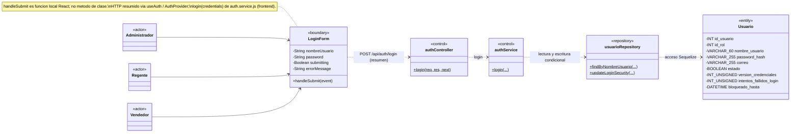

**Correspondencia verificable y firmas exactas** (los puntos suspensivos del dibujo solo abrevian parámetros):

| CU | Elemento / intermediario | Clase, componente o función real | Archivo fuente | Método o función real | Simplificación UML / condición |
|---|---|---|---|---|---|
| CU01 | LoginForm | Componente funcional LoginForm | `frontend/src/features/auth/components/LoginForm.jsx` | Función local `handleSubmit(event)` | Evento onSubmit; valida, llama a login recibido de useAuth y navega. login no es función propia del formulario. |
| CU01 | authController | Clase authController | `backend/src/presentation/controllers/auth.controller.js` | `login(req, res, next)` | Entrada HTTP; coloca cookie. |
| CU01 | authService | Clase authService | `backend/src/business/services/auth.service.js` | `login({ nombreUsuario, password })` | Cuenta, bcrypt, contador/bloqueo y generación del JWT dentro del método. |
| CU01 | usuarioRepository | Clase usuarioRepository | `backend/src/data/repositories/usuario.repository.js` | `findByNombreUsuario({ nombreUsuario, transaction = undefined, lock = false })`; `updateLoginSecurity({ idUsuario, intentosFallidosLogin, bloqueadoHasta, transaction })` | La escritura ocurre ante fallo o limpieza necesaria tras éxito. |
| CU01 | Usuario | Modelo Usuario | `backend/src/data/models/usuario.js` | — | Nueve atributos persistentes; sin operaciones propias de negocio. |
| CU01 | AuthProvider, intermediario en nota | Componente funcional; función de contexto | `frontend/src/features/auth/context/AuthContext.jsx` | Local `login(credentials)` | LoginForm obtiene login mediante useAuth; AuthProvider llama a loginRequest(credentials) y actualiza usuario. No es la función del módulo HTTP. |
| CU01 | auth.service.js (frontend) | Módulo ES; función exportada | `frontend/src/features/auth/services/auth.service.js` | `login(credentials)` | AuthProvider la importa como loginRequest; api.post('/auth/login', credentials). No es authService del backend. |
| CU01 | API, relación HTTP | Endpoint Express | `backend/src/presentation/routes/auth.router.js`; `backend/src/app.js` | `POST /api/auth/login` | authRouter.post('/login', authController.login), con prefijo /api/auth; no es un método React. |

**Descripción de relaciones:** los actores utilizan LoginForm, contenido en LoginPage. handleSubmit utiliza login obtenido de useAuth; AuthProvider ejecuta su función local login y llama a loginRequest, alias de la exportación login del módulo auth.service.js (frontend). La dependencia LoginForm–authController resume esta colaboración, explícita en nota y tabla, no una llamada directa del formulario. La función HTTP solicita POST /api/auth/login mediante Axios. authController llama a authService; este accede a Usuario mediante usuarioRepository. El rol se obtiene de la FK sin consultar Rol. No hay una entidad SesionUsuario ni métodos Usuario.validarCredenciales.

**Interacción Boundary:** los onChange de nombre/contraseña y el onClick de visibilidad son eventos inline que utilizan setters de useState; no existen updateField, handleChange ni un handler de visibilidad independiente en LoginForm. getLoginErrorMessage es una función de módulo del mismo archivo, no una operación local del componente.

Una contraseña incorrecta incrementa los fallos de una cuenta activa no bloqueada; el tercero bloquea diez minutos. Los intentos durante el bloqueo no lo prolongan. El éxito reinicia el contador cuando corresponde. Solo las credenciales aceptadas permiten establecer sesión; una cuenta inexistente no genera un contador persistido.

**Apoyos reales omitidos del dibujo:** `authValidator.validateLogin(data)` en `backend/src/business/validators/auth.validator.js` valida el body. `generarToken({ idUsuario, idRol, versionCredenciales })` en `backend/src/shared/utils/jwt.js` es una función exportada, no un método de authService. bcrypt.compare pertenece a la librería. `POST /api/auth/login` está declarado en `backend/src/presentation/routes/auth.router.js`.

La restauración al recargar mediante `/api/auth/me` es una solicitud de apoyo distinta y no se añade como método de este Control. Referencias: RF01/RF03; RN05/RN07/RN115.

### CU02 — Cerrar sesión

**Actor o actores:** Administrador, Regente o Vendedor autenticado.

**Objetivo:** finalizar la sesión actual en el navegador.

**Elementos participantes:**

| Elemento | Estereotipo / tipo | Responsabilidad |
|---|---|---|
| AppHeader / AppSidebar | Boundary; componentes funcionales | Ofrecen la acción de salida mediante la prop onLogout. |
| MainLayout | Boundary; componente funcional padre | Implementa handleLogout y lo pasa a ambas interfaces como onLogout. |
| auth.service.js (frontend) | Módulo ES intermediario; sin caja | Exporta logout y solicita el cierre, por intervención de AuthProvider. |
| authController | Control HTTP; clase | Elimina la cookie en logout. |
| authMiddleware | Función de middleware | Comprueba la sesión antes del Controller. |
| authService | Control de negocio; clase | Comprueba la cuenta activa y su versión en getSessionUsuario. |
| usuarioRepository | Repository; clase | Lee la cuenta para comprobar la sesión. |
| Usuario | Entity | Aporta el estado y versión para comprobar la sesión antes de cerrar. |

**Diagrama de clases:**

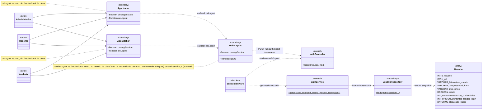

**Correspondencia verificable y firmas exactas:**

| CU | Elemento / intermediario | Clase, componente o función real | Archivo fuente | Método o función real | Simplificación UML / condición |
|---|---|---|---|---|---|
| CU02 | AppHeader / AppSidebar | Componentes funcionales | `frontend/src/layouts/components/AppHeader.jsx`; `frontend/src/layouts/components/AppSidebar.jsx` | Reciben la prop onLogout | onClick usa ese callback; ninguno define una función local de cierre. handleKeyDown de AppSidebar corresponde a navegación/foco y no se incorpora al logout. |
| CU02 | MainLayout | Componente funcional padre | `frontend/src/layouts/MainLayout.jsx` | Función local `handleLogout()` | Pasa handleLogout como onLogout a AppHeader y AppSidebar; llama a logout recibido de useAuth. |
| CU02 | authController | Clase authController | `backend/src/presentation/controllers/auth.controller.js` | `logout(req, res, next)` | Elimina cookie; no llama a authService.logout. |
| CU02 | authMiddleware | Función exportada | `backend/src/presentation/middlewares/auth.middleware.js` | `authMiddleware(req, res, next)` | No es clase; usa getSessionUsuario y llama next. |
| CU02 | authService | Clase authService | `backend/src/business/services/auth.service.js` | `getSessionUsuario(idUsuario, versionCredenciales)` | Ejecutado por middleware, no por logout. |
| CU02 | usuarioRepository | Clase usuarioRepository | `backend/src/data/repositories/usuario.repository.js` | `findByIdForSession({ idUsuario })` | Solo lectura de la cuenta. |
| CU02 | Usuario | Modelo Usuario | `backend/src/data/models/usuario.js` | — | Nueve atributos; no se modifica. |
| CU02 | AuthProvider, intermediario en nota | Componente funcional; función de contexto | `frontend/src/features/auth/context/AuthContext.jsx` | Local `logout()` | MainLayout obtiene logout de useAuth; AuthProvider llama a logoutRequest y limpia usuario en finally. |
| CU02 | auth.service.js (frontend) | Módulo ES; función exportada | `frontend/src/features/auth/services/auth.service.js` | `logout()` | AuthProvider la importa como logoutRequest; api.post('/auth/logout'). No existe authService.logout del backend. |
| CU02 | API, relación HTTP | Endpoint Express | `backend/src/presentation/routes/auth.router.js`; `backend/src/app.js` | `POST /api/auth/logout` | authRouter.post('/logout', authMiddleware, authController.logout), con prefijo /api/auth. |

**Descripción de relaciones:** AppHeader y AppSidebar invocan la prop onLogout, implementada como handleLogout en MainLayout. Este llama a logout del contexto mediante useAuth; AuthProvider llama a logoutRequest, alias de la función exportada logout de auth.service.js (frontend). El módulo solicita `POST /api/auth/logout` y MainLayout navega a login. La dependencia MainLayout–authController resume esta colaboración HTTP, identificando la intermediación del contexto en nota y tabla; no afirma una llamada directa. authMiddleware comprueba Usuario mediante authService y usuarioRepository antes de autorizar la ejecución de authController.logout. No existe dependencia logout → authService. Cerrar sesión elimina la cookie sin incrementar versión ni revocar todas las posibles copias del token.

**Correspondencia con la implementación:** `frontend/src/layouts/components/AppHeader.jsx`, `AppSidebar.jsx` y `frontend/src/layouts/MainLayout.jsx` representan la acción de interfaz; no existe una página independiente de logout. AuthContext limpia el estado público de autenticación incluso si la solicitud falla.

`res.clearCookie` es una operación de Express, no un método propio del Controller. La ruta está en `backend/src/presentation/routes/auth.router.js`. Referencias: RF02/RF03 y CU02.

### CU03 — Crear usuario

**Actor o actores:** Administrador autenticado.

**Objetivo:** registrar una cuenta con un rol existente y activo, nombre único y contraseña protegida.

**Elementos participantes:**

| Elemento | Estereotipo / tipo | Responsabilidad |
|---|---|---|
| UsuarioFormPage / UsuarioForm | Boundary; componentes funcionales | Coordinan el alta y sus campos reales, incluida confirmPassword. |
| usuario.service.js (frontend) | Módulo ES intermediario; sin caja | Exporta createUsuario y envía los datos recibidos de la página. |
| usuarioController | Control HTTP; clase | Valida la entrada y atiende createUsuario. |
| usuarioService | Control de negocio; clase | Comprueba unicidad/rol, genera hash, crea y relee los datos públicos. |
| usuarioRepository | Repository; clase | Consulta Usuario/Rol, inserta y obtiene la cuenta creada. |
| Usuario | Entity | Representa la cuenta creada y su identificación. |
| Rol | Entity | Representa uno de los roles fijos asignables. |

**Diagrama de clases:**

```mermaid
classDiagram
    direction LR
    class Administrador { <<actor>> }
    class UsuarioForm {
        <<boundary>>
        -String form.nombreUsuario
        -String form.idRol
        -String form.password
        -String form.confirmPassword
        -String form.correo
        -Function onSubmit
        -Function onCancel
        +updateField(event)
        +handleSubmit(event)
    }
    class UsuarioFormPage {
        <<boundary>>
        -String mode
        -Boolean submitting
        -String errorMessage
        +handleSubmit(data)
    }
    class usuarioController {
        <<control>>
        +createUsuario(req, res, next)$
    }
    class usuarioService {
        <<control>>
        +createUsuario(...)$
        +getUsuarioById(...)$
    }
    class usuarioRepository {
        <<repository>>
        +findByNombreUsuario(...)$
        +findByCorreo(...)$
        +findRolById(...)$
        +createUsuario(...)$
        +findById(...)$
    }
    class Usuario {
        <<entity>>
        -INT id_usuario
        -INT id_rol
        -VARCHAR_60 nombre_usuario
        -VARCHAR_255 correo
        -VARCHAR_255 password_hash
        -BOOLEAN estado
        -INT_UNSIGNED version_credenciales
        -INT_UNSIGNED intentos_fallidos_login
        -DATETIME bloqueado_hasta
    }
    class Rol {
        <<entity>>
        -INT id_rol
        -VARCHAR_60 nombre
        -VARCHAR_255 descripcion
        -BOOLEAN estado
    }
    Administrador --> UsuarioForm
    UsuarioForm ..> UsuarioFormPage : callback onSubmit
    UsuarioFormPage ..> usuarioController : POST /api/usuarios (resumen)
    usuarioController ..> usuarioService : createUsuario
    usuarioService ..> usuarioRepository
    usuarioRepository ..> Usuario : consultas e insercion
    usuarioRepository ..> Rol : valida e incluye
    Rol "1" -- "0..*" Usuario : rol
    note for UsuarioForm "Operaciones = funciones locales React; no metodos de clase. onSubmit y onCancel son props"
    note for UsuarioFormPage "handleSubmit(data) es funcion local de la pagina React; no metodo de clase"
```

**Correspondencia verificable y firmas exactas:**

| CU | Elemento / intermediario | Clase, componente o función real | Archivo fuente | Método o función real | Simplificación UML / condición |
|---|---|---|---|---|---|
| CU03 | UsuarioForm | Componente funcional | `frontend/src/features/usuarios/components/UsuarioForm.jsx` | Locales `updateField(event)` y `handleSubmit(event)` | onChange usa updateField; onSubmit del elemento form usa handleSubmit. Este convierte idRol a Number y llama a la prop onSubmit, sin realizar HTTP. |
| CU03 | UsuarioFormPage | Componente funcional | `frontend/src/features/usuarios/pages/UsuarioFormPage.jsx` | Local `handleSubmit(data)` | mode=create; pasa esta función como onSubmit y llama a createUsuario(data). onCancel recibe una función inline de navegación; no existe handleCancel. |
| CU03 | usuarioController | Clase usuarioController | `backend/src/presentation/controllers/usuario.controller.js` | `createUsuario(req, res, next)` | Entrada HTTP. |
| CU03 | usuarioService | Clase usuarioService | `backend/src/business/services/usuario.service.js` | `createUsuario({ idRol, nombreUsuario, password, correo })`; `getUsuarioById(idUsuario, transaction = undefined)` | El segundo método se llama dentro del alta, no por otra petición. |
| CU03 | usuarioRepository | Clase usuarioRepository | `backend/src/data/repositories/usuario.repository.js` | `findByNombreUsuario({ nombreUsuario, transaction = undefined, lock = false })`; `findByCorreo({ correo, transaction = undefined })`; `findRolById({ idRol, transaction = undefined })`; `createUsuario({ idRol, nombreUsuario, passwordHash, correo = null })`; `findById({ idUsuario, transaction = undefined })` | Correo se consulta si no es nulo/omitido; findById incluye Rol. |
| CU03 | Usuario / Rol | Modelos Usuario y Rol | `backend/src/data/models/usuario.js`; `backend/src/data/models/rol.js` | — | Nueve y cuatro atributos completos. |
| CU03 | usuario.service.js (frontend) | Módulo ES; función exportada | `frontend/src/features/usuarios/services/usuario.service.js` | `createUsuario(data)` | UsuarioFormPage la importa y llama desde handleSubmit en modo create; api.post('/usuarios', data). |
| CU03 | API, relación HTTP | Endpoint Express | `backend/src/presentation/routes/usuario.router.js`; `backend/src/app.js` | `POST /api/usuarios` | usuarioRouter.post('/', usuarioController.createUsuario), con prefijo /api/usuarios y middleware de Administrador. |

**Descripción de relaciones:** UsuarioFormPage renderiza UsuarioForm y recibe sus datos por onSubmit. Su handleSubmit llama a createUsuario del módulo usuario.service.js (frontend), que solicita POST /api/usuarios; no hay llamada HTTP propia de UsuarioForm. usuarioController llama a usuarioService, que consulta y escribe mediante usuarioRepository. Cada Usuario pertenece a un Rol; un Rol tiene cero o más usuarios. No hay herencia de permisos.

**Interacción Boundary de CU03:** UsuarioForm.handleSubmit(event) es una función local que valida y ejecuta la prop onSubmit; la página suministra su propia handleSubmit(data). createUsuario(data) pertenece al módulo HTTP, no a ninguno de los componentes. loadUsuario está definida dentro del efecto de UsuarioFormPage, pero ese efecto retorna antes de ejecutarla en modo create: no participa en CU03. El botón Cancelar invoca onCancel, recibido como `() => navigate('/usuarios')`. PasswordInput maneja la visibilidad con un evento inline y PasswordRequirements presenta reglas, sin handlers locales nombrados necesarios en este dibujo; no se añaden cajas auxiliares ni operaciones ficticias.

La contraseña se transforma en hash antes de persistir. Su confirmación se comprueba localmente y no se envía al backend. El ID y el estado inicial proceden del backend; el actor no los introduce. Correo es opcional y único cuando está presente. No se crea una recuperación al registrar la cuenta.

**Correspondencia con la implementación:** `/usuarios/nuevo`, `frontend/src/features/usuarios/pages/UsuarioFormPage.jsx` y `frontend/src/features/usuarios/components/UsuarioForm.jsx` representan la vista; el servicio HTTP invoca `POST /api/usuarios`.

**Funciones externas, no métodos del Service:** `throwIfDuplicateUsuario(nombreUsuario, idUsuario = undefined, transaction = undefined)`, `throwIfDuplicateCorreo(correo, idUsuario = undefined, transaction = undefined)`, `validateRolActivo(idRol, transaction = undefined)`, `handleDuplicateDatabaseError(error)` y `toPublicUsuario(usuario)` están declaradas a nivel de módulo en `backend/src/business/services/usuario.service.js`. El Controller usa `usuarioValidator.validateCreateUsuario(data)` en `backend/src/business/validators/usuario.validator.js`. bcrypt.hash es de librería.

Referencias: RF04/RF05/RF09; RN01–RN07/RN107.

### CU04 — Consultar usuarios

**Actor o actores:** Administrador autenticado.

**Objetivo:** consultar las cuentas registradas, con sus datos públicos, rol y estado.

**Elementos participantes:**

| Elemento | Estereotipo / tipo | Responsabilidad |
|---|---|---|
| UsuariosPage / UsuarioTable | Boundary; componentes funcionales | Cargan y muestran el listado, con filtros locales reales. |
| usuario.service.js (frontend) | Módulo ES intermediario; sin caja | Exporta getUsuarios y consulta el listado para UsuariosPage. |
| usuarioController / usuarioService | Control; clases | Atienden getUsuarios y preparan datos públicos. |
| usuarioRepository | Repository; clase | Consulta cuentas con su Rol. |
| Usuario | Entity | Representa las cuentas activas e inactivas consultadas. |
| Rol | Entity | Identifica el rol de cada cuenta. |

**Diagrama de clases:**


**Correspondencia verificable y firmas exactas:**

| CU | Elemento / intermediario | Clase, componente o función real | Archivo fuente | Método o función real | Simplificación UML / condición |
|---|---|---|---|---|---|
| CU04 | UsuariosPage | Componente funcional | `frontend/src/features/usuarios/pages/UsuariosPage.jsx` | Local `loadUsuarios()` | Invocada desde useEffect y onClick de Reintentar; llama a getUsuarios del módulo HTTP. |
| CU04 | UsuarioTable | Componente funcional | `frontend/src/features/usuarios/components/UsuarioTable.jsx` | — | Recibe usuarios; muestra ID, nombre, rol y estado. No define una función local de consulta. |
| CU04 | usuarioController | Clase usuarioController | `backend/src/presentation/controllers/usuario.controller.js` | `getUsuarios(req, res, next)` | GET /api/usuarios. |
| CU04 | usuarioService | Clase usuarioService | `backend/src/business/services/usuario.service.js` | `getUsuarios()` | Usa toPublicUsuario, función externa del mismo módulo. |
| CU04 | usuarioRepository | Clase usuarioRepository | `backend/src/data/repositories/usuario.repository.js` | `findAllUsuarios()` | include Rol; sin escritura. |
| CU04 | Usuario / Rol | Modelos | `backend/src/data/models/usuario.js`; `backend/src/data/models/rol.js` | — | Atributos completos del modelo, no todos se devuelven al cliente. |
| CU04 | usuario.service.js (frontend) | Módulo ES; función exportada | `frontend/src/features/usuarios/services/usuario.service.js` | `getUsuarios()` | UsuariosPage la importa y llama desde loadUsuarios; api.get('/usuarios'). |
| CU04 | API, relación HTTP | Endpoint Express | `backend/src/presentation/routes/usuario.router.js`; `backend/src/app.js` | `GET /api/usuarios` | usuarioRouter.get('/', usuarioController.getUsuarios), con prefijo /api/usuarios. |

**Descripción de relaciones:** loadUsuarios de UsuariosPage llama a getUsuarios del módulo usuario.service.js (frontend), que solicita GET /api/usuarios. usuarioRepository consulta Usuario con include Rol. usuarioService convierte a DTO público y usuarioController devuelve los datos a través del cliente HTTP a UsuariosPage, que renderiza UsuarioTable con filteredUsuarios. El listado conserva activos/inactivos y admite resultado vacío. Los filtros no generan operaciones de backend.

**Interacción Boundary:** search/statusFilter cambian mediante onChange inline; filteredUsuarios es un valor calculado por un callback anónimo de useMemo, no una función propia denominada aplicarFiltros. Los callbacks de cambio de estado/restablecimiento de UsuarioTable corresponden a CU07/CU08 y no se añaden como operaciones de consulta.

**Correspondencia con la implementación:** `/usuarios`, `frontend/src/features/usuarios/pages/UsuariosPage.jsx` y `frontend/src/features/usuarios/components/UsuarioTable.jsx` representan la vista.

La conversión usa la función de módulo `toPublicUsuario(usuario)` en `backend/src/business/services/usuario.service.js`; no es un método de usuarioService. No se devuelve password_hash ni información privada de seguridad.

No se atribuye un Validator específico al listado ni una escritura a sus filtros. Referencias: RF04/RF06 y CU04.

### CU05 — Consultar usuario por ID

**Actor o actores:** Administrador autenticado.

**Objetivo:** obtener los datos públicos de una cuenta específica existente.

**Elementos participantes:**

| Elemento | Estereotipo / tipo | Responsabilidad |
|---|---|---|
| UsuarioFormPage / UsuarioForm | Boundary; componentes funcionales | Cargan la cuenta por ID y presentan initialData en edición. |
| usuario.service.js (frontend) | Módulo ES intermediario; sin caja | Exporta getUsuario y consulta la cuenta por ID. |
| usuarioController / usuarioService | Control; clases | Validan ID y obtienen datos públicos de la cuenta. |
| usuarioRepository | Repository; clase | Consulta Usuario con include Rol. |
| Usuario | Entity | Representa la cuenta consultada. |
| Rol | Entity | Aporta el rol asociado a la cuenta. |

**Diagrama de clases:**

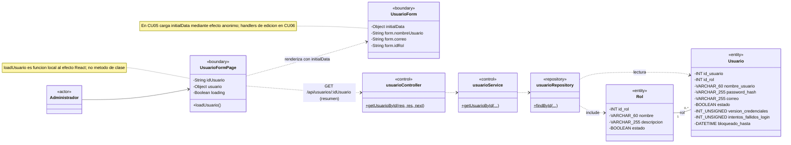

**Correspondencia verificable y firmas exactas:**

| CU | Elemento / intermediario | Clase, componente o función real | Archivo fuente | Método o función real | Simplificación UML / condición |
|---|---|---|---|---|---|
| CU05 | UsuarioFormPage | Componente funcional | `frontend/src/features/usuarios/pages/UsuarioFormPage.jsx` | Local al efecto `loadUsuario()` | El efecto la define y ejecuta en edición; usa getUsuario(numericId) del módulo HTTP. No es función pública del componente. |
| CU05 | UsuarioForm | Componente funcional | `frontend/src/features/usuarios/components/UsuarioForm.jsx` | — | Carga form desde initialData mediante un efecto anónimo. updateField/handleSubmit participan en CU06, no en esta lectura. |
| CU05 | usuarioController | Clase usuarioController | `backend/src/presentation/controllers/usuario.controller.js` | `getUsuarioById(req, res, next)` | Usa la función externa getIdUsuario(params), del mismo archivo. |
| CU05 | usuarioService | Clase usuarioService | `backend/src/business/services/usuario.service.js` | `getUsuarioById(idUsuario, transaction = undefined)` | Error 404 si no existe. |
| CU05 | usuarioRepository | Clase usuarioRepository | `backend/src/data/repositories/usuario.repository.js` | `findById({ idUsuario, transaction = undefined })` | Incluye Rol. |
| CU05 | Usuario / Rol | Modelos | `backend/src/data/models/usuario.js`; `backend/src/data/models/rol.js` | — | Atributos persistentes completos. |
| CU05 | usuario.service.js (frontend) | Módulo ES; función exportada | `frontend/src/features/usuarios/services/usuario.service.js` | `getUsuario(idUsuario)` | loadUsuario, local al efecto de UsuarioFormPage, llama a getUsuario(numericId); api.get con /usuarios/${idUsuario}. |
| CU05 | API, relación HTTP | Endpoint Express | `backend/src/presentation/routes/usuario.router.js`; `backend/src/app.js` | `GET /api/usuarios/:idUsuario` | usuarioRouter.get('/:idUsuario', usuarioController.getUsuarioById), con prefijo /api/usuarios. |

**Descripción de relaciones:** loadUsuario de UsuarioFormPage llama a getUsuario del módulo usuario.service.js (frontend), que solicita GET /api/usuarios/:idUsuario. El Controller llama al Service, que lee mediante Repository; initialData alimenta UsuarioForm. La consulta no modifica datos, estado ni contraseña.

**Correspondencia con la implementación:** es la carga inicial en `/usuarios/:idUsuario/editar`, sin pantalla independiente de detalle. Prepara CU06, cuya escritura se analiza por separado. `usuarioValidator.validateIdUsuario(data)` está en `backend/src/business/validators/usuario.validator.js`; `getIdUsuario(params)` y `getValidatedData(result)` son funciones de módulo del Controller, no métodos de su clase.

Referencias: RF04/RF06 y CU05.

### CU06 — Modificar usuario

**Actor o actores:** Administrador autenticado.

**Objetivo:** modificar nombre, rol y/o correo de una cuenta, manteniendo las condiciones de unicidad y seguridad.

**Elementos participantes:**

| Elemento | Estereotipo / tipo | Responsabilidad |
|---|---|---|
| UsuarioFormPage / UsuarioForm | Boundary; componentes funcionales | Coordinan la edición y envío de campos permitidos. |
| usuario.service.js (frontend) | Módulo ES intermediario; sin caja | Exporta updateUsuario y envía los cambios de la página. |
| usuarioController / usuarioService | Control; clases | Atienden updateUsuario y su lectura pública interna. |
| usuarioRepository | Repository; clase | Bloquea, valida datos relacionados, actualiza y relee la cuenta. |
| recuperacionPasswordRepository | Repository; clase | Invalida pendientes si cambia o se retira el correo. |
| Usuario | Entity | Representa la cuenta y los datos modificables. |
| Rol | Entity | Representa la asignación que se valida cuando se proporciona un rol. |
| RecuperacionPassword | Entity | Representa emisiones pendientes que se invalidan ante cambio efectivo o retirada de correo. |

**Diagrama de clases:**


**Correspondencia verificable y firmas exactas:**

| CU | Elemento / intermediario | Clase, componente o función real | Archivo fuente | Método o función real | Simplificación UML / condición |
|---|---|---|---|---|---|
| CU06 | UsuarioForm | Componente funcional | `frontend/src/features/usuarios/components/UsuarioForm.jsx` | Locales `updateField(event)` y `handleSubmit(event)` | mode=edit; onChange actualiza campos y onSubmit del form ejecuta handleSubmit, que invoca la prop onSubmit. No envía contraseña. |
| CU06 | UsuarioFormPage | Componente funcional | `frontend/src/features/usuarios/pages/UsuarioFormPage.jsx` | Local `handleSubmit(data)` | Recibida por UsuarioForm como onSubmit; llama a updateUsuario(Number(idUsuario), data). onCancel recibe navegación inline, sin handleCancel. |
| CU06 | usuarioController | Clase usuarioController | `backend/src/presentation/controllers/usuario.controller.js` | `updateUsuario(req, res, next)` | PATCH /api/usuarios/:idUsuario. |
| CU06 | usuarioService | Clase usuarioService | `backend/src/business/services/usuario.service.js` | `updateUsuario(idUsuario, { idRol, nombreUsuario, correo })`; `getUsuarioById(idUsuario, transaction = undefined)` | La lectura pública ocurre dentro de updateUsuario. |
| CU06 | usuarioRepository | Clase usuarioRepository | `backend/src/data/repositories/usuario.repository.js` | `findByIdForUpdate({ idUsuario, transaction })`; `findByNombreUsuario({ nombreUsuario, transaction = undefined, lock = false })`; `findByCorreo({ correo, transaction = undefined })`; `findRolById({ idRol, transaction = undefined })`; `updateUsuario({ idUsuario, idRol, nombreUsuario, correo, transaction = undefined })`; `findById({ idUsuario, transaction = undefined })` | Unicidad/rol según campos recibidos; findById incluye Rol. |
| CU06 | recuperacionPasswordRepository | Clase recuperacionPasswordRepository | `backend/src/data/repositories/recuperacion-password.repository.js` | `invalidatePendingByUsuario({ idUsuario, invalidadaEn, transaction })` | Solo ante cambio efectivo o retirada del correo. |
| CU06 | Usuario / Rol / RecuperacionPassword | Modelos | `backend/src/data/models/usuario.js`; `backend/src/data/models/rol.js`; `backend/src/data/models/recuperacion-password.js` | — | Nueve, cuatro y nueve atributos completos. |
| CU06 | usuario.service.js (frontend) | Módulo ES; función exportada | `frontend/src/features/usuarios/services/usuario.service.js` | `updateUsuario(idUsuario, data)` | UsuarioFormPage la importa y llama desde handleSubmit en modo edit; api.patch con /usuarios/${idUsuario} y data. |
| CU06 | API, relación HTTP | Endpoint Express | `backend/src/presentation/routes/usuario.router.js`; `backend/src/app.js` | `PATCH /api/usuarios/:idUsuario` | usuarioRouter.patch('/:idUsuario', usuarioController.updateUsuario), con prefijo /api/usuarios. |

**Descripción de relaciones:** la página recibe datos del formulario mediante onSubmit; su handleSubmit llama a updateUsuario del módulo usuario.service.js (frontend), que solicita PATCH /api/usuarios/:idUsuario. usuarioController llama a usuarioService; este accede por los dos Repositories. Cada cuenta conserva un rol y puede tener varias recuperaciones históricas. RecuperacionPassword se modifica únicamente si el correo cambia efectivamente o se retira: omitido se conserva, nulo se retira y el mismo correo normalizado no invalida. Actualización e invalidación se confirman juntas.

Los chequeos de nombre, correo y rol dependen de los campos proporcionados. El CU no cambia contraseña, estado, versión de credenciales ni cuotas IP. La carga preparatoria corresponde a CU05.

**Interacción Boundary:** se reutilizan las dos funciones locales de UsuarioForm, pero la rama edit de handleSubmit no valida ni envía la contraseña inicial. El handleSubmit de la página ejecuta updateUsuario del módulo HTTP, no createUsuario. loadUsuario y la carga desde initialData se analizan en CU05; no se copian como operaciones de esta escritura.

**Correspondencia con la implementación:** `/usuarios/:idUsuario/editar`, `frontend/src/features/usuarios/pages/UsuarioFormPage.jsx` y `frontend/src/features/usuarios/components/UsuarioForm.jsx` representan la vista.

**Apoyos externos:** `usuarioValidator.validateIdUsuario(data)` y `validateUpdateUsuario(data)` están en `backend/src/business/validators/usuario.validator.js`. Las funciones de módulo `throwIfDuplicateUsuario`, `throwIfDuplicateCorreo`, `validateRolActivo`, `handleDuplicateDatabaseError` y `toPublicUsuario`, descritas en CU03, no se presentan como métodos de usuarioService. La lectura HTTP preparatoria pertenece a CU05; la lectura interna getUsuarioById sí participa en este PATCH.

Referencias: RF04/RF07, RI15; RN04/RN107.

### CU07 — Activar o desactivar usuario

**Actor o actores:** Administrador autenticado.

**Objetivo:** cambiar el estado administrativo de una cuenta conservando su información e historial.

**Elementos participantes:**

| Elemento | Estereotipo / tipo | Responsabilidad |
|---|---|---|
| UsuariosPage / UsuarioTable / ConfirmDialog | Boundary; componentes funcionales | Seleccionan cuenta y confirman el cambio de estado. |
| usuario.service.js (frontend) | Módulo ES intermediario; sin caja | Exporta updateEstadoUsuario y solicita el cambio confirmado por la página. |
| usuarioController / usuarioService | Control; clases | Atienden updateEstado y las lecturas públicas internas. |
| usuarioRepository | Repository; clase | Lee con Rol y actualiza únicamente estado. |
| Usuario | Entity | Representa la cuenta cuyo estado cambia. |
| Rol | Entity | Aporta el rol en las lecturas públicas de la cuenta antes y después del cambio. |

**Diagrama de clases:**


**Correspondencia verificable y firmas exactas:**

| CU | Elemento / intermediario | Clase, componente o función real | Archivo fuente | Método o función real | Simplificación UML / condición |
|---|---|---|---|---|---|
| CU07 | UsuariosPage | Componente funcional | `frontend/src/features/usuarios/pages/UsuariosPage.jsx` | Local `handleUpdateEstado()` | Pasa esta función como onConfirm a ConfirmDialog; llama a updateEstadoUsuario del módulo HTTP. |
| CU07 | UsuarioTable | Componente funcional | `frontend/src/features/usuarios/components/UsuarioTable.jsx` | Prop callback onToggleEstado | Recibe setEstadoTarget de la página; onClick inline ejecuta onToggleEstado(usuario). Sin función local nombrada de cambio de estado. |
| CU07 | ConfirmDialog | Componente funcional | `frontend/src/components/ConfirmDialog.jsx` | Prop callback onConfirm | Recibe handleUpdateEstado y busy=updatingEstado; onClick utiliza onConfirm. No define una función local de confirmación. |
| CU07 | usuarioController | Clase usuarioController | `backend/src/presentation/controllers/usuario.controller.js` | `updateEstado(req, res, next)` | PATCH /api/usuarios/:idUsuario/estado. |
| CU07 | usuarioService | Clase usuarioService | `backend/src/business/services/usuario.service.js` | `updateEstado(idUsuario, { estado })`; `getUsuarioById(idUsuario, transaction = undefined)` | Lee antes y después del cambio. |
| CU07 | usuarioRepository | Clase usuarioRepository | `backend/src/data/repositories/usuario.repository.js` | `findById({ idUsuario, transaction = undefined })`; `updateEstado({ idUsuario, estado })` | Rol participa por include en findById. |
| CU07 | Usuario / Rol | Modelos | `backend/src/data/models/usuario.js`; `backend/src/data/models/rol.js` | — | Nueve y cuatro atributos completos. |
| CU07 | usuario.service.js (frontend) | Módulo ES; función exportada | `frontend/src/features/usuarios/services/usuario.service.js` | `updateEstadoUsuario(idUsuario, estado)` | handleUpdateEstado de UsuariosPage la llama con estadoTarget.idUsuario y nextEstado; api.patch con /usuarios/${idUsuario}/estado y { estado }. |
| CU07 | API, relación HTTP | Endpoint Express | `backend/src/presentation/routes/usuario.router.js`; `backend/src/app.js` | `PATCH /api/usuarios/:idUsuario/estado` | usuarioRouter.patch('/:idUsuario/estado', usuarioController.updateEstado), con prefijo /api/usuarios. El nombre frontend es updateEstadoUsuario; el backend usa updateEstado. |

**Descripción de relaciones:** UsuariosPage coordina selección en UsuarioTable y confirmación en ConfirmDialog. onConfirm ejecuta handleUpdateEstado de la página, que llama a updateEstadoUsuario del módulo usuario.service.js (frontend). Este solicita PATCH /api/usuarios/:idUsuario/estado, atendido por usuarioController.updateEstado. usuarioService lee y modifica mediante usuarioRepository; Rol participa en las lecturas públicas. Desactivar conserva historial e impide acceso posterior. Bloqueo temporal y estado administrativo son diferentes.

**Interacción Boundary:** setEstadoTarget es un setter de useState, no una función propia inventada del componente. El cierre de ConfirmDialog recibe `() => setEstadoTarget(null)` como onClose; se documenta como callback inline de la página. loadUsuarios y handlePasswordReset corresponden a CU04/CU08 y no se incorporan a este cambio de estado.

Esta operación no cambia contraseña/versión, no reinicia intentos y no elimina recuperaciones. No se incorpora una regla de protección del último Administrador o de prohibición de cambiar el propio estado, porque no está implementada en este flujo.

**Correspondencia con la implementación:** `frontend/src/features/usuarios/pages/UsuariosPage.jsx`, `frontend/src/features/usuarios/components/UsuarioTable.jsx` y `frontend/src/components/ConfirmDialog.jsx` representan selección y confirmación.

`usuarioValidator.validateIdUsuario(data)` y `validateUpdateEstado(data)` en `backend/src/business/validators/usuario.validator.js` comprueban ID/body. La lectura inicial del listado corresponde a CU04; getUsuarioById es aquí una llamada interna real, no otro endpoint.

Referencias: RF04/RF08; RN05/RN06.

### CU08 — Cambiar contraseña

El CU conserva dos variantes con permisos y resultados diferentes. Se muestran por separado para distinguir la contraseña actual exigida al cambiar la propia de la intervención administrativa sobre una cuenta seleccionada.

#### Variante A — Cambio propio

**Actor o actores:** Administrador, Regente o Vendedor autenticado.

**Objetivo:** cambiar la contraseña propia, comprobar la actual y mantener la sesión del navegador con credenciales renovadas.

**Elementos participantes:**

| Elemento | Estereotipo / tipo | Responsabilidad |
|---|---|---|
| ChangeOwnPasswordDialog | Boundary; componente funcional | Recoge los campos reales del estado form. |
| usuario.service.js (frontend) | Módulo ES intermediario; sin caja | Exporta updateOwnPassword y envía las contraseñas actual/nueva. |
| usuarioController / usuarioService | Control; clases | Ejecutan updateOwnPassword; el Controller renueva cookie. |
| usuarioRepository / recuperacionPasswordRepository | Repository; clases | Consultan/actualizan la cuenta e invalidan recuperaciones. |
| Usuario | Entity | Representa la cuenta autenticada y su seguridad de acceso. |
| RecuperacionPassword | Entity | Representa las recuperaciones pendientes que dejan de ser utilizables. |

**Diagrama de clases:**

```mermaid
classDiagram
    direction LR
    class Administrador { <<actor>> }
    class Regente { <<actor>> }
    class Vendedor { <<actor>> }
    class ChangeOwnPasswordDialog {
        <<boundary>>
        -String form.passwordActual
        -String form.passwordNueva
        -String form.confirmPassword
        -Boolean submitting
        -Boolean open
        -Function onClose
        +updateField(event)
        +handleSubmit(event)
    }
    class usuarioController {
        <<control>>
        +updateOwnPassword(req, res, next)$
    }
    class usuarioService {
        <<control>>
        +updateOwnPassword(...)$
    }
    class usuarioRepository {
        <<repository>>
        +findByIdWithPassword(...)$
        +updatePassword(...)$
    }
    class recuperacionPasswordRepository {
        <<repository>>
        +invalidatePendingByUsuario(...)$
    }
    class Usuario {
        <<entity>>
        -INT id_usuario
        -INT id_rol
        -VARCHAR_60 nombre_usuario
        -VARCHAR_255 password_hash
        -VARCHAR_255 correo
        -BOOLEAN estado
        -INT_UNSIGNED version_credenciales
        -INT_UNSIGNED intentos_fallidos_login
        -DATETIME bloqueado_hasta
    }
    class RecuperacionPassword {
        <<entity>>
        -INT id_recuperacion
        -INT id_usuario
        -CHAR_64 codigo_hmac
        -CHAR_36 nonce
        -DATETIME_3 fecha_solicitud
        -DATETIME_3 expira_en
        -TINYINT_UNSIGNED intentos_fallidos
        -DATETIME_3 consumida_en
        -DATETIME_3 invalidada_en
    }
    Administrador --> ChangeOwnPasswordDialog
    Regente --> ChangeOwnPasswordDialog
    Vendedor --> ChangeOwnPasswordDialog
    ChangeOwnPasswordDialog ..> usuarioController : PATCH /api/usuarios/me/password (resumen)
    usuarioController ..> usuarioService : updateOwnPassword
    usuarioService ..> usuarioRepository
    usuarioService ..> recuperacionPasswordRepository
    usuarioRepository ..> Usuario
    recuperacionPasswordRepository ..> RecuperacionPassword
    Usuario "1" -- "0..*" RecuperacionPassword : recuperacionesPassword
    note for ChangeOwnPasswordDialog "Operaciones = funciones locales React; no metodos de clase. onClose es prop"
```

**Correspondencia verificable y firmas exactas:**

| CU | Elemento / intermediario | Clase, componente o función real | Archivo fuente | Método o función real | Simplificación UML / condición |
|---|---|---|---|---|---|
| CU08-A | ChangeOwnPasswordDialog | Componente funcional | `frontend/src/features/usuarios/components/ChangeOwnPasswordDialog.jsx` | Locales `updateField(event)` y `handleSubmit(event)` | updateField recibe onChange de PasswordInput; handleSubmit atiende onSubmit y llama a updateOwnPassword del módulo HTTP. open/onClose son props; confirmPassword es local. |
| CU08-A | usuarioController | Clase usuarioController | `backend/src/presentation/controllers/usuario.controller.js` | `updateOwnPassword(req, res, next)` | ID y versión proceden de req.usuario, no del body. |
| CU08-A | usuarioService | Clase usuarioService | `backend/src/business/services/usuario.service.js` | `updateOwnPassword(idUsuario, { passwordActual, passwordNueva }, versionCredenciales)` | Firma exacta del método abreviado en el dibujo. |
| CU08-A | usuarioRepository | Clase usuarioRepository | `backend/src/data/repositories/usuario.repository.js` | `findByIdWithPassword({ idUsuario, transaction = undefined, lock = false })`; `updatePassword({ idUsuario, passwordHash, versionCredenciales, transaction })` | Primera lectura y revalidación bloqueada; después escritura. |
| CU08-A | recuperacionPasswordRepository | Clase recuperacionPasswordRepository | `backend/src/data/repositories/recuperacion-password.repository.js` | `invalidatePendingByUsuario({ idUsuario, invalidadaEn, transaction })` | Misma transacción del cambio. |
| CU08-A | Usuario / RecuperacionPassword | Modelos | `backend/src/data/models/usuario.js`; `backend/src/data/models/recuperacion-password.js` | — | Nueve atributos completos en cada entidad. |
| CU08-A | usuario.service.js (frontend) | Módulo ES; función exportada | `frontend/src/features/usuarios/services/usuario.service.js` | `updateOwnPassword(data)` | ChangeOwnPasswordDialog la importa y llama desde handleSubmit; api.patch('/usuarios/me/password', data). No utiliza login/logout del contexto. |
| CU08-A | API, relación HTTP | Endpoint Express | `backend/src/presentation/routes/usuario.router.js`; `backend/src/app.js` | `PATCH /api/usuarios/me/password` | usuarioRouter.patch('/me/password', authMiddleware, usuarioController.updateOwnPassword), antes del middleware de Administrador. |

**Descripción de relaciones:** handleSubmit de ChangeOwnPasswordDialog llama directamente a la exportación updateOwnPassword del módulo usuario.service.js (frontend), que solicita PATCH /api/usuarios/me/password. usuarioController llama a usuarioService con ID/versión autenticados. El Service utiliza los dos Repositories, revalida credenciales y actualiza hash/versión, contador/bloqueo y recuperaciones conjuntamente. No acepta usuario objetivo elegido por el cliente.

**Interacción Boundary:** MainLayout controla open y pasa `() => setPasswordDialogOpen(false)` como onClose; no hay una función local handleClose en el diálogo. Su efecto de reinicio es anónimo. Los auxiliares PasswordInput/PasswordRequirements no ejecutan la solicitud HTTP ni reciben las operaciones de negocio como métodos propios.

La cookie renovada mantiene esta sesión; las sesiones con la versión anterior dejan de ser válidas. Se utiliza el ID de rol almacenado en Usuario para renovar las credenciales, sin consultar Rol. No se modifican cuotas IP.

**Correspondencia con la implementación:** `frontend/src/features/usuarios/components/ChangeOwnPasswordDialog.jsx`, abierto desde MainLayout, representa la vista. Su confirmación local no forma parte del body de `PATCH /api/usuarios/me/password`.

**Funciones externas:** `requireCurrentCredentials(usuario, versionCredenciales, passwordHash = undefined)` está a nivel de módulo en `backend/src/business/services/usuario.service.js`, no en la clase. `siguienteVersionCredenciales(usuario)` está en `backend/src/shared/utils/credenciales.js`; `generarToken({ idUsuario, idRol, versionCredenciales })`, en `backend/src/shared/utils/jwt.js`. El Validator ejecuta `validateUpdateOwnPassword(data)` en `backend/src/business/validators/usuario.validator.js`; bcrypt.compare/hash y res.cookie son operaciones de librerías. No se dibuja getUsuarioById porque este camino no lo llama.

Referencias: RF09; RN07/RN115 y CU08.

#### Variante B — Restablecimiento administrativo

**Actor o actores:** Administrador autenticado.

**Objetivo:** establecer una nueva contraseña para una cuenta seleccionada sin conocer ni mostrar la anterior.

**Elementos participantes:**

| Elemento | Estereotipo / tipo | Responsabilidad |
|---|---|---|
| ResetPasswordDialog | Boundary; componente funcional | Recibe usuario y maneja password y confirmation. |
| usuario.service.js (frontend) | Módulo ES intermediario; sin caja | Exporta resetPasswordUsuario y envía la contraseña de la cuenta objetivo. |
| usuarioController / usuarioService | Control; clases | Ejecutan updatePassword y la lectura pública previa. |
| usuarioRepository / recuperacionPasswordRepository | Repository; clases | Consultan/actualizan cuenta e invalidan recuperaciones. |
| Usuario | Entity | Representa la cuenta objetivo y sus credenciales. |
| Rol | Entity | Aporta el rol en la lectura pública previa de la cuenta objetivo. |
| RecuperacionPassword | Entity | Representa recuperaciones pendientes que se invalidan. |

**Diagrama de clases:**


**Correspondencia verificable y firmas exactas:**

| CU | Elemento / intermediario | Clase, componente o función real | Archivo fuente | Método o función real | Simplificación UML / condición |
|---|---|---|---|---|---|
| CU08-B | ResetPasswordDialog | Componente funcional | `frontend/src/features/usuarios/components/ResetPasswordDialog.jsx` | Local `handleSubmit(event)` | Atiende onSubmit; llama a resetPasswordUsuario y después a la prop onSuccess(usuario). Los onChange de password/confirmation son inline, sin updateField propio. |
| CU08-B | Callback del padre, omitido del gráfico | Componente UsuariosPage | `frontend/src/features/usuarios/pages/UsuariosPage.jsx` | Local `handlePasswordReset(usuario)` | Pasa esta función como onSuccess; limpia resetTarget y muestra el mensaje. onClose recibe `() => setResetTarget(null)`, no handleCancel. |
| CU08-B | usuarioController | Clase usuarioController | `backend/src/presentation/controllers/usuario.controller.js` | `updatePassword(req, res, next)` | PATCH /api/usuarios/:idUsuario/password. |
| CU08-B | usuarioService | Clase usuarioService | `backend/src/business/services/usuario.service.js` | `updatePassword(idUsuario, { password })`; `getUsuarioById(idUsuario, transaction = undefined)` | getUsuarioById se ejecuta internamente antes del cambio. |
| CU08-B | usuarioRepository | Clase usuarioRepository | `backend/src/data/repositories/usuario.repository.js` | `findById({ idUsuario, transaction = undefined })`; `findByIdForUpdate({ idUsuario, transaction })`; `updatePassword({ idUsuario, passwordHash, versionCredenciales, transaction })` | include Rol solo en la lectura pública previa. |
| CU08-B | recuperacionPasswordRepository | Clase recuperacionPasswordRepository | `backend/src/data/repositories/recuperacion-password.repository.js` | `invalidatePendingByUsuario({ idUsuario, invalidadaEn, transaction })` | En la transacción del cambio. |
| CU08-B | Usuario / Rol / RecuperacionPassword | Modelos | `backend/src/data/models/usuario.js`; `backend/src/data/models/rol.js`; `backend/src/data/models/recuperacion-password.js` | — | Nueve, cuatro y nueve atributos completos. |
| CU08-B | usuario.service.js (frontend) | Módulo ES; función exportada | `frontend/src/features/usuarios/services/usuario.service.js` | `resetPasswordUsuario(idUsuario, password)` | ResetPasswordDialog la importa y llama desde handleSubmit; api.patch con /usuarios/${idUsuario}/password y { password }. |
| CU08-B | API, relación HTTP | Endpoint Express | `backend/src/presentation/routes/usuario.router.js`; `backend/src/app.js` | `PATCH /api/usuarios/:idUsuario/password` | usuarioRouter.patch('/:idUsuario/password', usuarioController.updatePassword), con prefijo /api/usuarios. La exportación frontend no se llama updatePassword. |

**Descripción de relaciones:** el Administrador usa ResetPasswordDialog sobre una cuenta recibida del listado. Su handleSubmit llama directamente a resetPasswordUsuario del módulo usuario.service.js (frontend), que solicita PATCH /api/usuarios/:idUsuario/password, atendido por usuarioController.updatePassword. El Service lee con Rol y cambia credenciales por los dos Repositories. Se conservan rol/estado y se limpian fallos/bloqueo. Los actores no son subclases de Usuario.

**Interacción Boundary:** handleSubmit es propia de ResetPasswordDialog; handlePasswordReset pertenece a UsuariosPage y se recibe como onSuccess. La página se documenta en la correspondencia sin otra caja para mantener el gráfico acotado. Los callbacks inline de campos/cierre y el efecto anónimo de reinicio no originan métodos adicionales.

No se exige contraseña anterior ni se emite cookie de renovación para la cuenta objetivo. Sus sesiones anteriores quedan obsoletas, incluso si el Administrador utiliza esta variante sobre su propia cuenta. La selección desde el listado corresponde a CU04; no se incorpora su GET como consulta HTTP independiente de este diagrama.

**Apoyos reales:** `usuarioValidator.validateIdUsuario(data)` y `validateUpdatePassword(data)` están en `backend/src/business/validators/usuario.validator.js`; `siguienteVersionCredenciales(usuario)` es función exportada de `backend/src/shared/utils/credenciales.js`. No se consulta la contraseña anterior ni se llama a updateOwnPassword. El campo real y la propiedad enviada son password, no passwordNueva; confirmation es solo local.

La ruta es `PATCH /api/usuarios/:idUsuario/password`. Referencias: RF04/RF09; RN07/RN115 y CU08.

### CU09 — Restablecer contraseña mediante correo electrónico

**Actor o actores:** Administrador, Regente o Vendedor que olvidó su contraseña; acceso público sin sesión previa.

**Objetivo:** establecer una nueva contraseña mediante un código enviado al correo asociado a una cuenta activa.

**Elementos participantes:**

| Elemento | Estereotipo / tipo | Responsabilidad |
|---|---|---|
| RecuperacionPasswordPage | Boundary; componente funcional | Maneja correo, step y form; solicita código y restablece. |
| auth.service.js (frontend) | Módulo ES intermediario; sin caja | Exporta solicitarRecuperacion/restablecerPassword, cada una con su endpoint. |
| authController | Control HTTP; clase | Atiende los dos endpoints públicos y pasa la IP del socket. |
| recuperacionPasswordService | Control de negocio; clase | Coordina emisión/consumo y sus auxiliares reales de cuota, espera y rechazo. |
| usuarioRepository | Repository; clase | Busca/bloquea la cuenta y actualiza credenciales al consumir. |
| recuperacionPasswordRepository | Repository; clase | Persiste cuotas IP, emisiones, intentos, consumo e invalidaciones. |
| Usuario | Entity | Representa la cuenta asociada al correo y sus credenciales. |
| RecuperacionPassword | Entity | Representa la emisión protegida, su vigencia, fallos y estados de uso. |
| LimiteRecuperacionIp | Entity | Representa las cuotas persistentes por ámbito/IP protegida; solo participa en este CU de la fase. |

**Diagrama de clases:**


**Correspondencia verificable y firmas exactas:**

| CU | Elemento / intermediario | Clase, componente o función real | Archivo fuente | Método o función real | Simplificación UML / condición |
|---|---|---|---|---|---|
| CU09 | RecuperacionPasswordPage | Componente funcional | `frontend/src/features/auth/pages/RecuperacionPasswordPage.jsx` | Locales `handleRequest(event)`; `handleReset(event)`; `requestAnotherCode()`; `updatePasswordField(event)` | onSubmit selecciona handleRequest/handleReset según step; onClick usa requestAnotherCode; PasswordInput recibe updatePasswordField como onChange. Ninguna es método de clase. |
| CU09 | authController | Clase authController | `backend/src/presentation/controllers/auth.controller.js` | `solicitarRecuperacion(req, res, next)`; `restablecerPassword(req, res, next)` | Dos entradas HTTP públicas, IP de req.socket.remoteAddress. |
| CU09 | recuperacionPasswordService | Clase recuperacionPasswordService | `backend/src/business/services/recuperacion-password.service.js` | `solicitarRecuperacion(data, ip, mailOptions = {})`; `restablecerPassword(data, ip)`; `verificarLimiteIp(ambito, ip)`; `esperarRespuesta(inicio)`; `invalidarEnvioRechazado({ idUsuario, idRecuperacion, nonce })` | Solo operaciones realmente declaradas; auxiliares según camino descrito abajo. |
| CU09 | usuarioRepository | Clase usuarioRepository | `backend/src/data/repositories/usuario.repository.js` | `findByCorreo({ correo, transaction = undefined })`; `findByIdForRecovery({ idUsuario, transaction })`; `updatePassword({ idUsuario, passwordHash, versionCredenciales, transaction })` | updatePassword solo al consumir válidamente; no llama updateLoginSecurity. |
| CU09 | recuperacionPasswordRepository | Clase recuperacionPasswordRepository | `backend/src/data/repositories/recuperacion-password.repository.js` | `getCurrentDate({ transaction } = {})`; `incrementIpQuota({ ambito, claveIpHmac, ahora, ventanaHasta, transaction })`; `findHistoryByUsuario({ idUsuario, desde, transaction })`; `invalidatePendingByUsuario({ idUsuario, invalidadaEn, transaction })`; `create({ values, transaction })`; `findByIdForUpdate({ idRecuperacion, idUsuario, transaction })`; `updateById({ idRecuperacion, values, transaction })`; `findLatestByUsuario({ idUsuario, transaction })` | Parámetros abreviados únicamente en el gráfico; matriz de caminos a continuación. |
| CU09 | Usuario / RecuperacionPassword / LimiteRecuperacionIp | Modelos | `backend/src/data/models/usuario.js`; `backend/src/data/models/recuperacion-password.js`; `backend/src/data/models/limite-recuperacion-ip.js` | — | Nueve, nueve y cuatro atributos completos; IP con PK compuesta, sin FK. |
| CU09 | auth.service.js (frontend), solicitar | Módulo ES; función exportada | `frontend/src/features/auth/services/auth.service.js` | `solicitarRecuperacion({ correo })` | handleRequest de RecuperacionPasswordPage la llama directamente; api.post('/auth/recuperacion/solicitar', { correo }). |
| CU09 | auth.service.js (frontend), restablecer | Módulo ES; función exportada | `frontend/src/features/auth/services/auth.service.js` | `restablecerPassword({ correo, codigo, passwordNueva })` | handleReset de RecuperacionPasswordPage la llama directamente; api.post('/auth/recuperacion/restablecer', { correo, codigo, passwordNueva }). |
| CU09 | API, relación de solicitud | Endpoint Express | `backend/src/presentation/routes/auth.router.js`; `backend/src/app.js` | `POST /api/auth/recuperacion/solicitar` | authRouter.post('/recuperacion/solicitar', authController.solicitarRecuperacion), con prefijo /api/auth. |
| CU09 | API, relación de restablecimiento | Endpoint Express | `backend/src/presentation/routes/auth.router.js`; `backend/src/app.js` | `POST /api/auth/recuperacion/restablecer` | authRouter.post('/recuperacion/restablecer', authController.restablecerPassword), con prefijo /api/auth. |

**Descripción de relaciones:** la página importa directamente las dos funciones de auth.service.js (frontend): handleRequest llama a solicitarRecuperacion y handleReset a restablecerPassword. El módulo solicita los dos POST indicados en relaciones separadas; no interviene AuthProvider ni se realiza login. authController llama a recuperacionPasswordService y este a los Repositories. Cada RecuperacionPassword pertenece a un Usuario; una cuenta tiene cero o más emisiones históricas. LimiteRecuperacionIp se utiliza por ámbito/IP y no tiene FK ni asociación con las otras entidades. No se añade una clase ficticia de correo ni se dibujan consultas directas del Service a los modelos.

**Interacción Boundary:** handleRequest llama a solicitarRecuperacion del módulo HTTP; handleReset llama a restablecerPassword de ese módulo. requestAnotherCode solo limpia el borrador y vuelve a step=request, sin enviar otro correo automáticamente. updatePasswordField modifica passwordNueva/confirmPassword; correo y código usan onChange inline, con restricción de dígitos para el código. getRecoveryErrorMessage es una función de módulo, no local al componente. No se añaden funciones ficticias de verificación ni login tras el éxito.

El dibujo reúne dos operaciones del mismo CU. La verificación del código se realiza al solicitar el restablecimiento; no existe un tercer endpoint de verificación independiente.

| Camino | Responsabilidades y condiciones |
|---|---|
| Solicitar código | Valida correo/cuota IP, comprueba cuenta activa y cuotas de cuenta; cuando corresponde, invalida la emisión anterior y registra código protegido/vigencia. Intenta el correo una vez después de confirmar la emisión. Devuelve respuesta pública genérica también para desconocidos, inactivos y solicitudes suprimidas. |
| Resultado del envío | Un rechazo explícito invalida únicamente esa emisión; un resultado incierto conserva el código hasta vencer. No hay reenvío automático. La espera mínima pública se aplica en el bloque documentado de solicitud admitida, sin afirmar tiempo constante. |
| Restablecer | Valida correo, código y nueva contraseña, consume cuota IP y comprueba cuenta, código y vigencia. Los fallos de verificación se registran; solo una verificación válida permite cambiar credenciales y consumir la emisión. Invalida las demás recuperaciones pendientes. |

El código tiene seis dígitos, diez minutos de vigencia y máximo cinco fallos; no se persiste en claro. Las cuotas de cuenta proceden del historial y las cuotas IP de LimiteRecuperacionIp. Cambiar credenciales incrementa versión y limpia bloqueo/contador de login. No reactiva una cuenta, no cambia el rol ni inicia sesión automáticamente.

**Correspondencia con la implementación:** `/recuperar-contrasena` y `frontend/src/features/auth/pages/RecuperacionPasswordPage.jsx` representan la vista. Sus funciones HTTP están en `frontend/src/features/auth/services/auth.service.js`.

| Camino | Operaciones reales participantes |
|---|---|
| Solicitar | authController.solicitarRecuperacion → recuperacionPasswordService.solicitarRecuperacion; verificarLimiteIp usa getCurrentDate/incrementIpQuota. Busca por findByCorreo/findByIdForRecovery; findHistoryByUsuario comprueba cuota/códigos recientes; invalidatePendingByUsuario/create se ejecutan al emitir. esperarRespuesta se llama en finally del bloque de solicitud, después de admitir cuota IP y crear transporte. |
| Rechazo explícito del correo | invalidarEnvioRechazado utiliza findByIdForRecovery, findByIdForUpdate y, si coincide nonce y sigue pendiente, updateById/getCurrentDate. Resultado incierto no ejecuta esta invalidación. |
| Restablecer | authController.restablecerPassword → recuperacionPasswordService.restablecerPassword; verificarLimiteIp usa getCurrentDate/incrementIpQuota. Busca por findByCorreo/findByIdForRecovery/findLatestByUsuario; updateById registra invalidez, fallos o consumo según rama. updatePassword e invalidatePendingByUsuario solo después de revalidar el consumo. No llama esperarRespuesta ni invalidarEnvioRechazado. |

**Funciones y objetos externos, expresamente distintos de métodos del Service:**

| CU | Elemento de apoyo | Clase, componente o función real | Archivo fuente | Firma real | Observación UML |
|---|---|---|---|---|---|
| CU09 | Comprobación de cuenta/código | Funciones de módulo | `backend/src/business/services/recuperacion-password.service.js` | `findCurrentUsuario(idUsuario, correo, transaction)`; `isUsable(recovery, ahora, transaction)`; `matchesCode(usuario, recovery, codigo)`; `generateNonRepeatedCode(usuario, history, ahora)` | Declaradas fuera de recuperacionPasswordService; no se dibujan como métodos. |
| CU09 | Protección criptográfica | Funciones exportadas | `backend/src/shared/utils/recuperacion-crypto.js` | `generarCodigoRecuperacion()`; `generarNonceRecuperacion()`; `calcularCodigoHmac({ codigo, ...metadata } = {})`; `verificarCodigoHmac({ codigo, codigoHmac, ...metadata } = {})`; `calcularClaveIpHmac({ ambito, ipNormalizada } = {})`; `normalizarIpRecuperacion(ip)` | No pertenecen a la clase Service. |
| CU09 | Correo | Función exportada y método de objeto retornado | `backend/src/shared/utils/recuperacion-mail.js` | `crearTransporteRecuperacion({ resolverMock } = {})`; `enviar(payload, { signal } = {})` | enviar está en un objeto Object.freeze, no en una clase de servicio ni modelo. |
| CU09 | Configuración / versión | Funciones exportadas | `backend/src/shared/utils/recuperacion-config.js`; `backend/src/shared/utils/credenciales.js` | `exigirRecuperacionHabilitada()`; `siguienteVersionCredenciales(usuario)` | No son métodos de recuperacionPasswordService. |

`recuperacionPasswordValidator.validateSolicitud(data)` y `validateRestablecimiento(data)` se declaran en `backend/src/business/validators/recuperacion-password.validator.js` y se ejecutan tanto en Controller como en Service. Las rutas públicas se comprueban en `backend/src/presentation/routes/auth.router.js`. No hay login automático, consulta a Rol ni método verificarCodigo de esta clase.

La solicitud usa `POST /api/auth/recuperacion/solicitar`; el consumo, `POST /api/auth/recuperacion/restablecer`. La confirmación local no se envía. La activación/configuración y validación del envío a un buzón real siguen siendo pendientes operativos documentados, aunque el CU esté implementado. Referencias: RF40–RF42, RI15; RN107–RN115.

## 2. Cierre y revisión de la primera entrega

| Caso de uso | Diagramas | Aspecto principal de revisión |
|---|---|---|
| CU01 — Iniciar sesión | 1 | Cuenta activa, bloqueo temporal y establecimiento de sesión. |
| CU02 — Cerrar sesión | 1 | Eliminación de cookie con comprobación previa, sin modificación de cuenta. |
| CU03 — Crear usuario | 1 | Unicidad, rol activo y contraseña protegida. |
| CU04 — Consultar usuarios | 1 | Datos públicos y filtros locales de interfaz. |
| CU05 — Consultar usuario por ID | 1 | Lectura reutilizada al preparar edición, sin escritura. |
| CU06 — Modificar usuario | 1 | Invalidación condicional de recuperaciones por correo. |
| CU07 — Activar o desactivar usuario | 1 | Estado administrativo distinto del bloqueo temporal. |
| CU08 — Cambiar contraseña | 2 | Cambio propio con renovación frente a restablecimiento administrativo. |
| CU09 — Recuperación por correo | 1 | Emisión/consumo, cuotas persistentes y respuesta pública genérica. |
| **Total de Fase 1** | **10** | **Nueve CU, numeración única CU01–CU09.** |

**Criterio de comprobación de la corrección:** cada nombre implementado del dibujo debe encontrarse en su fuente y participar en el CU o una rama válida. Los métodos backend se declaran en su clase; las operaciones Boundary son funciones locales de componentes React, identificadas por notas, sin presentarlas como métodos de clase. Las dependencias HTTP etiquetadas `(resumen)` sintetizan la colaboración Boundary–Controller a través de funciones exportadas y, cuando corresponde, del contexto. Las tablas identifican esos intermediarios con firma, propietario, archivo y endpoint, contrastados con las solicitudes Axios y rutas Express; no se dibujan como clases ni se atribuyen sus funciones al Boundary. Se incluyen funciones locales a efectos solo donde se ejecutan, como loadUsuario en CU05.

**Entidades completas:** Usuario tiene nueve atributos, Rol cuatro, RecuperacionPassword nueve y LimiteRecuperacionIp cuatro: **26 atributos persistentes distintos**. Se conservan todos en cada aparición. Usuario.correo y bloqueado_hasta, Rol.descripcion y RecuperacionPassword.consumida_en/invalidada_en admiten NULL. Los ID numéricos son PK autoincrementales, salvo FK; LimiteRecuperacionIp tiene PK compuesta ambito/clave_ip_hmac y carece de id técnico adicional. Todos estos modelos usan timestamps:false; no hay createdAt/updatedAt implícitos. Las asociaciones pertinentes son Rol `1`–`0..*` Usuario y Usuario `1`–`0..*` RecuperacionPassword, sin composición ni herencia. Las demás asociaciones de Usuario pertenecen a otros CU y no se cargan en esta fase.

**Acceso verificado:** `backend/src/presentation/routes/auth.router.js` mantiene login/recuperación públicos y logout protegido por authMiddleware. `backend/src/presentation/routes/usuario.router.js` declara el cambio propio antes del requireRole de Administrador; las demás operaciones de usuarios requieren ese rol. `frontend/src/app/router.jsx` protege las rutas de usuarios con RoleRoute; MainLayout abre el cambio propio para los tres roles. `requireRole(...rolesPermitidos)` en `backend/src/presentation/middlewares/role.middleware.js` es una función factory, no una clase. Para evitar duplicación, la comprobación transversal de sesión se describe en 0.3; en CU02 se dibuja porque es su única lectura de entidad y se distingue de logout.

**Resultado de la revisión de Fase 1:** nueve CU y diez diagramas con Boundary revisados. Sus compartimentos muestran **15 funciones locales distintas, en 18 apariciones**, con propietario y parámetros contrastados con el código. MainLayout aparece en CU02 porque implementa handleLogout, recibido por AppHeader/AppSidebar como onLogout. UsuarioTable, ConfirmDialog y los elementos de solo lectura conservan compartimentos sin operaciones cuando no hay una función local nombrada pertinente al CU. handlePasswordReset de UsuariosPage se documenta como callback padre de CU08-B, sin otra caja. Los **47 métodos backend distintos**, en **66 apariciones**, y las **154 apariciones de atributos persistentes** se conservan respecto de la corrección anterior, junto con entidades, asociaciones y permisos. Los Validators, AppError, bcrypt, Express y utilidades permanecen separados de las operaciones propias.

**Comunicación frontend–backend compacta:** los diez diagramas utilizan **11 colaboraciones HTTP resumidas**, con verbo/endpoint. Las tablas conservan las **11 funciones exportadas** y sus archivos: auth.service.js (frontend) aporta login/logout y las dos operaciones de recuperación; usuario.service.js (frontend), las siete operaciones de usuarios. Se retiraron las diez cajas de módulos HTTP; sus funciones no se trasladaron a compartimentos Boundary. AuthProvider se identifica como intermediario de CU01/CU02 en notas y tablas; Axios se documenta en 0.3. Las funciones homónimas de contexto y backend son implementaciones distintas. La restauración de sesión getSession y los GET preparatorios de otros CU no se añaden a operaciones que no los utilizan.

**Comprobación acotada de la representación HTTP compacta:** las once funciones exportadas, sus firmas, archivos y endpoints se contrastaron con las solicitudes Axios, los routers y sus prefijos Express. Las 18 apariciones de funciones Boundary conservan sus declaraciones locales en los componentes correspondientes. **10/10 diagramas de Fase 1 con sintaxis válida en Mermaid 11.12.0**, mediante mermaid.parse. Se comprobó la ausencia de cajas/identificadores de módulos HTTP y la conservación exacta de las declaraciones de los demás participantes, incluidos sus atributos y operaciones. Las relaciones previas se conservan, sustituyendo únicamente los recorridos por módulos HTTP por dependencias resumidas Boundary–Controller con los mismos endpoints. `git diff --check` aprobado; únicamente cambia este Markdown. El bloque desde Fase 2 permanece idéntico a la versión previa. No se ejecutaron pruebas funcionales ni conexiones a MySQL; no se generaron capturas, SVG ni suites extensas. La revisión visual exhaustiva se reserva para el cierre del documento completo.

**Avance de corrección:** Fase 1 queda para revisión del usuario: **9/33 CU y 10/34 diagramas corregidos**. El documento conserva la cobertura total de 33 CU/34 diagramas. Las cinco fases siguientes mantienen sus entregas anteriores hasta que se autorice corregirlas.

## 3. Fase 2 — Proveedores y Laboratorios

### 3.1. Condiciones compartidas y relaciones de contexto

Se aplican las convenciones BCE de Fase 1: componentes React con sus funciones locales, Controller y Service reales, Repository como intermediario de persistencia y **ProveedorLaboratorio como entidad unificada**. Los cuatro diagramas usan llamadas HTTP resumidas con verbo/endpoint; sus funciones frontend y archivos se identifican en las tablas, sin cajas de módulos HTTP.

**Acceso:** CU10, CU12 y CU13 requieren Administrador; CU11 permite Administrador o Regente. Todas las solicitudes requieren sesión válida, cuenta activa y versión de credenciales vigente. La comprobación previa utiliza authMiddleware, authService.getSessionUsuario y usuarioRepository.findByIdForSession; requireRole verifica el rol. Como condición transversal, se explica aquí sin repetir Usuario ni un segundo Control en los cuatro dibujos. Esto no elimina su participación técnica en la autenticación.

**Entidad y datos:** ProveedorLaboratorio tiene cinco atributos persistentes, repetidos completos en cada diagrama: id_proveedor_laboratorio, nombre, telefono, direccion y estado. El ID es INT, PK autoincremental; telefono/direccion admiten NULL y estado tiene default true. El modelo utiliza timestamps:false, sin createdAt/updatedAt implícitos. Los tipos `VARCHAR_150` y `VARCHAR_30` abrevian `VARCHAR(150)` y `VARCHAR(30)`. Nombre y contactos se recortan; los contactos vacíos se convierten a NULL. Teléfono admite texto de hasta 30 caracteres, sin imponer un patrón numérico. Nombre admite 1–150 caracteres y dirección, hasta 255. No hay restricción de nombre único ni comprobación de duplicados en estas operaciones.

**Relaciones persistentes de contexto:**

| Asociación | Multiplicidades estructurales | Participación en esta fase |
|---|---|---|
| ProveedorLaboratorio — Medicamento | Cada medicamento tiene `1` proveedor/laboratorio; cada proveedor tiene `0..*` medicamentos. | CU10–CU13 no cargan ni modifican la colección. |
| ProveedorLaboratorio — Compra | Cada compra tiene `1` proveedor/laboratorio; cada proveedor tiene `0..*` compras. | CU10–CU13 no cargan ni modifican la colección. |

Las FK no nullable están en Medicamento y Compra. Sus restricciones RESTRICT no implican composición UML. No se dibujan como participantes porque las consultas de esta fase no las incluyen; sus asociaciones se representarán cuando esas entidades participen en sus CU. ProveedorLaboratorio no tiene una FK hacia Usuario ni registra al actor como creador o modificador.

**Estado e historial:** se admite un estado inicial opcional al crear; si la API lo omite, se aplica activo por defecto. Después, la edición normal modifica únicamente nombre/teléfono/dirección, y el cambio de estado tiene una operación específica. Los registros inactivos siguen siendo consultables y editables; se conserva su historial. Las comprobaciones para nuevas compras y asignaciones de medicamentos corresponden a esos flujos consumidores.

RN11 exige al personal comprobar licencia y resolución SEDES. Es una verificación humana: no se agregan atributos, métodos ni entidades de validación automática ante SEDES.

Las correspondencias utilizan `proveedorLaboratorioController`, `proveedorLaboratorioValidator`, `proveedorLaboratorioService` y `proveedorLaboratorioRepository`, documentados en el análisis técnico. La comunicación HTTP de las vistas se realiza mediante `frontend/src/features/proveedores/services/proveedor-laboratorio.service.js` y la configuración API compartida. Referencias comunes: RF03/RF04/RF10; RN09–RN12.

**Intermediarios y apoyos reales:** el módulo HTTP exporta cinco funciones y utiliza basePath='/proveedores-laboratorios', api de `frontend/src/api/api.js` y response.data.data. El router de `backend/src/presentation/routes/proveedor-laboratorio.router.js` se monta en `/api/proveedores-laboratorios` desde `backend/src/app.js`. Ninguna de estas solicitudes utiliza login/logout de AuthProvider; useAuth aporta el usuario para las restricciones visuales. `toPublicProveedorLaboratorio(proveedorLaboratorio)` es una función de módulo en `backend/src/business/services/proveedor-laboratorio.service.js`, no un método de proveedorLaboratorioService. `getValidatedData(result)` y `getIdProveedorLaboratorio(params)` son funciones de módulo del Controller. El Validator de `backend/src/business/validators/proveedor-laboratorio.validator.js` declara validateCreate(data), validateId(data), validateUpdate(data) y validateUpdateEstado(data); se documenta su uso por CU sin otra caja. Los esquemas Zod y `textoOpcional(maximo, campo)` son externos a esa clase. No se atribuyen al modelo las operaciones heredadas de Sequelize ni a los Services las funciones auxiliares.

### CU10 — Registrar proveedor o laboratorio

**Actor o actores:** Administrador autenticado.

**Objetivo:** registrar una entidad que suministra medicamentos, con nombre, contactos opcionales y estado inicial.

**Elementos participantes:**

| Elemento | Estereotipo / tipo | Responsabilidad |
|---|---|---|
| ProveedorLaboratorioForm / ProveedorLaboratorioFormPage | Boundary; componentes funcionales | Recogen los datos y coordinan el alta en modo create mediante onSubmit. |
| proveedorLaboratorioController | Control HTTP; clase | Valida la entrada y atiende createProveedorLaboratorio. |
| proveedorLaboratorioService | Control de negocio; clase | Coordina la creación y convierte el registro creado a datos públicos. |
| proveedorLaboratorioRepository | Repository; clase | Inserta nombre y los campos opcionales presentes. |
| ProveedorLaboratorio | Entity | Representa al proveedor o laboratorio registrado. |

**Diagrama de clases:**

```mermaid
classDiagram
    direction LR
    class Administrador { <<actor>> }
    class ProveedorLaboratorioForm {
        <<boundary>>
        -String form.nombre
        -String form.telefono
        -String form.direccion
        -Boolean form.estado
        -Function onSubmit
        -Function onCancel
        +updateField(event)
        +handleSubmit(event)
    }
    class ProveedorLaboratorioFormPage {
        <<boundary>>
        -String mode
        -Boolean submitting
        -String errorMessage
        +handleSubmit(data)
    }
    class proveedorLaboratorioController {
        <<control>>
        +createProveedorLaboratorio(req, res, next)$
    }
    class proveedorLaboratorioService {
        <<control>>
        +createProveedorLaboratorio(data)$
    }
    class proveedorLaboratorioRepository {
        <<repository>>
        +create(...)$
    }
    class ProveedorLaboratorio {
        <<entity>>
        -INT id_proveedor_laboratorio
        -VARCHAR_150 nombre
        -VARCHAR_30 telefono
        -VARCHAR_255 direccion
        -BOOLEAN estado
    }
    Administrador --> ProveedorLaboratorioForm
    ProveedorLaboratorioForm ..> ProveedorLaboratorioFormPage : callback onSubmit
    ProveedorLaboratorioFormPage ..> proveedorLaboratorioController : POST /api/proveedores-laboratorios (resumen)
    proveedorLaboratorioController ..> proveedorLaboratorioService : createProveedorLaboratorio
    proveedorLaboratorioService ..> proveedorLaboratorioRepository : create
    proveedorLaboratorioRepository ..> ProveedorLaboratorio : insercion Sequelize
    note for ProveedorLaboratorioForm "Operaciones = funciones locales React; no metodos de clase.\nonSubmit y onCancel son props."
    note for ProveedorLaboratorioFormPage "handleSubmit(data) es funcion local React;\nfuncion HTTP importada y archivo en tabla."
```

**Correspondencia verificable y firmas exactas:**

| CU | Elemento / intermediario | Clase, componente o función real | Archivo fuente | Método o función real | Simplificación UML / condición |
|---|---|---|---|---|---|
| CU10 | ProveedorLaboratorioForm | Componente funcional | `frontend/src/features/proveedores/components/ProveedorLaboratorioForm.jsx` | Locales `updateField(event)`; `handleSubmit(event)` | updateField atiende onChange, convirtiendo estado a booleano; handleSubmit recorta/valida y llama a la prop onSubmit. Envía contactos vacíos como null. |
| CU10 | ProveedorLaboratorioFormPage | Componente funcional | `frontend/src/features/proveedores/pages/ProveedorLaboratorioFormPage.jsx` | Local `handleSubmit(data)` | mode=create; pasa esta función como onSubmit y llama a createProveedorLaboratorio(data). onCancel recibe `() => navigate('/proveedores')`; no existe handleCancel. |
| CU10 | proveedorLaboratorioController | Clase proveedorLaboratorioController | `backend/src/presentation/controllers/proveedor-laboratorio.controller.js` | `createProveedorLaboratorio(req, res, next)` | Utiliza proveedorLaboratorioValidator.validateCreate(data) mediante getValidatedData; responde 201 con mensaje y datos. |
| CU10 | proveedorLaboratorioService | Clase proveedorLaboratorioService | `backend/src/business/services/proveedor-laboratorio.service.js` | `createProveedorLaboratorio(data)` | Llama a Repository.create; usa toPublicProveedorLaboratorio, función externa al Service. |
| CU10 | proveedorLaboratorioRepository | Clase proveedorLaboratorioRepository | `backend/src/data/repositories/proveedor-laboratorio.repository.js` | `create({ nombre, telefono, direccion, estado })` | Solo incluye contactos/estado si no son undefined; no consulta por ID ni comprueba nombre duplicado. |
| CU10 | ProveedorLaboratorio | Modelo ProveedorLaboratorio | `backend/src/data/models/proveedor-laboratorio.js` | — | Cinco atributos persistentes completos; create es heredado de Sequelize. |
| CU10 | Función HTTP intermediaria | Módulo ES; función exportada | `frontend/src/features/proveedores/services/proveedor-laboratorio.service.js` | `createProveedorLaboratorio(data)` | Importada por la página; api.post(basePath, data). No es una función local del formulario ni un método de la página. |
| CU10 | API, relación HTTP resumida | Endpoint Express | `backend/src/presentation/routes/proveedor-laboratorio.router.js`; `backend/src/app.js` | `POST /api/proveedores-laboratorios` | POST '/' con prefijo /api/proveedores-laboratorios; authMiddleware y requireRole de Administrador. |

**Descripción de relaciones:** el Administrador utiliza ProveedorLaboratorioForm. La página recibe sus datos por onSubmit y llama a createProveedorLaboratorio del módulo HTTP; la dependencia hacia el Controller resume esa petición y no representa una llamada directa. El Controller llama al Service; este inserta por Repository y convierte la instancia devuelta. El ID no se introduce ni se calcula manualmente. El formulario ofrece estado inicial, activo por defecto; la API admite omitirlo. El estado pertenece a la entidad, no a un tipo diferente de proveedor.

El Service prepara la respuesta a partir del registro recién creado, sin una segunda consulta por ID. Este CU no registra compras ni medicamentos y no exige unicidad del nombre. Tras éxito se vuelve al listado, cuya carga corresponde a CU11; ante error se conserva el borrador.

**Correspondencia con la implementación:** `/proveedores/nuevo`, `frontend/src/features/proveedores/pages/ProveedorLaboratorioFormPage.jsx` en modo create y `frontend/src/features/proveedores/components/ProveedorLaboratorioForm.jsx` representan la vista.

**Interacción Boundary:** el submit del elemento form ejecuta handleSubmit(event); la prop onSubmit es la función handleSubmit(data) de la página. loadProveedor, local al efecto de la página, solo se ejecuta en edición: no se incorpora a CU10. Los callbacks anónimos del efecto y los setters de useState no se convierten en operaciones propias adicionales. validateCreate es estricto: rechaza ID y campos extra; estado, telefono y direccion son opcionales para la API.

La función HTTP `createProveedorLaboratorio` invoca `POST /api/proveedores-laboratorios`; devuelve 201 con mensaje y datos. Entrada inválida, sesión/permisos o fallo inesperado se comunican como error. Referencias: RF10; RN09–RN11 y CU10.

### CU11 — Consultar proveedores o laboratorios

**Actor o actores:** Administrador o Regente autenticado.

**Objetivo:** consultar el listado de proveedores/laboratorios y los datos de un registro seleccionado.

**Elementos participantes:**

| Elemento | Estereotipo / tipo | Responsabilidad |
|---|---|---|
| ProveedoresPage / ProveedorLaboratorioTable | Boundary; componentes funcionales | Cargan y presentan el listado con filtros locales y enlaces reales. |
| ProveedorLaboratorioDetailPage | Boundary; componente funcional | Carga la entidad por ID y presenta sus datos públicos. |
| proveedorLaboratorioController / proveedorLaboratorioService | Control; clases | Atienden listado y consulta por ID, con validación de ID/existencia cuando corresponde. |
| proveedorLaboratorioRepository | Repository; clase | Lee todos los registros o el seleccionado por PK. |
| ProveedorLaboratorio | Entity | Representa los registros activos e inactivos consultados. |

**Diagrama de clases:**

```mermaid
classDiagram
    direction LR
    class Administrador { <<actor>> }
    class Regente { <<actor>> }
    class ProveedoresPage {
        <<boundary>>
        -String search
        -String statusFilter
        -Array proveedores
        -Boolean loading
        +loadProveedores()
    }
    class ProveedorLaboratorioTable {
        <<boundary>>
        -Array proveedores
        -Boolean canManage
    }
    class ProveedorLaboratorioDetailPage {
        <<boundary>>
        -String idProveedorLaboratorio
        -Object proveedor
        -Boolean loading
        -String errorMessage
        +loadProveedor()
    }
    class proveedorLaboratorioController {
        <<control>>
        +getProveedoresLaboratorios(req, res, next)$
        +getProveedorLaboratorioById(req, res, next)$
    }
    class proveedorLaboratorioService {
        <<control>>
        +getProveedoresLaboratorios()$
        +getProveedorLaboratorioById(idProveedorLaboratorio)$
    }
    class proveedorLaboratorioRepository {
        <<repository>>
        +findAll()$
        +findById(...)$
    }
    class ProveedorLaboratorio {
        <<entity>>
        -INT id_proveedor_laboratorio
        -VARCHAR_150 nombre
        -VARCHAR_30 telefono
        -VARCHAR_255 direccion
        -BOOLEAN estado
    }
    Administrador --> ProveedoresPage
    Regente --> ProveedoresPage
    Administrador --> ProveedorLaboratorioDetailPage
    Regente --> ProveedorLaboratorioDetailPage
    ProveedoresPage ..> ProveedorLaboratorioTable : renderiza listado filtrado
    ProveedorLaboratorioTable ..> ProveedorLaboratorioDetailPage : enlace via React Router
    ProveedoresPage ..> proveedorLaboratorioController : GET /api/proveedores-laboratorios (resumen)
    ProveedorLaboratorioDetailPage ..> proveedorLaboratorioController : GET /api/proveedores-laboratorios/#58;idProveedorLaboratorio (resumen)
    proveedorLaboratorioController ..> proveedorLaboratorioService : consulta de listado o por ID
    proveedorLaboratorioService ..> proveedorLaboratorioRepository : findAll o findById
    proveedorLaboratorioRepository ..> ProveedorLaboratorio : lectura Sequelize
    note for ProveedoresPage "loadProveedores es funcion local React; no metodo de clase."
    note for ProveedorLaboratorioTable "Sin funcion local de consulta;\nel enlace navega a la ruta de detalle."
    note for ProveedorLaboratorioDetailPage "loadProveedor es local al efecto React;\nno metodo de clase."
```

**Correspondencia verificable y firmas exactas:**

| CU | Elemento / intermediario | Clase, componente o función real | Archivo fuente | Método o función real | Simplificación UML / condición |
|---|---|---|---|---|---|
| CU11 | ProveedoresPage | Componente funcional | `frontend/src/features/proveedores/pages/ProveedoresPage.jsx` | Local `loadProveedores()` | Invocada desde useEffect y Reintentar; llama a getProveedoresLaboratorios. loadRequest, referencia de useRef, descarta respuestas obsoletas. |
| CU11 | ProveedorLaboratorioTable | Componente funcional | `frontend/src/features/proveedores/components/ProveedorLaboratorioTable.jsx` | — | Recibe proveedores/canManage; el Link de detalle navega por React Router, no llama a una función del componente de detalle. No hay handler local de consulta. |
| CU11 | ProveedorLaboratorioDetailPage | Componente funcional | `frontend/src/features/proveedores/pages/ProveedorLaboratorioDetailPage.jsx` | Local al efecto `loadProveedor()` | idProveedorLaboratorio viene como cadena de useParams; valida y convierte a numericId antes de getProveedorLaboratorio(numericId). |
| CU11 | Carga de edición, documentada sin otra caja | Componente ProveedorLaboratorioFormPage | `frontend/src/features/proveedores/pages/ProveedorLaboratorioFormPage.jsx` | Local al efecto `loadProveedor()` | Camino preparatorio de CU12, solo para Administrador. Modo edit; usa el mismo GET por ID y pasa proveedor como initialData a ProveedorLaboratorioForm. Es distinta de la función homónima del detalle. |
| CU11 | proveedorLaboratorioController | Clase proveedorLaboratorioController | `backend/src/presentation/controllers/proveedor-laboratorio.controller.js` | `getProveedoresLaboratorios(req, res, next)`; `getProveedorLaboratorioById(req, res, next)` | validateId(data), mediante getIdProveedorLaboratorio, solo en la consulta por ID. |
| CU11 | proveedorLaboratorioService | Clase proveedorLaboratorioService | `backend/src/business/services/proveedor-laboratorio.service.js` | `getProveedoresLaboratorios()`; `getProveedorLaboratorioById(idProveedorLaboratorio)` | Convierte mediante toPublicProveedorLaboratorio; por ID rechaza inexistencia con 404. |
| CU11 | proveedorLaboratorioRepository | Clase proveedorLaboratorioRepository | `backend/src/data/repositories/proveedor-laboratorio.repository.js` | `findAll()`; `findById({ idProveedorLaboratorio })` | Orden ascendente por ID; sin include de compras/medicamentos ni escrituras. |
| CU11 | ProveedorLaboratorio | Modelo ProveedorLaboratorio | `backend/src/data/models/proveedor-laboratorio.js` | — | Cinco atributos completos; findAll/findByPk son heredados de Sequelize. |
| CU11 | Función HTTP de listado | Módulo ES; función exportada | `frontend/src/features/proveedores/services/proveedor-laboratorio.service.js` | `getProveedoresLaboratorios()` | Importada por ProveedoresPage; api.get(basePath). |
| CU11 | Función HTTP por ID | Módulo ES; función exportada | `frontend/src/features/proveedores/services/proveedor-laboratorio.service.js` | `getProveedorLaboratorio(idProveedorLaboratorio)` | Importada por las páginas de detalle/edición; api.get con basePath e ID. No es getProveedorLaboratorioById del Service backend. |
| CU11 | API, listado resumido | Endpoint Express | `backend/src/presentation/routes/proveedor-laboratorio.router.js`; `backend/src/app.js` | `GET /api/proveedores-laboratorios` | GET '/' → proveedorLaboratorioController.getProveedoresLaboratorios; Administrador/Regente. |
| CU11 | API, consulta por ID resumida | Endpoint Express | `backend/src/presentation/routes/proveedor-laboratorio.router.js`; `backend/src/app.js` | `GET /api/proveedores-laboratorios/:idProveedorLaboratorio` | GET '/:idProveedorLaboratorio' → proveedorLaboratorioController.getProveedorLaboratorioById; Administrador/Regente. |

**Descripción de relaciones:** ambos actores acceden al listado y al detalle, representados por sus componentes reales. ProveedoresPage renderiza la tabla; su Link conduce al detalle mediante React Router. Cada página llama a su función HTTP importada y las dependencias hacia el Controller resumen las solicitudes, sin llamadas directas. El Controller llama al Service, que lee por Repository. La entidad aporta nombre, contactos y estado; las colecciones de compras/medicamentos no se cargan.

| Camino | Responsabilidades y condiciones |
|---|---|
| Listado | getProveedoresLaboratorios llama a findAll y convierte cada resultado mediante toPublicProveedorLaboratorio. No valida un ID. Activos/inactivos y un resultado vacío son válidos. |
| Detalle | getIdProveedorLaboratorio usa validateId antes de getProveedorLaboratorioById; este llama a findById y verifica existencia. ID inválido produce 400 y registro inexistente, 404. |
| Filtros de interfaz | filteredProveedores es un valor calculado por un callback anónimo de useMemo: busca por nombre/teléfono/dirección y filtra por estado. Los onChange de search/statusFilter son inline; no existe aplicarFiltrosLocales como función implementada. No genera una consulta de filtros al backend ni una escritura. |

El Regente consulta; las acciones administrativas del listado/detalle se reservan al Administrador. Se muestran carga, vacío y error cuando corresponde. La lectura por ID también prepara la edición de CU12, sin efectuar su escritura.

**Correspondencia con la implementación:** `/proveedores`, `frontend/src/features/proveedores/pages/ProveedoresPage.jsx` y `frontend/src/features/proveedores/components/ProveedorLaboratorioTable.jsx` representan el listado; `/proveedores/:idProveedorLaboratorio` y `frontend/src/features/proveedores/pages/ProveedorLaboratorioDetailPage.jsx`, el detalle.

**Interacción Boundary:** loadProveedores pertenece a ProveedoresPage y loadProveedor es local al efecto del detalle. La función homónima del efecto de ProveedorLaboratorioFormPage participa en la carga preparatoria, no en CU10 ni en la escritura de CU12. ProveedorLaboratorioForm carga initialData con un efecto anónimo. onToggleEstado de la tabla y handleUpdateEstado de la página corresponden a CU13, sin añadirse como operaciones del listado. El Regente no accede a la ruta de edición aunque tenga permiso para consultar el GET por ID.

Las funciones HTTP `getProveedoresLaboratorios` y `getProveedorLaboratorio` invocan `GET /api/proveedores-laboratorios` y `GET /api/proveedores-laboratorios/:idProveedorLaboratorio`. Ambas devuelven 200 con datos; sesión/permisos y errores inesperados se manejan por separado. Referencias: RF10; RN09/RN10 y CU11.

### CU12 — Modificar proveedor o laboratorio

**Actor o actores:** Administrador autenticado.

**Objetivo:** actualizar nombre y/o contactos de un proveedor/laboratorio existente, conservando su identidad y estado.

**Elementos participantes:**

| Elemento | Estereotipo / tipo | Responsabilidad |
|---|---|---|
| ProveedorLaboratorioForm / ProveedorLaboratorioFormPage | Boundary; componentes funcionales | Coordinan la edición de nombre y contactos en modo edit. |
| proveedorLaboratorioController / proveedorLaboratorioService | Control; clases | Atienden updateProveedorLaboratorio y las lecturas internas de existencia/resultado. |
| proveedorLaboratorioRepository | Repository; clase | Lee por PK y actualiza los campos permitidos. |
| ProveedorLaboratorio | Entity | Representa el registro cuyos datos se actualizan. |

**Diagrama de clases:**

```mermaid
classDiagram
    direction LR
    class Administrador { <<actor>> }
    class ProveedorLaboratorioForm {
        <<boundary>>
        -String form.nombre
        -String form.telefono
        -String form.direccion
        -Function onSubmit
        -Function onCancel
        +updateField(event)
        +handleSubmit(event)
    }
    class ProveedorLaboratorioFormPage {
        <<boundary>>
        -String idProveedorLaboratorio
        -Boolean submitting
        -String errorMessage
        +handleSubmit(data)
    }
    class proveedorLaboratorioController {
        <<control>>
        +updateProveedorLaboratorio(req, res, next)$
    }
    class proveedorLaboratorioService {
        <<control>>
        +updateProveedorLaboratorio(idProveedorLaboratorio, data)$
        +getProveedorLaboratorioById(idProveedorLaboratorio)$
    }
    class proveedorLaboratorioRepository {
        <<repository>>
        +findById(...)$
        +update(...)$
    }
    class ProveedorLaboratorio {
        <<entity>>
        -INT id_proveedor_laboratorio
        -VARCHAR_150 nombre
        -VARCHAR_30 telefono
        -VARCHAR_255 direccion
        -BOOLEAN estado
    }
    Administrador --> ProveedorLaboratorioForm
    ProveedorLaboratorioForm ..> ProveedorLaboratorioFormPage : callback onSubmit
    ProveedorLaboratorioFormPage ..> proveedorLaboratorioController : PATCH /api/proveedores-laboratorios/#58;idProveedorLaboratorio (resumen)
    proveedorLaboratorioController ..> proveedorLaboratorioService : updateProveedorLaboratorio
    proveedorLaboratorioService ..> proveedorLaboratorioRepository : findById y update
    proveedorLaboratorioRepository ..> ProveedorLaboratorio : lecturas y actualizacion Sequelize
    note for ProveedorLaboratorioForm "Operaciones = funciones locales React; no metodos de clase.\nonSubmit y onCancel son props."
    note for ProveedorLaboratorioFormPage "handleSubmit(data) es funcion local React;\nla carga por ID corresponde a CU11."
```

**Correspondencia verificable y firmas exactas:**

| CU | Elemento / intermediario | Clase, componente o función real | Archivo fuente | Método o función real | Simplificación UML / condición |
|---|---|---|---|---|---|
| CU12 | ProveedorLaboratorioForm | Componente funcional | `frontend/src/features/proveedores/components/ProveedorLaboratorioForm.jsx` | Locales `updateField(event)`; `handleSubmit(event)` | mode=edit; onChange usa updateField, el submit usa handleSubmit y este invoca la prop onSubmit sin incluir estado. |
| CU12 | ProveedorLaboratorioFormPage | Componente funcional | `frontend/src/features/proveedores/pages/ProveedorLaboratorioFormPage.jsx` | Local `handleSubmit(data)` | Pasa esta función como onSubmit; llama a updateProveedorLaboratorio(Number(idProveedorLaboratorio), data). onCancel recibe navegación inline. |
| CU12 | proveedorLaboratorioController | Clase proveedorLaboratorioController | `backend/src/presentation/controllers/proveedor-laboratorio.controller.js` | `updateProveedorLaboratorio(req, res, next)` | validateId(data) mediante getIdProveedorLaboratorio y validateUpdate(data) mediante getValidatedData; responde con mensaje y datos. |
| CU12 | proveedorLaboratorioService | Clase proveedorLaboratorioService | `backend/src/business/services/proveedor-laboratorio.service.js` | `updateProveedorLaboratorio(idProveedorLaboratorio, data)`; `getProveedorLaboratorioById(idProveedorLaboratorio)` | El segundo método se ejecuta dentro del primero antes/después de escribir; no es un GET HTTP adicional. |
| CU12 | proveedorLaboratorioRepository | Clase proveedorLaboratorioRepository | `backend/src/data/repositories/proveedor-laboratorio.repository.js` | `findById({ idProveedorLaboratorio })`; `update({ idProveedorLaboratorio, data })` | UPDATE por PK entre dos lecturas; no abre transacción conjunta ni bloquea explícitamente la fila. |
| CU12 | ProveedorLaboratorio | Modelo ProveedorLaboratorio | `backend/src/data/models/proveedor-laboratorio.js` | — | Cinco atributos completos; conserva ID y estado. |
| CU12 | Función HTTP intermediaria | Módulo ES; función exportada | `frontend/src/features/proveedores/services/proveedor-laboratorio.service.js` | `updateProveedorLaboratorio(idProveedorLaboratorio, data)` | Importada por la página; api.patch con basePath/ID y data. No es método local de la página. |
| CU12 | API, relación HTTP resumida | Endpoint Express | `backend/src/presentation/routes/proveedor-laboratorio.router.js`; `backend/src/app.js` | `PATCH /api/proveedores-laboratorios/:idProveedorLaboratorio` | PATCH '/:idProveedorLaboratorio' → proveedorLaboratorioController.updateProveedorLaboratorio; Administrador. |

**Descripción de relaciones:** ProveedorLaboratorioForm invoca onSubmit, implementado como handleSubmit(data) en la página. Esta llama a updateProveedorLaboratorio del módulo HTTP, sintetizado por la dependencia hacia el Controller. El Controller llama al Service, que consulta por Repository antes de escribir para comprobar existencia y después para devolver el resultado público. Estado se muestra en la entidad como dato conservado: no forma parte de los campos editables de esta vista.

La API admite uno o varios de nombre/teléfono/dirección; un campo omitido se conserva y un contacto nulo o vacío se limpia. El formulario actual envía los tres campos de datos. También se puede editar una entidad inactiva. El ID y las relaciones históricas permanecen; no se exige unicidad del nombre. Las lecturas y actualización son sentencias independientes, sin transacción conjunta explícita del Service.

**Correspondencia con la implementación:** `/proveedores/:idProveedorLaboratorio/editar`, `frontend/src/features/proveedores/pages/ProveedorLaboratorioFormPage.jsx` en modo edit y `frontend/src/features/proveedores/components/ProveedorLaboratorioForm.jsx` representan la vista. La carga inicial utiliza CU11; no se atribuye a esta operación de escritura.

**Interacción Boundary y validación:** la rama edit de handleSubmit(event) envía nombre/teléfono/dirección y omite estado; aunque form.estado se conserva en el estado interno, no hay selector en edición. El callback onCancel no origina un handleCancel ficticio. loadProveedor y el efecto de initialData pertenecen a la lectura preparatoria de CU11. El PATCH backend es estricto, no vacío y excluye ID/estado del body. toPublicProveedorLaboratorio convierte las lecturas sin ser un método del Service.

La función HTTP `updateProveedorLaboratorio` invoca `PATCH /api/proveedores-laboratorios/:idProveedorLaboratorio`; devuelve 200 con mensaje y datos. Tras éxito se vuelve al listado; ante error se conserva el borrador. Se manejan entrada inválida, sesión/permisos, inexistencia y fallo inesperado. Referencias: RF10; RN09/RN10 y CU12.

### CU13 — Activar o desactivar proveedor o laboratorio

**Actor o actores:** Administrador autenticado.

**Objetivo:** cambiar el estado administrativo de la entidad conservando su registro, relaciones e historial.

**Elementos participantes:**

| Elemento | Estereotipo / tipo | Responsabilidad |
|---|---|---|
| ProveedoresPage / ProveedorLaboratorioTable / ConfirmDialog | Boundary; componentes funcionales | Coordinan selección del proveedor o laboratorio, confirmación y cambio de estado. |
| proveedorLaboratorioController / proveedorLaboratorioService | Control; clases | Atienden updateEstado y las lecturas públicas internas. |
| proveedorLaboratorioRepository | Repository; clase | Consulta por PK y modifica únicamente estado. |
| ProveedorLaboratorio | Entity | Representa la entidad que se activa o desactiva. |

**Diagrama de clases:**

```mermaid
classDiagram
    direction LR
    class Administrador { <<actor>> }
    class ProveedoresPage {
        <<boundary>>
        -Object estadoTarget
        -Boolean updatingEstado
        +handleUpdateEstado()
    }
    class ProveedorLaboratorioTable {
        <<boundary>>
        -Array proveedores
        -Boolean canManage
        -Function onToggleEstado
    }
    class ConfirmDialog {
        <<boundary>>
        -Boolean open
        -Boolean busy
        -Function onConfirm
    }
    class proveedorLaboratorioController {
        <<control>>
        +updateEstado(req, res, next)$
    }
    class proveedorLaboratorioService {
        <<control>>
        +updateEstado(...)$
        +getProveedorLaboratorioById(idProveedorLaboratorio)$
    }
    class proveedorLaboratorioRepository {
        <<repository>>
        +findById(...)$
        +updateEstado(...)$
    }
    class ProveedorLaboratorio {
        <<entity>>
        -INT id_proveedor_laboratorio
        -VARCHAR_150 nombre
        -VARCHAR_30 telefono
        -VARCHAR_255 direccion
        -BOOLEAN estado
    }
    Administrador --> ProveedorLaboratorioTable
    Administrador --> ConfirmDialog
    ProveedorLaboratorioTable ..> ProveedoresPage : callback onToggleEstado
    ConfirmDialog ..> ProveedoresPage : callback onConfirm
    ProveedoresPage ..> proveedorLaboratorioController : PATCH /api/proveedores-laboratorios/#58;idProveedorLaboratorio/estado (resumen)
    proveedorLaboratorioController ..> proveedorLaboratorioService : updateEstado
    proveedorLaboratorioService ..> proveedorLaboratorioRepository : findById y updateEstado
    proveedorLaboratorioRepository ..> ProveedorLaboratorio : lecturas y cambio de estado Sequelize
    note for ProveedoresPage "handleUpdateEstado es funcion local React; no metodo de clase."
    note for ProveedorLaboratorioTable "onToggleEstado es prop;\nseleccion por onClick inline."
    note for ConfirmDialog "onConfirm es prop;\nsin funcion local de confirmacion."
```

**Correspondencia verificable y firmas exactas:**

| CU | Elemento / intermediario | Clase, componente o función real | Archivo fuente | Método o función real | Simplificación UML / condición |
|---|---|---|---|---|---|
| CU13 | ProveedoresPage | Componente funcional | `frontend/src/features/proveedores/pages/ProveedoresPage.jsx` | Local `handleUpdateEstado()` | Pasa esta función como onConfirm; llama a updateEstadoProveedorLaboratorio con estadoTarget.idProveedorLaboratorio y !estadoTarget.estado. |
| CU13 | ProveedorLaboratorioTable | Componente funcional | `frontend/src/features/proveedores/components/ProveedorLaboratorioTable.jsx` | Prop callback onToggleEstado | Recibe setEstadoTarget de la página; onClick inline ejecuta onToggleEstado(proveedor). canManage limita las acciones al Administrador. No define un handler local de cambio. |
| CU13 | ConfirmDialog | Componente funcional | `frontend/src/components/ConfirmDialog.jsx` | Props onConfirm/onClose | onConfirm recibe handleUpdateEstado; busy recibe updatingEstado. onClose recibe `() => setEstadoTarget(null)`. No tiene función local de confirmación. |
| CU13 | proveedorLaboratorioController | Clase proveedorLaboratorioController | `backend/src/presentation/controllers/proveedor-laboratorio.controller.js` | `updateEstado(req, res, next)` | Usa validateId(data) y validateUpdateEstado(data); recibe estado booleano objetivo y responde con mensaje/datos. |
| CU13 | proveedorLaboratorioService | Clase proveedorLaboratorioService | `backend/src/business/services/proveedor-laboratorio.service.js` | `updateEstado(idProveedorLaboratorio, { estado })`; `getProveedorLaboratorioById(idProveedorLaboratorio)` | Consulta internamente antes/después de escribir, sin petición GET adicional; no exige estado diferente del existente. |
| CU13 | proveedorLaboratorioRepository | Clase proveedorLaboratorioRepository | `backend/src/data/repositories/proveedor-laboratorio.repository.js` | `findById({ idProveedorLaboratorio })`; `updateEstado({ idProveedorLaboratorio, estado })` | Solo modifica estado; sin transacción conjunta explícita de la secuencia. |
| CU13 | ProveedorLaboratorio | Modelo ProveedorLaboratorio | `backend/src/data/models/proveedor-laboratorio.js` | — | Cinco atributos completos; no elimina registro ni relaciones. |
| CU13 | Función HTTP intermediaria | Módulo ES; función exportada | `frontend/src/features/proveedores/services/proveedor-laboratorio.service.js` | `updateEstadoProveedorLaboratorio(idProveedorLaboratorio, estado)` | Importada por ProveedoresPage; api.patch con basePath/ID/estado y { estado }. El nombre difiere de updateEstado del backend. |
| CU13 | API, relación HTTP resumida | Endpoint Express | `backend/src/presentation/routes/proveedor-laboratorio.router.js`; `backend/src/app.js` | `PATCH /api/proveedores-laboratorios/:idProveedorLaboratorio/estado` | PATCH '/:idProveedorLaboratorio/estado' → proveedorLaboratorioController.updateEstado; Administrador. |

**Descripción de relaciones:** la tabla selecciona el registro mediante la prop onToggleEstado; ConfirmDialog invoca onConfirm, función handleUpdateEstado de ProveedoresPage. La página solicita el PATCH mediante la función HTTP importada; su dependencia al Controller resume esa colaboración. El Controller llama al Service, que accede por Repository antes/después de modificar exclusivamente estado. Nombre identifica el registro seleccionado; teléfono/dirección permanecen y se muestran completos en la entidad.

La interfaz propone el estado inverso al actual, pero la API recibe un booleano objetivo; el Service no exige que difiera del existente. No se elimina el registro ni se modifican en cascada medicamentos, compras o inventario. Inactivar impide su uso en nuevas compras/asignaciones según los flujos consumidores; no impide vender medicamentos que ya están en inventario. Activar no cambia el estado propio de los medicamentos relacionados.

**Correspondencia con la implementación:** `/proveedores`, `frontend/src/features/proveedores/pages/ProveedoresPage.jsx`, `frontend/src/features/proveedores/components/ProveedorLaboratorioTable.jsx` y `frontend/src/components/ConfirmDialog.jsx` representan selección y confirmación.

**Interacción Boundary y validación:** setEstadoTarget es un setter de useState, no una función propia inventada. El callback de cierre es inline y no se dibuja como handleClose. La carga inicial loadProveedores corresponde a CU11; CU13 sustituye la fila local con el resultado del PATCH. El Controller exige ID positivo y body estricto con estado booleano; el Service usa toPublicProveedorLaboratorio como función externa al convertir las lecturas.

La función HTTP `updateEstadoProveedorLaboratorio` invoca `PATCH /api/proveedores-laboratorios/:idProveedorLaboratorio/estado`; devuelve 200 con mensaje y datos. La vista impide envíos duplicados y actualiza la fila con el DTO devuelto, sin un GET adicional inmediato. Ante error muestra el mensaje y cierra la confirmación sin aplicar un cambio local exitoso. Referencias: RF10; RN09/RN10/RN102 y CU13.

## 4. Cierre y revisión de la segunda entrega

| Caso de uso | Diagramas | Aspecto principal de revisión |
|---|---|---|
| CU10 — Registrar proveedor o laboratorio | 1 | Contactos opcionales, estado inicial y ausencia de unicidad de nombre. |
| CU11 — Consultar proveedores o laboratorios | 1 | Listado/detalle, filtros locales y consulta por Administrador o Regente. |
| CU12 — Modificar proveedor o laboratorio | 1 | Solo datos permitidos; lectura de existencia y resultado; estado conservado. |
| CU13 — Activar o desactivar proveedor o laboratorio | 1 | Confirmación, estado objetivo y conservación de relaciones/historial. |
| **Total de Fase 2** | **4** | **Cuatro CU, numeración única CU10–CU13.** |

**Criterio de comprobación:** las operaciones de los Boundary pertenecen a sus componentes React; las de Controller, Service y Repository son métodos propios de sus clases, con firmas exactas en las tablas. Las colaboraciones HTTP se identifican como resumidas y conservan función exportada/archivo/endpoint. CU11 reúne listado/detalle y documenta la carga preparatoria de edición; CU12/CU13 distinguen esa petición de sus lecturas internas. ProveedorLaboratorio permanece como única entidad del objetivo, con todos sus atributos. Las asociaciones persistentes de contexto conservan `1`–`0..*` y no se convierten en composición, cascadas ni métodos del modelo.

**Resultado de la corrección de Fase 2:** cuatro CU y cuatro diagramas con nombres implementados. Se representan seis componentes funcionales, tres clases backend y el modelo ProveedorLaboratorio. Los gráficos contienen **6 funciones locales distintas en 9 apariciones**, **15 métodos backend distintos en 19 apariciones** y **20 apariciones de atributos persistentes**, cinco en cada entidad. Las cinco funciones HTTP se documentan en las tablas, sin cajas adicionales ni métodos importados en los Boundary. loadProveedor del efecto de la página de edición se documenta como función adicional del camino preparatorio de CU11, sin otra caja.

**Comprobación acotada:** participantes, firmas, estados/props, callbacks y funciones HTTP contrastados con sus archivos fuente; permisos con el catálogo y rutas protegidas; atributos con el modelo y su migración; multiplicidades de contexto con sus asociaciones. **4/4 diagramas de Fase 2 con sintaxis válida en Mermaid 11.12.0**, mediante mermaid.parse. Se comprobó la conservación íntegra de Fase 1 y del bloque desde Fase 3; `git diff --check` aprobado y únicamente cambia este Markdown. Se mantienen los 33 CU y 34 diagramas del documento. La revisión visual exhaustiva se reserva para el cierre integral; no se ejecutaron pruebas funcionales, conexiones a MySQL, suites extensas, hashes del repositorio ni capturas/SVG.

**Avance de corrección al cierre de Fase 2:** **13/33 CU y 14/34 diagramas corregidos**. Fase 2 queda para revisión del usuario. Las fases 3–6 conservan su versión conceptual anterior y permanecen pendientes de autorización para corregirlas.

## 5. Fase 3 — Medicamentos, Principios Activos y Composición

### 5.1. Condiciones compartidas, permisos y asociaciones

Se aplica la estructura corregida de Fases 1–2: componentes funcionales React con funciones locales, Controllers y Services reales como Control, Repositories como intermediarios de persistencia y modelos como Entity. Las dependencias HTTP son resúmenes con verbo/endpoint; las tablas identifican funciones exportadas, firmas y archivos sin cajas de módulos HTTP. Los auxiliares de módulo y Validators se documentan sin atribuirlos a otra clase.

| Caso o camino | Actores autorizados |
|---|---|
| CU14, CU16 y CU17 | Regente. |
| CU15 y CU20 | Administrador, Regente o Vendedor. |
| CU18: listado y consulta por ID | Administrador o Regente. |
| CU18: registro, edición y cambio de estado | Regente. |
| CU19: agregar, editar y retirar componentes | Regente, actor principal del CU. |
| CU19: lectura de apoyo de la pantalla | Administrador, Regente o Vendedor. |

Todas las solicitudes requieren sesión válida y cuenta activa, con versión de credenciales vigente. La autenticación transversal conserva el flujo documentado de authMiddleware/authService/usuarioRepository; requireRole autoriza cada operación. Usuario no se repite como entidad del objetivo ni se confunde con los actores.

**Atributos y tipos:** cada modelo dibujado muestra todos sus atributos persistentes, incluidas sus FK. `VARCHAR_n` abrevia VARCHAR(n), `DECIMAL_12_4` representa DECIMAL(12,4) y `DECIMAL_14_6`, DECIMAL(14,6). DATEONLY representa una fecha sin hora y DATE, fecha/hora; los ENUM conservan sus valores en los modelos fuente. Las cantidades de composición son positivas, con hasta cuatro decimales y unidades de hasta 30 caracteres; la API recibe números JSON y devuelve cadenas decimales. Los datos Boundary son estado/props/hooks, no atributos de clases JavaScript; Array representa arreglos. Los seis modelos utilizan timestamps:false.

**Detalles de tipos y presentación:** precision_vencimiento utiliza ENUM('DIA', 'MES') y direccion de MovimientoInventario utiliza ENUM('ENTRADA', 'SALIDA'). Las PK técnicas son INT autoincrementales. `form` de MedicamentoForm mantiene cadenas de sus campos comerciales antes de convertir proveedor/stock; `form` de ComposicionForm mantiene cantidades/unidades antes de construir el payload numérico. `decimal(value)` de ComposicionTable es una función externa al componente para presentación, no una operación local de la tabla ni un cálculo persistente.

| Asociación persistente utilizada | Multiplicidades | Interpretación |
|---|---|---|
| ProveedorLaboratorio — Medicamento | `1` — `0..*` | Cada medicamento tiene un proveedor/laboratorio; este puede no tener medicamentos. |
| Medicamento — ComposicionMedicamento | `1` — `0..*` | Cada componente pertenece a un medicamento; estructuralmente se conservan históricos sin componentes. |
| PrincipioActivo — ComposicionMedicamento | `1` — `0..*` | Cada componente referencia un principio; un principio puede participar en varios medicamentos. |
| Medicamento — ExistenciaMedicamento | `1` — `0..*` | Cada existencia pertenece a un medicamento. En CU16/CU19 se consulta para comprobar historial. |
| ExistenciaMedicamento — MovimientoInventario | `1` — `0..*` | Cada movimiento pertenece a una existencia; basta un movimiento para establecer historial del medicamento. |

Las asociaciones se dibujan cuando ambas entidades participan. ComposicionMedicamento es la clase asociativa con cantidades/unidades: no se agrega una relación directa muchos-a-muchos que oculte esos datos. Las FK no nullable y RESTRICT no constituyen composición UML. La asociación persistente adicional **Usuario `1` — `0..*` MovimientoInventario** identifica al responsable histórico; queda como contexto, porque CU16/CU19 no cargan al responsable de los movimientos. El usuario autenticado no tiene que ser su autor.

**Mínimo funcional y persistencia:** CU14 exige al menos un componente al crear; no se cambia por ello la multiplicidad estructural `0..*`. Se conservan históricos incompletos y CU19 permite retirar la última relación sin movimientos si el resultado respeta la unicidad. El par medicamento/principio es único; un principio inactivo no impide por sí solo relacionarlo en el contrato vigente.

**Identidad e historial:** el código se genera en el backend y es inmutable desde el alta. La identidad comercial compara nombre, proveedor, forma, presentación, unidad de inventario, vía, liberación y composición completa con todos sus datos, incluidos registros inactivos y excluyendo el propio registro al modificar. No equivale a compartir ingredientes. Un historial existe por movimientos asociados, aunque se hayan revertido o el saldo sea cero; una existencia por sí sola no basta. `tieneHistorial` no es columna ni campo público.

CU14/CU16/CU19 coordinan transacción de catálogo, bloqueos y comprobación de identidad; CU17 y las escrituras de CU18 también usan transacciones, según sus flujos reales. Consultar historial no registra movimientos ni modifica stock. La carga preparatoria de proveedores y principios reutiliza CU11/CU18; no se incorpora como operación propia de alta o edición de Medicamento.

Las correspondencias remiten a `medicamentoService`, `principioActivoService` y `composicionMedicamentoService` y a sus Controllers/Validators/Repositories documentados en el análisis técnico. `backend/src/business/services/identidad-medicamento.js` exporta auxiliares compartidos, no otra entidad ni otro Service. Referencias comunes: RF03/RF04, RF11–RF14; RN10/RN13–RN17.

**Fuentes compartidas:** `frontend/src/features/medicamentos/services/medicamento.service.js` y `frontend/src/features/principios-activos/services/principio-activo.service.js` utilizan api de `frontend/src/api/api.js`, con cookies y URL base compartidas. Los routers `backend/src/presentation/routes/medicamento.router.js` y `principio-activo.router.js` se montan en `/api/medicamentos` y `/api/principios-activos` desde `backend/src/app.js`; `composicion-medicamento.router.js`, con mergeParams:true, se monta bajo `/:idMedicamento/composicion`. authMiddleware precede a requireRole; useAuth solo aporta información pública para restricciones visuales.

**Auxiliares, sin operaciones de clase inventadas:** en `backend/src/business/services/medicamento.service.js`, `toModelData(data)`, `toPublicMedicamento(medicamento)`, `toPublicComposicion(composicion)`, `validateCodigoNoEnviado(data)`, `esColisionCodigo(error)` y `generarCodigo(prefijo, transaction)` son funciones de módulo. `obtenerPrefijoMedicamento(nombreComercial)` pertenece a `backend/src/shared/utils/codigo-medicamento.js`. En `identidad-medicamento.js`, `composicionCanonica(componentes)`, `transaccionCatalogo(callback)`, `bloquearProveedoresIdentidad(ids, transaction)`, `validarIdentidadDisponible(medicamento, composicion, transaction, idMedicamento)` y `convertirErrorContencionCatalogo(error)` son exportaciones independientes: las llamadas al Repository realizadas por ellas se resumen como dependencias del flujo del Service. En `composicion-medicamento.service.js`, `prepararModificacion(idMedicamento, transaction)`, `validarResultado(actual, idMedicamento, transaction)` y `getComposicion(idMedicamento, idComposicion, transaction)` también son externas a la clase. En `principio-activo.service.js`, lo son `toPublicPrincipioActivo(principio)`, `validateNombreDisponible(nombre, transaction, idPrincipioActivo)` y `handleDuplicateDatabaseError(error)`. Los tres archivos de Controller tienen su propio getValidatedData(result); getIdMedicamento(params) y getIdPrincipioActivo(params) son auxiliares de sus módulos respectivos.

### CU14 — Registrar medicamento

**Actor o actores:** Regente autenticado.

**Objetivo:** registrar un medicamento y su composición inicial no vacía mediante una única operación atómica.

**Elementos participantes:**

| Elemento | Estereotipo / tipo | Responsabilidad |
|---|---|---|
| MedicamentoFormPage / MedicamentoForm / ComposicionForm / ComposicionTable | Boundary; componentes funcionales | Coordinan alta y borrador local mediante props/callbacks. |
| medicamentoController / medicamentoService | Control; clases | Validan y coordinan el POST integral y su lectura final. |
| medicamentoRepository / composicionMedicamentoRepository | Repository; clases | Consultan referencias/identidad/código e insertan producto y componentes. |
| Medicamento | Entity | Representa el producto nuevo del catálogo. |
| ProveedorLaboratorio | Entity | Representa el proveedor existente y activo asignado. |
| PrincipioActivo | Entity | Identifica cada ingrediente existente. |
| ComposicionMedicamento | Entity | Representa los componentes registrados junto al medicamento. |

**Diagrama de clases:**

```mermaid
classDiagram
    direction LR
    class Regente { <<actor>> }
    class MedicamentoForm {
        <<boundary>>
        -Object form
        -Array composicion
        -Object editor
        -Number nextId
        -Function onSubmit
        -Function onCancel
        +guardarComponente(data)
        +update(event)
        +submit(event)
    }
    class MedicamentoFormPage {
        <<boundary>>
        -String mode
        -Array proveedores
        -Array principios
        -Array duplicados
        -Boolean submitting
        +submit(data)
    }
    class ComposicionForm {
        <<boundary>>
        -Object form
        -Function onSubmit
        -Function onCancel
        +update(event)
        +submit(event)
    }
    class ComposicionTable {
        <<boundary>>
        -Array composicion
        -Function onEdit
        -Function onRemove
    }
    class medicamentoController {
        <<control>>
        +createMedicamento(req, res, next)$
    }
    class medicamentoService {
        <<control>>
        +createMedicamento(data)$
        +getMedicamentoById(...)$
    }
    class medicamentoRepository {
        <<repository>>
        +findProveedorById(...)$
        +findDuplicadosIdentidad(...)$
        +findMayorCorrelativo(...)$
        +findByCodigo(...)$
        +create(...)$
        +findById(...)$
    }
    class composicionMedicamentoRepository {
        <<repository>>
        +findPrincipioById(...)$
        +create(...)$
    }
    class Medicamento {
        <<entity>>
        -INT id_medicamento
        -INT id_proveedor_laboratorio
        -VARCHAR_20 codigo_medicamento
        -VARCHAR_150 nombre_comercial
        -VARCHAR_80 forma_farmaceutica
        -VARCHAR_150 presentacion
        -VARCHAR_50 unidad_inventario
        -INT stock_minimo
        -VARCHAR_40 condicion_venta
        -VARCHAR_80 via_administracion
        -VARCHAR_80 tipo_liberacion
        -BOOLEAN estado
    }
    class ProveedorLaboratorio {
        <<entity>>
        -INT id_proveedor_laboratorio
        -VARCHAR_150 nombre
        -VARCHAR_30 telefono
        -VARCHAR_255 direccion
        -BOOLEAN estado
    }
    class PrincipioActivo {
        <<entity>>
        -INT id_principio_activo
        -VARCHAR_150 nombre
        -VARCHAR_255 descripcion
        -BOOLEAN estado
    }
    class ComposicionMedicamento {
        <<entity>>
        -INT id_composicion
        -INT id_medicamento
        -INT id_principio_activo
        -DECIMAL_12_4 cantidad_principio_activo
        -VARCHAR_30 unidad_principio_activo
        -DECIMAL_12_4 cantidad_referencia
        -VARCHAR_30 unidad_referencia
    }
    Regente --> MedicamentoForm
    MedicamentoForm ..> MedicamentoFormPage : callback onSubmit
    ComposicionForm ..> MedicamentoForm : callback onSubmit a guardarComponente
    ComposicionTable ..> MedicamentoForm : callbacks onEdit y onRemove
    MedicamentoFormPage ..> medicamentoController : POST /api/medicamentos (resumen)
    medicamentoController ..> medicamentoService : createMedicamento
    medicamentoService ..> medicamentoRepository : alta y auxiliares de identidad y codigo
    medicamentoService ..> composicionMedicamentoRepository : referencia y alta de componentes
    medicamentoRepository ..> Medicamento : consultas e insercion
    medicamentoRepository ..> ProveedorLaboratorio : referencia y lectura final
    medicamentoRepository ..> ComposicionMedicamento : identidad y lectura final
    medicamentoRepository ..> PrincipioActivo : include final
    composicionMedicamentoRepository ..> PrincipioActivo : verifica existencia
    composicionMedicamentoRepository ..> ComposicionMedicamento : inserta
    ProveedorLaboratorio "1" -- "0..*" Medicamento : proveedorLaboratorio
    Medicamento "1" -- "0..*" ComposicionMedicamento : composiciones
    PrincipioActivo "1" -- "0..*" ComposicionMedicamento : principioActivo
    note for MedicamentoForm "Operaciones = funciones locales React; no metodos de clase.\nBorrador sin peticiones de componentes."
    note for MedicamentoFormPage "submit(data) es local React;\ncarga preparatoria por efecto anonimo, segun tabla."
    note for ComposicionForm "update y submit son locales React;\nonSubmit y onCancel son props."
    note for ComposicionTable "Sin handlers locales; onEdit y onRemove son props."
```

**Descripción de relaciones:** el Regente prepara el medicamento y uno o más componentes. ComposicionForm llama a guardarComponente mediante onSubmit; la tabla devuelve edición/retiro mediante props. MedicamentoForm envía el borrador a submit(data) de la página, que llama a la función HTTP importada; la dependencia hacia medicamentoController resume ese POST. El Controller valida y el Service comprueba referencias/identidad y registra producto/componentes por los Repositories. Agregar, corregir o retirar del borrador no escribe entidades. Las asociaciones y las FK completas identifican producto e ingrediente de cada relación.

El código se genera con tres letras válidas normalizadas del nombre y el mayor correlativo conservado del prefijo más uno, sin reutilizar huecos. La comparación de identidad incluye inactivos. El estado inicial de medicamento es activo por defecto; el formulario no envía estado ni código/IDs técnicos. Stock mínimo utiliza cero por defecto. El mínimo de un componente pertenece a la precondición del alta, no a un cambio de la multiplicidad persistente.

Una colisión específica de código puede repetir la transacción hasta cinco intentos; agotamiento, referencia inválida o duplicado rechazan el alta. Cualquier fallo revierte todas las inserciones. No se crean existencias ni movimientos y no se incorpora stock físico al dar de alta el catálogo.

**Correspondencia verificable y firmas exactas:**

| CU | Elemento / intermediario | Archivo fuente | Método o función real | Simplificación UML / condición |
|---|---|---|---|---|
| CU14 | MedicamentoForm | `frontend/src/features/medicamentos/components/MedicamentoForm.jsx` | Locales `guardarComponente(data)`; `update(event)`; `submit(event)` | getValues(data) es externo. onEdit recibe setEditor; onRemove es inline. nextId es ID local, excluido del payload junto a principioActivo. editor puede ser null, 'nuevo' u objeto. |
| CU14 | ComposicionForm / ComposicionTable | `frontend/src/features/medicamentos/components/ComposicionForm.jsx`; `frontend/src/features/medicamentos/components/ComposicionTable.jsx` | Locales del formulario `update(event)`; `submit(event)` | onSubmit=guardarComponente; la tabla no declara handlers propios. Un único modal fuera del formulario principal evita formularios anidados. |
| CU14 | MedicamentoFormPage | `frontend/src/features/medicamentos/pages/MedicamentoFormPage.jsx` | Local `submit(data)` | onSubmit de MedicamentoForm; onCancel y reintento son inline. Efecto anónimo carga opciones, sin loadMedicamento inventado. |
| CU14 | medicamentoController | `backend/src/presentation/controllers/medicamento.controller.js` | `createMedicamento(req, res, next)` | medicamentoValidator.validateCreate(data), en `backend/src/business/validators/medicamento.validator.js`, valida body estricto y composición. |
| CU14 | medicamentoService | `backend/src/business/services/medicamento.service.js` | `createMedicamento(data)`; `getMedicamentoById(idMedicamento, transaction = undefined)` | Transacción READ COMMITTED, referencias/identidad/código/inserción y lectura final; generarCodigo no es método de clase. |
| CU14 | medicamentoRepository | `backend/src/data/repositories/medicamento.repository.js` | `findProveedorById({ idProveedorLaboratorio, transaction, exclusivo = false })`; `findDuplicadosIdentidad({ medicamento, composicion, transaction, idMedicamento })`; `findMayorCorrelativo({ prefijo, transaction })`; `findByCodigo({ codigoMedicamento, transaction })`; `create({ data, transaction })`; `findById({ idMedicamento, transaction, lock = false })` | Los auxiliares compartidos llaman a referencia/identidad; generarCodigo a los métodos de correlativo/código. findById final incluye relaciones. |
| CU14 | composicionMedicamentoRepository | `backend/src/data/repositories/composicion-medicamento.repository.js` | `findPrincipioById({ idPrincipioActivo, transaction })`; `create({ data, transaction })` | Verifica existencia y crea cada componente en la misma transacción. |
| CU14 | Medicamento / ProveedorLaboratorio / PrincipioActivo / ComposicionMedicamento | `backend/src/data/models/medicamento.js`; `proveedor-laboratorio.js`; `principio-activo.js`; `composicion-medicamento.js` (mismo directorio) | — | Atributos persistentes completos; sin métodos de negocio ni métodos heredados dibujados. |
| CU14 | Función HTTP intermediaria | `frontend/src/features/medicamentos/services/medicamento.service.js` | `createMedicamento(data)` | api.post; importada por la página, no función local. |
| CU14 | API, relación HTTP resumida | `backend/src/presentation/routes/medicamento.router.js`; `backend/src/app.js` | `POST /api/medicamentos` | createMedicamento del Controller; solo Regente. |
| CU14 | Consultas preparatorias CU11/CU18 | `frontend/src/features/proveedores/services/proveedor-laboratorio.service.js`; `frontend/src/features/principios-activos/services/principio-activo.service.js` | `getProveedoresLaboratorios()`; `getPrincipiosActivos()` | GET /api/proveedores-laboratorios y GET /api/principios-activos, dentro de Promise.all del efecto. Reutilizan sus flujos verificados, documentados sin repetir cajas de apoyo. |

Resultado 201 después del commit; la interfaz abre la ficha con el código confirmado. Ante rechazo conserva el borrador y, si recibe referencias de duplicados, permite consultarlas. Referencias: RF11/RF13; RN10/RN13/RN15/RN16 y CU14.

### CU15 — Consultar o buscar medicamento

**Actor o actores:** Administrador, Regente o Vendedor autenticado.

**Objetivo:** consultar el catálogo por nombre/código y obtener la ficha de un medicamento seleccionado.

**Elementos participantes:**

| Elemento | Estereotipo / tipo | Responsabilidad |
|---|---|---|
| MedicamentosPage / MedicamentoFilters / MedicamentoTable / MedicamentoDetailPage | Boundary; componentes funcionales | Coordinan filtros, listado y navegación a ficha. |
| medicamentoController / medicamentoService | Control; clases | Validan y coordinan listado/ficha. |
| medicamentoRepository | Repository; clase | Lee productos y sus asociaciones completas. |
| Medicamento | Entity | Representa los productos activos e inactivos consultados. |
| ProveedorLaboratorio | Entity | Identifica al proveedor incluido en la respuesta. |
| ComposicionMedicamento | Entity | Aporta la composición completa de cada producto. |
| PrincipioActivo | Entity | Identifica los ingredientes de los componentes. |

**Diagrama de clases:**

```mermaid
classDiagram
    direction LR
    class Administrador { <<actor>> }
    class Regente { <<actor>> }
    class Vendedor { <<actor>> }
    class MedicamentosPage {
        <<boundary>>
        -Object filters
        -Array medicamentos
        +search(nextFilters)
        +changeFilters(nextFilters, immediate = false)
        +isCurrent()
    }
    class MedicamentoFilters {
        <<boundary>>
        -Object filters
        -Function onTextChange
        -Function onClear
    }
    class MedicamentoTable {
        <<boundary>>
        -Array medicamentos
        -Boolean canManage
    }
    class MedicamentoDetailPage {
        <<boundary>>
        -String idMedicamento
        -Object med
        -Boolean loading
    }
    class medicamentoController {
        <<control>>
        +getMedicamentos(req, res, next)$
        +getMedicamentoById(req, res, next)$
    }
    class medicamentoService {
        <<control>>
        +getMedicamentos(filtros)$
        +getMedicamentoById(...)$
    }
    class medicamentoRepository {
        <<repository>>
        +findAll(...)$
        +findById(...)$
    }
    class Medicamento {
        <<entity>>
        -INT id_medicamento
        -INT id_proveedor_laboratorio
        -VARCHAR_20 codigo_medicamento
        -VARCHAR_150 nombre_comercial
        -VARCHAR_80 forma_farmaceutica
        -VARCHAR_150 presentacion
        -VARCHAR_50 unidad_inventario
        -INT stock_minimo
        -VARCHAR_40 condicion_venta
        -VARCHAR_80 via_administracion
        -VARCHAR_80 tipo_liberacion
        -BOOLEAN estado
    }
    class ProveedorLaboratorio {
        <<entity>>
        -INT id_proveedor_laboratorio
        -VARCHAR_150 nombre
        -VARCHAR_30 telefono
        -VARCHAR_255 direccion
        -BOOLEAN estado
    }
    class ComposicionMedicamento {
        <<entity>>
        -INT id_composicion
        -INT id_medicamento
        -INT id_principio_activo
        -DECIMAL_12_4 cantidad_principio_activo
        -VARCHAR_30 unidad_principio_activo
        -DECIMAL_12_4 cantidad_referencia
        -VARCHAR_30 unidad_referencia
    }
    class PrincipioActivo {
        <<entity>>
        -INT id_principio_activo
        -VARCHAR_150 nombre
        -VARCHAR_255 descripcion
        -BOOLEAN estado
    }
    Administrador --> MedicamentosPage
    Regente --> MedicamentosPage
    Vendedor --> MedicamentosPage
    Administrador --> MedicamentoDetailPage
    Regente --> MedicamentoDetailPage
    Vendedor --> MedicamentoDetailPage
    MedicamentoFilters ..> MedicamentosPage : callbacks de filtros
    MedicamentosPage ..> MedicamentoTable : renderiza resultados
    MedicamentoTable ..> MedicamentoDetailPage : enlace via React Router
    MedicamentosPage ..> medicamentoController : GET /api/medicamentos (resumen)
    MedicamentoDetailPage ..> medicamentoController : GET /api/medicamentos/#58;idMedicamento (resumen)
    medicamentoController ..> medicamentoService : listado o ficha
    medicamentoService ..> medicamentoRepository : findAll o findById
    medicamentoRepository ..> Medicamento : consulta
    medicamentoRepository ..> ProveedorLaboratorio : include
    medicamentoRepository ..> ComposicionMedicamento : include completo
    medicamentoRepository ..> PrincipioActivo : include
    ProveedorLaboratorio "1" -- "0..*" Medicamento : proveedorLaboratorio
    Medicamento "1" -- "0..*" ComposicionMedicamento : composiciones
    PrincipioActivo "1" -- "0..*" ComposicionMedicamento : principioActivo
    note for MedicamentosPage "Operaciones = funciones locales React; no metodos de clase.\nisCurrent es local al efecto de resultados."
    note for MedicamentoFilters "Callbacks recibidos; eventos inline, sin handlers propios."
    note for MedicamentoTable "Enlaces de ficha; sin handler local de consulta."
    note for MedicamentoDetailPage "Consulta por efecto anonimo; no existe loadMedicamento."
```

**Descripción de relaciones:** los tres actores acceden al listado/ficha. Los callbacks de MedicamentoFilters conducen a changeFilters/search; un efecto anónimo solicita el GET. La tabla navega a la ficha mediante Link, no invoca al componente de detalle. Este consulta desde su propio efecto anónimo. Las dependencias al Controller resumen llamadas a funciones HTTP importadas; Controller → Service → Repository obtiene entidades asociadas sin invocar por ello sus Services de mantenimiento. Los atributos completos de modelos no implican que cada include devuelva todos los campos de las entidades de apoyo: proveedor/principio se proyectan a ID/nombre.

| Camino | Responsabilidades y condiciones |
|---|---|
| Listado y búsqueda | validateFiltros → getMedicamentos → findAll; código/nombre como texto contenido combinable. Un listado vacío es válido. |
| Detalle | validateId → getMedicamentoById → findById; producto inexistente devuelve 404. |

La búsqueda textual espera 350 ms en la interfaz y conserva criterios en URL; se descartan respuestas anteriores al cambiar el borrador. El contrato mantiene activos/inactivos e históricos sin composición, sin filtro de estado ni paginación. La ficha no calcula stock ni historial; sus enlaces reutilizan otros CU. La búsqueda por ingredientes se detalla por separado en CU20.

**Correspondencia verificable y firmas exactas:**

| CU | Elemento / intermediario | Archivo fuente | Método o función real | Simplificación UML / condición |
|---|---|---|---|---|
| CU15 | MedicamentosPage | `frontend/src/features/medicamentos/pages/MedicamentosPage.jsx` | Locales `search(nextFilters)`; `changeFilters(nextFilters, immediate = false)`; local al efecto `isCurrent()` | search escribe URL; changeFilters aplica debounce e invalida respuestas. readFilters(query) es externo al componente. isCurrent protege resultados/errores, no llama a API. |
| CU15 | MedicamentoFilters / MedicamentoTable | `frontend/src/features/medicamentos/components/MedicamentoFilters.jsx`; `frontend/src/features/medicamentos/components/MedicamentoTable.jsx` | Props onTextChange/onClear y enlaces Link | onTextChange/onClear son implementados inline por la página; sin handlers locales propios. togglePrincipio y la carga de opciones load pertenecen a CU20. |
| CU15 | MedicamentoDetailPage / preparación de edición | `frontend/src/features/medicamentos/pages/MedicamentoDetailPage.jsx`; `frontend/src/features/medicamentos/pages/MedicamentoFormPage.jsx` | Efectos anónimos | Ambos llaman getMedicamento(id), sin loadMedicamento. Edición solo Regente; opciones de proveedores reutilizan CU11. |
| CU15 | medicamentoController | `backend/src/presentation/controllers/medicamento.controller.js` | `getMedicamentos(req, res, next)`; `getMedicamentoById(req, res, next)` | medicamentoValidator.validateFiltros(data)/validateId(data), en `backend/src/business/validators/medicamento.validator.js`. |
| CU15 | medicamentoService | `backend/src/business/services/medicamento.service.js` | `getMedicamentos(filtros)`; `getMedicamentoById(idMedicamento, transaction = undefined)` | DTO por auxiliares externos toPublicMedicamento/toPublicComposicion. |
| CU15 | medicamentoRepository | `backend/src/data/repositories/medicamento.repository.js` | `findAll({ codigoMedicamento, nombreComercial, idPrincipioActivo } = {})`; `findById({ idMedicamento, transaction, lock = false })` | incluye proveedor y composición/principios; no modifica datos. contiene(texto) es auxiliar externo para LIKE literal. |
| CU15 | Medicamento / ProveedorLaboratorio / ComposicionMedicamento / PrincipioActivo | `backend/src/data/models/medicamento.js`; `proveedor-laboratorio.js`; `composicion-medicamento.js`; `principio-activo.js` (mismo directorio) | — | Modelos completos; DTO y proyecciones no añaden atributos persistentes. |
| CU15 | Funciones HTTP intermediarias | `frontend/src/features/medicamentos/services/medicamento.service.js` | `getMedicamentos({ codigoMedicamento, nombreComercial, idPrincipioActivo = [] } = {})`; `getMedicamento(idMedicamento)` | api.get; nombres y defaults distintos de las firmas backend. |
| CU15 | API, listado y ficha resumidos | `backend/src/presentation/routes/medicamento.router.js`; `backend/src/app.js` | `GET /api/medicamentos`; `GET /api/medicamentos/:idMedicamento` | Los tres roles; no llamadas directas React–Controller. |

Las consultas usan `GET /api/medicamentos` y `GET /api/medicamentos/:idMedicamento`; devuelven 200 sin escrituras. Referencias: RF11; RN13–RN16 y CU15.

### CU16 — Modificar medicamento

**Actor o actores:** Regente autenticado.

**Objetivo:** actualizar datos comerciales permitidos, conservando código, composición e integridad histórica.

**Elementos participantes:**

| Elemento | Estereotipo / tipo | Responsabilidad |
|---|---|---|
| MedicamentoForm / MedicamentoFormPage | Boundary; componentes funcionales | Editan datos comerciales y envían campos modificados. |
| medicamentoController / medicamentoService | Control; clases | Coordinan validación, historial/identidad condicionales, actualización y resultado. |
| medicamentoRepository / composicionMedicamentoRepository | Repository; clases | Consultan/bloquean referencias e historial y escriben producto; composición solo lectura. |
| Medicamento | Entity | Representa el producto editado y su identidad comercial. |
| ProveedorLaboratorio | Entity | Representa referencias bloqueadas y proveedor enviado que debe estar activo. |
| ComposicionMedicamento | Entity | Aporta composición actual para identidad y lectura final; no se modifica. |
| PrincipioActivo | Entity | Identifica los ingredientes incluidos en la lectura final. |
| ExistenciaMedicamento | Entity | Permite localizar y bloquear las existencias al comprobar historial. |
| MovimientoInventario | Entity | Determina si existe historial que impide cambios protegidos. |

**Diagrama de clases:**

```mermaid
classDiagram
    direction LR
    class Regente { <<actor>> }
    class MedicamentoForm {
        <<boundary>>
        -Object form
        -Object initialData
        -Function onSubmit
        -Function onCancel
        +update(event)
        +submit(event)
    }
    class MedicamentoFormPage {
        <<boundary>>
        -String idMedicamento
        -Object medicamento
        -Boolean submitting
        -Array duplicados
        +submit(data)
    }
    class medicamentoController {
        <<control>>
        +updateMedicamento(req, res, next)$
    }
    class medicamentoService {
        <<control>>
        +updateMedicamento(idMedicamento, data)$
        +getMedicamentoForUpdate(idMedicamento, transaction)$
        +validateSinHistorial(idMedicamento, transaction)$
        +getMedicamentoById(...)$
    }
    class medicamentoRepository {
        <<repository>>
        +findById(...)$
        +findProveedorById(...)$
        +hasMovimientos(...)$
        +findDuplicadosIdentidad(...)$
        +update(...)$
    }
    class composicionMedicamentoRepository {
        <<repository>>
        +findAllForMedicamento(...)$
    }
    class Medicamento {
        <<entity>>
        -INT id_medicamento
        -INT id_proveedor_laboratorio
        -VARCHAR_20 codigo_medicamento
        -VARCHAR_150 nombre_comercial
        -VARCHAR_80 forma_farmaceutica
        -VARCHAR_150 presentacion
        -VARCHAR_50 unidad_inventario
        -INT stock_minimo
        -VARCHAR_40 condicion_venta
        -VARCHAR_80 via_administracion
        -VARCHAR_80 tipo_liberacion
        -BOOLEAN estado
    }
    class ProveedorLaboratorio {
        <<entity>>
        -INT id_proveedor_laboratorio
        -VARCHAR_150 nombre
        -VARCHAR_30 telefono
        -VARCHAR_255 direccion
        -BOOLEAN estado
    }
    class ComposicionMedicamento {
        <<entity>>
        -INT id_composicion
        -INT id_medicamento
        -INT id_principio_activo
        -DECIMAL_12_4 cantidad_principio_activo
        -VARCHAR_30 unidad_principio_activo
        -DECIMAL_12_4 cantidad_referencia
        -VARCHAR_30 unidad_referencia
    }
    class PrincipioActivo {
        <<entity>>
        -INT id_principio_activo
        -VARCHAR_150 nombre
        -VARCHAR_255 descripcion
        -BOOLEAN estado
    }
    class ExistenciaMedicamento {
        <<entity>>
        -INT id_existencia
        -INT id_medicamento
        -VARCHAR_30 codigo_existencia
        -DATEONLY fecha_vencimiento
        -ENUM precision_vencimiento
        -INT cantidad_fisica
        -DECIMAL_14_6 costo_unitario_promedio
    }
    class MovimientoInventario {
        <<entity>>
        -INT id_movimiento
        -INT id_usuario
        -INT id_existencia
        -INT id_detalle_compra
        -INT id_detalle_venta
        -INT id_movimiento_original
        -ENUM direccion
        -INT cantidad
        -DATE fecha_movimiento
        -VARCHAR_40 motivo
        -VARCHAR_500 observacion
        -DECIMAL_14_6 costo_unitario_aplicado
    }
    Regente --> MedicamentoForm
    MedicamentoForm ..> MedicamentoFormPage : callback onSubmit
    MedicamentoFormPage ..> medicamentoController : PATCH /api/medicamentos/#58;idMedicamento (resumen)
    medicamentoController ..> medicamentoService : updateMedicamento
    medicamentoService ..> medicamentoRepository : actualizacion y auxiliares de identidad
    medicamentoService ..> composicionMedicamentoRepository : composicion para identidad condicional
    medicamentoRepository ..> Medicamento : bloqueo y actualizacion y lectura final
    medicamentoRepository ..> ProveedorLaboratorio : referencia y lectura final
    medicamentoRepository ..> ComposicionMedicamento : identidad y lectura final
    medicamentoRepository ..> PrincipioActivo : lectura final
    medicamentoRepository ..> ExistenciaMedicamento : historial condicional
    medicamentoRepository ..> MovimientoInventario : historial condicional
    composicionMedicamentoRepository ..> ComposicionMedicamento : lectura para identidad
    ProveedorLaboratorio "1" -- "0..*" Medicamento : proveedorLaboratorio
    Medicamento "1" -- "0..*" ComposicionMedicamento : composiciones
    PrincipioActivo "1" -- "0..*" ComposicionMedicamento : principioActivo
    Medicamento "1" -- "0..*" ExistenciaMedicamento : existencias
    ExistenciaMedicamento "1" -- "0..*" MovimientoInventario : movimientosInventario
    note for MedicamentoForm "update y submit son locales React; no metodos de clase.\nNo se utiliza el borrador de composicion al editar."
    note for MedicamentoFormPage "submit(data) es local React;\ncarga por efecto anonimo, reutiliza CU15 y CU11."
```

**Descripción de relaciones:** submit(event) del formulario llama a la prop onSubmit, implementada como submit(data) en la página; esta llama a updateMedicamento importado. La dependencia HTTP resume el PATCH al Controller. Este llama al Service y este a los Repositories, directamente o mediante auxiliares compartidos. ComposicionMedicamento y PrincipioActivo participan en identidad/lectura, sin escrituras. Solo un cambio efectivo de campos protegidos ejecuta validateSinHistorial → hasMovimientos, con acceso condicional a existencias/movimientos.

| Cambio solicitado | Condición y efecto |
|---|---|
| Proveedor, forma, presentación, unidad de inventario, vía o liberación | Si cambia efectivamente, exige ausencia de movimientos en cualquiera de las existencias. |
| Nombre comercial | Puede cambiar con historial; un cambio efectivo exige comparar identidad con la composición completa. |
| Stock mínimo o condición de venta | Pueden cambiar con historial; por sí solos no activan la comparación de identidad. |
| Código, estado o composición | No se aceptan en este PATCH; código inmutable, estado mediante CU17 y composición mediante CU19. |

Si se envía proveedor, debe estar activo incluso si es el mismo ID; la interfaz omite una asignación conservada, permitiendo mantener su proveedor inactivo. Se bloquean producto y proveedores y se comprueba historial/identidad cuando corresponde; se excluye el propio producto de la búsqueda de duplicados. Una existencia sin movimientos no basta para bloquear el cambio. Actualización y lectura final se confirman juntas; un conflicto revierte el PATCH.

**Correspondencia verificable y firmas exactas:**

| CU | Elemento / intermediario | Archivo fuente | Método o función real | Simplificación UML / condición |
|---|---|---|---|---|
| CU16 | MedicamentoForm / MedicamentoFormPage | `frontend/src/features/medicamentos/components/MedicamentoForm.jsx`; `frontend/src/features/medicamentos/pages/MedicamentoFormPage.jsx` | Formulario: `update(event)`; `submit(event)`; página: `submit(data)` | Todas locales React. onSubmit=submit de la página; onCancel inline. guardarComponente no participa en edición. Se envían solo cambios, sin código/estado/composición. |
| CU16 | medicamentoController | `backend/src/presentation/controllers/medicamento.controller.js` | `updateMedicamento(req, res, next)` | validateId(data)/validateUpdate(data) de medicamentoValidator en `backend/src/business/validators/medicamento.validator.js`; PATCH estricto/no vacío. |
| CU16 | medicamentoService | `backend/src/business/services/medicamento.service.js` | `updateMedicamento(idMedicamento, data)`; `getMedicamentoForUpdate(idMedicamento, transaction)`; `validateSinHistorial(idMedicamento, transaction)`; `getMedicamentoById(idMedicamento, transaction = undefined)` | getMedicamentoForUpdate devuelve instancia; getMedicamentoById devuelve DTO. Historial condicional, bloqueo producto/proveedores y lectura final en READ COMMITTED. |
| CU16 | medicamentoRepository | `backend/src/data/repositories/medicamento.repository.js` | `findById({ idMedicamento, transaction, lock = false })`; `findProveedorById({ idProveedorLaboratorio, transaction, exclusivo = false })`; `hasMovimientos({ idMedicamento, transaction })`; `findDuplicadosIdentidad({ medicamento, composicion, transaction, idMedicamento })`; `update({ idMedicamento, data, transaction })` | findById con lock:true no incluye asociaciones; lectura final sin lock las incluye. hasMovimientos retorna false sin consultar movimientos si no hay existencias. |
| CU16 | composicionMedicamentoRepository | `backend/src/data/repositories/composicion-medicamento.repository.js` | `findAllForMedicamento({ idMedicamento, transaction })` | Solo ante cambio efectivo de nombre/atributos de identidad; componentes completos para comparar. |
| CU16 | Seis modelos Entity | `backend/src/data/models/medicamento.js`; `proveedor-laboratorio.js`; `composicion-medicamento.js`; `principio-activo.js`; `existencia-medicamento.js`; `movimiento-inventario.js` (mismo directorio) | — | Todos los atributos; cantidad_fisica/costos no se modifican. Usuario y detalles/reversión no se cargan por incluir sus FK en MovimientoInventario. |
| CU16 | Función HTTP intermediaria | `frontend/src/features/medicamentos/services/medicamento.service.js` | `updateMedicamento(idMedicamento, data)` | api.patch, importada por la página. |
| CU16 | API, relación HTTP resumida | `backend/src/presentation/routes/medicamento.router.js`; `backend/src/app.js` | `PATCH /api/medicamentos/:idMedicamento` | Solo Regente; GET preparatorio de CU15 y GET proveedores de CU11 documentados sin duplicar sus cajas. |

Resultado 200; datos inválidos, referencias, historial o duplicado se comunican según el error real. El formulario conserva el borrador ante rechazo y abre la ficha al éxito. No se regeneran códigos ni se escriben movimientos. Referencias: RF11; RN10/RN13 y CU16.

### CU17 — Activar o desactivar medicamento

**Actor o actores:** Regente autenticado.

**Objetivo:** cambiar el estado del medicamento sin eliminar el registro ni su historial.

**Elementos participantes:**

| Elemento | Estereotipo / tipo | Responsabilidad |
|---|---|---|
| MedicamentosPage / MedicamentoTable / ConfirmDialog | Boundary; componentes funcionales | Seleccionan producto y confirman el estado objetivo. |
| medicamentoController / medicamentoService | Control; clases | Validan y coordinan cambio y lectura final. |
| medicamentoRepository | Repository; clase | Bloquea, actualiza estado y consulta resultado. |
| Medicamento | Entity | Representa el producto cuyo estado cambia. |
| ProveedorLaboratorio | Entity | Aporta datos asociados del resultado, sin cambio ni validación de actividad. |
| ComposicionMedicamento | Entity | Aporta composición de la lectura final, sin modificación. |
| PrincipioActivo | Entity | Identifica ingredientes de la lectura final. |

**Diagrama de clases:**

```mermaid
classDiagram
    direction LR
    class Regente { <<actor>> }
    class MedicamentosPage {
        <<boundary>>
        -Object target
        -Boolean busy
        +toggleEstado()
    }
    class MedicamentoTable {
        <<boundary>>
        -Boolean canManage
        -Function onToggleEstado
    }
    class ConfirmDialog {
        <<boundary>>
        -Boolean busy
        -Function onConfirm
    }
    class medicamentoController {
        <<control>>
        +updateEstado(req, res, next)$
    }
    class medicamentoService {
        <<control>>
        +updateEstado(...)$
        +getMedicamentoForUpdate(idMedicamento, transaction)$
        +getMedicamentoById(...)$
    }
    class medicamentoRepository {
        <<repository>>
        +findById(...)$
        +updateEstado(...)$
        +update(...)$
    }
    class Medicamento {
        <<entity>>
        -INT id_medicamento
        -INT id_proveedor_laboratorio
        -VARCHAR_20 codigo_medicamento
        -VARCHAR_150 nombre_comercial
        -VARCHAR_80 forma_farmaceutica
        -VARCHAR_150 presentacion
        -VARCHAR_50 unidad_inventario
        -INT stock_minimo
        -VARCHAR_40 condicion_venta
        -VARCHAR_80 via_administracion
        -VARCHAR_80 tipo_liberacion
        -BOOLEAN estado
    }
    class ProveedorLaboratorio {
        <<entity>>
        -INT id_proveedor_laboratorio
        -VARCHAR_150 nombre
        -VARCHAR_30 telefono
        -VARCHAR_255 direccion
        -BOOLEAN estado
    }
    class ComposicionMedicamento {
        <<entity>>
        -INT id_composicion
        -INT id_medicamento
        -INT id_principio_activo
        -DECIMAL_12_4 cantidad_principio_activo
        -VARCHAR_30 unidad_principio_activo
        -DECIMAL_12_4 cantidad_referencia
        -VARCHAR_30 unidad_referencia
    }
    class PrincipioActivo {
        <<entity>>
        -INT id_principio_activo
        -VARCHAR_150 nombre
        -VARCHAR_255 descripcion
        -BOOLEAN estado
    }
    Regente --> MedicamentoTable
    Regente --> ConfirmDialog
    MedicamentoTable ..> MedicamentosPage : callback onToggleEstado
    ConfirmDialog ..> MedicamentosPage : callback onConfirm
    MedicamentosPage ..> medicamentoController : PATCH /api/medicamentos/#58;idMedicamento/estado (resumen)
    medicamentoController ..> medicamentoService : updateEstado
    medicamentoService ..> medicamentoRepository : findById y updateEstado
    medicamentoRepository ..> Medicamento : bloqueo y actualizacion y lectura
    medicamentoRepository ..> ProveedorLaboratorio : lectura final
    medicamentoRepository ..> ComposicionMedicamento : lectura final
    medicamentoRepository ..> PrincipioActivo : lectura final
    ProveedorLaboratorio "1" -- "0..*" Medicamento : proveedorLaboratorio
    Medicamento "1" -- "0..*" ComposicionMedicamento : composiciones
    PrincipioActivo "1" -- "0..*" ComposicionMedicamento : principioActivo
    note for MedicamentosPage "toggleEstado es funcion local React; no metodo de clase."
    note for MedicamentoTable "onToggleEstado es prop; click inline a setTarget del padre."
    note for ConfirmDialog "onConfirm es prop; no handler local de confirmacion."
```

**Descripción de relaciones:** la tabla invoca onToggleEstado, setter setTarget de MedicamentosPage. ConfirmDialog invoca onConfirm=toggleEstado; esta función local llama a updateEstadoMedicamento importado. El PATCH resumido conduce al Controller y luego al Service/Repository. Solo se modifica estado; proveedor/composición/principios participan en el DTO final. El flujo no comprueba historial, actividad del proveedor ni duplicados comerciales. Existencias/movimientos no participan en esta operación.

La API recibe estado booleano objetivo, aunque la interfaz proponga el inverso. Se acepta el estado ya existente. Inactivar conserva código e información, no pone saldo físico a cero; los consumidores de stock aplican las condiciones de disponibilidad vendible en sus CU. El cambio y resultado se confirman en una transacción con bloqueo del producto.

**Correspondencia verificable y firmas exactas:**

| CU | Elemento / intermediario | Archivo fuente | Método o función real | Simplificación UML / condición |
|---|---|---|---|---|
| CU17 | MedicamentosPage | `frontend/src/features/medicamentos/pages/MedicamentosPage.jsx` | Local `toggleEstado()` | onConfirm; llama HTTP con target.idMedicamento y !target.estado; actualiza fila local. |
| CU17 | MedicamentoTable / ConfirmDialog | `frontend/src/features/medicamentos/components/MedicamentoTable.jsx`; `frontend/src/components/ConfirmDialog.jsx` | Props onToggleEstado/onConfirm | La tabla recibe setTarget; dialog recibe toggleEstado. Cierre inline; sin handleConfirm/handleClose inventados. |
| CU17 | medicamentoController | `backend/src/presentation/controllers/medicamento.controller.js` | `updateEstado(req, res, next)` | medicamentoValidator.validateId(data)/validateUpdateEstado(data), en `backend/src/business/validators/medicamento.validator.js`. |
| CU17 | medicamentoService | `backend/src/business/services/medicamento.service.js` | `updateEstado(idMedicamento, { estado })`; `getMedicamentoForUpdate(idMedicamento, transaction)`; `getMedicamentoById(idMedicamento, transaction = undefined)` | Transacción Sequelize con bloqueo y lectura final; no usa transaccionCatalogo ni READ COMMITTED explícito. |
| CU17 | medicamentoRepository | `backend/src/data/repositories/medicamento.repository.js` | `findById({ idMedicamento, transaction, lock = false })`; `updateEstado({ idMedicamento, estado, transaction })`; `update({ idMedicamento, data, transaction })` | updateEstado delega en this.update; findById con/sin bloqueo corresponde a preparación/resultado, sin otro GET. |
| CU17 | Cuatro modelos Entity | `backend/src/data/models/medicamento.js`; `proveedor-laboratorio.js`; `composicion-medicamento.js`; `principio-activo.js` (mismo directorio) | — | Todos los atributos; entidades asociadas solo lectura. |
| CU17 | Función HTTP intermediaria | `frontend/src/features/medicamentos/services/medicamento.service.js` | `updateEstadoMedicamento(idMedicamento, estado)` | api.patch con { estado }; distinta de updateEstado del backend. |
| CU17 | API, relación HTTP resumida | `backend/src/presentation/routes/medicamento.router.js`; `backend/src/app.js` | `PATCH /api/medicamentos/:idMedicamento/estado` | Solo Regente; carga del listado pertenece a CU15. |

La función HTTP `updateEstadoMedicamento` usa `PATCH /api/medicamentos/:idMedicamento/estado`; devuelve 200 con mensaje/DTO. El listado actualiza la fila con la respuesta y cierra la confirmación; un error no se muestra como cambio exitoso. Referencias: RF11; RN13/RN14 y CU17.

### CU18 — Gestionar principios activos

**Actor o actores:** Administrador o Regente para consultar; exclusivamente Regente para registrar, modificar y cambiar estado.

**Objetivo:** mantener el catálogo de principios activos mediante consulta, registro, edición y activación/desactivación.

**Elementos participantes:**

| Elemento | Estereotipo / tipo | Responsabilidad |
|---|---|---|
| PrincipiosActivosPage / PrincipioActivoTable / PrincipioActivoFormPage / PrincipioActivoForm / ConfirmDialog | Boundary; componentes funcionales | Coordinan listado, edición/alta y confirmación según rol. |
| principioActivoController / principioActivoService | Control; clases | Validan y coordinan operación/unicidad según camino. |
| principioActivoRepository | Repository; clase | Lee, bloquea y escribe principios según operación. |
| PrincipioActivo | Entity | Representa el ingrediente de referencia con nombre único, descripción y estado. |

**Diagrama de clases:**

```mermaid
classDiagram
    direction LR
    class Administrador { <<actor>> }
    class Regente { <<actor>> }
    class PrincipiosActivosPage {
        <<boundary>>
        -Array principios
        -String search
        -Object target
        -Boolean busy
        +toggle()
    }
    class PrincipioActivoTable {
        <<boundary>>
        -Boolean canManage
        -Function onToggleEstado
    }
    class PrincipioActivoForm {
        <<boundary>>
        -String nombre
        -String descripcion
        -Function onSubmit
        -Function onCancel
        +submit(event)
    }
    class PrincipioActivoFormPage {
        <<boundary>>
        -String mode
        -String idPrincipioActivo
        -Object principio
        -Boolean submitting
        +submit(data)
    }
    class ConfirmDialog {
        <<boundary>>
        -Boolean busy
        -Function onConfirm
    }
    class principioActivoController {
        <<control>>
        +getPrincipiosActivos(req, res, next)$
        +getPrincipioActivoById(req, res, next)$
        +createPrincipioActivo(req, res, next)$
        +updatePrincipioActivo(req, res, next)$
        +updateEstado(req, res, next)$
    }
    class principioActivoService {
        <<control>>
        +getPrincipiosActivos()$
        +getPrincipioActivoById(...)$
        +createPrincipioActivo(data)$
        +updatePrincipioActivo(idPrincipioActivo, data)$
        +updateEstado(...)$
    }
    class principioActivoRepository {
        <<repository>>
        +findAll()$
        +findById(...)$
        +findByNombre(...)$
        +create(...)$
        +update(...)$
        +updateEstado(...)$
    }
    class PrincipioActivo {
        <<entity>>
        -INT id_principio_activo
        -VARCHAR_150 nombre
        -VARCHAR_255 descripcion
        -BOOLEAN estado
    }
    Administrador --> PrincipiosActivosPage : solo consulta
    Regente --> PrincipiosActivosPage
    Regente --> PrincipioActivoForm
    Regente --> ConfirmDialog
    PrincipiosActivosPage ..> PrincipioActivoTable : renderiza listado
    PrincipioActivoTable ..> PrincipioActivoFormPage : enlace de edicion via React Router
    PrincipioActivoTable ..> PrincipiosActivosPage : callback onToggleEstado
    ConfirmDialog ..> PrincipiosActivosPage : callback onConfirm
    PrincipioActivoForm ..> PrincipioActivoFormPage : callback onSubmit
    PrincipiosActivosPage ..> principioActivoController : GET /api/principios-activos (resumen)
    PrincipiosActivosPage ..> principioActivoController : PATCH /api/principios-activos/#58;idPrincipioActivo/estado (resumen)
    PrincipioActivoFormPage ..> principioActivoController : GET /api/principios-activos/#58;idPrincipioActivo (resumen)
    PrincipioActivoFormPage ..> principioActivoController : POST /api/principios-activos (resumen)
    PrincipioActivoFormPage ..> principioActivoController : PATCH /api/principios-activos/#58;idPrincipioActivo (resumen)
    principioActivoController ..> principioActivoService : segun operacion
    principioActivoService ..> principioActivoRepository : consultas y escrituras
    principioActivoRepository ..> PrincipioActivo : acceso Sequelize
    note for PrincipiosActivosPage "toggle es funcion local React; no metodo de clase.\nListado por efecto anonimo; filtro por useMemo anonimo."
    note for PrincipioActivoForm "submit(event) es local React; onChange inline."
    note for PrincipioActivoFormPage "submit(data) es local React; GET de edicion por efecto anonimo."
    note for PrincipioActivoTable "Callbacks recibidos y eventos inline; no operaciones propias."
    note for ConfirmDialog "onConfirm recibe toggle del padre; no handler local."
```

**Descripción de relaciones:** el listado renderiza la tabla; esta selecciona estado mediante onToggleEstado=setTarget y navega a la edición con Link. ConfirmDialog invoca toggle del listado. El formulario invoca submit(data) de su página mediante onSubmit. Las dos páginas llaman a exportaciones HTTP importadas, resumidas hacia el Controller; este llama al Service y este al Repository. Una solicitud ejecuta solo su camino. El GET por ID está autorizado para Administrador/Regente en backend, pero la ruta de edición solo permite Regente y no existe una página de detalle independiente. No se carga ComposicionMedicamento; su asociación `1` — `0..*` permanece como contexto.

| Camino | Permiso y responsabilidades |
|---|---|
| Listado | Administrador/Regente; getPrincipiosActivos, sin Validator específico. Búsqueda local por nombre/descripción; resultado vacío válido. |
| Consulta por ID | Administrador/Regente en API; validateId y getPrincipioActivoById. La edición solo Regente reutiliza esta carga. |
| Registro | Regente; valida datos y nombre único y registra. Estado inicial opcional en API, activo por defecto. |
| Edición | Regente; valida PATCH/ID, bloquea principio, comprueba nombre si se envía y modifica datos; consulta resultado. |
| Cambio de estado | Regente; valida ID/booleano, bloquea y cambia estado; consulta resultado. |

Nombre es obligatorio, recortado y hasta 150 caracteres; descripción opcional admite NULL y vacío como retirada. Un duplicado de nombre produce 409. Desactivar conserva principio y relaciones; no elimina ni modifica componentes. La relación de composición exige existencia del principio, no actividad. Cambiar nombre/descripción del catálogo no cambia sus FK, cantidades ni unidades en composición y no ejecuta la comprobación de identidad comercial del medicamento. Vendedor no accede a este catálogo de mantenimiento.

**Correspondencia verificable y firmas exactas:**

| CU | Elemento / intermediario | Archivo fuente | Método o función real | Simplificación UML / condición |
|---|---|---|---|---|
| CU18 | PrincipiosActivosPage | `frontend/src/features/principios-activos/pages/PrincipiosActivosPage.jsx` | Local `toggle()` | onConfirm del diálogo; listado en efecto anónimo. visible es valor calculado por useMemo anónimo; onChange de search inline. No existe loadPrincipios como handler. |
| CU18 | PrincipioActivoFormPage / PrincipioActivoForm | `frontend/src/features/principios-activos/pages/PrincipioActivoFormPage.jsx`; `frontend/src/features/principios-activos/components/PrincipioActivoForm.jsx` | Página: `submit(data)`; formulario: `submit(event)` | Funciones locales conectadas por onSubmit. GET de edición en efecto anónimo; cancelación/reintento/onChange inline. Alta no envía estado; PATCH parcial no vacío. |
| CU18 | PrincipioActivoTable / ConfirmDialog | `frontend/src/features/principios-activos/components/PrincipioActivoTable.jsx`; `frontend/src/components/ConfirmDialog.jsx` | Props onToggleEstado/onConfirm | Tabla recibe setTarget y dialog recibe toggle; sin funciones locales de la acción. |
| CU18 | principioActivoController | `backend/src/presentation/controllers/principio-activo.controller.js` | `getPrincipiosActivos(req, res, next)`; `getPrincipioActivoById(req, res, next)`; `createPrincipioActivo(req, res, next)`; `updatePrincipioActivo(req, res, next)`; `updateEstado(req, res, next)` | principioActivoValidator.validateId(data)/validateCreate(data)/validateUpdate(data)/validateUpdateEstado(data), en `backend/src/business/validators/principio-activo.validator.js`; listado sin Validator. |
| CU18 | principioActivoService | `backend/src/business/services/principio-activo.service.js` | `getPrincipiosActivos()`; `getPrincipioActivoById(idPrincipioActivo, transaction = undefined)`; `createPrincipioActivo(data)`; `updatePrincipioActivo(idPrincipioActivo, data)`; `updateEstado(idPrincipioActivo, { estado })` | Escrituras transaccionales; validateNombreDisponible y traducción de duplicados son auxiliares externos, no métodos. getPrincipioActivoById también participa como lectura final interna. |
| CU18 | principioActivoRepository | `backend/src/data/repositories/principio-activo.repository.js` | `findAll()`; `findById({ idPrincipioActivo, transaction, lock = false })`; `findByNombre({ nombre, transaction })`; `create({ data, transaction })`; `update({ idPrincipioActivo, data, transaction })`; `updateEstado({ idPrincipioActivo, estado, transaction })` | updateEstado delega en update; findByNombre llamado por auxiliar externo. |
| CU18 | PrincipioActivo | `backend/src/data/models/principio-activo.js` | — | Cuatro atributos; descripcion nullable, nombre UNIQUE, estado default true. |
| CU18 | Funciones HTTP intermediarias | `frontend/src/features/principios-activos/services/principio-activo.service.js` | `getPrincipiosActivos()`; `getPrincipioActivo(idPrincipioActivo)`; `createPrincipioActivo(data)`; `updatePrincipioActivo(idPrincipioActivo, data)`; `updateEstadoPrincipioActivo(idPrincipioActivo, estado)` | api.get/post/patch; reciben/retornan datos públicos, sin métodos importados en Boundary. |
| CU18 | API, cinco relaciones HTTP resumidas | `backend/src/presentation/routes/principio-activo.router.js`; `backend/src/app.js` | `GET /api/principios-activos`; `GET /api/principios-activos/:idPrincipioActivo`; `POST /api/principios-activos`; `PATCH /api/principios-activos/:idPrincipioActivo`; `PATCH /api/principios-activos/:idPrincipioActivo/estado` | GET Administrador/Regente; escrituras Regente. |

El servicio HTTP `frontend/src/features/principios-activos/services/principio-activo.service.js` utiliza `/api/principios-activos`: GET de listado/ID, POST de registro, PATCH de datos y PATCH `/:idPrincipioActivo/estado`. Resultado 201 en alta y 200 en las demás operaciones. El formulario conserva borrador ante error y vuelve al listado al guardar. Referencias: RF12; RN16 y CU18.

### CU19 — Gestionar composición de medicamento

**Actor o actores:** Regente para administrar, actor principal del CU. Administrador, Regente o Vendedor en la lectura de apoyo de la pantalla.

**Objetivo:** consultar y administrar componentes de un medicamento existente, respetando historial, pertenencia e identidad comercial completa.

**Elementos participantes:**

| Elemento | Estereotipo / tipo | Responsabilidad |
|---|---|---|
| MedicamentoComposicionPage / ComposicionForm / ComposicionTable / ConfirmDialog | Boundary; componentes funcionales | Coordinan consulta y acciones de composición mediante funciones locales y props. |
| composicionMedicamentoController / composicionMedicamentoService | Control; clases | Atienden consulta y escrituras de componentes. |
| medicamentoController / medicamentoService | Control; clases | Atienden ficha preparatoria y colaboran en lectura, bloqueo e historial del producto. |
| composicionMedicamentoRepository / medicamentoRepository | Repository; clases | Acceden a componentes, referencias, identidad e historial. |
| Medicamento | Entity | Identifica el producto al que debe pertenecer la composición. |
| ProveedorLaboratorio | Entity | Participa en sincronización de identidad y lectura, sin exigir actividad aquí. |
| ComposicionMedicamento | Entity | Representa la relación que se consulta, crea, modifica o retira. |
| PrincipioActivo | Entity | Identifica ingredientes y valida existencia al agregar. |
| ExistenciaMedicamento | Entity | Permite comprobar ausencia de historial antes de toda escritura. |
| MovimientoInventario | Entity | Establece historial que impide administrar la composición. |

**Diagrama de clases:**

```mermaid
classDiagram
    direction LR
    class Regente { <<actor>> }
    class Administrador { <<actor>> }
    class Vendedor { <<actor>> }
    class MedicamentoComposicionPage {
        <<boundary>>
        -String idMedicamento
        -Array composicion
        -Object dialog
        -Object removeTarget
        -Boolean busy
        +openForm(item = null)
        +save(data)
        +remove()
    }
    class ComposicionForm {
        <<boundary>>
        -Object form
        -Function onSubmit
        -Function onCancel
        +update(event)
        +submit(event)
    }
    class ComposicionTable {
        <<boundary>>
        -Function onEdit
        -Function onRemove
    }
    class ConfirmDialog {
        <<boundary>>
        -Boolean busy
        -Function onConfirm
    }
    class composicionMedicamentoController {
        <<control>>
        +getComposicionMedicamento(req, res, next)$
        +createComposicion(req, res, next)$
        +updateComposicion(req, res, next)$
        +removeComposicion(req, res, next)$
    }
    class medicamentoController {
        <<control>>
        +getMedicamentoById(req, res, next)$
    }
    class composicionMedicamentoService {
        <<control>>
        +getComposicionMedicamento(idMedicamento)$
        +createComposicion(idMedicamento, data)$
        +updateComposicion(idMedicamento, idComposicion, data)$
        +removeComposicion(idMedicamento, idComposicion)$
    }
    class medicamentoService {
        <<control>>
        +getMedicamentoById(...)$
        +getMedicamentoForUpdate(idMedicamento, transaction)$
        +validateSinHistorial(idMedicamento, transaction)$
    }
    class composicionMedicamentoRepository {
        <<repository>>
        +findAllForMedicamento(...)$
        +findById(...)$
        +findByPrincipio(...)$
        +findPrincipioById(...)$
        +create(...)$
        +update(...)$
        +remove(...)$
    }
    class medicamentoRepository {
        <<repository>>
        +findById(...)$
        +hasMovimientos(...)$
        +findProveedorById(...)$
        +findDuplicadosIdentidad(...)$
    }
    class Medicamento {
        <<entity>>
        -INT id_medicamento
        -INT id_proveedor_laboratorio
        -VARCHAR_20 codigo_medicamento
        -VARCHAR_150 nombre_comercial
        -VARCHAR_80 forma_farmaceutica
        -VARCHAR_150 presentacion
        -VARCHAR_50 unidad_inventario
        -INT stock_minimo
        -VARCHAR_40 condicion_venta
        -VARCHAR_80 via_administracion
        -VARCHAR_80 tipo_liberacion
        -BOOLEAN estado
    }
    class ProveedorLaboratorio {
        <<entity>>
        -INT id_proveedor_laboratorio
        -VARCHAR_150 nombre
        -VARCHAR_30 telefono
        -VARCHAR_255 direccion
        -BOOLEAN estado
    }
    class ComposicionMedicamento {
        <<entity>>
        -INT id_composicion
        -INT id_medicamento
        -INT id_principio_activo
        -DECIMAL_12_4 cantidad_principio_activo
        -VARCHAR_30 unidad_principio_activo
        -DECIMAL_12_4 cantidad_referencia
        -VARCHAR_30 unidad_referencia
    }
    class PrincipioActivo {
        <<entity>>
        -INT id_principio_activo
        -VARCHAR_150 nombre
        -VARCHAR_255 descripcion
        -BOOLEAN estado
    }
    class ExistenciaMedicamento {
        <<entity>>
        -INT id_existencia
        -INT id_medicamento
        -VARCHAR_30 codigo_existencia
        -DATEONLY fecha_vencimiento
        -ENUM precision_vencimiento
        -INT cantidad_fisica
        -DECIMAL_14_6 costo_unitario_promedio
    }
    class MovimientoInventario {
        <<entity>>
        -INT id_movimiento
        -INT id_usuario
        -INT id_existencia
        -INT id_detalle_compra
        -INT id_detalle_venta
        -INT id_movimiento_original
        -ENUM direccion
        -INT cantidad
        -DATE fecha_movimiento
        -VARCHAR_40 motivo
        -VARCHAR_500 observacion
        -DECIMAL_14_6 costo_unitario_aplicado
    }
    Regente --> MedicamentoComposicionPage : administra
    Administrador --> MedicamentoComposicionPage : solo lectura
    Vendedor --> MedicamentoComposicionPage : solo lectura
    ComposicionForm ..> MedicamentoComposicionPage : callback onSubmit a save
    ComposicionTable ..> MedicamentoComposicionPage : callbacks onEdit y onRemove
    ConfirmDialog ..> MedicamentoComposicionPage : callback onConfirm a remove
    MedicamentoComposicionPage ..> medicamentoController : GET /api/medicamentos/#58;idMedicamento (resumen)
    MedicamentoComposicionPage ..> composicionMedicamentoController : GET /api/medicamentos/#58;idMedicamento/composicion (resumen)
    MedicamentoComposicionPage ..> composicionMedicamentoController : POST /api/medicamentos/#58;idMedicamento/composicion (resumen)
    MedicamentoComposicionPage ..> composicionMedicamentoController : PATCH /api/medicamentos/#58;idMedicamento/composicion/#58;idComposicion (resumen)
    MedicamentoComposicionPage ..> composicionMedicamentoController : DELETE /api/medicamentos/#58;idMedicamento/composicion/#58;idComposicion (resumen)
    medicamentoController ..> medicamentoService : ficha preparatoria
    composicionMedicamentoController ..> composicionMedicamentoService : segun operacion
    composicionMedicamentoService ..> medicamentoService : lectura y prepararModificacion externo
    composicionMedicamentoService ..> composicionMedicamentoRepository : escrituras y auxiliares externos
    composicionMedicamentoService ..> medicamentoRepository : auxiliares de identidad y bloqueo
    medicamentoService ..> medicamentoRepository : lectura y historial
    medicamentoRepository ..> Medicamento : comprueba y consulta
    medicamentoRepository ..> ProveedorLaboratorio : identidad y lectura
    medicamentoRepository ..> ComposicionMedicamento : identidad y lectura
    medicamentoRepository ..> PrincipioActivo : include
    medicamentoRepository ..> ExistenciaMedicamento : solo escrituras
    medicamentoRepository ..> MovimientoInventario : solo escrituras
    composicionMedicamentoRepository ..> ComposicionMedicamento : segun escritura
    composicionMedicamentoRepository ..> PrincipioActivo : referencia e include
    ProveedorLaboratorio "1" -- "0..*" Medicamento : proveedorLaboratorio
    Medicamento "1" -- "0..*" ComposicionMedicamento : composiciones
    PrincipioActivo "1" -- "0..*" ComposicionMedicamento : principioActivo
    Medicamento "1" -- "0..*" ExistenciaMedicamento : existencias
    ExistenciaMedicamento "1" -- "0..*" MovimientoInventario : movimientosInventario
    note for MedicamentoComposicionPage "Operaciones = funciones locales React; no metodos de clase.\nGET iniciales por efecto anonimo; opciones CU18 en tabla."
    note for ComposicionForm "update y submit son locales React; callbacks recibidos."
    note for ComposicionTable "Props onEdit y onRemove; eventos inline."
    note for ConfirmDialog "onConfirm es remove del padre; sin handler local."
```

**Descripción de relaciones:** ComposicionForm invoca save mediante onSubmit; la tabla invoca openForm por onEdit y selecciona retiro mediante onRemove inline. ConfirmDialog invoca remove por onConfirm. La página llama a las funciones HTTP importadas: GET iniciales, POST/PATCH desde save y DELETE desde remove. Sus dependencias hacia Controllers son resumidas. Consultar composición llama desde composicionMedicamentoService a medicamentoService y lee por medicamentoRepository, sin ejecutar composicionMedicamentoRepository en ese camino. Las escrituras utilizan los auxiliares externos para bloquear producto/proveedor/existencias, comprobar historial, pertenencia e identidad y operar por Repositories. MovimientoInventario se busca si hay existencias; su responsable no se carga ni modifica.

| Camino | Condiciones y resultado |
|---|---|
| Consulta de apoyo | Los tres roles pueden leer; devuelve todos los componentes. No comprueba ausencia de historial ni escribe. |
| Agregar | Solo Regente y sin historial; principio existente, sin repetición para ese producto. Crea la relación y valida identidad completa resultante. |
| Editar | Solo Regente y sin historial; relación buscada por medicamento y componente. Modifica únicamente cantidades/unidades y valida identidad resultante. |
| Retirar relación | Solo Regente y sin historial; confirma retiro, verifica pertenencia y elimina físicamente esa relación. Valida identidad resultante, también si se retira la última. |

El PATCH no cambia medicamento/principio por FK. Un ingrediente equivocado se corrige retirando su relación y creando la correcta. Un componente de otro medicamento produce 404; un historial, ingrediente repetido o identidad duplicada rechaza el cambio según su condición. Toda escritura y comprobación resultante se confirman juntas o se revierten. Se permite completar un histórico vacío y retirar la última relación sin historial si no se produce duplicado; no habilita un alta nueva sin composición.

El proveedor se bloquea para sincronizar identidad, pero este CU no exige que proveedor o medicamento estén activos. Los principios deben existir, sin exigir estado activo. No se escriben existencias/movimientos. Las altas iniciales pertenecen al registro integral de CU14.

**Correspondencia verificable y firmas exactas:**

| CU | Elemento / intermediario | Archivo fuente | Método o función real | Simplificación UML / condición |
|---|---|---|---|---|
| CU19 | MedicamentoComposicionPage | `frontend/src/features/medicamentos/pages/MedicamentoComposicionPage.jsx` | Locales `openForm(item = null)`; `save(data)`; `remove()` | openForm abre modal; save agrega/edita, remove retira. GET iniciales por Promise.all en efecto anónimo, sin loadComposicion inventado. |
| CU19 | ComposicionForm | `frontend/src/features/medicamentos/components/ComposicionForm.jsx` | Locales `update(event)`; `submit(event)` | onSubmit=save; onCancel inline. Nuevo componente incluye principio; PATCH solo cantidades/unidades cambiadas, sin FK. |
| CU19 | ComposicionTable / ConfirmDialog | `frontend/src/features/medicamentos/components/ComposicionTable.jsx`; `frontend/src/components/ConfirmDialog.jsx` | Props onEdit/onRemove/onConfirm | onEdit=openForm; onRemove inline selecciona removeTarget; onConfirm=remove. Sin handlers propios. Modal de `frontend/src/components/Modal.jsx` solo contiene formulario y recibe cierre inline, sin operación específica de composición. |
| CU19 | composicionMedicamentoController | `backend/src/presentation/controllers/composicion-medicamento.controller.js` | `getComposicionMedicamento(req, res, next)`; `createComposicion(req, res, next)`; `updateComposicion(req, res, next)`; `removeComposicion(req, res, next)` | composicionMedicamentoValidator.validateMedicamentoId(data)/validateId(data)/validateCreate(data)/validateUpdate(data), en `backend/src/business/validators/composicion-medicamento.validator.js`, según camino. |
| CU19 | composicionMedicamentoService | `backend/src/business/services/composicion-medicamento.service.js` | `getComposicionMedicamento(idMedicamento)`; `createComposicion(idMedicamento, data)`; `updateComposicion(idMedicamento, idComposicion, data)`; `removeComposicion(idMedicamento, idComposicion)` | Lectura delegada al Service de Medicamento; escrituras READ COMMITTED con prepararModificacion/validarResultado/getComposicion externos. |
| CU19 | medicamentoController / medicamentoService | `backend/src/presentation/controllers/medicamento.controller.js`; `backend/src/business/services/medicamento.service.js` | Controller: `getMedicamentoById(req, res, next)`; Service: `getMedicamentoById(idMedicamento, transaction = undefined)`; `getMedicamentoForUpdate(idMedicamento, transaction)`; `validateSinHistorial(idMedicamento, transaction)` | Controller solo por GET de ficha; colaboración entre Services/auxiliares no añade peticiones HTTP internas. |
| CU19 | composicionMedicamentoRepository | `backend/src/data/repositories/composicion-medicamento.repository.js` | `findAllForMedicamento({ idMedicamento, transaction })`; `findById({ idMedicamento, idComposicion, transaction })`; `findByPrincipio({ idMedicamento, idPrincipioActivo, transaction })`; `findPrincipioById({ idPrincipioActivo, transaction })`; `create({ data, transaction })`; `update({ idMedicamento, idComposicion, data, transaction })`; `remove({ idMedicamento, idComposicion, transaction })` | Solo caminos de escritura; pertenencia por ambos IDs; remove usa destroy heredado para esa relación. |
| CU19 | medicamentoRepository | `backend/src/data/repositories/medicamento.repository.js` | `findById({ idMedicamento, transaction, lock = false })`; `hasMovimientos({ idMedicamento, transaction })`; `findProveedorById({ idProveedorLaboratorio, transaction, exclusivo = false })`; `findDuplicadosIdentidad({ medicamento, composicion, transaction, idMedicamento })` | Lectura, historial y auxiliares de identidad/bloqueo; no escribe producto ni movimientos en este CU. |
| CU19 | Seis modelos Entity | `backend/src/data/models/medicamento.js`; `proveedor-laboratorio.js`; `composicion-medicamento.js`; `principio-activo.js`; `existencia-medicamento.js`; `movimiento-inventario.js` (mismo directorio) | — | Atributos completos; condiciones históricas no son columnas. |
| CU19 | Funciones HTTP intermediarias | `frontend/src/features/medicamentos/services/medicamento.service.js` | `getMedicamento(idMedicamento)`; `getComposicionMedicamento(idMedicamento)`; `createComposicion(idMedicamento, data)`; `updateComposicion(idMedicamento, idComposicion, data)`; `deleteComposicion(idMedicamento, idComposicion)` | api.get/post/patch/delete. deleteComposicion devuelve response.data.message; las demás response.data.data. No existe removeComposicion como función frontend importada. |
| CU19 | API, relaciones HTTP resumidas | `backend/src/presentation/routes/medicamento.router.js`; `composicion-medicamento.router.js` (mismo directorio); `backend/src/app.js` | `GET /api/medicamentos/:idMedicamento`; `GET /api/medicamentos/:idMedicamento/composicion`; `POST /api/medicamentos/:idMedicamento/composicion`; `PATCH /api/medicamentos/:idMedicamento/composicion/:idComposicion`; `DELETE /api/medicamentos/:idMedicamento/composicion/:idComposicion` | GET tres roles; escrituras Regente; DELETE llama removeComposicion del Controller. |
| CU19 | Opciones preparatorias CU18 | `frontend/src/features/principios-activos/services/principio-activo.service.js` | `getPrincipiosActivos()` | GET /api/principios-activos, solo cargado por el Regente en esta pantalla. No repite cajas de su flujo verificado. |

Las rutas bajo `/api/medicamentos/:idMedicamento/composicion` utilizan GET/POST y PATCH/DELETE `/:idComposicion`. Resultado 201 al agregar y 200 en las demás operaciones; DELETE devuelve mensaje sin data. Ante fallo se conserva el formulario; tras éxito la interfaz actualiza componentes locales. Referencias: RF13; RN13/RN15/RN16 y CU19.

### CU20 — Consultar medicamentos por composición

**Actor o actores:** Administrador, Regente o Vendedor autenticado.

**Objetivo:** buscar medicamentos que contengan todos los principios activos seleccionados, admitiendo ingredientes adicionales.

**Elementos participantes:**

| Elemento | Estereotipo / tipo | Responsabilidad |
|---|---|---|
| MedicamentosPage / MedicamentoFilters / MedicamentoTable | Boundary; componentes funcionales | Seleccionan principios, consultan y presentan resultados. |
| medicamentoController / medicamentoService | Control; clases | Validan filtros y coordinan búsqueda. |
| medicamentoRepository | Repository; clase | Selecciona coincidencias AND y lee asociaciones completas. |
| ComposicionMedicamento | Entity | Permite identificar medicamentos que contienen todos los principios solicitados. |
| Medicamento | Entity | Representa los productos coincidentes y los filtros textuales. |
| ProveedorLaboratorio | Entity | Identifica el proveedor en la respuesta completa. |
| PrincipioActivo | Entity | Identifica todos los ingredientes de los productos encontrados. |

**Diagrama de clases:**

```mermaid
classDiagram
    direction LR
    class Administrador { <<actor>> }
    class Regente { <<actor>> }
    class Vendedor { <<actor>> }
    class MedicamentosPage {
        <<boundary>>
        -Object filters
        -Array principios
        -Array medicamentos
        +togglePrincipio(id)
        +changeFilters(nextFilters, immediate = false)
        +search(nextFilters)
        +isCurrent()
        +load()
    }
    class MedicamentoFilters {
        <<boundary>>
        -Array principios
        -Function onTogglePrincipio
        -Function onTextChange
        -Function onClear
        -Function onRetryOptions
    }
    class MedicamentoTable {
        <<boundary>>
        -Array medicamentos
    }
    class medicamentoController {
        <<control>>
        +getMedicamentos(req, res, next)$
    }
    class medicamentoService {
        <<control>>
        +getMedicamentos(filtros)$
    }
    class medicamentoRepository {
        <<repository>>
        +findAll(...)$
    }
    class ComposicionMedicamento {
        <<entity>>
        -INT id_composicion
        -INT id_medicamento
        -INT id_principio_activo
        -DECIMAL_12_4 cantidad_principio_activo
        -VARCHAR_30 unidad_principio_activo
        -DECIMAL_12_4 cantidad_referencia
        -VARCHAR_30 unidad_referencia
    }
    class Medicamento {
        <<entity>>
        -INT id_medicamento
        -INT id_proveedor_laboratorio
        -VARCHAR_20 codigo_medicamento
        -VARCHAR_150 nombre_comercial
        -VARCHAR_80 forma_farmaceutica
        -VARCHAR_150 presentacion
        -VARCHAR_50 unidad_inventario
        -INT stock_minimo
        -VARCHAR_40 condicion_venta
        -VARCHAR_80 via_administracion
        -VARCHAR_80 tipo_liberacion
        -BOOLEAN estado
    }
    class ProveedorLaboratorio {
        <<entity>>
        -INT id_proveedor_laboratorio
        -VARCHAR_150 nombre
        -VARCHAR_30 telefono
        -VARCHAR_255 direccion
        -BOOLEAN estado
    }
    class PrincipioActivo {
        <<entity>>
        -INT id_principio_activo
        -VARCHAR_150 nombre
        -VARCHAR_255 descripcion
        -BOOLEAN estado
    }
    Administrador --> MedicamentosPage
    Regente --> MedicamentosPage
    Vendedor --> MedicamentosPage
    MedicamentoFilters ..> MedicamentosPage : callbacks de criterios
    MedicamentosPage ..> MedicamentoTable : renderiza resultados
    MedicamentosPage ..> medicamentoController : GET /api/medicamentos (resumen)
    medicamentoController ..> medicamentoService : getMedicamentos
    medicamentoService ..> medicamentoRepository : findAll
    medicamentoRepository ..> ComposicionMedicamento : seleccion AND e include
    medicamentoRepository ..> Medicamento : consulta coincidencias
    medicamentoRepository ..> ProveedorLaboratorio : include
    medicamentoRepository ..> PrincipioActivo : include completo
    ProveedorLaboratorio "1" -- "0..*" Medicamento : proveedorLaboratorio
    Medicamento "1" -- "0..*" ComposicionMedicamento : composiciones
    PrincipioActivo "1" -- "0..*" ComposicionMedicamento : principioActivo
    note for MedicamentosPage "Operaciones = funciones locales React; no metodos de clase.\nisCurrent y load son locales a efectos distintos.\nOpciones segun rol documentadas en tabla."
    note for MedicamentoFilters "onTogglePrincipio recibe togglePrincipio; resto inline.\nSin handlers locales de filtro."
    note for MedicamentoTable "Presenta los DTO completos; sin funcion local de busqueda."
```

**Descripción de relaciones:** los callbacks de MedicamentoFilters conducen a togglePrincipio/changeFilters/search en MedicamentosPage; un efecto anónimo solicita resultados y isCurrent descarta respuestas obsoletas. La página llama a getMedicamentos del módulo HTTP y la dependencia resume el GET hacia el Controller. Este llama al Service y este a findAll del Repository. La selección usa ComposicionMedicamento para localizar productos con todos los principios; si hay coincidencias, lee Medicamento con proveedor y composición completa, incluidos ingredientes adicionales. Las cantidades/unidades no son criterios de este filtro.

Solicitar A y B exige ambos, pero un producto A+B+C también coincide. Un ID de principio válido sin coincidencias devuelve listado vacío, no 404. El filtro no ejecuta la igualdad comercial de CU14/CU16/CU19 ni indica sustitución terapéutica. Mantiene activos/inactivos y no calcula stock vendible.

Administrador/Regente obtienen opciones mediante CU18. Vendedor obtiene opciones deduplicando principios del catálogo autorizado mediante CU15; no llama al catálogo de principios activos restringido. Las opciones no se limitan a los resultados filtrados. La selección de principios consulta inmediatamente; los filtros textuales conservan 350 ms de espera y los criterios se mantienen en URL.

**Correspondencia verificable y firmas exactas:**

| CU | Elemento / intermediario | Archivo fuente | Método o función real | Simplificación UML / condición |
|---|---|---|---|---|
| CU20 | MedicamentosPage | `frontend/src/features/medicamentos/pages/MedicamentosPage.jsx` | Locales `togglePrincipio(id)`; `changeFilters(nextFilters, immediate = false)`; `search(nextFilters)`; locales a efectos `isCurrent()`; `load()` | togglePrincipio agrega/quita ID y llama changeFilters con immediate=true. isCurrent es del efecto de resultados; load del efecto independiente de opciones. |
| CU20 | MedicamentoFilters / MedicamentoTable | `frontend/src/features/medicamentos/components/MedicamentoFilters.jsx`; `frontend/src/features/medicamentos/components/MedicamentoTable.jsx` | Props onTogglePrincipio/onTextChange/onClear/onRetryOptions | onTogglePrincipio=togglePrincipio; demás callbacks inline del padre, no operaciones propias. Tabla renderiza DTO recibidos. |
| CU20 | medicamentoController | `backend/src/presentation/controllers/medicamento.controller.js` | `getMedicamentos(req, res, next)` | medicamentoValidator.validateFiltros(data), en `backend/src/business/validators/medicamento.validator.js`, valida IDs positivos y deduplica. |
| CU20 | medicamentoService | `backend/src/business/services/medicamento.service.js` | `getMedicamentos(filtros)` | Convierte resultados con toPublicMedicamento externo; no compara identidad comercial. |
| CU20 | medicamentoRepository | `backend/src/data/repositories/medicamento.repository.js` | `findAll({ codigoMedicamento, nombreComercial, idPrincipioActivo } = {})` | IN + GROUP BY medicamento + COUNT DISTINCT igual al número de principios. Sin coincidencias retorna [] antes del SELECT de productos; con coincidencias incluye todos los ingredientes. |
| CU20 | Cuatro modelos Entity | `backend/src/data/models/medicamento.js`; `proveedor-laboratorio.js`; `composicion-medicamento.js`; `principio-activo.js` (mismo directorio) | — | Todos los atributos; no entidad de equivalencia terapéutica. |
| CU20 | Función HTTP intermediaria | `frontend/src/features/medicamentos/services/medicamento.service.js` | `getMedicamentos({ codigoMedicamento, nombreComercial, idPrincipioActivo = [] } = {})` | api.get; URLSearchParams repite idPrincipioActivo para varios IDs. |
| CU20 | API, relación HTTP resumida | `backend/src/presentation/routes/medicamento.router.js`; `backend/src/app.js` | `GET /api/medicamentos` | Tres roles; query de ingredientes y filtros textuales combinables. |
| CU20 | Opciones para Administrador/Regente, CU18 | `frontend/src/features/principios-activos/services/principio-activo.service.js` | `getPrincipiosActivos()` | GET /api/principios-activos desde load; flujo de apoyo documentado sin cajas adicionales. |
| CU20 | Opciones para Vendedor, CU15 | `frontend/src/features/medicamentos/services/medicamento.service.js` | `getMedicamentos({ codigoMedicamento, nombreComercial, idPrincipioActivo = [] } = {})` | load llama sin argumentos y deduplica principios del catálogo autorizado; mismo GET del dibujo sin filtros, sin acceso al catálogo restringido de principios. |

No existe buscarPorComposicion como método adicional: getMedicamentos y findAll atienden este filtro real. Las dos consultas son lecturas sin transacción conjunta explícita. Resultado 200 con composición completa; se manejan query inválida, sesión/permisos y fallo inesperado. Referencias: RF14; RN16/RN17 y CU20.

## 6. Cierre y revisión de la tercera entrega

| Caso de uso | Diagramas | Aspecto principal de revisión |
|---|---|---|
| CU14 — Registrar medicamento | 1 | Alta integral, código automático, composición no vacía e identidad completa. |
| CU15 — Consultar o buscar medicamento | 1 | Listado/ficha, filtros textuales y lectura de todas las asociaciones. |
| CU16 — Modificar medicamento | 1 | Historial e identidad condicionales; código/composición conservados. |
| CU17 — Activar o desactivar medicamento | 1 | Estado específico y lectura final, sin modificar stock ni historial. |
| CU18 — Gestionar principios activos | 1 | Consulta y mantenimiento con permisos diferenciados y nombre único. |
| CU19 — Gestionar composición de medicamento | 1 | Consulta de apoyo y tres escrituras; pertenencia, historial e identidad resultante. |
| CU20 — Consultar medicamentos por composición | 1 | Selección AND, ingredientes adicionales y opciones autorizadas por rol. |
| **Total de Fase 3** | **7** | **Siete CU, numeración única CU14–CU20.** |

**Criterio de comprobación:** los Boundary son componentes React reales y solo muestran funciones locales participantes; props, eventos inline y efectos anónimos se distinguen en notas/tablas. Controllers, Services y Repositories conservan sus métodos propios y firmas exactas. Los seis modelos muestran atributos persistentes completos. Las dependencias HTTP conservan verbo/endpoint y la aclaración de resumen; las consultas de apoyo reutilizan CU11/CU15/CU18 con sus fuentes identificadas. Existencias/movimientos participan únicamente en comprobaciones de historial de CU16/CU19; se distingue el mínimo de alta de la cardinalidad estructural.

**Resultado de la corrección de Fase 3:** siete CU y siete diagramas con nombres implementados. Se representan **14 componentes funcionales**, **9 clases backend** y **6 modelos**. Los gráficos contienen **18 funciones locales distintas en 26 apariciones**, **53 métodos backend distintos en 77 apariciones**, **210 apariciones de atributos persistentes completos** y **16 colaboraciones HTTP resumidas**. Las tablas documentan **15 funciones HTTP exportadas distintas**, incluidas las consultas preparatorias reutilizadas, con sus firmas y archivos. Se conservan las **22 asociaciones persistentes dibujadas**, con idénticos participantes, multiplicidades y alias. Usuario y su relación de responsabilidad histórica permanecen como contexto.

**Comprobación acotada:** nombres, firmas, propietarios, estados/props y callbacks contrastados con sus fuentes React/backend; funciones HTTP, endpoints y permisos con solicitudes Axios, routers y rutas protegidas; atributos y asociaciones con modelos y análisis técnico. Se revisaron los caminos de CU15/CU18/CU19, historial/identidad condicionales de CU16, borrador frente a persistencia en CU14/CU19 y selección AND con opciones por rol en CU20. **7/7 diagramas con sintaxis válida en Mermaid 11.12.0**, mediante mermaid.parse.

Las fases 1–2 y el bloque completo desde Fase 4 se conservaron íntegros; permanecen los **33 CU y 34 diagramas**. `git diff --check` aprobado y únicamente cambia este Markdown. La revisión visual exhaustiva se reserva para el cierre integral; no se ejecutaron pruebas funcionales, conexiones a MySQL, suites extensas ni hashes del repositorio, y no se generaron capturas/SVG.

**Avance de corrección al cierre de Fase 3:** **20/33 CU y 21/34 diagramas corregidos**. Fase 3 queda para revisión del usuario. Las fases 4–6 conservan su versión conceptual anterior y permanecen pendientes de autorización para corregirlas.

## 7. Fase 4 — Compras

### 7.1. Condiciones compartidas, participantes y asociaciones

Se aplica la estructura corregida de las fases anteriores: componentes funcionales React como Boundary, Controllers y Services reales como Control, Repositories y modelos con nombres verificables. Las funciones HTTP y hooks intermediarios se documentan en notas/tablas; las dependencias al Controller resumen solicitudes con verbo/endpoint. CU25 y CU27 requieren **Administrador**; CU26 permite **Administrador o Regente**. Todos requieren sesión válida y cuenta activa, con versión de credenciales vigente, y autorización del backend por operación.

Usuario participa porque la compra identifica registrador/anulador y los movimientos identifican responsable; el actor Administrador no es una subclase de Usuario. Cada modelo del dibujo muestra todos sus atributos persistentes, incluidas FK, snapshots y campos de Usuario ajenos al DTO de compras. Los includes de responsables solo obtienen ID/nombre: dibujar password_hash no implica leerlo ni devolverlo en estas operaciones. La autenticación transversal conserva la comprobación documentada sin añadir otro Control.

| Asociación persistente | Multiplicidades | Significado |
|---|---|---|
| Usuario — Compra, registrador | `1` — `0..*` | Cada compra tiene un registrador; una cuenta puede registrar varias compras. |
| Usuario — Compra, anulador | `0..1` — `0..*` | La anulación tiene un responsable distinto de la asociación de registro; inicialmente puede estar ausente. |
| ProveedorLaboratorio — Compra | `1` — `0..*` | La cabecera conserva el proveedor único derivado de los medicamentos recibidos. |
| Compra — DetalleCompra | `1` — `0..*` | Cada línea pertenece a una compra; el mínimo de una línea se exige al registrar, no por la FK. |
| ExistenciaMedicamento — DetalleCompra | `1` — `0..*` | Cada detalle identifica la existencia recibida. |
| DetalleCompra — MovimientoInventario | `0..1` — `0..*` | Un movimiento puede referir un detalle de compra; el esquema no limita a un solo movimiento por detalle. |
| MovimientoInventario — MovimientoInventario | `0..1` — `0..1` | Una reversión identifica un original; cada original admite como máximo una reversión. |
| Venta — DetalleVenta | `1` — `0..*` | Referencia de contexto que participa condicionalmente en integridad de CU27. |
| ExistenciaMedicamento — DetalleVenta | `1` — `0..*` | Permite comprobar la existencia de una referencia histórica de venta. |
| DetalleVenta — MovimientoInventario | `0..1` — `0..*` | Referencia opcional de venta utilizada en esa comprobación condicional. |

También se conservan Medicamento–ExistenciaMedicamento, ExistenciaMedicamento–MovimientoInventario y Usuario–MovimientoInventario con `1` — `0..*`; CU25 representa además ProveedorLaboratorio–Medicamento para derivar el proveedor. Los dibujos seleccionan las asociaciones del CU técnico, no todas las relaciones globales de cada modelo. No hay composición UML inferida de las FK o de RESTRICT.

**Mínimos funcionales:** una compra nueva exige al menos un detalle y crea exactamente un original de entrada por línea. Una anulación válida genera una reversión por original. Esos requisitos no convierten la multiplicidad estructural de detalles/movimientos en `1..*` o `1`. Un movimiento puede referir detalle de compra o de venta, nunca ambos; movimientos independientes pueden no referir ninguno.

**Importes y snapshots:** `DECIMAL_14_2` representa `DECIMAL(14,2)` para total/subtotales y `DECIMAL_14_6`, `DECIMAL(14,6)` para costos/promedios. Los valores monetarios de la API son cadenas, sin trasladar cálculos exactos a React. DetalleCompra conserva saldo/costo promedio anteriores por existencia; los históricos pueden tener ambos NULL. Las nuevas compras proporcionan el par completo, común a todas las líneas del grupo. Estos atributos persistentes no se exponen en el DTO público de consulta.

`ENUM_CONFIRMADA_ANULADA`, `ENUM_CONFIRMADA_ANULADA_PENDIENTE`, `ENUM_DIA_MES` y `ENUM_ENTRADA_SALIDA` abrevian los estados de Compra/Venta, la precisión de vencimiento y la dirección real del movimiento. La fecha de adquisición DATE se distingue de la hora civil de registro/movimientos en America/La_Paz; indicar adquisición anterior no genera movimientos retroactivos.

**Claves y respuestas inciertas:** la clave de operación es única globalmente y no se reutiliza tras anular. Un 409 por clave no acredita igualdad de solicitudes ni devuelve automáticamente la compra desde POST. CU26 permite buscar la clave únicamente entre operaciones del usuario autenticado, sin restringir el listado general ni la ficha por ID. La interfaz conserva clave/borrador y no reenvía automáticamente.

Las correspondencias remiten a compraController, compraValidator, compraService, compraRepository y los Repositories de medicamentos/existencias/movimientos del análisis técnico. compraService coordina Repositories directamente; no llama a medicamentoService ni inventarioService. No existe DetalleCompraService ni DetalleCompraRepository en este flujo. Referencias comunes: RF03/RF04/RF20–RF22; RN33–RN45/RN71–RN76/RN79/RN80.

**HTTP y fuentes:** `frontend/src/features/compras/services/compra.service.js` exporta getCompras, getCompra, createCompra y anularCompra; todas devuelven **response.data**, el envoltorio con data/message, a diferencia de funciones de otras features que extraen el DTO. Importan api de `frontend/src/api/api.js`, con URL base/cookies compartidas. `backend/src/presentation/routes/compra.router.js` se monta en `/api/compras` desde `backend/src/app.js`; authMiddleware precede a requireRole. Los parámetros de ruta se escapan como #58; en Mermaid.

**Hooks y componentes reales:** `useConsulta(consultar, clave, filtros, habilitada = true)`, en `frontend/src/hooks/useConsulta.js`, ejecuta la función consultar desde un efecto y descarta respuestas obsoletas con isCurrent(), local a ese efecto. retry/invalidate son callbacks anónimos retornados por el hook, no funciones propias de las páginas. `useConsultaAutomatica(consultar, validar, transformar = sinTransformacion)`, en `frontend/src/hooks/useConsultaAutomatica.js`, declara aplicar(nextFilters) y cambiar(nextFilters, inmediato), retorna onChange/onClear mediante callbacks anónimos y reutiliza useConsulta. No se convierten en operaciones Boundary ni requieren cajas adicionales. `CompraDetalle` es un componente funcional local, no exportado, en `frontend/src/features/compras/pages/CompraDetailPage.jsx`; CompraDetailPage solo obtiene idCompra y lo renderiza con key=idCompra. Las funciones actualizar/guardar pertenecen a CompraDetalle.

**Auxiliares externos a clases:** en `backend/src/business/services/compra.service.js`, validarImporte(valor, nombre), claveExistencia(data), manejarErrorRegistro(error), toPlain(registro), decimal(valor, escala), inconsistenciaAnulacion(), cantidadHistorica(valor, permiteCero = false), costoHistorico(valor), esMotivoCompra(motivo), esMotivoAnulacionCompra(motivo), validarReferenciaCompensacion(movimiento, original, referencias), calcularCompensacion(existencia, detalles, movimientos, referencias), toPublicUsuario(usuario), toPublicCompra(data) y toPublicDetalle(data) son funciones de módulo. getValidatedData(result) es externo a compraController; relacionesCabecera() y atributosCompra son externos a compraRepository. compraValidator de `backend/src/business/validators/compra.validator.js` declara validateCreate(data), validateAnular(data), validateId(data), validateFiltros(data) y validateSinFiltros(data), apoyados por esquemas Zod externos. Los cálculos exactos de `backend/src/shared/utils/decimal.js`, vencimiento de `vencimiento.js` y hora comercial de `fecha-operacion.js` no son métodos de entidades ni del Service.

**Modelos y tipos completos:** Compra tiene 11 atributos, DetalleCompra 8, Medicamento 12, ProveedorLaboratorio 5, ExistenciaMedicamento 7, MovimientoInventario 12, Usuario 9, Venta 10 y DetalleVenta 7. Todos utilizan timestamps:false y PK INT autoincrementales. DATE representa DATEONLY del modelo y DATETIME, DataTypes.DATE; INT_UNSIGNED corresponde a INTEGER.UNSIGNED. Los nombres persistentes conservan snake_case; los datos de estado/props de React son temporales. Las asociaciones no obligan a consultar todos los campos dibujados ni todas las relaciones de cada modelo.

### CU25 — Registrar compra

**Actor o actores:** Administrador autenticado.

**Objetivo:** registrar una adquisición con todas sus líneas y efectos de inventario de manera conjunta.

**Elementos participantes:**

| Elemento | Estereotipo / tipo | Responsabilidad |
|---|---|---|
| CompraFormPage / CompraForm / CompraLinea | Boundary; componentes funcionales | Coordinan datos, líneas locales, revisión y confirmación mediante callbacks. |
| compraController / compraService | Control; clases | Validan y coordinan el registro transaccional y su resultado. |
| compraRepository / medicamentoRepository / existenciaMedicamentoRepository / movimientoInventarioRepository | Repository; clases | Consultan/bloquean referencias y persisten cabecera, detalles, existencias y entradas. |
| Compra | Entity | Conserva cabecera, clave, fechas, proveedor, responsable y total. |
| DetalleCompra | Entity | Conserva cada línea recibida, importes y estado anterior común del grupo. |
| Medicamento | Entity | Identifica productos existentes y activos de la recepción. |
| ProveedorLaboratorio | Entity | Permite derivar y comprobar el proveedor único y activo. |
| ExistenciaMedicamento | Entity | Representa saldo y promedio de la existencia nueva o reutilizada. |
| MovimientoInventario | Entity | Registra una entrada individual por detalle con trazabilidad. |
| Usuario | Entity | Identifica al registrador y responsable de las entradas mediante la sesión. |

**Diagrama de clases:**

```mermaid
classDiagram
    direction LR
    class Administrador { <<actor>> }
    class CompraForm {
        <<boundary>>
        -Object form
        -Object review
        -Function onSubmit
        -Function onCancel
        -Function onLookup
        +changeLinea(key, campo, value)
        +revisar(event)
        +close()
        +confirmar()
    }
    class CompraFormPage {
        <<boundary>>
        -Object opciones
        -Boolean submitting
        -Boolean attempted
        -String error
        +guardar(data)
    }
    class CompraLinea {
        <<boundary>>
        -Object linea
        -Boolean disabled
        -Function onChange
        -Function onRemove
    }
    class compraController {
        <<control>>
        +createCompra(req, res, next)$
    }
    class compraService {
        <<control>>
        +createCompra(data, idUsuarioAutenticado)$
        +getCompraById(idCompra, transaction)$
    }
    class compraRepository {
        <<repository>>
        +findByClave(...)$
        +create(...)$
        +createDetalle(...)$
        +findById(...)$
    }
    class medicamentoRepository {
        <<repository>>
        +findById(...)$
        +findProveedorById(...)$
    }
    class existenciaMedicamentoRepository {
        <<repository>>
        +findParaCompra(...)$
        +create(...)$
        +updateSaldoYCosto(...)$
    }
    class movimientoInventarioRepository {
        <<repository>>
        +create(...)$
    }
    class Compra {
        <<entity>>
        -INT id_compra
        -INT id_usuario
        -INT id_proveedor_laboratorio
        -VARCHAR_64 clave_operacion
        -DATE fecha_compra
        -DATETIME fecha_registro
        -ENUM_CONFIRMADA_ANULADA estado_operacion
        -DECIMAL_14_2 total
        -DATETIME fecha_anulacion
        -VARCHAR_255 motivo_anulacion
        -INT id_usuario_anulador
    }
    class DetalleCompra {
        <<entity>>
        -INT id_detalle_compra
        -INT id_compra
        -INT id_existencia
        -INT cantidad
        -DECIMAL_14_6 costo_unitario
        -DECIMAL_14_2 subtotal
        -INT saldo_anterior
        -DECIMAL_14_6 costo_promedio_anterior
    }
    class Medicamento {
        <<entity>>
        -INT id_medicamento
        -INT id_proveedor_laboratorio
        -VARCHAR_20 codigo_medicamento
        -VARCHAR_150 nombre_comercial
        -VARCHAR_80 forma_farmaceutica
        -VARCHAR_150 presentacion
        -VARCHAR_50 unidad_inventario
        -INT stock_minimo
        -VARCHAR_40 condicion_venta
        -VARCHAR_80 via_administracion
        -VARCHAR_80 tipo_liberacion
        -BOOLEAN estado
    }
    class ProveedorLaboratorio {
        <<entity>>
        -INT id_proveedor_laboratorio
        -VARCHAR_150 nombre
        -VARCHAR_30 telefono
        -VARCHAR_255 direccion
        -BOOLEAN estado
    }
    class ExistenciaMedicamento {
        <<entity>>
        -INT id_existencia
        -INT id_medicamento
        -VARCHAR_30 codigo_existencia
        -DATE fecha_vencimiento
        -ENUM_DIA_MES precision_vencimiento
        -INT cantidad_fisica
        -DECIMAL_14_6 costo_unitario_promedio
    }
    class MovimientoInventario {
        <<entity>>
        -INT id_movimiento
        -INT id_usuario
        -INT id_existencia
        -INT id_detalle_compra
        -INT id_detalle_venta
        -INT id_movimiento_original
        -ENUM_ENTRADA_SALIDA direccion
        -INT cantidad
        -DATETIME fecha_movimiento
        -VARCHAR_40 motivo
        -VARCHAR_500 observacion
        -DECIMAL_14_6 costo_unitario_aplicado
    }
    class Usuario {
        <<entity>>
        -INT id_usuario
        -INT id_rol
        -VARCHAR_60 nombre_usuario
        -VARCHAR_255 password_hash
        -VARCHAR_255 correo
        -BOOLEAN estado
        -INT_UNSIGNED version_credenciales
        -INT_UNSIGNED intentos_fallidos_login
        -DATETIME bloqueado_hasta
    }
    Administrador --> CompraForm
    CompraLinea ..> CompraForm : callbacks onChange y onRemove
    CompraForm ..> CompraFormPage : callback onSubmit a guardar
    CompraFormPage ..> compraController : POST /api/compras (resumen)
    compraController ..> compraService : createCompra
    compraService ..> compraRepository : clave y cabecera y detalles y resultado
    compraService ..> medicamentoRepository : bloqueo y referencias activas
    compraService ..> existenciaMedicamentoRepository : existencia nueva o reutilizada
    compraService ..> movimientoInventarioRepository : create por detalle
    compraRepository ..> Compra : clave y registro y lectura final
    compraRepository ..> DetalleCompra : registro de lineas y lectura final
    compraRepository ..> ExistenciaMedicamento : include final
    compraRepository ..> Medicamento : include final
    compraRepository ..> ProveedorLaboratorio : include final
    compraRepository ..> Usuario : responsables publicos del resultado
    medicamentoRepository ..> Medicamento : lectura bajo bloqueo
    medicamentoRepository ..> ProveedorLaboratorio : referencia bajo bloqueo compartido
    existenciaMedicamentoRepository ..> ExistenciaMedicamento : crea o actualiza
    movimientoInventarioRepository ..> MovimientoInventario : inserta entradas
    Usuario "1" -- "0..*" Compra : usuarioRegistrador
    Usuario "0..1" -- "0..*" Compra : usuarioAnulador
    ProveedorLaboratorio "1" -- "0..*" Compra : proveedorLaboratorio
    ProveedorLaboratorio "1" -- "0..*" Medicamento : proveedorLaboratorio
    Compra "1" -- "0..*" DetalleCompra : detallesCompra
    Medicamento "1" -- "0..*" ExistenciaMedicamento : existencias
    ExistenciaMedicamento "1" -- "0..*" DetalleCompra : existencia
    ExistenciaMedicamento "1" -- "0..*" MovimientoInventario : movimientosInventario
    Usuario "1" -- "0..*" MovimientoInventario : usuario
    DetalleCompra "0..1" -- "0..*" MovimientoInventario : detalleCompra
    note for CompraForm "Operaciones = funciones locales React; no metodos de clase.\nAgregar/quitar lineas es inline; consulta por clave en CU26."
    note for CompraFormPage "guardar es local React; opciones mediante useConsulta.\nconsultarOpciones es externo al componente, segun tabla."
    note for CompraLinea "Callbacks recibidos; onChange inline, sin handlers propios."
```

**Descripción de relaciones:** CompraLinea invoca callbacks del formulario; changeLinea modifica el borrador. revisar prepara review y confirmar llama a onSubmit=guardar de CompraFormPage. Esta llama a createCompra exportado por el módulo HTTP; la dependencia al Controller resume el POST, no una llamada directa. El Controller valida y pasa el ID autenticado al Service, que coordina los cuatro Repositories. Proveedor se deriva de medicamentos y responsable de sesión; no son campos libres. Compra conserva cabecera, DetalleCompra cada línea y MovimientoInventario una entrada por detalle/existencia/responsable. Usuario participa por sus FK y datos públicos del include, sin una llamada directa Service–Usuario. El anulador permanece ausente al registrar.

La recepción agrupa cantidades/valor por medicamento–fecha almacenada–precisión para calcular saldo/promedio una vez por existencia, pero conserva cada detalle y movimiento individual, incluidas líneas repetidas. Los subtotales se redondean a dos decimales y el total suma esos subtotales. Los costos y promedio mantienen seis decimales. Todos los detalles del mismo grupo guardan el mismo estado previo a la compra completa; si la existencia es nueva, el par es 0/0.000000.

| Camino de existencia | Condición y efecto |
|---|---|
| Nueva | No existe la combinación medicamento–fecha–precisión; se crea con código generado a partir del máximo correlativo conservado más uno. |
| Existente | Se reutiliza la combinación, aunque tenga saldo cero, y se actualizan saldo/promedio agrupados. |

Una compra puede utilizar ambos caminos en distintos grupos. Se comprueban medicamentos/proveedor activos, proveedor único, fecha de adquisición no futura y recepción no vencida con el día comercial posterior a los bloqueos. MES se recibe como YYYY-MM y se normaliza al último día; DIA utiliza YYYY-MM-DD. La clave se normaliza a minúsculas y el UNIQUE protege las solicitudes concurrentes.

Cabecera, detalles, existencias, snapshots y entradas se confirman en una transacción o se revierten íntegramente. No se reciben total, subtotal, IDs/códigos de existencia, responsable, proveedor o snapshots desde React. Tampoco se crea composición ni se consulta el catálogo de principios.

**Correspondencia verificable y firmas exactas:**

| CU | Elemento / intermediario | Archivo fuente | Método o función real | Simplificación UML / condición |
|---|---|---|---|---|
| CU25 | CompraForm | `frontend/src/features/compras/components/CompraForm.jsx` | Locales `changeLinea(key, campo, value)`; `revisar(event)`; `close()`; `confirmar()` | revisar prepara review; confirmar llama onSubmit. Nueva línea/quitar/cabecera son inline; nuevaLinea(key) es externa. close se pasa al Modal y al botón de retorno. |
| CU25 | CompraFormPage | `frontend/src/features/compras/pages/CompraFormPage.jsx` | Local `guardar(data)` | onSubmit del formulario; inFlight evita envíos dobles, active ignora respuestas tras salir. consultarOpciones() y mensajeError(error) son externos al componente. consultarClave corresponde a CU26. |
| CU25 | CompraLinea / Modal | `frontend/src/features/compras/components/CompraLinea.jsx`; `frontend/src/components/Modal.jsx` | Props onChange/onRemove/onClose | onChange inline del padre llama changeLinea; onRemove inline filtra detalles. Modal recibe close; no se le atribuyen revisar/confirmar. onCancel del formulario navega inline a /compras. |
| CU25 | Helpers del borrador | `frontend/src/features/compras/utils/compraForm.js` | Exportadas `generarClaveCompra()`; `prepararCompra(form, medicamentos, proveedores)` | Funciones de módulo; clave no es PK. prepararCompra devuelve solo campos permitidos y costo como cadena; no calcula saldos/importes. fechaValida(value) es auxiliar privado del módulo. |
| CU25 | compraController | `backend/src/presentation/controllers/compra.controller.js` | `createCompra(req, res, next)` | validateSinFiltros(data)/validateCreate(data) de compraValidator; ID de usuario desde req.usuario. |
| CU25 | compraService | `backend/src/business/services/compra.service.js` | `createCompra(data, idUsuarioAutenticado)`; `getCompraById(idCompra, transaction)` | Agrupación/importes/generación de código dentro de createCompra; getCompraById es lectura final interna, no otro GET ni Controller. |
| CU25 | compraRepository | `backend/src/data/repositories/compra.repository.js` | `findByClave({ claveOperacion, transaction })`; `create({ data, transaction })`; `createDetalle({ data, transaction })`; `findById(idCompra, { transaction } = {})` | Clave previa fuera de transacción; inserciones y lectura final dentro. Detalles se persisten por esta clase. |
| CU25 | medicamentoRepository | `backend/src/data/repositories/medicamento.repository.js` | `findById({ idMedicamento, transaction, lock = false })`; `findProveedorById({ idProveedorLaboratorio, transaction, exclusivo = false })` | lock:true en producto y bloqueo compartido en proveedor; no se ejecutan includes de composición en findById bloqueante. |
| CU25 | existenciaMedicamentoRepository | `backend/src/data/repositories/existencia-medicamento.repository.js` | `findParaCompra({ idMedicamento, transaction })`; `create({ data, transaction })`; `updateSaldoYCosto({ idExistencia, cantidadFisica, costoUnitarioPromedio, transaction })` | Incluye agotadas; cada grupo crea o actualiza, nunca ambas para el mismo grupo. |
| CU25 | movimientoInventarioRepository | `backend/src/data/repositories/movimiento-inventario.repository.js` | `create({ data, transaction })` | Una ENTRADA COMPRA por línea; fecha comercial común, STR_TO_DATE al persistir. |
| CU25 | Siete modelos Entity | `backend/src/data/models/compra.js`; `detalle-compra.js`; `medicamento.js`; `proveedor-laboratorio.js`; `existencia-medicamento.js`; `movimiento-inventario.js`; `usuario.js` (mismo directorio) | — | Atributos completos; snapshots no publicados. Sin métodos heredados ni cálculos atribuidos a entidades. |
| CU25 | Función HTTP intermediaria | `frontend/src/features/compras/services/compra.service.js` | `createCompra(data)` | api.post('/compras', data); devuelve envoltorio response.data, utilizado como response.data.idCompra por guardar. |
| CU25 | API, relación HTTP resumida | `backend/src/presentation/routes/compra.router.js`; `backend/src/app.js` | `POST /api/compras` | Solo Administrador; body claveOperacion/fechaCompra/detalles, query vacío. |
| CU25 | Opciones preparatorias CU15/CU11 | `frontend/src/features/compras/pages/CompraFormPage.jsx`; `frontend/src/features/medicamentos/services/medicamento.service.js`; `frontend/src/features/proveedores/services/proveedor-laboratorio.service.js` | Externa `consultarOpciones()`; exportadas `getMedicamentos({ codigoMedicamento, nombreComercial, idPrincipioActivo = [] } = {})`; `getProveedoresLaboratorios()` | useConsulta invoca consultarOpciones, que ejecuta Promise.all con GET /api/medicamentos y GET /api/proveedores-laboratorios. Devuelve { data: { medicamentos, proveedores } }; flujos de apoyo sin repetir cajas. |

`createCompra` del servicio HTTP usa `POST /api/compras`; responde 201 únicamente después del commit. Un error conserva clave/borrador; la interfaz impide duplicados y abre el detalle al éxito. Una clave existente produce 409 sin reproducir el POST; la consulta posterior vacía no prueba que una solicitud pendiente haya terminado. Referencias: RF20; RN10/RN14/RN29/RN33–RN45 y CU25.

### CU26 — Consultar compras

**Actor o actores:** Administrador o Regente autenticado.

**Objetivo:** consultar compras mediante filtros o ficha por ID, conservando los datos originales y la información de anulación.

**Elementos participantes:**

| Elemento | Estereotipo / tipo | Responsabilidad |
|---|---|---|
| ComprasPage / CompraFilters / CompraTable | Boundary; componentes funcionales | Consultan y presentan listado/filtros con hooks intermediarios. |
| CompraDetailPage / CompraDetalle / CompraDetallesTable | Boundary; componentes funcionales | Obtienen ID, consultan ficha y presentan líneas originales. |
| CompraFormPage / CompraForm | Boundary; componentes funcionales | Permiten al Administrador recuperar una operación por clave desde el borrador de CU25. |
| compraController / compraService | Control; clases | Validan y coordinan listado/ficha con filtro personal condicional. |
| compraRepository | Repository; clase | Consulta cabeceras o ficha con includes y proyecciones públicas. |
| Compra | Entity | Aporta cabecera, clave, importes originales y datos de anulación. |
| ProveedorLaboratorio | Entity | Identifica al proveedor registrado en la cabecera. |
| Usuario | Entity | Identifica registrador/anulador y determina el filtro personal por clave. |
| DetalleCompra | Entity | Aporta líneas originales únicamente en la ficha. |
| ExistenciaMedicamento | Entity | Identifica las existencias recibidas únicamente en la ficha. |
| Medicamento | Entity | Aporta identificación actual del producto a través de existencia, solo en ficha. |

**Diagrama de clases:**

```mermaid
classDiagram
    direction LR
    class Administrador { <<actor>> }
    class Regente { <<actor>> }
    class ComprasPage {
        <<boundary>>
        -Object filtros
        -String query
        -Object consulta
        -Function onChange
        -Function onClear
    }
    class CompraFilters {
        <<boundary>>
        -Object filtros
        -Function onChange
        -Function onClear
        +campo(nombre, inmediato = true)
    }
    class CompraTable {
        <<boundary>>
        -Array compras
        -String query
    }
    class CompraDetailPage {
        <<boundary>>
        -String idCompra
    }
    class CompraDetalle {
        <<boundary>>
        -String idCompra
        -Object consulta
        -Object resultado
        +actualizar()
    }
    class CompraDetallesTable {
        <<boundary>>
        -Array detalles
    }
    class CompraFormPage {
        <<boundary>>
        -Object lookup
        +consultarClave(claveOperacion)
    }
    class CompraForm {
        <<boundary>>
        -Object form
        -Function onLookup
    }
    class compraController {
        <<control>>
        +getCompras(req, res, next)$
        +getCompraById(req, res, next)$
    }
    class compraService {
        <<control>>
        +getCompras(...)$
        +getCompraById(idCompra, transaction)$
    }
    class compraRepository {
        <<repository>>
        +findAll(...)$
        +findById(...)$
    }
    class Compra {
        <<entity>>
        -INT id_compra
        -INT id_usuario
        -INT id_proveedor_laboratorio
        -VARCHAR_64 clave_operacion
        -DATE fecha_compra
        -DATETIME fecha_registro
        -ENUM_CONFIRMADA_ANULADA estado_operacion
        -DECIMAL_14_2 total
        -DATETIME fecha_anulacion
        -VARCHAR_255 motivo_anulacion
        -INT id_usuario_anulador
    }
    class ProveedorLaboratorio {
        <<entity>>
        -INT id_proveedor_laboratorio
        -VARCHAR_150 nombre
        -VARCHAR_30 telefono
        -VARCHAR_255 direccion
        -BOOLEAN estado
    }
    class Usuario {
        <<entity>>
        -INT id_usuario
        -INT id_rol
        -VARCHAR_60 nombre_usuario
        -VARCHAR_255 password_hash
        -VARCHAR_255 correo
        -BOOLEAN estado
        -INT_UNSIGNED version_credenciales
        -INT_UNSIGNED intentos_fallidos_login
        -DATETIME bloqueado_hasta
    }
    class DetalleCompra {
        <<entity>>
        -INT id_detalle_compra
        -INT id_compra
        -INT id_existencia
        -INT cantidad
        -DECIMAL_14_6 costo_unitario
        -DECIMAL_14_2 subtotal
        -INT saldo_anterior
        -DECIMAL_14_6 costo_promedio_anterior
    }
    class ExistenciaMedicamento {
        <<entity>>
        -INT id_existencia
        -INT id_medicamento
        -VARCHAR_30 codigo_existencia
        -DATE fecha_vencimiento
        -ENUM_DIA_MES precision_vencimiento
        -INT cantidad_fisica
        -DECIMAL_14_6 costo_unitario_promedio
    }
    class Medicamento {
        <<entity>>
        -INT id_medicamento
        -INT id_proveedor_laboratorio
        -VARCHAR_20 codigo_medicamento
        -VARCHAR_150 nombre_comercial
        -VARCHAR_80 forma_farmaceutica
        -VARCHAR_150 presentacion
        -VARCHAR_50 unidad_inventario
        -INT stock_minimo
        -VARCHAR_40 condicion_venta
        -VARCHAR_80 via_administracion
        -VARCHAR_80 tipo_liberacion
        -BOOLEAN estado
    }
    Administrador --> ComprasPage
    Regente --> ComprasPage
    Administrador --> CompraDetailPage
    Regente --> CompraDetailPage
    Administrador --> CompraForm : recuperacion por clave
    CompraFilters ..> ComprasPage : callbacks del hook de filtros
    ComprasPage ..> CompraTable : renderiza cabeceras
    CompraTable ..> CompraDetailPage : enlace via React Router
    CompraDetailPage ..> CompraDetalle : renderiza con ID y key
    CompraDetalle ..> CompraDetallesTable : renderiza lineas
    CompraForm ..> CompraFormPage : callback onLookup a consultarClave
    ComprasPage ..> compraController : GET /api/compras (resumen)
    CompraDetalle ..> compraController : GET /api/compras/#58;idCompra (resumen)
    CompraFormPage ..> compraController : GET /api/compras (resumen)
    compraController ..> compraService : listado o ficha
    compraService ..> compraRepository : findAll o findById
    compraRepository ..> Compra : consulta
    compraRepository ..> ProveedorLaboratorio : proveedor registrado
    compraRepository ..> Usuario : responsables publicos
    compraRepository ..> DetalleCompra : solo ficha
    compraRepository ..> ExistenciaMedicamento : solo ficha
    compraRepository ..> Medicamento : solo ficha
    Usuario "1" -- "0..*" Compra : usuarioRegistrador
    Usuario "0..1" -- "0..*" Compra : usuarioAnulador
    ProveedorLaboratorio "1" -- "0..*" Compra : proveedorLaboratorio
    Compra "1" -- "0..*" DetalleCompra : detallesCompra
    Medicamento "1" -- "0..*" ExistenciaMedicamento : existencias
    ExistenciaMedicamento "1" -- "0..*" DetalleCompra : existencia
    note for ComprasPage "Sin funciones locales de consulta; usa useConsultaAutomatica.\nonChange y onClear provienen del hook."
    note for CompraFilters "campo es funcion local React; no metodo de clase.\nDevuelve props con callback onChange anonimo."
    note for CompraDetailPage "Solo obtiene idCompra y renderiza CompraDetalle."
    note for CompraDetalle "actualizar es local React; no metodo de clase.\nComponente local del archivo CompraDetailPage.jsx.\nGET via consultarCompra externo y useConsulta."
    note for CompraFormPage "consultarClave es local React; no metodo de clase."
    note for CompraForm "onLookup es prop; click inline a consultarClave del padre."
```

**Descripción de relaciones:** CompraFilters invoca callbacks devueltos por useConsultaAutomatica; ComprasPage utiliza ese hook y renderiza CompraTable. Su Link conserva comprasQuery y navega a CompraDetailPage, que renderiza CompraDetalle con ID/key. Este consulta mediante useConsulta y la función externa consultarCompra; actualizar llama a consulta.retry. CompraDetallesTable presenta líneas y enlaces de inventario. En recuperación desde el borrador, CompraForm llama a onLookup=consultarClave de CompraFormPage, que solicita el mismo listado con clave. Las dependencias HTTP resumen hooks/funciones importadas; Controller → Service → Repository lee cabeceras o ficha. Proveedor proviene de la cabecera histórica; no se consulta MovimientoInventario ni se calculan saldos.

| Camino | Responsabilidades y condiciones |
|---|---|
| Listado general | Valida fechas inclusivas sobre adquisición, proveedor y estado; puede consultar operaciones de otros registradores. Orden por fecha de adquisición e ID descendentes. |
| Listado por clave | Usa el mismo listado filtrado, pero agrega ID de usuario desde sesión; clave ajena o sin coincidencia devuelve []. No recibe un usuario elegido por el cliente. |
| Ficha por ID | Valida ID y query vacío; obtiene todas las líneas por ID ascendente. No aplica el filtro personal de clave; compra inexistente produce 404. |

Una compra anulada conserva líneas, importes, clave y datos de anulación. Las líneas repetidas no se agrupan y los importes no se recalculan. Nombres/presentación/estados del catálogo son actuales; no hay snapshots de esos textos. El DTO no expone snapshots B1, stock físico actual ni promedio de la existencia: aparecen en los modelos completos, no como datos de pantalla ni proyecciones de esta consulta. Consultar por período no implementa el reporte futuro CU39.

**Correspondencia verificable y firmas exactas:**

| CU | Elemento / intermediario | Archivo fuente | Método o función real | Simplificación UML / condición |
|---|---|---|---|---|
| CU26 | ComprasPage | `frontend/src/features/compras/pages/ComprasPage.jsx` | — | Sin función local de carga/filtros; onChange/onClear/consulta son resultados del hook. consultarProveedores() es externo al componente. |
| CU26 | CompraFilters | `frontend/src/features/compras/components/CompraFilters.jsx` | Local `campo(nombre, inmediato = true)` | Genera value/onChange del campo; callback anónimo invoca prop onChange. Clave usa inmediato=false; fechas/proveedor/estado, true. onClear es prop. |
| CU26 | CompraTable / CompraDetallesTable | `frontend/src/features/compras/components/CompraTable.jsx`; `frontend/src/features/compras/components/CompraDetallesTable.jsx` | — | Sin funciones locales de consulta; Link a ficha conserva comprasQuery; enlaces de inventario remiten a sus CU. |
| CU26 | CompraDetailPage / CompraDetalle | `frontend/src/features/compras/pages/CompraDetailPage.jsx` | Local de CompraDetalle `actualizar()` | La página exportada no declara este handler. consultarCompra(id), externa a ambos componentes, valida ID y llama getCompra. CompraDetalle usa useConsulta; guardar pertenece a CU27. |
| CU26 | Recuperación desde CU25 | `frontend/src/features/compras/pages/CompraFormPage.jsx`; `frontend/src/features/compras/components/CompraForm.jsx` | Local de la página `consultarClave(claveOperacion)` | onLookup recibido por formulario; click inline normaliza clave y llama a prop. GET personal comparte flujo de listado; sin reenviar POST. |
| CU26 | Hooks intermediarios | `frontend/src/hooks/useConsultaAutomatica.js`; `frontend/src/hooks/useConsulta.js` | `useConsultaAutomatica(consultar, validar, transformar = sinTransformacion)`; `useConsulta(consultar, clave, filtros, habilitada = true)` | aplicar(nextFilters)/cambiar(nextFilters, inmediato) son locales al primer hook; isCurrent() al efecto del segundo. retry/invalidate/onChange/onClear son callbacks anónimos retornados, sin operaciones propias en las páginas. Debounce de 300 ms y URL. |
| CU26 | Helpers de filtros | `frontend/src/features/compras/utils/filtrosCompra.js` | `normalizarFiltrosCompra(filtros)`; `validarFiltrosCompra(filtros)` | Exportaciones independientes entregadas al hook; no operaciones de ComprasPage/CompraFilters. |
| CU26 | compraController | `backend/src/presentation/controllers/compra.controller.js` | `getCompras(req, res, next)`; `getCompraById(req, res, next)` | validateFiltros(data) en listado; validateId(data)/validateSinFiltros(data) en ficha. |
| CU26 | compraService | `backend/src/business/services/compra.service.js` | `getCompras(filtros = {}, idUsuarioAutenticado)`; `getCompraById(idCompra, transaction)` | Clave añade idUsuario desde sesión; listado general/ficha no se restringen por registrador. DTO por auxiliares externos. |
| CU26 | compraRepository | `backend/src/data/repositories/compra.repository.js` | `findAll({ desde, hasta, idProveedorLaboratorio, estadoOperacion, claveOperacion, idUsuario } = {})`; `findById(idCompra, { transaction } = {})` | findAll tiene firma multilinea en fuente; no ejecuta findByClave. findById incluye líneas y proyecta campos públicos; sin Repositories de inventario. |
| CU26 | Seis modelos Entity | `backend/src/data/models/compra.js`; `proveedor-laboratorio.js`; `usuario.js`; `detalle-compra.js`; `existencia-medicamento.js`; `medicamento.js` (mismo directorio) | — | Atributos completos; listado no consulta detalles/existencias/medicamentos. |
| CU26 | Funciones HTTP intermediarias | `frontend/src/features/compras/services/compra.service.js` | `getCompras(filtros = {})`; `getCompra(idCompra)` | api.get; devuelven envoltorio response.data, compatible con useConsulta y lookup. |
| CU26 | API, listado/ficha resumidos | `backend/src/presentation/routes/compra.router.js`; `backend/src/app.js` | `GET /api/compras`; `GET /api/compras/:idCompra` | Administrador/Regente; recuperación desde alta solo Administrador por su ruta de origen. |
| CU26 | Opciones de proveedores CU11 | `frontend/src/features/compras/pages/ComprasPage.jsx`; `frontend/src/features/proveedores/services/proveedor-laboratorio.service.js` | Externa `consultarProveedores()`; exportada `getProveedoresLaboratorios()` | useConsulta invoca auxiliar que devuelve { data: ... }; GET /api/proveedores-laboratorios incluye inactivos. No repite cajas de su flujo verificado. |

Las funciones HTTP `getCompras` y `getCompra` usan `GET /api/compras` y `GET /api/compras/:idCompra`; resultado 200 sin escrituras. Se manejan carga, vacío y errores de filtros, sesión/permisos o inexistencia. Los enlaces de inventario/historial invocan sus CU correspondientes. Referencias: RF21; RN33–RN40/RN75 y CU26.

### CU27 — Anular compra

**Actor o actores:** Administrador autenticado; puede anular una compra de otro registrador.

**Objetivo:** compensar íntegramente una compra mediante reversión, conservando sus originales e historial.

**Elementos participantes:**

| Elemento | Estereotipo / tipo | Responsabilidad |
|---|---|---|
| CompraDetailPage / CompraDetalle / CompraAnularForm | Boundary; componentes funcionales | Coordinan motivo, revisión y confirmación; guardar pertenece al componente local CompraDetalle. |
| compraController / compraService | Control; clases | Validan y coordinan estado/integridad, compensación, escrituras y resultado. |
| compraRepository / existenciaMedicamentoRepository / movimientoInventarioRepository | Repository; clases | Bloquean/consultan referencias e historial y persisten compensación/anulación. |
| Compra | Entity | Conserva operación original y registra estado, fecha, motivo y anulador. |
| DetalleCompra | Entity | Aporta cantidades/costos originales y snapshots del estado anterior. |
| ExistenciaMedicamento | Entity | Aporta saldo/promedio actual y recibe el estado compensado. |
| MovimientoInventario | Entity | Aporta historial/originales y conserva nuevas reversiones ligadas a ellos. |
| Usuario | Entity | Identifica registrador, anulador y responsable de reversiones. |
| Medicamento | Entity | Identifica productos incluidos en la lectura final, sin modificar el catálogo. |
| ProveedorLaboratorio | Entity | Identifica proveedor registrado en la lectura final, sin exigir actividad actual. |
| Venta | Entity | Aporta estado de referencias históricas de venta solo cuando integridad lo necesita. |
| DetalleVenta | Entity | Identifica referencias de venta/existencia en esa comprobación condicional. |

**Diagrama de clases:**

```mermaid
classDiagram
    direction LR
    class Administrador { <<actor>> }
    class CompraDetailPage {
        <<boundary>>
        -String idCompra
    }
    class CompraDetalle {
        <<boundary>>
        -String idCompra
        -String motivo
        -Object resultado
        -Boolean submitting
        -Boolean requiereConsulta
        +guardar(data)
    }
    class CompraAnularForm {
        <<boundary>>
        -String motivo
        -Object review
        -Function onChange
        -Function onSubmit
        +close()
        +revisar(event)
        +confirmar()
    }
    class compraController {
        <<control>>
        +anularCompra(req, res, next)$
    }
    class compraService {
        <<control>>
        +anularCompra(idCompra, motivo, idUsuarioAutenticado)$
        +getCompraById(idCompra, transaction)$
    }
    class compraRepository {
        <<repository>>
        +findParaAnular(...)$
        +findDetallesParaAnular(...)$
        +anular(...)$
        +findById(...)$
    }
    class existenciaMedicamentoRepository {
        <<repository>>
        +findByIdParaAnular(...)$
        +updateSaldoYCosto(...)$
    }
    class movimientoInventarioRepository {
        <<repository>>
        +findParaAnular(...)$
        +findReferenciasParaAnular(...)$
        +findReversiones(...)$
        +create(...)$
    }
    class Venta {
        <<entity>>
        -INT id_venta
        -INT id_usuario
        -DATETIME fecha_venta
        -DATETIME fecha_registro
        -ENUM_CONFIRMADA_ANULADA_PENDIENTE estado_operacion
        -VARCHAR_64 clave_operacion
        -DECIMAL_14_2 total
        -DATETIME fecha_anulacion
        -VARCHAR_255 motivo_anulacion
        -INT id_usuario_anulador
    }
    class DetalleVenta {
        <<entity>>
        -INT id_detalle_venta
        -INT id_venta
        -INT id_receta
        -INT id_existencia
        -INT cantidad
        -DECIMAL_14_2 precio_unitario
        -DECIMAL_14_2 subtotal
    }
    class Compra {
        <<entity>>
        -INT id_compra
        -INT id_usuario
        -INT id_proveedor_laboratorio
        -VARCHAR_64 clave_operacion
        -DATE fecha_compra
        -DATETIME fecha_registro
        -ENUM_CONFIRMADA_ANULADA estado_operacion
        -DECIMAL_14_2 total
        -DATETIME fecha_anulacion
        -VARCHAR_255 motivo_anulacion
        -INT id_usuario_anulador
    }
    class DetalleCompra {
        <<entity>>
        -INT id_detalle_compra
        -INT id_compra
        -INT id_existencia
        -INT cantidad
        -DECIMAL_14_6 costo_unitario
        -DECIMAL_14_2 subtotal
        -INT saldo_anterior
        -DECIMAL_14_6 costo_promedio_anterior
    }
    class ExistenciaMedicamento {
        <<entity>>
        -INT id_existencia
        -INT id_medicamento
        -VARCHAR_30 codigo_existencia
        -DATE fecha_vencimiento
        -ENUM_DIA_MES precision_vencimiento
        -INT cantidad_fisica
        -DECIMAL_14_6 costo_unitario_promedio
    }
    class MovimientoInventario {
        <<entity>>
        -INT id_movimiento
        -INT id_usuario
        -INT id_existencia
        -INT id_movimiento_original
        -INT id_detalle_compra
        -INT id_detalle_venta
        -ENUM_ENTRADA_SALIDA direccion
        -INT cantidad
        -DECIMAL_14_6 costo_unitario_aplicado
        -DATETIME fecha_movimiento
        -VARCHAR_40 motivo
        -VARCHAR_500 observacion
    }
    class Usuario {
        <<entity>>
        -INT id_usuario
        -INT id_rol
        -VARCHAR_60 nombre_usuario
        -VARCHAR_255 password_hash
        -VARCHAR_255 correo
        -BOOLEAN estado
        -INT_UNSIGNED version_credenciales
        -INT_UNSIGNED intentos_fallidos_login
        -DATETIME bloqueado_hasta
    }
    class Medicamento {
        <<entity>>
        -INT id_medicamento
        -INT id_proveedor_laboratorio
        -VARCHAR_20 codigo_medicamento
        -VARCHAR_150 nombre_comercial
        -VARCHAR_80 forma_farmaceutica
        -VARCHAR_150 presentacion
        -VARCHAR_50 unidad_inventario
        -INT stock_minimo
        -VARCHAR_40 condicion_venta
        -VARCHAR_80 via_administracion
        -VARCHAR_80 tipo_liberacion
        -BOOLEAN estado
    }
    class ProveedorLaboratorio {
        <<entity>>
        -INT id_proveedor_laboratorio
        -VARCHAR_150 nombre
        -VARCHAR_30 telefono
        -VARCHAR_255 direccion
        -BOOLEAN estado
    }
    Administrador --> CompraDetailPage
    Administrador --> CompraAnularForm
    CompraDetailPage ..> CompraDetalle : renderiza con ID y key
    CompraAnularForm ..> CompraDetalle : callbacks onChange y onSubmit
    CompraDetalle ..> compraController : POST /api/compras/#58;idCompra/anular (resumen)
    compraController ..> compraService : anularCompra
    compraService ..> compraRepository : bloqueo y estado y resultado
    compraService ..> existenciaMedicamentoRepository : bloqueo y compensacion
    compraService ..> movimientoInventarioRepository : historial y referencias y reversiones
    compraRepository ..> Compra : valida y anula y lectura final
    compraRepository ..> DetalleCompra : lineas bloqueadas y lectura final
    compraRepository ..> Usuario : responsables publicos del resultado
    compraRepository ..> Medicamento : include final
    compraRepository ..> ProveedorLaboratorio : include final
    compraRepository ..> ExistenciaMedicamento : include final
    existenciaMedicamentoRepository ..> ExistenciaMedicamento : compensa
    movimientoInventarioRepository ..> MovimientoInventario : historial y reversiones
    movimientoInventarioRepository ..> DetalleCompra : referencias condicionales
    movimientoInventarioRepository ..> Compra : referencias condicionales
    movimientoInventarioRepository ..> DetalleVenta : referencias condicionales
    movimientoInventarioRepository ..> Venta : referencias condicionales
    Usuario "1" -- "0..*" Compra : usuarioRegistrador
    Usuario "0..1" -- "0..*" Compra : usuarioAnulador
    ProveedorLaboratorio "1" -- "0..*" Compra : proveedorLaboratorio
    Compra "1" -- "0..*" DetalleCompra : detallesCompra
    Medicamento "1" -- "0..*" ExistenciaMedicamento : existencias
    ExistenciaMedicamento "1" -- "0..*" DetalleCompra : existencia
    ExistenciaMedicamento "1" -- "0..*" MovimientoInventario : movimientosInventario
    Usuario "1" -- "0..*" MovimientoInventario : usuario
    DetalleCompra "0..1" -- "0..*" MovimientoInventario : detalleCompra
    MovimientoInventario "0..1" -- "0..1" MovimientoInventario : movimientoOriginal
    DetalleVenta "0..*" -- "1" Venta : venta
    ExistenciaMedicamento "1" -- "0..*" DetalleVenta : existencia
    DetalleVenta "0..1" -- "0..*" MovimientoInventario : detalleVenta
    note for CompraDetailPage "No declara guardar; renderiza el componente local CompraDetalle."
    note for CompraDetalle "guardar es funcion local React; no metodo de clase.\nactualizar y GET preparatorio pertenecen a CU26."
    note for CompraAnularForm "close, revisar y confirmar son locales React.\nonChange y onSubmit son props; Modal recibe close."
```

**Descripción de relaciones:** CompraDetailPage renderiza CompraDetalle. Este pasa setMotivo como onChange y guardar como onSubmit al formulario; revisar prepara { motivo }, confirmar invoca esa prop y close atiende el Modal. guardar llama a anularCompra importado; la dependencia hacia compraController resume el POST. Controller → Service coordina Repositories para validar/compensar toda la compra. Existencia aporta estado actual y MovimientoInventario, historial/originales/reversiones; la asociación reflexiva conserva vínculo y reversión única. Usuario distingue registrador/anulador y solo aporta datos públicos en la lectura final. Medicamento/proveedor se leen mediante compraRepository, sin llamar a medicamentoRepository ni validar actividad. Las dependencias de referencias hacia Compra/DetalleCompra/Venta/DetalleVenta son condicionales y no representan secuencia ni escrituras sobre Ventas.

Venta y DetalleVenta se leen únicamente si el historial contiene referencias de compensaciones de venta que requieren comprobar existencia, pertenencia y estado. El método de lectura de referencias se invoca aunque no haya IDs, pero consulta esos modelos solo con listas no vacías. No se escribe una venta ni se implementa CU30; Receta no participa.

La compra debe existir, estar CONFIRMADA y no tener datos previos de anulación. Se bloquean cabecera/detalles y existencias por ID; se comprueban saldo conciliado, referencias íntegras y exactamente un original de entrada por detalle, con igual existencia/cantidad/costo. Se rechazan snapshots parciales/contradictorios, intercalaciones o reversiones incompatibles. Todos los grupos se validan antes de escribir.

| Valoración por existencia | Condiciones y efecto |
|---|---|
| B1: sin posteriores ajenos | Exige snapshots completos e iguales y estado actual igual al resultado agrupado esperado; restaura exactamente saldo/promedio anteriores una vez por existencia. Sin estado anterior disponible, rechaza el legado. |
| A: con posteriores ajenos | Resta cantidad y valor originales desde saldo/promedio actuales; calcula promedio residual a seis decimales. Rechaza saldo o residual negativos, promedio fuera de rango y residual no cero a saldo cero; con ambos cero conserva promedio actual. |

La decisión es del backend, no de la vista. A puede aceptar históricos con ambos snapshots NULL si el historial es íntegro, pero no elude inconsistencias. Los posteriores se identifican en la misma existencia excluyendo los originales de esta compra; se usa el orden por ID dentro del protocolo de bloqueo, no como garantía global de orden de commits. La valoración utiliza costos de seis decimales, no subtotales monetarios redondeados.

Se actualiza una vez el saldo/promedio de cada existencia y se crea una SALIDA ANULACION_COMPRA por original, conservando cantidad/costo/existencia y referencias al original y detalle. Su observación conserva el motivo. Compra se marca ANULADA con fecha/motivo/anulador; todas las reversiones y la cabecera comparten el instante comercial posterior a los bloqueos. El literal histórico Reversión sigue siendo reconocido al consultar/validar; no es el motivo de nuevas escrituras del flujo vigente.

La transacción conserva detalles, snapshots, originales, total, adquisición, clave y códigos. Un fallo revierte toda la operación; bloqueo de cabecera y UNIQUE del original impiden dos anulaciones efectivas. Actividad actual o vencimiento no impiden compensar una compra histórica; saldo suficiente por sí solo no garantiza valoración válida.

**Correspondencia verificable y firmas exactas:**

| CU | Elemento / intermediario | Archivo fuente | Método o función real | Simplificación UML / condición |
|---|---|---|---|---|
| CU27 | CompraDetailPage / CompraDetalle | `frontend/src/features/compras/pages/CompraDetailPage.jsx` | Local de CompraDetalle `guardar(data)` | Página exportada solo renderiza CompraDetalle con ID/key. guardar usa inFlight/active; setMotivo es setter, no handler propio. Éxito fija resultado=response.data sin GET inmediato; actualizar pertenece a CU26. |
| CU27 | CompraAnularForm | `frontend/src/features/compras/components/CompraAnularForm.jsx` | Locales `close()`; `revisar(event)`; `confirmar()` | revisar valida motivo y prepara review; confirmar llama onSubmit=guardar. onChange recibe setMotivo; textarea ejecuta callback inline. confirming es ref para evitar duplicados. |
| CU27 | Modal, apoyo de revisión | `frontend/src/components/Modal.jsx` | Prop onClose | Recibe close del formulario; no declara revisar/confirmar ni calcula B1/A. CU26 carga la ficha; formulario solo Administrador y compra CONFIRMADA. |
| CU27 | compraController | `backend/src/presentation/controllers/compra.controller.js` | `anularCompra(req, res, next)` | validateId(data)/validateSinFiltros(data)/validateAnular(data) de compraValidator; ID autenticado desde req.usuario. |
| CU27 | compraService | `backend/src/business/services/compra.service.js` | `anularCompra(idCompra, motivo, idUsuarioAutenticado)`; `getCompraById(idCompra, transaction)` | Coordina transacción y lectura final interna. calcularCompensacion(existencia, detalles, movimientos, referencias) es función externa al Service, responsable de B1/A e integridad por grupo. |
| CU27 | compraRepository | `backend/src/data/repositories/compra.repository.js` | `findParaAnular({ idCompra, transaction })`; `findDetallesParaAnular({ idCompra, transaction })`; `anular({ idCompra, motivo, idUsuario, fechaHora, transaction })`; `findById(idCompra, { transaction } = {})` | Bloquea cabecera/detalles; anular actualiza estado/fecha/motivo/anulador; findById carga DTO final con includes. |
| CU27 | existenciaMedicamentoRepository | `backend/src/data/repositories/existencia-medicamento.repository.js` | `findByIdParaAnular({ idExistencia, transaction })`; `updateSaldoYCosto({ idExistencia, cantidadFisica, costoUnitarioPromedio, transaction })` | Bloqueo por ID ascendente y actualización una vez por existencia. |
| CU27 | movimientoInventarioRepository | `backend/src/data/repositories/movimiento-inventario.repository.js` | `findParaAnular({ idsExistencias, idsDetalles, transaction })`; `findReferenciasParaAnular({ idsDetallesCompra, idsDetallesVenta, transaction })`; `findReversiones({ idsOriginales, transaction })`; `create({ data, transaction })` | Consulta referencias solo para listas no vacías; comprueba reversiones antes de escribir; crea SALIDA ANULACION_COMPRA por original. |
| CU27 | Nueve modelos Entity | `backend/src/data/models/compra.js`; `detalle-compra.js`; `existencia-medicamento.js`; `movimiento-inventario.js`; `usuario.js`; `medicamento.js`; `proveedor-laboratorio.js`; `venta.js`; `detalle-venta.js` (mismo directorio) | — | Todos los atributos; Venta/DetalleVenta solo referencia condicional. id_receta en DetalleVenta no implica cargar Receta ni completar CU de Ventas. |
| CU27 | Función HTTP intermediaria | `frontend/src/features/compras/services/compra.service.js` | `anularCompra(idCompra, data)` | api.post con { motivo }; devuelve envoltorio response.data. No recibe modalidad ni calcula compensación. |
| CU27 | API, relación HTTP resumida | `backend/src/presentation/routes/compra.router.js`; `backend/src/app.js` | `POST /api/compras/:idCompra/anular` | Solo Administrador; puede anular compra ajena. Body exclusivo motivo, query vacío; GET de actualización separado en CU26. |

El servicio HTTP `anularCompra` usa `POST /api/compras/:idCompra/anular`; resultado 200 después del commit. Entrada inválida produce 400, inexistencia 404 y estado/integridad/stock/valoración/contención 409, además de sesión/permisos y fallos inesperados. El éxito reemplaza la ficha y retira el formulario sin GET inmediato. Ante 400 conserva motivo; 404/409/red/500 exigen actualizar antes de otro envío, y 401/403 bloquean escritura. La respuesta perdida se recupera mediante CU26; no se reintenta automáticamente y repetir una anulación confirmada devuelve 409. Referencias: RF22; RN30/RN71–RN76/RN79/RN80 y CU27.

## 8. Cierre y revisión de la cuarta entrega

| Caso de uso | Diagramas | Aspecto principal de revisión |
|---|---|---|
| CU25 — Registrar compra | 1 | Recepción integral, proveedor derivado, existencias nuevas/reutilizadas, importes agrupados y snapshots. |
| CU26 — Consultar compras | 1 | Listado/ficha, clave propia frente a consulta general e importes originales. |
| CU27 — Anular compra | 1 | Integridad, B1/A por existencia, reversión única y conservación histórica. |
| **Total de Fase 4** | **3** | **Tres CU, numeración única CU25–CU27.** |

**Criterio de comprobación:** las funciones Boundary pertenecen a los componentes donde están declaradas; CompraDetalle se distingue de la página exportada CompraDetailPage. Se identifican callbacks recibidos/inline, funciones de módulo y hooks intermediarios sin atribuirlos a las páginas. Los métodos de Controller, Service y Repository son propios de sus clases y conservan firmas exactas. Todos los atributos persistentes de los nueve modelos se muestran, aunque las proyecciones públicas consulten solo una parte. Usuario participa por responsabilidad de dominio y Venta/DetalleVenta únicamente en lectura condicional de integridad.

**Resultado de la corrección de Fase 4:** tres CU y tres diagramas con nombres implementados. Se representan **10 componentes funcionales**, **6 clases backend** y **9 modelos**. Los gráficos contienen **12 funciones locales distintas en 12 apariciones**, **26 métodos backend distintos en 32 apariciones**, **197 apariciones de atributos persistentes completos** y **5 colaboraciones HTTP resumidas**. Las cuatro exportaciones HTTP de Compras y las consultas preparatorias de Medicamentos/Proveedores están documentadas con sus firmas y archivos. Se conservan las **29 asociaciones persistentes dibujadas**, con idénticos extremos, multiplicidades y alias, incluidas la relación reflexiva y la asociación DetalleVenta–Venta con extremos invertidos.

**Comprobación acotada:** nombres, firmas, propietarios y estados/props contrastados con React/backend; hooks/callbacks y respuestas HTTP con sus módulos; endpoints/permisos con routers, rutas protegidas y catálogo oficial; atributos/asociaciones con modelos y análisis técnico. Se revisaron existencia nueva/reutilizada, listado/ficha/clave propia, snapshots, B1/A y referencias de venta condicionales. Se confirmó en compra.service.js que las nuevas reversiones usan ANULACION_COMPRA y que Reversión se reconoce como literal histórico.

**3/3 diagramas con sintaxis válida en Mermaid 11.12.0**, mediante mermaid.parse. Se conservaron íntegros los bloques de fases 1–3, incluidos los cambios previos sin commit, y el bloque desde Fase 5. Permanecen los **33 CU y 34 diagramas**. `git diff --check` aprobado y únicamente cambia este Markdown. La revisión visual exhaustiva se reserva para el cierre integral; no se ejecutaron pruebas funcionales, conexiones a MySQL, suites extensas ni hashes del repositorio, y no se generaron capturas/SVG.

**Avance de corrección al cierre de Fase 4:** **23/33 CU y 24/34 diagramas corregidos**. Fase 4 queda para revisión del usuario. Las fases 5–6 conservan su versión conceptual anterior y permanecen pendientes de autorización para corregirlas.

## 9. Fase 5 — Inventario, Ajustes, Movimientos y Stock bajo

### 9.1. Condiciones compartidas, estado y asociaciones

Se conserva Actor → Boundary → Control → Entity mediante componentes funcionales React, Controllers/Services reales, Repositories y modelos verificables. Las operaciones Boundary son funciones locales de análisis, no métodos de clases JavaScript. CU21, CU22 y CU37 permiten **Administrador, Regente o Vendedor**; CU24 y CU40, **Administrador o Regente**; CU23, únicamente **Regente**. No existe herencia de permisos del Regente hacia Administrador. Todos requieren sesión válida, cuenta activa y versión de credenciales vigente, con autorización definitiva del backend. Usuario aparece en CU23 por responsabilidad del ajuste y en CU24/CU40 por identificación del responsable; en las demás consultas su uso es transversal y no se repite en el dibujo.

**Fuentes:** Fase 5 del análisis técnico y sección 5 del diagrama general, contrastadas con CU21–CU24/CU37/CU40, RF15/RF17–RF19/RF29/RF34/RF37/RF39 y RN18/RN24/RN26–RN32/RN64–RN74/RN81–RN84/RN93/RN96/RN100/RN102–RN104. Las correspondencias de inventarioController, inventarioValidator e inventarioService remiten a `backend/src/presentation/controllers/`, `backend/src/business/validators/` y `backend/src/business/services/`; los Repositories, a `backend/src/data/repositories/`.

| Asociación persistente | Multiplicidades | Participación en esta fase |
|---|---|---|
| Medicamento — ExistenciaMedicamento | `1` — `0..*` | Producto del catálogo y existencias concretas; CU21 exige al menos una en el resultado, no en toda la persistencia. |
| ExistenciaMedicamento — MovimientoInventario | `1` — `0..*` | Marcador de CU22, comprobación/escritura de CU23 y hechos históricos de CU24/CU40. |
| Usuario — MovimientoInventario | `1` — `0..*` | Responsable autenticado del ajuste o responsable público consultado en historial. |
| DetalleCompra — MovimientoInventario | `0..1` — `0..*` | Identificación opcional de origen por detalle en CU24/CU40. |
| DetalleVenta — MovimientoInventario | `0..1` — `0..*` | Identificación opcional de origen por detalle en CU24/CU40, sin completar Ventas. |
| MovimientoInventario — MovimientoInventario | `0..1` — `0..1` | Original y reversión única consultados en CU24/CU40. |

Se muestran las asociaciones seleccionadas en cada CU técnico. Medicamento–Existencia pertenece a la preparación CU22/CU15 y no se repite en el dibujo del POST CU23, que no consulta Medicamento. Usuario–Movimiento es responsabilidad persistente en CU23; en CU22 no se consulta al responsable ni se agrega Usuario al gráfico. Las cabeceras Compra/Venta y Receta no se cargan en CU24/CU40; sus FK en los detalles no justifican agregarlas al dibujo. No se infiere composición UML ni se crea entidad Inventario, Ajuste, Conteo, Alerta o Reporte.

| Información | Naturaleza y uso |
|---|---|
| cantidad_fisica, costo_unitario_promedio | Saldo y promedio persistidos en ExistenciaMedicamento. |
| stockFisico | Proyección del saldo por existencia o suma por medicamento. |
| stockVendible | Calculado por backend según actividad del producto y vencimiento; cero para inactivos/vencidos. |
| fechaEfectivaVencimiento, vencida | Resultados calculados; no columnas nuevas. |
| ultimoMovimiento | Mayor ID por existencia o null; CU22 lo consulta junto con el saldo en una sentencia. |
| stockObservado, ultimoMovimientoObservado | Precondiciones temporales tomadas de CU22 y revalidadas bajo bloqueo en CU23. |
| saldoContado, diferencia, ajusteRealizado | Entrada/resultado de conciliación; no entidades ni auditoría persistida independiente. |
| data, meta | Respuesta de disponibilidad con fecha comercial y zona horaria; no modelos del dominio. |

`ENUM_DIA_MES` y `ENUM_ENTRADA_SALIDA` conservan valores reales de precisión y dirección; `DECIMAL_14_6` conserva DECIMAL(14,6). Los costos se reciben/presentan como cadenas de seis decimales. DIA deja de ser vendible al inicio de su fecha comercial; MES, desde el primer día del mes siguiente. Se utiliza una fecha comercial común America/La_Paz por consulta, sin cambiar fechas históricas ni convertir DATETIME históricos a UTC. React muestra los valores calculados por API, no decide vendibilidad ni valoración.

**Interfaz y HTTP:** `frontend/src/features/inventario/services/inventario.service.js` exporta las funciones HTTP de esta fase y usa api de `frontend/src/api/api.js`, con URL base y cookies. El auxiliar privado consultar(path, filtros, campos) prepara GET usando los arrays filtrosStock/filtrosHistorial y devuelve response.data; registrarAjuste también conserva el envoltorio. getExistenciasMedicamento combina CU22/CU15 y devuelve { data: { medicamento, existencias }, meta }. Los dibujos resumen HTTP con verbo/endpoint; no representan llamadas directas de React al Controller. `backend/src/presentation/routes/inventario.router.js`, montado en `/api/inventario` desde `backend/src/app.js`, aplica authMiddleware antes de requireRole.

**Hooks intermediarios:** `useConsultaAutomatica(consultar, validar, transformar = sinTransformacion)` en `frontend/src/hooks/useConsultaAutomatica.js` declara aplicar(nextFilters) y cambiar(nextFilters, inmediato), y retorna onChange/onClear mediante callbacks anónimos. Reutiliza `useConsulta(consultar, clave, filtros, habilitada = true)` de `frontend/src/hooks/useConsulta.js`: isCurrent() es local a su efecto y retry/invalidate son callbacks anónimos retornados. No son operaciones propias de InventarioPage, ExistenciasPage ni MovimientosPage. Las búsquedas textuales/IDs esperan 300 ms; fechas/dirección y Limpiar aplican inmediatamente. Conserva filtros en URL, descarta respuestas tardías y retira resultados previos durante carga. `validarFiltrosInventario(filtros)`, exportada por `frontend/src/features/inventario/utils/filtrosInventario.js`, valida IDs/rango para el hook; no es una función local de las páginas.

**Propietarios React:** InventarioFilters declara campo(nombre, inmediato = false), que devuelve props de campo con callback anónimo a onChange; onClear es prop. InventarioPage selecciona config del objeto externo vistas según vista; no declara handlers de consulta. ExistenciasPage utiliza consultarExistencias(id), auxiliar externo en su archivo. AjusteFormPage renderiza con IDs/key al componente local no exportado AjusteConteo del mismo archivo; actualizar()/guardar(data) pertenecen a este último. AjusteForm recibe onChange=setForm y onSubmit=guardar; setForm no es handler propio del formulario. Eventos inline, setters y efectos anónimos se explican sin inventar nombres de operaciones.

**Auxiliares backend, sin cajas adicionales:** en `backend/src/business/services/inventario.service.js`, toPlain(registro), decimal6(valor), disponibilidadMeta(fechaComercial), costoPromedioExistencia(existencia), compararVencimientos(a, b), toPublicExistencias(medicamento, fechaComercial, incluirUltimoMovimiento = false), toPublicInventario(registro, fechaComercial), consultarDisponibilidad(filtros, fechaComercial, opciones), existenciasDeInventario(medicamentos), toPublicMovimiento(registro) y registrarRetiro(data, idUsuarioAutenticado, motivo) son funciones de módulo. consultarDisponibilidad coordina findInventario; registrarRetiro/existenciasDeInventario pertenecen a Fase 6 y no se ejecutan en CU23. getValidatedData(result) es externo a inventarioController. inventarioValidator, en `backend/src/business/validators/inventario.validator.js`, aporta validateId(data), validateSinFiltros(data), validateFiltrosInventario(data), validateFiltrosMovimientos(data) y validateAjuste(data) a estos CU; texto(maximo), esquemas y precondiciones son externos a esa clase. Los helpers/arrays de Repositories y utilidades decimales/de vencimiento/fecha comercial tampoco son métodos de modelos.

**Entidades completas:** Medicamento muestra sus 12 atributos persistentes; ExistenciaMedicamento, 7; MovimientoInventario, 12; Usuario, 9; DetalleCompra, 8; DetalleVenta, 7, incluidas todas las FK. Sus modelos están en `backend/src/data/models/medicamento.js`, `existencia-medicamento.js`, `movimiento-inventario.js`, `usuario.js`, `detalle-compra.js` y `detalle-venta.js`. DATE corresponde a DATEONLY, DATETIME a DataTypes.DATE e INT_UNSIGNED a INTEGER.UNSIGNED; timestamps:false no genera columnas adicionales. No se dibujan métodos heredados de Sequelize ni associate(models). Mostrar atributos completos no significa proyectarlos todos: CU24/CU40 solo incluyen ID/nombre de Usuario; password_hash no se obtiene ni publica. CU23 devuelve idUsuario del movimiento, sin consultar un nombre público.

### CU21 — Consultar inventario

**Actor o actores:** Administrador, Regente o Vendedor autenticado.

**Objetivo:** consultar disponibilidad física y vendible de medicamentos con existencias registradas.

**Clases participantes:**

| Clase | Estereotipo | Responsabilidad |
|---|---|---|
| InventarioPage / InventarioFilters / InventarioTable | Boundary; componentes funcionales | Seleccionan consulta, reciben filtros/callbacks del hook y presentan cantidades del backend. |
| inventarioController / inventarioService | Control; clases | Validan filtros y coordinan disponibilidad por auxiliares externos. |
| existenciaMedicamentoRepository | Repository; clase | Consulta productos con include obligatorio de existencias. |
| Medicamento | Entity | Aporta identidad, unidad, actividad y mínimo del producto. |
| ExistenciaMedicamento | Entity | Aporta vencimiento, precisión, saldo físico y promedio por existencia. |

**Diagrama de clases:**

```mermaid
classDiagram
    direction LR
    class Administrador { <<actor>> }
    class Regente { <<actor>> }
    class Vendedor { <<actor>> }
    class InventarioPage {
        <<boundary>>
        -String vista
        -Object filtros
        -Object consulta
        -Function onChange
        -Function onClear
    }
    class InventarioFilters {
        <<boundary>>
        -Object filtros
        -Function onChange
        -Function onClear
        +campo(nombre, inmediato = false)
    }
    class InventarioTable {
        <<boundary>>
        -Array medicamentos
        -Boolean stockBajo
    }
    class inventarioController {
        <<control>>
        +getInventario(req, res, next)$
    }
    class inventarioService {
        <<control>>
        +getInventario(...)$
    }
    class existenciaMedicamentoRepository {
        <<repository>>
        +findInventario(...)$
    }
    class Medicamento {
        <<entity>>
        -INT id_medicamento
        -VARCHAR_20 codigo_medicamento
        -VARCHAR_150 nombre_comercial
        -VARCHAR_50 unidad_inventario
        -INT stock_minimo
        -BOOLEAN estado
        -INT id_proveedor_laboratorio
        -VARCHAR_80 forma_farmaceutica
        -VARCHAR_150 presentacion
        -VARCHAR_40 condicion_venta
        -VARCHAR_80 via_administracion
        -VARCHAR_80 tipo_liberacion
    }
    class ExistenciaMedicamento {
        <<entity>>
        -INT id_existencia
        -INT id_medicamento
        -VARCHAR_30 codigo_existencia
        -DATE fecha_vencimiento
        -ENUM_DIA_MES precision_vencimiento
        -INT cantidad_fisica
        -DECIMAL_14_6 costo_unitario_promedio
    }
    Administrador --> InventarioPage
    Regente --> InventarioPage
    Vendedor --> InventarioPage
    InventarioFilters ..> InventarioPage : callbacks del hook
    InventarioPage ..> InventarioTable : renderiza resultados
    InventarioPage ..> inventarioController : GET /api/inventario (resumen)
    inventarioController ..> inventarioService : getInventario
    inventarioService ..> existenciaMedicamentoRepository : findInventario via consultarDisponibilidad externo
    existenciaMedicamentoRepository ..> Medicamento : consulta identidad y estado
    existenciaMedicamentoRepository ..> ExistenciaMedicamento : include obligatorio
    Medicamento "1" -- "0..*" ExistenciaMedicamento : existencias
    note for InventarioPage "Sin handlers locales; vista inventario selecciona getInventario.\nHTTP via useConsultaAutomatica y modulo HTTP; no llamada directa."
    note for InventarioFilters "campo es funcion local React; no metodo de clase.\nonChange y onClear son props del hook."
```

**Descripción de relaciones:** InventarioFilters llama a callbacks del hook recibidos por InventarioPage; la página selecciona getInventario desde vistas y renderiza InventarioTable. La dependencia HTTP resume useConsultaAutomatica/useConsulta, la exportación HTTP y Axios. Controller → Service → Repository consulta Medicamento con sus existencias obligatorias en este resultado; la multiplicidad global sigue siendo cero o muchas. Una existencia agotada, vencida o de producto inactivo basta para incluir el producto. No exige compras ni movimientos, por lo que también admite existencias iniciales/históricas sin esas referencias. Crear solo un producto de catálogo no lo incorpora a Inventario.

La cantidad física se conserva aunque esté vencida; la vendible es cero si producto inactivo o existencia vencida. Se suman ambas por producto sin mezclar sus significados. Cada existencia conserva código, fecha, precisión y promedio; la fecha efectiva y condición de vencida se calculan. Se ordenan productos por ID y existencias por vencimiento efectivo/ID. No se consulta MovimientoInventario ni se aporta ultimoMovimiento: preparar un ajuste exige CU22.

**Correspondencia con la implementación:** `/inventario`, `frontend/src/features/inventario/pages/InventarioPage.jsx` en vista inventario, `frontend/src/features/inventario/components/InventarioFilters.jsx` e `InventarioTable.jsx` representan la vista. ConsultaMeta/ConsultaResultado presentan disponibilidad y estados de consulta; enlaces de producto conducen a CU22.

**Correspondencia verificable y firmas exactas:**

| CU | Elemento / intermediario | Archivo fuente | Método o función real | Simplificación UML / condición |
|---|---|---|---|---|
| CU21 | InventarioPage | `frontend/src/features/inventario/pages/InventarioPage.jsx` | — | vista='inventario' por defecto; config.consultar=getInventario en objeto externo vistas. Actualizar usa consulta.retry del hook, sin handler propio. |
| CU21 | InventarioFilters | `frontend/src/features/inventario/components/InventarioFilters.jsx` | Local `campo(nombre, inmediato = false)` | Genera props value/onChange; ID/código/nombre usan espera de 300 ms. onClear es prop del hook; submit preventDefault es inline. |
| CU21 | InventarioTable | `frontend/src/features/inventario/components/InventarioTable.jsx` | — | Props medicamentos/stockBajo; sin consulta local. Link a CU22 y cantidades recibidas, no filtro de inclusión React. |
| CU21 | Hooks y validación UI | `frontend/src/hooks/useConsultaAutomatica.js`; `frontend/src/hooks/useConsulta.js`; `frontend/src/features/inventario/utils/filtrosInventario.js` | `useConsultaAutomatica(consultar, validar, transformar = sinTransformacion)`; `useConsulta(consultar, clave, filtros, habilitada = true)`; `validarFiltrosInventario(filtros)` | Intermediarios externos a Boundary, según 9.1; mantienen URL y descarte de respuestas. |
| CU21 | inventarioController | `backend/src/presentation/controllers/inventario.controller.js` | `getInventario(req, res, next)` | validateFiltrosInventario(data) del Validator; no calcula disponibilidad. |
| CU21 | inventarioService | `backend/src/business/services/inventario.service.js` | `getInventario(filtros, fechaComercial = obtenerFechaComercial())` | consultarDisponibilidad externo recibe soloConExistencias:true; DTO/sumas/vencimiento por auxiliares externos. Fecha comercial no es entrada HTTP. |
| CU21 | existenciaMedicamentoRepository | `backend/src/data/repositories/existencia-medicamento.repository.js` | `findInventario({ idMedicamento, codigoMedicamento, nombreComercial } = {}, { soloConExistencias = false } = {})` | Firma multilinea en fuente; CU21 pasa true para required del include. |
| CU21 | Dos modelos Entity | `backend/src/data/models/medicamento.js`; `backend/src/data/models/existencia-medicamento.js` | — | 12 y 7 atributos completos; los includes proyectan solo los necesarios. |
| CU21 | Exportación HTTP | `frontend/src/features/inventario/services/inventario.service.js` | `getInventario(filtros = {})` | Llama consultar('', filtros, filtrosStock), auxiliar del módulo; devuelve envoltorio { data, meta }. |
| CU21 | API, relación HTTP resumida | `backend/src/presentation/routes/inventario.router.js`; `backend/src/app.js` | `GET /api/inventario` | Tres roles; no llamada directa React–Controller. |

`getInventario` HTTP usa `GET /api/inventario` y devuelve 200 `{ data, meta }`. Código/nombre son coincidencias parciales LIKE con metacaracteres escapados; ID es exacto. Filtro sin resultados, ID inexistente o producto sin existencias devuelve lista vacía, no 404. Query inválido produce 400; sesión/permisos, 401/403; fallo inesperado, 500. No modifica saldos ni ejecuta getExistencias/getMovimientos. Referencias: RF15/RF17/RF18; RN18/RN24/RN27–RN29 y CU21.

### CU22 — Consultar existencias de un medicamento

**Actor o actores:** Administrador, Regente o Vendedor autenticado.

**Objetivo:** consultar existencias, disponibilidad y marcador coherente de movimientos de un producto.

**Clases participantes:**

| Clase | Estereotipo | Responsabilidad |
|---|---|---|
| ExistenciasPage / ExistenciasTable | Boundary; componentes funcionales | Consultan mediante hook/auxiliar externo y presentan identidad, existencias y enlaces. |
| inventarioController / inventarioService | Control; clases | Validan ID/query y coordinan disponibilidad y marcador. |
| existenciaMedicamentoRepository | Repository; clase | Obtiene producto, existencias y MAX correlacionado en una sentencia. |
| Medicamento | Entity | Identifica el producto y su actividad; existe aun sin existencias. |
| ExistenciaMedicamento | Entity | Aporta saldo, promedio, código y vencimiento de cada agrupación. |
| MovimientoInventario | Entity | Aporta exclusivamente el máximo ID por existencia mediante consulta SQL. |

**Diagrama de clases:**

```mermaid
classDiagram
    direction LR
    class Administrador { <<actor>> }
    class Regente { <<actor>> }
    class Vendedor { <<actor>> }
    class ExistenciasPage {
        <<boundary>>
        -String idMedicamento
        -Object consulta
        -Boolean canSeeMovimientos
    }
    class ExistenciasTable {
        <<boundary>>
        -Array existencias
        -Boolean canSeeMovimientos
        -Boolean canAdjust
        -Boolean canRetire
    }
    class inventarioController {
        <<control>>
        +getExistencias(req, res, next)$
    }
    class inventarioService {
        <<control>>
        +getExistencias(...)$
    }
    class existenciaMedicamentoRepository {
        <<repository>>
        +findMedicamentoConExistencias(idMedicamento)$
    }
    class Medicamento {
        <<entity>>
        -INT id_medicamento
        -VARCHAR_20 codigo_medicamento
        -VARCHAR_150 nombre_comercial
        -VARCHAR_50 unidad_inventario
        -BOOLEAN estado
        -INT id_proveedor_laboratorio
        -VARCHAR_80 forma_farmaceutica
        -VARCHAR_150 presentacion
        -INT stock_minimo
        -VARCHAR_40 condicion_venta
        -VARCHAR_80 via_administracion
        -VARCHAR_80 tipo_liberacion
    }
    class ExistenciaMedicamento {
        <<entity>>
        -INT id_existencia
        -INT id_medicamento
        -VARCHAR_30 codigo_existencia
        -DATE fecha_vencimiento
        -ENUM_DIA_MES precision_vencimiento
        -INT cantidad_fisica
        -DECIMAL_14_6 costo_unitario_promedio
    }
    class MovimientoInventario {
        <<entity>>
        -INT id_movimiento
        -INT id_usuario
        -INT id_existencia
        -INT id_detalle_compra
        -INT id_detalle_venta
        -INT id_movimiento_original
        -ENUM_ENTRADA_SALIDA direccion
        -INT cantidad
        -DATETIME fecha_movimiento
        -VARCHAR_40 motivo
        -VARCHAR_500 observacion
        -DECIMAL_14_6 costo_unitario_aplicado
    }
    Administrador --> ExistenciasPage
    Regente --> ExistenciasPage
    Vendedor --> ExistenciasPage
    ExistenciasPage ..> ExistenciasTable : renderiza y pasa permisos visuales
    ExistenciasPage ..> inventarioController : GET /api/inventario/medicamentos/#58;idMedicamento/existencias (resumen)
    inventarioController ..> inventarioService : getExistencias
    inventarioService ..> existenciaMedicamentoRepository : findMedicamentoConExistencias
    existenciaMedicamentoRepository ..> Medicamento : comprueba producto
    existenciaMedicamentoRepository ..> ExistenciaMedicamento : include opcional
    existenciaMedicamentoRepository ..> MovimientoInventario : solo MAX correlacionado en SQL
    Medicamento "1" -- "0..*" ExistenciaMedicamento : existencias
    ExistenciaMedicamento "1" -- "0..*" MovimientoInventario : movimientosInventario
    note for ExistenciasPage "Sin handlers locales; consultarExistencias es externo.\nHTTP via useConsulta y getExistenciasMedicamento, segun tabla.\nCatalogo CU15 en paralelo; no llamada directa al Controller."
    note for MovimientoInventario "Modelo completo; esta lectura solo usa MAX de id_movimiento.\nNo ejecuta movimientoInventarioRepository."
```

**Descripción de relaciones:** ExistenciasPage utiliza useConsulta con consultarExistencias externo; getExistenciasMedicamento solicita CU22 y la ficha CU15 en paralelo, según tabla. ExistenciasTable recibe datos y permisos visuales por props. La dependencia HTTP resume únicamente CU22, sin llamada directa al Controller ni atribución del GET de catálogo a inventarioService. Controller → Service → Repository obtiene producto, existencias y máximo ID en la misma sentencia SQL que el saldo, no por otra consulta HTTP ni carga completa del historial. El producto puede tener cero o varias existencias y cada una, cero o varios movimientos. Sin movimientos el marcador es null, nunca cero; ultimoMovimiento es una proyección calculada, no atributo persistente ni garantía de idempotencia.

No se exige saldo positivo, actividad, compra o movimiento para incluir una existencia. Se prepara físico/vendible, fecha almacenada, precisión, vencida, fecha efectiva y promedio, ordenados por vencimiento efectivo/ID, con meta comercial común. Un producto existente sin existencias mantiene identidad y enlaces; producto inexistente produce 404.

**Correspondencia con la implementación:** `/inventario/medicamentos/:idMedicamento/existencias`, `frontend/src/features/inventario/pages/ExistenciasPage.jsx` y `frontend/src/features/inventario/components/ExistenciasTable.jsx` representan la vista. `getExistenciasMedicamento` HTTP consulta en paralelo este endpoint y la ficha CU15 del catálogo. CU15 aporta identidad visible, incluso ante lista vacía; no se atribuye esa llamada de apoyo a inventarioService. Historial se enlaza solo para Administrador/Regente; ajuste/retiro, solo para Regente.

**Correspondencia verificable y firmas exactas:**

| CU | Elemento / intermediario | Archivo fuente | Método o función real | Simplificación UML / condición |
|---|---|---|---|---|
| CU22 | ExistenciasPage | `frontend/src/features/inventario/pages/ExistenciasPage.jsx` | — | useConsulta llama a consultarExistencias(id), función externa que valida ID. Actualizar usa consulta.retry, callback del hook. |
| CU22 | ExistenciasTable | `frontend/src/features/inventario/components/ExistenciasTable.jsx` | — | Sin handlers locales; props existencias/canSeeMovimientos/canAdjust/canRetire. Historial para Administrador/Regente; ajuste/retiros solo Regente. |
| CU22 | Hook de lectura | `frontend/src/hooks/useConsulta.js` | `useConsulta(consultar, clave, filtros, habilitada = true)` | Clave/filtros=idMedicamento; carga, errores y respuesta obsoleta según 9.1. |
| CU22 | inventarioController | `backend/src/presentation/controllers/inventario.controller.js` | `getExistencias(req, res, next)` | validateId(data)/validateSinFiltros(data) de inventarioValidator. |
| CU22 | inventarioService | `backend/src/business/services/inventario.service.js` | `getExistencias(idMedicamento, fechaComercial = obtenerFechaComercial())` | Usa toPublicExistencias externo con incluirUltimoMovimiento=true; no ejecuta getInventario ni Repository de movimientos. |
| CU22 | existenciaMedicamentoRepository | `backend/src/data/repositories/existencia-medicamento.repository.js` | `findMedicamentoConExistencias(idMedicamento)` | SELECT de producto/include opcional con MAX correlacionado de movimiento_inventario. |
| CU22 | Tres modelos Entity | `backend/src/data/models/medicamento.js`; `existencia-medicamento.js`; `movimiento-inventario.js` (mismo directorio) | — | 12/7/12 atributos completos; solo id_movimiento participa en subconsulta, sin include del modelo de movimientos. |
| CU22 | Exportación HTTP | `frontend/src/features/inventario/services/inventario.service.js` | `getExistenciasMedicamento(idMedicamento)` | Promise.all de api.get del endpoint CU22 y getMedicamento de CU15. Combina { data: { medicamento, existencias }, meta }; conserva identidad con lista vacía. |
| CU22 | Lectura de apoyo CU15 | `frontend/src/features/medicamentos/services/medicamento.service.js` | `getMedicamento(idMedicamento)` | Exportación HTTP reutilizada; GET /api/medicamentos/:idMedicamento aporta catálogo, no precondiciones de saldo/historial. Flujo verificado en Fase 3 sin repetir cajas. |
| CU22 | API, relación HTTP resumida | `backend/src/presentation/routes/inventario.router.js`; `backend/src/app.js` | `GET /api/inventario/medicamentos/:idMedicamento/existencias` | Tres roles; GET de apoyo `GET /api/medicamentos/:idMedicamento` en paralelo. |

`GET /api/inventario/medicamentos/:idMedicamento/existencias` devuelve 200 `{ data: existencias, meta }`, incluida lista vacía. ID/query inválido produce 400; medicamento inexistente, 404; sesión/permisos, 401/403; fallo inesperado, 500. El Regente vuelve a consultar este CU al preparar ajuste/retiro, sin reutilizar el marcador antiguo de la tabla. `findUltimoIdParaExistencia` se reserva para comprobación bloqueante de escritura, no esta lectura. Referencias: RF15/RF17/RF18; RN18/RN24/RN27–RN29/RN103 y CU22.

### CU23 — Registrar ajuste de inventario

**Actor o actores:** Regente autenticado.

**Objetivo:** conciliar un conteo físico con el saldo registrado, dejando movimiento solo si hay diferencia.

**Clases participantes:**

| Clase | Estereotipo | Responsabilidad |
|---|---|---|
| AjusteFormPage / AjusteConteo / AjusteForm | Boundary; componentes funcionales | Obtienen IDs, coordinan borrador/consulta/POST y revisión con funciones locales reales. |
| ExistenciaObservada / AjusteResultado | Boundary; componentes funcionales | Presentan estado observado y resultado confirmado; reciben props/callbacks. |
| inventarioController / inventarioService | Control; clases | Validan contrato y coordinan precondiciones, diferencia/valoración y efectos atómicos. |
| existenciaMedicamentoRepository / movimientoInventarioRepository | Repository; clases | Bloquean existencia/marcador y escriben saldo/movimiento solo con diferencia. |
| ExistenciaMedicamento | Entity | Aporta saldo/promedio actual y recibe valores conciliados si corresponde. |
| MovimientoInventario | Entity | Aporta marcador actual y registra entrada o salida independiente de ajuste. |
| Usuario | Entity | Identifica al responsable del ajuste desde la sesión autenticada. |

**Diagrama de clases:**

```mermaid
classDiagram
    direction LR
    class Regente { <<actor>> }
    class AjusteFormPage {
        <<boundary>>
        -String idMedicamento
        -String idExistencia
    }
    class AjusteConteo {
        <<boundary>>
        -String idMedicamento
        -String idExistencia
        -Object consulta
        -Object form
        -Object resultado
        -Boolean requiereConsulta
        +actualizar()
        +guardar(data)
    }
    class AjusteForm {
        <<boundary>>
        -Object form
        -Object existencia
        -Object review
        -Function onChange
        -Function onSubmit
        +close()
        +revisar(event)
        +confirmar()
    }
    class ExistenciaObservada {
        <<boundary>>
        -Object existencia
    }
    class AjusteResultado {
        <<boundary>>
        -Object resultado
        -Function onNuevoConteo
    }
    class inventarioController {
        <<control>>
        +registrarAjuste(req, res, next)$
    }
    class inventarioService {
        <<control>>
        +registrarAjuste(data, idUsuarioAutenticado)$
    }
    class existenciaMedicamentoRepository {
        <<repository>>
        +findByIdParaMovimiento(...)$
        +updateSaldoYCosto(...)$
    }
    class movimientoInventarioRepository {
        <<repository>>
        +findUltimoIdParaExistencia(...)$
        +create(...)$
    }
    class ExistenciaMedicamento {
        <<entity>>
        -INT id_existencia
        -INT id_medicamento
        -VARCHAR_30 codigo_existencia
        -DATE fecha_vencimiento
        -ENUM_DIA_MES precision_vencimiento
        -INT cantidad_fisica
        -DECIMAL_14_6 costo_unitario_promedio
    }
    class MovimientoInventario {
        <<entity>>
        -INT id_movimiento
        -INT id_usuario
        -INT id_existencia
        -INT id_detalle_compra
        -INT id_detalle_venta
        -INT id_movimiento_original
        -ENUM_ENTRADA_SALIDA direccion
        -INT cantidad
        -DECIMAL_14_6 costo_unitario_aplicado
        -DATETIME fecha_movimiento
        -VARCHAR_40 motivo
        -VARCHAR_500 observacion
    }
    class Usuario {
        <<entity>>
        -INT id_usuario
        -VARCHAR_60 nombre_usuario
        -INT id_rol
        -VARCHAR_255 password_hash
        -VARCHAR_255 correo
        -BOOLEAN estado
        -INT_UNSIGNED version_credenciales
        -INT_UNSIGNED intentos_fallidos_login
        -DATETIME bloqueado_hasta
    }
    Regente --> AjusteFormPage
    Regente --> AjusteForm
    AjusteFormPage ..> AjusteConteo : renderiza con IDs y key
    AjusteForm ..> AjusteConteo : onChange a setForm y onSubmit a guardar
    AjusteConteo ..> ExistenciaObservada : renderiza par consultado
    AjusteConteo ..> AjusteResultado : renderiza resultado del POST
    AjusteResultado ..> AjusteConteo : callback onNuevoConteo inline
    AjusteConteo ..> inventarioController : POST /api/inventario/ajustes (resumen)
    inventarioController ..> inventarioService : registrarAjuste
    inventarioService ..> existenciaMedicamentoRepository : bloqueo y escritura si diferencia
    inventarioService ..> movimientoInventarioRepository : marcador y create si diferencia
    existenciaMedicamentoRepository ..> ExistenciaMedicamento : bloquea y concilia
    movimientoInventarioRepository ..> MovimientoInventario : marcador y escritura condicional
    ExistenciaMedicamento "1" -- "0..*" MovimientoInventario : movimientosInventario
    Usuario "1" -- "0..*" MovimientoInventario : usuario
    note for AjusteFormPage "Solo obtiene IDs; actualizar y guardar pertenecen a AjusteConteo."
    note for AjusteConteo "Funciones locales React; no metodos de clase.\nPOST via registrarAjuste exportado, sin llamada directa.\nGET de preparacion/reconsulta reutiliza CU22 y CU15."
    note for AjusteForm "close, revisar y confirmar son locales React.\nonChange y onSubmit son props; Modal recibe close."
    note for Usuario "FK del responsable desde sesion; el POST no consulta Usuario."
```

**Descripción de relaciones:** AjusteFormPage renderiza AjusteConteo con IDs/key; este consulta el estado fresco mediante useConsulta/consultarExistencia, renderiza ExistenciaObservada y pasa setForm/guardar al formulario. revisar prepara review; confirmar llama a onSubmit=guardar; close atiende Modal. guardar solicita POST mediante la exportación HTTP registrarAjuste y presenta AjusteResultado. Su onNuevoConteo es callback inline del padre que reinicia borrador y llama actualizar; actualizar reconsulta CU22/CU15, sin POST automático. La dependencia hacia Controller es HTTP resumido. Controller → Service coordina Repositories para bloquear existencia y leer actualmente último movimiento; compara saldo y marcador antes de diferencia, incluso si el conteo coincide. Que el saldo vuelva al valor anterior no elimina el conflicto si cambió el historial. El marcador observado admite null solo si CU22 informó explícitamente ausencia; un campo ausente/incorrecto no se convierte en null.

Usuario representa responsabilidad de dominio por FK; el resultado del POST contiene idUsuario, no nombre público ni consulta del modelo Usuario. Medicamento no se consulta en este POST: la identificación/pertenencia preparatorias reutilizan CU22/CU15. Actividad/vencimiento no son condiciones para contar una existencia registrada; agotadas, vencidas o de productos inactivos son válidas, sin crear existencias ni reactivar producto o modificar fechas.

| Camino | Valoración y efecto |
|---|---|
| Entrada | Diferencia positiva; exige costo unitario positivo y calcula promedio ponderado exacto, con un redondeo a seis decimales y empate hacia arriba. Saldo anterior cero no aporta valor del promedio histórico. |
| Salida | Diferencia negativa; cantidad positiva igual a su valor absoluto. Aplica y conserva promedio vigente, admitido cero, incluso al agotar; el cliente no proporciona costo alternativo. |
| Sin diferencia | Comprueba igualmente precondiciones, integridad y observación, pero no modifica saldo/promedio ni registra movimiento u otra auditoría; no persiste observación. |

La dirección, cantidad, diferencia, motivo y valoración son decisiones del backend. Con diferencia se confirma saldo contado, promedio aplicable y un movimiento AJUSTE conjuntamente; referencia a detalle de compra, detalle de venta y original quedan NULL. Fecha/hora comercial se toma después de los bloqueos y responsable procede de sesión. Todo fallo revierte los efectos y nunca deja saldo negativo. El ajuste efectivo puede ser posterior para CU27; sin diferencia no agrega posteriores. Un daño/vencimiento identificado corresponde al retiro CU36/CU35, no a este ajuste ni a una pérdida genérica.

**Correspondencia con la implementación:** `/inventario/medicamentos/:idMedicamento/existencias/:idExistencia/ajuste`, `frontend/src/features/inventario/pages/AjusteFormPage.jsx`, `frontend/src/features/inventario/components/AjusteForm.jsx`, revisión en Modal y AjusteResultado representan la vista. `frontend/src/features/inventario/utils/consultaExistencia.js` vuelve a consultar CU22/CU15 y valida IDs/pertenencia y par fresco antes de habilitar preparación.

**Correspondencia verificable y firmas exactas:**

| CU | Elemento / intermediario | Archivo fuente | Método o función real | Simplificación UML / condición |
|---|---|---|---|---|
| CU23 | AjusteFormPage / AjusteConteo | `frontend/src/features/inventario/pages/AjusteFormPage.jsx` | Locales de AjusteConteo `actualizar()`; `guardar(data)` | Página exportada solo obtiene IDs. guardar usa inFlight/active y fija resultado=response.data; actualizar llama consulta.retry. borradorVacio() es externo; setForm es setter. |
| CU23 | AjusteForm | `frontend/src/features/inventario/components/AjusteForm.jsx` | Locales `close()`; `revisar(event)`; `confirmar()` | revisar crea review con par/observación/costo de entrada; confirmar llama prop onSubmit. onChange inline llama setForm recibido. saldoValido(value) es auxiliar externo al componente. |
| CU23 | ExistenciaObservada / AjusteResultado | `frontend/src/features/inventario/components/ExistenciaObservada.jsx`; `frontend/src/features/inventario/components/AjusteResultado.jsx` | — | Solo props de presentación. onNuevoConteo recibido ejecuta callback inline del padre que vacía borrador y llama actualizar. Sin cálculo de valoración. |
| CU23 | Modal de revisión | `frontend/src/components/Modal.jsx` | Prop onClose | Recibe close; no se le atribuyen revisar/confirmar. |
| CU23 | Consulta preparatoria reutilizada | `frontend/src/features/inventario/utils/consultaExistencia.js`; `frontend/src/hooks/useConsulta.js`; `frontend/src/features/inventario/services/inventario.service.js` | Exportadas `consultarExistencia({ idMedicamento, idExistencia })`; `getExistenciasMedicamento(idMedicamento)`; `useConsulta(consultar, clave, filtros, habilitada = true)` | consultarExistencia valida IDs/pertenencia/par y selecciona existencia; rechazar(status, message) es privado. Reutiliza `GET /api/inventario/medicamentos/:idMedicamento/existencias` y `GET /api/medicamentos/:idMedicamento` de CU22/CU15. No atribuye esos GET al POST ni a inventarioService.registrarAjuste. |
| CU23 | inventarioController | `backend/src/presentation/controllers/inventario.controller.js` | `registrarAjuste(req, res, next)` | validateSinFiltros(data)/validateAjuste(data); ID autenticado desde req.usuario; 201/200 según ajusteRealizado. |
| CU23 | inventarioService | `backend/src/business/services/inventario.service.js` | `registrarAjuste(data, idUsuarioAutenticado)` | Transacción Sequelize sin fijar aislamiento; compara par antes de diferencia. Cálculo exacto dentro del método con auxiliares/utilidades externos, sin registrarRetiro ni GET interno para DTO. |
| CU23 | existenciaMedicamentoRepository | `backend/src/data/repositories/existencia-medicamento.repository.js` | `findByIdParaMovimiento({ idExistencia, transaction })`; `updateSaldoYCosto({ idExistencia, cantidadFisica, costoUnitarioPromedio, transaction })` | Bloqueo FOR UPDATE; actualización solo con diferencia. |
| CU23 | movimientoInventarioRepository | `backend/src/data/repositories/movimiento-inventario.repository.js` | `findUltimoIdParaExistencia({ idExistencia, transaction })`; `create({ data, transaction })` | Lectura bloqueante siempre tras existencia encontrada; create solo con diferencia. STR_TO_DATE persiste hora civil. |
| CU23 | Tres modelos Entity | `backend/src/data/models/existencia-medicamento.js`; `movimiento-inventario.js`; `usuario.js` (mismo directorio) | — | Atributos completos; Usuario participa por FK, sin consulta del POST ni include. |
| CU23 | Exportación HTTP | `frontend/src/features/inventario/services/inventario.service.js` | `registrarAjuste(data)` | api.post; devuelve envoltorio { message, data }. Resultado no causa GET automático. |
| CU23 | API, relación HTTP resumida | `backend/src/presentation/routes/inventario.router.js`; `backend/src/app.js` | `POST /api/inventario/ajustes` | Solo Regente; query vacío y body estricto, sin llamada directa React–Controller. |

`registrarAjuste` HTTP usa `POST /api/inventario/ajustes`, con idExistencia, saldoContado, stockObservado, ultimoMovimientoObservado y observacion; agrega costoUnitario únicamente en entrada. Conteo/saldo observado son enteros 0–2147483647; marcador es ID positivo dentro de INT o null; observación, 1–500 tras trim; costo positivo en cadena, hasta 99999999.999999 y máximo seis decimales. No envía dirección, cantidad de movimiento, diferencia, promedio, motivo, fecha o responsable.

Responde 201 si hay movimiento y 200 si ajusteRealizado es false y movimiento null, con `{ message, data }`; muestra saldo anterior/contado, diferencia, físico, promedio y marcador resultante. No devuelve vendible posterior: se obtiene mediante CU22. Contrato inválido produce 400; existencia ausente, 404; par cambiado/integridad/contención, 409; sesión/permisos, 401/403; fallo inesperado, 500.

La interfaz evita doble confirmación y conserva borrador ante errores. 404/409/red/500 exigen reconsulta explícita y nueva revisión antes de otro envío; reemplaza conjuntamente las precondiciones, conservando conteo/observación y omitiendo costo si ya no corresponde entrada. No hay POST automático, clave de idempotencia ni recuperación inequívoca de respuesta perdida. Dos conciliaciones sin efectos pueden ser exitosas sobre el mismo par. Referencias: RF19/RF39; RN26/RN30/RN40/RN64–RN70/RN81–RN84/RN103/RN104 y CU23.

### CU24 — Consultar movimientos de inventario

**Actor o actores:** Administrador o Regente autenticado.

**Objetivo:** consultar entradas y salidas por existencia o medicamento, con responsables y referencias de origen/reversión.

**Clases participantes:**

| Clase | Estereotipo | Responsabilidad |
|---|---|---|
| MovimientosPage / InventarioFilters / MovimientosTable | Boundary; componentes funcionales | Coordinan consulta por hook, filtros y presentación de hechos/referencias. |
| inventarioController / inventarioService | Control; clases | Validan filtros y coordinan DTO histórico mediante auxiliar externo. |
| movimientoInventarioRepository | Repository; clase | Consulta movimientos con includes, sin cargar cabeceras. |
| MovimientoInventario | Entity | Conserva hechos originales, costo aplicado y referencia de compensación. |
| ExistenciaMedicamento | Entity | Identifica la existencia de cada movimiento y permite filtro por producto. |
| Medicamento | Entity | Aporta identificación actual del producto asociado a existencia. |
| Usuario | Entity | Aporta identidad pública actual del responsable de cada hecho. |
| DetalleCompra | Entity | Identifica detalle/compra de origen cuando existe la referencia. |
| DetalleVenta | Entity | Identifica detalle/venta de origen cuando existe la referencia. |

**Diagrama de clases:**

```mermaid
classDiagram
    direction LR
    class Administrador { <<actor>> }
    class Regente { <<actor>> }
    class MovimientosPage {
        <<boundary>>
        -Object filtros
        -Object consulta
        -Function onChange
        -Function onClear
    }
    class InventarioFilters {
        <<boundary>>
        -Object filtros
        -Boolean movimientos
        -Function onChange
        -Function onClear
        +campo(nombre, inmediato = false)
    }
    class MovimientosTable {
        <<boundary>>
        -Array movimientos
    }
    class inventarioController {
        <<control>>
        +getMovimientos(req, res, next)$
    }
    class inventarioService {
        <<control>>
        +getMovimientos(filtros)$
    }
    class movimientoInventarioRepository {
        <<repository>>
        +findAll(...)$
    }
    class MovimientoInventario {
        <<entity>>
        -INT id_movimiento
        -INT id_movimiento_original
        -ENUM_ENTRADA_SALIDA direccion
        -INT cantidad
        -DATETIME fecha_movimiento
        -VARCHAR_40 motivo
        -VARCHAR_500 observacion
        -DECIMAL_14_6 costo_unitario_aplicado
        -INT id_usuario
        -INT id_existencia
        -INT id_detalle_compra
        -INT id_detalle_venta
    }
    class ExistenciaMedicamento {
        <<entity>>
        -INT id_existencia
        -VARCHAR_30 codigo_existencia
        -INT id_medicamento
        -DATE fecha_vencimiento
        -ENUM_DIA_MES precision_vencimiento
        -INT cantidad_fisica
        -DECIMAL_14_6 costo_unitario_promedio
    }
    class Medicamento {
        <<entity>>
        -INT id_medicamento
        -VARCHAR_20 codigo_medicamento
        -VARCHAR_150 nombre_comercial
        -INT id_proveedor_laboratorio
        -VARCHAR_80 forma_farmaceutica
        -VARCHAR_150 presentacion
        -VARCHAR_50 unidad_inventario
        -INT stock_minimo
        -VARCHAR_40 condicion_venta
        -VARCHAR_80 via_administracion
        -VARCHAR_80 tipo_liberacion
        -BOOLEAN estado
    }
    class Usuario {
        <<entity>>
        -INT id_usuario
        -VARCHAR_60 nombre_usuario
        -INT id_rol
        -VARCHAR_255 password_hash
        -VARCHAR_255 correo
        -BOOLEAN estado
        -INT_UNSIGNED version_credenciales
        -INT_UNSIGNED intentos_fallidos_login
        -DATETIME bloqueado_hasta
    }
    class DetalleCompra {
        <<entity>>
        -INT id_detalle_compra
        -INT id_compra
        -INT id_existencia
        -INT cantidad
        -DECIMAL_14_6 costo_unitario
        -DECIMAL_14_2 subtotal
        -INT saldo_anterior
        -DECIMAL_14_6 costo_promedio_anterior
    }
    class DetalleVenta {
        <<entity>>
        -INT id_detalle_venta
        -INT id_venta
        -INT id_receta
        -INT id_existencia
        -INT cantidad
        -DECIMAL_14_2 precio_unitario
        -DECIMAL_14_2 subtotal
    }
    Administrador --> MovimientosPage
    Regente --> MovimientosPage
    InventarioFilters ..> MovimientosPage : callbacks del hook
    MovimientosPage ..> MovimientosTable : renderiza hechos
    MovimientosPage ..> inventarioController : GET /api/inventario/movimientos (resumen)
    inventarioController ..> inventarioService : getMovimientos
    inventarioService ..> movimientoInventarioRepository : findAll
    movimientoInventarioRepository ..> MovimientoInventario : hechos e include movimientoReversion
    movimientoInventarioRepository ..> ExistenciaMedicamento : include obligatorio y filtro producto
    movimientoInventarioRepository ..> Medicamento : include de existencia
    movimientoInventarioRepository ..> Usuario : responsable publico
    movimientoInventarioRepository ..> DetalleCompra : IDs de origen opcional
    movimientoInventarioRepository ..> DetalleVenta : IDs de origen opcional
    Medicamento "1" -- "0..*" ExistenciaMedicamento : existencias
    ExistenciaMedicamento "1" -- "0..*" MovimientoInventario : movimientosInventario
    Usuario "1" -- "0..*" MovimientoInventario : usuario
    DetalleCompra "0..1" -- "0..*" MovimientoInventario : detalleCompra
    DetalleVenta "0..1" -- "0..*" MovimientoInventario : detalleVenta
    MovimientoInventario "0..1" -- "0..1" MovimientoInventario : movimientoReversion
    note for MovimientosPage "Sin handlers locales; usa useConsultaAutomatica/getMovimientos.\nHTTP resumido, no llamada directa al Controller.\nActualizar usa consulta.retry del hook."
    note for InventarioFilters "campo es funcion local React; no metodo de clase.\nonChange y onClear son props del hook."
```

**Descripción de relaciones:** InventarioFilters devuelve props de campo e invoca callbacks del hook utilizados por MovimientosPage. La página renderiza MovimientosTable y consulta mediante useConsultaAutomatica/useConsulta y getMovimientos exportado; la dependencia HTTP no es llamada directa. Controller → Service → Repository carga hechos y sus includes. Cada hecho corresponde a existencia y responsable; el producto se obtiene a través de existencia. Las referencias a detalle de compra o venta son opcionales y excluyentes. Sus IDs identifican operación de origen sin cargar cabeceras Compra/Venta ni Receta. Ajustes/retiros independientes pueden tener ambas referencias NULL, sin perder existencia/responsable.

La asociación reflexiva permite incluir la reversión única del original; id_movimiento_original identifica al original desde una reversión sin recargar todos sus atributos. Se mantienen ambos hechos, sus cantidades positivas, dirección, motivo/observación, fecha y costo aplicado. No se recalculan costos históricos con el promedio actual, se borran originales ni se compensa nada al consultar. Nombres de usuario/producto y códigos se presentan desde sus datos actuales.

**Correspondencia con la implementación:** `/inventario/movimientos`, `frontend/src/features/inventario/pages/MovimientosPage.jsx`, InventarioFilters y `frontend/src/features/inventario/components/MovimientosTable.jsx` representan la vista. Accesos desde CU22/Compras preparan filtros de producto/existencia cuando corresponde. IDs/motivo esperan 300 ms; fechas, dirección y Limpiar aplican inmediatamente, con filtros en URL.

**Correspondencia verificable y firmas exactas:**

| CU | Elemento / intermediario | Archivo fuente | Método o función real | Simplificación UML / condición |
|---|---|---|---|---|
| CU24 | MovimientosPage | `frontend/src/features/inventario/pages/MovimientosPage.jsx` | — | Sin handlers locales; useConsultaAutomatica(getMovimientos, validarFiltrosInventario). onChange/onClear/consulta.retry vienen de hooks. |
| CU24 | InventarioFilters | `frontend/src/features/inventario/components/InventarioFilters.jsx` | Local `campo(nombre, inmediato = false)` | movimientos=true; IDs/motivo con espera de 300 ms; fechas/dirección inmediatas; onClear prop aplica inmediato. |
| CU24 | MovimientosTable | `frontend/src/features/inventario/components/MovimientosTable.jsx` | — | Props movimientos; details/summary nativo y enlaces, sin handlers locales ni otra consulta. |
| CU24 | Hooks y helper de filtros | `frontend/src/hooks/useConsultaAutomatica.js`; `frontend/src/hooks/useConsulta.js`; `frontend/src/features/inventario/utils/filtrosInventario.js` | `useConsultaAutomatica(consultar, validar, transformar = sinTransformacion)`; `useConsulta(consultar, clave, filtros, habilitada = true)`; `validarFiltrosInventario(filtros)` | Propietarios y callbacks anónimos según 9.1; URL y respuesta actual. |
| CU24 | inventarioController | `backend/src/presentation/controllers/inventario.controller.js` | `getMovimientos(req, res, next)` | validateFiltrosMovimientos(data); envuelve data del Service. |
| CU24 | inventarioService | `backend/src/business/services/inventario.service.js` | `getMovimientos(filtros)` | map(toPublicMovimiento), auxiliar externo; no calcula saldos ni revalora costos. |
| CU24 | movimientoInventarioRepository | `backend/src/data/repositories/movimiento-inventario.repository.js` | `findAll({ idMedicamento, idExistencia, desde, hasta, direccion, motivo } = {})` | Includes de existencia/producto, usuario, detalles opcionales y movimientoReversion; no findReversiones/findReferenciasParaAnular. |
| CU24 | Seis modelos Entity | `backend/src/data/models/movimiento-inventario.js`; `existencia-medicamento.js`; `medicamento.js`; `usuario.js`; `detalle-compra.js`; `detalle-venta.js` (mismo directorio) | — | Atributos completos; proyecciones de responsables/detalles solo ID/nombre e IDs de origen, no password_hash/snapshots. |
| CU24 | Exportación HTTP | `frontend/src/features/inventario/services/inventario.service.js` | `getMovimientos(filtros = {})` | consultar('/movimientos', filtros, filtrosHistorial); devuelve envoltorio { data }, sin meta de disponibilidad. |
| CU24 | API, relación HTTP resumida | `backend/src/presentation/routes/inventario.router.js`; `backend/src/app.js` | `GET /api/inventario/movimientos` | Administrador/Regente; mismo flujo implementado de CU40, con análisis separado. |

`getMovimientos` HTTP usa `GET /api/inventario/movimientos`: IDs positivos dentro de INT, fechas desde/hasta con orden válido, ENTRADA/SALIDA y motivo de 1–40 tras trim, todos opcionales/combinables. Motivo usa igualdad según colación, no coincidencia parcial ni enum que descarte textos históricos. El período abarca desde 00:00:00 hasta 23:59:59.999999 del día final sobre DATETIME almacenado, sin conversión UTC. Orden por fecha y luego ID descendentes; DATE_FORMAT publica hora civil.

Responde 200 `{ data: movimientos }`, sin meta de disponibilidad. Sin coincidencias o IDs sin movimientos devuelve lista vacía, no 404. Query inválido produce 400; sesión/permisos, 401/403; fallo inesperado, 500. No llama a existenciaMedicamentoRepository, compraRepository, getInventario ni Services de ventas/recetas; tampoco ejecuta findReversiones/findReferenciasParaAnular de CU27. CU40 comparte este flujo con otro objetivo académico. Referencias: RF29/RF39; RN64–RN74/RN102 y CU24.

### CU37 — Consultar medicamentos con stock bajo

**Actor o actores:** Administrador, Regente o Vendedor autenticado.

**Objetivo:** identificar productos activos cuyo stock vendible necesita reposición según el mínimo definido.

**Clases participantes:**

| Clase | Estereotipo | Responsabilidad |
|---|---|---|
| InventarioPage / InventarioFilters / InventarioTable | Boundary; componentes funcionales | Seleccionan vista stockBajo y presentan el resultado calculado del backend. |
| inventarioController / inventarioService | Control; clases | Validan y coordinan disponibilidad amplia/selección por stock vendible. |
| existenciaMedicamentoRepository | Repository; clase | Consulta productos con existencias opcionales. |
| Medicamento | Entity | Aporta identidad, actividad, unidad y stock mínimo del producto. |
| ExistenciaMedicamento | Entity | Aporta saldos, vencimientos y promedios cuando existan agrupaciones. |

**Diagrama de clases:**

```mermaid
classDiagram
    direction LR
    class Administrador { <<actor>> }
    class Regente { <<actor>> }
    class Vendedor { <<actor>> }
    class InventarioPage {
        <<boundary>>
        -String vista
        -Object filtros
        -Object consulta
        -Function onChange
        -Function onClear
    }
    class InventarioFilters {
        <<boundary>>
        -Object filtros
        -Function onChange
        -Function onClear
        +campo(nombre, inmediato = false)
    }
    class InventarioTable {
        <<boundary>>
        -Array medicamentos
        -Boolean stockBajo
    }
    class inventarioController {
        <<control>>
        +getStockBajo(req, res, next)$
    }
    class inventarioService {
        <<control>>
        +getStockBajo(...)$
    }
    class existenciaMedicamentoRepository {
        <<repository>>
        +findInventario(...)$
    }
    class Medicamento {
        <<entity>>
        -INT id_medicamento
        -VARCHAR_20 codigo_medicamento
        -VARCHAR_150 nombre_comercial
        -VARCHAR_50 unidad_inventario
        -INT stock_minimo
        -BOOLEAN estado
        -INT id_proveedor_laboratorio
        -VARCHAR_80 forma_farmaceutica
        -VARCHAR_150 presentacion
        -VARCHAR_40 condicion_venta
        -VARCHAR_80 via_administracion
        -VARCHAR_80 tipo_liberacion
    }
    class ExistenciaMedicamento {
        <<entity>>
        -INT id_existencia
        -INT id_medicamento
        -VARCHAR_30 codigo_existencia
        -DATE fecha_vencimiento
        -ENUM_DIA_MES precision_vencimiento
        -INT cantidad_fisica
        -DECIMAL_14_6 costo_unitario_promedio
    }
    Administrador --> InventarioPage
    Regente --> InventarioPage
    Vendedor --> InventarioPage
    InventarioFilters ..> InventarioPage : callbacks del hook
    InventarioPage ..> InventarioTable : renderiza con stockBajo true
    InventarioPage ..> inventarioController : GET /api/inventario/stock-bajo (resumen)
    inventarioController ..> inventarioService : getStockBajo
    inventarioService ..> existenciaMedicamentoRepository : findInventario via consultarDisponibilidad externo
    existenciaMedicamentoRepository ..> Medicamento : actividad y minimo
    existenciaMedicamentoRepository ..> ExistenciaMedicamento : include opcional
    Medicamento "1" -- "0..*" ExistenciaMedicamento : existencias
    note for InventarioPage "Sin handlers locales; vista stockBajo selecciona getStockBajo.\nHTTP via hooks y modulo HTTP; no llamada directa."
    note for InventarioFilters "campo es funcion local React; no metodo de clase.\nCallbacks recibidos del hook."
```

**Descripción de relaciones:** los componentes/hooks de CU21 se reutilizan con vista='stockBajo': config selecciona getStockBajo y la tabla recibe stockBajo=true para presentación. InventarioFilters conserva campo/callbacks reales; la dependencia HTTP resume hooks/exportación/Axios, no llamada directa. Controller → Service → Repository consulta disponibilidad amplia y el Service aplica **activo y stockVendible <= stockMinimo**. La asociación permite productos sin existencias, con físico/vendible cero; un activo sin existencias y mínimo cero se incluye. Igualar el mínimo también es stock bajo. Un activo con solo unidades vencidas puede tener físico positivo y vendible cero. Los inactivos se excluyen aunque sus existencias sigan visibles en CU21/CU22.

El criterio usa suma vendible, no física; no exige compra, movimiento ni saldo positivo. El DTO conserva existencias y costos cuando hay, así como metadatos comunes. La alerta es resultado de consulta, no otra entidad persistida ni disponibilidad garantizada para una futura venta.

**Correspondencia con la implementación:** `/inventario/stock-bajo`, InventarioPage en vista stockBajo, InventarioFilters e InventarioTable representan la vista, reutilizando filtros automáticos, URL, ConsultaMeta/ConsultaResultado y enlaces a CU22. React no repite el criterio de selección.

**Correspondencia verificable y firmas exactas:**

| CU | Elemento / intermediario | Archivo fuente | Método o función real | Simplificación UML / condición |
|---|---|---|---|---|
| CU37 | InventarioPage | `frontend/src/features/inventario/pages/InventarioPage.jsx` | — | vista='stockBajo'; objeto externo vistas selecciona config.consultar=getStockBajo. Sin handler de selección/consulta propio. |
| CU37 | InventarioFilters | `frontend/src/features/inventario/components/InventarioFilters.jsx` | Local `campo(nombre, inmediato = false)` | Filtros/callbacks del hook como CU21, espera de 300 ms; onClear prop inmediata. |
| CU37 | InventarioTable | `frontend/src/features/inventario/components/InventarioTable.jsx` | — | stockBajo=true solo agrega etiqueta visual; no vuelve a filtrar ni sumar stock. |
| CU37 | Hooks y helper de filtros | `frontend/src/hooks/useConsultaAutomatica.js`; `frontend/src/hooks/useConsulta.js`; `frontend/src/features/inventario/utils/filtrosInventario.js` | `useConsultaAutomatica(consultar, validar, transformar = sinTransformacion)`; `useConsulta(consultar, clave, filtros, habilitada = true)`; `validarFiltrosInventario(filtros)` | Intermediarios/propietarios según 9.1; consulta.retry es callback del hook, no función de la página. |
| CU37 | inventarioController | `backend/src/presentation/controllers/inventario.controller.js` | `getStockBajo(req, res, next)` | validateFiltrosInventario(data), contrato compartido CU21. |
| CU37 | inventarioService | `backend/src/business/services/inventario.service.js` | `getStockBajo(filtros, fechaComercial = obtenerFechaComercial())` | consultarDisponibilidad externo sin opción true; filtra estado y vendible <= mínimo dentro del método. No llama a getInventario. |
| CU37 | existenciaMedicamentoRepository | `backend/src/data/repositories/existencia-medicamento.repository.js` | `findInventario({ idMedicamento, codigoMedicamento, nombreComercial } = {}, { soloConExistencias = false } = {})` | Include opcional por defecto; admite productos sin existencias. |
| CU37 | Dos modelos Entity | `backend/src/data/models/medicamento.js`; `backend/src/data/models/existencia-medicamento.js` | — | 12 y 7 atributos completos; sin entidad Alerta ni cálculos de modelo. |
| CU37 | Exportación HTTP | `frontend/src/features/inventario/services/inventario.service.js` | `getStockBajo(filtros = {})` | consultar('/stock-bajo', filtros, filtrosStock); devuelve envoltorio { data, meta }. |
| CU37 | API, relación HTTP resumida | `backend/src/presentation/routes/inventario.router.js`; `backend/src/app.js` | `GET /api/inventario/stock-bajo` | Tres roles; filtros de CU21, distinta condición de selección backend. |

`getStockBajo` HTTP usa `GET /api/inventario/stock-bajo` y responde 200 `{ data, meta }`, incluida lista vacía válida. Contrato/errores de filtros son los de CU21: 400/401/403/500; no modifica stock ni persiste alertas. La consulta amplia es esencial: llamar a getInventario excluiría indebidamente los productos sin existencias. Referencias: RF34; RN28/RN29/RN31/RN32/RN93/RN96 y CU37.

### CU40 — Consultar historial de inventario

**Actor o actores:** Administrador o Regente autenticado.

**Objetivo:** consultar trazabilidad histórica de inventario, relacionando hechos, responsables y compensaciones.

**Clases participantes:**

| Clase | Estereotipo | Responsabilidad |
|---|---|---|
| MovimientosPage / InventarioFilters / MovimientosTable | Boundary; componentes funcionales | Presentan el historial con los mismos componentes/funciones de CU24. |
| inventarioController / inventarioService | Control; clases | Coordinan la misma consulta implementada para trazabilidad histórica. |
| movimientoInventarioRepository | Repository; clase | Lee hechos/referencias con los mismos includes de CU24. |
| MovimientoInventario | Entity | Conserva entradas, salidas, ajustes, retiros y compensaciones sin reemplazar originales. |
| ExistenciaMedicamento | Entity | Identifica la agrupación de unidades afectada por cada hecho. |
| Medicamento | Entity | Identifica el producto de la existencia mediante datos actuales. |
| Usuario | Entity | Identifica públicamente al responsable de cada movimiento. |
| DetalleCompra | Entity | Identifica origen de compra cuando el movimiento lo referencia. |
| DetalleVenta | Entity | Identifica origen de venta cuando el movimiento lo referencia. |

**Diagrama de clases:**

```mermaid
classDiagram
    direction LR
    class Administrador { <<actor>> }
    class Regente { <<actor>> }
    class MovimientosPage {
        <<boundary>>
        -Object filtros
        -Object consulta
        -Function onChange
        -Function onClear
    }
    class InventarioFilters {
        <<boundary>>
        -Object filtros
        -Boolean movimientos
        -Function onChange
        -Function onClear
        +campo(nombre, inmediato = false)
    }
    class MovimientosTable {
        <<boundary>>
        -Array movimientos
    }
    class inventarioController {
        <<control>>
        +getMovimientos(req, res, next)$
    }
    class inventarioService {
        <<control>>
        +getMovimientos(filtros)$
    }
    class movimientoInventarioRepository {
        <<repository>>
        +findAll(...)$
    }
    class MovimientoInventario {
        <<entity>>
        -INT id_movimiento
        -INT id_movimiento_original
        -ENUM_ENTRADA_SALIDA direccion
        -INT cantidad
        -DATETIME fecha_movimiento
        -VARCHAR_40 motivo
        -VARCHAR_500 observacion
        -DECIMAL_14_6 costo_unitario_aplicado
        -INT id_usuario
        -INT id_existencia
        -INT id_detalle_compra
        -INT id_detalle_venta
    }
    class ExistenciaMedicamento {
        <<entity>>
        -INT id_existencia
        -VARCHAR_30 codigo_existencia
        -INT id_medicamento
        -DATE fecha_vencimiento
        -ENUM_DIA_MES precision_vencimiento
        -INT cantidad_fisica
        -DECIMAL_14_6 costo_unitario_promedio
    }
    class Medicamento {
        <<entity>>
        -INT id_medicamento
        -VARCHAR_20 codigo_medicamento
        -VARCHAR_150 nombre_comercial
        -INT id_proveedor_laboratorio
        -VARCHAR_80 forma_farmaceutica
        -VARCHAR_150 presentacion
        -VARCHAR_50 unidad_inventario
        -INT stock_minimo
        -VARCHAR_40 condicion_venta
        -VARCHAR_80 via_administracion
        -VARCHAR_80 tipo_liberacion
        -BOOLEAN estado
    }
    class Usuario {
        <<entity>>
        -INT id_usuario
        -VARCHAR_60 nombre_usuario
        -INT id_rol
        -VARCHAR_255 password_hash
        -VARCHAR_255 correo
        -BOOLEAN estado
        -INT_UNSIGNED version_credenciales
        -INT_UNSIGNED intentos_fallidos_login
        -DATETIME bloqueado_hasta
    }
    class DetalleCompra {
        <<entity>>
        -INT id_detalle_compra
        -INT id_compra
        -INT id_existencia
        -INT cantidad
        -DECIMAL_14_6 costo_unitario
        -DECIMAL_14_2 subtotal
        -INT saldo_anterior
        -DECIMAL_14_6 costo_promedio_anterior
    }
    class DetalleVenta {
        <<entity>>
        -INT id_detalle_venta
        -INT id_venta
        -INT id_receta
        -INT id_existencia
        -INT cantidad
        -DECIMAL_14_2 precio_unitario
        -DECIMAL_14_2 subtotal
    }
    Administrador --> MovimientosPage
    Regente --> MovimientosPage
    InventarioFilters ..> MovimientosPage : callbacks del hook
    MovimientosPage ..> MovimientosTable : renderiza hechos
    MovimientosPage ..> inventarioController : GET /api/inventario/movimientos (resumen)
    inventarioController ..> inventarioService : getMovimientos
    inventarioService ..> movimientoInventarioRepository : findAll
    movimientoInventarioRepository ..> MovimientoInventario : hechos e include movimientoReversion
    movimientoInventarioRepository ..> ExistenciaMedicamento : include obligatorio y filtro producto
    movimientoInventarioRepository ..> Medicamento : include de existencia
    movimientoInventarioRepository ..> Usuario : responsable publico
    movimientoInventarioRepository ..> DetalleCompra : IDs de origen opcional
    movimientoInventarioRepository ..> DetalleVenta : IDs de origen opcional
    Medicamento "1" -- "0..*" ExistenciaMedicamento : existencias
    ExistenciaMedicamento "1" -- "0..*" MovimientoInventario : movimientosInventario
    Usuario "1" -- "0..*" MovimientoInventario : usuario
    DetalleCompra "0..1" -- "0..*" MovimientoInventario : detalleCompra
    DetalleVenta "0..1" -- "0..*" MovimientoInventario : detalleVenta
    MovimientoInventario "0..1" -- "0..1" MovimientoInventario : movimientoReversion
    note for MovimientosPage "Sin handlers locales; usa useConsultaAutomatica/getMovimientos.\nHTTP resumido, no llamada directa al Controller.\nCU40 comparte implementacion con CU24, sin otra ejecucion."
    note for InventarioFilters "campo es funcion local React; no metodo de clase.\nonChange y onClear son props del hook."
```

**Descripción de relaciones:** reutiliza los mismos componentes, hooks y flujo Controller → Service → Repository de CU24. campo pertenece a InventarioFilters; callbacks de consulta/filtros provienen de hooks y la dependencia HTTP resume getMovimientos/Axios. Conserva las asociaciones/atributos de CU24: existencia y responsable obligatorios, origen por detalle opcional y reversión única. Cada hecho conserva cantidades, costo aplicado, motivo/observación y hora registrados, mientras identidad pública de producto/responsable corresponde a datos actuales. Los motivos históricos permanecen sin normalización. Nuevas compras/anulaciones identifican detalle y, en reversión, original; ajustes/retiros independientes pueden no tener detalles.

Un movimiento compensado no desaparece: el vínculo permite distinguir original y reversión. Una consulta parcial no demuestra que se esté mostrando todo el historial, ni reconstruye saldo acumulado o valoración desde el promedio actual. La consulta no ejecuta un reporte de pérdidas ni de ventas, ni carga cabeceras de operaciones/Receta. Estos objetivos siguen en sus CU correspondientes.

**Correspondencia con la implementación:** MovimientosPage, InventarioFilters y MovimientosTable en `/inventario/movimientos` representan también esta vista conceptual. Accesos desde existencias, compras y resultados de ajustes/retiros pueden conservar el filtro de producto/existencia. No hay otra página/Service de Reportes ni segunda ejecución adicional por llamarse historial.

**Correspondencia verificable y firmas exactas:**

| CU | Elemento / intermediario | Archivo fuente | Método o función real | Simplificación UML / condición |
|---|---|---|---|---|
| CU40 | MovimientosPage | `frontend/src/features/inventario/pages/MovimientosPage.jsx` | — | Mismo componente de CU24, sin handler propio de historial ni segunda ejecución. Consulta/reintento mediante hooks. |
| CU40 | InventarioFilters | `frontend/src/features/inventario/components/InventarioFilters.jsx` | Local `campo(nombre, inmediato = false)` | movimientos=true; callbacks/espera/configuración idénticos a CU24. |
| CU40 | MovimientosTable | `frontend/src/features/inventario/components/MovimientosTable.jsx` | — | Prop movimientos, hechos y referencias; sin funciones locales de lectura/reconstrucción. |
| CU40 | Hooks y helper de filtros | `frontend/src/hooks/useConsultaAutomatica.js`; `frontend/src/hooks/useConsulta.js`; `frontend/src/features/inventario/utils/filtrosInventario.js` | `useConsultaAutomatica(consultar, validar, transformar = sinTransformacion)`; `useConsulta(consultar, clave, filtros, habilitada = true)`; `validarFiltrosInventario(filtros)` | onChange/onClear/consulta.retry provienen de hooks según 9.1; filtros en URL. |
| CU40 | inventarioController | `backend/src/presentation/controllers/inventario.controller.js` | `getMovimientos(req, res, next)` | validateFiltrosMovimientos(data), mismo método de CU24. |
| CU40 | inventarioService | `backend/src/business/services/inventario.service.js` | `getMovimientos(filtros)` | toPublicMovimiento(registro) es auxiliar externo; no hay método getHistorial ni ReporteService. |
| CU40 | movimientoInventarioRepository | `backend/src/data/repositories/movimiento-inventario.repository.js` | `findAll({ idMedicamento, idExistencia, desde, hasta, direccion, motivo } = {})` | Mismos includes/proyecciones que CU24; sin cabeceras Compra/Venta ni Receta. |
| CU40 | Seis modelos Entity | `backend/src/data/models/movimiento-inventario.js`; `existencia-medicamento.js`; `medicamento.js`; `usuario.js`; `detalle-compra.js`; `detalle-venta.js` (mismo directorio) | — | Atributos completos idénticos a CU24; las FK dibujadas no agregan lecturas de otros modelos. |
| CU40 | Exportación HTTP | `frontend/src/features/inventario/services/inventario.service.js` | `getMovimientos(filtros = {})` | Misma exportación/auxiliar consultar del CU24; devuelve { data }. |
| CU40 | API, relación HTTP resumida | `backend/src/presentation/routes/inventario.router.js`; `backend/src/app.js` | `GET /api/inventario/movimientos` | Administrador/Regente; diagrama separado por objetivo oficial, sin endpoint adicional. |

`getMovimientos` HTTP usa el mismo `GET /api/inventario/movimientos`, filtros, rango inclusivo, orden descendente y respuesta 200 `{ data }` de CU24. Lista vacía válida, 400/401/403/500 y ausencia de escrituras son compartidos. El análisis/diagrama se mantienen separados para el objetivo oficial CU40, sin duplicar implementación ni inventar un endpoint. Ventas/Recetas y reportes CU38/CU39/CU41 permanecen pendientes. Referencias: RF37/RF39; RN70–RN74/RN97/RN100/RN102/RN104 y CU40.

## 10. Cierre y revisión de la quinta entrega

| Caso de uso | Diagramas | Aspecto principal de revisión |
|---|---|---|
| CU21 — Consultar inventario | 1 | Existencias obligatorias en listado y stock físico/vendible diferenciado. |
| CU22 — Consultar existencias de un medicamento | 1 | Saldo y marcador en una sentencia, identidad de apoyo y lista vacía frente a 404. |
| CU23 — Registrar ajuste de inventario | 1 | Par revalidado bajo bloqueo y entrada/salida/sin diferencia con valoración propia. |
| CU24 — Consultar movimientos de inventario | 1 | Hechos, responsable público, origen opcional y reversión conservada. |
| CU37 — Consultar medicamentos con stock bajo | 1 | Activo y vendible menor o igual al mínimo, incluso sin existencias. |
| CU40 — Consultar historial de inventario | 1 | Trazabilidad con análisis separado y consulta compartida con CU24. |
| **Total de Fase 5** | **6** | **Seis CU, numeración oficial y orden de fases conservados.** |

**Criterio de comprobación:** los Boundary son componentes funcionales con funciones locales reales; hooks, props, callbacks inline, setters y auxiliares externos se identifican por propietario. Los métodos propios de Controller, Service y Repository conservan firmas exactas en las tablas y $ para static en Mermaid. MovimientoInventario participa en CU22 por MAX SQL, en CU23 por comprobación/escritura condicional y en CU24/CU40 por lectura histórica. Los seis modelos muestran atributos persistentes completos, separados de proyecciones y precondiciones. Usuario participa en CU23 por FK, sin consulta propia del POST, y en CU24/CU40 por include público.

**Resultado de la corrección de Fase 5:** seis CU y seis diagramas con **12 componentes funcionales**, **4 clases backend** y **6 modelos** reales. Se verificaron **6 funciones locales distintas en 9 apariciones**, **17 métodos backend distintos en 21 apariciones**, **207 apariciones de atributos persistentes completos** y **6 colaboraciones HTTP resumidas**. Se documentan las cinco exportaciones HTTP distintas de Inventario participantes y getMedicamento de apoyo, con firmas/archivos/endpoints. Se conservaron las **18 asociaciones persistentes**, con los mismos extremos, multiplicidades y alias, incluida la reversión reflexiva. CU24/CU40 conservan idénticos participantes, atributos, operaciones y dependencias implementadas; sus objetivos académicos permanecen separados.

**Comprobación acotada:** nombres, funciones locales, propietarios y estados/props contrastados con fuentes React; firmas estáticas, auxiliares y respuesta con backend; atributos/tipos/asociaciones con modelos y diagrama general; endpoints/permisos con routers, rutas visuales y catálogo oficial. Se revisaron productos con/sin existencias, físico/vendible, fecha efectiva, lectura conjunta de saldo/marcador, revalidación bloqueante y entrada/salida/conciliación sin efectos. Se comprobó que AjusteConteo declara actualizar/guardar y que las páginas de lectura usan callbacks de hooks sin handlers propios inventados.

**6/6 diagramas con sintaxis válida en Mermaid 11.12.0**, mediante mermaid.parse. Se conservaron íntegros los bloques de fases 1–4, incluidos los cambios anteriores sin commit, y todo el bloque desde Fase 6. Permanecen los **33 CU y 34 diagramas**. `git diff --check` aprobado y únicamente cambia este Markdown. La comprobación es documental y de sintaxis; no incluye pruebas funcionales, conexiones a MySQL, suites extensas, hashes del repositorio ni capturas/SVG.

**Avance de corrección al cierre de Fase 5:** **29/33 CU y 30/34 diagramas corregidos**. Fase 5 queda para revisión del usuario; Fase 6 conserva su versión conceptual anterior y requiere autorización para corregirse.

## 11. Fase 6 — Vencimientos y Retiros

### 11.1. Condiciones compartidas, fechas y valoración

Se conserva Actor → Boundary → Control → Entity con componentes funcionales React, Controllers/Services reales, Repositories y modelos verificables, según las convenciones de las fases corregidas. Las operaciones Boundary son funciones locales, no métodos de clases JavaScript. CU33/CU34 permiten **Administrador o Regente**; CU35/CU36, únicamente **Regente**. La autorización de consulta no concede permiso de retiro. Todos requieren sesión válida, cuenta activa y versión de credenciales vigente, verificadas por el backend. Usuario participa por la FK del responsable en los retiros, sin consulta del modelo ni nombre público en la respuesta del POST; en las consultas su uso de autenticación es transversal y no se repite en los dibujos.

**Fuentes:** Fase 6 del análisis técnico, secciones 5/6 del diagrama general, CU33–CU36, RF30–RF33/RF39 y RN28–RN30/RN40/RN64–RN70/RN85–RN95/RN103/RN104, contrastadas con las decisiones de API e interfaz del contexto maestro. Se reutilizan inventarioController, inventarioValidator, inventarioService y los Repositories de existencias/movimientos; no se introducen clases técnicas de Vencimientos, Retiro o Pérdida.

| Asociación persistente | Multiplicidades | Participación |
|---|---|---|
| Medicamento — ExistenciaMedicamento | `1` — `0..*` | Identificación y estado del producto en CU33/CU34; solo se presentan existencias que cumplen su criterio físico/temporal. |
| ExistenciaMedicamento — MovimientoInventario | `1` — `0..*` | Marcador actual y salida independiente en CU35/CU36. |
| Usuario — MovimientoInventario | `1` — `0..*` | Responsable autenticado del retiro; el resultado contiene idUsuario, sin consultar nombre público. |

La multiplicidad persistente no exige saldo positivo ni actividad; esas condiciones dependen de cada operación. Un retiro válido crea un movimiento de cantidad positiva, sin convertir la asociación global en uno a uno. Medicamento–Existencia pertenece a la preparación CU22/CU15 y no se repite en el dibujo del POST, que no consulta Medicamento. Los retiros dejan id_detalle_compra, id_detalle_venta e id_movimiento_original en NULL; no son reversión de un original ni requieren cabeceras de Compra/Venta/Receta. No se infiere composición UML de las FK.

| Información temporal | Significado y uso |
|---|---|
| fecha_vencimiento, precision_vencimiento | Fecha y precisión persistidas, conservadas incluso en registros históricos MES no canónicos. |
| fechaEtiquetaNormalizada | Fecha calculada: DIA usa su fecha; MES, último día del mes de etiqueta. CU33 la usa para el intervalo inclusivo. |
| fechaEfectivaVencimiento | Fecha calculada de no venta: DIA desde el inicio de su fecha; MES desde el primer día del mes siguiente. |
| fechaComercial, zonaHoraria | Metadatos de disponibilidad, determinados por backend en America/La_Paz, no por un parámetro del cliente. |
| fechaHasta | Fecha comercial más tres meses calendario; solo CU33 la agrega a meta. |
| stockObservado, ultimoMovimientoObservado | Par temporal tomado conjuntamente de CU22 y vuelto a comprobar bajo bloqueo en CU35/CU36. |

Las nuevas recepciones MES almacenan fin de mes, pero estas consultas/retiros no corrigen fechas históricas. Tres meses calendario conservan el día de origen o usan el último día del mes destino si no existe ese día; no equivalen a 90 días. Se diferencia etiqueta de fecha efectiva, sin crear columnas para sus proyecciones. `ENUM_DIA_MES`, `ENUM_ENTRADA_SALIDA` y `DECIMAL_14_6` conservan los tipos/valores reales del modelo.

**Stock y pérdida:** vencer o desactivar un producto deja vendible cero, pero conserva físico. CU33/CU34 pueden incluir productos inactivos; consultar no retira unidades. CU35/CU36 aplican el promedio vigente, admitido cero, y lo conservan incluso al agotar. La pérdida es cantidad retirada × costo aplicado, calculada exactamente y redondeada a dos decimales con empate hacia arriba; se devuelve como cadena, sin columna o entidad propia. El movimiento conserva costo aplicado a seis decimales. El importe derivado puede superar DECIMAL(14,2), que no es límite de ese resultado; React no convierte importes a Number ni calcula la pérdida.

**Preparación:** RetiroExistencia vuelve a consultar CU22 junto con CU15 para identidad del catálogo mediante useConsulta/consultarExistencia y valida pertenencia. El par procede de saldo/marcador de la misma respuesta CU22, no de una alerta ni de la tabla previa. Un marcador ausente no se sustituye por null. Los campos Boundary son estado/props temporales. Las lecturas de preparación y reconsulta se explican como colaboraciones reutilizadas, sin atribuirlas al POST ni a sus métodos backend.

**Propietarios React y hooks:** `RetiroFormPage`, en `frontend/src/features/inventario/pages/RetiroFormPage.jsx`, recibe tipo, obtiene IDs de ruta y renderiza con key al componente local no exportado RetiroExistencia del mismo archivo. actualizar()/guardar(data) pertenecen a RetiroExistencia; borradorVacio() es externo a ambos. RetiroForm declara close(), revisar(event) y confirmar(), y recibe onChange=setForm/onSubmit=guardar; setters, eventos inline y efectos anónimos no son operaciones inventadas. RetiroResultado recibe onNuevoRetiro, callback inline del padre que reinicia borrador y llama actualizar. InventarioPage no declara handlers de consulta: el objeto externo vistas selecciona config.consultar y el hook aporta onChange/onClear/consulta.retry. InventarioFilters conserva campo(nombre, inmediato = false). `useConsultaAutomatica(consultar, validar, transformar = sinTransformacion)` y `useConsulta(consultar, clave, filtros, habilitada = true)`, en `frontend/src/hooks/`, mantienen los propietarios y callbacks documentados en 9.1; no se atribuyen a las páginas. `validarFiltrosInventario(filtros)` es exportación de `frontend/src/features/inventario/utils/filtrosInventario.js`.

**Intermediarios HTTP:** `frontend/src/features/inventario/services/inventario.service.js` exporta getProximosAVencer(filtros = {}), getVencidos(filtros = {}), registrarRetiroVencimiento(data) y registrarRetiroDano(data); usa api de `frontend/src/api/api.js`, con URL base y cookies. Los GET llaman al auxiliar privado consultar(path, filtros, campos) con filtrosStock; GET/POST conservan response.data, el envoltorio data/meta o message/data. getExistenciasMedicamento(idMedicamento) combina CU22 con getMedicamento(idMedicamento) de CU15 en paralelo. Las dependencias al Controller resumen HTTP con verbo/endpoint, no llamadas directas React–Controller. `backend/src/presentation/routes/inventario.router.js` se monta en `/api/inventario` desde `backend/src/app.js` y aplica authMiddleware antes de requireRole; rutas visuales/roles en `frontend/src/app/router.jsx`.

**Auxiliares externos a clases:** `consultarDisponibilidad(filtros, fechaComercial, opciones)`, `existenciasDeInventario(medicamentos)`, `compararVencimientos(a, b)`, `toPublicInventario(registro, fechaComercial)`, `toPublicExistencias(medicamento, fechaComercial, incluirUltimoMovimiento = false)`, `disponibilidadMeta(fechaComercial)`, `decimal6(valor)`, `toPlain(registro)`, `costoPromedioExistencia(existencia)` y `registrarRetiro(data, idUsuarioAutenticado, motivo)` son funciones de módulo en `backend/src/business/services/inventario.service.js`, no métodos de inventarioService. registrarRetiro comparte transacción, bloqueos, valoración y DTO de CU35/CU36; las dependencias Service–Repository resumen esa delegación real. getValidatedData(result) es externo a inventarioController. inventarioValidator de `backend/src/business/validators/inventario.validator.js` aporta validateFiltrosInventario(data), validateSinFiltros(data), validateRetiroVencimiento(data) y validateRetiroDano(data); esquemas Zod/objeto precondiciones son externos a esa clase. `calcularVencimiento(fechaVencimiento, precisionVencimiento, fechaComercial)`, `sumarMesesCalendario(fecha, meses)` y `obtenerFechaEtiquetaNormalizada(fechaVencimiento, precisionVencimiento)` pertenecen a `backend/src/shared/utils/vencimiento.js`; obtenerFechaOperacion a `fecha-operacion.js` y la aritmética exacta a `decimal.js`, sin cajas ni atribución a modelos.

**Entidades completas:** Medicamento muestra sus 12 atributos persistentes; ExistenciaMedicamento, 7; MovimientoInventario, 12; Usuario, 9, incluidas todas las FK. Fuentes: `backend/src/data/models/medicamento.js`, `existencia-medicamento.js`, `movimiento-inventario.js` y `usuario.js`. DATE corresponde a DATEONLY, DATETIME a DataTypes.DATE e INT_UNSIGNED a INTEGER.UNSIGNED; timestamps:false no agrega columnas. Se omiten associate(models), métodos heredados y métodos de negocio inventados. Mostrar todos los campos no afirma que una consulta los proyecte ni que el POST consulte Usuario o publique password_hash. Fecha/precisión permanecen en el modelo completo de CU36, aunque su rama de escritura no evalúe vencimiento.

### CU33 — Consultar productos próximos a vencer

**Actor o actores:** Administrador o Regente autenticado.

**Objetivo:** identificar existencias con saldo físico que todavía no vencieron y cuya etiqueta está dentro de los próximos tres meses calendario.

**Clases participantes:**

| Clase | Estereotipo | Responsabilidad |
|---|---|---|
| InventarioPage / InventarioFilters / ExistenciasTable | Boundary; componentes funcionales | Seleccionan vista proximos y presentan filtros/fechas/disponibilidad calculados. |
| inventarioController / inventarioService | Control; clases | Validan y coordinan disponibilidad y criterio temporal de existencias. |
| existenciaMedicamentoRepository | Repository; clase | Consulta productos con existencias opcionales para disponibilidad amplia. |
| Medicamento | Entity | Aporta identidad, unidad y estado del producto asociado. |
| ExistenciaMedicamento | Entity | Aporta fecha/precisión, físico y promedio para control preventivo. |

**Diagrama de clases:**

```mermaid
classDiagram
    direction LR
    class Administrador { <<actor>> }
    class Regente { <<actor>> }
    class InventarioPage {
        <<boundary>>
        -String vista
        -Object filtros
        -Object consulta
        -Function onChange
        -Function onClear
    }
    class InventarioFilters {
        <<boundary>>
        -Object filtros
        -Function onChange
        -Function onClear
        +campo(nombre, inmediato = false)
    }
    class ExistenciasTable {
        <<boundary>>
        -Array existencias
        -Boolean showMedicamento
        -Boolean canSeeMovimientos
        -Boolean canRetire
    }
    class inventarioController {
        <<control>>
        +getProximosAVencer(req, res, next)$
    }
    class inventarioService {
        <<control>>
        +getProximosAVencer(...)$
    }
    class existenciaMedicamentoRepository {
        <<repository>>
        +findInventario(...)$
    }
    class Medicamento {
        <<entity>>
        -INT id_medicamento
        -VARCHAR_20 codigo_medicamento
        -VARCHAR_150 nombre_comercial
        -VARCHAR_50 unidad_inventario
        -BOOLEAN estado
        -INT id_proveedor_laboratorio
        -VARCHAR_80 forma_farmaceutica
        -VARCHAR_150 presentacion
        -INT stock_minimo
        -VARCHAR_40 condicion_venta
        -VARCHAR_80 via_administracion
        -VARCHAR_80 tipo_liberacion
    }
    class ExistenciaMedicamento {
        <<entity>>
        -INT id_existencia
        -INT id_medicamento
        -VARCHAR_30 codigo_existencia
        -DATE fecha_vencimiento
        -ENUM_DIA_MES precision_vencimiento
        -INT cantidad_fisica
        -DECIMAL_14_6 costo_unitario_promedio
    }
    Administrador --> InventarioPage
    Regente --> InventarioPage
    InventarioFilters ..> InventarioPage : callbacks del hook
    InventarioPage ..> ExistenciasTable : renderiza con showMedicamento true
    InventarioPage ..> inventarioController : GET /api/inventario/proximos-a-vencer (resumen)
    inventarioController ..> inventarioService : getProximosAVencer
    inventarioService ..> existenciaMedicamentoRepository : findInventario via consultarDisponibilidad externo
    existenciaMedicamentoRepository ..> Medicamento : identifica producto y estado
    existenciaMedicamentoRepository ..> ExistenciaMedicamento : include opcional
    Medicamento "1" -- "0..*" ExistenciaMedicamento : existencias
    note for InventarioPage "Sin handlers locales; vista proximos selecciona getProximosAVencer.\nHTTP via hooks y modulo HTTP; no llamada directa."
    note for InventarioFilters "campo es funcion local React; no metodo de clase.\nonChange y onClear son props del hook."
```

**Descripción de relaciones:** InventarioPage selecciona getProximosAVencer desde vistas según vista='proximos'; usa hooks intermediarios, recibe callbacks de filtros y renderiza ExistenciasTable. campo pertenece a InventarioFilters; Actualizar utiliza consulta.retry del hook. La dependencia HTTP resume exportación/Axios, sin llamada directa al Controller. Controller → Service → Repository obtiene productos con existencias opcionales; el Service aplana sus existencias mediante auxiliares externos y conserva físico positivo, todavía no vencida y **fechaComercial <= fechaEtiquetaNormalizada <= fechaHasta**. Productos sin existencias no aportan filas; no exige compra ni movimiento. Las existencias de productos inactivos pueden aparecer por su control físico, aunque tengan vendible cero.

Para MES el intervalo utiliza el último día del mes de etiqueta, no el primer día del mes siguiente de no venta. DIA ya está vencida al comenzar su fecha y se excluye aunque coincida con el extremo inferior del intervalo. Se ordena por etiqueta normalizada e ID de existencia. Los cálculos no modifican la fecha persistida ni implican selección FEFO de una venta.

**Correspondencia con la implementación:** `/vencimientos`, `frontend/src/features/inventario/pages/InventarioPage.jsx` en vista proximos, `frontend/src/features/inventario/components/InventarioFilters.jsx` y `ExistenciasTable.jsx` representan la vista. Búsqueda automática de 300 ms para texto, filtros en URL, ConsultaMeta y estados de carga/vacío/error presentan la consulta calculada; la fecha comercial y el horizonte no son campos elegidos por el usuario.

**Correspondencia verificable y firmas exactas:**

| CU | Elemento / intermediario | Archivo fuente | Método o función real | Simplificación UML / condición |
|---|---|---|---|---|
| CU33 | InventarioPage | `frontend/src/features/inventario/pages/InventarioPage.jsx` | — | vista='proximos'; config.consultar=getProximosAVencer del objeto externo vistas. Sin handler propio de carga/filtros. |
| CU33 | InventarioFilters | `frontend/src/features/inventario/components/InventarioFilters.jsx` | Local `campo(nombre, inmediato = false)` | ID/código/nombre con espera de 300 ms; onChange/onClear props del hook. submit preventDefault es inline. |
| CU33 | ExistenciasTable | `frontend/src/features/inventario/components/ExistenciasTable.jsx` | — | showMedicamento=true, canSeeMovimientos=true para ambos roles y canRetire=false. Sin funciones locales de consulta ni cálculo temporal. |
| CU33 | Hooks/helper UI | `frontend/src/hooks/useConsultaAutomatica.js`; `frontend/src/hooks/useConsulta.js`; `frontend/src/features/inventario/utils/filtrosInventario.js` | `useConsultaAutomatica(consultar, validar, transformar = sinTransformacion)`; `useConsulta(consultar, clave, filtros, habilitada = true)`; `validarFiltrosInventario(filtros)` | Propietarios/callbacks según 9.1/11.1; filtros en URL, respuesta vigente, retry externo a página. |
| CU33 | inventarioController | `backend/src/presentation/controllers/inventario.controller.js` | `getProximosAVencer(req, res, next)` | validateFiltrosInventario(data) de inventarioValidator. |
| CU33 | inventarioService | `backend/src/business/services/inventario.service.js` | `getProximosAVencer(filtros, fechaComercial = obtenerFechaComercial())` | consultarDisponibilidad/existenciasDeInventario externos; sumarMesesCalendario y obtenerFechaEtiquetaNormalizada de vencimiento.js. El método aplica filtros/orden e incorpora fechaHasta. |
| CU33 | existenciaMedicamentoRepository | `backend/src/data/repositories/existencia-medicamento.repository.js` | `findInventario({ idMedicamento, codigoMedicamento, nombreComercial } = {}, { soloConExistencias = false } = {})` | Include opcional predeterminado; no llama a getInventario ni a Repository de movimientos. |
| CU33 | Dos modelos Entity | `backend/src/data/models/medicamento.js`; `backend/src/data/models/existencia-medicamento.js` | — | 12/7 atributos completos; las fechas calculadas no son columnas. |
| CU33 | Exportación HTTP | `frontend/src/features/inventario/services/inventario.service.js` | `getProximosAVencer(filtros = {})` | consultar('/proximos-a-vencer', filtros, filtrosStock), auxiliar privado; conserva envoltorio { data, meta }. |
| CU33 | API, relación HTTP resumida | `backend/src/presentation/routes/inventario.router.js`; `backend/src/app.js` | `GET /api/inventario/proximos-a-vencer` | Administrador/Regente; filtros de producto, no horizonte/fecha elegidos por cliente. |

`getProximosAVencer` de `frontend/src/features/inventario/services/inventario.service.js` usa `GET /api/inventario/proximos-a-vencer`. Responde 200 `{ data: existenciasConMedicamento, meta }`, incluida lista vacía válida; 400 por query inválido, 401/403 por sesión/permisos y 500 inesperado. Cada fila muestra existencia con producto, fechas/precisión, físico/vendible y costo promedio. No incluye ultimoMovimiento, no lee MovimientoInventario ni ejecuta getInventario/getExistencias/retiros; no persiste alertas. Referencias: RF32; RN28/RN29/RN85/RN93/RN94 y CU33.

### CU34 — Consultar productos vencidos

**Actor o actores:** Administrador o Regente autenticado.

**Objetivo:** identificar existencias vencidas que conservan unidades físicas pendientes de retiro.

**Clases participantes:**

| Clase | Estereotipo | Responsabilidad |
|---|---|---|
| InventarioPage / InventarioFilters / ExistenciasTable | Boundary; componentes funcionales | Seleccionan vista vencidos y presentan unidades físicas/acciones según rol. |
| inventarioController / inventarioService | Control; clases | Validan y coordinan disponibilidad/selección de vencidas con físico positivo. |
| existenciaMedicamentoRepository | Repository; clase | Consulta productos con existencias opcionales. |
| Medicamento | Entity | Aporta identificación, unidad y estado actual del producto. |
| ExistenciaMedicamento | Entity | Aporta fecha/precisión, físico y promedio de unidades pendientes. |

**Diagrama de clases:**

```mermaid
classDiagram
    direction LR
    class Administrador { <<actor>> }
    class Regente { <<actor>> }
    class InventarioPage {
        <<boundary>>
        -String vista
        -Object filtros
        -Object consulta
        -Function onChange
        -Function onClear
    }
    class InventarioFilters {
        <<boundary>>
        -Object filtros
        -Function onChange
        -Function onClear
        +campo(nombre, inmediato = false)
    }
    class ExistenciasTable {
        <<boundary>>
        -Array existencias
        -Boolean showMedicamento
        -Boolean canSeeMovimientos
        -Boolean canRetire
    }
    class inventarioController {
        <<control>>
        +getVencidos(req, res, next)$
    }
    class inventarioService {
        <<control>>
        +getVencidos(...)$
    }
    class existenciaMedicamentoRepository {
        <<repository>>
        +findInventario(...)$
    }
    class Medicamento {
        <<entity>>
        -INT id_medicamento
        -VARCHAR_20 codigo_medicamento
        -VARCHAR_150 nombre_comercial
        -VARCHAR_50 unidad_inventario
        -BOOLEAN estado
        -INT id_proveedor_laboratorio
        -VARCHAR_80 forma_farmaceutica
        -VARCHAR_150 presentacion
        -INT stock_minimo
        -VARCHAR_40 condicion_venta
        -VARCHAR_80 via_administracion
        -VARCHAR_80 tipo_liberacion
    }
    class ExistenciaMedicamento {
        <<entity>>
        -INT id_existencia
        -INT id_medicamento
        -VARCHAR_30 codigo_existencia
        -DATE fecha_vencimiento
        -ENUM_DIA_MES precision_vencimiento
        -INT cantidad_fisica
        -DECIMAL_14_6 costo_unitario_promedio
    }
    Administrador --> InventarioPage
    Regente --> InventarioPage
    InventarioFilters ..> InventarioPage : callbacks del hook
    InventarioPage ..> ExistenciasTable : renderiza y pasa canRetire segun rol
    InventarioPage ..> inventarioController : GET /api/inventario/vencidos (resumen)
    inventarioController ..> inventarioService : getVencidos
    inventarioService ..> existenciaMedicamentoRepository : findInventario via consultarDisponibilidad externo
    existenciaMedicamentoRepository ..> Medicamento : identifica producto y estado
    existenciaMedicamentoRepository ..> ExistenciaMedicamento : include opcional
    Medicamento "1" -- "0..*" ExistenciaMedicamento : existencias
    note for InventarioPage "Sin handlers locales; vista vencidos selecciona getVencidos.\nHTTP via hooks y modulo HTTP; no llamada directa."
    note for InventarioFilters "campo es funcion local React; no metodo de clase.\nonChange y onClear son props del hook."
```

**Descripción de relaciones:** InventarioPage reutiliza componentes/hooks de CU33 con vista='vencidos', config.consultar=getVencidos y canRetire según rol. ExistenciasTable presenta filas y enlaces, sin handlers propios de retiro ni precondiciones de escritura. La dependencia HTTP resume hooks/exportación/Axios. Controller → Service → Repository consulta disponibilidad amplia; el Service aplana existencias y selecciona **vencida y stockFisico > 0**, sin excluir productos inactivos. Todas las vencidas tienen vendible cero; físico se mantiene hasta una salida registrada. Una agotada no aparece aunque esté vencida y un producto sin existencias no aporta filas. Se ordena por fecha efectiva e ID.

El vencimiento efectivo MES comienza el primer día del mes siguiente, incluso si la fecha histórica guardada no era canónica de fin de mes. Se conserva el DATE almacenado. Consultar no pone saldo en cero ni registra automáticamente un retiro, y no necesita historial o compra vinculada.

**Correspondencia con la implementación:** `/vencimientos/vencidos`, InventarioPage en vista vencidos, InventarioFilters y ExistenciasTable representan la vista. Se reutilizan consulta automática, URL, metadatos y estados de consulta. El enlace a retiro por vencimiento solo se ofrece al Regente y abre CU35 con nueva lectura CU22/CU15; el saldo de la alerta no es precondición definitiva de escritura.

**Correspondencia verificable y firmas exactas:**

| CU | Elemento / intermediario | Archivo fuente | Método o función real | Simplificación UML / condición |
|---|---|---|---|---|
| CU34 | InventarioPage | `frontend/src/features/inventario/pages/InventarioPage.jsx` | — | vista='vencidos'; config.consultar=getVencidos de vistas externo; consulta.retry viene del hook. |
| CU34 | InventarioFilters | `frontend/src/features/inventario/components/InventarioFilters.jsx` | Local `campo(nombre, inmediato = false)` | Filtros de producto y callbacks como CU33, espera de 300 ms; onClear prop inmediata. |
| CU34 | ExistenciasTable | `frontend/src/features/inventario/components/ExistenciasTable.jsx` | — | showMedicamento=true; historial para ambos roles; canRetire solo Regente. Ofrece enlaces a CU35 y CU36, sin POST ni par definitivo desde alerta. |
| CU34 | Hooks/helper UI | `frontend/src/hooks/useConsultaAutomatica.js`; `frontend/src/hooks/useConsulta.js`; `frontend/src/features/inventario/utils/filtrosInventario.js` | `useConsultaAutomatica(consultar, validar, transformar = sinTransformacion)`; `useConsulta(consultar, clave, filtros, habilitada = true)`; `validarFiltrosInventario(filtros)` | Intermediarios según 9.1/11.1; URL y descarte de respuestas obsoletas. |
| CU34 | inventarioController | `backend/src/presentation/controllers/inventario.controller.js` | `getVencidos(req, res, next)` | validateFiltrosInventario(data) del Validator. |
| CU34 | inventarioService | `backend/src/business/services/inventario.service.js` | `getVencidos(filtros, fechaComercial = obtenerFechaComercial())` | consultarDisponibilidad/existenciasDeInventario/compararVencimientos externos; filtra físico positivo/vencida en método, sin registrar retiro. |
| CU34 | existenciaMedicamentoRepository | `backend/src/data/repositories/existencia-medicamento.repository.js` | `findInventario({ idMedicamento, codigoMedicamento, nombreComercial } = {}, { soloConExistencias = false } = {})` | Include opcional amplio; no consulta movimientos. |
| CU34 | Dos modelos Entity | `backend/src/data/models/medicamento.js`; `backend/src/data/models/existencia-medicamento.js` | — | 12/7 atributos completos; fecha almacenada sin corrección histórica. |
| CU34 | Exportación HTTP | `frontend/src/features/inventario/services/inventario.service.js` | `getVencidos(filtros = {})` | consultar('/vencidos', filtros, filtrosStock); conserva envoltorio { data, meta }. |
| CU34 | API, relación HTTP resumida | `backend/src/presentation/routes/inventario.router.js`; `backend/src/app.js` | `GET /api/inventario/vencidos` | Administrador/Regente; consulta no concede autorización de escritura. |

`getVencidos` HTTP usa `GET /api/inventario/vencidos` y responde 200 `{ data: existenciasConMedicamento, meta }`, vacío válido; 400/401/403/500 según contrato compartido. No agrega fechaHasta/fechaEtiquetaNormalizada de CU33 ni ultimoMovimiento de CU22. No lee movimientos, llama a registrarRetiroVencimiento o persiste alertas. Referencias: RF33; RN27–RN29/RN86/RN87/RN93/RN95 y CU34.

### CU35 — Registrar retiro por vencimiento

**Actor o actores:** Regente autenticado.

**Objetivo:** registrar salida física de unidades vencidas, conservar su trazabilidad y presentar la pérdida derivada.

**Clases participantes:**

| Clase | Estereotipo | Responsabilidad |
|---|---|---|
| RetiroFormPage / RetiroExistencia / RetiroForm | Boundary; componentes funcionales | Obtienen IDs/tipo y coordinan consulta, borrador, revisión y envío con funciones locales reales. |
| ExistenciaObservada / RetiroResultado | Boundary; componentes funcionales | Presentan par consultado y resultado confirmado; reciben props/callbacks. |
| inventarioController / inventarioService | Control; clases | Validan contrato y delegan retiro transaccional al auxiliar externo registrarRetiro. |
| existenciaMedicamentoRepository / movimientoInventarioRepository | Repository; clases | Bloquean existencia/marcador y escriben saldo/movimiento tras validaciones. |
| ExistenciaMedicamento | Entity | Aporta fecha/precisión y saldo/promedio actuales; recibe saldo reducido con promedio conservado. |
| MovimientoInventario | Entity | Aporta marcador actual y conserva salida VENCIMIENTO con costo y responsable. |
| Usuario | Entity | Identifica al responsable por FK; el POST toma idUsuario de sesión, sin consultar nombre público. |

**Diagrama de clases:**

```mermaid
classDiagram
    direction LR
    class Regente { <<actor>> }
    class RetiroFormPage {
        <<boundary>>
        -String idMedicamento
        -String idExistencia
        -String tipo
    }
    class RetiroExistencia {
        <<boundary>>
        -String idMedicamento
        -String idExistencia
        -String tipo
        -Object consulta
        -Object form
        -Object resultado
        -Boolean requiereConsulta
        +actualizar()
        +guardar(data)
    }
    class RetiroForm {
        <<boundary>>
        -String tipo
        -Object form
        -Object existencia
        -Object review
        -Function onChange
        -Function onSubmit
        +close()
        +revisar(event)
        +confirmar()
    }
    class ExistenciaObservada {
        <<boundary>>
        -Object existencia
    }
    class RetiroResultado {
        <<boundary>>
        -Object resultado
        -Function onNuevoRetiro
    }
    class inventarioController {
        <<control>>
        +registrarRetiroVencimiento(req, res, next)$
    }
    class inventarioService {
        <<control>>
        +registrarRetiroVencimiento(data, idUsuarioAutenticado)$
    }
    class existenciaMedicamentoRepository {
        <<repository>>
        +findByIdParaMovimiento(...)$
        +updateSaldoYCosto(...)$
    }
    class movimientoInventarioRepository {
        <<repository>>
        +findUltimoIdParaExistencia(...)$
        +create(...)$
    }
    class ExistenciaMedicamento {
        <<entity>>
        -INT id_existencia
        -INT id_medicamento
        -VARCHAR_30 codigo_existencia
        -DATE fecha_vencimiento
        -ENUM_DIA_MES precision_vencimiento
        -INT cantidad_fisica
        -DECIMAL_14_6 costo_unitario_promedio
    }
    class MovimientoInventario {
        <<entity>>
        -INT id_movimiento
        -INT id_usuario
        -INT id_existencia
        -INT id_detalle_compra
        -INT id_detalle_venta
        -INT id_movimiento_original
        -ENUM_ENTRADA_SALIDA direccion
        -INT cantidad
        -DECIMAL_14_6 costo_unitario_aplicado
        -DATETIME fecha_movimiento
        -VARCHAR_40 motivo
        -VARCHAR_500 observacion
    }
    class Usuario {
        <<entity>>
        -INT id_usuario
        -INT id_rol
        -VARCHAR_60 nombre_usuario
        -VARCHAR_255 password_hash
        -VARCHAR_255 correo
        -BOOLEAN estado
        -INT_UNSIGNED version_credenciales
        -INT_UNSIGNED intentos_fallidos_login
        -DATETIME bloqueado_hasta
    }
    Regente --> RetiroFormPage
    Regente --> RetiroForm
    RetiroFormPage ..> RetiroExistencia : renderiza con IDs y tipo y key
    RetiroForm ..> RetiroExistencia : onChange a setForm y onSubmit a guardar
    RetiroExistencia ..> ExistenciaObservada : renderiza par consultado
    RetiroExistencia ..> RetiroResultado : renderiza resultado del POST
    RetiroResultado ..> RetiroExistencia : callback onNuevoRetiro inline
    RetiroExistencia ..> inventarioController : POST /api/inventario/retiros/vencimiento (resumen)
    inventarioController ..> inventarioService : registrarRetiroVencimiento
    inventarioService ..> existenciaMedicamentoRepository : via registrarRetiro externo
    inventarioService ..> movimientoInventarioRepository : via registrarRetiro externo
    existenciaMedicamentoRepository ..> ExistenciaMedicamento : bloquea y reduce saldo
    movimientoInventarioRepository ..> MovimientoInventario : marcador y salida VENCIMIENTO
    ExistenciaMedicamento "1" -- "0..*" MovimientoInventario : movimientosInventario
    Usuario "1" -- "0..*" MovimientoInventario : usuario
    note for RetiroFormPage "Solo obtiene IDs y recibe tipo; handlers en RetiroExistencia."
    note for RetiroExistencia "actualizar y guardar son locales React; no metodos de clase.\nTipo vencimiento selecciona exportacion HTTP de CU35.\nPOST resumido; preparacion/reconsulta reutiliza CU22/CU15."
    note for RetiroForm "close, revisar y confirmar son locales React.\nonChange y onSubmit son props; Modal recibe close."
    note for inventarioService "registrarRetiro es funcion externa al Service, no metodo propio.\nSu rama VENCIMIENTO comprueba DIA/MES tras bloqueos."
    note for Usuario "FK del responsable desde sesion; el POST no consulta Usuario."
```

**Descripción de relaciones:** RetiroFormPage renderiza RetiroExistencia con IDs/tipo/key. Este consulta preparación por hook, presenta ExistenciaObservada y pasa setForm/guardar a RetiroForm. revisar prepara review; confirmar llama a onSubmit=guardar; close atiende Modal. guardar selecciona registrarRetiroVencimiento exportado por el módulo HTTP y fija resultado para RetiroResultado. Su onNuevoRetiro es callback inline del padre que vacía borrador y llama actualizar; actualizar reconsulta CU22/CU15, sin POST automático. La dependencia al Controller resume HTTP, no llamada directa. Controller → Service delega al auxiliar externo registrarRetiro, que coordina Repositories para bloquear existencia y obtener último movimiento actual; compara ambos valores observados antes de efectos. Sin existencia rechaza antes de leer marcador. El par cambiado produce conflicto aunque el saldo haya sido restituido. El instante comercial se obtiene después de los bloqueos y se comprueba vencimiento efectivo DIA/MES, sin fecha del cliente ni condición antigua de una alerta.

Exige cantidad positiva no superior al físico y promedio vigente representable, permitido cero. El saldo final es saldo actual menos cantidad, con promedio conservado. La pérdida se deriva del costo aplicado y cantidad, sin otra clase persistente. Actualiza exactamente una existencia y crea una SALIDA VENCIMIENTO con responsable, hora civil y observación opcional; las referencias de compra/venta/original quedan NULL. Conserva existencia/código, fecha y costos históricos, incluso al agotar o retirar producto inactivo.

No hay un retiro válido sin efectos por cantidad cero. Cabecera de producto/compras/ventas y Receta no se leen en el POST; no se crea existencia ni se cambia vencimiento. La transacción confirma saldo y movimiento conjuntamente o revierte íntegramente ante fallo, manteniendo bloqueos hasta commit/rollback. El movimiento efectivo es posterior para RN76 y puede condicionar CU27; no modifica snapshots para facilitar anulación. Presentar su pérdida no completa el reporte CU41.

**Correspondencia con la implementación:** `/inventario/medicamentos/:idMedicamento/existencias/:idExistencia/retiro-vencimiento`, `frontend/src/features/inventario/pages/RetiroFormPage.jsx` en tipo vencimiento, `frontend/src/features/inventario/components/RetiroForm.jsx`, revisión en Modal y RetiroResultado representan la vista. Accede desde CU22/CU34 y vuelve a consultar CU22/CU15 mediante `frontend/src/features/inventario/utils/consultaExistencia.js`. Antes de preparar exige saldo positivo y vencida según backend; la escritura lo comprueba nuevamente bajo bloqueo.

**Correspondencia verificable y firmas exactas:**

| CU | Elemento / intermediario | Archivo fuente | Método o función real | Simplificación UML / condición |
|---|---|---|---|---|
| CU35 | RetiroFormPage / RetiroExistencia | `frontend/src/features/inventario/pages/RetiroFormPage.jsx` | Locales de RetiroExistencia `actualizar()`; `guardar(data)` | Página exportada solo obtiene IDs/recibe tipo. tipo='vencimiento'; guardar usa inFlight/active y resultado=response.data; actualizar llama consulta.retry. borradorVacio() es externo. |
| CU35 | RetiroForm | `frontend/src/features/inventario/components/RetiroForm.jsx` | Locales `close()`; `revisar(event)`; `confirmar()` | revisar crea review con cantidad/par y observación solo si contiene texto; confirmar llama onSubmit. onChange inline llama setForm recibido; confirming es ref. |
| CU35 | ExistenciaObservada / RetiroResultado | `frontend/src/features/inventario/components/ExistenciaObservada.jsx`; `frontend/src/features/inventario/components/RetiroResultado.jsx` | — | Props de presentación; onNuevoRetiro es callback inline del padre. No calcula pérdida ni stock vendible posterior. |
| CU35 | Modal de revisión | `frontend/src/components/Modal.jsx` | Prop onClose | Recibe close; handleKeyDown(event) es local a su efecto para Escape. No declara revisar/confirmar del retiro. |
| CU35 | Consulta preparatoria reutilizada | `frontend/src/features/inventario/utils/consultaExistencia.js`; `frontend/src/hooks/useConsulta.js`; `frontend/src/features/inventario/services/inventario.service.js` | `consultarExistencia({ idMedicamento, idExistencia })`; `useConsulta(consultar, clave, filtros, habilitada = true)`; `getExistenciasMedicamento(idMedicamento)` | Exportaciones/helpers independientes del componente. GET CU22 y CU15 en paralelo; valida IDs/pertenencia/par. No se incluyen métodos de esos GET en el flujo del POST. |
| CU35 | Lectura de apoyo CU15 | `frontend/src/features/medicamentos/services/medicamento.service.js` | `getMedicamento(idMedicamento)` | getExistenciasMedicamento lo importa; `GET /api/medicamentos/:idMedicamento`, identificación sin precondiciones de saldo/historial. |
| CU35 | inventarioController | `backend/src/presentation/controllers/inventario.controller.js` | `registrarRetiroVencimiento(req, res, next)` | validateSinFiltros(data)/validateRetiroVencimiento(data); query inválido interrumpe antes de validar body y llamar Service. |
| CU35 | inventarioService / auxiliar externo | `backend/src/business/services/inventario.service.js` | Método `registrarRetiroVencimiento(data, idUsuarioAutenticado)`; externa `registrarRetiro(data, idUsuarioAutenticado, motivo)` | Método fija MOTIVOS_MOVIMIENTO.VENCIMIENTO y delega. Auxiliar gestiona transacción sin fijar aislamiento, bloqueos, cálculo exacto, condición temporal y DTO, sin GET interno final. |
| CU35 | existenciaMedicamentoRepository | `backend/src/data/repositories/existencia-medicamento.repository.js` | `findByIdParaMovimiento({ idExistencia, transaction })`; `updateSaldoYCosto({ idExistencia, cantidadFisica, costoUnitarioPromedio, transaction })` | FOR UPDATE; reduce saldo/conserva promedio tras validaciones. Debe actualizar exactamente una existencia. |
| CU35 | movimientoInventarioRepository | `backend/src/data/repositories/movimiento-inventario.repository.js` | `findUltimoIdParaExistencia({ idExistencia, transaction })`; `create({ data, transaction })` | Lectura actual bloqueante tras existencia encontrada; SALIDA VENCIMIENTO después de update, con STR_TO_DATE para hora civil. |
| CU35 | Tres modelos Entity | `backend/src/data/models/existencia-medicamento.js`; `movimiento-inventario.js`; `usuario.js` (mismo directorio) | — | 7/12/9 atributos completos; Usuario participa por FK, sin consulta del POST ni publicación de nombre/hash. |
| CU35 | Exportación HTTP | `frontend/src/features/inventario/services/inventario.service.js` | `registrarRetiroVencimiento(data)` | api.post; devuelve envoltorio { message, data }, sin cálculo frontend de pérdida. |
| CU35 | API, relación HTTP resumida | `backend/src/presentation/routes/inventario.router.js`; `backend/src/app.js` | `POST /api/inventario/retiros/vencimiento` | Solo Regente. Preparación/reconsulta reutiliza `GET /api/inventario/medicamentos/:idMedicamento/existencias` y CU15, no GET automático tras éxito. |

`registrarRetiroVencimiento` HTTP usa `POST /api/inventario/retiros/vencimiento`, con idExistencia/cantidad positivos hasta 2147483647, stockObservado entero 0–2147483647 y ultimoMovimientoObservado positivo dentro de INT o null. Observación opcional: si se envía, exige 1–500 caracteres tras trim; vacío/null no son válidos. React omite texto vacío y el backend conserva NULL si no se proporcionó. No envía ID de medicamento de la ruta visual, costo alternativo, pérdida, motivo, dirección, fecha o responsable.

Responde 201 `{ message, data }` tras commit: idExistencia, saldoAnterior, cantidadRetirada, stockFisico, costoUnitarioPromedio, perdida, ultimoMovimiento y movimiento. Costos/promedio son cadenas de seis decimales y pérdida de dos, sin límite artificial DECIMAL(14,2); cero de promedio produce 0.00. Vendible posterior se obtiene de CU22. Contrato inválido produce 400; sesión/permisos, 401/403; existencia ausente, 404; par obsoleto/vencimiento/stock/saldo/costo/contención, 409; fallo inesperado, 500. Timeout/deadlock se traducen después de rollback.

La interfaz bloquea duplicados, conserva borrador ante error y exige reconsulta explícita/nueva revisión tras 404/409/red/500; 401/403 bloquean envío. No hay POST automático, clave de idempotencia ni reconstrucción inequívoca de respuesta perdida. Resultado ofrece existencias/historial y preparar otro retiro con nueva consulta. Referencias: RF30/RF39; RN29/RN30/RN40/RN64–RN70/RN87/RN88/RN90–RN92/RN103/RN104 y CU35.

### CU36 — Registrar retiro por daño

**Actor o actores:** Regente autenticado.

**Objetivo:** retirar unidades dañadas conservando observación, responsable, costo aplicado y pérdida derivada.

**Clases participantes:**

| Clase | Estereotipo | Responsabilidad |
|---|---|---|
| RetiroFormPage / RetiroExistencia / RetiroForm | Boundary; componentes funcionales | Reutilizan consulta, borrador y revisión con tipo dano y observación obligatoria. |
| ExistenciaObservada / RetiroResultado | Boundary; componentes funcionales | Presentan estado observado y resultado confirmado, mediante props/callbacks. |
| inventarioController / inventarioService | Control; clases | Validan contrato y delegan retiro atómico al auxiliar externo, sin condición de vencimiento. |
| existenciaMedicamentoRepository / movimientoInventarioRepository | Repository; clases | Bloquean existencia/marcador y escriben saldo/movimiento tras validaciones. |
| ExistenciaMedicamento | Entity | Aporta saldo/promedio vigente y recibe saldo reducido con promedio conservado. |
| MovimientoInventario | Entity | Aporta marcador actual y conserva SALIDA DAÑO con observación obligatoria. |
| Usuario | Entity | Identifica al responsable por FK; el POST toma idUsuario de sesión, sin consultar nombre público. |

**Diagrama de clases:**

```mermaid
classDiagram
    direction LR
    class Regente { <<actor>> }
    class RetiroFormPage {
        <<boundary>>
        -String idMedicamento
        -String idExistencia
        -String tipo
    }
    class RetiroExistencia {
        <<boundary>>
        -String idMedicamento
        -String idExistencia
        -String tipo
        -Object consulta
        -Object form
        -Object resultado
        -Boolean requiereConsulta
        +actualizar()
        +guardar(data)
    }
    class RetiroForm {
        <<boundary>>
        -String tipo
        -Object form
        -Object existencia
        -Object review
        -Function onChange
        -Function onSubmit
        +close()
        +revisar(event)
        +confirmar()
    }
    class ExistenciaObservada {
        <<boundary>>
        -Object existencia
    }
    class RetiroResultado {
        <<boundary>>
        -Object resultado
        -Function onNuevoRetiro
    }
    class inventarioController {
        <<control>>
        +registrarRetiroDano(req, res, next)$
    }
    class inventarioService {
        <<control>>
        +registrarRetiroDano(data, idUsuarioAutenticado)$
    }
    class existenciaMedicamentoRepository {
        <<repository>>
        +findByIdParaMovimiento(...)$
        +updateSaldoYCosto(...)$
    }
    class movimientoInventarioRepository {
        <<repository>>
        +findUltimoIdParaExistencia(...)$
        +create(...)$
    }
    class ExistenciaMedicamento {
        <<entity>>
        -INT id_existencia
        -INT id_medicamento
        -VARCHAR_30 codigo_existencia
        -DATE fecha_vencimiento
        -ENUM_DIA_MES precision_vencimiento
        -INT cantidad_fisica
        -DECIMAL_14_6 costo_unitario_promedio
    }
    class MovimientoInventario {
        <<entity>>
        -INT id_movimiento
        -INT id_usuario
        -INT id_existencia
        -INT id_detalle_compra
        -INT id_detalle_venta
        -INT id_movimiento_original
        -ENUM_ENTRADA_SALIDA direccion
        -INT cantidad
        -DECIMAL_14_6 costo_unitario_aplicado
        -DATETIME fecha_movimiento
        -VARCHAR_40 motivo
        -VARCHAR_500 observacion
    }
    class Usuario {
        <<entity>>
        -INT id_usuario
        -INT id_rol
        -VARCHAR_60 nombre_usuario
        -VARCHAR_255 password_hash
        -VARCHAR_255 correo
        -BOOLEAN estado
        -INT_UNSIGNED version_credenciales
        -INT_UNSIGNED intentos_fallidos_login
        -DATETIME bloqueado_hasta
    }
    Regente --> RetiroFormPage
    Regente --> RetiroForm
    RetiroFormPage ..> RetiroExistencia : renderiza con IDs y tipo y key
    RetiroForm ..> RetiroExistencia : onChange a setForm y onSubmit a guardar
    RetiroExistencia ..> ExistenciaObservada : renderiza par consultado
    RetiroExistencia ..> RetiroResultado : renderiza resultado del POST
    RetiroResultado ..> RetiroExistencia : callback onNuevoRetiro inline
    RetiroExistencia ..> inventarioController : POST /api/inventario/retiros/dano (resumen)
    inventarioController ..> inventarioService : registrarRetiroDano
    inventarioService ..> existenciaMedicamentoRepository : via registrarRetiro externo
    inventarioService ..> movimientoInventarioRepository : via registrarRetiro externo
    existenciaMedicamentoRepository ..> ExistenciaMedicamento : bloquea y reduce saldo
    movimientoInventarioRepository ..> MovimientoInventario : marcador y salida DAÑO
    ExistenciaMedicamento "1" -- "0..*" MovimientoInventario : movimientosInventario
    Usuario "1" -- "0..*" MovimientoInventario : usuario
    note for RetiroFormPage "Solo obtiene IDs y recibe tipo; handlers en RetiroExistencia."
    note for RetiroExistencia "actualizar y guardar son locales React; no metodos de clase.\nTipo dano selecciona exportacion HTTP de CU36.\nPOST resumido; preparacion/reconsulta reutiliza CU22/CU15."
    note for RetiroForm "close, revisar y confirmar son locales React.\nonChange y onSubmit son props; observacion obligatoria."
    note for inventarioService "registrarRetiro es funcion externa al Service, no metodo propio.\nRama DANO fija DAÑO y no evalua vencimiento."
    note for Usuario "FK del responsable desde sesion; el POST no consulta Usuario."
```

**Descripción de relaciones:** reutiliza los componentes/funciones de CU35 con tipo='dano'. RetiroFormPage renderiza RetiroExistencia; actualizar/guardar pertenecen a este último y close/revisar/confirmar, a RetiroForm. Los callbacks recibidos conducen al setter/handler del padre, mientras onNuevoRetiro inline reinicia borrador y reconsulta. guardar selecciona registrarRetiroDano importado; la dependencia HTTP resume el POST, no llamada directa al Controller. Controller → Service delega a registrarRetiro externo, con los mismos Repositories y protocolo de bloqueo/comparación del par de CU35. Mantiene existencia y responsable obligatorios del movimiento; referencias de compra/venta/original quedan NULL. Usuario identifica responsable por FK/ID autenticado, sin consulta de nombre ni cuenta elegida por formulario.

El daño admite existencias vencidas y productos inactivos sin cambiar vencimientos o reactivar catálogo. No ejecuta calcularVencimiento ni exige actividad; fecha/precisión se muestran por completitud del modelo, no como condición temporal de esta escritura. Preparar la pantalla con CU22/CU15 sigue mostrando identidad y disponibilidad, sin atribuir sus consultas al POST.

Con saldo suficiente y promedio válido, aplica costo vigente, permitido cero, reduce físico y conserva promedio aun al agotar. Crea SALIDA DAÑO con observación obligatoria, costo aplicado, responsable y hora civil. La pérdida deriva exactamente de cantidad/costo y se devuelve a dos decimales; no es ajuste negativo ni retiro por vencimiento. El costo guardado permanece histórico aunque después cambie el promedio. La transacción mantiene atomicidad de saldo y movimiento, y no completa una nueva entidad de baja/pérdida ni el reporte CU41.

**Correspondencia con la implementación:** `/inventario/medicamentos/:idMedicamento/existencias/:idExistencia/retiro-dano`, RetiroFormPage en tipo dano, RetiroForm, Modal y RetiroResultado representan la vista. Reutiliza la preparación fresca CU22/CU15 y validación de pertenencia por consultaExistencia; solo Regente puede preparar/confirmar. Cantidad se valida como entero positivo no superior al físico observado y observación como texto obligatorio.

**Correspondencia verificable y firmas exactas:**

| CU | Elemento / intermediario | Archivo fuente | Método o función real | Simplificación UML / condición |
|---|---|---|---|---|
| CU36 | RetiroFormPage / RetiroExistencia | `frontend/src/features/inventario/pages/RetiroFormPage.jsx` | Locales de RetiroExistencia `actualizar()`; `guardar(data)` | Página exportada solo obtiene IDs/recibe tipo. tipo='dano'; guardar elige registrarRetiroDano con inFlight/active; actualizar llama consulta.retry. |
| CU36 | RetiroForm | `frontend/src/features/inventario/components/RetiroForm.jsx` | Locales `close()`; `revisar(event)`; `confirmar()` | porDano exige observación; revisar prepara review con par/cantidad/texto. confirmar llama onSubmit; onChange inline llama setForm recibido, sin operación propia de cambio. |
| CU36 | ExistenciaObservada / RetiroResultado | `frontend/src/features/inventario/components/ExistenciaObservada.jsx`; `frontend/src/features/inventario/components/RetiroResultado.jsx` | — | Props de presentación; onNuevoRetiro es callback inline del padre, no función local del resultado. |
| CU36 | Modal de revisión | `frontend/src/components/Modal.jsx` | Prop onClose | Recibe close; handleKeyDown(event) es local a su efecto, no handler de retiro. |
| CU36 | Consulta preparatoria reutilizada | `frontend/src/features/inventario/utils/consultaExistencia.js`; `frontend/src/hooks/useConsulta.js`; `frontend/src/features/inventario/services/inventario.service.js` | `consultarExistencia({ idMedicamento, idExistencia })`; `useConsulta(consultar, clave, filtros, habilitada = true)`; `getExistenciasMedicamento(idMedicamento)` | GET CU22/CU15 y validación de pertenencia/par, como CU35. No fabrica marcador ni reutiliza saldo de alerta como precondición. |
| CU36 | Lectura de apoyo CU15 | `frontend/src/features/medicamentos/services/medicamento.service.js` | `getMedicamento(idMedicamento)` | Exportación reutilizada por getExistenciasMedicamento; `GET /api/medicamentos/:idMedicamento`, flujo de catálogo independiente del POST. |
| CU36 | inventarioController | `backend/src/presentation/controllers/inventario.controller.js` | `registrarRetiroDano(req, res, next)` | validateSinFiltros(data)/validateRetiroDano(data) por etapas; ID autenticado desde req.usuario. |
| CU36 | inventarioService / auxiliar externo | `backend/src/business/services/inventario.service.js` | Método `registrarRetiroDano(data, idUsuarioAutenticado)`; externa `registrarRetiro(data, idUsuarioAutenticado, motivo)` | Método fija MOTIVOS_MOVIMIENTO.DANO, literal DAÑO. Auxiliar comparte transacción sin fijar aislamiento, bloqueos/cálculo/DTO; rama de daño sin calcularVencimiento. |
| CU36 | existenciaMedicamentoRepository | `backend/src/data/repositories/existencia-medicamento.repository.js` | `findByIdParaMovimiento({ idExistencia, transaction })`; `updateSaldoYCosto({ idExistencia, cantidadFisica, costoUnitarioPromedio, transaction })` | FOR UPDATE y actualización de exactamente una existencia; promedio conservado. |
| CU36 | movimientoInventarioRepository | `backend/src/data/repositories/movimiento-inventario.repository.js` | `findUltimoIdParaExistencia({ idExistencia, transaction })`; `create({ data, transaction })` | Lectura actual bloqueante; create después de update, SALIDA DAÑO con observación y referencias NULL. |
| CU36 | Tres modelos Entity | `backend/src/data/models/existencia-medicamento.js`; `movimiento-inventario.js`; `usuario.js` (mismo directorio) | — | 7/12/9 atributos completos como CU35; FK de responsable sin consulta del POST. |
| CU36 | Exportación HTTP | `frontend/src/features/inventario/services/inventario.service.js` | `registrarRetiroDano(data)` | api.post; conserva envoltorio { message, data }; no envía motivo/costo/pérdida. |
| CU36 | API, relación HTTP resumida | `backend/src/presentation/routes/inventario.router.js`; `backend/src/app.js` | `POST /api/inventario/retiros/dano` | Solo Regente. Preparación/reconsulta reutiliza `GET /api/inventario/medicamentos/:idMedicamento/existencias` y CU15; no GET automático tras éxito. |

`registrarRetiroDano` HTTP usa `POST /api/inventario/retiros/dano`, con los mismos IDs/cantidad/par observado de CU35 y observacion obligatoria de 1–500 tras trim. No admite costo alternativo, pérdida, motivo, dirección, responsable o fecha. El método backend fija MOTIVOS_MOVIMIENTO.DANO, cuyo literal persistido es DAÑO; el formulario no selecciona el motivo mediante un body parametrizado.

Responde 201 `{ message, data }`, con los saldos, cantidad retirada, promedio conservado, pérdida, marcador y movimiento del contrato CU35. Observación se conserva como texto, no NULL; promedio cero produce pérdida 0.00. Vendible actualizado se consulta con CU22: retirar no vuelve vendibles unidades vencidas/inactivas. Errores 400/401/403/404/409/500 comparten el flujo de CU35, sin rechazo por no estar vencida. Un conflicto o fallo revierte íntegramente.

Tras 404/409/red/500 conserva borrador y requiere reconsulta/revisión explícita, sin reintento automático ni idempotencia completa. La reconsulta reemplaza conjuntamente las precondiciones; si disminuye el saldo, el usuario corrige cantidad. Resultado ofrece CU22/CU24/CU40 y otro retiro con preparación nueva. El movimiento DAÑO es posterior para RN76 y conserva su categoría separada de VENCIMIENTO/AJUSTE. Referencias: RF31/RF39; RN30/RN40/RN64–RN70/RN89–RN92/RN103/RN104 y CU36.

## 12. Cierre y revisión de la sexta entrega

| Caso de uso | Diagramas | Aspecto principal de revisión |
|---|---|---|
| CU33 — Consultar productos próximos a vencer | 1 | Etiqueta normalizada, tres meses calendario, físico positivo y no vencida. |
| CU34 — Consultar productos vencidos | 1 | Fecha efectiva de no venta y físico pendiente, incluidos inactivos. |
| CU35 — Registrar retiro por vencimiento | 1 | Par fresco/bloqueado, corte DIA/MES, observación opcional y salida VENCIMIENTO. |
| CU36 — Registrar retiro por daño | 1 | Observación obligatoria, salida DAÑO sin condición temporal y promedio conservado. |
| **Total de Fase 6** | **4** | **Cuatro CU y cuatro diagramas; alcance implementado completo.** |

**Criterio de comprobación:** componentes funcionales como Boundary con funciones locales/props reales y propietario explícito; Controller/Service como Control y Repositories como acceso a datos, con métodos propios y firmas exactas. Los cuatro modelos conservan atributos persistentes completos. Se distingue fecha almacenada/etiqueta/fecha efectiva, alerta frente a preparación nueva y físico frente a vendible. Usuario participa por FK en retiro, sin consulta de nombre/hash en el POST. registrarRetiro es auxiliar externo al Service; la pérdida es resultado derivado, sin entidad ni método de modelo inventado.

**Resultado de la corrección de Fase 6:** cuatro CU y cuatro diagramas con **8 componentes funcionales**, **4 clases backend** y **4 modelos** reales. Se verificaron **6 funciones locales distintas en 12 apariciones**, **13 métodos backend distintos en 18 apariciones**, **94 apariciones de atributos persistentes completos** y **4 colaboraciones HTTP resumidas**. Las cuatro exportaciones HTTP de consulta/retiro y las dos de preparación reutilizadas se documentan con firmas, archivos y endpoints. Se conservaron las **6 asociaciones persistentes**, con idénticos extremos, multiplicidades y alias. Las funciones actualizar/guardar pertenecen a RetiroExistencia y close/revisar/confirmar, a RetiroForm; no se atribuyen a la página exportada ni a Modal.

**Comprobación acotada:** nombres, firmas, propietarios y estados/props contrastados con componentes/hooks/backend; tipos/FK/asociaciones con modelos y análisis técnico; endpoints/permisos con routers y rutas protegidas. Se revisaron etiqueta normalizada frente a fecha efectiva, tres meses calendario inclusivos, MES histórico conservado e inactivos con físico. Se comprobaron preparación fresca CU22/CU15, par revalidado bajo bloqueo, corte temporal exclusivo de CU35, observación opcional/obligatoria, saldo suficiente, promedio conservado y pérdida derivada sin columna ni límite artificial DECIMAL(14,2). Se verificaron delegación al auxiliar transaccional, referencias NULL, errores y reconsulta sin POST automático ni garantía de idempotencia.

**4/4 diagramas con sintaxis válida en Mermaid 11.12.0**, mediante mermaid.parse. Se conservaron íntegros los bloques de fases 1–5, incluidos los cambios anteriores sin commit, y la sección de ocho CU futuros. Permanecen el título/subtítulo, las seis fases, los **33 CU y 34 diagramas**, incluidas las dos variantes de CU08. `git diff --check` aprobado y únicamente cambia este Markdown. La comprobación es documental y de sintaxis, sin pruebas funcionales, conexión a MySQL, instalación de dependencias, suites extensas, hashes del repositorio ni capturas/SVG.

**Avance de corrección al cierre de Fase 6:** **33/33 CU y 34/34 diagramas corregidos**. Fase 6 queda para revisión del usuario junto con el cierre acumulado; no equivale a aprobación visual del trazado ni aceptación funcional adicional.

## 13. Cobertura acumulada y cierre del alcance académico implementado

| Fase | Casos incluidos | CU analizados | Diagramas |
|---|---|---|---|
| 1 — Autenticación, Usuarios y Recuperación | CU01–CU09 | 9 | 10; CU08 con dos variantes |
| 2 — Proveedores y Laboratorios | CU10–CU13 | 4 | 4 |
| 3 — Medicamentos, Principios Activos y Composición | CU14–CU20 | 7 | 7 |
| 4 — Compras | CU25–CU27 | 3 | 3 |
| 5 — Inventario, Ajustes, Movimientos y Stock bajo | CU21–CU24, CU37 y CU40 | 6 | 6 |
| 6 — Vencimientos y Retiros | CU33–CU36 | 4 | 4 |
| **Total** | **33 CU únicos implementados** | **33** | **34** |

Cada caso conserva actores, objetivo, tabla de participantes, diagrama de clases BCE, descripción de relaciones y correspondencia resumida con la implementación. CU08 mantiene variante propia/administrativa; CU11/CU15/CU18/CU19 agrupan sus caminos y permisos. CU24/CU40 conservan análisis/dibujos independientes sobre el mismo flujo. Compras precede a Inventario por el orden de fases acordado, sin renumerar el catálogo.

**Comprobación acumulada:** los 33 identificadores son únicos y coinciden con el alcance implementado del análisis técnico; cada caso tiene un diagrama salvo CU08, con dos. Los 34 dibujos conservan BCE mediante componentes reales, Controllers/Services, Repositories y modelos, y todos los análisis mantienen su plantilla completa. Las funciones Boundary pertenecen a sus componentes; props/callbacks, efectos y eventos inline, exportaciones HTTP, endpoints y métodos backend se distinguen en notas/tablas. Los modelos muestran atributos persistentes completos y las asociaciones conservan multiplicidades/alias sin inferir composición. Los 30 diagramas de fases 1–5 permanecen idénticos a sus versiones corregidas; las validaciones de sintaxis de esas entregas y los cuatro diagramas actuales cubren **34/34 diagramas** en Mermaid 11.12.0. No se presenta ese resultado como renderizado ni revisión visual exhaustiva. Los ocho CU funcionalmente pendientes conservan su estado, sin análisis/diagramas anticipados.

**Estado de revisión:** esta entrega completa la corrección del análisis académico de los **33 CU implementados y 34 diagramas**, y queda para revisión del usuario. El documento técnico independiente conserva su detalle por capas; este documento conserva el enfoque BCE con componentes, funciones locales, clases backend y atributos completos verificables, usando tablas para intermediarios y simplificaciones. La validación documental/de sintaxis no representa aceptación funcional, revisión visual exhaustiva ni despliegue. El pendiente operativo de activar/validar el envío de CU09 a un buzón real se conserva conforme a la documentación del proyecto.

## 14. Casos futuros fuera del alcance implementado

CU28–CU32 (Ventas y Recetas), CU38 (reporte de ventas), CU39 (reporte de compras) y CU41 (consultar pérdidas) están funcionalmente pendientes. Su análisis académico se completará cuando exista el diseño o implementación correspondiente; no se presentan como implementados ni se incluyen diagramas anticipados en esta entrega.
