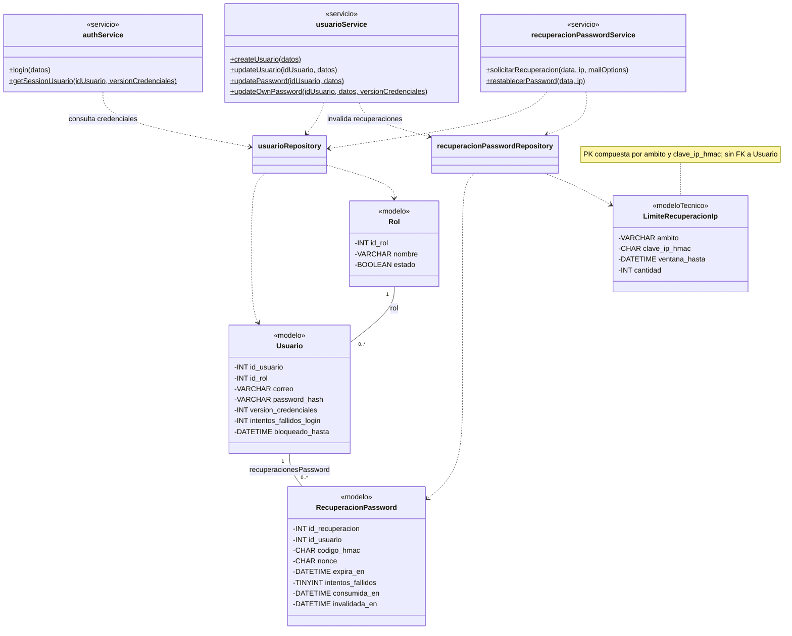
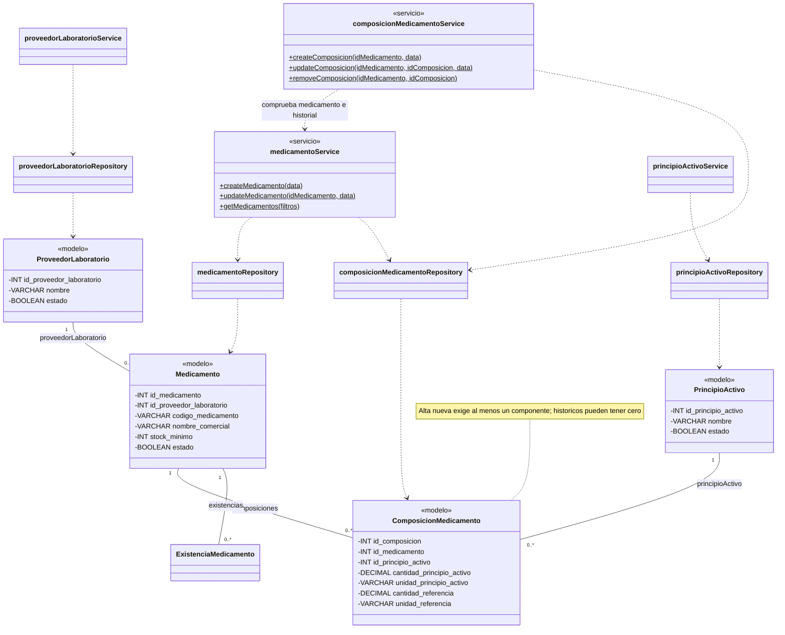
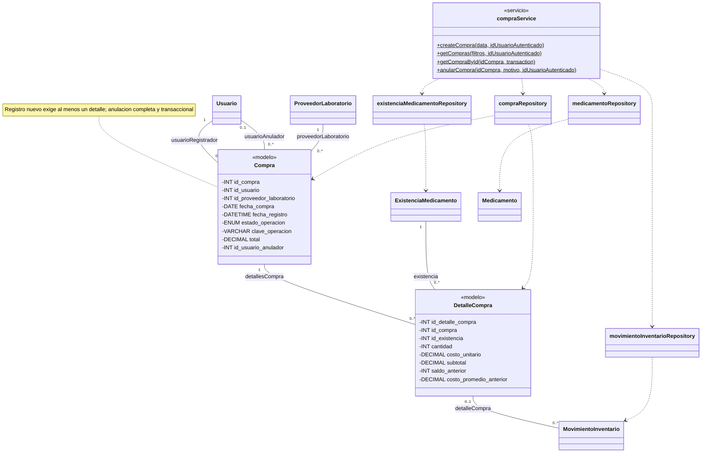
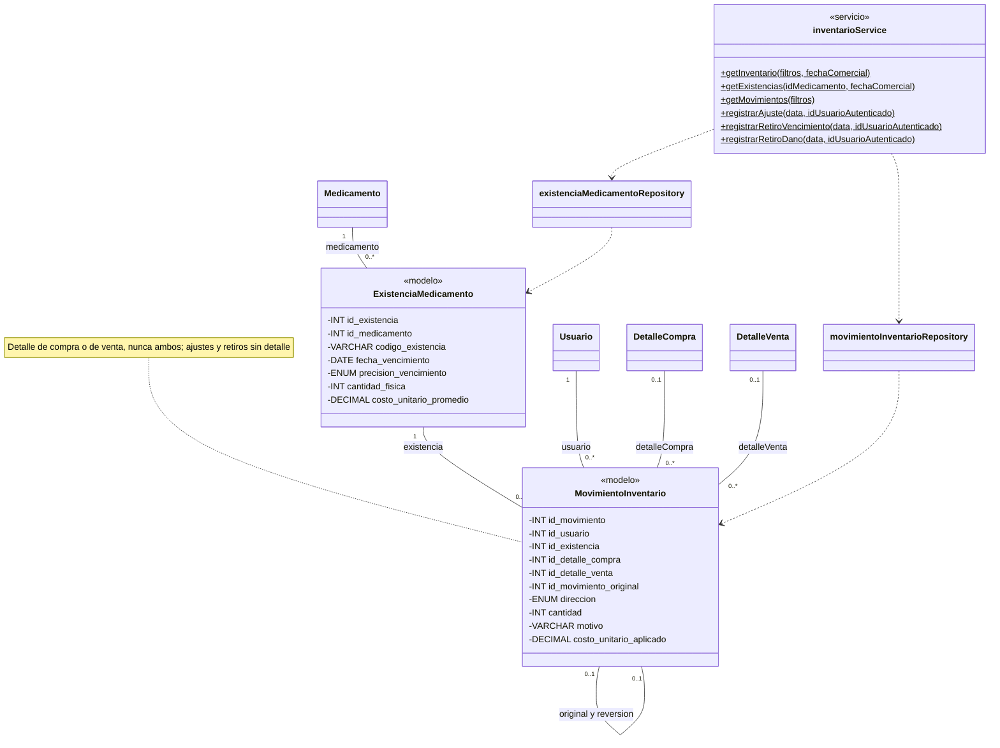
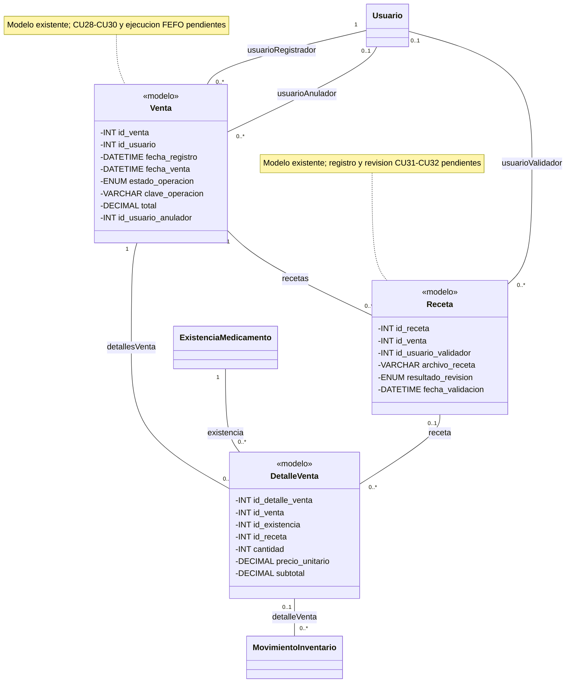

# CADEFAR — Diagrama de clases actualizado del proyecto

> **Actualizado:** 12/10/2026.
>
> **Estado:** referencia estructural del código y del diseño funcional vigente. Sustituye el inventario de la primera versión de `Diagrama de clases cadefar SI1.drawio`.
>
> **Cobertura:** 15 modelos persistentes y 9 clases de servicio implementadas. Ventas y Recetas tienen modelos y migraciones, pero sus operaciones funcionales están pendientes. El módulo de Reportes también está pendiente.

## 0. Alcance, fuentes y notación

Este documento reúne atributos, operaciones y relaciones para servir de base al análisis posterior de diagramas de clases por caso de uso. Los diagramas de esta entrega se organizan por módulos; todavía no son diagramas específicos de cada CU.

### Fuentes contrastadas

- `backend/src/data/models/`: atributos y asociaciones Sequelize de los 15 modelos.
- `backend/src/data/database/migrations/`: restricciones y evolución del esquema, incluida la simplificación de recuperación y los snapshots de Compras.
- `backend/src/business/services/`: nombres, firmas y responsabilidades de los servicios actuales.
- `backend/src/data/repositories/`: acceso a los modelos y dependencias reales de los servicios.
- `backend/src/presentation/routes/` y `frontend/src/app/router.jsx`: operaciones expuestas y estado funcional.
- `docs/ai/contexto-maestro.md`, `requerimientos.md`, `reglas-negocio.md` y `casos-uso.md`: decisiones y reglas vigentes.

### Criterios de lectura

1. **Nombres:** las clases y atributos usan los nombres reales del backend. Las entidades usan PascalCase; los servicios conservan su nombre exportado, por ejemplo `medicamentoService`. No se renombra código para adaptar el dibujo.
2. **Persistencia y API:** los atributos persistidos usan `snake_case`; parámetros y DTO suelen usar `camelCase`. `cantidad_fisica` es el atributo almacenado; `stockFisico` es su representación pública. No son dos columnas.
3. **Tipos:** las tablas muestran el tipo de persistencia equivalente: `DATEONLY` → `DATE`, `DATE` → `DATETIME`, `DATE(3)` → `DATETIME(3)`. `BOOLEAN` es el tipo lógico de Sequelize, representado por MySQL como `TINYINT(1)`.
4. **Claves:** PK = clave primaria; FK = clave foránea; UQ = unicidad. «Nulo: Sí» significa `allowNull: true`. Las PK numéricas son `INT AUTO_INCREMENT`, excepto la PK compuesta de `LimiteRecuperacionIp`.
5. **Operaciones:** los métodos de los servicios son públicos, estáticos y asíncronos (`+`, `$` en Mermaid). Se conservan sus parámetros; no se inventan tipos de retorno para JavaScript sin tipado declarado. Los parámetros con `?` en las tablas son opcionales por valor predeterminado.
6. **Modelos:** no tienen métodos propios de negocio. Declaran `static associate(models)` para sus asociaciones, excepto `LimiteRecuperacionIp`, que no tiene asociaciones. Se omiten los métodos heredados de Sequelize y las funciones de inicialización del diagrama. El signo `-` identifica atributos internos de persistencia en la vista UML; no afirma que Sequelize declare campos privados de JavaScript.
7. **Multiplicidades:** los diagramas de modelos muestran la estructura persistente. Una relación `hasMany` admite `0..*` hijos estructuralmente; las reglas que exigen al menos uno al registrar una operación se explican aparte.
8. **Relaciones:** `--` representa asociación; `..>` representa dependencia de código. Se usan asociaciones para las FK. Los rombos de la versión conceptual original no se interpretan como borrado en cascada: las asociaciones declaradas emplean `RESTRICT`.
9. **Capas:** un servicio accede a entidades mediante Repositories. No se dibuja una dependencia directa servicio–modelo como si reemplazara esa capa. La coordinación de transacciones utiliza Sequelize, sin convertirlo en entidad del dominio.
10. **Persistencia técnica:** `SequelizeMeta` es infraestructura de migraciones, no un modelo del dominio. JWT, cookies, DTO, parámetros de escritura y funciones auxiliares tampoco se cuentan como modelos persistentes.

## 1. Inventario y estado de los módulos

| Módulo | Modelos persistentes | Servicios implementados | Cobertura funcional actual |
|---|---|---|---|
| Autenticación, usuarios y recuperación | `Rol`, `Usuario`, `RecuperacionPassword`, `LimiteRecuperacionIp` | `authService`, `usuarioService`, `recuperacionPasswordService` | CU01–CU09. El envío real de correo sigue pendiente de validación. |
| Proveedores / laboratorios | `ProveedorLaboratorio` | `proveedorLaboratorioService` | CU10–CU13. |
| Medicamentos, principios activos y composición | `Medicamento`, `PrincipioActivo`, `ComposicionMedicamento` | `medicamentoService`, `principioActivoService`, `composicionMedicamentoService` | CU14–CU20. |
| Compras | `Compra`, `DetalleCompra` | `compraService` | CU25–CU27. |
| Inventario, existencias, movimientos y vencimientos | `ExistenciaMedicamento`, `MovimientoInventario` | `inventarioService` | CU21–CU24, CU33–CU37 y CU40. |
| Ventas y recetas | `Venta`, `DetalleVenta`, `Receta` | Ninguno implementado para estas operaciones | CU28–CU32 pendientes; modelos y migraciones existentes. |
| Reportes | Sin modelo propio | Sin servicio de reportes implementado | CU38, CU39 y CU41 pendientes. CU40 ya está cubierto por Inventario. |
| **Total** | **15 modelos** | **9 servicios** | **33 CU implementados en código; 8 pendientes.** |

Los valores calculados y las validaciones de configuración no amplían el inventario de entidades. Las pruebas y la activación de funciones se distinguen de la existencia del código en la sección 10.

## 2. Autenticación, usuarios, roles y recuperación

### 2.1. `Rol` — modelo

**Fuente:** `backend/src/data/models/rol.js`; tabla `rol`.

| Atributo | Tipo | Nulo | Claves / valor predeterminado |
|---|---|---|---|
| `id_rol` | INT | No | PK, AUTO_INCREMENT |
| `nombre` | VARCHAR(60) | No | UQ |
| `descripcion` | VARCHAR(255) | Sí | — |
| `estado` | BOOLEAN | No | `true` |

Los roles son fijos: Administrador, Regente y Vendedor. La asignación de un rol no implica herencia de las operaciones de otro (RN01).

### 2.2. `Usuario` — modelo

**Fuente:** `backend/src/data/models/usuario.js`; tabla `usuario`.

| Atributo | Tipo | Nulo | Claves / valor predeterminado |
|---|---|---|---|
| `id_usuario` | INT | No | PK, AUTO_INCREMENT |
| `id_rol` | INT | No | FK → `Rol.id_rol` |
| `nombre_usuario` | VARCHAR(60) | No | UQ |
| `password_hash` | VARCHAR(255) | No | Hash bcrypt; no se devuelve al cliente |
| `correo` | VARCHAR(255) | Sí | UQ `uq_usuario_correo`; colación `utf8mb4_bin` en migración |
| `version_credenciales` | INT UNSIGNED | No | `0` |
| `estado` | BOOLEAN | No | `true` |
| `intentos_fallidos_login` | INT UNSIGNED | No | `0` |
| `bloqueado_hasta` | DATETIME | Sí | — |

**Reglas relevantes:**

- Tres fallos consecutivos bloquean nuevos inicios de sesión durante diez minutos, sin modificar `estado` (RN07).
- El correo es opcional. Su cambio efectivo o retirada invalida recuperaciones pendientes; no reinicia las cuotas.
- Los JWT incluyen `idUsuario`, `idRol` y `versionCredenciales`; la versión debe coincidir con `version_credenciales` del usuario activo.
- CU08 y CU09 incrementan la versión y revocan credenciales anteriores. El cambio propio renueva su cookie; CU09 no inicia sesión automáticamente (RN115).
- No existen modelos `Auth`, `SesionUsuario` ni una tabla de tokens. La cookie HttpOnly se administra en la capa HTTP.

### 2.3. `RecuperacionPassword` — modelo nuevo

**Fuente:** `backend/src/data/models/recuperacion-password.js`; tabla `recuperacion_password`.

| Atributo | Tipo | Nulo | Claves / valor predeterminado |
|---|---|---|---|
| `id_recuperacion` | INT | No | PK, AUTO_INCREMENT |
| `id_usuario` | INT | No | FK → `Usuario.id_usuario` |
| `codigo_hmac` | CHAR(64) | No | HMAC-SHA-256; no contiene el código en claro |
| `nonce` | CHAR(36) | No | UQ `uq_recuperacion_nonce` |
| `fecha_solicitud` | DATETIME(3) | No | — |
| `expira_en` | DATETIME(3) | No | — |
| `intentos_fallidos` | TINYINT UNSIGNED | No | `0` |
| `consumida_en` | DATETIME(3) | Sí | — |
| `invalidada_en` | DATETIME(3) | Sí | — |

El modelo definitivo tiene **nueve atributos**. La migración correctiva retiró `payload_envio_cifrado`, `envio_intentos`, `envio_proximo_en` y `envio_bloqueado_hasta`; no forman parte del diagrama actual.

El código tiene seis dígitos, diez minutos de vigencia y cinco fallos máximos. Se almacena su HMAC y se consume una sola vez. El correo se intenta enviar después del commit, sin procesador persistente ni reenvíos automáticos (RN108–RN113).

### 2.4. `LimiteRecuperacionIp` — modelo técnico nuevo

**Fuente:** `backend/src/data/models/limite-recuperacion-ip.js`; tabla `limite_recuperacion_ip`.

| Atributo | Tipo | Nulo | Claves / valor predeterminado |
|---|---|---|---|
| `ambito` | VARCHAR(24) | No | Parte de PK compuesta |
| `clave_ip_hmac` | CHAR(64) | No | Parte de PK compuesta; IP protegida mediante HMAC |
| `ventana_hasta` | DATETIME(3) | No | — |
| `cantidad` | INT UNSIGNED | No | — |

No tiene FK a Usuario ni a RecuperacionPassword. Controla cuotas independientes por ámbito `solicitud` / `restablecimiento` e IP normalizada. Las cuotas de cuenta se consultan desde el historial de recuperaciones; no hay un contador de cuota añadido a Usuario.

### 2.5. Servicios actuales

Las firmas conservan objetos desestructurados; todos los métodos siguientes son estáticos, públicos y asíncronos.

| Clase / archivo en `backend/src/business/services/` | Operaciones implementadas |
|---|---|
| `authService` — `auth.service.js` | `login({ nombreUsuario, password })`; `getSessionUsuario(idUsuario, versionCredenciales)` |
| `usuarioService` — `usuario.service.js` | `createUsuario({ idRol, nombreUsuario, password, correo })`; `getUsuarios()`; `getUsuarioById(idUsuario, transaction?)`; `updateUsuario(idUsuario, { idRol, nombreUsuario, correo })`; `updateEstado(idUsuario, { estado })`; `updatePassword(idUsuario, { password })`; `updateOwnPassword(idUsuario, { passwordActual, passwordNueva }, versionCredenciales)` |
| `recuperacionPasswordService` — `recuperacion-password.service.js` | `solicitarRecuperacion(data, ip, mailOptions?)`; `restablecerPassword(data, ip)`; `verificarLimiteIp(ambito, ip)`; `esperarRespuesta(inicio)`; `invalidarEnvioRechazado({ idUsuario, idRecuperacion, nonce })` |

`verificarLimiteIp`, `esperarRespuesta` e `invalidarEnvioRechazado` son auxiliares públicos de la clase, no endpoints ni casos de uso independientes. `mailOptions` tiene `{}` por defecto y permite configurar el transporte utilizado por la operación.

**Responsabilidades y dependencias:**

- `authService` consulta `usuarioRepository`, verifica contraseña/estado/bloqueo y genera JWT. Su `login` devuelve internamente token y usuario público; el Controller coloca la cookie.
- `usuarioService` usa `usuarioRepository` y `recuperacionPasswordRepository`; el primero también consulta Rol. La asignación de rol pertenece al alta/edición, no existe `asignarRol()` independiente.
- `recuperacionPasswordService` usa ambos Repositories. `recuperacionPasswordRepository` accede a RecuperacionPassword y LimiteRecuperacionIp. Crypto, configuración y transporte de correo son utilidades, no entidades adicionales.
- Logout está implementado en `authController.logout` mediante eliminación de cookie; no hay método `authService.logout()` ni clase de sesión que representar.

### 2.6. Diagrama del módulo

Los métodos mostrados son las operaciones principales; el inventario completo está en 2.5. Los atributos completos y restricciones están en 2.1–2.4.

## 3. Proveedores, medicamentos, principios activos y composición

### 3.1. `ProveedorLaboratorio` — modelo

**Fuente:** `backend/src/data/models/proveedor-laboratorio.js`; tabla `proveedor_laboratorio`.

| Atributo | Tipo | Nulo | Claves / valor predeterminado |
|---|---|---|---|
| `id_proveedor_laboratorio` | INT | No | PK, AUTO_INCREMENT |
| `nombre` | VARCHAR(150) | No | — |
| `telefono` | VARCHAR(30) | Sí | — |
| `direccion` | VARCHAR(255) | Sí | — |
| `estado` | BOOLEAN | No | `true` |

Proveedor y laboratorio siguen unificados. La verificación de documentación SEDES corresponde al personal, no a atributos o validación automática del sistema (RN09–RN12).

### 3.2. `Medicamento` — modelo

**Fuente:** `backend/src/data/models/medicamento.js`; tabla `medicamento`.

| Atributo | Tipo | Nulo | Claves / valor predeterminado |
|---|---|---|---|
| `id_medicamento` | INT | No | PK, AUTO_INCREMENT |
| `id_proveedor_laboratorio` | INT | No | FK → `ProveedorLaboratorio.id_proveedor_laboratorio` |
| `codigo_medicamento` | VARCHAR(20) | No | UQ `uq_medicamento_codigo` |
| `nombre_comercial` | VARCHAR(150) | No | — |
| `forma_farmaceutica` | VARCHAR(80) | No | — |
| `presentacion` | VARCHAR(150) | No | — |
| `unidad_inventario` | VARCHAR(50) | No | — |
| `stock_minimo` | INT | No | `0`; no negativo |
| `condicion_venta` | VARCHAR(40) | No | — |
| `via_administracion` | VARCHAR(80) | No | — |
| `tipo_liberacion` | VARCHAR(80) | No | — |
| `estado` | BOOLEAN | No | `true` |

**Reglas actuales (RN13–RN17, RN105):**

- El código se genera con tres letras y correlativo `001`–`999`, y es inmutable. `VARCHAR(20)` es la capacidad persistente; no significa que el código nuevo tenga veinte caracteres.
- El alta crea medicamento y composición no vacía en una sola transacción. No registra existencias ni aumenta inventario.
- La unicidad comercial considera atributos de identidad y composición completa, incluidos medicamentos inactivos. No existe un UNIQUE comercial compuesto: la comprobación y serialización por proveedor pertenecen al backend.
- Un movimiento en cualquier existencia bloquea cambios efectivos de proveedor, forma, presentación, unidad, vía, liberación y toda la composición. El código ya era inmutable antes del historial. Nombre, stock mínimo y condición de venta siguen editables según sus reglas.
- `tieneHistorial` es una variable interna de validación obtenida mediante `hasMovimientos`, no una columna ni un campo del DTO público del medicamento.

### 3.3. `PrincipioActivo` — modelo

**Fuente:** `backend/src/data/models/principio-activo.js`; tabla `principio_activo`.

| Atributo | Tipo | Nulo | Claves / valor predeterminado |
|---|---|---|---|
| `id_principio_activo` | INT | No | PK, AUTO_INCREMENT |
| `nombre` | VARCHAR(150) | No | UQ `uq_principio_activo_nombre` |
| `descripcion` | VARCHAR(255) | Sí | — |
| `estado` | BOOLEAN | No | `true` |

### 3.4. `ComposicionMedicamento` — modelo

**Fuente:** `backend/src/data/models/composicion-medicamento.js`; tabla `composicion_medicamento`.

| Atributo | Tipo | Nulo | Claves / valor predeterminado |
|---|---|---|---|
| `id_composicion` | INT | No | PK, AUTO_INCREMENT |
| `id_medicamento` | INT | No | FK → `Medicamento.id_medicamento` |
| `id_principio_activo` | INT | No | FK → `PrincipioActivo.id_principio_activo` |
| `cantidad_principio_activo` | DECIMAL(12,4) | No | Positiva |
| `unidad_principio_activo` | VARCHAR(30) | No | — |
| `cantidad_referencia` | DECIMAL(12,4) | No | Positiva |
| `unidad_referencia` | VARCHAR(30) | No | — |

UQ compuesto `uq_composicion_medicamento_principio` sobre `(id_medicamento, id_principio_activo)`: un ingrediente no se repite en el mismo medicamento.

**Multiplicidad:** estructuralmente un medicamento tiene `0..*` componentes; el **alta integral nueva exige `1..*`**. Los históricos sin composición se conservan; CU19 permite retirar la última relación sin movimientos si respeta la unicidad. No se impone `1..*` como invariante absoluto del almacenamiento.

Antes del historial se pueden agregar, editar cantidades/unidades y retirar relaciones. Corregir un principio equivocado requiere retirar la relación y crear la correcta; el PATCH no cambia sus FK. Una búsqueda por varios principios utiliza AND y admite ingredientes adicionales, sin equivalencia terapéutica automática.

### 3.5. Servicios actuales

| Clase / archivo en `backend/src/business/services/` | Operaciones implementadas |
|---|---|
| `proveedorLaboratorioService` — `proveedor-laboratorio.service.js` | `createProveedorLaboratorio(data)`; `getProveedoresLaboratorios()`; `getProveedorLaboratorioById(idProveedorLaboratorio)`; `updateProveedorLaboratorio(idProveedorLaboratorio, data)`; `updateEstado(idProveedorLaboratorio, { estado })` |
| `medicamentoService` — `medicamento.service.js` | `getMedicamentos(filtros)`; `getMedicamentoById(idMedicamento, transaction?)`; `getMedicamentoForUpdate(idMedicamento, transaction)`; `validateSinHistorial(idMedicamento, transaction)`; `createMedicamento(data)`; `updateMedicamento(idMedicamento, data)`; `updateEstado(idMedicamento, { estado })` |
| `principioActivoService` — `principio-activo.service.js` | `getPrincipiosActivos()`; `getPrincipioActivoById(idPrincipioActivo, transaction?)`; `createPrincipioActivo(data)`; `updatePrincipioActivo(idPrincipioActivo, data)`; `updateEstado(idPrincipioActivo, { estado })` |
| `composicionMedicamentoService` — `composicion-medicamento.service.js` | `getComposicionMedicamento(idMedicamento)`; `createComposicion(idMedicamento, data)`; `updateComposicion(idMedicamento, idComposicion, data)`; `removeComposicion(idMedicamento, idComposicion)` |

`getMedicamentoForUpdate` y `validateSinHistorial` son operaciones públicas de apoyo utilizadas por Composición, no casos de uso adicionales. `generarCodigo` es una función auxiliar de módulo, no un método privado de la clase. Las funciones de `identidad-medicamento.js` comparten transacción, canonización, bloqueo y validación; no constituyen otro Service ni otro modelo.

**Dependencias:**

- `proveedorLaboratorioService` → `proveedorLaboratorioRepository` → ProveedorLaboratorio.
- `principioActivoService` → `principioActivoRepository` → PrincipioActivo.
- `medicamentoService` → `medicamentoRepository` y `composicionMedicamentoRepository` para el alta integral, referencias, consultas e historial.
- `composicionMedicamentoService` → `medicamentoService`, `composicionMedicamentoRepository` y las funciones compartidas de identidad. No hay dependencia inversa de `medicamentoService` hacia `composicionMedicamentoService`.
- Los Repositories y las funciones compartidas consultan proveedor, principio, existencias y movimientos cuando la operación lo necesita. Estas lecturas no convierten el alta de catálogo en una operación de inventario.

### 3.6. Diagrama del catálogo

## 4. Compras

### 4.1. `Compra` — modelo

**Fuente:** `backend/src/data/models/compra.js`; tabla `compra`.

| Atributo | Tipo | Nulo | Claves / valor predeterminado |
|---|---|---|---|
| `id_compra` | INT | No | PK, AUTO_INCREMENT |
| `id_usuario` | INT | No | FK → `Usuario.id_usuario`; registrador |
| `id_proveedor_laboratorio` | INT | No | FK → `ProveedorLaboratorio.id_proveedor_laboratorio` |
| `fecha_compra` | DATE | No | Fecha de adquisición |
| `fecha_registro` | DATETIME | No | CURRENT_TIMESTAMP en esquema; hora de operación en escrituras del Service |
| `estado_operacion` | ENUM('CONFIRMADA','ANULADA') | No | `CONFIRMADA` |
| `clave_operacion` | VARCHAR(64) | No | UQ `uq_compra_clave_operacion` |
| `total` | DECIMAL(14,2) | No | No negativo |
| `fecha_anulacion` | DATETIME | Sí | — |
| `motivo_anulacion` | VARCHAR(255) | Sí | Obligatorio al anular |
| `id_usuario_anulador` | INT | Sí | FK → `Usuario.id_usuario`; anulador |

La cabecera conserva el proveedor obtenido de los medicamentos de la compra y ambos responsables, con asociaciones distintas: `usuarioRegistrador` y `usuarioAnulador`. La fecha de adquisición no sustituye la hora de registro ni vuelve retroactivos los movimientos.

### 4.2. `DetalleCompra` — modelo

**Fuente:** `backend/src/data/models/detalle-compra.js`; tabla `detalle_compra`.

| Atributo | Tipo | Nulo | Claves / valor predeterminado |
|---|---|---|---|
| `id_detalle_compra` | INT | No | PK, AUTO_INCREMENT |
| `id_compra` | INT | No | FK → `Compra.id_compra` |
| `id_existencia` | INT | No | FK → `ExistenciaMedicamento.id_existencia` |
| `cantidad` | INT | No | Positiva |
| `costo_unitario` | DECIMAL(14,6) | No | Positivo |
| `subtotal` | DECIMAL(14,2) | No | No negativo |
| `saldo_anterior` | INT | Sí | Snapshot previo a toda la compra |
| `costo_promedio_anterior` | DECIMAL(14,6) | Sí | Snapshot previo a toda la compra |

La migración B1 exige que el par de snapshots sea **ambos NULL o ambos presentes y no negativos**. Las compras nuevas proporcionan ambos; no se inventan valores para los históricos. Todos los detalles de una compra sobre la misma existencia comparten el estado anterior a la compra completa (RN36).

### 4.3. `compraService` — servicio implementado

**Fuente:** `backend/src/business/services/compra.service.js`.

| Operación pública estática | Responsabilidad |
|---|---|
| `createCompra(data, idUsuarioAutenticado)` | Registra cabecera, detalles, existencias, movimientos, saldos, promedio y snapshots atómicamente. |
| `getCompras(filtros?, idUsuarioAutenticado)` | Consulta compras; `filtros` tiene `{}` por defecto. La búsqueda por clave se limita al usuario autenticado. |
| `getCompraById(idCompra, transaction)` | Consulta cabecera y detalles; admite recibir `undefined` como transacción en la consulta normal. |
| `anularCompra(idCompra, motivo, idUsuarioAutenticado)` | Valida y compensa toda la compra mediante B1/A, conserva originales y registra anulación/reversiones. |

**Dependencias reales:** `compraRepository`, `medicamentoRepository`, `existenciaMedicamentoRepository` y `movimientoInventarioRepository`. No llama a `inventarioService`; esa flecha de la primera versión se sustituye por los Repositories que realmente utiliza. No existen métodos de clase `agregarDetalle()` o `calcularTotal()` independientes.

**Invariantes:**

- Cada compra nueva confirmada tiene al menos un detalle, aunque una FK no imponga ese mínimo a la cabecera.
- Todos los medicamentos de la recepción pertenecen a un proveedor único y activo, derivado del catálogo.
- Costos y promedio usan seis decimales; total y subtotales, dos. El Service usa cadenas/BigInt para cálculos exactos.
- La clave es única y no se reutiliza al anular. El conflicto no demuestra igualdad de solicitudes ni supone idempotencia completa de POST.
- Cada detalle genera un movimiento original de entrada. Una anulación válida crea una reversión por original, con la misma existencia, cantidad y costo aplicado.
- B1 restaura el par anterior cuando no hay posteriores y se cumplen integridad/snapshots; A compensa desde el estado actual cuando hay posteriores y la valoración lo permite. No se elude una inconsistencia con A (RN76/RN80).

### 4.4. Diagrama de Compras

## 5. Inventario, existencias, movimientos, ajustes y retiros

### 5.1. `ExistenciaMedicamento` — modelo

**Fuente:** `backend/src/data/models/existencia-medicamento.js`; tabla `existencia_medicamento`.

| Atributo | Tipo | Nulo | Claves / valor predeterminado |
|---|---|---|---|
| `id_existencia` | INT | No | PK, AUTO_INCREMENT |
| `id_medicamento` | INT | No | FK → `Medicamento.id_medicamento` |
| `codigo_existencia` | VARCHAR(30) | No | UQ `uq_existencia_codigo` |
| `fecha_vencimiento` | DATE | No | — |
| `precision_vencimiento` | ENUM('DIA','MES') | No | — |
| `cantidad_fisica` | INT | No | `0`; no negativa |
| `costo_unitario_promedio` | DECIMAL(14,6) | No | `0`; no negativo |

UQ compuesto `uq_existencia_medicamento_vencimiento_precision` sobre `(id_medicamento, fecha_vencimiento, precision_vencimiento)`.

Una existencia representa unidades de un medicamento, no otro producto ni un lote. Su código es automático, único y conservado aunque se agote. `cantidad_fisica` y promedio son estado actual; la trazabilidad está en MovimientoInventario.

### 5.2. `MovimientoInventario` — modelo

**Fuente:** `backend/src/data/models/movimiento-inventario.js`; tabla `movimiento_inventario`.

| Atributo | Tipo | Nulo | Claves / valor predeterminado |
|---|---|---|---|
| `id_movimiento` | INT | No | PK, AUTO_INCREMENT |
| `id_usuario` | INT | No | FK → `Usuario.id_usuario` |
| `id_existencia` | INT | No | FK → `ExistenciaMedicamento.id_existencia` |
| `id_detalle_compra` | INT | Sí | FK → `DetalleCompra.id_detalle_compra` |
| `id_detalle_venta` | INT | Sí | FK → `DetalleVenta.id_detalle_venta` |
| `id_movimiento_original` | INT | Sí | FK reflexiva → `MovimientoInventario.id_movimiento`; UQ `uq_movimiento_original` |
| `direccion` | ENUM('ENTRADA','SALIDA') | No | — |
| `cantidad` | INT | No | Positiva |
| `fecha_movimiento` | DATETIME | No | CURRENT_TIMESTAMP en esquema; hora de operación en nuevas escrituras |
| `motivo` | VARCHAR(40) | No | No es un ENUM de la tabla |
| `observacion` | VARCHAR(500) | Sí | Obligatoriedad según la operación |
| `costo_unitario_aplicado` | DECIMAL(14,6) | No | No negativo |

**Restricciones y significado:**

- Cada movimiento tiene exactamente una existencia y un usuario responsable.
- Puede tener detalle de compra **o** detalle de venta, nunca ambos. Ambos NULL son válidos para ajustes y retiros independientes (CHECK `chk_movimiento_un_solo_origen`).
- La asociación `movimientoOriginal` es opcional; `movimientoReversion` es opcional y única por original. Una reversión legítima conserva existencia/cantidad/costo y cambia dirección (RN72–RN74).
- Un detalle puede tener `0..*` movimientos en el esquema. En el protocolo implementado de Compras se exige un original íntegro y, al anular, su reversión; no se confunde ese requisito con una FK que limite automáticamente todos los movimientos.
- Los motivos oficiales son `COMPRA`, `VENTA`, `ANULACION_COMPRA`, `ANULACION_VENTA`, `AJUSTE`, `VENCIMIENTO` y `DAÑO`. Las operaciones de Venta todavía no los escriben mediante un módulo funcional. `Compra` y `Reversión` se admiten para lectura/validación histórica controlada, no como motivos de nuevas escrituras.
- Los movimientos no se eliminan. Ajustes y retiros no requieren modelos separados `Ajuste`, `Retiro`, `BajaInventario` o `Perdida`.

### 5.3. `inventarioService` — servicio implementado

**Fuente:** `backend/src/business/services/inventario.service.js`.

| Operación pública estática | Responsabilidad |
|---|---|
| `getInventario(filtros, fechaComercial?)` | Disponibilidad de medicamentos con al menos una existencia registrada. |
| `getExistencias(idMedicamento, fechaComercial?)` | Existencias, stock físico/vendible, vencimientos, costo y último movimiento. |
| `getMovimientos(filtros)` | Movimientos e historial, incluyendo referencias de origen/reversión. |
| `getProximosAVencer(filtros, fechaComercial?)` | Existencias no vencidas con físico positivo dentro de tres meses calendario. |
| `getVencidos(filtros, fechaComercial?)` | Existencias vencidas con físico pendiente de retiro. |
| `getStockBajo(filtros, fechaComercial?)` | Medicamentos activos con vendible menor o igual al mínimo, incluso sin existencias. |
| `registrarAjuste(data, idUsuarioAutenticado)` | Concilia conteo con saldo; registra entrada/salida únicamente si hay diferencia. |
| `registrarRetiroVencimiento(data, idUsuarioAutenticado)` | Retira unidades vencidas, conserva costo y deriva pérdida. |
| `registrarRetiroDano(data, idUsuarioAutenticado)` | Retira unidades dañadas con observación obligatoria y deriva pérdida. |

`fechaComercial` se obtiene por defecto de `obtenerFechaComercial()`. **Dependencias reales:** `existenciaMedicamentoRepository` y `movimientoInventarioRepository`. Consultas/DTO y escritura transaccional reutilizan funciones de disponibilidad, fechas y decimales.

`registrarRetiro` y `consultarDisponibilidad` son funciones internas de módulo, no métodos privados declarados dentro de la clase. No existen los métodos del dibujo original `ingresarStock`, `retirarStock`, `registrarConteo`, `revertirMovimiento` o `seleccionarExistenciasFEFO` como operaciones de esta clase.

### 5.4. Estado persistido, valores derivados y precondiciones

| Información | Naturaleza actual |
|---|---|
| `cantidad_fisica` | Atributo persistido de una existencia. |
| `stockFisico` | DTO de la cantidad de una existencia o suma por medicamento. |
| `stockVendible` | Calculado según saldo, estado del medicamento y vencimiento efectivo. |
| `fechaEfectivaVencimiento`, `vencida`, `fechaEtiquetaNormalizada` | Calculados para consulta; no son columnas nuevas. |
| `ultimoMovimiento` | Mayor ID de movimiento de la existencia, o NULL si no hay; CU22 lo consulta conjuntamente con el saldo. |
| `stockObservado`, `ultimoMovimientoObservado` | Parámetros de solicitud tomados de CU22; se revalidan bajo bloqueo, no se almacenan como atributos. |
| `saldoContado`, `diferencia`, `ajusteRealizado` | Entrada/resultado de conciliación, no otra entidad de conteo. |
| `perdida` | Importe derivado de cantidad retirada × costo aplicado, mostrado a dos decimales; no columna ni modelo. |

El ajuste o retiro toma bloqueo de existencia, consulta actualmente su último movimiento y compara ambas precondiciones antes de efectos (RN103). Un saldo restaurado con historial diferente también produce conflicto. Una conciliación sin diferencia exige las precondiciones y la observación, pero no crea movimiento ni auditoría persistida.

Entradas de ajuste exigen costo positivo y actualizan promedio; salidas/retiros aplican y conservan el promedio vigente, incluso al agotar. Vencimiento requiere existencia vencida; daño exige observación y no exige vencimiento. Estas operaciones pueden afectar existencias de medicamentos inactivos sin reactivarlos.

### 5.5. Diagrama de Inventario y movimientos

## 6. Vencimientos y alertas

Este módulo reutiliza Medicamento, ExistenciaMedicamento, MovimientoInventario e `inventarioService`; **no añade una entidad o clase de servicio persistente propia**.

- `DIA`: deja de ser vendible al comenzar el día indicado.
- `MES`: las nuevas recepciones almacenan el último día del mes; deja de ser vendible el primer día del mes siguiente. No se normalizan automáticamente fechas históricas.
- La fecha comercial se determina en `America/La_Paz`. Las nuevas escrituras de compras, anulaciones, ajustes y retiros conservan hora civil; no se reinterpreta por ello todo DATETIME histórico.
- Próximos a vencer usa tres meses calendario y fecha normalizada de etiqueta, con saldo positivo y no vencido (RN85).
- Vencidos muestra saldo físico positivo pendiente de retiro. Vencer no coloca automáticamente el saldo en cero.
- Medicamentos inactivos pueden aparecer en próximos/vencidos, pero no en stock bajo.
- Inventario requiere alguna existencia registrada, aunque agotada o vencida; Stock bajo puede incluir activos sin existencias.

Las operaciones reales son `getProximosAVencer`, `getVencidos`, `getStockBajo` y los retiros de `inventarioService`. `VencimientoService` y `confirmarRetiro()` de la primera versión no existen como clase/método en el código actual. No hay tabla `Alerta` ni `Vencimiento`.

## 7. Ventas y recetas: modelos existentes, operaciones pendientes

Los atributos y asociaciones siguientes **sí existen en modelos y migraciones**. Registrar/confirmar/anular ventas, registrar/revisar recetas y ejecutar FEFO siguen documentados pero pendientes de Services, rutas e interfaz funcional. No se representan como operaciones terminadas.

### 7.1. `Venta` — modelo

**Fuente:** `backend/src/data/models/venta.js`; tabla `venta`.

| Atributo | Tipo | Nulo | Claves / valor predeterminado |
|---|---|---|---|
| `id_venta` | INT | No | PK, AUTO_INCREMENT |
| `id_usuario` | INT | No | FK → `Usuario.id_usuario`; registrador |
| `fecha_venta` | DATETIME | Sí | Sin fecha efectiva mientras está pendiente |
| `fecha_registro` | DATETIME | No | CURRENT_TIMESTAMP |
| `estado_operacion` | ENUM('CONFIRMADA','ANULADA','PENDIENTE') | No | `PENDIENTE` |
| `clave_operacion` | VARCHAR(64) | No | UQ `uq_venta_clave_operacion` |
| `total` | DECIMAL(14,2) | No | No negativo |
| `fecha_anulacion` | DATETIME | Sí | — |
| `motivo_anulacion` | VARCHAR(255) | Sí | — |
| `id_usuario_anulador` | INT | Sí | FK → `Usuario.id_usuario`; anulador |

La migración `20261003120100-add-pending-venta-state.js` establece `PENDIENTE` por defecto, hace nullable la fecha efectiva y exige fecha para `CONFIRMADA` mediante CHECK. No exige NULL para todos los otros estados: una anulada que antes estuvo confirmada conserva su fecha efectiva.

### 7.2. `DetalleVenta` — modelo

**Fuente:** `backend/src/data/models/detalle-venta.js`; tabla `detalle_venta`.

| Atributo | Tipo | Nulo | Claves / valor predeterminado |
|---|---|---|---|
| `id_detalle_venta` | INT | No | PK, AUTO_INCREMENT |
| `id_venta` | INT | No | FK → `Venta.id_venta` |
| `id_existencia` | INT | No | FK → `ExistenciaMedicamento.id_existencia` |
| `id_receta` | INT | Sí | FK → `Receta.id_receta` |
| `cantidad` | INT | No | Positiva |
| `precio_unitario` | DECIMAL(14,2) | No | No negativo |
| `subtotal` | DECIMAL(14,2) | No | No negativo |

### 7.3. `Receta` — modelo

**Fuente:** `backend/src/data/models/receta.js`; tabla `receta`.

| Atributo | Tipo | Nulo | Claves / valor predeterminado |
|---|---|---|---|
| `id_receta` | INT | No | PK, AUTO_INCREMENT |
| `id_venta` | INT | No | FK → `Venta.id_venta` |
| `id_usuario_validador` | INT | Sí | FK → `Usuario.id_usuario` |
| `numero_receta` | VARCHAR(80) | Sí | — |
| `fecha_receta` | DATE | No | — |
| `nombre_paciente` | VARCHAR(150) | No | — |
| `documento_paciente` | VARCHAR(40) | No | — |
| `nombre_medico` | VARCHAR(150) | No | — |
| `archivo_receta` | VARCHAR(500) | No | Referencia al archivo; no modelo de almacenamiento nuevo |
| `modalidad` | VARCHAR(50) | No | — |
| `resultado_revision` | ENUM('APROBADA','RECHAZADA') | Sí | NULL representa ausencia de revisión |
| `fecha_validacion` | DATETIME | Sí | — |
| `fecha_registro` | DATETIME | No | CURRENT_TIMESTAMP |
| `observacion` | VARCHAR(500) | Sí | — |

**Reglas documentadas para implementar (CU28–CU32):**

- Una venta nueva tiene al menos un detalle y se guarda pendiente, sin reservar ni descontar stock ni generar movimientos.
- Una receta pertenece a exactamente una venta; una venta admite varias recetas y una receta puede respaldar varios detalles.
- Cada detalle tiene como máximo una receta, que debe pertenecer a su misma venta. Las FK individuales no garantizan por sí solas esa igualdad; la validación de la operación está pendiente.
- La revisión pendiente se representa por NULL, no por un tercer literal `PENDIENTE` del ENUM de Receta. La revisión aprobada/rechazada conserva resultado, validador y fecha.
- El Regente revisa; el Vendedor confirma. La confirmación revalida stock, activos, vencimientos, FEFO y recetas aprobadas y registra efectos atómicamente.
- La selección de existencias pendiente es provisional; confirmar puede distribuir el producto entre varios detalles.
- Anular una pendiente no revierte stock; anular una confirmada compensa sus movimientos.

No se conservan los métodos conceptuales originales de `VentaService` como métodos existentes. El diseño de sus firmas definitivas pertenece a la implementación futura, no a esta actualización estructural.

### 7.4. Diagrama de modelos de Ventas y Recetas

## 8. Reportes y consultas

No existe modelo `Reporte` ni clase `ReporteService` implementada. Las fuentes son las entidades de operaciones, existencias y movimientos, no otra tabla de resultados.

| Caso de uso | Estado y relación con el código actual |
|---|---|
| CU38 — Reporte de ventas | Pendiente; depende del futuro flujo de ventas y su fecha efectiva. |
| CU39 — Reporte de compras | Pendiente como bloque de reportes. CU26 ya permite consultar compras por fecha/período; no se inventa otro método existente. |
| CU40 — Historial de inventario | Implementado mediante `inventarioService.getMovimientos(filtros)`, compartido con CU24. |
| CU41 — Consultar pérdidas | Pendiente como consulta conjunta por período. Los retiros ya devuelven su pérdida individual derivada. |

Los métodos `reporteVentas`, `reporteCompras`, `reporteInventario`, `reporteBajoStock`, `reporteVencimientos` y `reportePerdidas` del primer dibujo eran operaciones conceptuales; no se atribuyen a una clase real. El análisis por CU podrá identificar sus fuentes y diseño pendiente sin presentar esas firmas como implementadas.

## 9. Matriz global de relaciones y diferencias frente a la base

### 9.1. Asociaciones verificadas

La columna de multiplicidad indica cuántos objetos de destino puede tener cada objeto de origen, y viceversa. La FK y su nulabilidad fundamentan el extremo singular; el mínimo de hijos de una operación se expresa como regla adicional.

| Origen | Destino | Por cada origen | Por cada destino | FK en destino / nota |
|---|---|---|---|---|
| Rol | Usuario | `0..*` usuarios | `1` rol | `id_rol` |
| Usuario | RecuperacionPassword | `0..*` recuperaciones | `1` usuario | `id_usuario` |
| ProveedorLaboratorio | Medicamento | `0..*` medicamentos | `1` proveedor | `id_proveedor_laboratorio` |
| Medicamento | ComposicionMedicamento | `0..*` componentes | `1` medicamento | `id_medicamento`; alta nueva exige `1..*` |
| PrincipioActivo | ComposicionMedicamento | `0..*` componentes | `1` principio | `id_principio_activo` |
| Medicamento | ExistenciaMedicamento | `0..*` existencias | `1` medicamento | `id_medicamento` |
| Usuario (registrador) | Compra | `0..*` compras | `1` usuario | `id_usuario` |
| Usuario (anulador) | Compra | `0..*` compras | `0..1` usuario | `id_usuario_anulador` |
| ProveedorLaboratorio | Compra | `0..*` compras | `1` proveedor | `id_proveedor_laboratorio` |
| Compra | DetalleCompra | `0..*` detalles | `1` compra | `id_compra`; registro exige `1..*` |
| ExistenciaMedicamento | DetalleCompra | `0..*` detalles | `1` existencia | `id_existencia` |
| Usuario (registrador) | Venta | `0..*` ventas | `1` usuario | `id_usuario` |
| Usuario (anulador) | Venta | `0..*` ventas | `0..1` usuario | `id_usuario_anulador` |
| Venta | DetalleVenta | `0..*` detalles | `1` venta | `id_venta`; regla documentada exige `1..*` |
| ExistenciaMedicamento | DetalleVenta | `0..*` detalles | `1` existencia | `id_existencia` |
| Venta | Receta | `0..*` recetas | `1` venta | `id_venta` obligatorio |
| Usuario (validador) | Receta | `0..*` recetas | `0..1` usuario | `id_usuario_validador` |
| Receta | DetalleVenta | `0..*` detalles | `0..1` receta | `id_receta`; misma venta según RN60 |
| Usuario | MovimientoInventario | `0..*` movimientos | `1` usuario | `id_usuario` |
| ExistenciaMedicamento | MovimientoInventario | `0..*` movimientos | `1` existencia | `id_existencia` |
| DetalleCompra | MovimientoInventario | `0..*` movimientos | `0..1` detalle | `id_detalle_compra` |
| DetalleVenta | MovimientoInventario | `0..*` movimientos | `0..1` detalle | `id_detalle_venta`; excluyente con compra |
| MovimientoInventario (original) | MovimientoInventario (reversión) | `0..1` reversión | `0..1` original estructuralmente | `id_movimiento_original` nullable y único; toda reversión legítima debe tener `1` original |

LimiteRecuperacionIp permanece aislado en el diagrama de asociaciones persistentes; su participación se expresa mediante el Repository de recuperación, no mediante una FK inventada.

### 9.2. Cambios principales respecto de la primera versión

| Elemento de la base | Versión actual |
|---|---|
| 13 modelos | 15: se incorporan RecuperacionPassword y LimiteRecuperacionIp. |
| Usuario con credenciales básicas | Correo opcional, versión de credenciales, contador de fallos, bloqueo temporal y FK de rol explícitos. |
| Inicio de sesión en UsuarioService | Separado en `authService`; Usuario conserva administración y contraseñas. |
| Recuperación sin clases detalladas | Modelo de nueve atributos, cuotas IP persistentes y `recuperacionPasswordService`. |
| Composición concentrada en MedicamentoService | Alta integral en `medicamentoService`; gestión independiente en `composicionMedicamentoService`. |
| Código de medicamento como String genérico | Generación automática e inmutabilidad; unicidad comercial comprobada por el backend. |
| DetalleCompra sin estado previo | Par nullable `saldo_anterior` / `costo_promedio_anterior`, necesario para B1. |
| CompraService → InventarioService | `compraService` accede a Repositories de Compra, Medicamento, Existencia y Movimiento. |
| Usuario anulador de compra con destino ambiguo | Relación confirmada por `Compra.id_usuario_anulador` y asociaciones registrador/anulador. |
| VencimientoService independiente | Consultas y retiros implementados en `inventarioService`. |
| FEFO como método actual de InventarioService | Regla documentada de confirmación de ventas, aún sin operación implementada. |
| Cardinalidades y flechas por revisar | Matriz con FK, nulabilidad y distinción entre mínimo estructural y regla de negocio. |
| Venta sin definición precisa de pendiente | ENUM y fecha nullable actuales; confirmación y recetas pendientes funcionalmente. |
| VentaService y ReporteService como clases del sistema | Referencias del diseño original; no se cuentan como servicios implementados. |
| 9 servicios conceptuales | 9 servicios reales, con composición diferente y 48 métodos públicos estáticos inventariados. |

### 9.3. Cómo trasladarlo al dibujo UML

1. Crear las dos cajas nuevas de modelos de recuperación y actualizar las trece existentes con las tablas de atributos de este documento.
2. Mostrar tipos, campos opcionales y claves; mantener una leyenda si se abrevia el dibujo.
3. Usar los nueve servicios reales y las firmas de sus tablas. Los diagramas Mermaid son vistas resumidas; no sustituyen el inventario completo.
4. Representar Repositories como clases auxiliares de acceso a datos cuando se analice la implementación por CU. Las dependencias aquí mostradas son las principales, no un inventario completo de imports, utilidades, Controllers o Validators.
5. Usar asociaciones, responsables diferenciados y multiplicidades de la matriz. Si se conserva composición UML conceptual para detalles/componentes, indicar el criterio de pertenencia sin atribuirle cascadas físicas.
6. Añadir notas para restricciones no expresables solo con multiplicidad: exclusión compra/venta en movimientos, receta de la misma venta, mínimo de hijos al registrar, estado previo completo y reversiones legítimas.
7. Identificar Ventas/Recetas como modelos existentes con comportamiento pendiente, y Reportes como consultas futuras. No dibujar métodos futuros como implementados.

## 10. Verificación y límites de esta referencia

- Comprobación de esta actualización: 15 modelos, 123 atributos con tipos/nulabilidad/claves y valores predeterminados, 23 FK y 48 métodos de los 9 servicios contrastados con sus definiciones. Los cinco diagramas se analizaron y renderizaron localmente con Mermaid 11.12.0. Se instanciaron metadatos de Sequelize sin importar el inicializador de conexión del proyecto ni conectar a MySQL.
- Esta actualización se contrasta con archivos del repositorio; no certifica el estado de migraciones o los datos de cualquier servidor desplegado.
- Las verificaciones documentadas del proyecto incluyen integración real de Inventario/Compras y pruebas de concurrencia del registro integral de Medicamentos en bases temporales. La corrección posterior del criterio de listado de Inventario tiene pruebas simuladas; su nueva verificación MySQL sigue pendiente.
- CU09 tiene backend y frontend; la validación del envío a un buzón real y su activación/configuración de entorno son pendientes independientes del diagrama.
- Las asociaciones de Venta, DetalleVenta y Receta existen; no acreditan ejecución de CU28–CU32 ni cumplimiento de sus reglas por un Service todavía inexistente.
- Los resultados calculados, borradores de React y controles de concurrencia no se convierten en entidades persistentes. No se agregan Lote, Inventario, Alerta, Reporte, Ajuste, Retiro, Perdida, Paciente ni Medico.
- El archivo Draw.io original no forma parte de los archivos encontrados en el repositorio. Esta entrega actualiza el Markdown y sus cinco diagramas Mermaid; la sección 9.3 permite trasladar la referencia a Draw.io.

**Base para el próximo análisis:** utilizar las clases, métodos y asociaciones aquí verificadas al revisar cada caso de uso, e identificar expresamente el diseño pendiente cuando su operación todavía no exista. Las reglas de negocio completas continúan en los documentos funcionales enlazados en la sección 0.
