# IMPLEMENTACIÓN DE LA ARQUITECTURA DE SUBSISTEMAS — CADEFAR

Los diagramas representan tres niveles horizontales: **«Interface»**, interfaces React; **«Class»**, controladores HTTP Node.js/Express; y **«Table»**, tablas MySQL. Por presentación se omiten servicios, repositorios y modelos como cajas intermedias, sin alterar la arquitectura real.

Las líneas continuas con círculo resumen la comunicación mediante servicios frontend, Axios, rutas y middlewares. Las líneas discontinuas con flecha representan dependencias indirectas de persistencia: **Controller → Service → Repository → Sequelize → MySQL**. No representan consultas SQL directas desde los controladores.

**Colección cerrada documentalmente — Fase 4, 21/11/2026:** once paquetes P1–P11, CU01–CU42, en la clasificación de [fases.md](fases.md). P1–P9 conservados por SHA-256; P10/P11 mantienen el estilo revisado de P1. La evidencia de cada fase sigue siendo independiente e histórica. Este cierre no es aceptación funcional, aplicación de migraciones ni habilitación productiva. No se dispone de la imagen original anterior a P1 para contrastarla.

Los enlaces a código parten de este documento (`../../` llega a la raíz del repositorio). La navegación se contrasta con el [router React](../../frontend/src/app/router.jsx), la [instancia Axios](../../frontend/src/api/api.js) con cookies y los [montajes Express](../../backend/src/app.js). Una dependencia desde Class también puede resumir persistencia del middleware previo de su ruta; no significa que el Controller ejecute ese middleware ni que llame a otro Controller.

## P1. PAQUETE DE AUTENTICACIÓN Y USUARIOS

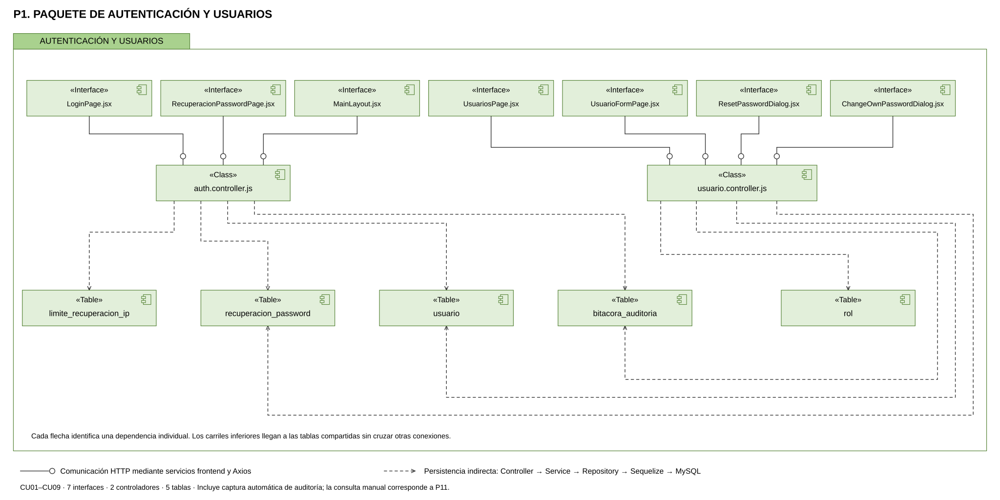

[Abrir el SVG a tamaño completo](diagrama-subsistemas/p1-autenticacion-usuarios.svg).

**Alcance:** CU01–CU09: inicio y cierre de sesión; creación, consulta, modificación y activación/desactivación de usuarios; cambio propio de contraseña, restablecimiento administrativo y recuperación mediante correo.

### Interfaces y controladores

Rutas relativas a la raíz del repositorio. Las conexiones incluyen la delegación a formularios o contexto; no afirman que cada página invoque directamente Axios.

| Interfaz real | Responsabilidad representada | Controlador |
|---|---|---|
| [`LoginPage.jsx`](../../frontend/src/features/auth/pages/LoginPage.jsx) | Acceso mediante el formulario `LoginForm.jsx` y `AuthContext.jsx`; CU01. | `auth.controller.js` |
| [`RecuperacionPasswordPage.jsx`](../../frontend/src/features/auth/pages/RecuperacionPasswordPage.jsx) | Solicitud de código y restablecimiento sin sesión previa; CU09. | `auth.controller.js` |
| [`MainLayout.jsx`](../../frontend/src/layouts/MainLayout.jsx) | Acción de cierre de sesión mediante el contexto; CU02. | `auth.controller.js` |
| [`UsuariosPage.jsx`](../../frontend/src/features/usuarios/pages/UsuariosPage.jsx) | Consulta de usuarios y cambio de estado; CU04/CU07. | `usuario.controller.js` |
| [`UsuarioFormPage.jsx`](../../frontend/src/features/usuarios/pages/UsuarioFormPage.jsx) | Creación, lectura individual preparatoria y edición; CU03/CU05/CU06. | `usuario.controller.js` |
| [`ResetPasswordDialog.jsx`](../../frontend/src/features/usuarios/components/ResetPasswordDialog.jsx) | Restablecimiento administrativo desde la gestión de usuarios; CU08. | `usuario.controller.js` |
| [`ChangeOwnPasswordDialog.jsx`](../../frontend/src/features/usuarios/components/ChangeOwnPasswordDialog.jsx) | Cambio propio, accesible desde el layout; CU08. | `usuario.controller.js` |

Los **dos controladores HTTP participantes** son [`auth.controller.js`](../../backend/src/presentation/controllers/auth.controller.js) y [`usuario.controller.js`](../../backend/src/presentation/controllers/usuario.controller.js), contrastados con los routers de autenticación y usuarios. La recuperación utiliza el primero; no existe un controlador separado para CU09. La captura automática de eventos utiliza `bitacora-auditoria.service.js`, no `bitacora-auditoria.controller.js`: este último atiende la consulta manual de P11 y no interviene en los flujos de CU01–CU09.

### Todas las tablas participantes

| Tabla física | Dependencia representada | Modelo Sequelize |
|---|---|---|
| `limite_recuperacion_ip` | `auth.controller.js`: cuotas persistentes de recuperación por IP. | [`limite-recuperacion-ip.js`](../../backend/src/data/models/limite-recuperacion-ip.js) |
| `recuperacion_password` | Ambos controladores: emisión/consumo de recuperaciones; invalidación por cambios de contraseña o cambio efectivo de correo. | [`recuperacion-password.js`](../../backend/src/data/models/recuperacion-password.js) |
| `usuario` | Ambos controladores: credenciales, cuenta, estado, bloqueo y versión de credenciales. | [`usuario.js`](../../backend/src/data/models/usuario.js) |
| `bitacora_auditoria` | Ambos controladores, sus servicios y la infraestructura transversal: captura automática de accesos, recuperación, cambios y consultas sensibles, según la política de auditoría. | [`bitacora-auditoria.js`](../../backend/src/data/models/bitacora-auditoria.js) |
| `rol` | `usuario.controller.js`: validación de asignación y consulta del rol asociado. No se atribuye una consulta de esta tabla al login. | [`rol.js`](../../backend/src/data/models/rol.js) |

Se representan las **cinco tablas utilizadas por el paquete**, incluida la persistencia transversal de auditoría, y sus **ocho dependencias individuales**: cuatro desde cada controlador. No hay distribuidores comunes ni líneas superpuestas. Las conexiones de `auth.controller.js` llegan por arriba; las conexiones de `usuario.controller.js` hacia las tres tablas compartidas utilizan carriles inferiores separados y flechas de entrada por abajo. La dirección de la flecha siempre apunta a la tabla; no representa una llamada entre controladores ni una relación entre tablas. Los nombres físicos se contrastaron con `tableName` y las migraciones de creación; las dependencias, con los servicios y repositorios de usuarios, recuperación y auditoría.

**Simplificaciones:** se omiten cajas de formularios internos, contexto, botones y relaciones de composición React; no se omiten controladores ni tablas participantes. `MainLayout.jsx` también hospeda el cambio propio, y `UsuariosPage.jsx` el diálogo administrativo; ambos diálogos se muestran por separado en la primera fila porque materializan las dos variantes de CU08. La restauración de sesión `/auth/me` queda resumida en el controlador de autenticación. La auditoría automática está incluida; su consulta manual se reserva para P11. No existe tabla de sesiones ni de autenticación.

**Limitaciones:** la existencia del flujo de recuperación no acredita entrega de correo a un buzón real ni su habilitación en el entorno desplegado. No se ejecutaron conexiones MySQL ni pruebas funcionales para este documento. La clasificación P1/CU01–CU09 se conserva según la solicitud y coincide con el bloque funcional de los casos de uso; no se localizó en `docs/` un apartado independiente titulado «3.1 Análisis de arquitectura» que permita contrastar su presentación académica original.

**Contraste de Fase 1:** cobertura confirmada sin inconsistencias que requieran modificar el SVG. La cadena HTTP se verifica en los servicios frontend de [autenticación](../../frontend/src/features/auth/services/auth.service.js) y [usuarios](../../frontend/src/features/usuarios/services/usuario.service.js), el [contexto](../../frontend/src/features/auth/context/AuthContext.jsx) y los routers de [autenticación](../../backend/src/presentation/routes/auth.router.js) y [usuarios](../../backend/src/presentation/routes/usuario.router.js). La persistencia se verifica en los servicios de [autenticación](../../backend/src/business/services/auth.service.js), [usuarios](../../backend/src/business/services/usuario.service.js) y [recuperación](../../backend/src/business/services/recuperacion-password.service.js), y los repositorios de [usuarios](../../backend/src/data/repositories/usuario.repository.js) y [recuperación](../../backend/src/data/repositories/recuperacion-password.repository.js). `findByIdForSession` y el login no incluyen `Rol`; las consultas públicas y asignaciones de usuarios sí lo utilizan. La autenticación de CU02 y demás rutas protegidas utiliza `usuario`, sin añadir otro controlador. La evidencia de tablas/migraciones y auditoría compartida se reúne al final de P3.

## P2. PAQUETE DE PROVEEDORES Y LABORATORIOS

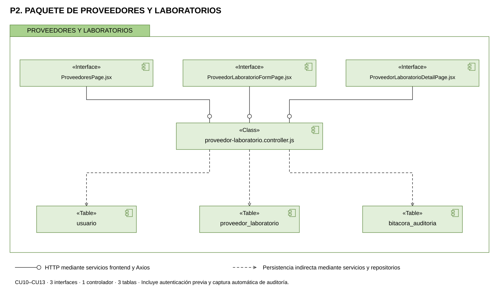

[Abrir el SVG a tamaño completo](diagrama-subsistemas/p2-proveedores-laboratorios.svg).

**Alcance:** CU10–CU13; RF10 y RN09–RN12. Proveedor y laboratorio son una sola entidad `ProveedorLaboratorio`. El Administrador registra, modifica y cambia el estado; Administrador y Regente consultan. La desactivación conserva las relaciones históricas; no hay validación automática ante SEDES.

### Interfaces, HTTP y controlador

| Interfaz real | Operación/CU | Controlador HTTP |
|---|---|---|
| [`ProveedoresPage.jsx`](../../frontend/src/features/proveedores/pages/ProveedoresPage.jsx) | Listado CU11 y cambio de estado CU13, con confirmación. | `proveedor-laboratorio.controller.js` |
| [`ProveedorLaboratorioFormPage.jsx`](../../frontend/src/features/proveedores/pages/ProveedorLaboratorioFormPage.jsx) | Alta CU10; lectura preparatoria CU11 y edición CU12. | `proveedor-laboratorio.controller.js` |
| [`ProveedorLaboratorioDetailPage.jsx`](../../frontend/src/features/proveedores/pages/ProveedorLaboratorioDetailPage.jsx) | Consulta individual CU11. | `proveedor-laboratorio.controller.js` |

Cadena comprobada: [servicio HTTP frontend](../../frontend/src/features/proveedores/services/proveedor-laboratorio.service.js) → [proveedor-laboratorio.router.js](../../backend/src/presentation/routes/proveedor-laboratorio.router.js) → [proveedor-laboratorio.controller.js](../../backend/src/presentation/controllers/proveedor-laboratorio.controller.js) → [proveedor-laboratorio.service.js](../../backend/src/business/services/proveedor-laboratorio.service.js) → [proveedor-laboratorio.repository.js](../../backend/src/data/repositories/proveedor-laboratorio.repository.js). El recurso es `/api/proveedores-laboratorios`: GET/POST en la raíz, GET/PATCH por `:idProveedorLaboratorio` y PATCH `/:idProveedorLaboratorio/estado`.

### Todas las tablas participantes

| Tabla física | Justificación de la relación dibujada |
|---|---|
| `proveedor_laboratorio` | Lectura, alta, edición y cambio de estado mediante el servicio y repositorio anteriores. |
| `usuario` | El `authMiddleware` de todas las rutas consulta la cuenta activa y versión de credenciales mediante `authService.getSessionUsuario` → `usuarioRepository.findByIdForSession`. No consulta `rol`. |
| `bitacora_auditoria` | Escrituras auditadas mediante `ejecutarCambio`/`registrarCambio`; rechazos y errores pertinentes mediante la infraestructura transversal. Los GET rutinarios exitosos no generan un evento de consulta. |

**Resultado:** 3 interfaces, 1 controlador, 3 tablas, 3 relaciones HTTP y 3 dependencias de persistencia. No participan los controladores de Usuarios, Autenticación o Bitácora por utilizar sus servicios/middlewares. Tampoco se consultan `medicamento` ni `compra` por el mero hecho de tener FK hacia el proveedor.

**Simplificaciones y límites:** formularios internos, tabla React y diálogo de confirmación quedan resumidos en sus páginas; no hay otra interfaz por CU. El detalle muestra datos del proveedor, no una consulta HTTP de sus compras o medicamentos. Las tablas son las declaradas por el código y migraciones, sin certificación del esquema desplegado.

## P3. PAQUETE DE MEDICAMENTOS Y COMPOSICIÓN

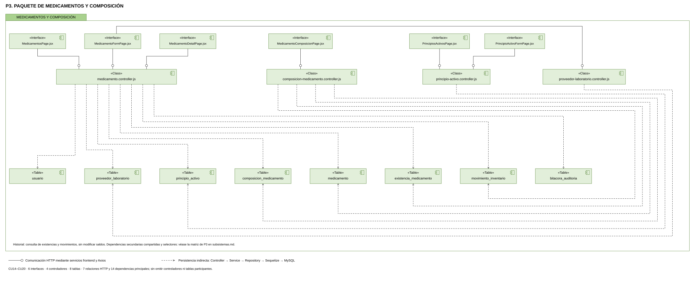

[Abrir el SVG a tamaño completo](diagrama-subsistemas/p3-medicamentos-composicion.svg).

**Alcance:** CU14–CU20; RF11–RF14 y RN13–RN17. El Regente gestiona medicamentos, principios y composición; las consultas conservan los roles de sus routers. El alta integral CU14 guarda medicamento y composición no vacía en una transacción; no llama al Controller de Composición ni crea existencias. CU19 gestiona las relaciones de medicamentos existentes. CU20 busca todos los ingredientes solicitados (AND), admite otros adicionales y no declara equivalencia terapéutica.

### Interfaces y correspondencias HTTP

| Interfaz real | Operación/CU y controlador principal | Apoyo HTTP comprobado |
|---|---|---|
| [`MedicamentosPage.jsx`](../../frontend/src/features/medicamentos/pages/MedicamentosPage.jsx) | CU15/CU20: listado y filtros; CU17: estado → `medicamento.controller.js`. | Administrador/Regente cargan principios con `principio-activo.controller.js`; el Vendedor los extrae del catálogo de medicamentos autorizado, sin llamar al catálogo de principios. |
| [`MedicamentoFormPage.jsx`](../../frontend/src/features/medicamentos/pages/MedicamentoFormPage.jsx) | CU14: alta integral y borrador de composición; CU15/CU16: lectura/edición → `medicamento.controller.js`. | Proveedores → `proveedor-laboratorio.controller.js` (conexión superior del SVG); principios solo en alta → `principio-activo.controller.js`. |
| [`MedicamentoDetailPage.jsx`](../../frontend/src/features/medicamentos/pages/MedicamentoDetailPage.jsx) | CU15: ficha → `medicamento.controller.js`. | Sus enlaces a composición/existencias son navegación, no llamadas a sus Controllers desde esta página. |
| [`MedicamentoComposicionPage.jsx`](../../frontend/src/features/medicamentos/pages/MedicamentoComposicionPage.jsx) | CU19: consulta, alta, modificación y retirada → `composicion-medicamento.controller.js`. | Carga ficha con `medicamento.controller.js` y, solo para gestionar, selector con `principio-activo.controller.js`. Hospeda `ComposicionForm.jsx` en un modal. |
| [`PrincipiosActivosPage.jsx`](../../frontend/src/features/principios-activos/pages/PrincipiosActivosPage.jsx) | CU18: consulta y cambio de estado → `principio-activo.controller.js`. | Consulta para Administrador/Regente; gestión solo Regente. |
| [`PrincipioActivoFormPage.jsx`](../../frontend/src/features/principios-activos/pages/PrincipioActivoFormPage.jsx) | CU18: alta, lectura individual y edición → `principio-activo.controller.js`. | Formulario reutilizado para alta/edición. |

El SVG dibuja siete conexiones HTTP principales; las cargas auxiliares de principios y de ficha descritas en esta tabla no se repiten como líneas. No se inventa una página de búsqueda por composición: CU20 utiliza `MedicamentosPage.jsx` y sus filtros. La composición inicial del formulario es un borrador local hasta el POST integral, no una serie de peticiones CU19.

| Servicio HTTP frontend | Router backend | Controller HTTP real |
|---|---|---|
| [`medicamento.service.js`](../../frontend/src/features/medicamentos/services/medicamento.service.js): `/api/medicamentos`, `/:idMedicamento` y `/:idMedicamento/estado` | [`medicamento.router.js`](../../backend/src/presentation/routes/medicamento.router.js) | [`medicamento.controller.js`](../../backend/src/presentation/controllers/medicamento.controller.js) |
| El mismo servicio: `/:idMedicamento/composicion` y `/:idComposicion`, GET/POST/PATCH/DELETE según operación | [`composicion-medicamento.router.js`](../../backend/src/presentation/routes/composicion-medicamento.router.js), anidado con `mergeParams` y autenticación heredada | [`composicion-medicamento.controller.js`](../../backend/src/presentation/controllers/composicion-medicamento.controller.js) |
| [`principio-activo.service.js`](../../frontend/src/features/principios-activos/services/principio-activo.service.js): `/api/principios-activos`, detalle y estado | [`principio-activo.router.js`](../../backend/src/presentation/routes/principio-activo.router.js) | [`principio-activo.controller.js`](../../backend/src/presentation/controllers/principio-activo.controller.js) |
| [Servicio HTTP de proveedores](../../frontend/src/features/proveedores/services/proveedor-laboratorio.service.js): GET `/api/proveedores-laboratorios` | [Router de proveedores](../../backend/src/presentation/routes/proveedor-laboratorio.router.js) | [Controller de proveedores](../../backend/src/presentation/controllers/proveedor-laboratorio.controller.js), compartido con P2 |

### Todas las tablas y dependencias de persistencia

| Tabla física | Medicamentos | Composición | Principios | Proveedores |
|---|---|---|---|---|
| `medicamento` | Catálogo, código, unicidad y escritura. | Ficha, bloqueo y unicidad resultante. | — | — |
| `composicion_medicamento` | Ficha, búsqueda AND, alta integral y unicidad. | Consulta y gestión de relaciones; unicidad resultante. | — | — |
| `principio_activo` | Referencias del alta y asociación de la ficha. | Validación del ingrediente y asociación de la consulta/respuesta. | Consulta y gestión del catálogo. | — |
| `proveedor_laboratorio` | Asociación, existencia/estado y bloqueo de identidad. | Ficha y bloqueo del proveedor para unicidad. | — | Lectura del selector. |
| `existencia_medicamento` | Comprobación del historial ante cambios protegidos. | Comprobación del historial antes de cualquier escritura CU19. | — | — |
| `movimiento_inventario` | Búsqueda de al menos un movimiento de esas existencias. | Misma comprobación mediante `medicamentoService`. | — | — |
| `usuario` | Autenticación previa. | Autenticación previa. | Autenticación previa. | Autenticación previa. |
| `bitacora_auditoria` | Escrituras y rechazos/fallos pertinentes. | Escrituras y rechazos/fallos pertinentes. | Escrituras y rechazos/fallos pertinentes. | Rechazos/fallos pertinentes del selector; no éxito GET rutinario. |

Las columnas identifican los **flujos de cada Controller**, no consultas SQL directas. Los GET rutinarios de catálogo no auditan éxitos. Las dependencias de `usuario` proceden del middleware de sus rutas; almacenar un ID de rol o responsable no implica consultar `rol` ni llamar a `usuario.controller.js`/`auth.controller.js`.

**Fundamento verificable: vías de negocio y datos.**

- [medicamento.service.js](../../backend/src/business/services/medicamento.service.js) → [medicamento.repository.js](../../backend/src/data/repositories/medicamento.repository.js): `relaciones` incluye proveedor, composición y principio; `findAll` filtra por composición; `hasMovimientos` consulta y bloquea existencias y movimientos sin modificar saldo. El código correlativo consulta `medicamento`, no una tabla de secuencias.
- El alta integral también usa [composicion-medicamento.repository.js](../../backend/src/data/repositories/composicion-medicamento.repository.js) para validar principios y crear componentes. [identidad-medicamento.js](../../backend/src/business/services/identidad-medicamento.js) coordina transacción, bloqueo de proveedores y validación de identidad/composición mediante el repositorio de medicamentos.
- [composicion-medicamento.service.js](../../backend/src/business/services/composicion-medicamento.service.js) → repositorio de composición y `medicamentoService.getMedicamentoById`/`getMedicamentoForUpdate`/`validateSinHistorial`; `prepararModificacion` y `validarResultado` justifican las lecturas compartidas. Llamar al Service de Medicamentos no llama a su Controller HTTP.
- [principio-activo.service.js](../../backend/src/business/services/principio-activo.service.js) → [principio-activo.repository.js](../../backend/src/data/repositories/principio-activo.repository.js); proveedor utiliza la cadena de P2, aquí solo para el selector. La autenticación y auditoría se justifican en las fuentes comunes siguientes.

**Selección de relaciones:** se dibujan 14 dependencias principales: Medicamentos → las ocho tablas; Composición → medicamento, composición, existencias y movimientos; Principios → principio; Proveedores → proveedor. Las lecturas auxiliares de principio/proveedor desde Composición y las dependencias transversales repetidas de Composición/Principios/Proveedores se conservan explícitamente en la matriz, sin repetir sus flechas. Esto resume detalles compartidos conforme al criterio de selección de `fases.md` §5.2, sin quitar ninguno de los cuatro controladores ni de las ocho tablas. No debe interpretarse la ausencia de esas flechas secundarias como ausencia de participación. Cada relación dibujada tiene su ruta y sus puertos propios; los carriles inferiores entran por abajo a las tablas compartidas.

**Límites:** las consultas de historial protegen identidad y composición (RN13/RN16), no implementan ajustes o movimientos de inventario en P3. El enlace «Ver existencias» lleva a P4 (incorporado en Fase 2), y no añade `inventario.controller.js` a P3. Tampoco se añaden tablas de compras/ventas por asociaciones no cargadas, ni el Controller de consulta manual de Bitácora. No se ha certificado el comportamiento funcional ni el despliegue mediante esta revisión documental.

### Evidencia común de persistencia y fuentes documentales de P1–P3

Autenticación transversal: [auth.middleware.js](../../backend/src/presentation/middlewares/auth.middleware.js) → [auth.service.js](../../backend/src/business/services/auth.service.js) → [usuario.repository.js](../../backend/src/data/repositories/usuario.repository.js), lectura sin asociación `Rol`. Auditoría automática: [auditoria-http.js](../../backend/src/shared/utils/auditoria-http.js), [middleware de errores](../../backend/src/presentation/middlewares/error.middleware.js), [middleware de errores de autenticación](../../backend/src/presentation/middlewares/auditoria-auth-error.middleware.js) → [bitacora-auditoria.service.js](../../backend/src/business/services/bitacora-auditoria.service.js) → [bitacora-auditoria.repository.js](../../backend/src/data/repositories/bitacora-auditoria.repository.js). No se invoca el Controller de consulta manual CU42. La [política de Bitácora](bitacora-auditoria.md) distingue escrituras, lecturas excluidas y rechazos/fallos.

Los nombres físicos se comprobaron contra `tableName` y la creación en migraciones; no contra una instancia MySQL:

| Tabla | Modelo y asociaciones | Migración de creación |
|---|---|---|
| `rol` | [rol.js](../../backend/src/data/models/rol.js) | [20260914035738-create-rol.js](../../backend/src/data/database/migrations/20260914035738-create-rol.js) |
| `usuario` | [usuario.js](../../backend/src/data/models/usuario.js) | [20260914035802-create-usuario.js](../../backend/src/data/database/migrations/20260914035802-create-usuario.js) |
| `recuperacion_password` | [recuperacion-password.js](../../backend/src/data/models/recuperacion-password.js) | [20261009120100-create-recuperacion-password.js](../../backend/src/data/database/migrations/20261009120100-create-recuperacion-password.js) |
| `limite_recuperacion_ip` | [limite-recuperacion-ip.js](../../backend/src/data/models/limite-recuperacion-ip.js) | [20261009120200-create-limite-recuperacion-ip.js](../../backend/src/data/database/migrations/20261009120200-create-limite-recuperacion-ip.js) |
| `bitacora_auditoria` | [bitacora-auditoria.js](../../backend/src/data/models/bitacora-auditoria.js) | [20261013120000-create-bitacora-auditoria.js](../../backend/src/data/database/migrations/20261013120000-create-bitacora-auditoria.js) |
| `proveedor_laboratorio` | [proveedor-laboratorio.js](../../backend/src/data/models/proveedor-laboratorio.js) | [20260914035749-create-proveedor-laboratorio.js](../../backend/src/data/database/migrations/20260914035749-create-proveedor-laboratorio.js) |
| `principio_activo` | [principio-activo.js](../../backend/src/data/models/principio-activo.js) | [20260914035756-create-principio-activo.js](../../backend/src/data/database/migrations/20260914035756-create-principio-activo.js) |
| `medicamento` | [medicamento.js](../../backend/src/data/models/medicamento.js) | [20260914035810-create-medicamento.js](../../backend/src/data/database/migrations/20260914035810-create-medicamento.js) |
| `composicion_medicamento` | [composicion-medicamento.js](../../backend/src/data/models/composicion-medicamento.js) | [20260914035816-create-composicion-medicamento.js](../../backend/src/data/database/migrations/20260914035816-create-composicion-medicamento.js) |
| `existencia_medicamento` | [existencia-medicamento.js](../../backend/src/data/models/existencia-medicamento.js) | [20260914035822-create-existencia-medicamento.js](../../backend/src/data/database/migrations/20260914035822-create-existencia-medicamento.js) |
| `movimiento_inventario` | [movimiento-inventario.js](../../backend/src/data/models/movimiento-inventario.js) | [20260914035901-create-movimiento-inventario.js](../../backend/src/data/database/migrations/20260914035901-create-movimiento-inventario.js) |

Referencias consultadas selectivamente: [contexto maestro](contexto-maestro.md) (estado vigente, arquitectura y catálogo), [casos de uso](casos-uso.md) CU01–CU20, [requerimientos](requerimientos.md) RF01–RF14 y recuperación/auditoría, [reglas](reglas-negocio.md) RN01–RN17 y RN107–RN115, [análisis académico simplificado](analisis-clases-academico-simplificado.md) (bloques de acceso y catálogos) y [modelo de clases](diagrama-clases.md) §3. No se encontró un documento académico independiente con el apartado «3.1 Análisis de arquitectura» y su vista de paquetes: se mantiene la clasificación explícita del usuario y de [fases.md](fases.md), sin inventar esa fuente.

**Evidencia histórica — componentes compartidos y cierre de Fase 1:** `proveedor-laboratorio.controller.js` aparece en P2 y P3 por una petición HTTP real; `proveedor_laboratorio` se comparte entre ambos. `usuario` y `bitacora_auditoria` participan en los tres paquetes. Axios, contexto/layout, autenticación y captura de auditoría son infraestructura común, no una cuarta fila. Los 3 paquetes de aquella fase reúnen 16 interfaces, 6 controladores y 11 tablas distintos (contando una vez cada nombre). El resumen final de once paquetes se reserva para la Fase 4.

## P4. PAQUETE DE EXISTENCIAS E INVENTARIO

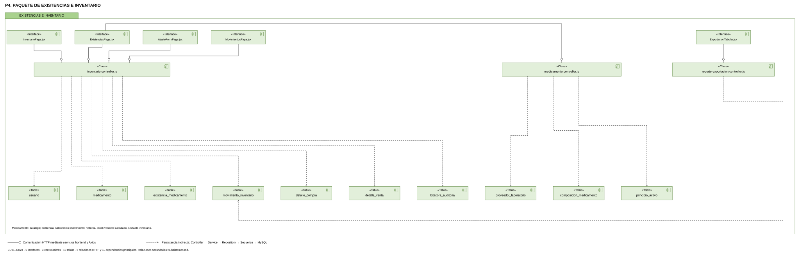

[Abrir el SVG a tamaño completo](diagrama-subsistemas/p4-existencias-inventario.svg).

**Alcance:** CU21–CU24; RF17–RF19/RF29, RN25–RN30/RN81–RN84/RN103. `medicamento` es el catálogo, `existencia_medicamento` mantiene saldo y costo promedio, y `movimiento_inventario` conserva entradas, salidas y reversiones. No existe tabla `inventario`. El stock físico no se borra por vencimiento; el vendible se calcula con actividad y vencimiento efectivo, no es otra tabla o columna.

### Interfaces y cadena HTTP comprobada

| Interfaz real | CU/operación y Controller | Apoyo y límites |
|---|---|---|
| [InventarioPage.jsx](../../frontend/src/features/inventario/pages/InventarioPage.jsx) | CU21, GET `/api/inventario` → `inventario.controller.js`. | Solo medicamentos con alguna existencia, incluidos agotados/inactivos/vencidos; no exige compra ni movimiento. Otras variantes de la página son P8/P9, no desarrolladas aquí. |
| [ExistenciasPage.jsx](../../frontend/src/features/inventario/pages/ExistenciasPage.jsx) | CU22, GET `/api/inventario/medicamentos/:idMedicamento/existencias` → Inventario. | También GET de ficha → `medicamento.controller.js`; conserva identificación con lista de existencias vacía. |
| [AjusteFormPage.jsx](../../frontend/src/features/inventario/pages/AjusteFormPage.jsx) | CU23, preparación CU22 y POST `/api/inventario/ajustes` → Inventario. | Aloja `AjusteForm.jsx`; [consultaExistencia.js](../../frontend/src/features/inventario/utils/consultaExistencia.js) reutiliza CU22 y ficha de Medicamentos. |
| [MovimientosPage.jsx](../../frontend/src/features/inventario/pages/MovimientosPage.jsx) | CU24, GET `/api/inventario/movimientos` → Inventario. | Filtros por medicamento/existencia/fechas/dirección/motivo. También reutilizable por CU40/P10. |
| [ExportacionTabular.jsx](../../frontend/src/features/reportes/components/ExportacionTabular.jsx) | Descarga del historial desde CU24 → `reporte-exportacion.controller.js`. | Componente compartido alojado en Movimientos, `fuente="movimientos"`; no se omite su Controller por pertenecer a Reportes. |

El [servicio HTTP de Inventario](../../frontend/src/features/inventario/services/inventario.service.js) utiliza Axios común; `getExistenciasMedicamento` hace **dos peticiones** (existencias y ficha). Su [router](../../backend/src/presentation/routes/inventario.router.js) aplica autenticación y roles: CU21/CU22 para los tres roles, CU23 solo Regente, CU24/exportación Administrador o Regente. Los Controllers reales son [Inventario](../../backend/src/presentation/controllers/inventario.controller.js), [Medicamentos](../../backend/src/presentation/controllers/medicamento.controller.js) y [Exportación](../../backend/src/presentation/controllers/reporte-exportacion.controller.js). La ficha sigue el [servicio frontend de Medicamentos](../../frontend/src/features/medicamentos/services/medicamento.service.js) y su [router](../../backend/src/presentation/routes/medicamento.router.js).

### Todas las tablas y matriz de participación

Cada columna representa el flujo HTTP completo, incluido middleware. «Rechazos» no significa auditar cada GET exitoso.

| Tabla física | Inventario | Medicamentos (solo ficha) | Exportación (solo movimientos) |
|---|---|---|---|
| `medicamento` | Disponibilidad, existencias e historial. | Ficha. | Catálogo de la existencia. |
| `existencia_medicamento` | Saldos, costos, vencimientos y ajuste. | — | Origen del movimiento y filtro. |
| `movimiento_inventario` | Último ID de CU22, consulta CU24 y ajuste CU23. | — | Extracción y vínculo a reversión. |
| `detalle_compra` | Referencia de compra en CU24. | — | Referencia de origen. |
| `detalle_venta` | Referencia de venta en CU24. | — | Referencia de origen. |
| `proveedor_laboratorio` | — | Asociación de ficha. | — |
| `composicion_medicamento` | — | Asociación de ficha. | — |
| `principio_activo` | — | Ingredientes de la ficha. | — |
| `usuario` | Autenticación; responsable del historial. | Autenticación. | Autenticación y responsable del movimiento. |
| `bitacora_auditoria` | Ajuste/conciliación, rechazos/fallos pertinentes. | Rechazos/fallos pertinentes. | Resultado de exportación, rechazos/fallos pertinentes. |

**Persistencia verificable:** [inventario.service.js](../../backend/src/business/services/inventario.service.js) coordina [existencia-medicamento.repository.js](../../backend/src/data/repositories/existencia-medicamento.repository.js) y [movimiento-inventario.repository.js](../../backend/src/data/repositories/movimiento-inventario.repository.js). No hay un `inventario.repository.js`. `findMedicamentoConExistencias` lee saldo y `MAX(id_movimiento)` en el mismo SELECT; `findAll` de movimientos incluye ambos detalles, usuario, existencia/medicamento y reversión, **no** las cabeceras `compra`/`venta` ni `receta`. Una FK a cabecera no añade una consulta a ella.

CU23 bloquea existencia e historial y compara saldo/último movimiento observados antes de calcular la diferencia. Entrada: costo positivo y promedio ponderado; salida: promedio vigente; sin diferencia: no cambia saldo/costo ni crea movimiento, pero registra resultado de conciliación en Bitácora. No crea existencias, reactiva productos ni convierte vencidas en vendibles. La observación y las precondiciones se exigen también sin diferencia.

La ficha utiliza [medicamento.service.js](../../backend/src/business/services/medicamento.service.js) → [medicamento.repository.js](../../backend/src/data/repositories/medicamento.repository.js), `findById` sin bloqueo con proveedor/composición/principio. La descarga sigue [reporte.exportacion.service.js](../../backend/src/business/services/reporte.exportacion.service.js) → [reporte.extraccion.repository.js](../../backend/src/data/repositories/reporte.extraccion.repository.js), rama `MOVIMIENTOS`: mismas seis tablas de datos del historial, sin cabeceras ni tabla `reporte`. Su snapshot es independiente de la consulta visible.

**Selección y simplificaciones:** 5 interfaces, 3 Controllers, 10 tablas; 6 relaciones HTTP y 11 dependencias dibujadas. Se dibujan Inventario → sus siete tablas; Medicamentos → proveedor/composición/principio; Exportación → movimientos. Se resumen **solo las flechas secundarias** de Medicamentos → medicamento/usuario/bitácora y Exportación → medicamento/existencia/detalles/usuario/bitácora, todas explícitas en la matriz. La carga de ficha desde Ajuste queda textual (se dibuja desde Existencias, que utiliza el mismo servicio). El componente de exportación tiene su propia caja; no se dibuja composición React entre él y Movimientos. Esto evita repetir recorridos auxiliares sin omitir tablas o Controllers (§5.2 de fases.md).

**Límites:** no se desarrollan P8–P10 por reutilizar sus componentes. La descarga depende de las guardas LOCAL/Railway opt-in y recursos del servidor; no se acredita disponibilidad ni entrega de archivos. No se llama a los Controllers de Auth, Usuarios, Bitácora, Compras o Ventas. Los enlaces a operaciones de origen son navegación, no peticiones ejecutadas por CU24.

## P5. PAQUETE DE COMPRAS

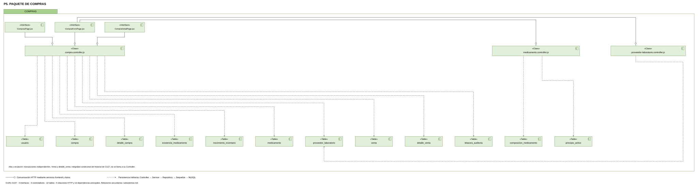

[Abrir el SVG a tamaño completo](diagrama-subsistemas/p5-compras.svg).

**Alcance:** CU25–CU27; RF20–RF22, RN33–RN47/RN75–RN76/RN79–RN80. Consulta Administrador/Regente; registro y anulación solo Administrador. Proveedor único derivado del catálogo de los medicamentos, no elegido de forma independiente ni separado de laboratorio.

### Interfaces, HTTP y Controllers

| Interfaz real | CU/operación principal | Peticiones auxiliares reales |
|---|---|---|
| [ComprasPage.jsx](../../frontend/src/features/compras/pages/ComprasPage.jsx) | CU26: listado y filtros → `compra.controller.js`. | GET proveedores para filtro → `proveedor-laboratorio.controller.js`. |
| [CompraFormPage.jsx](../../frontend/src/features/compras/pages/CompraFormPage.jsx) | CU25: alta; consulta propia por clave CU26 ante respuesta incierta → Compras. | GET medicamentos → `medicamento.controller.js`; GET proveedores → Proveedores. |
| [CompraDetailPage.jsx](../../frontend/src/features/compras/pages/CompraDetailPage.jsx) | CU26: detalle; CU27: anulación → Compras. | Aloja `CompraDetallesTable.jsx` y `CompraAnularForm.jsx`; enlaces a inventario no equivalen a llamadas a su Controller. |

[compra.service.js frontend](../../frontend/src/features/compras/services/compra.service.js) → [compra.router.js](../../backend/src/presentation/routes/compra.router.js) → [compra.controller.js](../../backend/src/presentation/controllers/compra.controller.js): GET/POST `/api/compras`, GET `/:idCompra`, POST `/:idCompra/anular`. La consulta por clave se restringe al usuario autenticado, sin restringir así todo el listado. Selectores: servicios frontend de [Medicamentos](../../frontend/src/features/medicamentos/services/medicamento.service.js) y [Proveedores](../../frontend/src/features/proveedores/services/proveedor-laboratorio.service.js), routers de [Medicamentos](../../backend/src/presentation/routes/medicamento.router.js) y [Proveedores](../../backend/src/presentation/routes/proveedor-laboratorio.router.js), Controllers de [Medicamentos](../../backend/src/presentation/controllers/medicamento.controller.js) y [Proveedores](../../backend/src/presentation/controllers/proveedor-laboratorio.controller.js), compartidos con P2/P3/P4.

### Todas las tablas y matriz de participación

| Tabla física | Compras | Medicamentos (solo selector) | Proveedores (solo selector/filtro) |
|---|---|---|---|
| `compra` | Cabecera, clave única, consulta, estado/anulación; cabeceras históricas de compensaciones. | — | — |
| `detalle_compra` | Líneas; snapshot común anterior por existencia; consulta e integridad histórica. | — | — |
| `existencia_medicamento` | Reutilización/alta, código, saldo y promedio; compensación. | — | — |
| `movimiento_inventario` | Entrada por detalle, historial, originales y reversiones. | — | — |
| `medicamento` | Actividad/proveedor con bloqueo en alta; ficha resumida del detalle. | Catálogo. | — |
| `proveedor_laboratorio` | Proveedor único activo en alta; asociación de consulta. | Asociación del catálogo. | Catálogo de apoyo. |
| `venta` | **Condicional CU27:** estado de cabecera de ventas compensadas en el historial. | — | — |
| `detalle_venta` | **Condicional CU27:** verificación de origen de reversiones de ventas. | — | — |
| `composicion_medicamento` | — | Asociación del catálogo. | — |
| `principio_activo` | — | Ingredientes del catálogo. | — |
| `usuario` | Autenticación y responsables de registro/anulación en consulta. | Autenticación. | Autenticación. |
| `bitacora_auditoria` | Registro/anulación; rechazos/fallos pertinentes. | Rechazos/fallos pertinentes. | Rechazos/fallos pertinentes. |

**Persistencia verificable:** [compra.service.js backend](../../backend/src/business/services/compra.service.js) → [compra.repository.js](../../backend/src/data/repositories/compra.repository.js), repositorios de [Medicamentos](../../backend/src/data/repositories/medicamento.repository.js), [Existencias](../../backend/src/data/repositories/existencia-medicamento.repository.js) y [Movimientos](../../backend/src/data/repositories/movimiento-inventario.repository.js). Compras coordina directamente repositorios, **no** `inventarioService`, `medicamentoService` ni sus Controllers. No existe un Controller separado de detalles para estos flujos. Los selectores sí llaman por HTTP a los otros dos Controllers.

- **Registro:** una transacción guarda cabecera/detalles, estado anterior común por existencia, saldos/costos, entradas y auditoría obligatoria. Agrupa por medicamento/vencimiento/precisión, reutiliza incluso agotadas y genera código conservando todos los anteriores. Valida medicamento/proveedor activos y vencimiento al instante comercial tras los bloqueos; calcula subtotales/total y promedio ponderado agrupado, sin modificar costos históricos.
- **Consulta:** incluye proveedor, usuarios registrador/anulador y, en detalle, existencia/medicamento. Los selectores cargan proveedor/composición/principios mediante `findAll` del catálogo: por eso estas dos últimas tablas también aparecen, aunque Compras no las escriba.
- **Anulación:** otra transacción valida todos los grupos, aplica B1 (restauración del snapshot) o A (valor residual conservador), actualiza estado/saldo/costo y añade una salida de reversión por entrada original. No elimina originales; bloquea reanulación, incoherencias o stock/valor residual negativos. `findReferenciasParaAnular` comprueba detalles y estados de cabeceras de compras/ventas **cuando hay compensaciones históricas**; justifica `venta`/`detalle_venta`, sin llamar a `venta.controller.js` ni consultar recetas. Un fallo revierte toda la anulación.

El selector de proveedores sigue [proveedor-laboratorio.service.js backend](../../backend/src/business/services/proveedor-laboratorio.service.js) → [proveedor-laboratorio.repository.js](../../backend/src/data/repositories/proveedor-laboratorio.repository.js). Medicamentos sigue la cadena de P4/P3, aquí solo GET.

**Selección y simplificaciones:** 3 interfaces, 3 Controllers, 12 tablas; 5 relaciones HTTP y 13 dependencias dibujadas. Compras → sus diez tablas; Medicamentos → composición/principio; Proveedores → proveedor. Se resumen las flechas de Medicamentos → medicamento/proveedor/usuario/bitácora y Proveedores → usuario/bitácora, explícitas en la matriz. GET de proveedores desde el listado queda textual; se dibuja desde el formulario que usa el mismo servicio. Formularios de líneas/anulación y tablas internas quedan agrupados en las tres páginas. Sin omitir Controllers ni tablas, se evita duplicar dependencias auxiliares (§5.2).

**Límites:** no se incorpora Inventario como Controller por afectar sus tablas ni Ventas por validar una reversión. No hay eliminación física ni tabla de costos o secuencias. El costo actual de una existencia no reemplaza el aplicado histórico. No se certifica el estado de una base desplegada ni aceptación funcional.

## P6. PAQUETE DE VENTAS

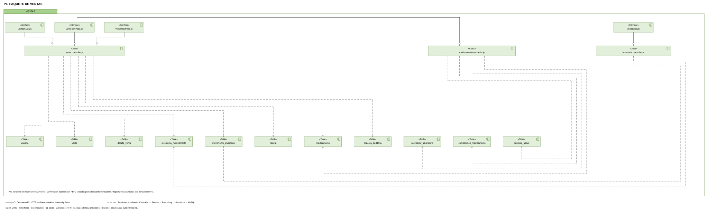

[Abrir el SVG a tamaño completo](diagrama-subsistemas/p6-ventas.svg).

**Alcance:** CU28–CU30; RF23–RF26, RN48–RN58/RN77–RN80. CU28 incluye alta pendiente **y confirmación posterior** por Vendedor. CU29 permite consulta a los tres roles; CU30 solo Administrador. No se desarrolla P7/CU31–CU32.

### Interfaces y cadena HTTP comprobada

| Interfaz real | CU/operación → Controller | Apoyo y límites |
|---|---|---|
| [VentasPage.jsx](../../frontend/src/features/ventas/pages/VentasPage.jsx) | CU29: listado, filtros y paginación → `venta.controller.js`. | Sus modos de selección para recetas no se desarrollan como P7 aquí. |
| [VentaFormPage.jsx](../../frontend/src/features/ventas/pages/VentaFormPage.jsx) | CU28: POST pendiente → Ventas. | GET catálogo → `medicamento.controller.js`; aloja `VentaForm.jsx`. |
| [VentaDetailPage.jsx](../../frontend/src/features/ventas/pages/VentaDetailPage.jsx) | CU29: ficha; CU28: confirmar; CU30: anular → Ventas. | Muestra referencias/estados de recetas incluidos en GET de venta, sin pedirlas a su Controller. Los enlaces a registrar/revisar recetas son navegación a P7. |
| [VentaLinea.jsx](../../frontend/src/features/ventas/components/VentaLinea.jsx) | Preparación CU28: existencias provisionales CU22 → `inventario.controller.js`. | [getExistenciasMedicamento](../../frontend/src/features/inventario/services/inventario.service.js) también pide ficha a Medicamentos. No selecciona FEFO definitivo. |

[venta.service.js frontend](../../frontend/src/features/ventas/services/venta.service.js) → [venta.router.js](../../backend/src/presentation/routes/venta.router.js) → [venta.controller.js](../../backend/src/presentation/controllers/venta.controller.js): GET/POST `/api/ventas`, GET `/:idVenta`, POST `/:idVenta/confirmar` y `/:idVenta/anular`. Auth/roles preceden al Controller. El router monta además Recetas, pero ese montaje **no** implica invocarlo desde estos endpoints. Apoyo: [servicio de Medicamentos](../../frontend/src/features/medicamentos/services/medicamento.service.js) → [router](../../backend/src/presentation/routes/medicamento.router.js) → [Controller](../../backend/src/presentation/controllers/medicamento.controller.js), y servicio de Inventario → [router](../../backend/src/presentation/routes/inventario.router.js) → [Controller](../../backend/src/presentation/controllers/inventario.controller.js).

### Todas las tablas y matriz de participación

| Tabla física | Ventas | Medicamentos (catálogo/ficha) | Inventario (solo CU22) |
|---|---|---|---|
| `venta` | Cabecera pendiente, listado/detalle, confirmación y anulación. | — | — |
| `detalle_venta` | Alta sin receta; finalización/división por FEFO; anulación y consulta. | — | — |
| `existencia_medicamento` | Referencia provisional, bloqueo/stock, descuento o devolución/costo. | — | Consulta de saldos/vencimientos/costos. |
| `movimiento_inventario` | Control de originales, salidas y reversiones. | — | Subconsulta de último ID en CU22. |
| `receta` | Lectura de referencias/estado en ficha y validación al confirmar. | — | — |
| `medicamento` | Actividad y condición de venta; ficha resumida del detalle. | Catálogo/ficha. | Identificación y actividad de CU22. |
| `proveedor_laboratorio` | — | Asociación de catálogo/ficha. | — |
| `composicion_medicamento` | — | Asociación de catálogo/ficha. | — |
| `principio_activo` | — | Ingredientes de catálogo/ficha. | — |
| `usuario` | Autenticación y responsables de cabecera. | Autenticación. | Autenticación. |
| `bitacora_auditoria` | Alta/confirmación/anulación y rechazos/fallos pertinentes. | Rechazos/fallos pertinentes. | Rechazos/fallos pertinentes. |

**Persistencia verificable:** [venta.service.js backend](../../backend/src/business/services/venta.service.js) coordina [venta.repository.js](../../backend/src/data/repositories/venta.repository.js), repositorios de [Medicamentos](../../backend/src/data/repositories/medicamento.repository.js), [Existencias](../../backend/src/data/repositories/existencia-medicamento.repository.js), [Movimientos](../../backend/src/data/repositories/movimiento-inventario.repository.js) y [Recetas](../../backend/src/data/repositories/receta.repository.js). Los [DTO de Ventas](../../backend/src/presentation/dtos/venta.dto.js) exponen en la ficha referencias/estados de recetas, no pacientes ni archivos. `ventaRepository.findById` incluye Receta directamente; `findParaConfirmacion` pertenece al repositorio de recetas, **no** a su Controller.

1. **Alta pendiente:** transacción de venta y detalles con `id_receta = null`, fecha de registro y total. Valida medicamento activo y existencia real correspondiente; no exige todavía saldo vendible, no reserva/descuenta ni crea movimientos. La selección React es provisional.
2. **Límite con P7:** cada receta y sus vínculos se guardan **después en otra transacción**; la revisión también es independiente. Se verificó el límite en [receta.service.js](../../backend/src/business/services/receta.service.js), `createReceta`/revisión. Un fallo de receta no revierte el alta ya confirmada de la venta. No se dibujan páginas/Controller de Recetas, porque estas operaciones no forman parte de CU28–CU30.
3. **Confirmación:** otra transacción, `READ COMMITTED`, bloquea venta/detalles, recetas usadas, medicamentos y existencias. Valida actividad, stock y vencimiento al instante comercial tras los bloqueos; `RECETA_MEDICA` exige receta aprobada de la misma venta y validador/fecha válidos; `LIBRE` no la exige, pero una receta vinculada debe estar aprobada. Condición desconocida bloquea. El Service calcula FEFO por vencimiento efectivo, redistribuye/divide detalles conservando receta y registra salidas a costo vigente, saldos y fecha efectiva junto al estado confirmado y auditoría. Si falla, sigue pendiente, sin efectos parciales.
4. **Consulta:** página y conteo comparten snapshot `REPEATABLE READ`; detalle incluye responsables, existencias/medicamento y referencias de recetas. No consulta `rol`, `compra` ni `detalle_compra` por tener FK o por reutilizar un repositorio que ofrece otros métodos.
5. **Anulación:** transacción independiente con motivo/fecha/responsable. Pendiente: sin cambios de stock ni reversiones. Confirmada: devuelve a existencias originales, crea entradas inversas al costo histórico y calcula promedio ponderado agrupado según RN78, **no** B1/A de Compras. Conserva detalles, recetas, fecha de venta y movimientos originales; rechaza doble anulación e inconsistencias.

**Selección y simplificaciones:** 4 interfaces, 3 Controllers, 11 tablas; 5 relaciones HTTP y 14 dependencias dibujadas. Ventas → sus ocho tablas; Medicamentos → medicamento/proveedor/composición/principio; Inventario → existencias/movimientos. Se resumen las flechas transversales de Medicamentos → usuario/bitácora e Inventario → medicamento/usuario/bitácora, explícitas en la matriz. La petición de ficha desde VentaLinea se describe sin duplicar la flecha al catálogo, dibujada desde VentaFormPage. `VentaLinea.jsx` se muestra como componente real para hacer visible la consulta de existencias; su composición con el formulario no es una conexión HTTP. No se añade `receta.controller.js` por consultar su repositorio, ni Controllers de Auth, Usuarios o Bitácora por infraestructura común.

**Límites:** no hay alta atómica venta+recetas, adjuntos ni implementación nueva. El esquema legado de recetas requiere la migración que permite archivo NULL antes de operar con el formulario sin adjuntos; esta tarea no la ejecuta ni verifica una base existente. P7 estaba pendiente al cerrar Fase 2; se incorpora abajo en Fase 3, sin modificar el SVG P6.

### Evidencia común y componentes compartidos de Fase 2

La autenticación y auditoría siguen las fuentes comunes de P1–P3 anteriores: `authMiddleware` lee `usuario` sin asociación a Rol; los Services de negocio guardan auditoría obligatoria en su transacción y la infraestructura trata rechazos/fallos pertinentes. GET rutinarios exitosos de inventario/catálogos/compras/ventas no equivalen a consultas sensibles auditadas automáticamente. No se añaden Controllers transversales por este motivo.

Se reutilizan las tablas/modelos/migraciones enlazados en P3. Las cinco tablas adicionales se contrastaron con `tableName` y creación física:

| Tabla | Modelo | Migración de creación |
|---|---|---|
| `compra` | [compra.js](../../backend/src/data/models/compra.js) | [20260914035830-create-compra.js](../../backend/src/data/database/migrations/20260914035830-create-compra.js) |
| `detalle_compra` | [detalle-compra.js](../../backend/src/data/models/detalle-compra.js) | [20260914035847-create-detalle-compra.js](../../backend/src/data/database/migrations/20260914035847-create-detalle-compra.js) |
| `venta` | [venta.js](../../backend/src/data/models/venta.js) | [20260914035836-create-venta.js](../../backend/src/data/database/migrations/20260914035836-create-venta.js) |
| `detalle_venta` | [detalle-venta.js](../../backend/src/data/models/detalle-venta.js) | [20260914035855-create-detalle-venta.js](../../backend/src/data/database/migrations/20260914035855-create-detalle-venta.js) |
| `receta` | [receta.js](../../backend/src/data/models/receta.js) | [20260914035842-create-receta.js](../../backend/src/data/database/migrations/20260914035842-create-receta.js) |

Migración complementaria pertinente al límite RN57: [20261101120000-allow-null-receta-archivo.js](../../backend/src/data/database/migrations/20261101120000-allow-null-receta-archivo.js). No se certifica esquema desplegado. Los modelos/asociaciones se usan selectivamente por cada método: el inventario de tablas no es un listado automático de todas sus FK.

**Compartidos sin fusionar paquetes:** Medicamentos es Controller auxiliar real de P4/P5/P6; Proveedores se comparte con P2/P3 y P5; Inventario con P4/P6; Exportación con P10 (incorporado en Fase 4). `usuario`, `bitacora_auditoria`, catálogo/ingredientes y existencias aparecen en los tres nuevos paquetes por las vías explícitas de sus matrices. `detalle_compra`/`detalle_venta` vinculan el historial; solo CU27 carga condicionalmente cabeceras de ventas para validar compensaciones. Receta pertenece también a P6 por lectura/validación, sin ejecutar CU31/CU32. Axios, hooks, autenticación, auditoría y componentes de presentación se resumen, no forman una cuarta fila.

**Fuentes y discrepancias documentales:** consulta selectiva de [contexto maestro](contexto-maestro.md) §4.8–4.11, [CU21–CU30](casos-uso.md), [RF17–RF29](requerimientos.md), [reglas](reglas-negocio.md) RN25–RN58/RN75–RN84/RN103 y [transacciones](transacciones.md) T21–T24. Este último inventario no enumera las aperturas actuales de Ventas: se contrastaron directamente en `venta.service.js`, sin atribuirle una cobertura inexistente. El [análisis académico simplificado](analisis-clases-academico-simplificado.md), bloques de Compras/Inventario/Ventas, justifica la colaboración; sus agrupaciones BCE no sustituyen estos Controllers HTTP. El [modelo de clases](diagrama-clases.md) §5 aún contiene notas históricas que dicen que Ventas no escribe movimientos y que la conciliación sin diferencia no persiste auditoría: prevalecen reglas/contexto vigentes y código verificado (sí escribe salidas/reversiones y resultado de conciliación). No se modifica ese documento fuera de alcance. No se localizó el apartado independiente «3.1 Análisis de arquitectura»; no se inventa su contenido.

**Cierre histórico de Fase 2:** seis SVG P1–P6 y CU01–CU30 documentados; evidencia de comprobaciones en [fases.md](fases.md). Se conserva la evidencia de Fase 1. P7–P11 y el resumen final estaban pendientes en aquel cierre.

## P7. PAQUETE DE RECETAS

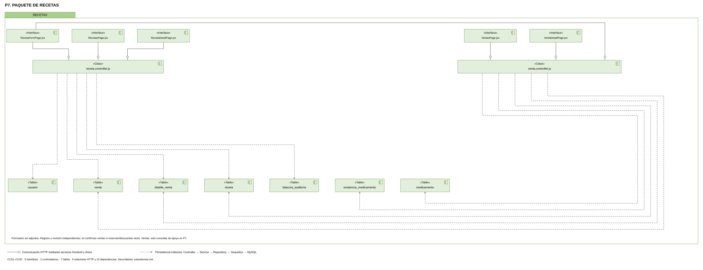

[Abrir el SVG a tamaño completo](diagrama-subsistemas/p7-recetas.svg).

**Alcance:** CU31–CU32; RF27/RF28, RN57–RN63. Registro por Regente/Vendedor; GET sensibles y revisión solo Regente. La consulta ordinaria de Ventas admite los tres roles, pero no concede acceso a datos personales de recetas. La autorización definitiva pertenece a Express.

### Interfaces, HTTP y Controllers participantes

| Interfaz real | Operación representada y Controller | Reutilización y apoyo comprobados |
|---|---|---|
| [RecetaFormPage.jsx](../../frontend/src/features/recetas/pages/RecetaFormPage.jsx) | CU31: POST `/api/ventas/:idVenta/recetas` → `receta.controller.js`. | GET de venta → `venta.controller.js` (flecha superior). Aloja [RecetaForm.jsx](../../frontend/src/features/recetas/components/RecetaForm.jsx), con selección de detalles de esa venta; sin carga de archivos. |
| [RecetasPage.jsx](../../frontend/src/features/recetas/pages/RecetasPage.jsx) | CU32: GET paginado de recetas por venta → Recetas. | Solicita en paralelo GET de venta → Ventas, para el contexto y estado; enlace al detalle. No hay listado global de recetas. |
| [RecetaDetailPage.jsx](../../frontend/src/features/recetas/pages/RecetaDetailPage.jsx) | CU32: GET individual y POST `/:idReceta/revisar` → Recetas. | GET de venta → Ventas, para estado/productos respaldados; aloja [RecetaRevisionForm.jsx](../../frontend/src/features/recetas/components/RecetaRevisionForm.jsx) y confirmación de decisión. |
| [VentasPage.jsx](../../frontend/src/features/ventas/pages/VentasPage.jsx) | Selección de venta, apoyo CU29 → Ventas. | `/recetas/registrar`, modo `registrarReceta`, Regente/Vendedor; `/recetas`, modo `revisarRecetas`, solo Regente. [VentaTable.jsx](../../frontend/src/features/ventas/components/VentaTable.jsx) enlaza al registro o listado de recetas. |
| [VentaDetailPage.jsx](../../frontend/src/features/ventas/pages/VentaDetailPage.jsx) | GET de contexto CU29 → Ventas; acceso a CU31/CU32. | Regente/Vendedor acceden al registro si pendiente; solo Regente al listado/detalle sensible. Referencias/estados ya incluidos en GET de venta; esos enlaces no llaman por sí mismos al Controller de Recetas. |

Cadena: [receta.service.js frontend](../../frontend/src/features/recetas/services/receta.service.js) → Axios común → [venta.router.js](../../backend/src/presentation/routes/venta.router.js), `authMiddleware` heredado → [receta.router.js](../../backend/src/presentation/routes/receta.router.js), `mergeParams` y `requireRole` → [receta.controller.js](../../backend/src/presentation/controllers/receta.controller.js). Apoyo real: [venta.service.js frontend](../../frontend/src/features/ventas/services/venta.service.js) → router de Ventas → [venta.controller.js](../../backend/src/presentation/controllers/venta.controller.js), **solo GET en este paquete**. Los modos/rutas React se comprueban en el router común enlazado en la introducción. No se agrega Medicamentos como Controller por mostrar productos incluidos en una respuesta de Ventas.

### Todas las tablas físicas y matriz de participación

| Tabla física | Recetas | Ventas (solo selección y contexto GET) |
|---|---|---|
| `usuario` | Autenticación previa; ID de validador asignado desde sesión, sin include del validador. | Autenticación y responsables registrador/anulador en cabecera. |
| `venta` | Referencia en consultas; bloqueo y estado pendiente en registro/revisión. No cambia su estado. | Listado y ficha de contexto. |
| `detalle_venta` | Validación de pertenencia y actualización de `id_receta` al registrar vínculos. | Detalles/productos respaldados de la ficha. |
| `receta` | Alta, consulta y decisión de revisión. | Referencias/estados en ficha, sin datos personales. |
| `bitacora_auditoria` | Registro/revisión transaccionales y consultas sensibles; rechazos/fallos pertinentes. | Rechazos/fallos pertinentes; éxito GET rutinario excluido. |
| `existencia_medicamento` | — | Include de la ficha para identificar el producto, sin consulta de saldo ni descuento. |
| `medicamento` | — | Include anidado de producto, sin proveedor/composición/principios. |

**Persistencia verificable:** [receta.service.js backend](../../backend/src/business/services/receta.service.js) → [receta.repository.js](../../backend/src/data/repositories/receta.repository.js) y [venta.repository.js](../../backend/src/data/repositories/venta.repository.js). `findParaReceta` bloquea únicamente cabecera/estado; no llama al Controller ni al Service de Ventas. Los GET de apoyo sí siguen [venta.service.js backend](../../backend/src/business/services/venta.service.js) → `findAll`/`findById` del repositorio de Ventas, cuyos includes justifican las dos tablas de productos. Usar un repositorio con métodos de confirmación no implica ejecutarlos en CU31/CU32.

- **Registro:** una transacción por receta guarda formulario, vínculos solicitados y auditoría obligatoria. Los [validators](../../backend/src/business/validators/receta.validator.js) rechazan campos extra, archivos y datos de revisión; IDs positivos sin duplicados, si se envían. El Service exige venta pendiente y detalles propios sin receta; exige vincular todos o revierte el POST. Omitir `idsDetallesVenta` crea una receta de la venta sin respaldar automáticamente ningún detalle. El formulario omite ese campo si no se selecciona ninguno. Siempre inicia con resultado/validador/fecha de revisión NULL, incluso si registra el Regente.
- **Consulta:** listado/resumen sin datos personales; detalle autorizado con paciente, documento, médico y observación. [receta.dto.js](../../backend/src/presentation/dtos/receta.dto.js) no expone archivos legados; respuestas exitosas `Cache-Control: no-store`. Cada GET de recetas usa snapshot `REPEATABLE READ`; su evento sensible se intenta registrar después, sin copiar datos personales. Los GET paralelos de venta y receta son solicitudes independientes, no un snapshot único de la pantalla.
- **Revisión:** otra transacción bloquea venta pendiente y receta de esa venta; resultado/validador/fecha deben seguir NULL. Guarda una única decisión `APROBADA` o `RECHAZADA`, responsable autenticado, fecha comercial posterior a bloqueos, observación y auditoría. Omisión de observación conserva la anterior; NULL la elimina. Rechaza nueva revisión o estado inconsistente. No exige tener ya detalles vinculados.
- **Separación de operaciones:** alta de venta+detalles (P6), cada registro de receta+vínculos, revisión y confirmación posterior son transacciones distintas. Un fallo de receta no revierte una venta pendiente previamente guardada. Registrar o aprobar **no confirma, no reserva/descuenta stock ni genera movimientos**. Solo la confirmación del Vendedor en P6 aplica RN58/FEFO; por ello `movimiento_inventario` no participa en los recorridos de P7.

**Columna legada, no adjunto:** [receta.js](../../backend/src/data/models/receta.js) admite `archivo_receta` NULL. La [migración original](../../backend/src/data/database/migrations/20260914035842-create-receta.js) la creó NOT NULL; [20261101120000-allow-null-receta-archivo.js](../../backend/src/data/database/migrations/20261101120000-allow-null-receta-archivo.js) cambia únicamente nulabilidad y conserva referencias históricas. `down` rechaza NULL en lugar de inventar referencias o borrar recetas. Nuevas altas escriben NULL; no se reciben ni sirven imágenes/PDF, no hay almacenamiento de archivos. Se inspeccionó el DDL, **no se ejecutó**: su aplicación en el entorno de uso no está acreditada.

**Selección y simplificaciones (§5.2 de fases.md):** 5 interfaces, 2 Controllers, 7 tablas; 6 relaciones HTTP y 10 dependencias dibujadas. Recetas → sus cinco tablas; Ventas → venta/detalle/receta/existencia/medicamento. Solo se resumen flechas transversales Ventas → usuario/bitácora, explícitas en la matriz. GET de venta desde RecetasPage/RecetaDetailPage queda textual: se representa desde RecetaFormPage que reutiliza el mismo servicio. Formularios, confirmaciones y tablas React se agrupan en sus páginas; no se omiten Controllers ni tablas. Las acciones de confirmar/anular de VentaDetailPage quedan fuera de P7 y conservadas en P6. No se inventan tablas de paciente, médico, archivo ni vínculos: estos últimos residen en `detalle_venta.id_receta`.

**Límites:** esta revisión documental no certifica ejecución funcional, aplicación de migraciones ni entorno desplegado. No se afirma idempotencia del POST de recetas; ante resultado incierto se consulta antes de repetir.

## P8. PAQUETE DE VENCIMIENTOS Y RETIROS

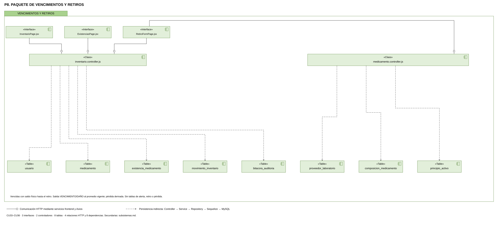

[Abrir el SVG a tamaño completo](diagrama-subsistemas/p8-vencimientos-retiros.svg).

**Alcance:** CU33–CU36; RF30–RF33, RN29/RN85–RN95/RN103–RN104. Consultas de próximos/vencidos para Administrador/Regente; registro de retiros solo Regente. Daño y vencimiento siguen siendo operaciones distintas aunque compartan implementación.

### Interfaces y correspondencias HTTP

| Interfaz real | CU/operación → Controller | Apoyo y componentes compartidos |
|---|---|---|
| [InventarioPage.jsx](../../frontend/src/features/inventario/pages/InventarioPage.jsx) | CU33: `vista="proximos"`, `/vencimientos`; CU34: `vista="vencidos"`, `/vencimientos/vencidos` → `inventario.controller.js`. | GET `/api/inventario/proximos-a-vencer` y `/vencidos`. Una sola caja por archivo, no una página ficticia por vista. |
| [ExistenciasPage.jsx](../../frontend/src/features/inventario/pages/ExistenciasPage.jsx) | CU22 preparatorio de CU35/CU36 → Inventario. | [ExistenciasTable.jsx](../../frontend/src/features/inventario/components/ExistenciasTable.jsx) enlaza a retiros; también se aloja en la consulta de vencidos. GET de ficha → Medicamentos. |
| [RetiroFormPage.jsx](../../frontend/src/features/inventario/pages/RetiroFormPage.jsx) | CU35/CU36: POST `/api/inventario/retiros/vencimiento` o `/dano` → Inventario. | Al abrir/reconsultar obtiene CU22 fresco y ficha → `medicamento.controller.js` (flecha superior). Aloja [RetiroForm.jsx](../../frontend/src/features/inventario/components/RetiroForm.jsx) y [RetiroResultado.jsx](../../frontend/src/features/inventario/components/RetiroResultado.jsx). |

Cadena: [inventario.service.js frontend](../../frontend/src/features/inventario/services/inventario.service.js) → Axios → [inventario.router.js](../../backend/src/presentation/routes/inventario.router.js), autenticación/roles → [inventario.controller.js](../../backend/src/presentation/controllers/inventario.controller.js). Preparación: [consultaExistencia.js](../../frontend/src/features/inventario/utils/consultaExistencia.js) → `getExistenciasMedicamento`, que hace **dos GET**: CU22 y [medicamento.service.js frontend](../../frontend/src/features/medicamentos/services/medicamento.service.js) → [medicamento.router.js](../../backend/src/presentation/routes/medicamento.router.js) → [medicamento.controller.js](../../backend/src/presentation/controllers/medicamento.controller.js). Sus permisos de consulta no conceden permiso para registrar un retiro.

### Todas las tablas físicas y matriz de participación

| Tabla física | Inventario (CU33–CU36 y preparación CU22) | Medicamentos (solo ficha auxiliar) |
|---|---|---|
| `usuario` | Autenticación previa; responsable autenticado del movimiento. | Autenticación previa. |
| `medicamento` | Consulta de identificación, actividad y existencias; no lo actualiza el retiro. | Ficha. |
| `existencia_medicamento` | Fechas/precisión, saldo, costo; bloqueo y reducción física en retiro. | — |
| `movimiento_inventario` | Último ID en CU22; lectura bloqueante de último movimiento y nueva SALIDA. | — |
| `bitacora_auditoria` | Retiro obligatorio dentro de su transacción; rechazos/fallos pertinentes, no éxito GET rutinario. | Rechazos/fallos pertinentes, no éxito GET rutinario. |
| `proveedor_laboratorio` | — | Include de ficha. |
| `composicion_medicamento` | — | Include de ficha. |
| `principio_activo` | — | Include de ingredientes de la ficha. |

**Persistencia:** [inventario.service.js backend](../../backend/src/business/services/inventario.service.js) → [existencia-medicamento.repository.js](../../backend/src/data/repositories/existencia-medicamento.repository.js) y [movimiento-inventario.repository.js](../../backend/src/data/repositories/movimiento-inventario.repository.js). No hay Repository de Inventario ni Controller de retiros separado. La ficha sigue [medicamento.service.js backend](../../backend/src/business/services/medicamento.service.js) → [medicamento.repository.js](../../backend/src/data/repositories/medicamento.repository.js), `findById` con proveedor/composición/principio, sin bloqueo de escritura.

- **CU33:** saldo físico positivo, no vencida y etiqueta normalizada entre fecha comercial y tres meses **calendario** inclusive, no 90 días. Para MES, la etiqueta normalizada es el último día del mes, distinta del corte efectivo de no venta. **CU34:** saldo físico positivo y vencida. Ambas consultas incluyen medicamentos inactivos cuando cumplen sus condiciones; no modifican saldos.
- **DIA/MES y físico/vendible:** [vencimiento.js](../../backend/src/shared/utils/vencimiento.js) usa `America/La_Paz`; DIA deja de ser vendible al inicio de su fecha, MES al inicio del primer día del mes siguiente. No reescribe DATE histórico para calcularlo. El vencimiento no pone saldo en cero; una existencia vencida puede seguir físicamente hasta su retiro. Medicamento inactivo tampoco aporta stock vendible.
- **Preparación y concurrencia:** CU22 proyecta saldo y `MAX(id_movimiento)` en el mismo SELECT, sin columna nueva. La pantalla de retiro vuelve a consultarlos; no reutiliza precondiciones de la alerta. En cada POST, `ejecutarRetiro` abre una transacción (T20), bloquea existencia y último movimiento mediante `findByIdParaMovimiento`/`findUltimoIdParaExistencia`, compara `stockObservado` y `ultimoMovimientoObservado` (incluido NULL), y luego obtiene el instante comercial. Un historial distinto se rechaza aunque el saldo coincida otra vez. Los [validators](../../backend/src/business/validators/inventario.validator.js) exigen cuerpo estricto, cantidad entera positiva y precondiciones, sin query/costo/motivo/fecha/responsable enviados por el cliente.
- **CU35/CU36:** saldo suficiente sin negativos; CU35 exige vencida y observación opcional; CU36 exige observación del daño, no vencimiento. Ambos admiten medicamento inactivo y CU36 existencia vencida. Saldo reducido, SALIDA `VENCIMIENTO` o `DAÑO`, costo y auditoría obligatoria se confirman juntos. Cualquier fallo revierte la operación. El promedio vigente (seis decimales, incluso cero) se aplica y conserva, también al agotar el saldo. Responsable/fecha los fija el servidor; referencias de detalle de compra/venta y movimiento original quedan NULL.
- **Pérdida derivada:** cantidad × costo aplicado histórico, aritmética exacta BigInt y presentación a dos decimales con empate hacia arriba. No es una columna ni hereda un límite DECIMAL de un importe no persistido. No se recalculan históricos con el costo actual ni se mezclan con ajustes negativos. El retiro cuenta como posterior para RN76, pero no ejecuta anulación de compra ni consulta sus tablas. El reporte agregado de pérdidas corresponde a P10, incorporado abajo en Fase 4.

**Selección y simplificaciones (§5.2):** 3 interfaces, 2 Controllers, 8 tablas; 4 relaciones HTTP y 8 dependencias dibujadas. Inventario → sus cinco tablas; Medicamentos → proveedor/composición/principio. Solo se resumen Medicamentos → medicamento/usuario/bitácora y el GET de ficha desde ExistenciasPage, explícitos en las matrices y dibujado este último desde RetiroFormPage mediante el servicio compartido. La composición React de tablas/formularios/resultados no es una relación HTTP. Enlaces al historial o ficha completa son navegación a P4/P3; no ejecutan aquí exportación ni `getMovimientos`. Por tanto no se agregan `detalle_compra`, `detalle_venta`, cabeceras ni Controller de Exportación por los otros métodos disponibles en los mismos archivos.

**Límites:** no existen tablas `vencimiento`, `retiro`, `perdida` o `alerta`. No se implementa reversión operativa de retiros, no se cambia actividad/vencimiento y no se crea existencia. Ante conflicto o resultado incierto la interfaz exige reconsulta, sin reintento automático ni garantía de idempotencia. No se certificó ejecución funcional ni esquema desplegado.

## P9. PAQUETE DE STOCK BAJO

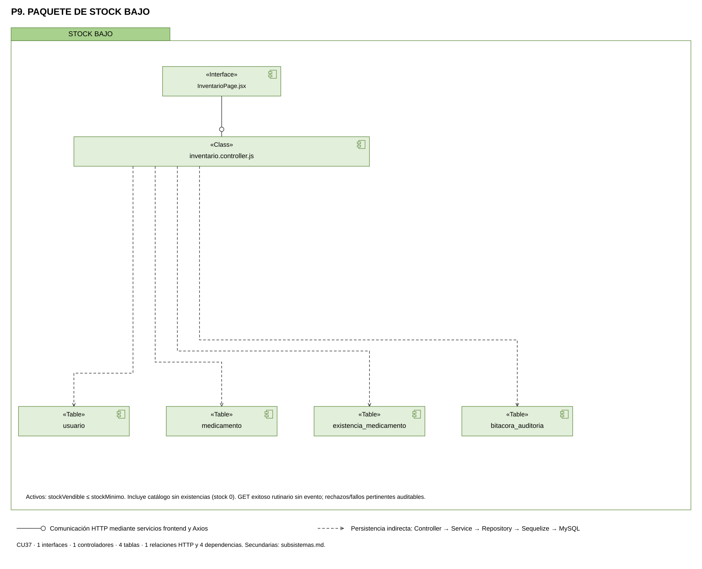

[Abrir el SVG a tamaño completo](diagrama-subsistemas/p9-stock-bajo.svg).

**Alcance:** CU37; RF34, RN28–RN32/RN93/RN96. Consulta para Administrador, Regente y Vendedor; no es registro de alerta, reposición automática ni operación de compra.

### Interfaz real y cadena comprobada

[InventarioPage.jsx](../../frontend/src/features/inventario/pages/InventarioPage.jsx), `vista="stockBajo"`, atiende `/inventario/stock-bajo`. Reutiliza filtros, metadatos de fecha/zona y [InventarioTable.jsx](../../frontend/src/features/inventario/components/InventarioTable.jsx) con `stockBajo`; no existe `StockBajoPage.jsx`. [inventario.service.js frontend](../../frontend/src/features/inventario/services/inventario.service.js), `getStockBajo` → Axios → GET `/api/inventario/stock-bajo` → [inventario.router.js](../../backend/src/presentation/routes/inventario.router.js), auth/roles → [inventario.controller.js](../../backend/src/presentation/controllers/inventario.controller.js), `getStockBajo` → [inventario.service.js backend](../../backend/src/business/services/inventario.service.js) → [existencia-medicamento.repository.js](../../backend/src/data/repositories/existencia-medicamento.repository.js), `findInventario`. No se llama al Controller HTTP de Medicamentos por consultar su modelo.

### Todas las tablas físicas y relaciones

| Tabla física | Justificación de cada dependencia dibujada desde Inventario |
|---|---|
| `usuario` | Cuenta activa/versión de credenciales mediante autenticación previa. No carga `rol`. |
| `medicamento` | Catálogo, actividad y `stock_minimo`, más filtros por ID/código/nombre. |
| `existencia_medicamento` | LEFT JOIN (`required: false`) de saldos y vencimientos DIA/MES para calcular vendible. No requiere movimientos. |
| `bitacora_auditoria` | Solo rechazos/fallos pertinentes mediante infraestructura transversal; el éxito GET rutinario está excluido. No persiste el resultado como alerta. |

**Criterio exacto:** `getStockBajo` conserva medicamentos activos con **`stockVendible <= stockMinimo`**, incluida igualdad. El stock vendible suma saldos de existencias no vencidas del medicamento activo; excluye las vencidas sin borrar su saldo físico. `findInventario` sin `soloConExistencias` también devuelve productos sin ninguna existencia, cuyo stock resulta 0 y que se incluyen si cumplen el mínimo. En contraste, `getInventario` general (CU21/P4) pasa `soloConExistencias: true`, exige al menos una existencia registrada, pero no saldo positivo ni movimientos/compras. No se aplica ese requisito a CU37. No se consulta proveedor, composición, principio, movimiento ni detalles/cabeceras por FK o por enlaces a otras pantallas.

**Selección y límites:** 1 interfaz, 1 Controller, 4 tablas; 1 relación HTTP y 4 dependencias, todas dibujadas, sin flechas secundarias omitidas. Componentes internos de filtros/tabla/nav, hooks y Axios se resumen en la página. Los enlaces de sus filas navegan a P4 y no añaden sus peticiones al GET de stock bajo. No hay tabla `stock_bajo` ni `alerta`, notificaciones automáticas ni snapshot compartido entre solicitudes independientes. No se realizó aceptación funcional o productiva.

### Evidencia común y alcance acumulado de Fase 3

Los nombres físicos de **todas** las tablas de P7–P9 se contrastan con `tableName` en sus modelos y su creación en las migraciones enlazadas en P3/Fase 2: `usuario`, `venta`, `detalle_venta`, `receta`, `medicamento`, `existencia_medicamento`, `movimiento_inventario`, `proveedor_laboratorio`, `composicion_medicamento`, `principio_activo` y `bitacora_auditoria`. No hay tablas adicionales nuevas. La creación de Bitácora usa SQL `CREATE TABLE`, también comprobado. La migración de nulabilidad de receta se inspecciona como complemento, no se aplica.

Autenticación: [auth.middleware.js](../../backend/src/presentation/middlewares/auth.middleware.js) → [auth.service.js](../../backend/src/business/services/auth.service.js) → [usuario.repository.js](../../backend/src/data/repositories/usuario.repository.js). Auditoría: fuentes transversales enlazadas en P3 → [bitacora-auditoria.service.js](../../backend/src/business/services/bitacora-auditoria.service.js) → [bitacora-auditoria.repository.js](../../backend/src/data/repositories/bitacora-auditoria.repository.js), con eventos y exclusiones de [bitacora-auditoria.md](bitacora-auditoria.md). No se añaden Controllers de Auth, Usuarios o Bitácora por esos servicios. Los GET sensibles de Recetas sí auditan éxitos; los de Inventario, Stock bajo, ficha de Medicamentos y Ventas no, sin excluir rechazos/fallos pertinentes.

**Compartidos, sin fusionar paquetes:** P7 comparte VentasPage/VentaDetailPage y Controller de Ventas con P6; P8/P9 comparten InventarioPage y Controller de Inventario con P4, y P8 añade ExistenciasPage y ficha de Medicamentos. `usuario`/`bitacora_auditoria` aparecen en los tres paquetes; `medicamento`/`existencia_medicamento` también, por motivos distintos indicados en sus matrices. Reutilización de Services/Repositories no añade Controllers ni una cuarta fila.

**Fuentes y límites académicos:** [contexto maestro](contexto-maestro.md) §4.11 y contratos vigentes de Inventario; [CU31–CU37](casos-uso.md), [RF27/RF28/RF30–RF34](requerimientos.md), [reglas](reglas-negocio.md) RN57–RN63/RN85–RN96/RN103–RN104 y [transacciones](transacciones.md) T20/T24 y aclaración de alcance histórico. Este inventario no desarrolla las aperturas actuales de Recetas; se comprobaron directamente en su Service, no se inventan traducciones SQL. El [análisis académico simplificado](analisis-clases-academico-simplificado.md), bloques CU31/CU32, CU33–CU36 y CU37, respalda la colaboración, no sustituye Controllers HTTP por agrupaciones BCE. Se conserva la limitación del apartado académico independiente «3.1 Análisis de arquitectura», no localizado en `docs/`; no se inventa contenido. Las antiguas notas de estado/atomicidad no prevalecen sobre decisiones actuales y código. No se modifican documentos académicos fuera de alcance.

**Cierre histórico de Fase 3:** nueve SVG P1–P9, CU01–CU37, con evidencia real en [fases.md](fases.md). Se conservaron los seis SVG anteriores y los cierres históricos. P10–P11 y el resumen final estaban pendientes en aquel cierre. Comprobación estática documental con Node.js/.NET, no navegador, pruebas funcionales, MySQL ni despliegue.

## P10. PAQUETE DE REPORTES Y CONSULTAS

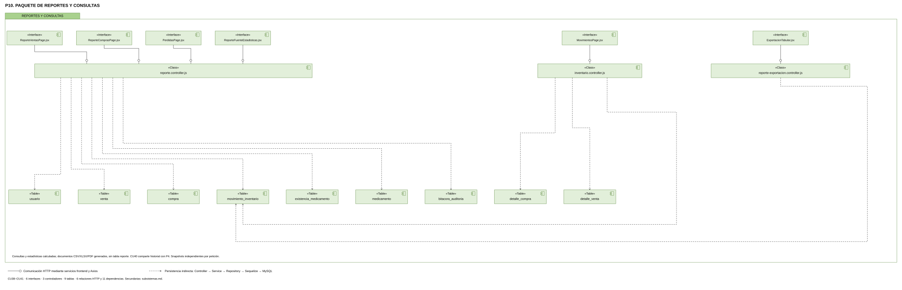

[Abrir el SVG a tamaño completo](diagrama-subsistemas/p10-reportes-consultas.svg).

**Alcance:** CU38–CU41, **incluido CU40**; RF35–RF38, RN91/RN97–RN101. Ventas/compras solo Administrador; pérdidas e historial Administrador/Regente. Vendedor no accede. El permiso operativo del Regente en Compras no concede CU39. Son consultas dinámicas, agregados estadísticos y documentos de presentación fija generados a demanda, no registros de una entidad Reporte ni casos de uso adicionales.

### Interfaces y correspondencias HTTP

| Interfaz real | CU/operación y Controller | Componentes compartidos y límites |
|---|---|---|
| [ReporteVentasPage.jsx](../../frontend/src/features/reportes/pages/ReporteVentasPage.jsx) | CU38: GET `/api/reportes/ventas` → `reporte.controller.js`. | Delega a [ReporteOperacionesConsulta.jsx](../../frontend/src/features/reportes/components/ReporteOperacionesConsulta.jsx); consulta, paginación, estadísticas y exportación. |
| [ReporteComprasPage.jsx](../../frontend/src/features/reportes/pages/ReporteComprasPage.jsx) | CU39: GET `/api/reportes/compras` → Reportes. | Mismo coordinador, distinto servicio/resultado; no consulta proveedores para mostrar su ID. |
| [PerdidasPage.jsx](../../frontend/src/features/reportes/pages/PerdidasPage.jsx) | CU41: GET `/api/reportes/perdidas` → Reportes. | Resumen completo, detalle paginado y referencia eventual de reversión, sin registrar retiros/reversiones. |
| [ReporteFuenteEstadisticas.jsx](../../frontend/src/features/reportes/components/ReporteFuenteEstadisticas.jsx) | CU38/CU39/CU41: GET `/api/reportes/{ventas\|compras\|perdidas}/estadisticas` → Reportes. | Una caja por archivo compartido; [ReporteEstadisticas.jsx](../../frontend/src/features/reportes/components/ReporteEstadisticas.jsx) presenta tabla/gráficas sin otra petición. No estadísticas de CU40. |
| [MovimientosPage.jsx](../../frontend/src/features/inventario/pages/MovimientosPage.jsx) | CU40 = CU24/P4: GET `/api/inventario/movimientos` → `inventario.controller.js`. | Misma página/ruta `/inventario/movimientos`, aunque se acceda desde Reportes; no se duplica ni fusiona P4/P10. |
| [ExportacionTabular.jsx](../../frontend/src/features/reportes/components/ExportacionTabular.jsx) | Cuatro fuentes: GET `/api/reportes/{ventas\|compras\|perdidas}/exportar` o `/api/inventario/movimientos/exportar` → `reporte-exportacion.controller.js`. | Comparte TABULAR/ESTADISTICA pese a su nombre; CU40 solo TABULAR. Aloja selección PDF/XLSX/CSV; no tres Controllers por formato. |

Cadena comprobada: [reporte.service.js frontend](../../frontend/src/features/reportes/services/reporte.service.js) y [inventario.service.js frontend](../../frontend/src/features/inventario/services/inventario.service.js) → [Axios](../../frontend/src/api/api.js), cookie HttpOnly → routers de [Reportes](../../backend/src/presentation/routes/reporte.router.js) e [Inventario](../../backend/src/presentation/routes/inventario.router.js), `authMiddleware`/`requireRole` → Controllers de [Reportes](../../backend/src/presentation/controllers/reporte.controller.js), [Exportación](../../backend/src/presentation/controllers/reporte-exportacion.controller.js) e [Inventario](../../backend/src/presentation/controllers/inventario.controller.js). Los siete endpoints de estadísticas/exportaciones rechazan HEAD con 405 después de autorización, sin ejecutar consultas/generación. Las descargas usan [descargaBinaria.js](../../frontend/src/utils/descargaBinaria.js) con Blob y validación de transporte, no JSON/base64.

### Todas las tablas físicas, por rama efectiva

Las columnas de datos **excluyen** autenticación/auditoría, detalladas en las dos últimas filas. «Tabular» incluye GET paginado y extracción completa salvo indicación; las asociaciones citadas son las realmente cargadas, no todas las FK del modelo.

| Tabla física | Reportes: ventas/compras | Reportes: pérdidas | Inventario: GET CU40 | Exportación |
|---|---|---|---|---|
| `venta` | Solo CU38: cabeceras para página/resumen/estadísticas. | — | — | VENTAS tabular/estadística, solo cabeceras. |
| `compra` | Solo CU39: cabeceras para página/resumen/estadísticas. | — | — | COMPRAS tabular/estadística, solo cabeceras. |
| `movimiento_inventario` | — | Originales: resumen/series sin JOIN; detalle con autoasociación `movimientoReversion`. | Originales y reversiones del historial; autoasociación a eventual reversión. | PERDIDAS: mismos criterios; autoasociación solo tabular. MOVIMIENTOS: historial, conteo y autoasociación. |
| `existencia_medicamento` | — | Solo detalle, include `existencia`. No estadísticas ni agregado. | Include requerido, filtro de medicamento. | PERDIDAS solo tabular; MOVIMIENTOS conteo/bloques. |
| `medicamento` | — | Solo detalle, include anidado de existencia. | Include anidado de existencia. | PERDIDAS solo tabular; MOVIMIENTOS include anidado también en conteo. |
| `detalle_compra` | — | — | Include `detalleCompra`, referencia `id_compra`; no cabecera. | Solo MOVIMIENTOS, bloques tabulares. |
| `detalle_venta` | — | — | Include `detalleVenta`, referencia `id_venta`; no cabecera ni receta. | Solo MOVIMIENTOS, bloques tabulares. |
| `usuario` | Autenticación previa de ambos CU; sin JOIN a responsables del reporte. | Autenticación previa; `id_usuario` del retiro no provoca include. | Autenticación y include del responsable. | Autenticación en las cuatro fuentes; solo MOVIMIENTOS carga además nombre del responsable. |
| `bitacora_auditoria` | Consulta/estadística sensible posterior; rechazos/fallos pertinentes. | Igual política sensible posterior. | Solo rechazos/fallos pertinentes, no éxito GET rutinario. | Terminal único de exportación; rechazos/fallos previos transversales. |

**Fundamento de cada rama:** [reporte.service.js backend](../../backend/src/business/services/reporte.service.js) → [reporte.repository.js](../../backend/src/data/repositories/reporte.repository.js), [reporte.criterios.js](../../backend/src/data/repositories/reporte.criterios.js), [reporte.materializacion.js](../../backend/src/business/services/reporte.materializacion.js) y [reporte.estadisticas.js](../../backend/src/business/services/reporte.estadisticas.js). Ventas/compras no leen detalles, proveedor ni recetas. Llevar `idProveedorLaboratorio` en la proyección de `compra` no consulta `proveedor_laboratorio`. Pérdidas no carga usuario ni detalles de origen por contener IDs de esas tablas. No se añaden Controllers de Compras/Ventas/Medicamentos: esos datos llegan por Reportes, no por peticiones HTTP auxiliares.

CU40 sigue [inventario.service.js backend](../../backend/src/business/services/inventario.service.js), `getMovimientos`/`toPublicMovimiento` → [movimiento-inventario.repository.js](../../backend/src/data/repositories/movimiento-inventario.repository.js), **solo `findAll`**. Este método carga las seis tablas de datos de su columna, no las cabeceras que otros métodos del mismo archivo consultan para anulaciones. Filtros opcionales por medicamento/existencia/desde/hasta/dirección/motivo; límites temporales abiertos admitidos y motivo textual, no enum. Respuesta `{ data: movimientos }` sin paginación, con observación y DTO anidado. Sus filtros son campos/IDs, sin peticiones de catálogos auxiliares. Los enlaces a operaciones/fichas son navegación fuera de estos flujos.

Exportación sigue [reporte.exportacion.service.js](../../backend/src/business/services/reporte.exportacion.service.js) → [reporte.extraccion.repository.js](../../backend/src/data/repositories/reporte.extraccion.repository.js) para TABULAR, o `reporteRepository.estadisticas*` para ESTADISTICA. `resumen`/`bloque` reutilizan criterios; no ejecutan Services/Controllers de Compras/Ventas ni `inventarioController`. MOVIMIENTOS cuenta con existencia/medicamento y extrae bloques con usuario/detalles/reversión; no carga cabeceras. Los nombres físicos de las **nueve tablas** coinciden con modelos y migraciones enlazados en P3 y en la evidencia común de Fase 2; no hay tabla `reporte`, `perdida`, documento ni estadística.

### Datos persistidos, cálculo y consistencia

- **CU38:** estado actual en snapshot, cuatro categorías disjuntas. CONFIRMADA y ANULADA_CONFIRMADA usan fecha de confirmación; PENDIENTE y ANULADA_SIN_CONFIRMAR, fecha de registro. Se suma el total histórico de cabecera; realizado = solo confirmadas. Una anulación posterior puede reclasificar el pasado; no es reconstrucción de cierre contable ni flujo negativo a fecha de anulación.
- **CU39:** período por `fecha_compra` de adquisición, no registro/anulación. Conteos/importes históricos separados para confirmadas/anuladas; realizado = solo confirmadas, sin volver a restar anuladas ni recalcular costos/detalles.
- **CU41/RN91:** solo originales `SALIDA`, motivo `VENCIMIENTO`/`DAÑO`, `id_movimiento_original IS NULL`, por fecha de movimiento. Excluye ajustes negativos, ventas y compensaciones; no excluye inactivos/agotados/vencidos actuales. Costo aplicado histórico a seis decimales, incluido cero; **no promedio actual**. SQL `SUM(ROUND(cantidad × costo_unitario_aplicado, 2))` y detalle BigInt con empate arriba redondean **por movimiento antes de sumar**: dos retiros de 1 × 0.005000 suman 0.02. Resumen por motivo y global: retiros, unidades e importe; costo cero sigue contando retiros/unidades. Cantidades agregadas son cadenas exactas, sin equivalencia farmacéutica entre productos. La reversión eventual, incluso fuera del período, se informa sin restarla: pérdida **bruta**, no neta, sin habilitar reversión operativa. Catálogo/códigos mostrados son actuales del snapshot; costo/cantidad/fecha vienen del movimiento histórico.
- GET CU38/CU39/CU41: día, mes o período cerrado explícito; resumen/total completo y detalle paginado 25/máximo 100, vacío 200 con ceros, página lejana vacía sin reajuste. Fechas civiles America/La_Paz; DATETIME(0) persistido no acredita fracciones aunque el filtro cubra todo el día. Estadística independiente DIA/MES/ANIO: agregados, intervalos, series/distribuciones exactas con ceros, máximo 1200 intervalos; no ganancias/pronósticos ni nuevos CU.
- Cada GET de Reportes tiene snapshot `REPEATABLE READ` para resumen/página o agregado/series. Cada descarga tiene **otro** snapshot común a agregados, bloques y relaciones; keyset hasta 1000 por bloque, spool conciliado, cierre de lectura antes de renderizar. No hay snapshot compartido entre pantalla, estadísticas, otra página y descarga. **CU40 GET no abre una transacción RR nueva**: conserva su consulta previa; su exportación sí usa el pipeline RR. No se escriben datos de negocio ni se reconstruyen saldos.

### Documentos, permisos, auditoría y disponibilidad

[reporte.plantillas.js](../../backend/src/business/services/reporte.plantillas.js) proyecta datos; los generadores [CSV](../../backend/src/shared/utils/reporte-csv.js), [XLSX](../../backend/src/shared/utils/reporte-xlsx.js) y [PDF](../../backend/src/shared/utils/reporte-pdf.js), más las variantes estadísticas y [gráfica](../../backend/src/shared/utils/reporte-grafica.js), son helpers, **no Controllers ni tablas**. TABULAR exporta todas las coincidencias, no la página; CU40 proyección plana sin observación ni resumen monetario, solo conteo. ESTADISTICA incluye todas las métricas y ceros, no detalle operativo; PDF/XLSX incrustan PNG y tabla exacta, CSV solo datos. Son 21 combinaciones, no 21 endpoints. Los temporales no son persistencia de reportes ni URL pública.

El Controller de Exportación valida antes de generar, envía archivo terminado con MIME/attachment/longitud y comprueba `writableFinished`/bytes antes del terminal EXITO `FINALIZADA_SERVIDOR`; esto **no demuestra recepción, guardado o apertura del usuario**. Timeout/cancelación/error posterior a headers destruye transporte, sin segundo JSON. [useExportacionTabular.js](../../frontend/src/features/reportes/hooks/useExportacionTabular.js) y la recepción Blob manejan vigencia/cancelación sin retry automático ni promesa de detener SQL.

La auditoría usa el Service de Bitácora, no su Controller: GET sensibles después de materializar/cerrar lectura (`cantidadResultados`); estadísticas después de conciliar (`granularidad`/`cantidadIntervalos`); descarga un terminal único, no eventos por bloque/documento/panel. No guarda filas, importes, filtros/query crudos ni rutas temporales. Fallo exclusivo del auditor conserva resultado/archivo y diagnóstico sanitizado, sin prometer persistencia ni reintento. CU40 GET sigue excluyendo éxitos rutinarios.

Guardas reales: [reporte-archivos.js](../../backend/src/shared/utils/reporte-archivos.js) para LOCAL development/socket loopback/recursos y temporal externo; [reporte-railway.js](../../backend/src/shared/utils/reporte-railway.js) para production + RAILWAY opt-in, una réplica declarada, Linux/metadatos, cgroup/margen RAM/disco y temporal privado; [reporte-plazo-sql.js](../../backend/src/data/repositories/reporte-plazo-sql.js) aplica controles de sesión solo en exportación Railway (MySQL 8 o **9.7.4 exacto**, no todas las versiones 9), restauración/descarte seguro. Perfil/recursos no acreditados → 503, ocupado sin cola → 503, límite → 413 sin truncado. Un trabajo por proceso incluida entrega; 128 MiB final/512 MiB trabajo, límites de filas/páginas/intervalos y plazos cooperativos. No reserva de recursos, exclusión distribuida ni deadline duro de red/SQL. Contratos y pendientes completos: [contratos-reportes-react.md](contratos-reportes-react.md) y [exportaciones-railway.md](exportaciones-railway.md). No se comprobó disponibilidad del despliegue ni entrega efectiva de descargas.

**Selección y simplificaciones (§5.2 de fases.md):** 6 interfaces, 3 Controllers, 9 tablas; 6 relaciones HTTP y 11 dependencias dibujadas. Reportes → sus siete tablas; Inventario → movimiento/detalle_compra/detalle_venta; Exportación → movimiento. Se resumen **solo** Inventario → usuario/existencia/medicamento/bitácora y Exportación → usuario/venta/compra/existencia/medicamento/detalles/bitácora, todas justificadas por rama en la matriz. La flecha principal de Exportación representa la rama compartida de movimientos/pérdidas, no atribuye movimientos a ventas/compras. Las cuatro páginas delegan estadísticas/exportación en las dos cajas compartidas: no se dibuja composición React ni se duplican esas conexiones desde cada anfitrión. Filtros/resultados/hooks/formatos quedan internos, sin cuarta fila ni omisión de Controllers/tablas. P4/P10 siguen separados.

## P11. PAQUETE DE BITÁCORA

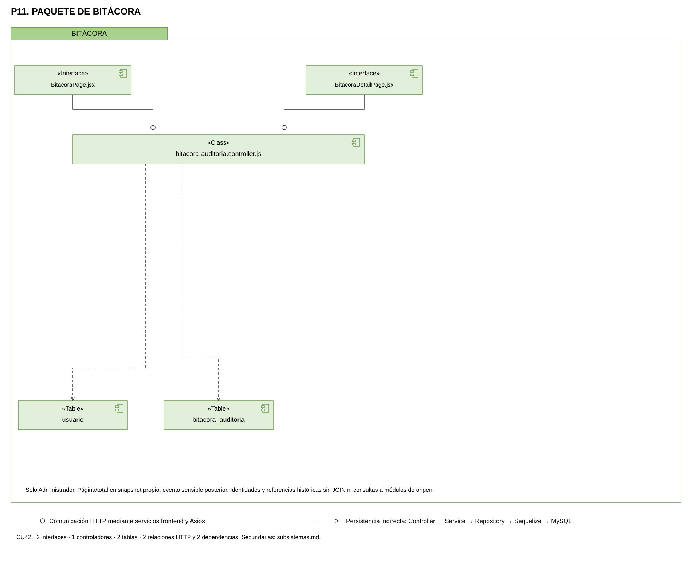

[Abrir el SVG a tamaño completo](diagrama-subsistemas/p11-bitacora.svg).

**Alcance:** CU42; RF50–RF53, RI16/RNF18–RNF22, RN117–RN128/RN130–RN133. Solo Administrador, comprobado en backend en ambos GET. La captura automática transversal de los demás CU no se convierte en otro objetivo manual ni se repiten todas sus pantallas.

### Interfaces, HTTP y tablas efectivas

| Interfaz real | Responsabilidad y petición |
|---|---|
| [BitacoraPage.jsx](../../frontend/src/features/bitacora/pages/BitacoraPage.jsx) | `/bitacora`: GET `/api/bitacora`; listado, filtros con Buscar y páginas del servidor. Resume [BitacoraFilters.jsx](../../frontend/src/features/bitacora/components/BitacoraFilters.jsx), [BitacoraTable.jsx](../../frontend/src/features/bitacora/components/BitacoraTable.jsx) y [BitacoraPagination.jsx](../../frontend/src/features/bitacora/components/BitacoraPagination.jsx). |
| [BitacoraDetailPage.jsx](../../frontend/src/features/bitacora/pages/BitacoraDetailPage.jsx) | `/bitacora/:idEvento`: GET `/api/bitacora/:idEvento` **sin query**. Conserva criterios solo para retorno visual; resume datos, cambios y referencias permitidos. |

Cadena: [bitacora.service.js frontend](../../frontend/src/features/bitacora/services/bitacora.service.js) → Axios común → [bitacora-auditoria.router.js](../../backend/src/presentation/routes/bitacora-auditoria.router.js), auth/Administrador → **único Controller** [bitacora-auditoria.controller.js](../../backend/src/presentation/controllers/bitacora-auditoria.controller.js) → [bitacora-auditoria.service.js](../../backend/src/business/services/bitacora-auditoria.service.js) → [bitacora-auditoria.repository.js](../../backend/src/data/repositories/bitacora-auditoria.repository.js). El [validator](../../backend/src/business/validators/auditoria.validator.js) valida filtros/ID/query; [DTO](../../backend/src/presentation/dtos/bitacora-auditoria.dto.js) proyecta campos explícitos. No hay selector remoto de usuarios/roles ni otra consulta HTTP auxiliar: filtros de ID son entradas, opciones de eventos/módulos son constantes locales. Enlace a evento relacionado ejecuta el mismo GET autorizado al navegar.

| Tabla física | Dependencia dibujada y evidencia |
|---|---|
| `usuario` | Solo autenticación previa: `authMiddleware` → `authService.getSessionUsuario` → `usuarioRepository.findByIdForSession`. Cuenta activa/versión, sin include `rol`; no reconstruye identidades históricas. [Modelo](../../backend/src/data/models/usuario.js), [migración](../../backend/src/data/database/migrations/20260914035802-create-usuario.js). |
| `bitacora_auditoria` | `findAll`/`count` y `findById`, más INSERT del evento sensible posterior y rechazos/fallos pertinentes. [Modelo](../../backend/src/data/models/bitacora-auditoria.js), [migración SQL](../../backend/src/data/database/migrations/20261013120000-create-bitacora-auditoria.js); nombre físico coincidente, sin asociaciones/FK/cascadas. |

**Filtros y páginas:** desde/hasta por `fecha_registro`, extremos inclusivos con zona explícita; igualdad por responsable/cuenta objetivo, nombre ingresado, IP normalizada, módulo, acción, tipoEvento, resultado, tipoRegistro/idRegistro (ID requiere tipo). [consultaBitacora.js](../../frontend/src/features/bitacora/utils/consultaBitacora.js) aplica borrador con Buscar y conserva criterios en URL/Atrás/Adelante. API: página positiva, límite 1–100/default 25; UI: 25/50/100, no descarga global. Orden `fecha_registro DESC, id_evento DESC`; respuesta `{ data, paginacion }`, vacío válido distinto de fallo, página lejana conserva total sin reajuste automático. Detalle `{ data }`; inexistente 404 después de autorización, entrada inválida 400, sesión/rol 401/403, error seguro sin confundirlo con vacío. El servicio frontend comprueba integridad básica de las respuestas.

**Datos expuestos realmente:** resumen con ID/tipo/módulo/acción/resultado/causa, fechas, responsable/cuenta objetivo históricos, nombre ingresado, IP/procedencia, registro, correlación, evento relacionado y versión; detalle añade `antes`, `despues`, `metadatos`, `referencias` sanitizados al capturar. No JOIN a Usuario/Rol para esos nombres/roles ni consultas a objetos de origen por IDs/referencias JSON. Ausencia/null/valor no conservado se distinguen. [BitacoraDetalleDatos.jsx](../../frontend/src/features/bitacora/components/BitacoraDetalleDatos.jsx), [BitacoraCambios.jsx](../../frontend/src/features/bitacora/components/BitacoraCambios.jsx) y [BitacoraDatosAdicionales.jsx](../../frontend/src/features/bitacora/components/BitacoraDatosAdicionales.jsx) presentan esos datos como texto, no HTML; versión desconocida muestra información general e incompatibilidad del detalle. No contraseñas/hashes/JWT/cookies/códigos/HMAC/SQL/stacks/datos clínicos. API UTC con Z/milisegundos, UI Bolivia; no cambia fechas comerciales de movimientos. IP de socket no prueba identidad ni IP original tras proxy.

**Snapshot y auditoría posterior:** `consultar` abre RR para **página y total de esa petición**, termina y luego intenta `BITACORA_CONSULTAR` en transacción independiente con `cantidadResultados`. El evento no aparece en su propia página/total ya leídos. `consultarEvento` hace una lectura individual **sin abrir el RR del listado**; luego intenta `BITACORA_EVENTO_CONSULTAR`, referencia BITACORA/ID y cantidad 1. No se copia query completa, no se reconsulta ni audita recursivamente la inserción. Solicitudes/páginas independientes pueden observar eventos nuevos. Fallo exclusivo del auditor conserva lectura, emite diagnóstico sanitizado, sin retry; NO_CONFIRMADO no demuestra ausencia tras commit incierto.

**Selección y límites:** 2 interfaces, 1 Controller, 2 tablas; 2 relaciones HTTP y 2 dependencias, **todas dibujadas**, sin relaciones secundarias omitidas. Componentes internos/hook/contexto se agrupan en las páginas. Usar Auth/Usuario Service y registrar auditoría no llama a sus Controllers; guardar referencias no incorpora tablas ni Controllers de cada módulo. CU42 no edita/elimina eventos ni reconstruye hechos previos no capturados. Aplicación de migración, privilegios SQL append-only reales, respaldos/retención mínima de 60 meses, RPO/RTO, volumen/rendimiento y cadena de proxies siguen sujetos a aceptación operativa; los hooks/API no protegen de un administrador SQL con DDL/DML. [bitacora-auditoria.md](bitacora-auditoria.md) conserva evidencia histórica y pendientes, no reejecutados aquí.

### Fuentes y cierre documental de Fase 4

Contraste selectivo con [contexto maestro](contexto-maestro.md) §38–39, [CU38–CU42](casos-uso.md), [RF35–RF38/RF50–RF53](requerimientos.md), [RN91/RN97–RN101 y auditoría](reglas-negocio.md), [transacciones](transacciones.md) T24/T25 y su aclaración de inventario histórico. Las aperturas actuales de Reportes/Exportación se comprobaron en sus Services; no se atribuyen traducciones SQL inexistentes a T01–T25. [Modelo de clases](diagrama-clases.md) §8 y [análisis académico simplificado](analisis-clases-academico-simplificado.md) CU40/CU42: los diagramas específicos CU38/CU39/CU41 siguen pendientes **en ese otro análisis**, no en esta colección ni como funcionalidad. No se localizó en `docs/` el apartado académico independiente «3.1 Análisis de arquitectura»; se conserva clasificación explícita de once paquetes sin inventar esa fuente. Las referencias de otros documentos a planes visuales/backend sustituidos no describen estas cuatro fases ni acreditan sus verificaciones.

## RESUMEN FINAL

**Once paquetes, CU01–CU42, cierre exclusivamente documental.** P1–P9 conservados byte a byte; P10/P11 completan consultas/auditoría sin cambiar código, esquema, dependencias ni otros diagramas. Orden y correspondencia:

| Paquete | Nombre | CU |
|---|---|---|
| P1 | Autenticación y usuarios | CU01–CU09 |
| P2 | Proveedores y laboratorios | CU10–CU13 |
| P3 | Medicamentos y composición | CU14–CU20 |
| P4 | Existencias e inventario | CU21–CU24 |
| P5 | Compras | CU25–CU27 |
| P6 | Ventas | CU28–CU30 |
| P7 | Recetas | CU31–CU32 |
| P8 | Vencimientos y retiros | CU33–CU36 |
| P9 | Stock bajo | CU37 |
| P10 | Reportes y consultas | CU38–CU41 |
| P11 | Bitácora | CU42 |

- **Reutilización visible:** InventarioPage en P4/P8/P9; ExistenciasPage en P4/P8; VentasPage/VentaDetailPage en P6/P7; MovimientosPage y ExportacionTabular en P4/P10. Reportes reutiliza coordinador/estadísticas/exportador entre fuentes. Cada Controller/tabla aparece una sola vez por SVG, aunque participe en otros paquetes.
- **Controllers compartidos por peticiones reales:** Proveedores P2/P3/P5; Medicamentos P3/P4/P5/P6/P8; Inventario P4/P6/P8/P9/P10; Ventas P6/P7; Exportación P4/P10. Auth/Usuarios se mantienen en P1 y consulta manual de Bitácora en P11; sus Services/middlewares transversales no crean llamadas HTTP ficticias.
- **Tablas compartidas:** `usuario` y `bitacora_auditoria` en los once paquetes; catálogo/composición/principios/proveedor según includes/validaciones explícitos; existencias/movimientos sustentan inventario, operaciones, retiros y pérdidas, pero no son dependencias automáticas de cualquier reporte. Compras/ventas y sus detalles conservan orígenes/reversiones; receta se comparte con Ventas por lectura/vínculos, no por Controller implícito. Recuperación/cuotas/rol quedan donde se consultan. No hay tablas de inventario, lote, alerta, pérdida o reporte.
- **Dependencias y límites de transacción:** compras/ventas actualizan existencias y trazabilidad; alta pendiente, cada receta, revisión y confirmación son operaciones distintas. P8 genera retiros que P10 consulta/valoriza. CU24/P4 y CU40/P10 comparten historial sin fusionarse. P11 consulta captura transversal, no sustituye movimientos ni historiales administrativos. Reportes/estadísticas/descargas tienen solicitudes independientes, no snapshot único de toda la pantalla.
- **Simplificación común:** tres filas; Services/Repositories/modelos/Axios/middlewares y composición React se explican en matrices, no como otra fila. Las flechas secundarias resumidas están enumeradas por paquete; no se suprime ningún Controller o tabla para simplificar. Formatos/documentos/agregados no son tablas. La clasificación académica no debe confundirse con las agrupaciones BCE de otros análisis.
- **Verificación y pendientes:** evidencia documental focalizada y resultados en [fases.md](fases.md), independiente de pruebas históricas. Sin navegador/revisión de renderizado ni comparación con imagen original ausente; geometría/XML/textos/enlaces comprobados con herramientas existentes. No se ejecutaron pruebas funcionales, MySQL, migraciones, descargas reales, despliegues, commits ni push. Siguen independientes la habilitación/migraciones en destino (incluida receta sin adjuntos y Bitácora), entrega real de correo, privilegios/retención/respaldos/rendimiento/proxies y las guardas/recursos/aceptación de exportaciones LOCAL/Railway y revisión de sus documentos. La evidencia backend de Reportes conserva sus límites DATETIME(0), multibloque y fallos tardíos no aceptados íntegramente; cerrar esta colección no los resuelve.
